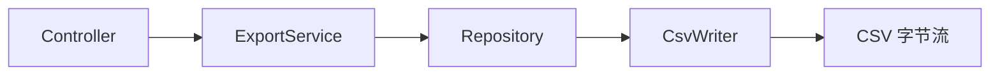
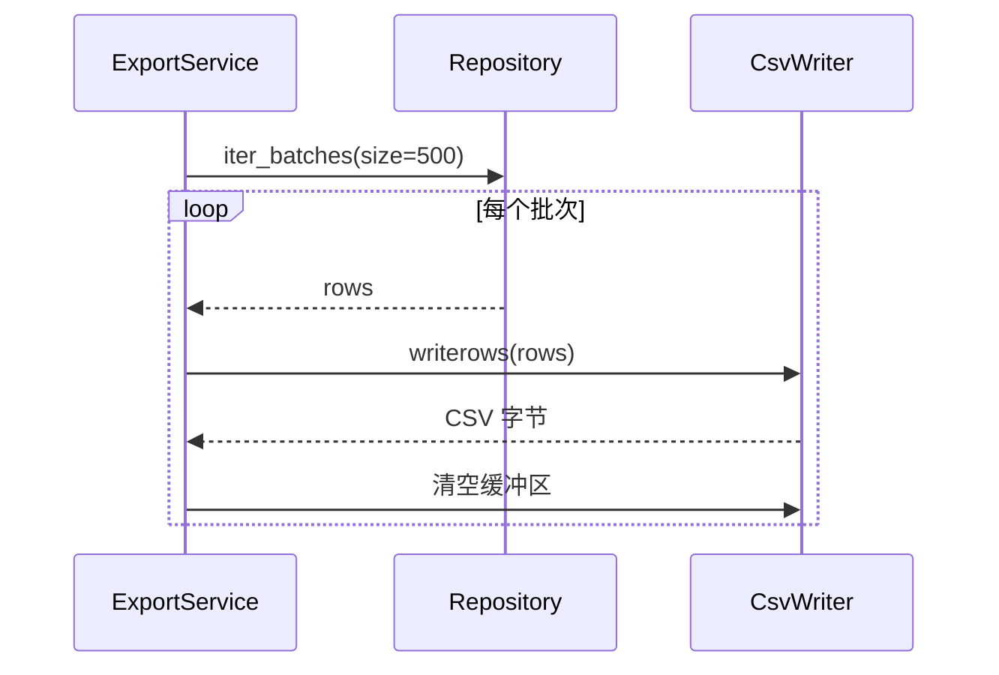

## 目标

| 核心问题                     | 实现目标                   | 量化指标（设计目标）            |
| ---------------------------- | -------------------------- | ------------------------------- |
| 一次读取全部记录占用大量内存 | 按批次读取并清空写出缓冲区 | 每批最多 **500 行**             |
| 导出字段不明确               | 限定 CSV 的可选列          | **1 种格式**；允许 **3 个字段** |
| 缺少处理速度目标             | 按现有方案交付流式导出     | 吞吐与总耗时：**未设定**        |

## 1. 方案概述

| 模块          | 负责内容                 | 输入 → 输出                 |
| ------------- | ------------------------ | --------------------------- |
| Controller    | 复用查询授权，返回文件流 | 查询条件 → CSV 响应         |
| ExportService | 校验列并组织分批导出     | 已授权条件、列选择 → 字节流 |
| Repository    | 分批读取记录             | 条件、批次大小 → 行集合     |
| CsvWriter     | 编码表头和数据行         | 行集合 → CSV 字节           |



## 2. 详细设计

### 2.1 数据交接



### 2.2 字段契约

| 字段      | 含义 | 编码     |
| --------- | ---- | -------- |
| `date`    | 日期 | CSV 文本 |
| `region`  | 区域 | CSV 文本 |
| `revenue` | 收入 | CSV 文本 |

```diagram-svg 缓冲区生命周期
<svg xmlns="http://www.w3.org/2000/svg" viewBox="0 0 640 120" role="img">
  <defs><marker id="arrow" viewBox="0 0 10 10" refX="9" refY="5" markerWidth="6" markerHeight="6" orient="auto"><path d="M 0 0 L 10 5 L 0 10 Z" fill="#245847"/></marker></defs>
  <g font-family="sans-serif" font-size="16" fill="#172c25">
    <rect x="12" y="30" width="160" height="60" rx="6" fill="#edf2eb" stroke="#8ba67c"/>
    <text x="92" y="66" text-anchor="middle">写入当前批次</text>
    <path d="M172 60 H228" stroke="#245847" marker-end="url(#arrow)"/>
    <rect x="234" y="30" width="160" height="60" rx="6" fill="#edf2eb" stroke="#8ba67c"/>
    <text x="314" y="66" text-anchor="middle">输出字节</text>
    <path d="M394 60 H450" stroke="#245847" marker-end="url(#arrow)"/>
    <rect x="456" y="30" width="170" height="60" rx="6" fill="#edf2eb" stroke="#8ba67c"/>
    <text x="541" y="66" text-anchor="middle">清空后读取下一批</text>
  </g>
</svg>
```

### 2.3 变更文件与变更内容

```text 文件变化
app/
├── export/service.py  [新增] 校验可选字段，组织分批读取与写出
└── report/api.py      [调整] 增加复用已有授权的 CSV 下载入口
```

### 2.4 核心类型与代码

{{code:export}}
