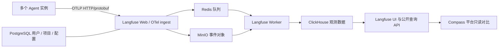

# 本地 Langfuse

第 14 课采用独立的本机 Langfuse v4.75.0，复用公开 OTLP 接收、查询和页面能力。入口为 `http://127.0.0.1:8104`，只绑定本机。Compass 原有五个应用与业务数据库继续按各自入口管理。

## 启动与配置

从 Compass 根目录执行：

```bash
pnpm observability init
pnpm observability up
pnpm observability status
pnpm observability logs
pnpm observability down
```

`init` 在忽略的 `work/observability/` 创建三个 0600 文件，已有任一文件时拒绝覆盖。`stack.env` 包含独立数据库密码、项目 Key、初始化账号与项目 ID；`agent.env` 只含 Agent 所需的观测配置；`web.env` 只含公开项目页面 URL。初始化账号为 `local.admin@compass.invalid`，密码从私有 `stack.env` 的 `LF_ADMIN_PASSWORD` 读取，不写入文档或日志。三份文件应与数据卷一起备份，重启沿用原配置。

`up` 首次由固定版 Langfuse 执行 PostgreSQL / ClickHouse 原生迁移和账号/项目初始化，等待全部六个服务健康。重复启动复用数据。`down` 只停止六个观测服务，保留卷与配置；Compass 应用继续运行。工具固定本机 Docker socket 和 `compass` Compose 项目。

Docker 运行的 Agent/Web 通过主 Compose 的可选 `env_file` 接入：启动观测栈后重建对应应用，使用 `pnpm run deploy agent` 与 `pnpm run deploy web`。Agent 发送到 `http://langfuse-web:3000`；浏览器打开 `http://127.0.0.1:8104/project/<项目ID>`。Agent 不依赖 Langfuse 的启动顺序。

宿主开发时，在启动 Agent 的环境中注入 `agent.env` 的变量，并将 `COMPASS_LANGFUSE_BASE_URL` 改为 `http://127.0.0.1:8104`。Web 启动环境仅需 `web.env` 的 `COMPASS_LANGFUSE_PROJECT_URL`。根 `.env.example` 登记全部可选项；`pnpm dev` 的 Turbo 白名单允许这些运行配置。修改配置后重启相应进程。禁用采集用 `COMPASS_OBSERVABILITY_ENABLED=false`；保持默认禁用时无需安装或启动 Langfuse。

## 数据从哪里来，存到哪里



| 数据                     | 格式与入口                                                                                | 持久化位置                                                  |
| ------------------------ | ----------------------------------------------------------------------------------------- | ----------------------------------------------------------- |
| 调用观测                 | OTel Span，HTTP/protobuf；`/api/public/otel/v1/traces`，项目 Basic 鉴权和 ingestion v4 头 | Langfuse Worker 处理后进入 ClickHouse；原始事件对象在 MinIO |
| 平台账号、项目、密钥配置 | Langfuse 自有结构                                                                         | 独立 Langfuse PostgreSQL                                    |
| 异步处理队列             | Langfuse 自有队列                                                                         | 独立 Redis，AOF 开启                                        |
| 导出自诊断               | stdout JSON，如 `event=observability`、instance_id、reason、计数                          | 宿主进程日志；Docker 日志滚动保留 3 × 10 MiB / 服务         |
| 原模型记录               | 既有 call_id、状态与安全用量摘要                                                          | Agent 业务库，结构保持 0004                                 |

Langfuse 通过 HTTP 接收 Span，不读取 Compass 的本地日志文件。Agent 不直连 Langfuse 数据表。Trace ID 在响应头和当前页面内关联，现有业务库没有新增 Trace 字段；导出丢失时可继续按 call_id 查询原调用记录。

Span 的可读结构示例（实际传输为 protobuf）：

```json
{
  "trace_id": "32位hex",
  "span_id": "16位hex",
  "parent_span_id": "父span或空",
  "name": "compass.attempt",
  "resource": {
    "service.name": "compass-agent",
    "service.instance.id": "启动时唯一ID",
    "deployment.environment.name": "local"
  },
  "attributes": {
    "langfuse.observation.type": "generation",
    "langfuse.observation.metadata.call_id": "业务调用UUID",
    "langfuse.observation.metadata.stage": "inference",
    "langfuse.observation.metadata.status": "completed",
    "langfuse.observation.metadata.cost_state": "unknown"
  }
}
```

元信息覆盖 Provider / 模型标识、配置/路由/字典版本、阶段、错误码、采样、排队和首片段时间。默认不采集 Prompt、SQL、Schema、结果正文、思考内容、工具参数、请求头或密钥。未知用量/费用省略原生值并保留未知标记；平台数字来自观测样本，正式收费与强审计另建独立计量链路。

## 多实例统一观测

所有实例使用相同项目 Key / 环境标识，每次启动自动生成不同 `service.instance.id`，也可设置唯一 `COMPASS_OBSERVABILITY_INSTANCE_ID`。业务请求、Logical Call、Attempt 均有独立 ID。

可信内部调用通过 `scope.carrier()` 发送 W3C `traceparent` / `tracestate`，下游鉴权和动作授权后继承 Trace ID、父 Span 和采样决定；父级已采样时，下游本地 ratio=0 仍跟随采样。无效上下文创建本地根；BFF 不接受浏览器提供的上下文，模型供应商调用不携带内部链路上下文。消息消费可使用相同 carrier；当前 Worker 的业务队列仍保持后续课次范围。

`tracestate` 只在可信服务间传播；OTLP 出口清除其中的 vendor 文本，向 Langfuse 发送链路 ID、父子关系与采样标记。敏感哨兵验证覆盖此原生 OTel 字段。

Langfuse 按同一 Trace ID 展示跨实例调用树。模型比较按同一项目、环境、时间窗口、Provider UUID 和当前模型标识聚合，分类和主推理分开。平台自诊断明确显示当前接收请求的实例，部署多个副本时逐实例检查。一次任务重新执行产生新的 Attempt，避免把重试统计为重复采集。

## 容量与故障

每进程 BSP 队列 512 Span、每批 64、1 秒调度；HTTP 导出预算 2 秒。队列满时丢弃可见，模型调用不等待导出。平台状态显示本实例队列、丢弃、失败和最近导出结果，导出成功也不等同于全部观测已可查询。正常关闭先收束模型根任务，再关闭 OTel；BSP 上限 30 秒，验收允许 33 秒，Agent 容器退出宽限 45 秒，日志记录安全关闭计数。

六个服务使用独立持久卷：`langfuse-postgres-data`、`langfuse-clickhouse-data`、`langfuse-clickhouse-logs`、`langfuse-redis-data`、`langfuse-minio-data`。卷由 Compose 加 `compass_` 前缀。删除卷会丢失观测与后台账号数据；停止/重启命令始终保留卷。本期没有自动留存清理任务。

| 镜像                  | 锁定                                                                            |
| --------------------- | ------------------------------------------------------------------------------- |
| Langfuse Web / Worker | 4.75.0，Compose 固定多架构 manifest digest                                      |
| PostgreSQL            | 17.6-alpine，固定 digest                                                        |
| ClickHouse            | 26.3.62.3，固定 digest                                                          |
| Redis                 | 7.4.5-alpine，固定 digest                                                       |
| MinIO                 | 采用 Langfuse 固定版官方 Compose 使用的 `cgr.dev/chainguard/minio`，固定 digest |

上游基线为 [Langfuse v4.75.0 Compose](https://github.com/langfuse/langfuse/blob/v4.75.0/docker-compose.yml)。镜像许可由各上游维护，本仓库仅登记依赖。升级前记录旧 digest、停止写入、备份 PostgreSQL / ClickHouse / MinIO / Redis 与三份私有配置，在独立栈恢复验证后切换。恢复时使用同版镜像与同一组 SALT/ENCRYPTION_KEY/项目 Key，完成健康和抽样查询后再接入 Agent；不回滚已迁移的数据卷并直接换旧版应用。

当前验证机器给 Docker 分配约 8 GiB 内存；这次本机运行结果登记在 [实施记录](../../mai-specs/990-lesson-14-model-observability/IMPLEMENTATION.md)。生产容量、备份调度、HA、告警和租户独立 Langfuse 授权按业务增长另行建设。
