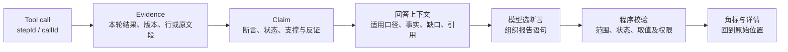
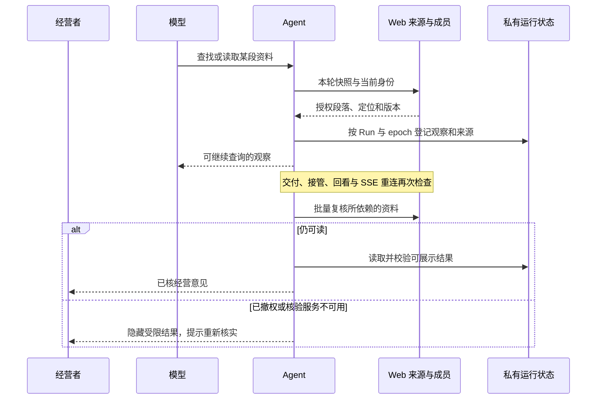

# 第 23 课 · 经营结论与引用校验

[返回技术方案](TECH_DESIGN.md) · [供评审的代码设计](CODE_DESIGN.md)

## 1. 从一次工具调用追到一句结论

工具批次签收和模型草稿提交是两处强制检查。两处的调用点、输入、返回主模型的反馈和普通 Chat 交付路径见[Verify 接入](TECH_DESIGN.md#4-verify-接入)。

经理看到“建议选 6,000 元体验档”。点开角标后，可以看到对方的档位报价、适用的试投条款和上次纪要确认的挂账金额。三种材料各自需要当前主体可读，任意一项变化都可能改变这句建议。

| 记录     | 由谁产生、存在哪里                                                                                                        | 能解决什么问题                                                                                   |
| -------- | ------------------------------------------------------------------------------------------------------------------------- | ------------------------------------------------------------------------------------------------ |
| 工具回执 | dispatcher 确认执行的 Run、step、call，适配器给出 `resultId` 或已读文档引用、质量状态及快照                               | 区分实际执行、缓存复用、模型候选和来源失败                                                       |
| Evidence | Agent 为被签收的结果签发本 Run 的 `evidenceId`。保留来源类别、原始版本、定位、内容摘要哈希、业务窗、K、权限引用和质量状态 | 查明某次观察的确切含义。同一原件被多个工具、纪要转述或重试再次返回时保留共同来源，独立性只算一次 |
| Claim    | 模型提出原子断言或修订，服务端分配 `claimId/revision`，保存对象、谓词、期间、值/单位、用途、依赖断言与证据边              | 每一项金额、条件、结论或假设都能单独检查。证据边标为取值、适用规则、计算输入、支撑或反证         |
| 发布清单 | 成功交付时服务端将最终断言版本、全部父引用及正文位置与 `answerRevision` 固定                                              | 同一份历史答案的编号、证据和正文对应。新报价或重新分析产生新 Run                                 |

**存储落点。** Agent 通过 save_private / read_private 在现有 Run 内保存 search/evidence、search/batch 和 search/answer 私有记录。verify_batch 在持租事务中签收有序回执。publish_citations 按输出修订保存正文摘要、角标和来源详情。回看时核对当前主体权限与正文摘要。

## 2. 三道校验与证据适用范围

**第一道在工具适配层，确认收到了什么。** 校验 scope、来源修订、原始 locator、K、业务期间、单位/粒度、齐备状态、截断和摘要。正式值必须有实际执行回执，指标定义只说明怎么算。SQL 预览标注 truncation 和可见行界限，包含整表统计的断言需完整聚合。明细中的原始字段回到授权实体键或有可核筛选的聚合，常数列、来源不可追或省略相关限制的计算只作查找线索。候选摘要可用于找文号，制度、档位和截止时间的事实取已读原段、完整表头及限制。输入中可能出现的操作指令按资料正文处理。

**第二道在跨来源对齐时，确认是否在谈同一件事。** 先对齐租户、组织/部门、数据 release、工作区、对象、销售地/履约地、渠道、单位、时间窗和经营截止。正式值再对齐指标身份、版本与归期。口径或粒度不同则保留两项。对齐后仍相反且同样适用的原始记录标成冲突，保留双方。优先来源按断言类别确定，规则在 Agent 适配与已发布语义契约中版本化。单项正式回执齐备即可支持一个简单取值。

| 断言类别                 | 可以采用的主来源                                   | 能发表的范围                                                                             |
| ------------------------ | -------------------------------------------------- | ---------------------------------------------------------------------------------------- |
| 正式经营指标 / 定义      | 已发布的语义绑定执行回执 / 已批准定义              | 指定对象、粒度、单位和期间内的值 / 口径。单独的定义或周报数字不作正式取值                |
| 已发生的交易、锁库、收货 | 授权事实行，或按其键和窗口可复算的明细聚合         | 单据的动作、数量、日期或该窗口的观察。计划、通知、调拨和采购实收各有独立含义             |
| 规则、余额、可订档位     | 在期的制度条款 / 当时获权的纪要原文 / 当期商业原函 | 分别支持试投资格、挂账约定、整档金额与时限。纪要中的旧经营解释可作为假设                 |
| 派生值 / 建议 / 解释     | 已支持的父断言及计算、适用条款和满足条件的回执     | 金额、比较、差额或带前提的行动建议。相关性和历史类比留作假设，付费效果缺样本时列入待验证 |

**第三道在交付前，检查句子和引用。** 模型可把复合句拆成“短缺率恢复”“已支付订单恢复”“恢复由付费投放引起”三个断言。运行侧根据证据边校验各自的覆盖范围。自由文本语义匹配只够提出候选，发布的确定陈述优先由结构化事实或真实原文生成。首版处理精确取值、可复算关系、原文限定和冲突，不设置整库统一置信分，也不单独调用模型给每条材料打分。

| Claim 状态     | 判定                                               | 在最终回答里的位置                                                                       |
| -------------- | -------------------------------------------------- | ---------------------------------------------------------------------------------------- |
| `supported`    | 证据适用、当前可读、必要字段齐备，已按业务类型核验 | 已核事实或满足前提的建议                                                                 |
| `refuted`      | 同一范围内有经核实的相反事实，原断言被否定         | 以已支持的相反断言纠正用户前提，保留原断言与反证关系。如“三个月一直下跌”由三个月回执纠正 |
| `insufficient` | 缺关键材料、正式回执、完整样本或适用条款           | 标作假设/待补项，并写明影响。资料不可读时只展示允许公开的缺口                            |
| `contested`    | 在同一比较坐标上仍有两条适用且互相矛盾的来源       | 在有权范围内说明分歧，相关签批条件保持待核                                               |

## 3. 跨来源计算

现有 `context_runtime/delivery.py` 的 `DeliveryDraft` 和 `_check_measurements` 核验结构化查询里的数值。主案例的余额来自纪要，比例来自制度，档位来自报价。**8,000 元和 14,000 元都是跨来源派生值。** 如果只验证“这些数字在上下文出现过”，换一张 9,000 元的报价仍可能输出旧建议。

断言格式 SearchDraft 使用 targets、claimProposals、answerBlocks，以本轮观察为叶子；comparison_brief 格式另见第六节。数据叶子指定回执、列/行键、单位、范围和状态。文档叶子指定已读版本、段落、表行/字段或原文字符范围，校验原文、数值、币种、时区和语义标签。模型只提交引用及有限的计算表达式。校验器从私有观察重新读取值，按有界表达式验证“余额 × 比例”“余额 − 购买额”“上限内的最高完整档”“上线后首个工作日”。文字条款和建议附相应段落及资格判断依据。缺少正式回执、必要输入或可适用条款时，建议状态降为待核。选中档位、建议金额和余款须引用同一报价与同一余额，段落中的所有可选档由服务端整体读取。日历只对有权原文覆盖的日期作判定，跨出覆盖范围给出缺口。

| 校验层     | 通过条件                                                                                                  | 失败后的交付                                                                             |
| ---------- | --------------------------------------------------------------------------------------------------------- | ---------------------------------------------------------------------------------------- |
| 经营取值   | 正式口径带本 Run 的已发布版本、执行回执、齐备状态、对象与窗口。明细观察保留其粒度                         | 已核实的明细可以展示，签批所需的正式指标列为待补                                         |
| 计算与选择 | 金额按整数分，比例按 Decimal，无样本为未知。档位来自完整报价表且满足上限，资格比较引用适用条款            | 明确缺口或暂缓。计算错误可用现有交付修复机会重写，仍受原预算限制                         |
| 正文投影   | 建议、表格、摘要、标题与附件中的关键数字和日期都从已核 claim/既有已核 view 渲染，事实、解释、收益假设分开 | 只能投影已核数字与允许公开的缺口，防止正文夹带未经核验的金额。缺少行动依据时抑制建议购买 |
| 依赖关系   | 每条派生值携带所有叶子的来源。型别、币种、主体、业务对象与时间关系满足表达式契约                          | 关系不匹配时不出数。只对未启用新模式的旧 Run 保留原草稿契约                              |

通用校验器负责机械可验证的计算、取值与已声明条件。由模型识别该决策受哪些条款约束，把条款、事实及结论关联。其完整性由金标准、删源与反事实联合验收。生产代码不解释一部预装的复投办法。课堂呈现意见供经理签批，不连接采购或外发工具。

经理点开三句话时，应看到不同的计算和来源。下表中的文号来自课程原件，运行时记录实际读到的修订、段落和行键。

| 正文里点开哪句话        | 详情应展开什么                                                                                                    | 什么变化会改变这句话                                                         |
| ----------------------- | ----------------------------------------------------------------------------------------------------------------- | ---------------------------------------------------------------------------- |
| “内部上限为 8,000 元”   | 纪要 H-0912 待办 3 的余额 20,000 元，以及制度 K-17 第 2 版的试投比例 40%。按分复算乘积                            | 单独更换媒介报价时上限仍为 8,000 元                                          |
| “建议订 6,000 元体验档” | 上限、已核净额与履约资格、当前库存，以及 E-1009 修订 2 的完整报价表。对两个整档分别比较额度，再核对条款的选择要求 | 体验档换成 9,000 元，两个整档都不符合，意见改为暂缓                          |
| “订后保留 14,000 元”    | H-0912 的余额减去同一份建议实际选中的档位金额。角标沿购买额回到完整报价及其父断言                                 | 换价暂缓时保留 20,000 元。报价权限被收回后，再读原报告也会隐藏依赖该函的余款 |

## 4. 回答上下文和角标由谁生成

生成前由 Context Runtime 提供四组内容。业务口径含组织、对象、时区、期间、K 和指标版本。已核事实含稳定断言 ID、允许展示的取值及必要原句。假设与缺口含反证、冲突对象、缺少什么以及它对行动的影响。候选引用清单只含当前可用的叶子及其定位。需要比较的坏消息和反证与正向事实拥有相同的保留优先级。

| 模型草稿                                                                           | 服务端的检查与动作                                                                                                                                                                  |
| ---------------------------------------------------------------------------------- | ----------------------------------------------------------------------------------------------------------------------------------------------------------------------------------- |
| 在 answerBlocks 中选用本轮提案的局部键，服务端为选中的结果签发 claimId 和 revision | 严格校验角色/用途、同一 Run/租户/工作区、修订、依赖闭包、当前 ACL、版本、有效期和质量                                                                                               |
| 引用一行报表或一段原文，指定它支撑哪项断言                                         | 用真实 locator 重开对应行列或段落，校验范围、币种、时点、原文与筛选，复算金额和派生值。不同用途的同一数字不能相互替代                                                               |
| 确定表达顺序，可将一个句子关联多个断言                                             | 校验所有关键陈述都有断言。数值和已确认的事实文字由已核对象投影，假设由带标注的独立段落呈现。任意新增的事实句、Markdown 链接或自造角标不直接发布                                     |
| 校验失败                                                                           | 向主 Agent 回传具体问题，如“该值只覆盖调拨行”或“缺少完整报价”。有合法取证空间可回 query/analyze，再次生成仍共享原预算。仅格式问题复用一次已有修复机会。穷尽路径时交付已核部分和缺口 |

服务端按最终正文首次使用的已核断言修订编号。同一断言复用编号，一个角标可关联多条原始引用，先按稳定键去重。把清单、受保护正文与其摘要按同一 Run 和输出 revision 原子保存。例如，上限 8,000 元的角标展开“纪要余额 × 有效制度比例”，余款 14,000 元的角标另展开“余额 − 已选整档”。教学页出现的编号为示意，生产编号始终由本次完成的清单生成。

**点击与兼容契约。** 既有 `MessageContent.text` 和 `RunCompleted.finalAnswer` 保留可读正文，旧客户端显示普通角标。Agent 的 `api/sessions.py` 提供两个只读方法，由 Web BFF 认证转发、校验 DTO 并返回 `no-store`。

| Agent GET 端点                                       | 授权返回                                                                                                                                                                                               |
| ---------------------------------------------------- | ------------------------------------------------------------------------------------------------------------------------------------------------------------------------------------------------------ |
| `/v1/analysis/runs/{run_id}/citations`               | 已发表答案的 `messageId, revision, textDigest, anchors[]`。每个 anchor 含 `citationId, ordinal, start, end`。偏移以原始 Markdown 文本 Unicode 码点计数、左闭右开。旧答案无清单时返回空列表             |
| `/v1/analysis/runs/{run_id}/citations/{citation_id}` | 当前有权的断言、来源名称、制度或指标版本、查询范围、行/段定位、必要原文或值、计算和验证状态。仅给已发表清单中的条目。未知、跨 Run 或撤权统一为不可查看，省略标题与片段。验权服务暂不可用时不给缓存详情 |

Web 将 BFF 的 `analysis/runs/{id}/citations` 两条路径接入已有分析模块。以服务端正文摘要、revision 与实际角标范围同时匹配为前提，按码点到浏览器文本位置的映射把对应角标显示为可用键盘打开的按钮。普通正文中的“[1]”维持原文。片段和来源标题使用安全文本渲染，模型无需构造 URL。详情复用现有弹层与焦点恢复。回答流只在结束并校验后提供可点击引用，新旧端可同时读原有字段。从 FastAPI 契约源生成 OpenAPI、Agent/Web 类型及 BFF 运行时校验。

## 5. 保存、撤权与回看

- 使用 `context_runtime/source_access.py` 的 `record_source`、`allows`、`require_run_sources`，扩展 `document` 引用及批量 Web 复核。搜索结果只要含片段，就先登记全部可见段落。原文和派生结果的依赖并入本 Run。若来源登记失败，本次内容不进入模型或流。对可重放的提交，沿用 Run 锁、epoch fence 与执行幂等键，事务完成后再投影工具结果。
- 原文、观察值、候选片段和模型中间文本走已有私有载荷。公共运行事件只含阶段、无敏感信息的状态及可重验引用。工作区启用多源交付后，敏感正文缓冲至校验和授权完成。Web 用当前主体 `no-store` 投影视图。覆盖普通消息、SSE 增量/重连、会话续问重新组装上下文、文件下载、执行回执与讲师回放。日志只写引用、耗时、状态与用量。
- 默认整份受影响的报告隐藏，避免余款等派生值间接泄露报价。授权恢复后仍须验证绑定、版本和摘要。可用当前权限新开 Run 生成部分报告。服务超时返回暂不可核验。新版本重跑不覆盖旧 Run。撤权约束作用于之后的每次交付与读取。
- 来源集合保存在助手消息上。普通 Run 使用 64 个计数引用上限；搜索 Run 的 MAX_SEARCH_REFS 同步骤数、单步工具数一起计算。去重、剔除单独重验的默认术语后再计数；搜索来源超限写入 source_set_blocked，回看时保持封闭。

## 6. 同一条查询行怎样进入两期比较表

工作区可在 Run 快照选择 `comparison_brief`。每个比较项提供经营范围名称和两格来源，每格包含 evidenceId、从零起的 row 和可用的 column。Agent 从本次 Run 重开回执，用 leaf 检查有效值、行列可追溯性及单位，随后计算本期减基期、差额除基期。基期为零时显示“基期为零”。模型无法通过修改草稿里的金额改变这张表。

华东本次合计行对应 100 万元和 88 万元，环比 −12%。模型还提交 interpretation、action、gap 三种说明，每条关联已读原段或实际查询行。表格项登记为 supported，文字说明保留来源并以 insufficient 状态展现；由审核者判断经营解释。所有角标沿用同一套发布、重验和回看接口。

### 管理员修改或停用分段后

文档引用携带文号、版本、分段标识和正文哈希。Web 在当前工作区重新检查知识库、文件、分段开关及哈希，编辑正文后旧引用退出可用范围。新一轮可取得修改后正文的引用。关闭分段会同时影响关键词检索、向量检索、相邻分段回读和交付时的引用复查。用户仍可在管理页查看停用分段及上传的原文件。
