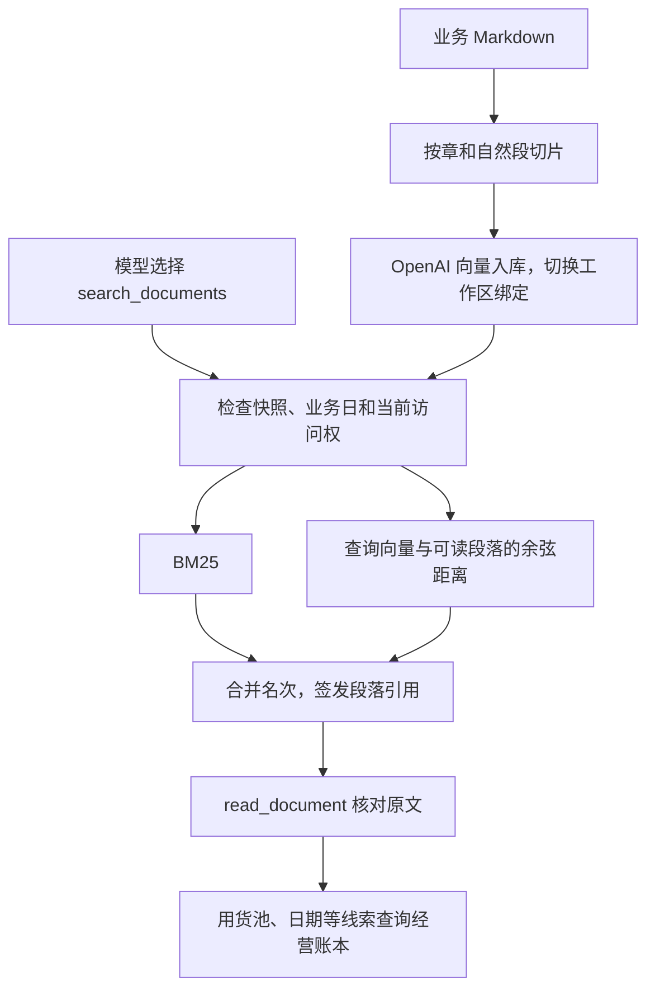

# 第 23 课 · OpenAI 向量检索与华东 GMV 诊断

[本课主方案](TECH_DESIGN.md) · [两组课堂案例的数据与口径](RETAIL_CASE.md)

经营会需要先确认华东少了多少钱，再判断是哪个经营单元少了、该由谁跟进。文档检索找到当时生效的支付口径、投放排期和门店券规则，账本查询给出两周的支付金额。两种来源在同一轮普通 Chat 中汇合。

## 课堂演示

在 Compass 首页选择「远山零售 → 华东区域 → 新建分析」，点击「华东区 GMV 为什么下降了 12%？」并发送。先看助手如何确定支付口径和封版时间，再看它如何从分单元查账转向晚场采购、旗舰店主销码和杭州试点券。讲到仓配时可以追问「周三已经签收，顾客从哪天开始买得到？」观察它是否继续检索货池的前台可售记录。

## 资料发布

将 12 份 Markdown 转为既有 collection。按二级标题取章节，过长章节沿空行拆分，以 600 字符为目标，完整自然段和表格保留在同一片，切片携带文号、版本、有效日期、标题和正文摘要。Embedding 文本是文档标题、章节标题与正文。使用现有 OpenAI Provider 的服务端密钥，模型固定为 text-embedding-3-small，输出 1024 维。每批最多 32 段；校验响应的行数、维度和有限数值后，在同一数据库事务内分批写入 Web 索引。内容包与索引均按摘要寻址，最后原子切换工作区绑定。发生失败时既有绑定可用，重跑同内容可复用已完成索引。

## 请求与归属

Agent 持有 Provider 密钥，发布阶段和查询阶段采用同一 Provider 配置与模型。普通 Chat 继续调用 search_documents，在启用向量的资料快照中额外发送问题向量。Web 按当时 Run 固定的文档版本、当前权限、业务日期先选可读章节。词法和余弦距离分别取前十，再按倒数名次融合，返回至多三个章节引用。精确文号优先，保留同条款不同版本的现有展示规则。read_document 原有回读、内容校验和撤权检查持续生效。Embedding 服务不可用时返回词法结果，并记录实际检索模式。



## 数据、发布与恢复

向量索引归 web/main。版本从 0008_semantic_asset_grants 升到 0009_document_vectors。真源为 [Web 迁移](../../../apps/web/db/main/migrations/)，[完整与增量 SQL](../../../apps/web/db/main/sql/) 随工具生成。表按 tenant_id、collection_digest、index_profile、doc_id、version、section_id 唯一，记录 section_hash 和 embedding。索引版本固定模型及维度，查询仅在同一版本内比对。现阶段逐向量精确计算余弦距离，12 份原文的 131 个片段使用 PostgreSQL 精确扫描即可完成召回。

先备份 Web 库，由已有本地供应入口在受管 Web 目标安装 vector 扩展，之后应用迁移、装载索引、发布工作区。Web 运行账号对离线发布表具有查询权限，对管理库的三张表具有查询、插入和更新权限。恢复可切回先前绑定；数据库按项目规范在新受管目标恢复备份。保留旧内容及在途 Run 的引用。教学经营账本单独装入业务库，给华东工作区绑定只读角色，与 Web 索引库分开。

## 混合排名与验收

```text
visible = readable(collection, currentAccess, runSnapshot, businessDate)
lexical = bm25(visible, query).top(10)
semantic = cosine(visible, queryEmbedding).top(10)
score(section) = sum(1 / (60 + rank))  # rank 从 1 开始
```

本案例为工作区选择 comparison_brief 交付格式，调查最多调用 52 次工具。模型为比较表选择基期、本期回执中的列与行，Agent 复核数值和单位并逐行计算差额与环比。引用原段或查询行的经营判断、优先行动与待验证事项单独展示。

附加向量只从内部受信调用进入。运行时按文号、版本、章节与摘要连接查询结果，再签发现有来源引用。新索引生成不向生产工具添加日期、课号或参考答案。

课堂在首页提交同一条普通问题，核对 Run 是否实际进行了混合检索、读取原文与查询经营数据，并查阅答案中的两期 GMV、贡献和行动。助手选择检索次序。讲师在独立目录保留已有的词法评测和标准答案，业务知识库只含 12 份原文。独立课堂环境的一次普通 Chat 实跑完成 10 次混合检索、15 次原文读取和 9 次 SQL 查询，返回两期金额、六个互斥经营单元的贡献及三项优先行动。

## 两周降幅与行动优先级

华东支付 GMV 在 2025 年 10 月 13–19 日为 100 万元，20–26 日为 88 万元。小程序付费跑鞋贡献 −6 万元、旗舰店跑鞋 −5 万元、杭州城西 −1.5 万元，自然服配抵消 0.5 万元。另外两个单元持平。差额加回 −12 万元，区域环比 −12%。 华东主工作区从首页以普通 Chat 再次提交后，返回了相同的总额和六项单元差额。

经营判断依次回到三份业务记录核对：晚场投放比白班少了多少有效落地，41、42 码何时在目标货池前台可售，杭州试点的新券门槛在哪家门店生效。普通 Chat 给出的行动是小额恢复晚场投放试验、前移主销码补货预警、复审门店用券门槛。

## 工作区知识文档管理

在「管理与治理 → 数据与语义 → 知识文档」创建知识库。卡片显示知识库名称、最多三行的说明、文件数量和原文件总大小。卡片和分段的标题靠上对齐，深绿悬停配白字。三点菜单提供编辑和删除，支持键盘选择、Esc 与点击外部关闭。打开知识库后可以按文件名搜索、批量选择或拖入文件，查看每个文件的解析和索引结果。打开文件后按原顺序展示切片，支持分页、正文搜索、查看原文件、编辑正文和逐片启停。三个层级共用 Compass 深绿主色、对话框与键盘焦点规则。

平台管理员打开知识文档即进入全平台目录。卡片悬停提示显示所属租户和工作区，在经营总部也能打开华东资料库、查看文件、原文和分段。普通成员按当前工作区的数据与语义权限访问。新建知识库归入页面当前工作区，修改已有资料时按资料所属工作区重新鉴权。Agent 发起检索时只使用本轮工作区获准的资料。

Web 拥有知识库、原始文件、发布时间与业务属性、切片文本、开关和索引。web/main 从 0009 升到 0010_knowledge_library，完整 SQL 与逐版增量由 Web 迁移工具生成。库属于租户和工作区。原文件与切片分别保存，编辑切片后仍可打开最初上传的文件。存量教学资料按发布摘要与分段哈希导入，沿用原向量、文号、时效与受众。备份覆盖 Web 数据库、已发布资料目录和 Run 固定记录，恢复时按相同组合恢复。

上传支持 UTF-8 Markdown、TXT 与带文本层的 PDF。PDF 用 unpdf 逐页提取文字，扫描件给出可操作的失败原因。Web 按章节、自然段及长度上限分片，通过受信 HTTP 请求由 Agent 调用已有 OpenAI Provider。文件的所有向量和正文在一个短事务内发布。失败保留原文件并支持重试。单片编辑在新向量就绪后同时更新正文和向量，版本冲突要求重新打开。停用切片立即退出召回和引用回读，重新启用复用已保存的向量。

新 Run 固定本轮可用资料，接下来的每次检索、回读与交付核对当前有效片段。原有教学发布的资料日期、审批和授权继续生效。管理入口上传的是工作区通用参考资料，文件详情记录真实上传时间；业务制度的正式历史版本继续通过带生效日期的发布流程提供。

| 数据                         | 存储位置                                              | 读取方式                                       |
| ---------------------------- | ----------------------------------------------------- | ---------------------------------------------- |
| 工作区知识库                 | web.knowledge_base                                    | 平台管理员可跨工作区浏览，成员按当前工作区列出 |
| 文件信息、原始字节与处理状态 | web.knowledge_file                                    | 管理页按文件名搜索，查看原文返回上传时的字节   |
| 分段内容、启停、哈希和向量   | web.knowledge_chunk                                   | 按文件及序号展示，按可见哈希执行余弦召回       |
| 原有课堂发布及历史运行       | 原 collection、web.document_vectors、Run 固定记录目录 | 管理库复用旧向量，固定快照继续支持旧引用复查   |

本机使用 Docker 的 PostgreSQL 17 实例与 pgvector，宿主映射端口 55432。进入「远山零售 → 华东区域」后，在管理页可以看到 12 份教材文件。导入脚本按稳定文件 ID 跳过已接管的文档。启用 Agentic Search 的工作区由 COMPASS_SEARCH_WORKSPACES 配置；有检索资料且无经营账本绑定的工作区可以固定仅含知识来源的快照。

管理功能接入后，在独立课堂从普通 Chat 重新发送华东问题。本轮完成 9 次混合检索，支付账本汇总为基期 100 万元、本期 88 万元。对管理页另外上传的练习文件，旧 Run 的原文引用在正文修改后失效，新 Run 能召回新正文。停用分段后，从已有 Run 和新 Run 检索均不会返回该段。

## 知识库检索测试

知识库最外层的「检索测试」位于「新建知识库」旁。右侧抽屉提供知识库选择、查询输入和预置关键词。默认覆盖当前账号在管理页可见的知识库，平台管理员可跨租户检索，普通成员使用当前工作区。可选择一个知识库缩小范围。课堂预置华东 GMV 下降、优惠券叠加、库存缺货、退款口径，点击后填入输入框，按 Enter 或检索按钮执行。

Web 接口为 POST knowledge/catalog/search 和 POST knowledge/bases/search，分别用于平台目录和工作区目录。请求接受 query 与可选 baseId。服务端先校验登录、CSRF、管理范围和知识库归属，提交查询文本至现有 Agent knowledge-embeddings 接口。OpenAI text-embedding-3-small 生成 1024 维查询向量。网络调用结束后再次检查当前权限，使用既有 pgvector 余弦距离从 knowledge_chunk 读取前 10 个有效片段。每次检索只使用已入库文件中已启用的片段，并排除已删除的库和文件。

结果展示知识库、租户与工作区、文件名、分段序号、章节标题、正文、片段 ID 和查询耗时。相关度为 1 减余弦距离，乘 100 后按百分比显示，供比较语义相似程度。支持三行预览、展开全文及进入文件分段。请求进行时禁用重复提交，失败保留输入并可重试，关闭抽屉取消客户端等待。Agentic Search 的混合排序和 Run 固定资料范围继续在运行链路中执行。
