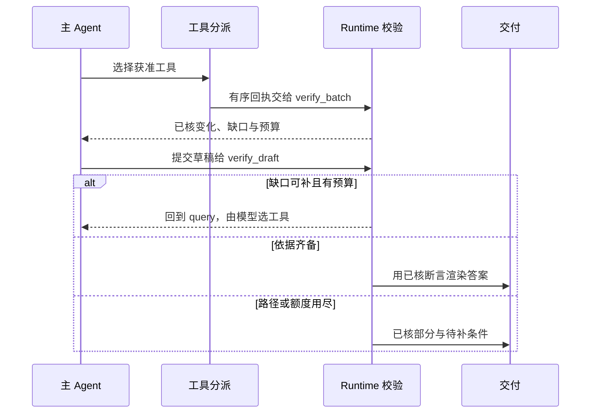

## 1. 本课实施清单

周会待办指明该查哪双鞋，履约手册规定从哪天起算恢复。模型再核对实际入库、恢复期指标与报价，才能给出可订的金额。

{{view:scope}}

## 2. 上下文装配

同一个问题，在路由、补查和生成答案时需要不同的材料。切换阶段可以看到这一轮模型已知什么、还可以去查什么。

{{view:context}}

{{fold:layers}}

{{code:layers}}

{{endfold}}

## 3. Prompt 设定

系统提示词约束事实的来源和表达。通用搜索 Skill 帮主模型选择下一问，运行侧保留工具授权和事实校验的决定权。

{{view:prompts}}

## 4. Verify 接入

工具返回后检查观察，模型交稿时检查结论。这两处都在同一个 Agent 循环内运行，关闭 Skill 也会执行。

{{view:verify}}

{{fold:feedback}}

{{code:verify-feedback}}

{{endfold}}

{{fold:decision}}

{{code:wire-verify}}

{{endfold}}

## 5. 主 Agent 的决策、工具治理与预算

主 Agent 决定补查什么、改用哪个窗口、何时提交。Runtime 复核权限、事实与剩余额度，决定哪些结论能够交付。

{{code:feedback}}

{{view:governance}}

{{fold:architecture}}

{{code:architecture}}

{{endfold}}

## 6. 一轮真实问题应该留下什么

华东 GMV 简报展示普通 Chat 的实际回答。投放复议保留两版报价的对照，供读者查看同一规则怎样产生不同的签批结果。

{{view:case}}

## 7. 开发顺序、兼容与恢复

先让授权数据可查，再接通模型决策与交付校验。五项工作各有可以独立检查的完成条件。

{{view:delivery}}
