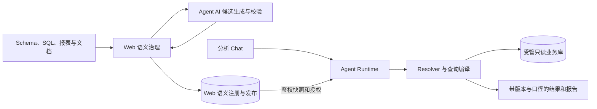

# 第 22 课｜Compass 企业经营语义治理技术方案

> Feature 974 · Profile standard · 状态：待评审 · [有效需求](../spec/PRD.md) · [标准模板](../../_templates/TECH_DESIGN.tmpl.md) · [返回需求简报](../BRIEF.md)

## 需求依据与代码基线

以 PRD 的 FR-01–09 和 AC-01–10 为交付契约。设计参考 Compass 当前工作目录，HEAD 为 `ce360a9`，包含未提交的运行时和迁移改动。实施从经验证的第 21 课节点 `compass/L21-complete` 切出，本次尚未找到该标签。先用当前源码定位接口，在节点可用后复核接口和迁移头，再定实际文件和版本号。

| 现有能力                               | 接入点                                                                                                                                                                                                                                                          |
| -------------------------------------- | --------------------------------------------------------------------------------------------------------------------------------------------------------------------------------------------------------------------------------------------------------------- |
| Web 工作区、成员授权及内部运行鉴权     | [权限模块](../../../apps/web/src/server/modules/access/public.ts) · [运行鉴权](../../../apps/web/src/app/api/internal/analysis/authorize/route.ts)                                                                                                              |
| 管理导航与分析状态                     | [页面目录](../../../apps/web/src/lib/page-catalog.ts) · [分析消息](../../../apps/web/src/components/analysis-run-turn.tsx)                                                                                                                                      |
| Agent 工具注册及调度                   | [Tool Catalog](../../../apps/agent/src/compass_agent/tools/catalog.py) · [工具装配规范](../../../apps/agent/src/compass_agent/tools/README.md)                                                                                                                  |
| 工作区授权连接、只读执行、连接身份验证 | [数据库绑定](../../../apps/agent/src/compass_agent/data_connections/tools.py) · [连接执行](../../../apps/agent/src/compass_agent/data_connections/transport.py) · [现有查询工具](../../../apps/agent/src/compass_agent/tools/builtin/database_query/handler.py) |

## 1. 整体设计

在 Web/BFF 加入语义治理模块，持有工作区语义资产、规则、反馈和发布记录。Agent 持有运行绑定并执行解析、编译和查询。两端经鉴权 HTTP 协作，业务数据留在受管连接。语义模型以同发布批次的结构化 JSON 表示；第一版用 PostgreSQL 持久化和发布，无需新的服务进程、图数据库或专属在线队列。



### 关键决策

| 选择                               | 理由及代价                                                                                                                                        |
| ---------------------------------- | ------------------------------------------------------------------------------------------------------------------------------------------------- |
| Web 管治理，Agent 管运行           | Web 复用工作区授权与管理界面，Agent 复用模型、工具和 Run 生命周期。增加一条内部快照与授权契约，两端按独立所有权迁移。                             |
| 结构化公式和发布快照               | 受控编译确保同一输入得到同口径。维护量集中在有限公式类型和连接元数据，超出表达能力的指标先登记为待支持，由数据负责人补可执行定义。                |
| 一个业务工具，三种操作             | `query_metric` 提供 `query`、`compare`、`drill_down` 判别联合，共用权限和编译。现有 `database_query` 保持独立入口，认证结果必须来自语义工具回执。 |
| 务实灰度与单工作区原子发布         | 同时保留一个稳定发布和一个明确受众的候选。灰度按服务器解析的成员 ID 集合匹配，缩小审批与并发测试范围。                                            |
| 同连接计算，跨连接在受控结果层对齐 | 支持多指标跨域报告。跨库原始明细联结有额外粒度、权限和归因成本，首期按共同维度对聚合结果做独立比较，无法对齐则明确返回原因。                      |

## 2. 存储、版本和权限

### 2.1 Web/main 语义治理数据

所有表按 `tenant_id + workspace_id` 约束，管理 API 以服务端授权上下文选定范围。同工作区内允许稳定 ID 演进，版本记录不可原地修改。

| 表                      | 主要字段、键与用途                                                                                                                 |
| ----------------------- | ---------------------------------------------------------------------------------------------------------------------------------- |
| `semantic_source`       | UUID 主键、作用域、类型、受管连接 ID 或资料引用、内容哈希、快照版本、负责人、状态；来源元数据和权限受工作区限制                    |
| `semantic_policy`       | 工作区主键、修订号、业务专家/数据负责人/发布负责人 ID 集、部门及岗位标签与成员绑定；通过当前成员授权求交集                         |
| `semantic_revision`     | UUID 主键、作用域、父版本、作者、内容哈希、定义 JSON、校验摘要、状态、时间；索引工作区和创建时间。提交时锁定内容，编辑派生下一版本 |
| `semantic_event`        | UUID 主键、作用域、候选版本或发布 ID、操作者、动作、前后版本、理由、影响摘要、时间、请求幂等键；按作用域与幂等键唯一               |
| `semantic_release`      | UUID 主键、作用域、候选版本、受众快照、父发布、内容哈希、发布时间、撤回时间。已发布内容保持不可变                                  |
| `semantic_release_head` | 作用域联合主键，稳定发布 ID、可空灰度发布 ID、单调 generation；并发控制锁定此行                                                    |
| `semantic_reference`    | 作用域与引用对象联合主键，指标 ID 列表、使用类型、引用来源和更新时间，用于登记查询与报表；模型依赖由快照推导                       |
| `semantic_feedback`     | UUID 主键、作用域、发布 ID、关联运行逻辑 ID、错误类别、脱敏说明、状态、关联修订 ID                                                 |

版本正文由 `domains`、`entities`、`relationships`、`dimensions`、`metrics`、`resolution_rules` 组成。公式节点仅含列、受支持聚合、运算、指标引用及比例，连接关系包含键/基数，时间定义包括业务事件字段、日历/时区和允许粒度。指标声明适用作用域、币种/单位、允许过滤、快照与聚合策略和来源位置。发布校验检查引用完整、依赖无环、关系基数、编译以及同优先级绑定冲突。历史报表与 SQL 用于提取和对照，执行端只接收验证后的定义。

部门及岗位由工作区管理员配置到已有成员 ID，语义团队负责标签维护。标签用于选取适用口径，实际数据访问由现有连接授权和源库范围控制。发布负责人和值班审批者以权限模块新增显式权限及策略映射授权。平台身份无工作区分析权限时拒绝执行，查询文本和模型输出均无法填充身份字段。

### 2.2 Agent/main 运行绑定

拟新增 `semantic_run_binding`。主键为 Run UUID，记录 `tenant_id`、`workspace_id`、`release_id`、`generation`、`content_hash` 和绑定时间。Run 首次执行语义工具时选生效发布并通过唯一键写入，重试与多副本竞争读取获胜值。发布快照依据 ID 和 hash 读取，可在 Agent 进程内按 hash 短期缓存不可变正文。授权、成员、灰度资格、撤回与连接状态每次重新检查。发布常规替换允许已绑定运行继续。显式撤回、灰度资格失效、权限撤销时阻断。工具查完后和结果最终可见前复核，持久化回执与报告按当前授权重新投影，历史审计由有权限的治理角色查看。数据库连接执行中存在短暂撤权窗口，对响应和保存状态执行后置检查，源库权限仍是查询访问边界。

### 2.3 迁移及发布恢复

遵循 [Compass 数据库规范](../../../docs/database-migrations.md)。

| 所有者           | 基线观测与目标                                                  | 迁移及 SQL                                                                                                                                         |
| ---------------- | --------------------------------------------------------------- | -------------------------------------------------------------------------------------------------------------------------------------------------- |
| Web/main         | 当前目录到 `0003_model_invocation_permission`，L21 后确认新序号 | 在 [migrations](../../../apps/web/db/main/migrations/) 添加唯一原生 SQL，更新 [bootstrap、upgrades 与 manifest](../../../apps/web/db/main/sql/)    |
| Agent/main       | 当前目录 manifest 到 `0015`，L21 后确认 Alembic 头              | 在 [versions](../../../apps/agent/migrations/versions/) 添加新修订与 ORM，更新 [bootstrap、upgrades 与 manifest](../../../apps/agent/db/main/sql/) |
| data-seed/retail | 使用既有授权数据                                                | 使用当前教学快照，只作消费，不增加源库迁移                                                                                                         |

跨库只传 UUID 和校验信息。两库各自升级和验证后先发布 Web 管理与内部读 API，再发布 Agent，最后对工作区启用语义工具。缺发布时语义工具不可用，现有分析入口可正常工作。失败时停用新入口并回切应用版本，保留新增表、运行记录和版本历史；语义业务回滚通过发布指针操作。上线前验证旧客户端、空库、旧库升级、错误版本拒绝、权限、SQL 一致性和部分失败恢复。

## 3. 模块与接口

| 接口                                             | 请求 → 响应及责任                                                                                                                                    |
| ------------------------------------------------ | ---------------------------------------------------------------------------------------------------------------------------------------------------- |
| Web 管理 `/api/semantic/sources`、`/revisions`   | 复用工作区会话和许可；登记、列表、详情、候选及校验；响应可见修订、依据与错误                                                                         |
| Web 管理 `/api/semantic/revisions/{id}/{action}` | `submit`、`approve-business`、`approve-data`、`return`、`publish`、`rollback`；写入携带幂等键、候选 hash、期望 generation；冲突 409，校验失败 422    |
| Web 内部 `/api/internal/semantic/authorize`      | 复用服务身份机制，校验 Run 所有者、工作区及用途；带可选发布 ID 返回当前可见规则、允许连接标识、发布及 hash。未授权拒绝，依赖不可用拒绝并允许有界重试 |
| Web → Agent 候选生成与执行校验                   | 受信请求传授权依据片段和模型档案，返回带来源定位/置信度/缺失项的结构化草案。Agent 校验可执行性，Web 存结果并由人工决定提交                           |
| Agent 工具 `query_metric`                        | 结构化解析与计算，共用调用 ID、取消、超时和工具回执，返回 `resolved`、`needs_clarification`、`unavailable` 或 `denied`；未知维度等带可修正信息       |

### 3.1 生成、审查和发布

导入保留原材料引用及哈希；按来源类型抽取可定位的字段与片段，并限定数据量。按工作区和来源版本去重。模型用现有模型调用与校验入口输出候选，系统执行结构校验、依赖图、已知字段、公式与权限检查，AI 负责归纳重复、冲突、口径演变和建议。置信度是建议字段。执行校验使用来源提供的允许范围和受控只读计划，来源未授权或无法连接显示待验证并阻断数据审批。

候选的状态为草稿、待业务评审、待数据评审、已批准或退回。修订产生新版本并重新审查，旧版本及意见保留。影响查询沿反向依赖遍历指标，合并已登记引用。发布人在确认影响后提交，事务内复核候选 hash、审批、来源验证、权限和旧 head。回滚产生新发布事件，复用仍满足当前依赖与权限校验的历史定义，可同时清空灰度指针。发布前后均写变更事件。

### 3.2 语义解析、确定性编译及运行投影

候选先按工作区与许可裁剪，模型仅负责从候选中提取意图、维度、时间与用户过滤。解析器应用明确选择、工作区的细粒度作用域规则及宽范围默认规则；命中多个同等安全候选时停在澄清。依照发布规则优先级选择岗位和部门组合、单一部门或岗位、工作区默认；单一部门与单一岗位同级冲突须澄清。澄清选择携带版本 ID，在下一次请求重新核对版本和权限。查询 SQL 由确定性编译器从允许的公式与表列生成，标识符由发布定义与源元数据交叉校验，值都绑定参数。

执行 `compare` 时对两期独立聚合并按共同维度对齐。库存期末值按定义的快照日期选取，比例在每个聚合层从同口径分子分母重算，分母为零返回 null 和原因。多事实表先各自聚合到共同粒度再合并，禁止不符合基数的明细连接。查询计划复用受限连接、只读事务、身份确认、超时和结果上限；教学 PostgreSQL 首期启用语义工具。旧通用工具结果仍保留原类型。

报告引用结构化工具回执，包含定义 ID、发布 ID、摘要、时区、时间窗、范围、单位、允许下钻维度与轻量追溯 ID。Web 显示可展开的口径卡及澄清选项。保存和读取使用已有 Run 可见性入口叠加语义授权复核，日志只存必要标识和错误分类。被撤回的发布和无权的明细不进入模型恢复上下文。

### 3.3 供评审的关键逻辑

下列为设计伪代码。省略框架装配及 DTO 序列化，现阶段未执行。

```text
publish(actor, revision_id, audience, expected_generation, request_key):
  begin web transaction
  lock release_head(workspace)
  if matching_request(request_key, actor, revision_id, audience): return stored_receipt()
  require_new_or_identical_request_key(request_key)
  require_publish_permission(actor, workspace)
  require head.generation == expected_generation
  revision = load_immutable_revision(workspace, revision_id)
  require valid_ordered_approvals(revision.hash, current_policy)
  require validated_sources_and_current_impact(revision)
  require valid_audience(audience, current_members)
  release = insert_release(revision, audience, previous_head)
  update_head_and_append_event(release, request_key)
  commit
  return release
```

```text
query_metric(run, request):
  owner = trusted_owner(run)
  existing = load_binding(run.id)
  entitlement = authorize(owner, release_id=existing.release_id if existing else null)
  binding = insert_if_absent_and_read_winner(run.id, entitlement.release)
  entitlement = authorize(owner, release_id=binding.release_id)
  snapshot = load_snapshot(binding.release_id, binding.content_hash)
  allowed = candidates(snapshot, entitlement, request)
  plan = resolve_and_validate(allowed, request)
  if plan.requires_choice: return accessible_choices(plan)
  if plan.has_error: return typed_error(plan)
  result = execute_read_only(compile_parameterized(plan), entitlement.connection)
  require authorize(owner, binding.release_id, plan.connection_id)
  return receipt(result, binding, plan)
```

评审重点是发布 CAS/幂等是否覆盖并发、授权与口径匹配是否分开、快照复用是否保留权限实时性，以及报告读取是否沿同一撤销边界。

## 4. 评测与实施切片

| 切片                | 拟新增/修改位置                                                                                                                | 交付与验证                                                |
| ------------------- | ------------------------------------------------------------------------------------------------------------------------------ | --------------------------------------------------------- |
| T1 资产与作用域     | `apps/web/src/server/modules/semantic/`、Web 迁移及 SQL、`apps/web/src/lib/page-catalog.ts`                                    | 建三域素材、指标模型和管理页，验证 AC-01/02               |
| T2 AI 与审查        | `apps/agent/src/compass_agent/semantic/`、Agent 受信路由、Web 管理接口                                                         | 保留两类检查结果，固定样本验证 AC-03                      |
| T3 HITL、灰度、回滚 | Web 语义模块、管理页面和现有权限模块                                                                                           | 双审批、发布 CAS、灰度与回滚，验证 AC-04/05               |
| T4 解析与受控查询   | `apps/agent/src/compass_agent/tools/business/query_metric/`、现有 `tools/catalog.py` 与 Run 装配、Agent 迁移、Web 内部授权路由 | T1–T3 后接入；连接权限、跨角色、快照与撤销，验证 AC-06–08 |
| T5 Chat 与评测      | `apps/web/src/components/analysis-run-turn.tsx`、Agent 回执及测试、当前 Feature 验收记录                                       | 复杂报告、反馈与复评，验证 AC-07–10；预置材料使用合成数据 |

评测采用独立人工标签及基准 SQL，与候选生成使用不同人员或独立复核。新增契约通过 `pnpm contracts`、`pnpm contracts:check` 校验，测试覆盖 Agent 和 Web 本应用检查与真实 PostgreSQL 权限场景。现有 `pnpm smoke` 核对旧路径，新增跨租户与恢复测试核对系统行为。量化阈值、分母和样本口径以 PRD AC-10 为准。当前交付规格与设计，运行数据、验收结果及正式环境授权配置待实施验证。
