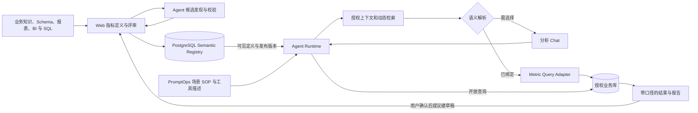
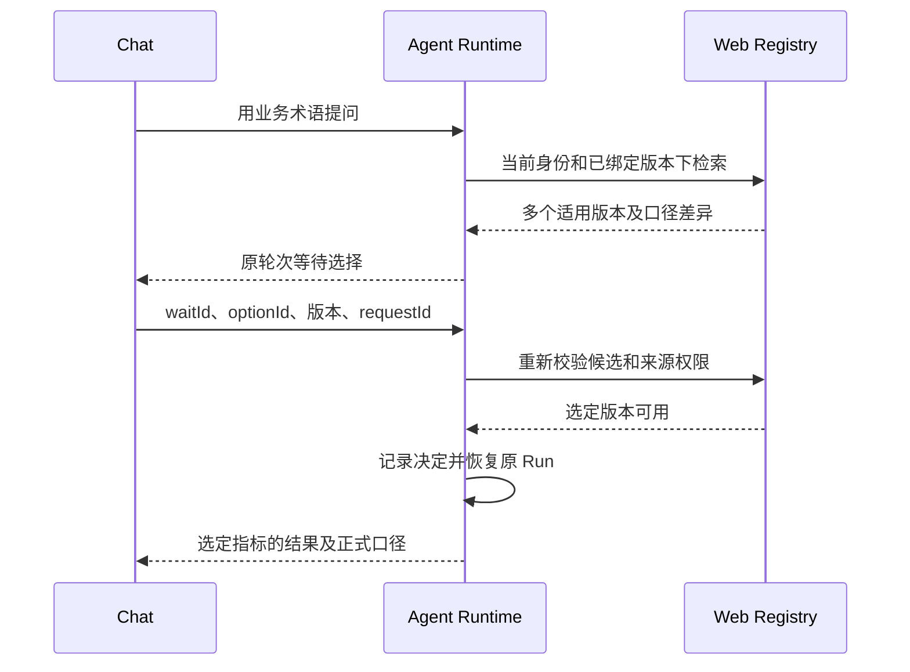

# 第 22 课｜Compass 企业经营语义治理技术方案

> Feature 974 · Profile standard · 状态：已完成架构复核，待负责人确认 · [企业语义内容专项需求](../spec/SEMANTIC_CONTENT_PRD.md) · [产品需求与验收](../spec/PRD.md) · [标准模板](../../_templates/TECH_DESIGN.tmpl.md) · [返回需求简报](../BRIEF.md)

## 需求依据与代码基线

先确定企业经营语义中需要管理的内容，再实现定义、查询和治理。业务术语、指标清单、实体关系、来源适用性与首批口径样例以专项需求为准。主 PRD 的 FR-01–13、AC-01–16 负责产品流程及验收。[方案讨论稿](../context/chatgpt_compass_yuyi.md)选定 PostgreSQL + JSONB、基于作用域的检索、模型辅助消歧和确定性执行绑定。本文给出这些选择在 Compass 中的表、工具和交互协议。

基线为 Compass 工作目录，HEAD `d5d36e5`，含本地变更。当前尚无 `compass/L21-complete` 标签。实施时在验证后的第 21 课节点上复核下列入口与迁移头。

| 现有能力                     | 本课接入点                                                                                                                                                                                                                                                                                                                                                                                                                                 |
| ---------------------------- | ------------------------------------------------------------------------------------------------------------------------------------------------------------------------------------------------------------------------------------------------------------------------------------------------------------------------------------------------------------------------------------------------------------------------------------------ |
| 身份、工作区、授权及业务连接 | [Web 权限模块](../../../apps/web/src/server/modules/access/public.ts)、[内部运行鉴权](../../../apps/web/src/app/api/internal/analysis/authorize/route.ts)、[受管连接](../../../apps/agent/src/compass_agent/data_connections/tools.py)、[只读执行](../../../apps/agent/src/compass_agent/data_connections/transport.py)                                                                                                                    |
| 当前上下文                   | [文件指标字典与匹配](../../../apps/agent/src/compass_agent/context_runtime/semantics.py)、[模型调用前的上下文组装](../../../apps/agent/src/compass_agent/context_runtime/pipeline.py)、[来源复核与可见性投影](../../../apps/agent/src/compass_agent/context_runtime/source_access.py)                                                                                                                                                      |
| 工具、持久等待与 Chat        | [工具目录](../../../apps/agent/src/compass_agent/tools/catalog.py)、[工具规范](../../../apps/agent/src/compass_agent/tools/README.md)、[已有查询工具](../../../apps/agent/src/compass_agent/tools/builtin/database_query/handler.py)、[等待与决策](../../../apps/agent/src/compass_agent/runtime/hitl.py)、[Run 契约](../../../apps/agent/src/compass_agent/schemas.py)、[控制路由](../../../apps/agent/src/compass_agent/api/sessions.py) |
| 指标页面、原轮次与保存邀请   | [导航目录](../../../apps/web/src/lib/page-catalog.ts)、[分析消息](../../../apps/web/src/components/analysis-run-turn.tsx)、[等待操作](../../../apps/web/src/components/durable-run-actions.tsx)、[工作流保存卡](../../../apps/web/src/components/workflow-save-card.tsx)、[界面规范](../../../docs/ui-style-guide.md)                                                                                                                      |

## 1. 整体设计

Web/BFF 在自有 PostgreSQL 中维护 Semantic Registry，是发布、可见定义、谁能治理哪些口径的权威入口。Agent 在现有 Runtime 内提供 Semantic Resolver、Metric Query Adapter 和治理工具。正式查询的执行计划只来自已发布绑定。业务行仍在工作区的受管连接内计算。前端与 Agent 均经授权 API 读写，两个应用各自迁移，不增加部署服务。



### 1.1 各类变更由谁承接

| 变化                                                 | 维护入口与交付物                                                                                           | 对运行链路的影响                                                                             |
| ---------------------------------------------------- | ---------------------------------------------------------------------------------------------------------- | -------------------------------------------------------------------------------------------- |
| 新增术语、指标、时间口径、维度或依赖                 | 维护者在指标管理页提交资产、版本、别名和关系，按归属评审发布                                               | 发布下一份清单，同一组工具读取新数据。编码、单位、日期字段、表名和指标公式均从版本与绑定取得 |
| 新租户、部门或岗位采用已有能力                       | 通过 IAM 配置成员与能力，在 Registry 登记可见范围、默认口径、置顶摘要、所用连接及已审绑定                  | 相同工具签名和提示词版本可服务多个租户。数据负责人只在本地范围安装执行绑定                   |
| 业务希望改变 Agent 的协作方式                        | 在 PromptOps 修订对应任务或阶段的 SOP，按既有发布机制绑定 generation。需要复用的领域说明可作为已登记 Skill | 改变模型何时解释、检索、澄清或建议保存。指令只能使用当前已授予的工具和可见材料               |
| 接入另一个使用已支持协议的来源                       | 登记来源、映射、列与行保护、类型化参数、结果契约，经验证和审批后发布                                       | 复用已有执行与授权适配器。复杂公式可登记不可变的参数化 SQL 或视图制品                        |
| 现有执行语义无法表达新计算，或新来源需要新的授权协议 | 工程侧新增可复用的算子或来源适配器，声明适用条件和验证方法                                                 | 新能力按种类接入，独立验证权限、重放与结果契约。原有租户与指标沿用原契约                     |

Registry 保存企业的业务词汇和计算事实；工具提供产品操作；场景提示词指导模型选操作。权限、绑定签名、用户决定和发布事务由服务端执行。生产代码按资产类型、授权能力、操作和协议分派。教学指标与提问只进入专项需求、可选导入包、评测样本及[静态原型](../spec/METRIC_WORKSPACE.html)。原型中的固定对话、候选与示例表单值只供交互演示。

### 1.2 正式与临时查询

| 链路         | 输入与计算责任                                                                                                                     | 输出                                 |
| ------------ | ---------------------------------------------------------------------------------------------------------------------------------- | ------------------------------------ |
| Metric Query | 已发布指标定义和维度、时间、过滤，经适配器选择有限、经测试的聚合操作。支持查询、对比、下钻                                         | 认证结果，含资产版本与可追溯来源     |
| Trusted SQL  | 同一 `query_metric` 选择已经审核的参数化 SQL 模板或经核准的只读视图绑定。SQL 模板按不可变引用和哈希读取，模型只填业务参数          | 同一认证回执，记录绑定类型和版本     |
| Open SQL     | 授权用户在无正式匹配时可进行开放分析，复用 `database_query` 的连接、只读限制和检查。开放分析独立标注，不能替用户绕过尚待选择的口径 | 临时查询回执，用户确认后可提议新口径 |

首期在教学 PostgreSQL 上启用上述三条路径。讨论稿的营销 API 可作为来源登记，待有实际受管 API 及授权适配器后开放执行。跨数据源仅对可比较的授权聚合结果做对齐。首期依赖关系使用有向关系表，检索使用 PostgreSQL。向量检索以新增别名后仍大量漏召回的评测结果为引入条件。

## 2. 存储、版本和权限

### 2.1 分层与键

首发内容的实现见[默认零售语义资产设计](RETAIL_SEMANTIC_ASSETS.md)。Web/main 的 0004 迁移已建立初装所用的八张表，教学包按显式入口写入待审版本。下表同时列出后续治理与发布切片的目标模型。

四类内容分别是业务术语与别名、指标定义、数据实体与关联、可信执行资产。业务域标识销售、营销、库存等经营主题，维护归属另用作用域记录。维度、时间、过滤、单位和治理属性按专项需求绑定到相应对象。下表列出 Web/main 的目标表。UUID 作为内部 ID；展示用指标代码仅在所属命名空间内唯一。同名术语与不同所有者的同代码指标有独立身份。

| 层               | 表                                                            | 核心字段、约束与读取方式                                                                                                                                                                                                                                                                                                                                                                          |
| ---------------- | ------------------------------------------------------------- | ------------------------------------------------------------------------------------------------------------------------------------------------------------------------------------------------------------------------------------------------------------------------------------------------------------------------------------------------------------------------------------------------- |
| 归属与规则       | `semantic_scopes`                                             | `scope_id, kind, tenant_id?, workspace_id?, department_key?, job_key?, owner_user_id?`。个人 scope 为 `personal`，必须带所属租户及本人用户 ID，复合外键核对租户成员。平台 scope 的组织字段为空。租户、工作区、部门和岗位按层级校验。形状 CHECK 和自然键上的 `NULLS NOT DISTINCT` 约束防止重复。                                                                                                   |
| 资产身份         | `semantic_assets`                                             | `asset_id PK, owner_scope_id FK, creator_user_id, kind, code, domain, responsible_ref, lifecycle, open_draft_id?`。`UNIQUE(owner_scope_id,kind,code)`。维护归属与创建者创建后固定。`responsible_ref` 用于业务联络，操作权限由 `owner_scope_id` 及授权决定。                                                                                                                                       |
| 不可变正文       | `semantic_versions`                                           | `version_id PK, asset_id FK, version_no, parent_version_id?, draft_id, usage_scope_id FK, editor_user_id, name, summary, grain, unit, schema_version, definition JSONB, digest, created_at`。`UNIQUE(asset_id,version_no)`。发布后的使用范围随版本持久化，纳入审批摘要。每次保存追加不可变正文，记录实际编辑者。同一逻辑草稿的快照共享 `draft_id`。按发布版本的 `usage_scope_id` 建索引支持检索。 |
| 检索与消歧       | `semantic_aliases`                                            | `origin_version_id FK, target_asset_id FK, scope_id FK, locale, alias_norm, keywords[], display_alias`。同一绑定去重，不对别名全局判重。B-tree `(scope_id,locale,alias_norm)`，GIN 预切词关键词或 `tsvector`。别名和目标都取所在发布的版本，并按目标版本的使用范围过滤。个人指标分享给部门后可用授权别名发现，私有别名仍受自身范围限制。                                                          |
| 实体、血缘和依赖 | `semantic_relations`                                          | `from_version_id FK, kind, to_asset_id FK, role, rule JSONB`。类型包括术语指向、派生、可分组维度、实体关联；关联列对、粒度与基数入规则。按目标建反向索引计算影响，发布清单锁定目标版本。校验依赖无环、作用域兼容与聚合安全。                                                                                                                                                                      |
| 可信执行         | `execution_bindings`                                          | `binding_id PK, version_id FK, workspace_id, source_ref, mode, target_ref, target_hash, parameter_schema JSONB, result_schema JSONB, validation_receipt`。`mode` 选受限聚合、参数化模板或白名单视图。按版本/工作区与连接用途唯一解析；公共指标可在多个工作区分别绑定。引用数据源及连接角色，不保存凭据。                                                                                          |
| 治理与审查       | `semantic_reviews`                                            | `review_id, target_scope_id FK, version_id FK, definition_digest, binding_digest?, step, actor_ref, verdict, findings JSONB, policy_rev, created_at`。AI 提议、阻断性规则和人审结论分列。按审批对象键、策略修订与审批级别约束有效决定。按范围审批队列及修订历史检索。                                                                                                                             |
| 来源与治理配置   | `semantic_source`、`semantic_policy`                          | 来源按归属、类型、定位符、内容版本/哈希去重。策略按 (scope_id, revision) 保存不可变、有 Schema 的 JSONB。可发布字段及生效规则见下文。                                                                                                                                                                                                                                                             |
| 生效与历史       | `semantic_release`、`semantic_release_head`、`semantic_event` | release 为每个发布分区的不可变清单，包含资产版本、别名/关系、策略修订、绑定引用及其哈希；head 每分区一行含 stable、可空灰度、generation；event 追加审批、发布、撤回、回滚与幂等回执。按 `(partition,request_key)` 唯一，记录请求摘要。                                                                                                                                                            |
| 影响与反馈       | `semantic_reference`、`semantic_feedback`                     | 关联已登记报表/查询/Run 与对应资产版本，维持反向索引；错误类别、修订建议、处理状态分开记录。报告影响显示未登记外部引用的覆盖缺口。                                                                                                                                                                                                                                                                |

**作用域策略。** 每个发布分区在清单中引用适用的 `semantic_policy` 修订及摘要。配置只有以下有限字段，发布时校验引用的类型、归属、可见范围与继承关系。策略正文按固定 Schema 校验。可执行模板只走独立的受审绑定，指令只走已登记的 PromptOps。

| 配置项         | 内容与生效规则                                                                                                                                                                                                                                                                                                                                                                                                                                                                                                                                                                                                                                                                           |
| -------------- | ---------------------------------------------------------------------------------------------------------------------------------------------------------------------------------------------------------------------------------------------------------------------------------------------------------------------------------------------------------------------------------------------------------------------------------------------------------------------------------------------------------------------------------------------------------------------------------------------------------------------------------------------------------------------------------------- |
| 组织归属与继承 | 策略引用现有组织标识。当前 Web 的 tenant_member 和 workspace_member 管理租户与工作区成员。在作用域层新增最小映射表 `semantic_scope_memberships(tenant_id, scope_id, tenant_member_id, valid_from, revoked_at?)`，用同租户复合外键维护部门/岗位归属，按请求读取有效成员及其映射。调岗、退组和撤权立即生效。成员归属只说明使用身份。另登记 `semantic_scope_grants(tenant_id, scope_id, grantee_member_id, capability, granted_by, revoked_at?)`，校验同租户外键并区分部门维护委派与目标分享许可。平台、租户管理员身份复用 IAM；个人归属从实际登录成员生成。范围策略只保存哪些范围适用、允许从哪个上级继承，发布时检查无环。以后接入可直接提供部门/岗位的组织目录时，以该目录为唯一成员来源 |
| 默认上下文     | `pinned_asset_ids` 按顺序列出可送入首轮的资产引用，可按已支持的产品任务筛选。置顶只影响初始上下文；指标被选作默认口径需要独立的配置                                                                                                                                                                                                                                                                                                                                                                                                                                                                                                                                                      |
| 默认口径       | `term_ref, target_metric_ref, applicable_scope_ref` 关联一个术语和已经批准的指标。术语别名由别名表维护。显式继承的下级可覆盖上级默认；当前意图同时命中不可比较的范围时保留冲突。删除默认映射后仍能检索相应资产                                                                                                                                                                                                                                                                                                                                                                                                                                                                           |
| 预算与能力     | `context_max_items, page_size, max_search_rounds` 与平台 token、执行时限共同生效。租户可在平台上限内收窄预算与允许能力。工具必须同时满足当前 IAM 授权、平台能力目录、任务阶段和服务可用性                                                                                                                                                                                                                                                                                                                                                                                                                                                                                                |
| 审批           | 记录职责对应的审批人范围、灰度受众与生效条件。业务确认和数据校验是发布必需步骤，策略只能配置获准执行各步骤的人                                                                                                                                                                                                                                                                                                                                                                                                                                                                                                                                                                           |

发布归属按平台全局、租户、工作区分区。个人、部门和岗位的版本随其所属租户或工作区发布。私有或分享给部门的资产都逐条按已发布版本的使用范围裁剪，API 只返回已授权条目。部门/岗位规则也随其租户或所属工作区发布，每个分区最多一个稳定版和一个有明确受众的灰度版。请求在 Web 的一个一致性读事务中读取可用分区的 head，形成 `manifest = [(partition,release_id,digest)]`，规范化后计算 `manifest_hash`。跨分区依赖显式固定为精确版本；读取和发布验证依赖组合，组合失效的资产暂停执行，返回可修复的绑定错误。正常切新版保留旧版本；显式撤回、成员失权、来源停用即时影响新旧运行。不同租户资产之间禁止引用；全局公共定义仅依赖公共定义。绑定与变更评审在本地归属范围内独立生效。

全局目录只包含安全的名称、术语和通用业务定义。租户的连接映射、数据源名、血缘、样本或模板参数值仅随本地授权返回。对公共指标新增或变更本地绑定时，将绑定作为本地发布清单的不可变条目，任何模板内容、参数、路由或连接映射变化都产生新绑定 ID，重新校验和审批。清单中显式记录绑定 ID/摘要和指标版本，防止公共版本更新时沿用不兼容的执行计划。复合外键、同租户所有权校验及发布前依赖遍历用于阻断跨域错误引用。作用域策略的编辑、预览和发布复用同一治理 API 与发布清单。预览说明某个有效范围会注入哪些摘要、哪些术语有唯一默认；使用当前操作者有权查看的资产投影，不接受客户端模拟任意他人身份。

### 2.2 创建、查看和计算的作用域

| 操作               | 服务端规则                                                                                                                                                                                                                                                                  | 用户看到的结果                                                                                                 |
| ------------------ | --------------------------------------------------------------------------------------------------------------------------------------------------------------------------------------------------------------------------------------------------------------------------- | -------------------------------------------------------------------------------------------------------------- |
| 查看定义或匹配术语 | 通过当前生效版本的 `usage_scope_id` 过滤。个人 scope 仅命中其本人和所在租户，部门或租户 scope 按当前成员关系匹配，平台公共 scope 面向登录成员。工作区和岗位限制继续取交集                                                                                                   | 可以看、用已发布版本。缺授权绑定时只读公共定义。草稿不进入运行时检索和默认上下文                               |
| 新建或修订         | `can_manage(actor,owner_scope_id)` 对个人范围只允许本人；对本租户范围允许具有该权限的租户管理员；对部门范围允许获授权的本租户管理员、部门管理员或受委派成员；对平台范围仅允许具备语义管理权的平台管理员。租户管理员对他人个人范围、未授权部门、平台和其他租户没有隐含维护权 | 个人新建时默认本人维护且仅本人用。修改已有资产保留其创建者与维护归属，写入当前修订的实际编辑者                 |
| 设置分享与查看草稿 | 新建/变更时独立校验 `can_share(actor,owner_scope_id,usage_scope_id)`，只接受获准目标和可向该受众公开的内容。同租户的个人资产可按授权分享给部门或租户，平台全局开放仅供平台公共定义。草稿列表、详情、Chat 读取都检查维护权；已送审内容通过单独审批投影向本步骤指定评审人开放 | 收到分享的人可读已发布定义，有数据权时可查询；看不到待发布修订，修改原件会被拒绝。具备建草稿权限的人可另行派生 |
| 消歧               | 先裁剪到可见集合，再验证用户本次明确指向的定义；未指明时，使用符合意图且沿显式继承关系唯一生效的默认映射。同级冲突、部门与工作区相互独立、意图仍不明或所选定义仅可查看时，分别返回需澄清或不可执行                                                                          | 解释采用的口径和适用范围；需要决定时展示当前用户有权查看、本次操作适用的候选差异                               |
| 执行               | 当前访问权、已发布版本、适用时间、工作区可执行绑定、依赖的列/行权限均需成立。数据行和列由绑定声明的受管连接及经验证的源端访问策略强制约束。业务过滤只能收窄当前授权范围                                                                                                     | 数值与版本、单位、统计时间、实际范围同时显示，无权限不透出受限定义、连接或其他租户候选数                       |

服务端从会话和可信 Run 所有者读取租户、工作区、用户、角色、部门、岗位及允许连接。当发布缩小使用范围时，旧 Run、回执及报告在投影前同时检查当前生效的使用权和原运行固定版本。授权缩小时即时收窄，版本固定继续保证口径一致性。工具参数中的部门或域只能作为筛选意图，客户端无法写入身份字段。操作系统角色、IAM 权限、组织业务标签和指标口径规则分别检查。建草稿、看定义和读取底层数据分别授权。

### 2.3 Agent/main 的运行状态和迁移

`semantic_run_binding` 以 Run ID 为主键，记录 `catalog_kind, tenant_id, workspace_id, manifest_hash, partition_releases JSONB, bound_at`，关联既有 Run 上下文中固定的 PromptOps generation 与 policy digest。首次构建模型上下文前插入，重试和多副本读取唯一键的获胜记录，默认注入与随后所有工具共享该绑定。检索缓存仅存不可变正文或索引，任何授权投影按当前成员、发布撤回、灰度资格和数据源权限重新计算。运行结束、恢复、回看报告均走同一投影。

候选选择复用 Agent/main 现有 `AgentWait`、Run、事件 outbox 与控制幂等记录，新增语义等待类型。拟新增 `semantic_metric_offer` 保存查询确认和建草稿邀请，字段包括 `offer_id, session_id, origin_run_id, origin_result_ref?, base_version_id?, owner_id, tenant_id, workspace_id, status, confirmation_ref?, proposal_revision, proposal_digest, private_payload, expires_at, saved_version_ref?`。提议至少关联一个服务端签发的来源引用。主动推荐必须绑定已确认的结果，直接修订已有指标可仅绑定其基线版本。按用户、会话和结果/草案摘要约束幂等；同一结果含多个指标时同时纳入提议对象键。预览内容加密，UI 从重鉴权投影恢复。Web 草稿 ID 为逻辑引用，双方独立提交。

| 所有者           | 版本与迁移源                                                                                                                                                                                                                               | 完整和增量 SQL                                                                                                              |
| ---------------- | ------------------------------------------------------------------------------------------------------------------------------------------------------------------------------------------------------------------------------------------ | --------------------------------------------------------------------------------------------------------------------------- |
| Web/main         | `0003_model_invocation_permission` → `0004_semantic_content` 安装内容表与独立教学数据包。`0004_semantic_content` → `0005_semantic_governance` 安装审批、发布清单和范围授权。0005 → `0006_semantic_search` 为版本正文与可见别名建立全文索引 | [原生迁移](../../../apps/web/db/main/migrations/)；更新 [bootstrap、upgrades、manifest](../../../apps/web/db/main/sql/)     |
| Agent/main       | `0016_prompt_context` → `0017` 增加 Run 绑定和受保护的结果回执，沿用现有等待与决策记录。旧 Run 继续使用受理时的配置                                                                                                                        | [Alembic](../../../apps/agent/migrations/versions/)；更新 [bootstrap、upgrades、manifest](../../../apps/agent/db/main/sql/) |
| data-seed/retail | 消费现有教学快照和只读角色，按 [独立参考查询](../../../tools/data-seed/src/compass_data_seed/sql/reference.sql) 核对样例                                                                                                                   | 本课无源库结构变更                                                                                                          |

按[数据库规范](../../../docs/database-migrations.md)依次升级 Web/Agent 数据结构、部署双读兼容接口、登记合成来源和发布、安装经验证的绑定，再按工作区启用。可将已批准的旧 `MetricCatalog` 文件按摘要幂等导入为候选，校验映射、连接和审批后再发布。新 Run 记录所用 Provider 和 PromptOps generation、策略摘要，启用 Registry 后从绑定的清单读取。旧 Run 按原 Dictionary digest 和旧 PromptOps 策略运行。当前 `pipeline.pin/exact` 仅接受进程内的 POLICY_DIGEST，首期选择保留旧 worker 并按 Run 的策略摘要分派直至排空，部署前验证原 generation、来源与 worker 均可取。等待中的旧 Run 同样需要恢复窗口；若旧策略已下线或权限不足，显式提示重新发起。Registry 故障时停止相关查询，不自动退回文件字典。应用回退停用新 Run 入口，保留绑定、已创建的草稿和治理历史，在途 Run 由兼容版本排空。迁移测试覆盖空库、旧头升级、权限、SQL 一致性、稳定/灰度读和撤回。

## 3. 运行时与管理时工具

在 `apps/agent/src/compass_agent/tools/business/<tool_name>/` 分别导出 `SPEC: ToolSpec` 并登记到现有静态目录，模型声明、前置检查和执行装配共用启用条件。读定义、受控查询、提议与送审分别绑定 ToolSpec 能力。声明给模型和实际分派使用相同的“当前授权 ∩ 任务阶段 ∩ 作用域收窄策略 ∩ 已注册且可用”结果；工具内部再核验目标资产、来源和目标范围。治理工具只在具有对应提议、校验或送审能力的入口装配。普通 Chat 的保存邀请通过服务端确认流程建草稿，不向普通分析模型发放发布或任意写权限。下面的签名是待实施契约；`?` 表示可缺省。

### 3.1 四个运行时工具

| 工具                    | 模型可传的参数                                                                                                                                                                  | 结果与约束                                                                                                                                                                                                                                                                |
| ----------------------- | ------------------------------------------------------------------------------------------------------------------------------------------------------------------------------- | ------------------------------------------------------------------------------------------------------------------------------------------------------------------------------------------------------------------------------------------------------------------------- |
| `search_semantics`      | `query, kinds?, domain?, scope_filter?, cursor?, limit?`。`scope_filter` 仅选已可见的范围或部门；空 query 仅允许有界列举可见条目                                                | 返回 `items[{asset_id,version_id,kind,name,definition_summary,scope_label,executable,match_reason}], next_cursor?`。相同 ID 的别名合并展示，区分可见定义与可执行指标。游标绑定用户、manifest、搜索条件，翻页重新验权                                                      |
| `resolve_semantics`     | `question, candidate_ids?, domain?, requested_dimensions?, time_hint?, as_of_hint?, filters?`。候选 ID 仅作为检索线索，不裁掉完整可见冲突集，也不构成用户选择                   | 返回 `resolved{query_ref, metric/version, time_range, business_timezone, as_of, data_release, dimensions, filters}`、`needs_clarification`、`no_match` 或 `not_executable`。歧义由 Runtime 写入等待状态；同轮多个有意查询的独立指标分别解析。无授权对象使用统一不可用结果 |
| `get_metric_definition` | `metric_id, version_id?`。缺省取已绑定清单的版本                                                                                                                                | 返回授权层级下的口径、粒度、允许维度、单位、业务时间、数据范围、摘要、可执行状态；责任人和来源仅按可见性返回。历史治理版本走管理 API；运行工具不能读取草稿、模板正文、数据库凭据                                                                                          |
| `query_metric`          | `query_ref, metric_id, operation, dimensions?, filters?, time_range?, comparison_range?, drill_dimension?, parent_group?`。`query_ref` 由成功解析/用户选择生成，不能跨 Run 使用 | `query` 返回当前聚合；`compare` 要求明确比较期间或参照组；`drill_down` 要求父分组和允许维度。返回结果回执或类型化错误。缺解析、参数与确认冲突、绑定不可用或失权时不执行                                                                                                   |

`query_ref` 绑定 Run、manifest、指标版本、已确认口径、授权范围及标准化时间契约：业务期间 `time_range`、口径的业务时区 `business_timezone`、数据可见截止 `as_of`（K，含边界）和每个授权数据源的不可变读取凭据 `data_release`（例如版本化数据集或可重读快照）。用户可表达历史截止意图；服务端按当前权限、来源支持的历史版本和 Run 接收时间校验，未指定时默认 K 为 Run 接收时刻。四项固定后方可发放回执，修改 K 或数据版本须重新解析。工具入口复核可变参数和操作是否落在绑定允许集合内；改变指代或定义须重新解析。可见但没有工作区绑定的公共指标仍可用于解释，一次数值查询只接受可执行候选。指标查询的输入不含 SQL、模板路径、租户身份、执行角色或任意标识符。对比或下钻时，维度引用取自该版本的允许集合，服务端校验业务窗口、数据权限和参数类型，适配器再绑定值。适配器回执含 `metric_id/version_id, manifest_hash, binding_id/hash, calculation_mode, time_range, business_timezone, as_of, data_release, source_versions, dimensions, unit, authorized_scope, rows, source_refs`。

### 3.2 三个治理工具和平台写入口

| 工具                           | 输入                                                                                                                                                                                                                                | 结果、写入和权限                                                                                                                                                                                                                                            |
| ------------------------------ | ----------------------------------------------------------------------------------------------------------------------------------------------------------------------------------------------------------------------------------- | ----------------------------------------------------------------------------------------------------------------------------------------------------------------------------------------------------------------------------------------------------------- |
| `discover_semantic_candidates` | `source_refs[], domain, owner_scope_id, usage_scope_id?, kinds?, existing_asset_id?`。来源可为 Schema、历史 SQL、报表、BI、业务文档、可见的指标版本或成功的查询回执。主动建议使用用户确认过的回执，显式提取使用用户所指明的可读对象 | 每个来源须有读权，所选管理归属须有创建权。以修订意图调用时另验已有资产的维护权。拟分享范围需有分享许可。返回含名称、公式意图、别名、实体、关联、来源位置、置信度、缺项的候选预览。运行该工具不写入指标库                                                    |
| `review_semantic_change`       | `candidate_ref, candidate_digest, owner_scope_id, usage_scope_id, checks?`                                                                                                                                                          | 在相同可见范围内检查同名、重复、JOIN 基数、字段、粒度、时间、依赖、权限及参数化绑定。回传 `blocking[], warnings[], impact[], suggestions[], evidence_refs[]`。可附加检查，发布要求的检查不能省略                                                            |
| `submit_semantic_change`       | `draft_version_id, expected_digest, target_scope_id, review_ref, request_key, change_note`                                                                                                                                          | 仅已被维护者确认保存的草稿可由同时具备维护权、提交权者送审。`target_scope_id` 为受审主体所属的治理范围，草稿正文的 `usage_scope_id` 表示发布使用范围。Web 复核归属、有效审查摘要与幂等键，进入待业务评审，返回版本/流程回执。模型不能代人审批或切换生效版本 |

Web 管理入口拟以 `/api/semantic` 为前缀：`GET /scopes` 分别返回可创建的管理归属及当前归属下允许分享的范围；`GET /assets` 与 `GET /assets/{id}` 分别供列表和版本详情；`POST /sources` 登记盘点来源；`POST /drafts` 新建资产草稿或在受管资产上打开修订，`POST /drafts/{id}/revisions` 在该草稿内追加正文；`POST /revisions/{id}/{action}` 处理提交、业务/数据审批、退回；`POST /releases` 与 `POST /releases/{id}/rollback` 处理发布与回切。写操作携带 `request_key`，编辑/审批带 `expected_digest`，发布/回滚带 `expected_generation`、变更理由和受众。重复请求返回原回执，同键异体或旧版冲突返回 409，非法定义 422。Web 内部为 Agent 提供按用途的 `authorize`、`search`、`definition`、`binding` 和 `drafts` 操作；仅服务身份可访问，核对 Run 所有者/作用域和当前授权。只有执行适配器能取具体模板，模型上下文只取受限投影。Web 请求 Agent 做 AI 生成与试算时沿用内部 HTTP 身份机制，传限量授权片段及其定位。

平台的「数据与语义 → 指标口径」使用已有导航 `admin/data/metrics`。详情展示业务定义、版本、单位/时间/粒度、依赖与审查；「新建指标」分别展示维护归属、发布使用范围和业务域，再填名称/别名、公式、来源、允许维度/过滤、业务时间、负责人及执行方式。保存预览可立即校验字段，未验证的绑定允许保留草稿，阻断发布。版本详情显示差异及影响，批准、退回、灰度或回滚分别向授权角色展示操作。表单和 Chat 共用定义、范围枚举及字段错误 DTO；窄屏换行，键盘可确认，失败后保留输入和焦点。

同一资产同时只有一个可编辑修订入口。Web 在事务中锁定 `semantic_assets` 行。新资产登记请求者为 `creator_user_id`，默认取本租户内请求者的 personal scope 作为维护归属与使用范围。修订时从服务端加载原资产的管理归属，检查 `can_manage`，拒绝客户端改写归属或创建者。无开放草稿时，从当前生效版建立 `open_draft_id`。存在可编辑或已退回草稿时返回同一 `draft_id` 与最新摘要。提交后冻结本次草稿，待审/已批准候选通过退回或撤回回到可编辑态。续编时核对 `expected_digest`，在同一事务追加快照、记录编辑者并推进草稿头。过时写入返回 409，页面保留用户输入。发布后关闭草稿。使用范围和归属分别校验，分享须在审批发布后生效。表单或 Chat 返回的可用操作只作展示，管理读写、会话恢复和确认落库均从可信身份重新授权。

### 3.3 默认上下文、动态检索与停止条件

**固定版本，实时鉴权。** 新 Run 创建时固定 Registry 清单和 PromptOps generation / policy digest。保留现有无工具的 `identify` 分类阶段。在首个消费业务语义的模型步骤，`prepare_input` 用服务端会话取得租户、工作区及当前组织成员关系，读取该清单中的适用策略。在已授权对象内，合并策略置顶和提问的直接命中，按稳定 ID 去重，受项目数与 token 双重预算约束。取不到默认项时，从空上下文开始检索。公开定义在缺少本地授权绑定时标记「仅可查看」。默认项、动态命中及原始来源摘录均作为标记来源和权限的 `ContextItem` 数据输入。系统指令只从已发布的 PromptOps 路径加载，指标描述和租户业务文档不能授予工具能力。

**逐步补齐。** 模型有足够信息解释问题时即可回答。需要补充时，先在完整授权视图内按规范化名称/别名、关键词和 PostgreSQL 全文索引排序，返回匹配原因与带权限的游标。名称规范化与中文分词属于检索实现，可以统一升级。模型可以改变搜索词、域或类型，查看定义，再请求解析。服务端在完整可见集合检查冲突，分页截断、相关度最高或默认注入的条目数均不参与唯一性判定。模型提出指标、维度、期间等意图，Resolver 依据版本化定义、显式约束与已发布默认映射核验。比较多个已明确的指标时分别绑定；对同一指代存在多种合理解释时，暂停并请用户确认。

**停止与审计。** 可回答、正式请求已唯一绑定、需要用户决定、重复检索无新信息、预算耗尽或权限失效均可结束检索。重复按规范化请求及新增候选集合判断，次数与页大小取本次生效的预算策略。无匹配时说明缺少的条件或提出可选的开放分析；失权、待选择、绑定被撤回均不得改走开放查询。私有回执记录生效策略、来源、所见版本与预算消耗。下一模型步、恢复、引用旧结果和交付时都复核当前访问。如 continuation 前缀包含已不可见内容，废弃此前缀并从授权投影重建，重新装配工具；失效决定需用户重新确认。

### 3.4 PromptOps 场景与工具使用 SOP

在现有 PromptOps 的 `shared/fragments` 登记一份公共语义约束，纳入 usage 枚举和 generation 发布。由 `ToolSpec.definition` 提供机器可读签名，`shared/tools/definitions/<tool>.md` 说明前置条件、参数与返回状态。下表的任务说明写入现有 task/stage 模板；语义工具在获准的 query/analyze 步装配，identify/generate 维持无工具，plan 维持已有计划能力。需要继续查数时返回既有可调用工具的步骤。可选 Skill 按其依赖能力装配，补充术语使用习惯；依赖正式取数的 Skill 无需获得开放 SQL 权限。一次产品流程允许多种工具顺序，模型根据可见材料和上一步回执决定下一步。对租户新增部门、业务用语、公式、指标和提问，沿用同一组任务标识与提示词。

| 场景与意图                                  | 系统提示词要求模型怎么做                                                                                                                               | 服务端保证与用户出口                                                                                                                                  |
| ------------------------------------------- | ------------------------------------------------------------------------------------------------------------------------------------------------------ | ----------------------------------------------------------------------------------------------------------------------------------------------------- |
| 释义与发现                                  | 已注入的当前定义足以回答时，说明其含义与适用范围；未知术语用 `search_semantics`，需精确公式、版本或可用维度时用 `get_metric_definition`                | 只投影可见已发布定义；解释口径无需访问业务行                                                                                                          |
| 正式取数、对比、下钻                        | 根据已有摘要或检索结果调用 `resolve_semantics`。取得有效 `query_ref` 后用 `query_metric` 选择相应操作。按回执标明期间、口径和范围                      | Resolver 确认唯一版本及参数，适配器校验权限与绑定。多个明确指标分别取数                                                                               |
| 歧义、没有匹配或信息不全                    | 可用新线索补搜；多个合理口径保留差异，等待原轮次的用户选择。无匹配且用户同意采用临时口径时，才在允许开放分析的场景使用 `database_query`                | 等待中冻结后续查询；无权限、失效绑定和超出业务行范围均不可降级绕过。临时结果带独立标识                                                                |
| 完成开放查询后建议沉淀，或跨轮提出创建/修改 | 主动建议须有用户确认过的结果，先检索同义资产，评估复用价值，必要时提出邀请；显式要求则从用户指明的授权结果或资产版本直接提取。多项指代未清时请用户选择 | 根据服务端会话引用定位材料；在有提议权的受限流程调用 `discover_semantic_candidates`、`review_semantic_change`。展示可编辑卡片，确认创建或修订才写草稿 |
| 指标管理与发布                              | 管理场景从获准来源发现候选、复核缺项和影响，向维护者解释差异；已保存的草稿由获准维护者明确送审时才用 `submit_semantic_change`                          | 平台核验目标范围、草稿摘要和审查回执；业务与数据两级审批、发布和回滚由获授权的人执行                                                                  |
| 分析诊断、看板与报告                        | 复用当前仍可见的结果引用；需要新数据时使用相同的解析、对比和下钻工具。结论按行、组或已验证的派生值引用回执                                             | 展示层只从受信工具记录取数，遵守单位、粒度、时点和可聚合性，交付前重新鉴权                                                                            |

公共指令示例：“回答数值问题时，引用已校验的查询结果。若同一用语对应多个适用口径，向用户展示差异并等待选择。收到保存请求时先展示范围、公式和变更内容，用户确认后再建草稿。” 管理员调整置顶术语或默认口径时发布范围策略；产品团队调整全体账户的协作 SOP 时发布 PromptOps 新 generation。两者分别留痕。

### 3.5 受控执行与草案转为可执行绑定

首期适配器支持 SUM、计数/去重、分子分母分别聚合、期末快照和显式维度分组。发布时将审核后的定义编译为有限的运算节点，校验列、时间、关系基数、白名单操作、参数及结果类型；超出支持范围时由数据负责人登记参数化 SQL 或受控视图的固定版本。SQL 文件由工程版本管理，注册时固化制品引用、内容 SHA-256、允许连接及命名参数 Schema；执行时核对制品哈希。只读视图采用部署后不可原地替换的版本化制品，或在绑定时固化并在执行前复核视图定义、列类型及其可变视图/函数依赖摘要；SQL 模板引用视图时执行同样的复核。同名同列的视图改公式、无法验证依赖或摘要失配时，阻断执行并要求重新审批。模板不接受用户 SQL 片段；动态维度/排序通过已审核投影的枚举选择，时间和过滤值使用驱动绑定，执行角色仅从 `AuthorizedDatabaseBinding` 取得。

每个受控绑定必须通过来源/列授权、实际只读连接身份、结果 Schema、粒度/基数和黄金样本试算；不满足的草稿保留待补项，不能认证。开放查询生成的摘要、JOIN、参数和结果只作建议，正文中写入一份可复用口径并标注哪些条件是固定规则、哪些是本次查询参数。能映射到受限聚合者生成待审绑定，复杂者选择现有可信模板或由负责人提交新模板；两种方式都经独立审查和发布。

`compare` 将两期业务窗口按同一口径时区规范为左闭右开，默认固定同一 K 和每个来源的数据集发布，再分别聚合、对齐。绑定声明业务时钟、截至 K 可见的源端规则、可重读的版本/快照能力及其字段映射。适配器按业务窗读取截至 K 的有效记录，将实取版本写入 `source_versions`。不要求源库存在特定列名或版本表；无法满足所请求时点或回放能力时返回类型化原因。迟到事件和历史订正可能使同一期间在不同 K 下得到不同值。重放/重试使用原回执的 K、时区、业务窗、源版本及当前权限，原版本不可用时返回无法重现。需要比较订正前后时，以两个明确 K 各生成独立回执，报告分别标注。使用快照型定义时按其快照策略选取业务时点，比率按目标粒度重算，零分母返回 null 和原因。多个事实先聚合至共同粒度，禁止多对多明细重复计数；不同连接的聚合结果只有在单位、维度、时间及权限均兼容时才可比较。复用源库 RLS、限定角色、只读事务、取消/超时和行数限制。查询后、回答前及后续报告读取均由 `source_access.py` 扩展的语义来源引用校验发布和数据权限；依赖服务暂不可用时延迟或拒绝交付。错误回执区分无数据、无可用绑定、非法维度、无可用范围和依赖暂不可用。

## 4. 治理与 Chat 的状态协议

### 4.1 版本、双审批与发布

维护者登记来源或提议修订 → AI 生成建议 → 规则与人工编辑 → 保存新草稿版本 → 提交 → 待业务评审 → 待数据评审 → 已批准 → 灰度/全量发布。退回保留理由及历史；重新编辑、替换执行制品或目标范围变更会改变摘要并重新走审批。业务专家、数据负责人和候选创建者按职责分离。影响预览反向遍历依赖并列出已登记查询和报告。全局发布仅由平台授权治理角色执行，部门维护者可管理本部门草案。灰度仅给指定的有效授权成员，恢复旧版生成新发布事件与 generation，重新校验兼容性、权限和旧源可用性。

以下为待实施的发布事务伪代码。定义摘要覆盖版本、维护归属、发布使用范围、别名和关系。审批对象键由 `target_scope_id + version_id + definition_digest + binding_digest` 组成；纯定义审批使用独立的无绑定标记。本地绑定摘要包含目标工作区、连接映射、模板/视图及依赖哈希、参数和结果 Schema。全局批准只允许公开定义生效，各租户/工作区的本地绑定须分别完成业务与数据审批。更换范围或模板使已有批准失效。

```text
publish(actor, partition, revision, audience, expected_generation, request_key):
  begin Web transaction
  require current_publish_permission(actor, partition)
  lock release_head(partition)
  if persisted(request_key):
      return authorized_receipt_if_same_request_or_conflict(actor, request_key)
  require head.generation == expected_generation
  require valid_owner_and_usage_scope(revision, current_grants)
  require rollout_within_usage_scope(audience, revision)
  for approval_key in exact_definition_and_binding_keys(partition, revision):
      require approved_business_then_data(approval_key, current_policy)
  require validated_bindings_and_impact(revision, current_sources)
  require audience_is_allowed(partition, audience)
  manifest = freeze_versions_relations_and_bindings(head, revision)
  insert_release_and_event(manifest, audience, request_key)
  advance_head_generation(partition)
  commit
```

### 4.2 Chat 中选择口径并恢复原 Run

用户的一个指代若同时符合多个可执行指标，且已发布的适用规则无法唯一确定口径，`resolve_semantics` 返回歧义。Runtime 在 Agent 事务内持久化等待与 outbox，再发 SSE；本轮暂停模型和后续查询。卡片显示可见候选的名称、业务定义差异、单位、适用范围、版本及「都不合适」。用户选择、修改提问或取消之前，不产生正式数值和推测答案。



扩展现有等待和控制协议：`AgentWait.kind=semantic_choice`，新增该类型的公开选项视图及 `decision=select|none|cancel` 判别分支。复用既有 `POST /v1/analysis/runs/{id}/decisions`，保留旧 `approve|reject` 和原审批权。`select` 必传 `waitId, proposalId, proposalRevision, proposalDigest, decisionId, requestId, expectedVersion, optionId`。`optionId` 是服务器发放、只在当前等待有效的选择令牌，后台映射已冻结的候选版本；“都不合适”可携带补充说明。正常查询的所有者即可选择，按原 Run、会话和 workspace 验证，独立于审批人权限。

读取卡片、提交选项及恢复执行均检查当前资格。发布的常规替换保持原 Run 的固定版本，显式撤回、失权或来源失效时丢弃旧选项。条件变化产生新候选摘要并重新选择；绑定清单整体失效则提示重新提问。校验通过后在 Agent 事务锁定 Run/Wait，写选择、回执与 outbox，原 Run 重新入队。相同请求或重复点击按相同负载重放回执；不同决定竞争返回 409，已过期的卡显示失效；取消终止当前请求，“都不合适”恢复为补充问题/无匹配，旧候选不执行。按版本恢复 SSE/刷新后的同一卡片，补充信息或选项仅作为本轮反馈，未经治理不会改变全局别名。

### 4.3 经确认的开放查询沉淀为指标

两条入口共用同一种可编辑预览。**主动入口**只在成功的开放分析之后，用户对明确结果作出「结果正确」反馈时评估。服务端记录 `result_confirmed` 与原结果引用；Runner 从权限内的 Registry 查重，并让模型判断口径有无复用价值、是否可说明聚合和来源。临时个人筛选、已有同义指标或信息不足时不弹保存邀请。**显式入口**接受同一会话中的创建及修订意图。模型从仍可见的结果、已选定义或现有草案引用中定位对象，服务端按原 Run、工具调用、结果 ID 或指标版本复核。识别请求使用当前对话与这些引用；禁止把示例话术、关键词或上轮末句作为状态。多份结果或同一结果中有多项时，列出授权选项供用户指明意图。显式要求可以直接进入提取/预览，最终写入始终另需一次明确确认。

| 节点         | 持久状态/前端动作                                                                                                                                                                                                            | 服务端写入和失败语义                                                                                                                                                                                                                                                                                                                                      |
| ------------ | ---------------------------------------------------------------------------------------------------------------------------------------------------------------------------------------------------------------------------- | --------------------------------------------------------------------------------------------------------------------------------------------------------------------------------------------------------------------------------------------------------------------------------------------------------------------------------------------------------- |
| 确认查询结果 | 开放结果带 `result_ref`；点击「结果正确」或在对话中明确确认唯一结果。反馈所指的结果不唯一时须澄清                                                                                                                            | Agent 按所有者核验成功回执、数据来源及用户事件；被撤回、未完成或不可见结果不进入提议。反馈本身不创建指标                                                                                                                                                                                                                                                  |
| 生成预览     | 主动推荐先显示「保存为指标？」及理由，可忽略；用户明确要求则直接展示提取预览。已拒绝同一建议不重复主动提示                                                                                                                   | Agent 从授权的工具调用、执行窗口与用户认可的规则抽取名称/术语、统计对象、公式、维度、时间、单位、来源、粒度、负责人、维护归属、发布后使用范围和待补项；区分一次性过滤与固定业务条件。只持久化私有邀请                                                                                                                                                     |
| 审阅与确认   | `offered → edited → confirmed`；表单可改范围、名称、定义。遇相似指标可查看已有定义、改作修订或取消。创建显示「确认创建草稿」，修改时按草稿状态显示「确认生成修订草稿」或「确认保存修订」并对照原版本；二者都不覆盖已发布口径 | 修改后生成新摘要，确认携 `offer_id, expected_revision, digest, owner_scope_id, usage_scope_id, request_key, base_version_id?, draft_id?, expected_draft_digest?`。不可见来源、失权或过期时失效；已取消/忽略保留原回答；缺必要字段显示补填；未验证的绑定保留待验证状态                                                                                     |
| 建草稿与送审 | `confirmed → saved`，显示草稿链接；后续由维护者提交并经双审批                                                                                                                                                                | Agent 用相同确认键向 Web 创建草稿。Web 在同事务复核来源、管理归属、分享权限、重复资产与提议摘要。修改时另验原资产维护权、`base_version_id` 及可编辑草稿的期望摘要，按第 3.2 节复用同一草稿，版本冲突返回 409 并保留用户输入。幂等写入并返回版本。超时重放同键取回既有回执；若 Web 成功而 Agent 记录失败，恢复只补写回执。用户确认与建草稿均不触发自动发布 |

复用 [持久产物与邀请](../../../apps/agent/src/compass_agent/runtime/resources.py) 及现有保存卡的展示/恢复方式，新建独立语义投影，防止与工作流保存混用。草稿调用、结果确认和主动推荐不改变已完成 Run 的终态；可在同一 Session 的后续交互经服务端唤起一次受限提取。跨轮材料从已授权的原回执提取，原业务窗、K、业务时区和源版本保留在提议的样例与验证条件中。新指标默认将查询时的 K 参数化；仅当维护者明确定义固定截止规则时才写入公式并送审。建议只携发布所需的变换和来源引用，去除原始行值及敏感参数。个人创建默认两项均为本人，管理页与 Chat 共用可管理归属及可分享使用范围。普通成员只能把自己的指标分享到获准的本租户受众。调宽使用范围不能取得该受众组织的管理权。

### 4.4 跨工具结果与运行回执

两类数值工具都由 Runtime 在可信工具日志中登记结果。共享的最小契约为 `result_ref, kind, run_id, source_refs, columns[id, type, unit, scale, aggregation], row_or_group_keys, business_period, authorization_ref`。正式结果额外关联 `query_ref, metric_version, binding_digest, as_of, data_release`；临时结果标记开放分析的来源与执行窗口。正式或临时的类别由工具实现声明，由分派器对成功执行的日志盖章，模型文本无权构造。工具失败或仅取到定义均不满足“已有数值”条件。

`turn.py` 以当前任务所需结果和受信回执判断是否继续工具调用。报告与看板中的数值引用指向 `result_ref + row/group + column`，渲染时从当前授权的回执读取单位、精度和统计期间。只有标明可加且粒度兼容的列才允许合计；比率、快照或跨粒度计算需重新调用合适的聚合操作。历史开放查询保留原回执投影。这样正式查询完成后可以直接生成答案，看板与报告无需再跑一次开放 SQL。

报告和分析表允许一次模型修订。修订后仍有无来源的数字或输出结构不合法时，系统仅在所需各指标均有当前可用正式回执的条件下，按原行与列交付 Markdown 表或 CSV，并说明自动解读未通过校验。跨维度对账须有相同绑定、来源授权、截止、筛选和窗口下的独立总计及完整分组合计，逐维度给出相等或实际差额。公式与版本取舍从本次生效的已批准定义读取。

以下为一次工具调用的服务端边界。模型可在任务允许的步骤选择工具；运行时只负责组装上下文、执行工具契约和处理有状态的人机决定。

```text
prepare_business_step(run, question):
  binding = bind_once_or_read_existing(run, registry_manifest, prompt_generation, policy_digest)
  access = current_authorization(run.owner, run.workspace)
  policy = read_pinned_scoped_policy(binding, access)
  tools = enabled_registered_specs(run.task, run.phase, access, policy, availability)
  visible = registry.visible_projection(access, binding)
  items = budgeted_union(visible.pinned(policy), visible.matches(question), policy.limits)
  history = reauthorize_refs_or_rebuild_prefix(run, access, binding)
  return compose(approved_prompt_paths(run), tools, as_untrusted_data(items), history)

resolve_for_run(run, intent):
  view = currently_visible_versions(run.owner, run.binding)
  matches = validate_intent_over_all_applicable_candidates(intent, view)
  outcome = resolve_explicit_choice_or_unique_applicable_default(matches, intent, view.policy)
  if outcome.requires_user_choice: return persist_wait_and_suspend(run, outcome.options)
  if outcome.needs_input_or_has_no_binding: return typed_user_action(outcome)
  return issue_run_bound_query_ref(run, outcome, validated_time_and_source_versions(outcome))

execute_metric(run, query_ref, parameters):
  access = current_authorization(run.owner, run.workspace)
  plan = verify_resolved_ref_and_parameters(run, access, query_ref, parameters)
  binding = verify_published_binding_and_source_grants(plan, access)
  result = execute_read_only(binding, bind_values(plan), timeout=run.remaining_time)
  require current_access_to_definition_and_sources(run.owner, plan)
  return record_trusted_result(run, result, plan, binding)
```

## 5. 实施切片与验收

### 5.1 现有入口的替换与兼容

| 当前实现中的约束                                                                                                                                                                                                                                                     | 本课的替换点                                                                                                                                                                                                                                                                              | 兼容要求                                                                                                                                                           |
| -------------------------------------------------------------------------------------------------------------------------------------------------------------------------------------------------------------------------------------------------------------------- | ----------------------------------------------------------------------------------------------------------------------------------------------------------------------------------------------------------------------------------------------------------------------------------------- | ------------------------------------------------------------------------------------------------------------------------------------------------------------------ |
| [上下文 profile](../../../apps/agent/src/compass_agent/context_runtime/profiles.py) 的 `resolve_profile` 对 finance 限定两个工具，固定部门与 SC 编号组合选择部分模板；[Runtime 插件发现](../../../apps/agent/src/compass_agent/runtime/service.py) 也按 finance 短路 | Registry 路径按已登记能力、任务阶段、当前授权与策略收窄组装工具。复用[工具规范](../../../apps/agent/src/compass_agent/tools/catalog_contracts.py)和 [PromptOps 目录](../../../apps/agent/src/compass_agent/promptops/catalog.py)，产品场景保留既有 task/phase；新部门只配置业务范围与授权 | 旧权限默认保留，插件发现继续要求插件权；本地语义工具独立以自身能力授权。显式授予新能力才对该范围开放。分类及既有受限阶段保持原边界，发布新策略时按 §2.3 排空旧 Run |
| [上下文流水线](../../../apps/agent/src/compass_agent/context_runtime/pipeline.py) 用少数指代短语拼接上轮文本，续跑可能重用上一份工具及语义摘要，[模型步骤回放](../../../apps/agent/src/compass_agent/context_runtime/model_step.py) 对现有查数工具有专门校验         | Registry 路径按会话内的结果、已选定义、等待或草案引用组织上下文。模型理解当前意图；引用有多种解释时由用户选。每个模型步重新校验所见对象和可用工具                                                                                                                                         | 对保存的旧前缀、等待、回执和历史回答分别复核。此前缀已失权则重建；恢复等待时沿用原 Run 并重验选项                                                                  |
| [文件字典解析器](../../../apps/agent/src/compass_agent/context_runtime/semantics.py) 有按措辞识别时间、粒度或单位的逻辑                                                                                                                                              | 以 Run 固定的 Provider 区分文件字典与 Registry。新路径由模型提出期间和维度，按定义的类型、聚合、时区与 Run 时钟规范化                                                                                                                                                                     | 历史字典在兼容窗口内维持原语义；Registry 不回退到猜测单位、财务受众或推断维度                                                                                      |
| [来源鉴权](../../../apps/agent/src/compass_agent/context_runtime/source_access.py) 有零售连接、区域键及源端策略的特定检查                                                                                                                                            | 从已批准绑定取得来源类型及授权验证器引用，按已支持的协议分派；验证器复用受管连接的身份/行列保护，并在读回执时复核                                                                                                                                                                         | 已有来源继续使用其原保护。未知协议、无映射、保护失效或无法复核时拒绝执行与交付；新物理访问协议需独立适配和测试                                                     |
| [运行轮次](../../../apps/agent/src/compass_agent/runtime/turn.py) 与[看板/报告交付](../../../apps/agent/src/compass_agent/context_runtime/delivery.py) 依赖 `database_query` 名称；数值校验有固定中文单位和列合计                                                    | 采用 §4.4 的已验证结果回执，按结果类型与统计契约取值；释义类请求按任务需求结束。正式查询与开放查询分别保留标识                                                                                                                                                                            | 原工具也产生可消费的临时结果。正式查询成功后可交付，旧看板事实引用继续可读；快照与比率不被默认求和                                                                 |

### 5.2 实施切片

| 切片                | 拟修改位置及依赖                                                                                     | 行为验证                                                                                                                                                                                                                                                     |
| ------------------- | ---------------------------------------------------------------------------------------------------- | ------------------------------------------------------------------------------------------------------------------------------------------------------------------------------------------------------------------------------------------------------------ |
| T1 内容与 Registry  | 按专项需求盘点教学源，Web `src/server/modules/semantic/`、Web 原生迁移、管理导航/定义表单            | 三域至少各一项可认证执行。检查个人、部门、租户和平台的管理边界与使用范围。覆盖个人分享后接收者只读、租户管理员修改受委派部门指标后归属不变、两入口续编同一草稿及并发冲突，同码不同租户并存，公共定义无连接仅可读，未知来源及粒度缺失阻断发布。AC-01/02/11/16 |
| T2 治理与受管绑定   | Web 范围管理与审查、Agent 拟增 `semantic/`、三个正式治理工具，试算与基准对照                         | 冲突/重复/缺失、来源/置信度、双审批绑定哈希、回滚、并发 CAS、灰度范围及受影响报告。AC-03–05/09                                                                                                                                                               |
| T3 发现、解析与查询 | Agent `context_runtime/`、业务工具目录、`tools/catalog.py`、内部授权 API 和两库迁移                  | 新旧字典切换；默认摘要与动态检索、配置预算耗尽、冲突澄清；多部门同问，跨租户猜 ID 被拒。区分 Metric Query、Trusted SQL、Open SQL，覆盖比较、下钻、快照、零分母、扇出、权限回收和在途版本。AC-06–08/12                                                        |
| T4 Chat 暂停与沉淀  | Agent `runtime/hitl.py`、`schemas.py`、`api/sessions.py`、Web 原轮次卡片和后续确认，Web 草稿幂等端点 | 两个浏览器并发选择、过期、刷新/断线或重启后继续；确认结果后可不推荐，明确跨轮要求可修改并仅建一次草稿；无权读取旧结果、无权建草稿、取消及来源变更均有处理。AC-13–15                                                                                          |
| T5 端到端与效果     | Agent/Web 测试、真实本地 PostgreSQL、冻结样本与当前 Feature 验收记录                                 | 以两个租户及销售/财务/营销身份样本覆盖同名不同义、同义不同名，并覆盖库存；用同版黄金 SQL 检查复杂报告、修订复评及原有分析链路兼容性。AC-01–16                                                                                                                |

### 5.3 通用性验收

验收保留一套实施团队未据此编写场景提示词的合成数据。冻结应用镜像、工具 Schema 和 PromptOps generation，只通过产品配置、授权和导入/发布接口接入。以下是实现后的放行用例。

| 变更或操作                                                                                                      | 合格结果                                                                                                                                   |
| --------------------------------------------------------------------------------------------------------------- | ------------------------------------------------------------------------------------------------------------------------------------------ |
| 在新租户建立两个交叉范围，导入陌生术语、同名不同义的指标、已支持的新单位，以及物理表名/列名不同的已支持来源绑定 | 释义、查询、对比、下钻均经原工具完成；部署版本、工具签名、场景提示词不变。可见定义与可计算的业务行分别受控                                 |
| 只改该租户的置顶清单、默认口径或检索预算，或删除默认映射                                                        | 新 Run 按新策略注入和解析，在途 Run 沿用已固定的规定与版本。置顶不会自动解除歧义；无默认、平级冲突或完整候选超出当前页时，原轮次可发起澄清 |
| 用未出现过的说法引用上轮结果，同时产生多份相似结果；选择、改选、创建和修订均从真实卡片回传                      | 可唯一指向时复用授权引用，多义时由用户选。重复提交只产生一份草稿，未确认不写库，前端从服务端 DTO 渲染候选和差异                            |
| 移除成员资格、撤回绑定或让来源失去保护，随后恢复旧 Run、卡片、continuation 或报告                               | 旧摘要、选项、数据或回执不再投影，过期决定无法执行；未知来源与不足权限不会被开放 SQL 绕过                                                  |
| 用返回陌生单位的正式工具结果生成报告，再分别对比率和期末值求汇总                                                | 正式回执直接支撑报告；合计能力从该指标的聚合契约读取。未经允许的合计需按目标粒度重查，伪造或无权的事实引用被拒                             |
| 单独修订一个任务的 SOP 后发布，再对同样资产执行相同请求                                                         | 模型可以改变检索或解释步骤，工具授权、数值来源、人审、事务边界维持同样约束；历史 Run 使用其已固定的提示词和策略                            |

教学域的业务口径、真实源表映射和黄金查询维护在专项需求、教学数据包及评测集中。它们验收计算是否正确；上述替换测试单独检验扩展是否需要改应用代码。两组测试均需通过。

上线前运行 `pnpm contracts`、`pnpm contracts:check`，检查两应用的 lint、类型与测试，验证 PostgreSQL 空库/升级、模板哈希、绑定权限、断网重试、幂等以及旧 Run 兼容。独立标签和基准 SQL 沿用主 PRD AC-10：核心域 ≥3、语义识别 ≥95%、同名消歧 ≥98%、SQL 语义正确 ≥95%、复杂任务成功 ≥90%。运行数据与量化验收结果在实现后采集。
