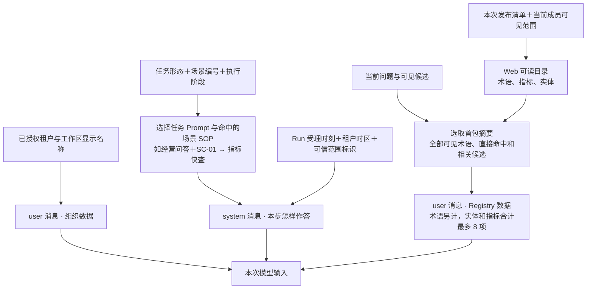
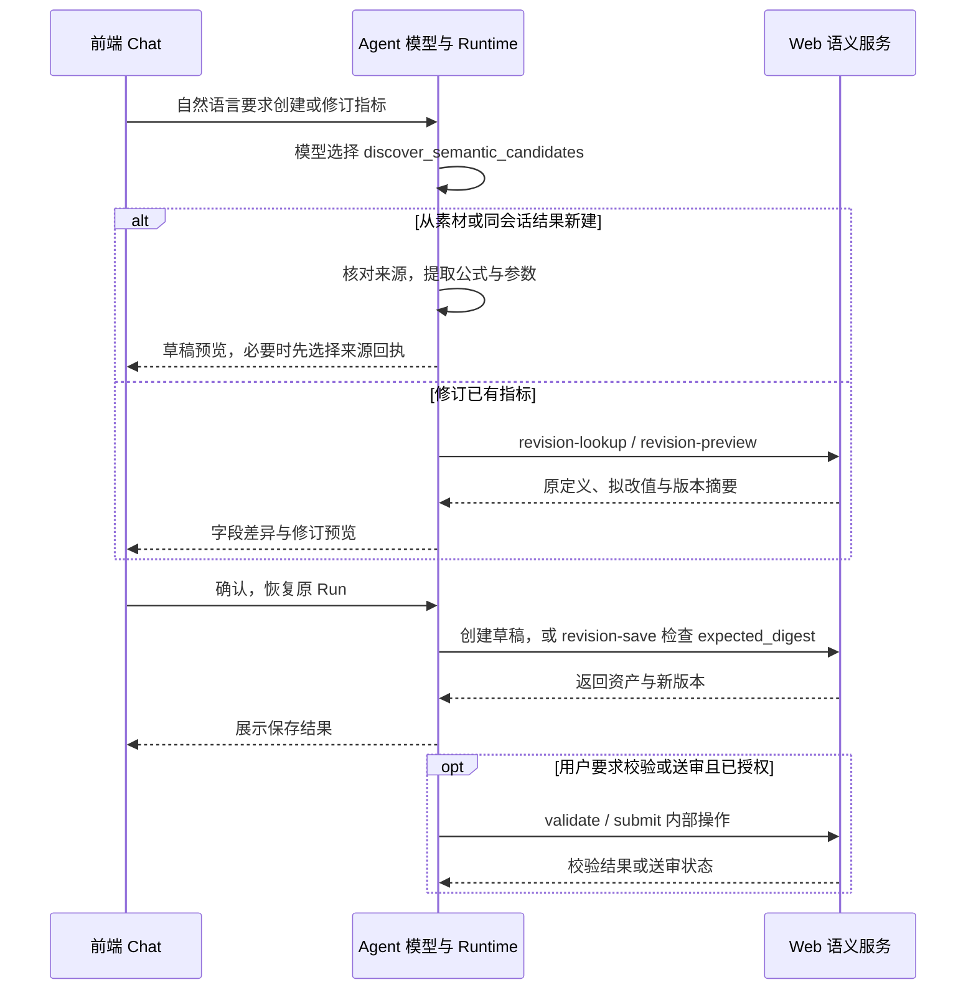

## 设计目标

让 Agent 使用语义资产理解问题、执行查询，并通过自然语言创建或修订指标。重点说明上下文工程、工具调用、提示词约束与运行时协作。

语义对象、数据库结构与初始化数据见[零售语义资产详解](#retail-assets)。本篇从前端问题进入 Agent 的链路展开。

## 总体架构

前端查询和指标维护共用 Agent Runtime。系统先固定版本并准备默认语义，模型再结合上下文和工具结果自主决策。开放式 NL2SQL 与指标绑定执行分别通过工具提供，创建与修订经过前端确认后保存。

{{overview}}

图中上半部分是系统自动执行的准备阶段，下半部分是模型与 Runtime 的动态调用循环。Web 语义服务提供默认上下文、动态定义、执行绑定及维护接口。业务事实通过授权只读连接查询，私有计划和结果引用由 Agent 保存。

## 上下文工程

Context Runtime 将任务方法与语义数据分别装入模型输入。系统消息提供任务 Prompt、场景操作指引（SOP）、Run 受理时刻和租户时区。用户消息提供已授权组织信息与语义目录摘要。同一 Run 跨午夜恢复沿用受理时刻，新提问重新装配。

| 时点                   | 系统自动读取与准备                                                                | 本次模型输入                                                                          |
| ---------------------- | --------------------------------------------------------------------------------- | ------------------------------------------------------------------------------------- |
| Run 受理               | 从 Web 的 `manifest` 取得发布 ID 与摘要，固定 PromptOps generation，写入 Run 快照 | 先固定版本依据，供后续装配与恢复使用                                                  |
| `identify` 任务识别    | 读取固定版本的路由提示词，注入受理时刻、时区和可信组织信息                        | 识别任务类型与场景                                                                    |
| 首次业务调用前         | 通过 `context` 从固定清单读取可见术语、相关实体与指标，结合当前问题生成摘要       | 全部可见术语的名称、别名、释义，实体与指标合计最多 8 项，以及初步解析和明确请求的指标 |
| 普通 Chat 的结果上下文 | 从 Agent 私有引用中读取同会话、当前获准的历史结果和已确认选择                     | `previous_results` 与当前选择，帮助承接前文                                           |
| 工具续调用             | 复用已记录的消息前缀，追加实际工具结果并复核权限                                  | 模型依据新观察自主决定下一次调用或结束                                                |

首次业务调用处于任务识别之后。专用检索仅开放非语义来源时，使用 `glossary` 读取已发布的非个人共享术语。语义来源不可用时向模型提供不可用状态。各阶段和新提问按当前问题、身份及阶段规则装配，完整定义可由工具继续读取。



识别任务时先确定日期与组织。开始分析时，模型读到全部可见术语的名称、别名和释义。实体与指标另外计数，两类合计最多带入 8 项，先选直接命中问题的，再补相关候选。没有命中时只带词表。新建的个人维护术语默认共享到当前工作区，历史私有术语仅本人可见。在仅获资料检索、未开放语义来源的模式下，单独读取已发布的非个人词表。正式取数另查指标版本、绑定与数据连接。

### 上下文装配与动态检索

首包摘要控制模型输入规模，动态检索补充本次任务需要的定义。下方消息栈展示一次按别名搜索并读取指标公式的调用过程，包含前文对候选选择的影响。

[[fold 查看模型消息栈与工具调用示例]]

[[context-stacks]]

[[/fold]]

相同的“销售额”可以对应支付、净回款和确认收入。Agent 依据当前问题及前文核对候选；线索不足时在原会话请用户选择。取数先由 `resolve_semantics` 固定版本、绑定与参数，再以 `query_ref` 查询。

[[fold 不同阶段、专用检索模式与翻页规则]]

#### 阶段与检索范围

- **阶段。** `identify` 负责路由。之后装配已匹配的任务和语义指令。`COMPASS_SEMANTIC_WORKSPACES` 可启用工作区 Registry。`plan` 至多开放 `todo_write`，`query/analyze` 可调用获准工具，`generate` 汇总已有材料。
- **模式。** Registry 消息标识为 `source=publishedSemanticRegistry`。普通模式带 `items`、`authorized_resolution`、`requested_metrics`、`previous_results`。专用检索启用语义来源时可读取该目录；仅有非语义来源时只注入共享术语。过往结果按本轮可用来源另取。
- **动态搜索。** `search_semantics` 在同一清单内按种类、域和使用范围筛选，依次匹配名称／别名／编码、摘要、PostgreSQL 全文词项与相关词。换条件从首页查，原条件用游标翻页。默认每页 12 项、上限 50 项。遇到重复页或用完检索轮数（最多 8 轮），请用户补充。
- **续调用。** 图中框代表模型调用。工具续调用复用已记录的前缀并复核权限。切换阶段可以重新装配，新的用户提问也会按其问题与身份选择语义。

[[/fold]]

## 工具体系与查询模式

Agent 在上下文中获得可见目录摘要，再按需调用工具读取定义、解析查询、执行计算或维护资产。问答、分析、看板与报告共用这套基础能力。

| 能力层     | 工具或基础设施                                                                     | 主要输入与输出                                                |
| ---------- | ---------------------------------------------------------------------------------- | ------------------------------------------------------------- |
| 上下文装配 | Context Runtime + Web Registry                                                     | 当前身份、问题、固定发布清单 → 可见术语与相关资产摘要         |
| 语义检索   | `search_semantics`、`get_metric_definition`                                        | 名称、别名或资产 ID → 候选、公式、维度与来源                  |
| 查询解析   | `resolve_semantics`                                                                | 口径与业务参数 → 用户选择、缺失条件或查询计划引用 `query_ref` |
| 正式执行   | `query_metric`                                                                     | `query_ref` → 数值、单位、期间、完整度与来源回执              |
| 开放查询   | `database_query`                                                                   | 获准连接与只读 SQL → 明细或临时计算结果                       |
| 资产维护   | `discover_semantic_candidates`、`review_semantic_change`、`submit_semantic_change` | 素材、查询结果或现有草稿 → 候选、校验结果与送审记录           |

模型在本步获准的工具集合内自主选择。可以先读定义、先查独立明细、请求口径选择或进入资产维护。Runtime 负责工具执行、状态保存与权限校验，工具结果回到模型后继续决策。

| 查询模式      | 模型提交什么                                                                  | 服务端怎样执行                                             | 输出                                               |
| ------------- | ----------------------------------------------------------------------------- | ---------------------------------------------------------- | -------------------------------------------------- |
| 开放式 NL2SQL | 调用 `database_query` 发现结构，并提交只读 SQL                                | 在用户获准的连接上执行，保留临时查询引用                   | 明细、临时计算结果与实际算法                       |
| 指标绑定执行  | `resolve_semantics` 提交口径和业务参数，`query_metric` 使用返回的 `query_ref` | 从固定版本读取已发布绑定，执行受控聚合或已核准的参数化 SQL | 带指标版本、绑定摘要、单位、期间与完整度的正式回执 |

两种模式都经过当前连接与数据权限检查。一个问题可以先用明细定位日期，再按指标绑定比较数值。口径明确但缺少绑定时，可在获准明细上计算，并说明实际采用的算法。

## 指标解析、执行与原任务恢复

解析器结合问题、前文和当前可见定义确定候选。口径、期间、筛选和绑定都就绪后，Agent 保存私有计划并签发 `query_ref`。`query_metric` 从私有计划读取指标版本、绑定与参数，经 Web 内部 API 重新取得绑定，核验模板摘要与当前只读连接。计算返回数值、单位、期间、数据截止时点和完整度，结果引用登记所用定义。变更主窗口、筛选或分组时重新解析计划。

| 解析状态                       | 后续处理                                 |
| ------------------------------ | ---------------------------------------- |
| 只查询定义                     | 返回可见版本的释义与公式                 |
| 口径明确且绑定、参数完整       | 签发 `query_ref`，由 `query_metric` 执行 |
| 多个候选仍符合语境             | 创建持久等待，由当前用户选择或填写算法   |
| 口径明确但缺正式绑定           | 可用获准明细计算，说明实际算法和来源     |
| 期间缺失、维度不合法或数据未齐 | 返回对应缺口，保留已完成的独立结果       |

### 消歧与原任务恢复

{{choice}}

口径卡最多展示三个可见候选。`approve + choiceId` 选定一个候选，`approve + customDefinition` 提交本轮算法。决定恢复原 Run，保留本次上下文与固定清单，恢复后复核当前授权。

[[fold 普通 Chat 运行记录]]

在已启用支付 GMV 绑定的远山教学快照中，明细查询找到 2025 年 11 月 19 日失败支付 10 笔。正式指标查询得到 11 月 12 日 31,402.35 元、11 月 19 日 42,339.45 元，增加 10,937.10 元。明细查询负责定位日期，指标查询负责按发布公式比较金额。

另一轮三个候选都只有定义的复测中，选择支付 GMV 后使用获准明细计算。11 月 17 日和 22 日各有一次失败，两天比上周同日分别少 191.26 元、多 784.50 元。两轮使用各自的数据与连接。

[[/fold]]

## 自然语言创建与修订指标

前端普通 Chat 接受创建和修订请求。模型调用 `discover_semantic_candidates`，从授权素材或同会话结果准备新草稿，或定位已有指标并生成字段差异。前端展示预览，用户确认后恢复原 Run，由 Web 保存结果。

`requested` 承接明确的创建或修订请求。`suggest` 从本轮结果提名可复用指标，核对来源、完整性和等价定义后最多展示三项。查询期间作为参数保留在计划中，可复用的算法与来源进入草稿。



服务端以回执归属保证来源来自当前会话，以请求键处理保存重试。修订原指标时，`revision-preview` 返回字段差异，确认后由 `revision-save` 检查 `expected_digest` 再追加版本，避免覆盖已经发生的修改。

| 维护环节 | 实现机制                                                              |
| -------- | --------------------------------------------------------------------- |
| 候选发现 | 核对回执完整性、来源及等价定义，提取可复用算法                        |
| 草稿保存 | 通过选择卡与草稿预览确认，失败项可单独重试                            |
| 校验送审 | `review_semantic_change` 返回问题与摘要，`semantic_submit` 确认后送审 |
| 审批发布 | 业务与数据负责人分别审批，由发布者更新清单，执行绑定单独验证          |

## 场景与提示词原文

PromptOps 保存本次 Run 固定版本的提示词。任务 Prompt 与场景 SOP 进入 system 消息，语义定义和查询结果作为数据进入 user / tool 消息，模型工具描述随本步工具清单提供。场景约束负责指导模型判断，实际权限、参数和绑定摘要由服务端检查。

| 任务场景         | 提示词重点约束                                             |
| ---------------- | ---------------------------------------------------------- |
| 经营问答 · SC-01 | 定义问题可直接解释，数值问题核对口径、期间、单位和数据缺口 |
| 数据分析 · SC-02 | 对齐比较窗口、统计粒度和分母，核对拆解结果与总量           |
| 看板 · SC-25     | 保留组件期间、筛选条件与数据截止时点，处理缺失数据         |
| 经营报告 · SC-29 | 摘要、正文与下载稿共用同一组数值，按范围选择通用或财务周报 |

下面按场景展示当前仓库默认配置中的任务 Prompt 与场景 SOP 完整原文，红色粗体标出关键约束。实际 Run 使用受理时固定的 PromptOps 版本。可切换任务标签并复制原文。

[[scene-prompts]]

分类器读取场景描述和示例。路由完成后才装入命中场景的 SOP，四类任务复用同一套语义工具。

[[fold 查看 40 个已登记场景的 SOP 原文]]

{{scene-sops}}

[[/fold]]

### 取数与开放查询的完整 Prompt

下方保留正式指标查询、开放 SQL 与专用检索协议的原文。它们规定两种查询模式的使用条件、歧义处理和结果要求。

[[query-prompts]]

### 指标保存与治理的提示词

[[fold 保存建议与后台审查的指令原文]]

{{quote:save}}

#### shared/policies.json · rules.semantic-governance

{{quote:governance}}

`POST /v1/semantic/suggestions` 将治理指令作为 system 消息、已授权素材或草稿作为 user 消息，校验候选 JSON 与来源位置。Chat 建草稿使用语义策略和持久等待协议。

[[/fold]]

## 工具契约参考

### 查口径与取数

{{tool:search_semantics|按名称、别名或业务域找候选。有明确资产 ID 时可直接读定义。}}

{{tool:get_metric_definition|按资产 ID 查看当前版本的定义、公式和维度。用户只问含义可在这里回答。}}

{{tool:resolve_semantics|用户要数值时解析原称与业务参数。前文已明确经营事件时可传入匹配的指标 ID；仍有歧义时请用户选择。}}

{{tool:query_metric|持解析回执执行正式查询、对比或下钻。变更本期、分组或筛选时重新解析。}}

### 开放式 NL2SQL

{{tool:database_query|先发现连接、表和字段，再执行只读查询。独立明细可先查；有歧义的指标等用户确定后再计算。}}

### 发现、校验与送审

{{tool:discover_semantic_candidates|从授权素材发现候选、提名可复用结果、按请求建草稿或修订原指标。}}

{{tool:review_semantic_change|已有草稿版本时检查来源、公式、冲突与影响。修正阻断项再送审。}}

{{tool:submit_semantic_change|维护者确认后将已校验的版本送交业务评审。批准和发布由相应负责人操作。}}

**工具声明装配。** `tools/catalog.py` 按能力和可用性选择 `ToolSpec`，`promptops/structured.py` 从本次 PromptOps 版本读取 `tools/<name>.json`，把 `function.description`、参数和已配置的示例交给模型。展开上面的工具可读仓库默认描述原文。跨工具的选择规则另由场景中的系统指令提供。

与 `database_query` 一同声明的 SQL 指引，以及专用检索模式追加的协议，可在查询场景的指令示例中逐段阅读。[查看取数与检索的完整 Prompt](#query-prompts)

## 接口与代码改动

### 服务间 API

| 调用方 → 服务方        | 新增或扩展                                                                                                      | 用来做什么                                                                                                                  |
| ---------------------- | --------------------------------------------------------------------------------------------------------------- | --------------------------------------------------------------------------------------------------------------------------- |
| 指标后台 → Web         | 新增 `/api/web/v1/semantic/*`，另有 `/api/semantic/*` 入口                                                      | 目录、维护、治理及发布                                                                                                      |
| Agent → Web            | 新增 `POST /api/internal/semantic/{op}`                                                                         | 绑定 Run 的清单，检索与解析，重验权限，保存草稿                                                                             |
| Web → Agent            | 新增 `POST /v1/semantic/suggestions`、`/v1/semantic/trial`                                                      | AI 候选与审查建议、只读绑定试算                                                                                             |
| Chat → Agent（经 Web） | 新增 `GET/POST /v1/analysis/runs/{run_id}/semantic-results`。扩展既有 `GET waits/{wait_id}` 与 `POST decisions` | 核对原回执并确认、忽略或保存。原 Run 接受 `choiceId`、`customDefinition` 或 `draftEdits` 后恢复，沿用 `GET events` 交付 SSE |

[[fold 展开管理 API 与内部操作明细]]

#### 指标管理的 HTTP 契约

| 方法              | `/api/web/v1/semantic` 下的路径                                                                                             |
| ----------------- | --------------------------------------------------------------------------------------------------------------------------- |
| GET               | `assets`、`assets/{id}`、`scopes`、`organization`、`asset-grants`、`sources`、`releases`                                    |
| POST · 维护       | `assets`、`assets/{id}/remove`、`sources`、`discover`、`suggestions`、`drafts`、`drafts/{draftId}/revisions`                |
| POST · 评审与发布 | `revisions/{id}/{validate,submit,business,data,return}`、`bindings`、`trial`、`releases`、`releases/{id}/{rollback,revoke}` |
| POST · 授权       | `scopes`、`grants`、`asset-grants`                                                                                          |

#### Agent 调用 Web 的内部操作

| 功能                 | `POST /api/internal/semantic/{op}` 的 `op`                                          |
| -------------------- | ----------------------------------------------------------------------------------- |
| 固定版本、检索和解析 | `manifest`、`context`、`glossary`、`search`、`definition`、`resolve`、`choice`      |
| 取数授权与来源回查   | `binding`、`authorize`、`reference`                                                 |
| 素材、范围与草稿治理 | `scopes`、`equivalents`、`discover`、`drafts`、`result-draft`、`validate`、`submit` |
| 在原会话修订指标     | `revision-lookup`、`revision-preview`、`revision-save`                              |

[[/fold]]

### 代码变更

```text Web · 资产和发布的所有者
apps/web/
├─ db/main/migrations/0004…0008*.sql       [新增] 内容、治理、检索与资产授权
└─ src/
   ├─ features/semantic/                  [新增] 目录、表单、结果确认
   ├─ components/durable-run-actions.tsx  [调整] 在原 Chat 展示选择和确认卡
   ├─ app/api/{semantic,internal/semantic}/  [新增] 浏览器和 Agent 两个入口
   └─ server/
      ├─ http/semantic-handler.ts         [新增] 鉴权、路由、派发读写
      └─ modules/semantic/
         ├─ access.ts · asset-grants.ts · catalog.ts         [新增] 成员范围与固定清单
         ├─ runtime.ts · retrieval.ts      [新增] 上下文消歧与动态检索
         └─ drafts.ts · chat-revisions.ts · bindings.ts · governance.ts  [新增] 草稿、绑定审批与发布
```

```text Agent 与跨应用契约 · 从系统指令到执行回执
apps/agent/
├─ migrations/versions/0017_semantic_runtime.py  [新增] 会话私有回执
├─ migrations/versions/0018_semantic_cleanup.py  [新增] 统一从 Run 快照读取清单
└─ src/compass_agent/
   ├─ prompts/shared/policies.json              [调整] 语义决策与候选治理指令
   ├─ prompts/{tasks,tools}/                    [调整] 场景 SOP 与模型工具描述
   ├─ tools/{catalog.py,business/}              [调整] 注册七个语义工具
   ├─ tools/builtin/database_query/handler.py   [调整] 区分正式取数与开放查询回执
   ├─ context_runtime/{assembly.json,profiles.py,run_facts.py,pipeline.py,model_step.py}  [调整] 选指令、装载摘要
   ├─ semantic/
   │  ├─ service.py · execution.py              [新增] 解析后的查询计划与受控执行
   │  └─ tool.py · clarification.py · results.py  [新增] 建议、等待与保存回执
   ├─ runtime/hitl.py                           [调整] 重验权限并恢复原 Run
   ├─ api/{semantic,sessions}.py                [新增／调整] 建议、试算和结果决定
   └─ schemas.py                                [调整] 等待卡和控制协议
contracts/ · apps/web/src/generated/            [生成] OpenAPI、Schema 与 Web 类型
```
