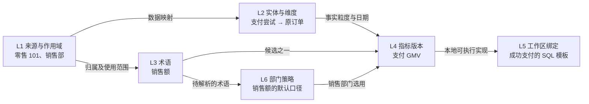
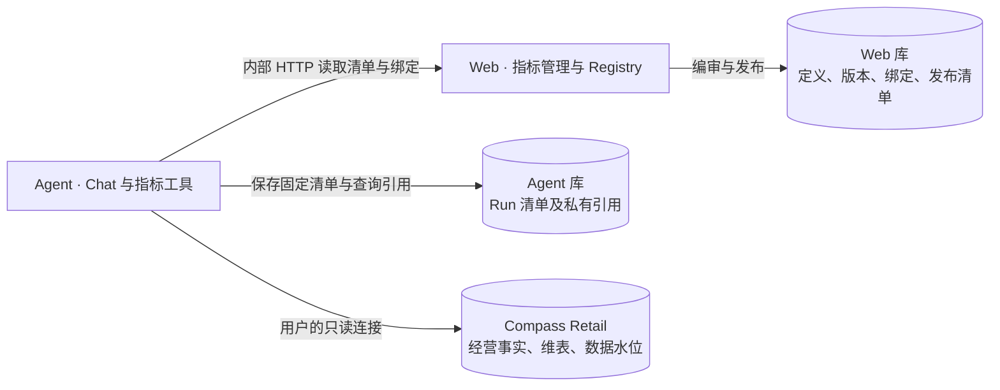
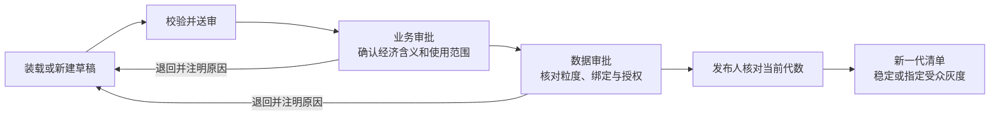
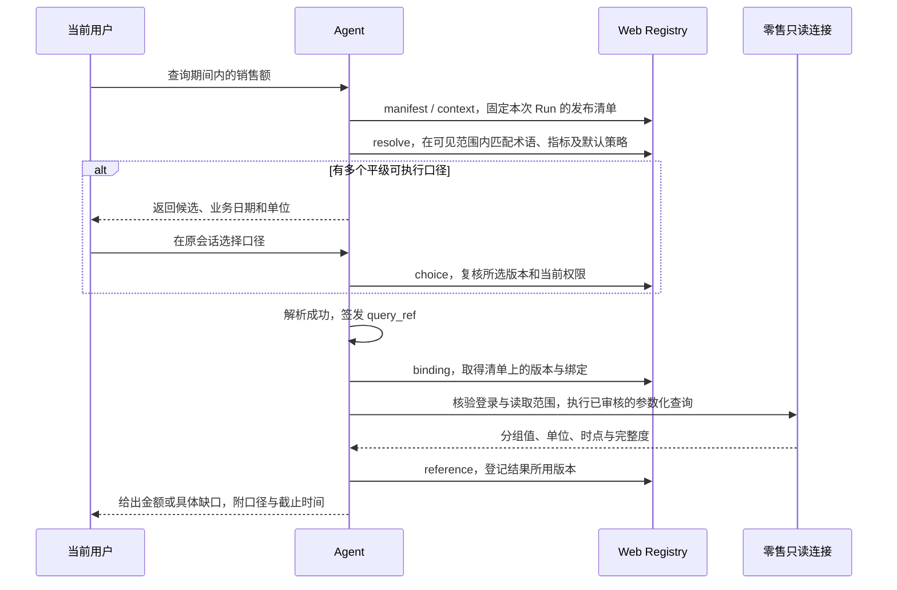
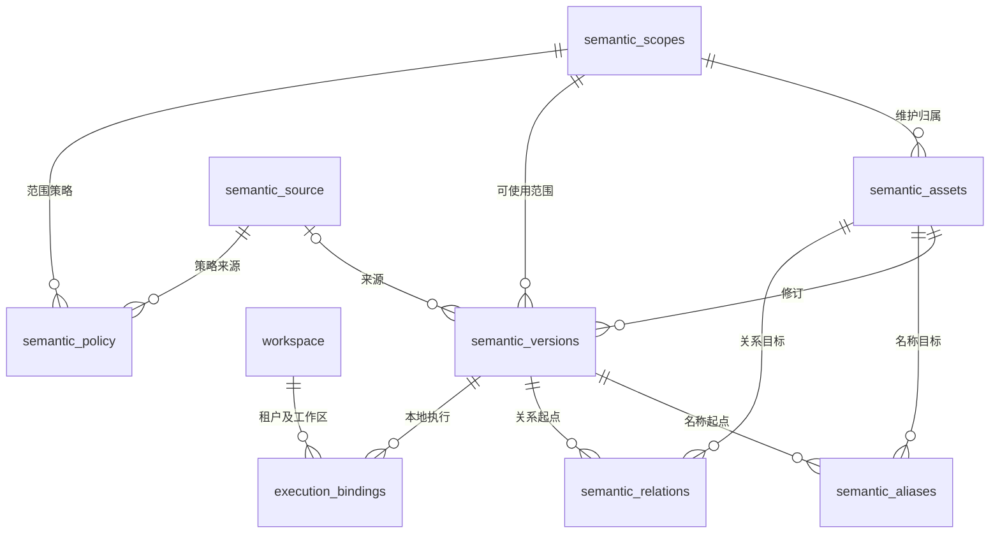
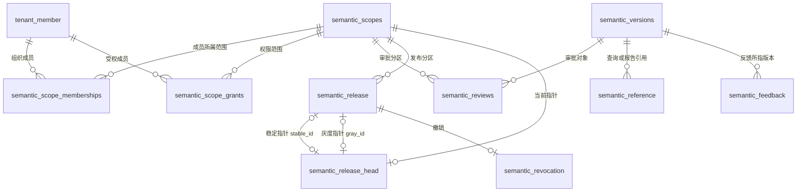
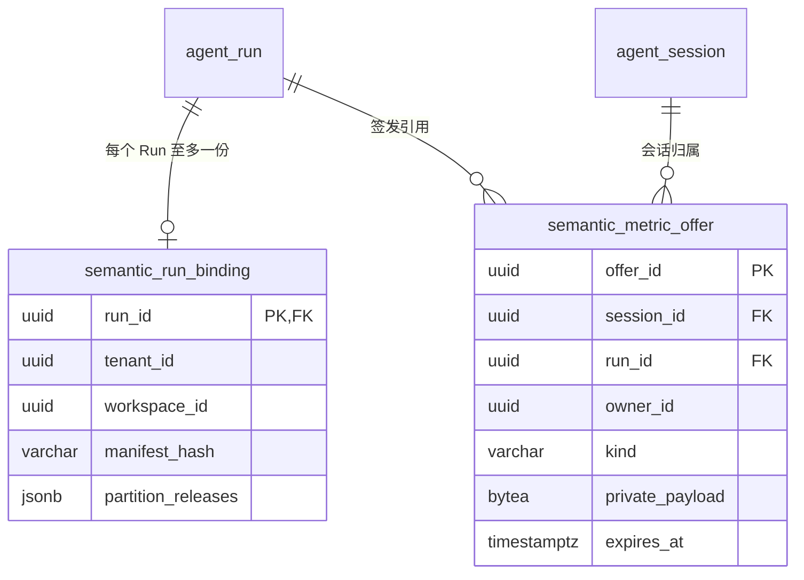
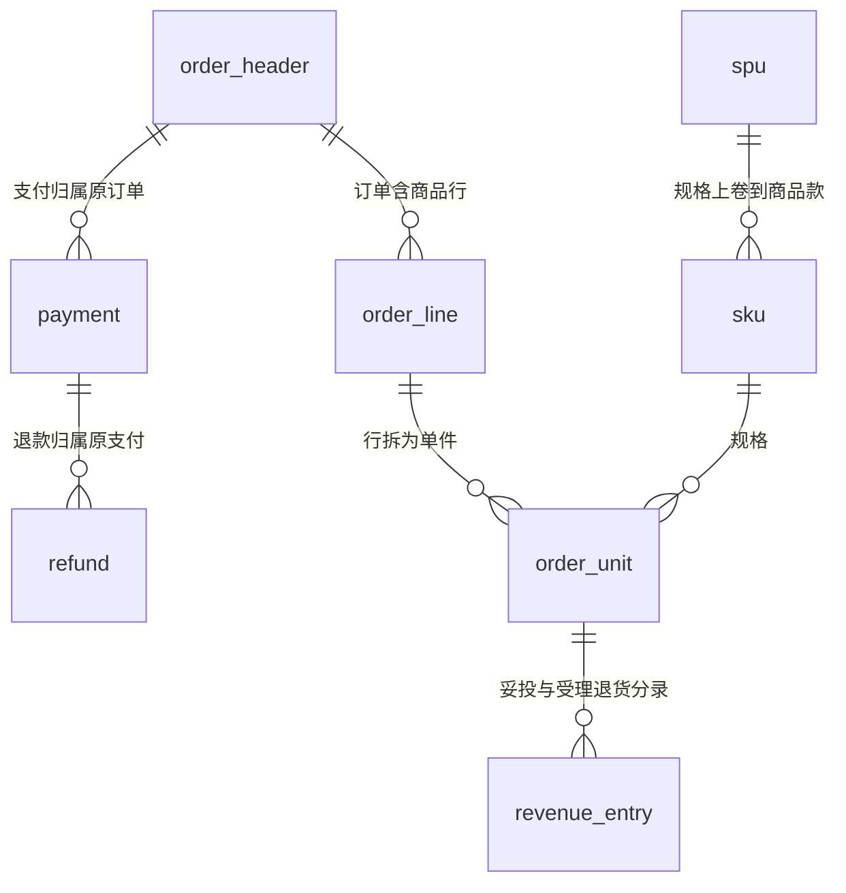

## 总体架构

Web 维护六层语义资产，把通过审批的定义、依赖、执行绑定和策略编入发布清单。Agent 为每次分析（Run）固定清单，按当前用户的授权连接读取 Compass Retail。下面六层按建模依赖排列，点击可直达详设。

1. [来源与作用域](#layer-1) · 确定数据版本、维护者和使用范围
2. [实体、维度与关系](#layer-2) · 确定一行的含义及可以联到哪里
3. [术语与别名](#layer-3) · 把经营用语指向候选定义
4. [度量与指标](#layer-4) · 规定怎么算、按什么时间和维度算
5. [执行绑定](#layer-5) · 把指标版本接到工作区的受限数据源
6. [使用策略](#layer-6) · 决定当前用户会看到、采用或选择哪个口径



同一术语可以指向多个指标，同一指标版本也可以有多份绑定。例如平台订单数只有一个公共定义，101 和 102 各用本工作区的连接执行。下面这张部署图标出谁持有定义、谁固定版本、谁实际读取经营数据。



### 从装载、审批到发布



| 决策点     | 业务规则                                                                                                 | 持久结果                                                                         |
| ---------- | -------------------------------------------------------------------------------------------------------- | -------------------------------------------------------------------------------- |
| SQL 装载   | 同版教学包按摘要幂等导入。八种可试算指标中，公共订单数还需要在各工作区审批本地绑定                       | 初始资产为 `draft`。安装 SQL 留下候选策略和绑定，审批与发布由管理入口完成        |
| 送审与双审 | 提交绑定版本及预期摘要。业务、数据由不同人员审批。需试算的新绑定在数据审批前须用独立预期匹配真实受限查询 | 评审记录关联版本、审批对象摘要、步骤、处理人和意见。退回保留过程，修订产生新版本 |
| 发布       | 先发布指标依赖的定义，公共定义先于工作区绑定。按目标分区锁定当前代数，灰度要求已有稳定版和指定受众       | 稳定或灰度指针前移。过期代数返回冲突，调用者刷新后重新核对                       |
| 回滚与撤销 | 回滚基于历史清单恢复内容，撤销标记指定发布。普通版本切换时，已有 Run 继续按固定清单读取                  | 新 Run 选择当前生效版。已有 Run 遇撤销或失权，在继续执行或读取结果时重新校验     |

### 一次正式查询怎样执行



无可见匹配时可以解释缺项，具备授权时可另做开放分析。仅缺绑定时可以读定义。请求不支持的维度时返回 `invalid_dimension`，允许的维度列在指标定义中。来源延迟时返回带状态的空值。报告需要数字时读取成功查询的结果引用。

### 数据库 ER 与迁移边界

**Web 内容模型。** `semantic_assets` 保存“哪一项”，`semantic_versions` 保存“哪一版”。一个版本拥有一套释义、粒度和单位。关系和别名从指定版本出发，目标落在稳定资产身份上，发布时再把依赖解析成具体版本。



| 键或约束                                   | 设计含义                                                                                                                                    |
| ------------------------------------------ | ------------------------------------------------------------------------------------------------------------------------------------------- |
| `UNIQUE(owner_scope_id, kind, code)`       | 稳定业务键在维护范围内唯一。`entity`、`term`、`metric` 是三种资产身份。绑定单独登记在 `execution_bindings`                                  |
| `UNIQUE(asset_id, version_no)`             | 版本顺序按资产独立增长。复合外键 `(asset_id, parent_version_id)` 把修订链限制在同一资产内                                                   |
| `semantic_aliases` 与 `semantic_relations` | 两者还关联 `scope_id`。同词允许有多个目标。关联另存角色、基数、键对和适用条件，使“发货地”和“原销售地”可分别使用                             |
| `execution_bindings.binding_id`            | 绑定同时关联 `version_id` 与 `(tenant_id, workspace_id)`。SQL 正文字节必须匹配 `target_hash`，同一版本可登记多个不可变绑定。清单选定具体 ID |

**Web 治理模型。** 成员归属决定哪些部门、岗位或工作区对当前用户生效。范围授权分别控制维护、分享、业务审批、数据审批与发布。发布分区保存每一代清单，并单独维护当前指针。



**Agent 运行模型。** Web 清单中的 `assets` 和 `policies` 以 JSON 固定资产版本、依赖、工作区绑定及策略修订号。Agent 通过内部 HTTP 取得发布 ID 与摘要，保存在自己的数据库。下图的外键均位于 Agent 库内。



| 数据库与迁移             | 新增或调整                                                                                                                                        | 使用者                             |
| ------------------------ | ------------------------------------------------------------------------------------------------------------------------------------------------- | ---------------------------------- |
| Web/main `0003 → 0004`   | 新增来源、作用域、资产、版本、别名、关系、执行绑定、策略八表。装入默认资产的 SQL 使用这些表                                                       | 教学包和指标管理页                 |
| Web/main `0004 → 0005`   | 扩展作用域、成员权限、来源与绑定，增加成员关系、授权、评审、清单、发布指针、撤销、事件、引用与反馈。`semantic_event` 以操作者、工作区、请求键去重 | 治理事务、发布和运行时 Registry    |
| Web/main `0005 → 0006`   | 对定义名称与摘要、别名显示文本分别增加 GIN 全文索引                                                                                               | 在已授权清单上执行检索             |
| Agent/main `0016 → 0017` | 新增 `semantic_run_binding`、`semantic_metric_offer` 及会话索引，迁移时重置工作进程的执行策略指纹                                                 | Run 启动、澄清恢复、计划和结果引用 |
| Compass Retail           | 复用现有业务表、行级权限、水位和修订字段                                                                                                          | L2 登记源表，L5 经实际用户连接读取 |

### API 与 Agent 工具抽象

管理页通过 Web 会话写资产。Agent 用服务身份调用 Registry，同时传入真实用户、租户、工作区与 Run，Web 每次重算可见范围。试算方向相反，由 Web 委托 Agent 使用受限连接执行。这三个入口的调用者和返回内容如下。

| 调用方向     | 契约与代表操作                                                                                                                                                               | 返回及约束                                                                                                                                  |
| ------------ | ---------------------------------------------------------------------------------------------------------------------------------------------------------------------------- | ------------------------------------------------------------------------------------------------------------------------------------------- |
| 浏览器 → Web | 在 `/api/semantic/` 下，`GET assets`、`GET assets/{id}` 读取目录与详情，`POST drafts`、`POST revisions/{id}/{submit,business,data}`、`POST releases` 写入草稿、审批和发布    | 管理视图、动作或写入回执。请求指定 `tenantId`、`workspaceId`，写入校验会话、同源和 CSRF，治理写入使用 `request_key`                         |
| Agent → Web  | `POST /api/internal/semantic/{op}`。`manifest/context` 固定和读取上下文，`search/definition/resolve/choice` 识别口径，`binding/authorize/reference` 取得绑定、复核、登记引用 | 请求含 `actor_user_id, tenant_id, workspace_id, run_id, args`，固定清单后带 `pins`。模型得到可见摘要或引用，可信 SQL 模板正文只在服务间传递 |
| Web → Agent  | `POST /v1/semantic/trial`，`POST /v1/semantic/suggestions`                                                                                                                   | 试算返回执行结果供 Web 比对独立预期。建议接口从授权素材提取可编辑候选                                                                       |

| 工具                           | 主要输入                                                                      | 输出与执行边界                                                          |
| ------------------------------ | ----------------------------------------------------------------------------- | ----------------------------------------------------------------------- |
| `search_semantics`             | 检索词，可选种类、业务域、范围、游标                                          | 已发布的可见候选、匹配理由与续页游标                                    |
| `get_metric_definition`        | `asset_id`，可选 `version_id`                                                 | 口径、单位、时间、适用维度、别名及可见依赖                              |
| `resolve_semantics`            | 提及词、所需维度，可选指标、期间和历史截止时间                                | 唯一匹配时签发 `query_ref`。同级冲突由原会话用户选择                    |
| `query_metric`                 | `query_ref`、`query / compare / drilldown` 操作、期间、分组和筛选，下钻带父组 | 结构化数值、完整度、版本和结果引用 `resultId`。对比期和下钻沿用同一计划 |
| `discover_semantic_candidates` | 授权素材引用或同会话查询的 `result_ref`，可选归属                             | 可编辑的候选提议，确认后保存草稿                                        |
| `review_semantic_change`       | `version_id`                                                                  | 来源与依赖检查、冲突、影响和当前摘要                                    |
| `submit_semantic_change`       | 版本、预期摘要、说明、请求键，可选绑定                                        | 维护者确认后送入双审，后续审批与发布在 Web 完成                         |

`query_ref` 代表本次 Run 获准使用的计算计划。`query_metric` 回执中的 `resultId` 指向已经取得的结果。候选发现工具用名为 `result_ref` 的输入接收同会话临时查询的结果引用。

## 分层详细设计

### L1 来源与作用域

教学包 `compass-retail/semantic-content` 的版本为 `1`，使用零售数据发布 `diagnostic-v3-20261019`。安装器把来源、组织映射和编辑者写入 Web。数据发布号随执行绑定保存，业务事实由零售库提供。治理清单也有单独的发布 ID，因此一次查询能同时回答“按哪版定义算”和“查的是哪版数据”。

| 维护归属 | 首次装载的范围                                               | 如何使用                                                                                         |
| -------- | ------------------------------------------------------------ | ------------------------------------------------------------------------------------------------ |
| 平台     | 1 个平台作用域                                               | 维护可共享的下单订单数及其术语。每个工作区独立核准连接与绑定                                     |
| 租户     | 远山零售／经营总部 → 零售 101，星河商贸／电商运营 → 零售 102 | 各自拥有实体、日历与本地指标。安装时核对 Web 租户 UUID 和工作区 UUID，查询时再核对零售租户与地区 |
| 部门     | 两家各有销售、财务、营销，共 6 个范围                        | 负责人可维护部门口径。成员在指定范围获准使用发布版本，兼任关系叠加                               |
| 个人     | 101 的教学分析师                                             | 个人渠道净回款作为候选。创建者、编辑者、维护归属和使用范围分别记录                               |

共 10 个初装范围。治理模型还支持工作区、岗位作用域。`owner_scope_id` 决定谁维护，`usage_scope_id` 决定向谁发布。来源连接的租户、行和列权限在 L5 检查。

#### SQL 如何写入默认资产

`edition.json` 声明租户、组织与策略，`entities.json`、`terms.json`、`metrics.json` 声明内容。装配器按“范围／业务键”解析引用，拼接 SQL 片段并计算 SHA-256，然后把同一份包交给 `install.sql`。一笔事务依次写入来源、范围、身份与初始版本、别名、关系、绑定和策略。两个工作区合计 74 个实体实例、29 个术语实例、18 个指标实例，共 121 个资产和 121 个初始版本，关联 167 条关系、191 条名称及别名索引、14 份绑定、7 份策略。

已供应的 Web 教学库通过以下入口装载。两种方式共享 DML。独立 SQL 的目标也是 Web 管理库。

{{code:seed}}

{{code:standalone}}

安装器先给每个“范围／业务键”预分配资产 ID 与版本 ID，存入事务内的临时表。下面两条 INSERT 共用这张映射。后续写别名、关系和绑定时也查同一映射，因而跨层引用落到同一批身份上。

{{sql:asset-versions}}

安装前校验受管数据库标记和教学身份，按包定位符加事务锁。已安装且摘要相同返回 `already_installed`。同版内容漂移、引用冲突或工作区映射错误会使整笔事务回滚。恢复时将备份还原至独立 Web 库，核对版本、摘要及权限后切换。

### L2 实体、维度与关系

以订单为例，订单头的一行代表一张订单，支付的一行代表一次尝试，收入分录的一行代表一次会计事件。先确定指标在哪种行上计数或求和，再沿已登记的键对取得维度，能避免一单多商品或多次退款造成重复计数。



| 业务问题         | 关联与聚合规则                                                                                                                     | 影响                                                                     |
| ---------------- | ---------------------------------------------------------------------------------------------------------------------------------- | ------------------------------------------------------------------------ |
| 订单筛选商品     | 给订单数加商品条件时，用 `EXISTS` 判断是否存在符合的商品行                                                                         | 同单含三个符合条件的 SKU 仍计一单                                        |
| 支付与退款归属   | 支付按 `(tenant_id, order_id, region_id)` 找订单。退款按 `(tenant_id, payment_id, order_id, region_id)` 找成功原支付。分支各自汇总 | 多次退款只增加退款事实。本期现金流可因上期订单退款而为负                 |
| 拆到商品和地点   | 收入分录按 `(tenant_id, order_unit_id, region_id)` 回到单件、SKU、原订单。地点还分原销售、发货、退货接收、持货角色                 | 确认收入可分商品。订单级支付需要分摊规则才能分商品。空销售网点保留独立组 |
| 多值或跨粒度关联 | 同款可有多个运动标签，按标签筛选可用存在性判断。营销消耗先由地区合并到活动日，再与同活动日的平台归因对齐                           | 按多标签加总须先约定分摊权重。全租户归因仅在有整租户数据时计算           |

{{catalog:entities}}

### L3 术语与别名

术语版本记录业务解释、典型问法和容易混用的说法。别名行负责名称检索，`denotes` 关系把术语版本指向该范围可用的指标或实体。“销售额”在 101 有支付 GMV、现金流净 GMV、确认收入三个候选。102 的教学词表登记支付 GMV 与现金流净 GMV。

| 名称               | 候选及辨别条件                                                                          | 解析产物                                         |
| ------------------ | --------------------------------------------------------------------------------------- | ------------------------------------------------ |
| 销售额／成交额     | 可能询问收款、扣退款后的现金流或财务确认收入。如果已指明“扣退款”，先用具体口径识别      | 得到明确指标，或把多个候选交给 L6 的范围默认策略 |
| 广告回报／广告 ROI | 净 ROAS 的分子是归因净回款，利润 ROI 的分子需要归因利润。提问明确利润时应能解释所缺条件 | 展示定义及可执行状态。需要利润口径时进入候选维护 |
| 门店／持货地点     | 可指向同一个 `site` 实体。销售指标取原销售网点，库存指标取快照所属网点                  | 维度角色随指标定义传递                           |

{{catalog:terms}}

### L4 度量与指标

指标版本封存业务事件、事实粒度、组成度量、公式、单位、期间、允许维度及例外。基础度量写在版本的 `definition.components` 中。金额以人民币分计算，展示元时除以 100。经营期间按上海时区取左闭右开区间 `[start, end)`。`as_of`（以下记为 K）表示这次复盘允许看到的数据截止时点，包含边界。

| 指标业务键                         | 计量、归期与允许下钻                                                                                | 对汇总结果有影响的规则                                                                     |
| ---------------------------------- | --------------------------------------------------------------------------------------------------- | ------------------------------------------------------------------------------------------ |
| `sales.order_count`                | 按 `order_header.ordered_at` 计订单，可按日、渠道、原销售地区、销售网点分组                         | 含取消单。商品可用于筛选，跨商品集合须回到订单去重                                         |
| `sales.paid_gmv`                   | 成功支付的 `amount_cent` 之和，按成功行 `attempted_at` 归期，支持同上四维                           | 剔除失败尝试，同一笔成功支付只入账一次                                                     |
| `sales.net_gmv`                    | 成功支付正项与成功退款负项各按自己的日期入账，支持同上四维                                          | 一笔跨月退款记在退款月。完整窗口允许出现负值                                               |
| `finance.recognized_revenue`       | 按 `recognized_at` 汇总妥投与受理退货的带符号分录。除渠道、地区、网点、日，还可按 SKU、款和品类分组 | 部分退货按受理日冲减。退款到账另属现金流                                                   |
| `marketing.net_roas`               | 平台末次点击七天、模型 v1，合计归因净回款除以合计消耗，按日、活动、平台渠道分组                     | 每个范围重算分子与分母。按 K 独立选归因版与各区消耗版。零消耗返回状态                      |
| `inventory.closing_available_qty`  | 取窗口最后一天（`end - 1 日`）的上海 23:59:59，按持货地点、地区、SKU、款或品类汇总可用件            | 跨日取末日。在同一时点逐组合校验 `available_qty = sellable_qty - reserved_qty`，齐备后求和 |
| `channel.reported_paid_amount`     | 渠道商品日报按报表日、渠道、SKU、地区各取 K 内最高修订，可按日、渠道、报表地区、SKU、款或品类分组   | 每天须有 COMPLETE 对账声明。先逐自然键取版，再合计实付分                                   |
| `channel.first_report_paid_amount` | 同源日报固定 `report_version = 1`，可筛渠道和地区，返回总计或日组                                   | 同时返回参与的首报行数。无可见明细的日期留在回执里，后续订正不会改写首报                   |

**四个只登记定义的指标。** 资产保留业务键、负责人和待补项，工作区绑定数为零。

| 指标业务键                  | 可执行前需要补齐的内容                            |
| --------------------------- | ------------------------------------------------- |
| `marketing.profit_roi`      | 归因毛利、成本分摊规则及所需授权                  |
| `finance.gross_profit`      | 成本冲回规则和成本列权限                          |
| `inventory.closing_value`   | 估值主体、有效快照与成本权限，101、102 各维护一份 |
| `personal.channel_net_cash` | 本人跟进的渠道和获准分享的范围                    |

### L5 执行绑定

八种可试算指标在两个工作区共登记 14 份绑定。每份把指标版本、租户、工作区、`source_ref`、可信 SQL 与摘要、参数及结果 Schema、访问要求绑在一起。平台支持 `aggregate`、`view`、`trusted_sql`，本包使用 `trusted_sql`。

| 调用边界                | 谁提供                                                                                   | 实际校验                                                                                                                             |
| ----------------------- | ---------------------------------------------------------------------------------------- | ------------------------------------------------------------------------------------------------------------------------------------ |
| 计算条件 `$1`           | 经工具校验的业务参数 `start, end, as_of, group_by, filters`                              | 每次最多一个分组维度，分组与过滤分别按指标白名单校验。比较两个窗口时固定 K、时区和来源发布                                           |
| 来源凭据和授权范围 `$2` | Agent 从当前用户获准的只读连接核验实际登录、租户、可读地区与零售发布号，再构造服务端参数 | 校验所需关系、行级保护、只读权限和固定搜索路径。全租户 ROAS 需覆盖全部地区                                                           |
| 结果行                  | 已核验摘要的 SQL 模板                                                                    | `group_key, value, status, detail, period_start, period_end, as_of, data_release, business_timezone, unit`。精确数值按无损十进制传递 |
| 正式回执                | Agent 执行后保存私有引用                                                                 | 回执带指标版本、绑定 ID／摘要、清单摘要、单位、授权范围、业务期间和 K。恢复、交付及历史读取复核当前授权                              |

**每日首报与最新日报共用一张物理表。** 例如一条报表自然键先报 100 元，订正到 90 元，在订正已可见且当日对账完成时，首报指标仍计 100 元、1 行，最新报指标计 90 元。两个物理版本直接相加会得到 190 元。这组示意值解释取版顺序，真实教学样本列在 Showcase 中。

| 数据类型               | 可给出数值的条件                                                                         | 数据有缺口时                                                                            |
| ---------------------- | ---------------------------------------------------------------------------------------- | --------------------------------------------------------------------------------------- |
| 订单、支付、退款和收入 | K 内的末次来源水位覆盖窗口右端。交易依赖 OMS，收入还核验 ERP                             | `COVERAGE_UNKNOWN` 或 `SOURCE_DELAYED`。完整窗口无事实时总计为 0，空分组标识 `NO_FACTS` |
| 商品日报               | 最新版逐日核对 COMPLETE。首报接受已到首报阶段的 PARTIAL 或 COMPLETE 并统计实际行数       | `REPORT_INCOMPLETE` 等状态附日期，首报无行另给 `NO_REPORT_ROWS`                         |
| 净 ROAS                | 活动日归因可见、消耗地区 1–7 齐备，且总消耗大于零                                        | 缺归因、归因未知、缺地区、零消耗分别返回状态，`detail` 保留所用版次                     |
| 期末库存               | 由有效配货范围生成“应有地点 × SKU”集合，左联同一收盘时刻的快照，逐项核对可见性及件数平衡 | 区分尚未收盘、快照未到、组合缺失、件数不平等状态。有缺口时总件数留空                    |

下面的只读 SQL 用左连接列出每个指标及本地绑定。在初装库里，平台订单数有两行绑定，利润 ROI 的绑定列为空。

{{code:inspect}}

### L6 使用策略

默认包登记 7 份候选策略，其中 3 份包含部门默认。`pinned_asset_ids` 让某个定义优先出现在上下文中。`defaults` 记录“特定术语在此范围首选哪个指标”，在清单可见且工作区有可执行候选时参与解析。

| 提问与范围             | 策略结果                                                                 | 查询所用事件                   |
| ---------------------- | ------------------------------------------------------------------------ | ------------------------------ |
| 101 销售的“上月销售额” | 支付 GMV                                                                 | 成功支付发生日                 |
| 101 财务的同一提问     | 确认收入                                                                 | 妥投、受理退货的入账日         |
| 102 销售的同一提问     | 现金流净 GMV                                                             | 成功支付和成功退款各自的事件日 |
| 101 同时属于销售、财务 | 两个同级默认并列。列出版本、经济含义、时间和单位，由本人选择后继续原 Run | 以本次实际选择为准             |

解析先用具体名称、业务键或别名匹配已发布对象，再展开术语关系、筛选可执行候选。默认优先级由个人、部门／岗位／工作区、租户、平台依次降低，采用最高适用层的默认。该层仍有多个候选，或缺少默认且有多个可执行候选时，由用户选择。单一候选还要检查维度。命中定义但缺本地绑定时返回 `unavailable_binding`，没有匹配时返回 `no_match`。置顶、组织默认和用户选择均受当前数据授权约束。

## Showcase 验收

| 演示问题                                     | 穿过哪些设计决策                                                       | 应观察到的结果                                                                                                  |
| -------------------------------------------- | ---------------------------------------------------------------------- | --------------------------------------------------------------------------------------------------------------- |
| 两周渠道实付变化最大的是谁，哪些商品贡献最大 | 最新日报选版 → 相同 K 的两期 → 按渠道比较 → 固定渠道后改按 SPU 分组    | 101 的 2025-11-17 至 23 日对 24 至 30 日，渠道 4 的后期减前期为 −4,287,590 分。前三项与其余项之和应回勾渠道差额 |
| 核对 POS 首报及每日明细                      | 报表渠道 6 → 固定首报 v1 → 计数与金额分别聚合                          | 101 在 2025-11-17 至 23 日为 453 行、44,597.20 元，七天明细合计等于周总额                                       |
| 上月收款为什么和收入不同                     | 一张 100 元订单跨月支付与妥投，次月两笔退款共 20 元 → 各分支独立归期   | 支付月支付 GMV 为 100 元，次月净现金流为 −20 元，次月确认收入为 80 元                                           |
| 同一活动日为何在两次复盘中数值不同           | 101／活动 30／平台渠道 3，2025-06-01 的消耗固定为 8,053 分，改变 K     | 6 月 10 日零点取归因 v1，为 2.8306 倍，8 月 2 日零点取 v2，为 1.9862 倍。归因修订保留在明细中                   |
| 某个地点期末还有多少可卖                     | 101／地点 1／SKU 9 → 指定收盘时点 → 检查快照是否可见                   | 2025-10-01 23:59:59 时快照尚未到达，次日零点可读 9 件。连续两日为 8、5 件时跨日取 5 件                          |
| 把临时查询沉淀为指标                         | 同会话开放查询结果 → 发现候选 → 用户确认字段与归属 → 草稿 → 双审与发布 | 提议保留来源及可复用条件，把样本日期留给试算。管理页可找到草稿，Chat 在发布后按清单使用                         |

## 变更文件树

以下按资产装载、治理与运行、验证三条实现路径列出本需求的主要文件。`[新增]` 和 `[调整]` 标记维护入口，`[生成]` 标记可由这些入口重建的文件。

```text 默认资产与 SQL 装载
apps/web/
├── db/main/migrations/
│   └── 0004_semantic_content.sql            [新增] 资产、版本、绑定及策略
├── db/main/seeds/
│   ├── retail-v1/
│   │   ├── edition.json                    [新增] 来源、范围、默认与置顶
│   │   ├── entities.json                   [新增] 粒度、字段、时钟与关联键
│   │   ├── terms.json                      [新增] 术语、别名、范围与指向
│   │   ├── metrics.json                    [新增] 指标定义、来源与绑定规格
│   │   ├── queries/                        [新增] 输入、八种计算及输出 SQL 片段
│   │   └── install.sql                     [新增] 事务、依赖解析与安装 DML
│   └── retail-v1.sql                       [生成] 可独立执行的完整资产包
└── scripts/
    ├── retail-semantic-seed.mjs            [新增] 实例化、组装、摘要校验及导出
    └── db-seed.mjs                         [调整] 注册 retail-semantics 入口
```

```text Web 治理与 Agent 运行
apps/
├── web/
│   ├── db/main/migrations/0005_semantic_governance.sql   [新增] 治理和清单
│   ├── db/main/migrations/0006_semantic_search.sql       [新增] 检索索引
│   ├── db/main/sql/                                     [生成] 安装、增量与清单
│   └── src/
│       ├── contracts/semantic.ts                         [新增] Web 语义契约
│       ├── app/api/semantic/[...path]/route.ts            [新增] 管理 API
│       ├── app/api/internal/semantic/[op]/route.ts        [新增] 内部 Registry
│       ├── server/http/semantic-handler.ts               [新增] 身份、授权与路由
│       ├── server/modules/semantic/                      [新增] 目录、治理、解析与绑定
│       └── features/semantic/                            [新增] 管理、试算、审批及策略界面
└── agent/
    ├── migrations/versions/0017_semantic_runtime.py      [新增] Run 清单与私有引用
    ├── db/main/sql/                                     [生成] 安装、增量与清单
    └── src/compass_agent/
        ├── api/semantic.py                              [新增] 试算与候选建议
        ├── context_runtime/semantics.py                 [新增] Run 固定清单与上下文
        ├── semantic/                                    [新增] 服务调用、消歧、执行及回执
        ├── tools/business/                              [新增] 七个语义工具子目录
        └── tools/catalog.py                             [调整] 按能力装配工具
```

```text 数据核验与端到端验收
apps/
├── web/tests/
│   ├── integration/migrations.integration.ts   [调整] 迁移、装载、幂等与恢复
│   ├── integration/semantics.integration.ts   [新增] 发布事务及范围隔离
│   └── e2e/
│       ├── semantics-governance.spec.ts        [新增] 管理、试算与审批
│       └── semantics-chat.spec.ts              [新增] 查询、消歧与保存提议
└── agent/tests/
    ├── test_context_semantics.py              [新增] 固定上下文
    └── test_semantic_governance.py            [新增] 授权、执行与恢复
mai-specs/974-lesson-22-enterprise-semantic-governance/
├── test/verify_retail_content.py              [新增] 真实教学数据逐指标核验
└── design/
    ├── RETAIL_SEMANTIC_ASSETS.md              [新增] 资产与 SQL 装载设计
    ├── document/                              [新增] 阅读稿与离线生成入口
    └── RETAIL_SEMANTIC_ASSETS.html            [生成] 语义层设计阅读版
```
