## 设计目标

完成 Compass 零售语义资产的建模与持久化，并建立 Agent 使用这些资产所需的检索、解析、执行绑定和资产维护能力。

## 语义资产建模

语义资产分为三类，共用身份、版本、来源与使用范围。实体描述业务数据，术语连接业务名称，指标定义计算规则。

1. [经营实体](#layer-1) · L1 描述粒度、字段、业务时间、主键及关联。
2. [业务术语](#layer-2) · L2 描述名称、别名、释义及候选对象。
3. [指标定义](#layer-3) · L3 描述公式、单位、期间、允许维度及例外。

| 类型    | 定义的具体结构                                         | 零售实例                                                           |
| ------- | ------------------------------------------------------ | ------------------------------------------------------------------ |
| L1 实体 | 一行的业务含义、字段解释、主键、关联键与时间字段       | 支付尝试 `payment`，每行一次尝试，包含原订单、状态、金额、尝试时间 |
| L2 术语 | 名称、别名、业务解释、典型问法与指向关系               | “销售额”可指支付 GMV、现金流净 GMV、确认收入                       |
| L3 指标 | 组成度量、聚合公式、单位、归期、维度白名单与完整度规则 | 支付 GMV 合计成功支付金额，按成功行 `attempted_at` 归期            |

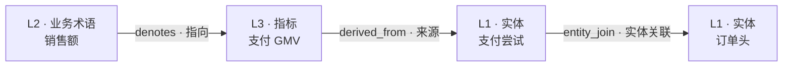

术语与指标分开建模，使同一业务词可以保留多个口径。指标通过实体关系定位字段和合法维度，实体关联保存明确的键对与基数。解析器据此选择口径，执行器按已发布绑定计算。

## 数据库设计

三类资产采用 PostgreSQL + JSONB 持久化。关系表表达稳定的身份、版本、授权与引用，版本正文保存不同资产类型的字段、释义和公式。

**Web 库共有 16 张语义相关表，其中 15 张以 `semantic_` 开头，另有 `execution_bindings`。Agent 库还有一张 `semantic_metric_offer`。** 下表列出完整范围。ER 图按内容、权限、发布和运行记录分组，相关的已有账户、工作区与任务表一并标出。

| 模块职责             | Web / Agent 中的表                                                                                                                                 | 表数 |
| -------------------- | -------------------------------------------------------------------------------------------------------------------------------------------------- | ---: |
| 资产内容、来源与绑定 | Web · `semantic_assets`、`semantic_versions`、`semantic_relations`、`semantic_aliases`、`semantic_source`、`semantic_scopes`、`execution_bindings` |    7 |
| 组织归属与访问授权   | Web · `semantic_scope_memberships`、`semantic_scope_grants`、`semantic_asset_grants`                                                               |    3 |
| 审批与版本发布       | Web · `semantic_reviews`、`semantic_release`、`semantic_release_head`、`semantic_revocation`                                                       |    4 |
| 操作事件与版本引用   | Web · `semantic_event`、`semantic_reference`                                                                                                       |    2 |
| Agent 私有查询引用   | Agent · `semantic_metric_offer`                                                                                                                    |    1 |

图中的 PK 表示主键，FK 表示外键，带分叉的一端可以有多条记录。`tenant`、`tenant_member`、`app_user`、`workspace` 是已有的组织与账户表，`agent_session`、`agent_run` 是已有的会话与任务表。顾客的支付、退款流水在零售业务库，通过授权连接查询。

### 资产、版本与来源

先看资产、版本、关系与执行绑定这四张表怎样连起来。图中的 `workspace` 提供已有工作区的身份。随后再看来源、别名和范围怎样补上维护信息。

{{asset-model}}

| 表                   | 一条记录保存什么                                                       | 实例与关联                                                                                                          |
| -------------------- | ---------------------------------------------------------------------- | ------------------------------------------------------------------------------------------------------------------- |
| `semantic_assets`    | 一项资产的稳定身份、类型、业务键和维护归属                             | 给“销售额”词条、“支付 GMV”指标、“支付尝试”实体各一个身份，修改定义时继续使用原身份                                  |
| `semantic_versions`  | 这项资产某次修订的名称、定义、来源、使用范围和摘要                     | 保存这一版支付 GMV 的公式、时间字段和允许维度。`asset_id` 指向身份，`parent_version_id` 连接同一资产的上一版        |
| `semantic_relations` | 从一个定义版本到另一项资产的关系及关联规则                             | “销售额”通过 `denotes` 指向支付 GMV；支付 GMV 通过 `derived_from` 指向支付实体；实体之间通过 `entity_join` 登记键对 |
| `semantic_aliases`   | 某个范围内可检索的名称及目标资产，并记录名称来自哪个版本               | 用户换一种叫法提问，目录仍能找到相应定义                                                                            |
| `semantic_source`    | 来源定位符、来源版本、摘要、材料及维护归属                             | 记录公式来自哪一版教学包或哪份维护者登记的材料                                                                      |
| `semantic_scopes`    | 平台、租户、部门、岗位、工作区或个人的范围身份                         | 表示“远山销售部”。资产用它记录谁维护，版本用它记录向哪个范围发布                                                    |
| `execution_bindings` | 一个指标版本在指定工作区的来源、计算模板、摘要、输入输出约束和访问要求 | 把支付 GMV 的这个版本接到远山经营总部的只读支付数据                                                                 |

一项资产可以不断追加版本，一个版本也可以有多条关系和多份工作区绑定。名称来自哪一版、关系从哪一版出发，都有字段可追溯。下面把另外三张表放回这条链路。

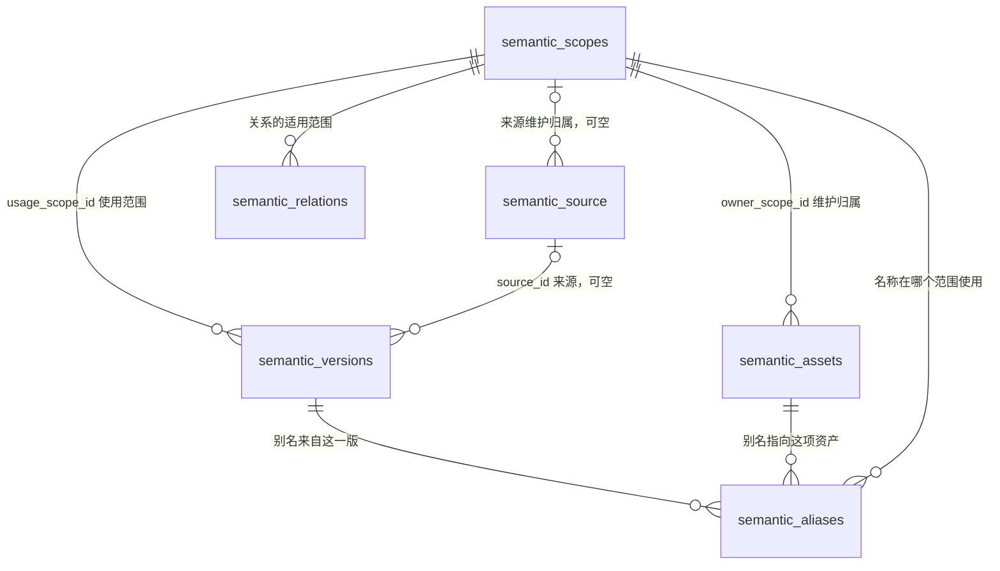

资产维护归属与版本使用范围独立记录，支持部门维护、跨范围使用。版本通过 `source_id` 保留来源，名称索引与关系支持检索和解析。每次修改追加版本，历史查询保留原公式。

[[catalog 查看资产、版本和绑定的唯一性约束]]

| 键或约束                                 | 设计含义                                                                                  |
| ---------------------------------------- | ----------------------------------------------------------------------------------------- |
| `UNIQUE(owner_scope_id, kind, code)`     | 同一维护范围、同一资产类型的业务键唯一                                                    |
| `UNIQUE(asset_id, version_no)`           | 每项资产单独编号。复合外键 `(asset_id, parent_version_id)` 把修订链限制在同一资产内       |
| `semantic_aliases`、`semantic_relations` | 名称或关系起于版本、指向稳定身份，另带适用范围。同词可有多个目标                          |
| `execution_bindings.binding_id`          | 每份绑定有独立 ID，引用指标版本和租户内的工作区。SQL 摘要随绑定保存，发布清单选定具体绑定 |

[[/catalog]]

### 组织与授权

组织归属、治理职责和资产使用权分别建模。成员归属决定部门或岗位范围，治理职责控制维护与发布，资产授权控制工作区内的定义使用权。分开记录后，同一成员可在不同范围承担不同职责。

| 表                           | 一条记录保存什么                                                     | 授权检查                                                                                   |
| ---------------------------- | -------------------------------------------------------------------- | ------------------------------------------------------------------------------------------ |
| `semantic_scope_memberships` | 某个租户成员属于哪个部门、岗位或其他范围，以及生效与撤销时间         | 确定成员的部门与岗位范围，计算部门授权和灰度发布受众                                       |
| `semantic_scope_grants`      | 在某个范围内授予一位成员一种职责，记录授予者和撤销时间               | 检查 `manage` 维护、`share` 分享、`business` 业务审批、`data` 数据审批、`release` 发布职责 |
| `semantic_asset_grants`      | 在一个工作区内，把某项实体或指标授予一个部门或成员，以及当前启停状态 | 检查成员在当前工作区对实体或指标的使用权                                                   |

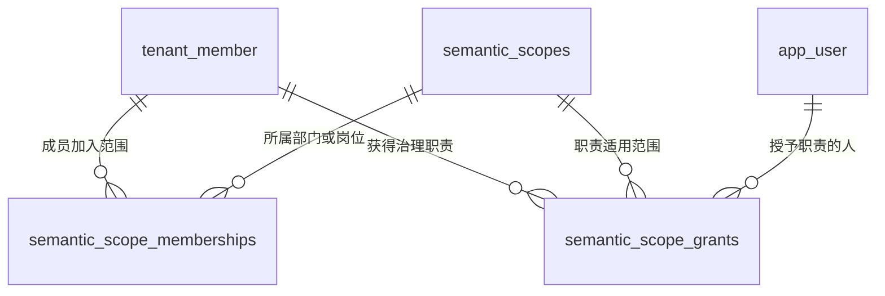

上图从成员出发，分别记录组织归属和治理职责。下图从工作区内的一项资产出发，记录获准使用它的部门或成员。

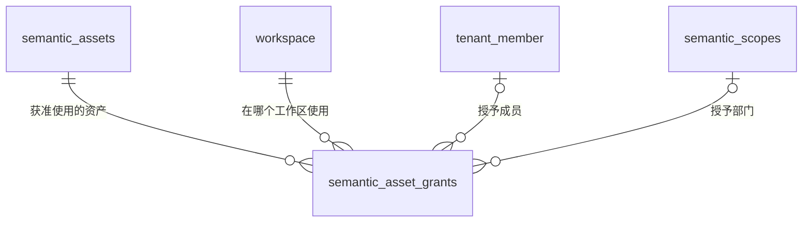

资产授权的一行只能选择部门或成员之一。授予销售部后，服务端结合当前成员归属计算使用权。维护、审批和发布另查范围职责。读取支付流水还要经过当前用户的业务连接和数据权限校验。

### 审批与发布清单

审批记录绑定具体版本和摘要。发布清单保存已选定的定义版本、依赖及执行绑定，当前指针决定新任务读取哪份清单。平台与各租户分别维护发布分区。不可变清单保留历史组合，独立指针支持切换当前版本。

| 表                      | 一条记录保存什么                                                           | 实例与关联                                                 |
| ----------------------- | -------------------------------------------------------------------------- | ---------------------------------------------------------- |
| `semantic_reviews`      | 对某一版本、范围和摘要的一次送审、业务审批、数据审批或退回，含操作者和意见 | 业务与数据负责人分别确认当次提交的定义和绑定内容           |
| `semantic_release`      | 某个发布分区的一代不可变清单，含 `manifest`、摘要和可选灰度人群            | 清单记下“支付 GMV 使用这个版本、这个绑定和这个模板摘要”    |
| `semantic_release_head` | 一个分区的当前代数、稳定版 ID、灰度版 ID 和灰度人群                        | 新任务到来时，找到此刻该用户应使用的发布清单               |
| `semantic_revocation`   | 某次发布的撤销人和原因                                                     | 原任务持有的发布被撤销后，后续查询与回看会受到权限复核约束 |

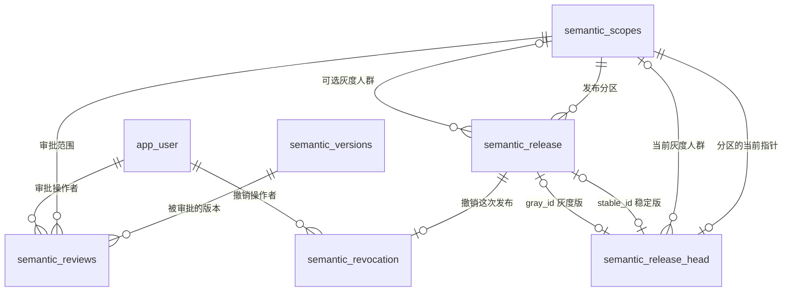

发布清单的 `manifest` 是 JSON，内容里按资产 ID 记录定义版本、依赖版本，以及选中的绑定 ID 和模板摘要。这些 ID 由发布服务校验后一起保存，属于应用管理的逻辑引用。图中外键连接的是清单、范围和当前指针。

维护者在目录“保存并生效”时，会追加定义版本并更新清单。为某个工作区启用计算方法时，还会按绑定要求试算，由业务和数据负责人分别审批。两种操作最终都让新任务从当前指针取得相应清单。

### 操作记录与运行引用

操作事件以请求键支持幂等重试，版本引用记录查询或报告使用的定义。两类记录分别服务于写入一致性和历史追溯。

| 表                   | 一条记录保存什么                                 | 实例与关联                                                                             |
| -------------------- | ------------------------------------------------ | -------------------------------------------------------------------------------------- |
| `semantic_event`     | 操作者、工作区、请求键、动作、请求摘要及结果回执 | 保存、授权、试算等操作按请求键去重。同一个请求重试可复用首次结果，试算回执也供审批检查 |
| `semantic_reference` | 工作区、定义版本、引用类型及查询或报告的引用 ID  | 记录某次查询或报告使用了哪个支付 GMV 版本，供影响检查与追溯                            |

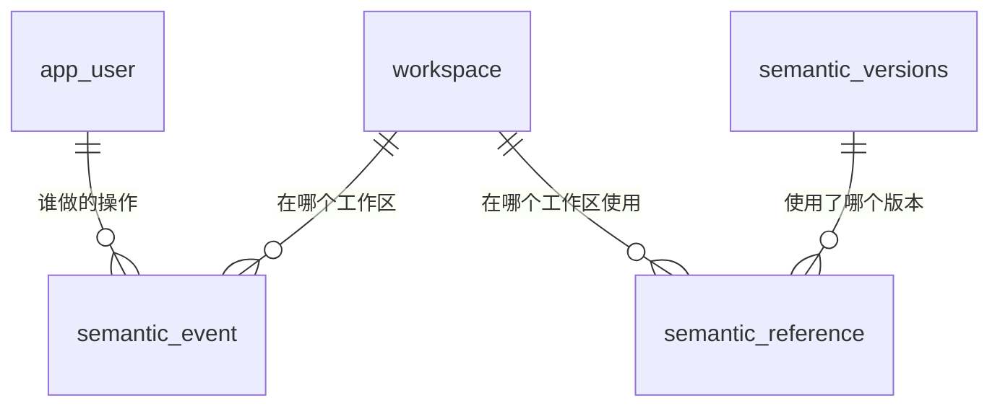

`semantic_event` 以“操作者、工作区、请求键”作为唯一组合。`semantic_reference` 记录已使用版本的结果引用。实际分析过程由 Agent 继续管理，下面的表位于 Agent 自有数据库。

| 表或已有字段                                        | 保存什么                                                                             | 运行时用途                                                               |
| --------------------------------------------------- | ------------------------------------------------------------------------------------ | ------------------------------------------------------------------------ |
| `semantic_metric_offer`                             | 属于同一用户、会话和 Run（一次分析任务）的私有引用，带种类、状态、加密内容及过期时间 | 保存查询计划、结果或候选所需内容，通过引用找到本次操作，再复核当前访问权 |
| `agent_run.config_snapshot.contextRuntime.registry` | 本次任务固定的发布 ID 和摘要                                                         | 恢复任务时沿用受理时选定的清单，并检查其当前可用性                       |
| `agent_session`、`agent_run`                        | 既有会话和分析任务                                                                   | 提供私有引用的会话归属与任务归属                                         |

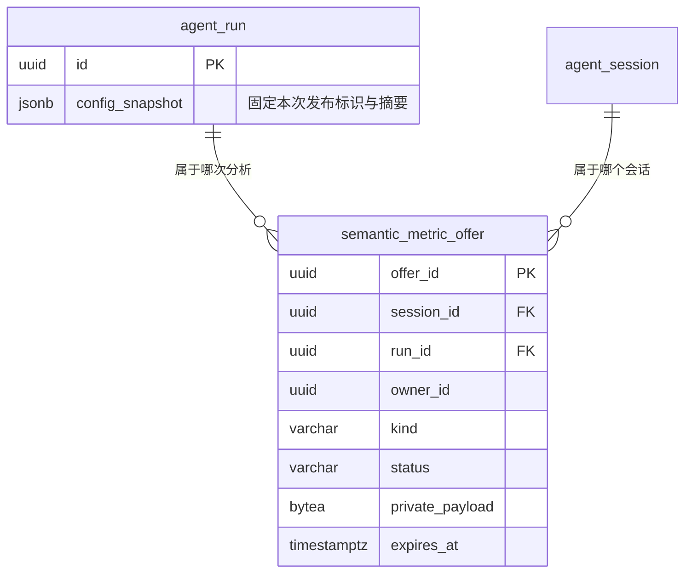

Agent 通过内部 HTTP 向 Web 取得发布内容，随后在自己的库中保存任务快照和私有引用。两个库各自管理外键，结果中的引用 ID 把这次查询与 Web 登记的版本使用记录联系起来。

[[catalog 查看早期版本中出现过的三张表]]

Web 的 `semantic_policy`、`semantic_feedback` 在迁移 `0007_semantic_cleanup` 中移除。Agent 的 `semantic_run_binding` 在迁移 `0018` 中核对与 Run 快照一致后移除，固定清单保存在 `agent_run.config_snapshot` 中。查看旧库或早期 SQL 时可能看到这些名字，本节表数按完成这些迁移后的结构计算。

[[/catalog]]

## 初始化数据

**远山零售**使用“经营总部”工作区，零售库中的租户编号为 101。**星河商贸**使用“电商运营”工作区，编号为 102。编号用于 SQL 定位数据。两家分别维护本地资产，平台还提供可共用的“下单订单数”。

| 第 2 版已发布的内容 | 不重复的业务种类 | 按维护归属计数的定义 | 怎样理解这两个数                                                                 |
| ------------------- | ---------------: | -------------------: | -------------------------------------------------------------------------------- |
| 经营实体            |            37 种 |                74 个 | 两家企业各有 37 个实体定义，合并相同源表后共描述 382 个字段、95 条关联规则       |
| 业务术语            |            16 种 |                29 个 | 同一名称在不同归属下可以有不同指向。远山的“销售额”登记了三个候选，星河登记了两个 |
| 指标                |            12 种 |                18 个 | 支付 GMV 由两家销售部分别维护，下单订单数由平台维护一份                          |

合计 **121 个定义**，分布在 10 个初装维护范围内。第 2 版还写入 **293 条关系**（190 条实体关联、33 条术语指向、70 条指标来源），另有 **191 条名称与别名索引**。8 种指标配了共 **14 份候选 SQL 绑定**，随包启用 **0 份**。安装后目录可提供定义检索，正式指标查询需要工作区另行发布对应绑定。

### 教学包版本与发布状态

| 安装步骤            | 写入的数据                                                                                 | 安装后能做什么                                                       |
| ------------------- | ------------------------------------------------------------------------------------------ | -------------------------------------------------------------------- |
| v1 建立基础目录     | 按归属新建 121 个资产身份和初始版本，写入 167 条关系、191 条名称与别名，以及 14 份候选绑定 | 后续发布使用同一批身份，保留初版记录                                 |
| v2 发布完整定义     | 追加字段解释、关系、指标来源和公式，发布到平台、远山和星河三个稳定清单                     | 获准成员能查释义、公式和关系，两个工作区按需启用候选模板             |
| v3 修订“销售额”释义 | 分别检查两家企业仍在使用的预置第 2 版，符合条件时追加新版词条                              | 可直接读出付款、净回款、确认收入的区别。已经人工修订或撤下的词条跳过 |

[[catalog 查看 10 个维护范围的分布]]

| 维护归属 | 首次装载的范围                        | 如何使用                                                                                         |
| -------- | ------------------------------------- | ------------------------------------------------------------------------------------------------ |
| 平台     | 1 个平台作用域                        | 维护可共享的下单订单数及其术语。每个工作区独立核准连接与绑定                                     |
| 租户     | 远山零售与星河商贸各一个租户范围      | 各自拥有实体、日历与本地指标。安装时核对 Web 租户 UUID 和工作区 UUID，查询时再核对零售租户与地区 |
| 部门     | 两家各有销售、财务、营销，共 6 个范围 | 负责人可维护部门口径。成员在指定范围获准使用发布版本，兼任关系叠加                               |
| 个人     | 远山零售的教学分析师                  | 个人渠道净回款可查阅公式。创建者、编辑者、维护归属和使用范围分别记录                             |

共 10 个初装范围。治理模型还支持工作区、岗位作用域。`owner_scope_id` 决定谁维护，`usage_scope_id` 决定向谁发布。来源连接的租户、行和列权限由执行器检查。

[[/catalog]]

## Agent 应用与工具体系

持久化后的资产通过 Web 内部 API 提供给 Agent。Context Runtime 装配可见摘要，语义工具按需检索、解析与执行，维护工具将可复用结果转为新版本。

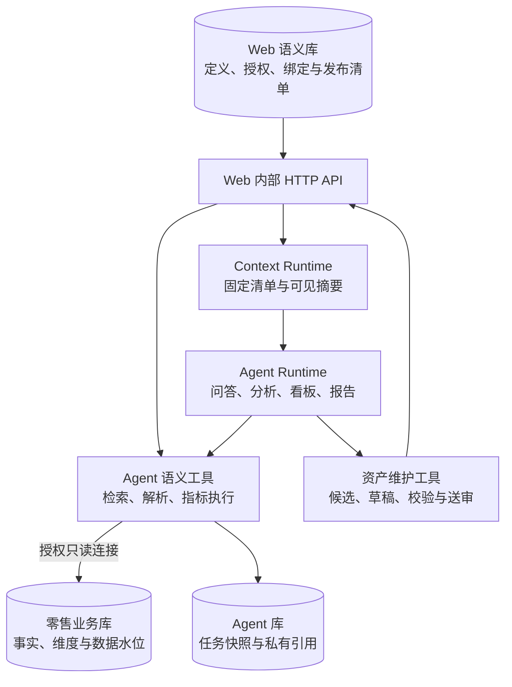

| 能力       | 入口                                                                               | 对底层模型的使用                                 |
| ---------- | ---------------------------------------------------------------------------------- | ------------------------------------------------ |
| 上下文装配 | `manifest`、`context`、`glossary` 内部操作                                         | 固定发布清单，按当前授权读取术语与资产摘要       |
| 检索与定义 | `search_semantics`、`get_metric_definition`                                        | 使用名称、别名、全文索引、版本与来源             |
| 解析与查询 | `resolve_semantics`、`query_metric`                                                | 固定指标版本、绑定、业务参数，保存私有计划并执行 |
| 开放查询   | `database_query`                                                                   | 通过获准只读连接发现结构并查询明细，保留临时回执 |
| 资产维护   | `discover_semantic_candidates`、`review_semantic_change`、`submit_semantic_change` | 从素材或回执建草稿、修订、校验和送审             |

Web 管理定义和发布，Agent 管理执行，零售库管理业务行。应用间通过 HTTP 交换已授权内容，各数据库独立迁移并维护自身外键。

## 核心模块详解

### 定义保存与版本发布

Web 在一个事务中完成权限检查、来源与依赖校验、版本追加和发布清单更新。维护者保存后，新任务取得新的定义组合，已有 Run 保留受理时固定的清单。归档前检查有效依赖，存在引用冲突时返回冲突项，历史版本继续保留。

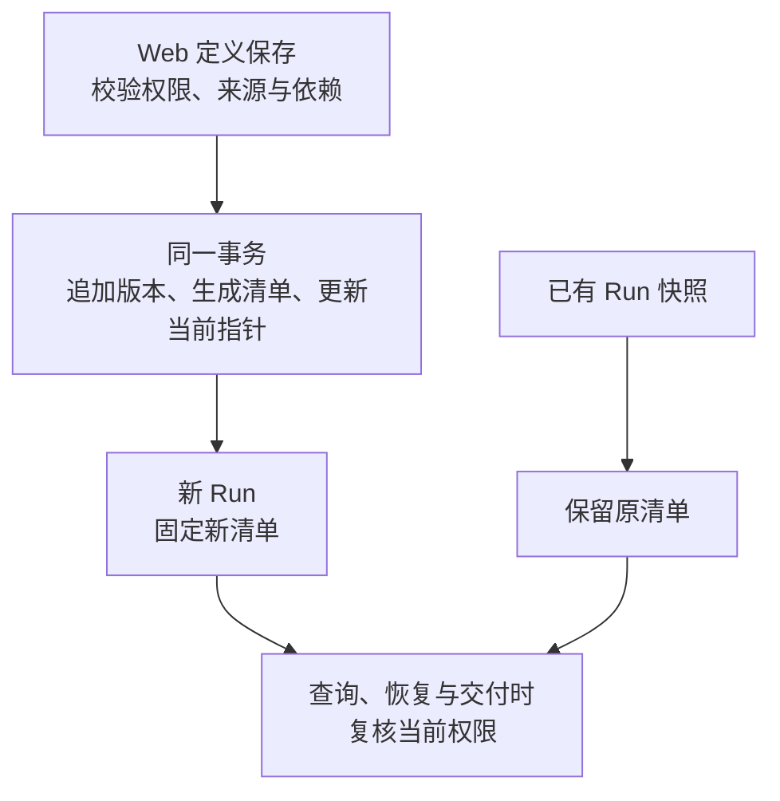

版本与清单同时保留，使定义能够持续修订，运行中的任务仍可按受理时的组合执行。实体和组织指标的使用权由资产授权管理，术语随发布范围共享，底层数据访问由连接权限另行控制。

### 工作区执行绑定

执行绑定保存指标版本、工作区、来源、SQL 或受控聚合、模板摘要、参数与结果 Schema，以及访问要求。同一业务公式可在多个工作区使用不同的受管连接，绑定独立记录本地执行方式。

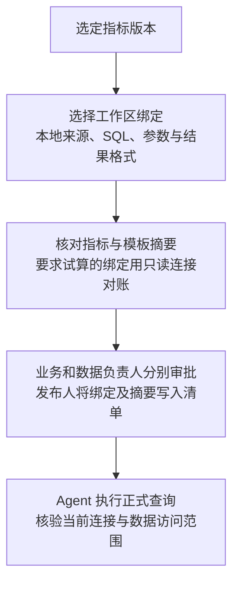

在教学包里查 `sales.order_count`（下单订单数）的第 2 版，会看到两条候选记录。一条指向远山经营总部的数据来源 `retail:101`，另一条指向星河电商运营的 `retail:102`。这两个来源标识告诉执行器去匹配哪家的受管连接。为远山启用订单数，只会把远山那份绑定加入对应的发布清单。

Agent 经内部 HTTP 向 Web 领取发布的绑定，通过用户获准的只读连接执行模板。业务期间决定统计哪几天，数据截止时点 `as_of`（下文简称 K）决定当时能看到哪些修订。复盘同一周时，二者都要保留。模型给出业务条件，服务端从受管连接取得授权范围，执行器分别校验。

| 调用边界                        | 谁提供                                                                                   | 实际校验                                                                                                                               |
| ------------------------------- | ---------------------------------------------------------------------------------------- | -------------------------------------------------------------------------------------------------------------------------------------- |
| 计算条件 `$1`                   | 经工具校验的业务参数 `start, end, as_of, group_by, filters`                              | 每次最多一个分组维度，分组与过滤分别按指标白名单校验。比较时须显式提交对照期，可选用解析返回的前一等长期间，两窗固定 K、时区和来源发布 |
| 已核验的来源身份和授权范围 `$2` | Agent 从当前用户获准的只读连接核验实际登录、租户、可读地区与零售发布号，再构造服务端参数 | 校验所需关系、行级保护、只读权限和固定搜索路径。计算整家企业的广告回报倍数（ROAS）时，连接须获准访问全部地区                           |
| 结果行                          | 已核验摘要的 SQL 模板                                                                    | `group_key, value, status, detail, period_start, period_end, as_of, data_release, business_timezone, unit`。精确数值按无损十进制传递   |
| 正式回执                        | Agent 执行后保存私有引用                                                                 | 回执带指标版本、绑定 ID／摘要、清单摘要、单位、授权范围、业务期间和 K。恢复、交付及历史读取复核当前授权                                |

### 语义解析与指标执行

一次 Run 固定受理时的发布清单。解析器结合当前问题和前文，在可见定义中确认口径，再校验期间、维度与绑定。私有查询计划固定版本、绑定与业务参数，工具只传递本任务的计划引用。

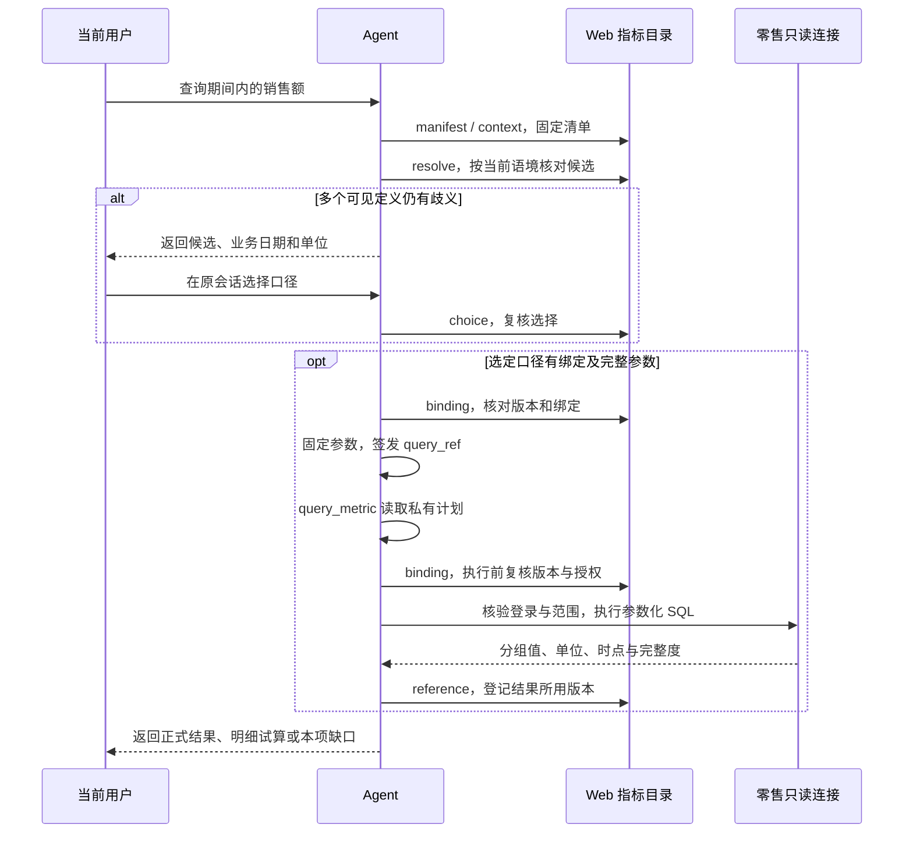

图中的 `query_ref` 是 Agent 签发的查询计划引用，固定选定的版本、绑定和业务参数。只有口径、参数、绑定和授权都就绪，正式查询才会读业务库。多个可见指标都符合原话时，本人可在原轮次选择或填写算法。单一可见定义缺少绑定时，仍可按明确的算法用授权明细计算并注明来源。有绑定但缺期间时返回 `needs_parameters`，维度超出定义时返回 `invalid_dimension`。来源延迟时，答案会标出缺口。例如，完整期间内一笔成功支付都没有，支付总额可以给 0；若订单系统的数据还未到齐，金额留空并说明延迟。

### 订正选版与数据完整度

业务期间使用左闭右开区间 `[start, end)`，数据截止时点 `as_of` 决定可见修订。商品日报先按自然键选版，再进行聚合。首报固定第 1 版，最新日报选择截止时点内的最高版本。两类查询共用物理表，各自采用不同的取版规则。

例如同一条日报由 100 元订正为 90 元，首报取 100 元，最新版取 90 元。版本之间属于修订关系，直接求和会重复计算。下表列出各类数据的完整度条件。

| 数据类型               | 可给出数值的条件                                                                               | 数据有缺口时                                                                            |
| ---------------------- | ---------------------------------------------------------------------------------------------- | --------------------------------------------------------------------------------------- |
| 订单、支付、退款和收入 | K 内的末次来源水位覆盖窗口右端。交易检查订单系统（OMS）的水位，收入还检查财务系统（ERP）的水位 | `COVERAGE_UNKNOWN` 或 `SOURCE_DELAYED`。完整窗口无事实时总计为 0，空分组标识 `NO_FACTS` |
| 商品日报               | 最新版逐日核对 COMPLETE。首报接受已到首报阶段的 PARTIAL 或 COMPLETE 并统计实际行数             | `REPORT_INCOMPLETE` 等状态附日期，首报无行另给 `NO_REPORT_ROWS`                         |
| 净 ROAS                | 活动日归因可见、消耗地区 1–7 齐备，且总消耗大于零                                              | 缺归因、归因未知、缺地区、零消耗分别返回状态，`detail` 保留所用版次                     |
| 期末库存               | 由有效配货范围生成“应有地点 × SKU”集合，左联同一收盘时刻的快照，逐项核对可见性及件数平衡       | 区分尚未收盘、快照未到、组合缺失、件数不平等状态。有缺口时总件数留空                    |

### 查询结果沉淀为资产

Agent 从同会话查询回执提取公式与来源，将本次日期保留为参数。候选发现先核对回执完整性与目录中的等价定义，再通过可编辑预览确认草稿。修订已有指标时检查原版本摘要，避免覆盖并发修改。


私有回执限定用户、会话和任务归属，保存操作以请求键处理重试。草稿经后续校验与发布进入目录，正式取数还需要可用的工作区绑定。

[[catalog 查看普通 Chat 运行记录与固定数据集核对值]]

**课堂运行记录。** 远山教学账号已在普通 Chat 创建“成功支付方式种数”，随后按名称查到带查询来源的个人草稿。另一道混合查询在已发布支付 GMV 绑定的教学快照中找到 11 月 19 日失败 10 笔，再按正式口径算出比上周同日多 10,937.10 元。

### 固定数据集核对值

以下是固定教学底本的核对值。用模板复算，可以检查日期、订正和分组处理是否正确。通过正式指标工具重放前，需要工作区已发布对应绑定。

| 演示问题                                     | 计算时要做的选择                                                                           | 应观察到的结果                                                                                                              |
| -------------------------------------------- | ------------------------------------------------------------------------------------------ | --------------------------------------------------------------------------------------------------------------------------- |
| 两周渠道实付变化最大的是谁，哪些商品贡献最大 | 最新日报选版 → 相同 K 的两期 → 按渠道比较 → 固定渠道后改按商品款（SPU）分组                | 远山零售的 2025-11-17 至 23 日对 24 至 30 日，微信小程序渠道的实付比前一周少 42,875.90 元。前三项与其余项之和应回勾渠道差额 |
| 核对 POS 首报及每日明细                      | 标准门店的收银（POS）日报 → 固定使用第一次上报的记录 → 计数与金额分别聚合                  | 远山零售在 2025-11-17 至 23 日为 453 行、44,597.20 元，七天明细合计等于周总额                                               |
| 上月收款为什么和收入不同                     | 一张 100 元订单跨月支付与妥投，次月两笔退款共 20 元 → 各分支独立归期                       | 支付月支付 GMV 为 100 元，次月净现金流为 −20 元，次月确认收入为 80 元                                                       |
| 同一活动日为何在两次复盘中数值不同           | 远山零售在抖音店铺投放的教学活动（活动编号 30），2025-06-01 的消耗固定为 8,053 分，改变 K  | 6 月 10 日零点取归因 v1，为 2.8306 倍，8 月 2 日零点取 v2，为 1.9862 倍。归因修订保留在明细中                               |
| 某个地点期末还有多少可卖                     | 远山零售的一组库存样本（持货地点编号 1，商品规格编号 9） → 指定收盘时点 → 检查快照是否可见 | 2025-10-01 23:59:59 时快照尚未到达，次日零点可读 9 件。连续两日为 8、5 件时跨日取 5 件                                      |

[[/catalog]]

## 零售资产字典

### L1 实体、维度与关系

以订单为例，订单头的一行代表一张订单，支付的一行代表一次尝试，收入分录的一行代表一次会计事件。先确定指标在哪种行上计数或求和，再沿已登记的键对取得维度，能避免一单多商品或多次退款造成重复计数。

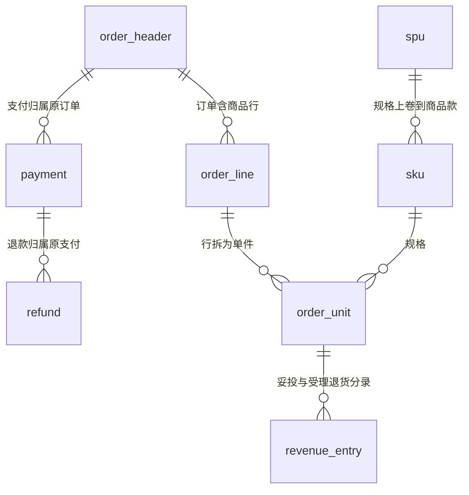

顺着图看，支付尝试连回原订单就能取得销售归属。收入分录要先找到具体售出的单件，再回到订单或商品；同一张订单可能含多件商品，按订单计数时要去重。

| 业务问题         | 关联与聚合规则                                                                                                                     | 影响                                                                     |
| ---------------- | ---------------------------------------------------------------------------------------------------------------------------------- | ------------------------------------------------------------------------ |
| 订单筛选商品     | 给订单数加商品条件时，用 `EXISTS` 判断是否存在符合的商品行                                                                         | 同单含三个符合条件的 SKU 仍计一单                                        |
| 支付与退款归属   | 支付按 `(tenant_id, order_id, region_id)` 找订单。退款按 `(tenant_id, payment_id, order_id, region_id)` 找成功原支付。分支各自汇总 | 多次退款只增加退款事实。本期现金流可因上期订单退款而为负                 |
| 拆到商品和地点   | 收入分录按 `(tenant_id, order_unit_id, region_id)` 回到单件、SKU、原订单。地点还分原销售、发货、退货接收、持货角色                 | 确认收入可分商品。订单级支付需要分摊规则才能分商品。空销售网点保留独立组 |
| 多值或跨粒度关联 | 同款可有多个运动标签，按标签筛选可用存在性判断。营销消耗先由地区合并到活动日，再与同活动日的平台归因对齐                           | 按多标签加总须先约定分摊权重。全租户归因仅在有整租户数据时计算           |

v2 字典包含 382 个字段和 95 条按源表去重的关联规则，其中 40 条来自 v1 业务建模，55 条由 v2 补入。每条关联给出有序键对、基数、可空性与适用条件。

{{catalog:entities}}

### L2 术语与别名

术语版本记录业务解释、典型问法和容易混用的说法。别名行负责名称检索，`denotes` 关系把术语版本指向该范围可用的指标或实体。远山零售的“销售额”有支付 GMV、现金流净 GMV、确认收入三个候选。星河商贸的教学词表登记支付 GMV 与现金流净 GMV。

| 名称               | 候选及辨别条件                                                                          | 解析产物                                                            |
| ------------------ | --------------------------------------------------------------------------------------- | ------------------------------------------------------------------- |
| 销售额／成交额     | 可能询问收款、扣退款后的现金流或财务确认收入。如果已指明“扣退款”，先用具体口径识别      | 得到明确指标，或把多个候选交给 Agent 结合前文区分，必要时请用户选择 |
| 广告回报／广告 ROI | 净 ROAS 的分子是归因净回款，利润 ROI 的分子需要归因利润。提问明确利润时应能解释所缺条件 | 展示两个公式，以及利润 ROI 在执行前需要的成本和分摊条件             |
| 门店／持货地点     | 可指向同一个 `site` 实体。销售指标取原销售网点，库存指标取快照所属网点                  | 维度角色随指标定义传递                                              |

{{catalog:terms}}

### L3 度量与指标

指标版本封存业务事件、事实粒度、组成度量、公式、单位、期间、允许维度及例外。基础度量写在版本的 `definition.components` 中。金额以人民币分计算，展示元时除以 100。经营期间按上海时区取左闭右开区间 `[start, end)`。`as_of`（以下记为 K）表示这次复盘允许看到的数据截止时点，包含边界。

| 指标名称与业务键                                        | 计量、归期与允许下钻                                                                                | 对汇总结果有影响的规则                                                                     |
| ------------------------------------------------------- | --------------------------------------------------------------------------------------------------- | ------------------------------------------------------------------------------------------ |
| 下单订单数 `sales.order_count`                          | 按 `order_header.ordered_at` 计订单，可按日、渠道、原销售地区、销售网点分组                         | 含取消单。商品可用于筛选，跨商品集合须回到订单去重                                         |
| 支付 GMV `sales.paid_gmv`                               | 成功支付的 `amount_cent` 之和，按成功行 `attempted_at` 归期，支持同上四维                           | 剔除失败尝试，同一笔成功支付只入账一次                                                     |
| 现金流净 GMV `sales.net_gmv`                            | 成功支付正项与成功退款负项各按自己的日期入账，支持同上四维                                          | 一笔跨月退款记在退款月。完整窗口允许出现负值                                               |
| 确认收入 `finance.recognized_revenue`                   | 按 `recognized_at` 汇总妥投与受理退货的带符号分录。除渠道、地区、网点、日，还可按 SKU、款和品类分组 | 部分退货按受理日冲减。退款到账另属现金流                                                   |
| 平台归因净回报倍数 `marketing.net_roas`                 | 平台末次点击七天、模型 v1，合计归因净回款除以合计消耗，按日、活动、平台渠道分组                     | 每个范围重算分子与分母。按 K 独立选归因版与各区消耗版。零消耗返回状态                      |
| 期末可用库存件数 `inventory.closing_available_qty`      | 取窗口最后一天（`end - 1 日`）的上海 23:59:59，按持货地点、地区、SKU、款或品类汇总可用件            | 跨日取末日。在同一时点逐组合校验 `available_qty = sellable_qty - reserved_qty`，齐备后求和 |
| 渠道商品日报实付金额 `channel.reported_paid_amount`     | 渠道商品日报按报表日、渠道、SKU、地区各取 K 内最高修订，可按日、渠道、报表地区、SKU、款或品类分组   | 每天须有 COMPLETE 对账声明。先逐自然键取版，再合计实付分                                   |
| 渠道商品首报实付金额 `channel.first_report_paid_amount` | 同源日报固定 `report_version = 1`，可筛渠道和地区，返回总计或日组                                   | 同时返回参与的首报行数。无可见明细的日期留在回执里，后续订正不会改写首报                   |

**另外四个指标已发布定义。** 公式和来源可在下方字典查阅，工作区绑定数为零。

| 指标名称与业务键                               | 可执行前需要补齐的内容                             |
| ---------------------------------------------- | -------------------------------------------------- |
| 投放利润 ROI `marketing.profit_roi`            | 归因毛利、成本分摊规则及所需授权                   |
| 商品毛利 `finance.gross_profit`                | 成本冲回规则和成本列权限                           |
| 期末库存估值 `inventory.closing_value`         | 估值主体、有效快照与成本权限，远山和星河各维护一份 |
| 我跟进的渠道净回款 `personal.channel_net_cash` | 本人跟进的渠道和获准分享的范围                     |

{{catalog:metrics}}

有关 Agent 怎样组装模型输入和选择工具，见配套阅读。[打开第 22 课主方案](#main-design)

## 实现参考 · 安装、权限与接口

### 安装与核对教学包

先准备好 Web 教学库和教学账号口令 `WEB_FIXTURE_PASSWORD`，再按下面的顺序装载。下面第二个代码块用独立 SQL 替代 v1 初装，随后同样依次发布 v2 和 v3。

{{code:seed}}

{{code:standalone}}

安装器先给每个“范围／业务键”预分配资产 ID 与版本 ID，存入事务内的临时表。下面两条 INSERT 摘自 v1 安装器，共用这张映射。后续写别名、关系和绑定时也查同一映射，因而跨层引用落到同一批身份上。

{{sql:asset-versions}}

安装前校验受管数据库标记和教学身份，按包定位符加事务锁。已安装且摘要相同返回 `already_installed`。同版内容漂移、引用冲突或工作区映射错误会使整笔事务回滚。v2 遇到被人工修改的目标定义、活动灰度或当前清单已含该目标时整笔回滚。重复执行摘要相同的 v2 包会返回已安装。恢复时将备份还原至独立 Web 库，核对版本、摘要及权限后切换。

下面的只读 SQL 用左连接列出每个指标及本地绑定。查询限定 v2 来源。平台订单数有两行候选绑定，利润 ROI 的绑定列为空。要确认正式工具可用，须核对选中清单上的绑定和当前用户的数据连接。

{{code:inspect}}

### 数据库迁移

| 数据库与迁移             | 新增或调整                                                                                                                                  | 使用者                                 |
| ------------------------ | ------------------------------------------------------------------------------------------------------------------------------------------- | -------------------------------------- |
| Web/main `0003 → 0004`   | 新增来源、作用域、资产、版本、别名、关系、执行绑定等内容表。装入默认资产的 SQL 使用这些表                                                   | 教学包和指标管理页                     |
| Web/main `0004 → 0005`   | 扩展作用域、成员权限、来源与绑定，增加成员关系、授权、评审、清单、发布指针、撤销、事件与引用。`semantic_event` 以操作者、工作区、请求键去重 | 治理事务、发布和运行时 Registry        |
| Web/main `0005 → 0006`   | 对定义名称与摘要、别名显示文本分别增加 GIN 全文索引                                                                                         | 在已授权清单上执行检索                 |
| Web/main `0006 → 0007`   | 保留资产和发布记录，收缩目录表                                                                                                              | 目录与受控查询                         |
| Web/main `0007 → 0008`   | `semantic_asset_grants` 记录工作区内部门或成员对组织实体、指标的使用权，每条恰好选择一种对象                                                | 授权抽屉、已发布目录与 Registry        |
| Agent/main `0017 → 0018` | 固定清单从 Run 快照读取，`semantic_metric_offer` 保留计划和结果引用                                                                         | Run 恢复与工具调用                     |
| Compass Retail           | 复用现有业务表、行级权限、水位和修订字段                                                                                                    | 实体登记源表，执行器经实际用户连接读取 |

### API 与工具契约

管理页通过 Web 会话写资产。Agent 用服务身份调用 Registry，同时传入真实用户、租户、工作区与 Run，Web 每次重算可见范围。试算方向相反，由 Web 委托 Agent 使用受限连接执行。

| 调用方向     | 契约与代表操作                                                                                                                                                                                              | 返回及约束                                                                                                                                  |
| ------------ | ----------------------------------------------------------------------------------------------------------------------------------------------------------------------------------------------------------- | ------------------------------------------------------------------------------------------------------------------------------------------- |
| 浏览器 → Web | 在 `/api/semantic/` 下，`GET assets`、`GET assets/{id}` 读取目录与详情，`POST assets` 保存并生效，`POST assets/{id}/remove` 删除，`POST sources` 登记来源，`GET/POST asset-grants` 读取或批量调整资产使用权 | 管理视图、动作或写入回执。请求指定 `tenantId`、`workspaceId`，写入校验会话、同源和 CSRF，治理写入使用 `request_key`                         |
| Agent → Web  | `POST /api/internal/semantic/{op}`。`manifest/context/glossary` 固定清单、读取授权摘要或共享词表，`search/definition/resolve/choice` 识别口径，`binding/authorize/reference` 取得绑定、复核、登记引用       | 请求含 `actor_user_id, tenant_id, workspace_id, run_id, args`，固定清单后带 `pins`。模型得到可见摘要或引用，可信 SQL 模板正文只在服务间传递 |
| Web → Agent  | `POST /v1/semantic/trial`，`POST /v1/semantic/suggestions`                                                                                                                                                  | 试算返回执行结果供 Web 比对独立预期。建议接口从授权素材提取可编辑候选                                                                       |

| 工具                           | 主要输入                                                                      | 输出与执行边界                                                                        |
| ------------------------------ | ----------------------------------------------------------------------------- | ------------------------------------------------------------------------------------- |
| `search_semantics`             | 检索词，可选种类、业务域、范围、游标                                          | 已发布的可见候选、匹配理由与续页游标                                                  |
| `get_metric_definition`        | `asset_id`，可选 `version_id`                                                 | 口径、单位、时间、适用维度、别名及可见依赖                                            |
| `resolve_semantics`            | 提及词、所需维度，可选指标、期间和历史截止时间                                | 绑定、期间和维度核准后签发 `query_ref`。同级冲突由原会话用户选择                      |
| `query_metric`                 | `query_ref`、`query / compare / drilldown` 操作、期间、分组和筛选，下钻带父组 | 结构化数值、完整度、版本和结果引用 `resultId`。更换分组或筛选须重新解析，下钻校验父组 |
| `discover_semantic_candidates` | 授权素材引用、同会话 `result_ref` 或 `revise_metric` 与修改字段               | 主动建议先查重，每轮最多三项；显式建草稿或修订原指标须本人确认                        |
| `review_semantic_change`       | `version_id`                                                                  | 来源与依赖检查、冲突、影响和当前摘要                                                  |
| `submit_semantic_change`       | 版本、预期摘要、说明、请求键，可选绑定                                        | 维护者确认后送入双审，后续审批与发布使用 Web 治理接口                                 |

前四个工具服务于查阅和取数，后面三个是按权限装配的 Chat 维护工具。签发的 `query_ref` 只在同一用户、会话、Run 内使用，有效期一天。它固定版本、绑定、期间、分组和筛选；变更条件需重新解析。`query_metric` 回执中的 `resultId` 指向已经取得的结果。候选发现工具用名为 `result_ref` 的输入接收同会话临时查询的结果引用。

### 源码入口

以下按资产装载、治理与运行、验证三条实现路径列出本需求的主要文件。`[新增]` 和 `[调整]` 标记维护入口，`[生成]` 标记可由这些入口重建的文件。

```text 默认资产与 SQL 装载
apps/web/
├── db/main/migrations/
│   └── 0004_semantic_content.sql            [新增] 资产、版本、执行绑定
├── db/main/seeds/
│   ├── retail-v1/
│   │   ├── edition.json                    [新增] v1 原始范围及历史配置
│   │   ├── entities.json                   [新增] 粒度、字段、时钟与关联键
│   │   ├── terms.json                      [新增] 术语、别名、范围与指向
│   │   ├── metrics.json                    [新增] 指标定义、来源与绑定规格
│   │   ├── queries/                        [新增] 输入、八种计算及输出 SQL 片段
│   │   └── install.sql                     [新增] 事务、依赖解析与安装 DML
│   ├── retail-v2/                         [新增] 完整字段、键关系、公式与词条修订
│   ├── retail-v3/                          [新增] 两个租户的销售额释义
│   └── retail-v1.sql                       [生成] 可独立执行的完整资产包
└── scripts/
    ├── retail-semantic-seed.mjs            [新增] 实例化、组装、摘要校验及导出
    ├── retail-semantic-release.mjs         [新增] 发布 v2 定义及 v3 词条修订
    └── db-seed.mjs                         [调整] v1、v2、v3 教学包入口
```

```text Web 治理与 Agent 运行
apps/
├── web/
│   ├── db/main/migrations/0005_semantic_governance.sql   [新增] 治理和清单
│   ├── db/main/migrations/0006_semantic_search.sql       [新增] 检索索引
│   ├── db/main/migrations/0007_semantic_cleanup.sql      [新增] 收缩目录
│   ├── db/main/migrations/0008_semantic_asset_grants.sql [新增] 资产使用授权
│   ├── db/main/sql/                                     [生成] 安装、增量与清单
│   └── src/
│       ├── contracts/semantic.ts                         [新增] Web 语义契约
│       ├── app/api/semantic/[...path]/route.ts            [新增] 管理 API
│       ├── app/api/internal/semantic/[op]/route.ts        [新增] 内部 Registry
│       ├── server/http/semantic-handler.ts               [新增] 身份、授权与路由
│       ├── server/modules/semantic/                      [新增] 目录、治理、解析与绑定
│       └── features/semantic/                            [新增] 类型筛选、预览与编辑抽屉、来源与组织授权
└── agent/
    ├── migrations/versions/0017_semantic_runtime.py      [新增] 会话私有引用
    ├── migrations/versions/0018_semantic_cleanup.py      [新增] 核对 Run 快照后清理重复存储
    ├── db/main/sql/                                     [生成] 安装、增量与清单
    └── src/compass_agent/
        ├── api/semantic.py                              [新增] 试算与候选建议
        ├── context_runtime/semantics.py                 [新增] Run 固定清单与上下文
        ├── semantic/                                    [新增] 服务调用、消歧、执行及回执
        ├── tools/business/                              [新增] 七个语义工具子目录
        └── tools/catalog.py                             [调整] 按能力装配工具
```

```text 数据核验与端到端验收
apps/
├── web/tests/
│   ├── integration/migrations.integration.ts   [调整] 迁移、装载、幂等与恢复
│   ├── integration/semantics.integration.ts   [新增] 发布事务及范围隔离
│   └── e2e/
│       ├── semantics-governance.spec.ts        [新增] 管理抽屉、关系跳转、保存与移除
│       └── semantics-chat.spec.ts              [新增] 查询、消歧与保存提议
└── agent/tests/
    ├── test_context_semantics.py              [新增] 固定上下文
    └── test_semantic_governance.py            [新增] 授权、执行与恢复
mai-specs/974-lesson-22-enterprise-semantic-governance/
├── test/score_sql_bindings.py                 [调整] 按 edition 复核 100 个受限 SQL 样例
├── test/verify_retail_content.py              [新增] 真实教学数据逐指标核验
└── design/
    ├── RETAIL_SEMANTIC_ASSETS.md              [新增] 资产与 SQL 装载设计
    ├── document/                              [新增] 阅读稿与离线生成入口
    └── RETAIL_SEMANTIC_ASSETS.html            [生成] 语义层设计阅读版
```
