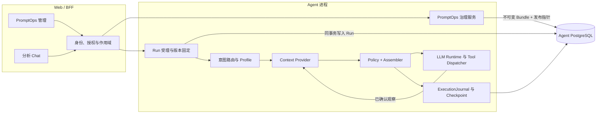
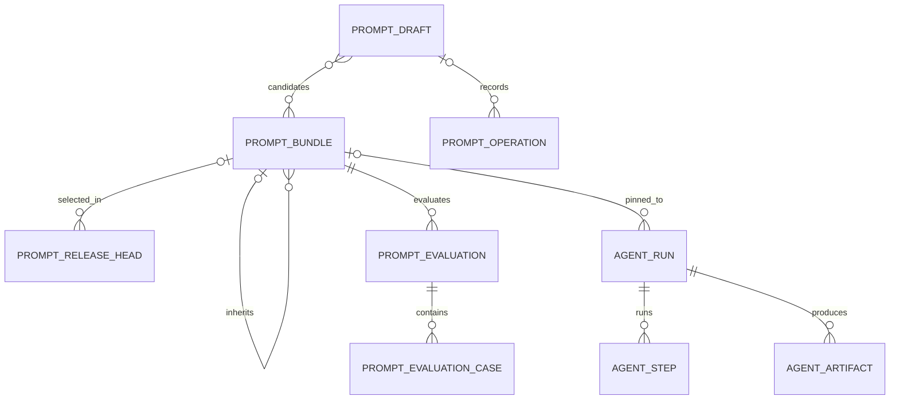
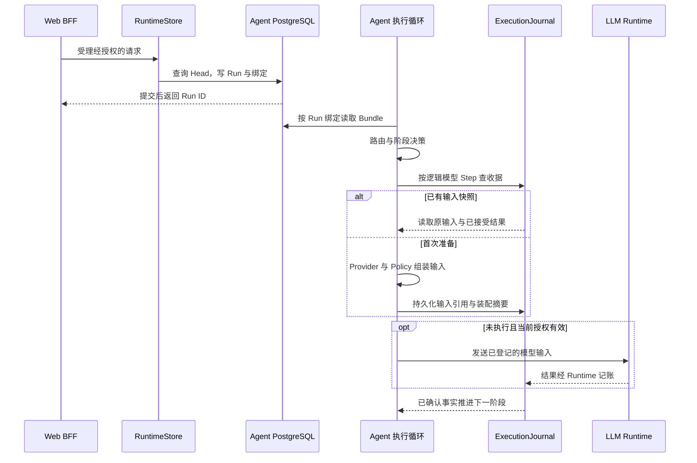

# Compass 第 21 课技术方案 · Context Runtime 与 PromptOps

> Feature 975 ｜ Profile standard ｜ 设计待评审 ｜ 2026-11-17

[需求简报](../BRIEF.md) · [有效 PRD](../spec/PRD.md) · [项目技术方案模板](../../_templates/TECH_DESIGN.tmpl.md) · [Compass 数据所有权与迁移规范](../../../docs/database-migrations.md)

## 需求依据与验收

本文以 PRD 的 FR-01 至 FR-09 及 AC-01 至 AC-10 为准。六类业务结果与量化门槛由 PRD 维护，方案以任务和验证入口关联各 AC。

**代码基线**为 `compass/L20-complete`，提交 `b547e91c1ff0994f9d1bcaba984c29fc2418f67f`。本文沿该标签核对现有入口与持久模型。该版本为 Agent 执行所有者、独立 Worker、PostgreSQL 队列和 Redis 发布，`agent/main` 到 0010。当前 Compass 工作区另有把消费者并入 Agent 副本、增加 Scheduler 定时投递及迁移至 0015 的改动。第 21 课实现时从已确认的前置节点隔离开发。若 0015 成为前置基线，使用共同受理事务 `RuntimeStore.submit_in_transaction`，即时 Run 与 Scheduler 触发均在这里绑定，迁移从实际前置版本接续。版本对齐在实施任务 T1 验证。

## 1. 方案概述

### 1.1 整体架构

在 `apps/agent` 中完成两件事。一是治理待发布的提示词配置，包括版本、试跑、审批和生效指针。二是在已有 Run 和 Step 中装配模型输入。两者共享同一份不可变配置，保存在 Agent 的 PostgreSQL。Web 负责界面和当前成员授权，通过 BFF 调 Agent API。现有队列、租约、LLM Runtime、Tool Dispatcher 和 Redis Stream 继续承担原职责。

| 现有入口（基线）                                                                                    | 用途和本次接法                                                                                                |
| --------------------------------------------------------------------------------------------------- | ------------------------------------------------------------------------------------------------------------- |
| `api/sessions.py::submit` → `runtime/store.py::RuntimeStore.submit`                                 | 在授权、幂等检查和容量准入之后读取发布指针，与 Run、受理回执及入队同事务提交。                                |
| `runtime/durable_service.py::DurableRuntime.execute` → `runtime/service.py::RunService.run`         | 创建现有 Journal，重载已固定快照并从现有路由结果选择 Profile。                                                |
| `routing/service.py::RoutingService.select_route`、`routing/dictionary.py`                          | 维持分类输出和模型选择，提供分类指令与业务 Profile 接口。保留受限和澄清分支。                                 |
| `harness/context.py::initial_messages/generate_input`、`harness/executor.py::AgentExecutor.execute` | 将受管 Run 的指令装配集中到 Context Runtime。继续使用现有消息、Tools、模型请求与预算契约。旧 Run 保留原路径。 |
| `runtime/journal.py::ExecutionJournal`、`runtime/diagnostics.py::RuntimeDiagnostics`                | 增加受管模型 Step 的私有装配记录与脱敏诊断。沿用回执、重放、故障与保护机制。                                  |
| `apps/web/src/lib/page-catalog.ts`、`apps/web/src/server/http/model-handler.ts`                     | 复用平台/工作空间入口与 BFF 授权、响应校验模式。PromptOps 页面及接口属于自身模块。                            |

### 1.2 关键决策

| 决策       | 采用方案                                                                                | 实施与维护代价                                                                                                 |
| ---------- | --------------------------------------------------------------------------------------- | -------------------------------------------------------------------------------------------------------------- |
| 版本固定点 | 受理事务读生效指针并持久化 Run 引用。之后只按不可变 ID 和摘要读取。                     | 草稿、评测结果和发布指针需要同库管理。按版本缓存编译数据可以优化吞吐，受理时仍读取 PostgreSQL 主库的当前指针。 |
| 继承与灰度 | 发布物物化完整有效配置并固定父版本；选择工作空间、租户或全局指针。                      | 父级业务配置更新后，有自定义配置的范围需要显式同步并重新验证。避免父级改动直接改变已审阅的组合。               |
| 阶段切换   | 依据受理与已确认执行事实推进阶段，按完整工具回合划分模型上下文。                        | 切换时明确处理供应商 continuation。沿用现有执行检查和预算，增加对阶段边界和重放的验证。                        |
| 权限和数据 | Agent 持有运行配置与执行记录；实时授权继续向 Web 核验。保护规则和工具清单由服务端执行。 | 权限字段新增本课动作而复用现有角色和授权存储，范围校验同时落在 Web BFF 与 Agent 查询。                         |
| 测试与交付 | 管理页调用小批量、可续做的固定用例执行，沿用 LLM Runtime；报告、看板随 Run 持久化。     | 评测失败或退出时可继续剩余用例，无需额外消费者进程；保持产品范围为 Chat 结果和 PromptOps。                     |

## 2. 详细设计

### 2.1 Prompt 配置及版本

管理侧编辑 `DraftDocument`。它包含 `fragments`、`profiles`、`sceneMap`、`slots` 和 `variables`。业务的最小版本单位为完整 Bundle；编辑时复用 Fragment，测试和审批时固定其具体 schema、内容或版本。角色/空间维度采用声明式匹配，变量仅支持名称替换和有界强类型值。

| 对象           | 主要字段与规则                                                                                                                                                                                                      |
| -------------- | ------------------------------------------------------------------------------------------------------------------------------------------------------------------------------------------------------------------- |
| Fragment       | `key, layer, category, slot, text, dependencies, variable_keys`。同 Bundle 内 key 唯一，片段版本使用内容摘要。层与类独立，类用于编辑器筛选。                                                                        |
| 模板 / Profile | `profile_key, intent_selector, stages, audience, fragment_keys, output_contract, allowed_slots`。按场景和阶段选择，角色匹配只能从服务端已验证的枚举获得。                                                           |
| 变量           | `key, type, required, default, source, max_length, visibility`。来源限已声明 Provider。只有受信业务枚举或配置值进入指令插槽；用户文本、历史、工具回包、文件正文经单独的数据消息输入。禁止动态表达式和对象属性遍历。 |
| 配置作用域     | `global`、`tenant:{id}`、`workspace:{tenant_id}:{id}`。ID 从服务端解析；工作空间应归于指定租户。归属用于访问过滤与决定可引用的父版本。                                                                              |
| Bundle         | 内容摘要包括规则版本、父版本、路由表、片段、模板、变量和输出合同。合并得到完全执行配置，保持不可变。审批关联具体 Bundle 和评测。                                                                                    |

编译时依次合并全局、场景、阶段、扩展；固定顺序为层级、依赖拓扑、同级稳定 key。重复键、循环、缺少依赖、父级类型不匹配、无权槽位和同层冲突会拒绝。可覆盖槽位须明确声明，角色风格等扩展按固定优先级替换。系统安全锚点、工具校验与数据权限由代码和当前策略提供，扩展只能收紧允许的业务工具。自由文本的指令冲突通过审核、用例和结构检查发现，真实权限以执行校验为准。

租户扩展继承合法的全局稳定 Bundle，工作空间扩展继承所属租户稳定 Bundle 或其全局默认。建立新草稿或执行“同步父版本”时记录父 Bundle、查看差异，重新测试和审批。扩展候选的内容指纹包含父版本。有效范围、指令顺序和落地字段见 [代码设计](CODE_DESIGN.md)。

### 2.2 存储与迁移

权威数据由 `agent/main` 管理。Web 按既有权限目录管理成员授权，使用已有授权表。涉及治理操作的记录与生效指针在同一 Agent 事务提交，Web 审计入口可展示授权摘要。

| 实体                     | 字段与关系                                                                                                                                                        | 关键约束                                                                                                                                                       |
| ------------------------ | ----------------------------------------------------------------------------------------------------------------------------------------------------------------- | -------------------------------------------------------------------------------------------------------------------------------------------------------------- |
| `prompt_draft`           | `id, scope_key, revision, status, title, document, parent_bundle_id, candidate_bundle_id, current_evaluation_id, editor_id, submitter_id, created_at, updated_at` | 范围固定，revision 乐观并发。编辑使当前候选引用及评测重新选择，保留原快照和历史。                                                                              |
| `prompt_bundle`          | `id, draft_id, draft_revision, scope_key, parent_bundle_id, schema_version, catalog_version, policy_version, document, sha256, created_by, created_at`            | 拟议 JSONB 为编译后的完整版本。每次草稿 revision 对应唯一候选。全局初始 Bundle 可无 draft。父子同库逻辑校验。                                                  |
| `prompt_release_head`    | `scope_key, generation, stable_bundle_id, canary_bundle_id, rollout_bps, updated_at`                                                                              | 每范围单行。稳定版/灰度版须为该范围的获准 Bundle。平台稳定版必有值；工作空间与租户可继承。灰度用 1–9999 基点，全量提升到 stable，清除 canary。                 |
| `prompt_operation`       | `id, scope_key, draft_id, bundle_id, evaluation_id, actor_id, request_id, request_sha256, kind, details, created_at`                                              | 追加式记录与操作回执。唯一 `actor_id + scope_key + request_id`，同请求重读原结果。发布记录存前/后指针、代次和范围，审批记录存当前 revision、候选、评测及顺序。 |
| `prompt_evaluation`      | `id, scope_key, draft_id, candidate_bundle_id, baseline_bundle_id, suite_version, data_digest, model_binding, status, created_by, created_at, completed_at`       | 绑定候选、稳定对照、规则/固定用例、输入数据和模型绑定。总分由用例结果推导。                                                                                    |
| `prompt_evaluation_case` | `evaluation_id, case_id, state, claim_token, lease_until, outcome, safe_details, updated_at`                                                                      | 按评测与用例唯一。同一 case 先持有短占用令牌，再限时执行。已完成可重读；过期回收记录明确。                                                                     |
| `agent_run`（扩展）      | `prompt_bundle_id` 可空 FK；`config_snapshot.promptBinding` 记录摘要、选中范围、发布代次、灰度分组及授权模板角色；`prompt_feedback` 可空枚举，另存更新时间        | Run 记录保留期间保护 Bundle。旧 Run 无绑定走历史模式。只允许所有者更新已完成 Run 的反馈。                                                                      |
| `agent_step`（扩展）     | `definition_snapshot.promptContext` 保存可授权投影的收据摘要；新 `context_state` 可空加密二进制保存变量、来源权限引用和渲染快照参数                               | 使用现有 `input_sha256`、context channel 消息引用和 Attempt。按同 Run、node key、当前租约和加密用途读取。                                                      |
| `agent_artifact`（扩展） | 沿用 `run_id, attempt_id, scope, content, sha256`，扩展受管产物的 MIME 白名单                                                                                     | 增加 `application/json`（看板）和 `text/markdown`（报告）。仍受既有尺寸上限和当前权限控制。                                                                    |

初始全局配置沿可复现的种子版本创建，冻结公开的六个 Profiles、代码基础指令及路由/合同版本，记录系统初始化来源。种子只建立缺失的初始数据并保持幂等。迁移使用固定资源，避免历史迁移引用后续会被修改的当前模型或代码常量。

| 项目           | 实施约定                                                                                                                                                                                                                                      |
| -------------- | --------------------------------------------------------------------------------------------------------------------------------------------------------------------------------------------------------------------------------------------- |
| 原生源与区间   | 唯一源为 `apps/agent/migrations/versions/` 的 Alembic 迁移，目标暂记 `L21_REV`。从标签实施时从 0010 接续，从当前候选部署形态实施时需先确认其提交和 0015 为有效前置。合并前分配唯一 revision 并登记实际 from/to。                              |
| 完整与增量交付 | 使用 `pnpm db:sql -F agent` 生成 `apps/agent/db/main/sql/bootstrap.sql`、`upgrades/<from>__<to>.sql` 与 manifest；运行 `pnpm db:sql:check -F agent`。保留源提交及 checksum，迁移继续使用受管入口。                                            |
| 上线顺序       | 备份 Agent DB、持久 Runtime 密钥及当前运行所需 Redis 记录，停止旧执行消费者并隔离旧写者。先升级 Agent DB，启动兼容两类 Run 的 Agent 并核验受理/恢复/产物，再开放 Web 管理入口和相应消费者。若使用 Scheduler，待即时链路验收后再启动定时投递。 |
| 退出与恢复     | 内容回滚只调整生效指针。应用回退时保全新版本数据与运行记录，确认在途 Run 和外部效果后按既有第 20 课流程恢复匹配的备份及密钥；上线前验证备份恢复，不删除新表来假定兼容。                                                                       |
| 迁移验收       | 真实 PostgreSQL 验证空库、含旧 Run 的升级、版本不符拒绝、再生成一致、运行账号访问、重跑与恢复。不为 Web 添加空迁移。                                                                                                                          |

### 2.3 PromptOps 管理、权限与发布

管理接口先从服务端会话推导 actor、租户及工作空间，按动作检查当前权限，使用已有 Agent service token 委托。Agent 根据请求目的与目标键再校验资源范围。Web 角色目录提议增加 `promptops.read/edit/test/approve_business` 可授予动作，复用现有授权存储。平台全局编辑、发布复核、激活及回滚复用平台管理员身份，并分别校验 purpose。租户/空间批准需当前范围的业务复核权限。任何列表、Diff、报告、导出及 Trace 均随请求重新验证范围，返回 `no-store` 且限定内容；越权个体对象返回 404。平台跨租户发布需明确选择目标且验证其存在，访问记录进入操作表。

1. 草稿变更采用 `expectedRevision`。校验后冻结候选并登记要跑的评测。评测完成后绑定候选和结果，提交审批。
2. 两级复核分别写入同一草稿 revision、Bundle 和 evaluation。用行锁保护审批顺序和身份约束。撤回、驳回、重新编辑或重测使已完成审批保留为历史，当前状态回到编辑或待评测。
3. 发布事务锁定目标 `scope_key`，检查 `expectedGeneration`、请求幂等、候选审批、评测完整及关键行为、策略/目录兼容范围，再改指针并写操作记录。历史回滚目标需属于同范围、确已发布且与当前策略兼容。范围恢复继承时删除业务选择值并递增代次，保留 head 记录。
4. 灰度对 `scope_key + actor_user_id` 做稳定散列，比较 0–9999 和基点值。灰度未命中时使用本范围 stable。首次局部灰度若无 stable，沿父级稳定链查找；未配置本地指针时继续参与父级灰度。100% 把目标升为 stable 并清除灰度。并发发布采用代次冲突返回 409。扩大灰度可复用同一已审核候选和该轮有效评测。
5. 受理时一次查询获取三个范围当前指针，按优先级选择并固定版本。发布成功后的健康受理入口读取 PostgreSQL 当前值，无跨进程失效通知依赖。运行期可按不可变 Bundle ID 和摘要缓存。保留任何 Run 引用的版本，读不到绑定数据时进入明确的受阻状态。

### 2.4 Context Runtime、模型调用与恢复

| 字段                                              | ContextItem 合同                                                                                         |
| ------------------------------------------------- | -------------------------------------------------------------------------------------------------------- |
| `kind, source, source_ref, version`               | 任务、有效历史、运行状态、经营数据、工具定义、工具观察、产物引用、可信配置指令；注明生产者、引用与版本。 |
| `tenant_id, workspace_id, access_ref, visibility` | 按来源绑定资源与权限。平台规则无租户内容，其余优先使用受验的范围与当前能力集合。                         |
| `trust, confidence, expires_at, estimated_tokens` | trust 明确指令或数据。confidence 表达来源置信信息，缺省未知；有效期与预算用于选择，授权独立强制。        |
| `value, required, priority, group_key`            | 正文仅在私有层。必要项和工具请求/结果配对整体保留。可选项按稳定优先级和最新程度裁剪。                    |

Context Provider 使用现有运行记录、模型工具目录、授权数据源和 Artifact。Context Store 采用一次装配的上下文集合、既有私有消息与新增 Step 私有收据，按内容引用复用，不引入独立服务或共享正文缓存。Memory 或知识服务接入后须有来源授权和明确的使用场景。本课经营背景来自配置元数据和已准入工具数据。

| 阶段       | 触发 / 权威状态                      | 装配重点                                                                                                    |
| ---------- | ------------------------------------ | ----------------------------------------------------------------------------------------------------------- |
| `intent`   | 受理后执行现有意图分类               | 输入含固定 Bundle 允许的分类提示、已授权问题及必要历史。路由字典、结构化输出约束和受限分支由 Runtime 持有。 |
| `plan`     | 需要规划且当前无已核验计划           | 目标、必要范围、允许的工具及业务规则。                                                                      |
| `query`    | 已选定查询项，或简单任务有待查询数据 | 来源/字段、授权工具和时段/口径规则。                                                                        |
| `analyze`  | 当前已收齐需要解释或核验的观察       | 结果引用、核验目标、口径约束。后续查询可回到 query。                                                        |
| `generate` | 已核验必需观察，或允许仅解释规则     | 结果合同、证据、风险与缺项；拒绝所需前提未成立的产物。                                                      |

复用 `RoutingService` 的 `Intent(category_id, scene_id)`。首版精确映射为 SC-01、SC-21 → 经营问答，SC-02、SC-04 → 数据分析，SC-26 → 经营报告，SC-03、SC-09、SC-19 → 异常诊断，SC-12 → 库存调拨建议。在现有 `reports_collaboration` 下加 SC-41 专用于看板创建，保留 SC-25 的一般图表请求。其余目录映射走经测试的现有默认路径。SC-33、SC-35、SC-36 至 SC-40 等边界继续走既有澄清、拒绝、交接或复合任务处理。分类器遇未知组合须校验或澄清；管理页配置的路由映射只能选择已有类型和允许的 Profile。具体版本由词典与 Bundle 共同标识。

**受理与重建。** 服务端会话解析可信身份与范围。受理时将用户当前角色映射为受管模板角色，绑定存入 Run；权限复核仍使用当前状态。重建时通过 `config_snapshot` 和在库 Bundle 读取同一版本，现有路由结果和业务状态以 Journal 的已接受记录为准。排队、暂停、继续、接管和重试沿用同一快照。当租户、工具或数据授权变化影响已储存输入时，拒绝重新派发并记录安全原因。扩大授权不会扩大在途 Run 已冻结的工具清单。

**阶段与消息协议。** 读取已采纳 Todo、验证器、工具回执和计划事实来判定下一阶段。未结算工具调用、等待和未知副作用时保持现有推进门槛。跨阶段只在工具调用及观察完整且已持久确认后创建新的模型消息帧。新帧由本阶段系统指令、可用历史、当前任务与已验证的结构化观察组成，用数据消息承载历史观测，不携带旧工具引用或旧 continuation。阶段内 continuation 需要完全相同的消息前缀，续接仅附对应的工具结果。在 `llm/continuation.py::restore` 所要求的绑定、前缀和工具 ID 约束下沿用已有令牌处理；同阶段字段发生变化时只能等安全边界重新起帧。旧路径保留已有 thinking 与 tool 协议。

**权威模型输入。** 对每个逻辑模型 Step，首次组装先验证范围、有效期和来源，再交给 Policy 做硬门槛与裁剪。预算计入模型消息、工具定义与输出预留，模型 tokenizer 不可用时采用保守估算；同时保留既有字节、消息数和调用上限。配对工具消息作为一个裁剪单元。对恢复重试，读取原 Step 的私有参数和加密消息引用，重建完全相同的请求与校验摘要，回执已接受时复用结果。阶段、变量、来源权限引用与预算结果写入同一 Step 准备事务，在分发前复核关键有效期和授权。过期的已准备输入返回安全受限状态；未确知结果的模型/工具调用沿现有恢复和对账策略处理，禁止擅自重派。详细边界在 [代码设计](CODE_DESIGN.md)。

### 2.5 业务输出、效果与 Trace

- **经营问答、分析、异常**复用现有授权查询与校验器。指标与口径从受管配置和观测获取。需要权限或数据缺失时进入明确降级，依据确认过的来源生成。
- **看板**提交有界 `DashboardResultV1`，包含期间、指标卡、允许的折线/柱状/占比图、布局槽位、单位和 `result_ref`。服务端按同 Run 的已验证工具观察解析数据点并固定产物字节。拒绝未知组件、外链和脚本。Web 对已授权数据使用既有图表/指标渲染模式。窄屏按槽位顺序折行。
- **报告**提交标题、固定章节、经核验的指标和观察引用，服务端输出有界 UTF-8 Markdown。Web 沿用文本净化与附件下载授权。报告和看板使用确定性结果 ID，在现有 Artifact 事务写入并公开授权引用。
- **库存建议**在授权库存快照内计算可调出上限和缺口，校验数量为正且不超过两者较小值。调拨单保持外部业务边界，产物保留 SKU、来源、约束和审批提示。本课样例复用零售合成数据的库存快照；受限或不可用时说明需要哪些信息。
- **Trace**以 `run_id / step_id / attempt_id / model_call_id` 关联，诊断记录 Bundle、阶段、profile、片段 key 和版本、有无变量、来源类型、预算、裁剪与失败码。变量值、真实消息和必要来源授权引用保存在加密记录里。BFF 只允许按权限查询摘要，公开 SSE v2 与普通结果保留当前投影。
- **效果**从 `agent_run` 和 `agent_session` 按作用域、Bundle 与时间窗聚合，不按 Attempt 计量。公开指标区分受理、已结束、完成、失败、取消、进行中、反馈数。以源记录构建首版报表。

### 2.6 API 与评测执行

管理 API 使用 `/v1/promptops`（Agent）和 `/api/web/v1/promptops`（Web BFF）同形映射。分析反馈走已授权的 `/v1/analysis/runs/{runId}/prompt-feedback` 及对应 BFF。以下为拟议契约；Python DTO/路由变化后通过 `pnpm contracts` 生成契约及 Web 类型。聚合/列表采用现有分页、范围与 `no-store` 规则。

| 路由族                                                      | 方法与主要输入                                                                  | 输出与边界                                                                         |
| ----------------------------------------------------------- | ------------------------------------------------------------------------------- | ---------------------------------------------------------------------------------- |
| `/drafts`、`/drafts/{id}`                                   | GET、POST、PATCH；作用域、内容、父版本、`expectedRevision`、`requestId`         | 草稿及字段问题；需 read/edit，竞争返回 409。                                       |
| `/bundles`、`/bundles/{id}`、`/diff`                        | GET；范围或两个 Bundle ID                                                       | 版本、模块/正文/路由差异、继承；分别核对两个对象范围。                             |
| `/drafts/{id}/preview`、`/evaluations`、`/evaluations/{id}` | POST 预览或冻结候选、GET 待读报告；样例、revision、候选、稳定基线、评测集       | 有界预览和脱敏结果；测试权限及允许使用的测试模型。导出复用读取权限。               |
| `/evaluations/{id}/cases/{caseId}/execute`                  | POST；`requestId`；case 由服务端评测集限定                                      | 原子领取且有时限，完成重读结果，正在执行返回状态。UI 限制并发并可恢复未完成 case。 |
| `/drafts/{id}/review`                                       | POST；提交、撤回、一级批准、二级批准、驳回；revision、候选 ID 和操作原因        | 新审批状态、验证结果与授权操作记录；禁止越级、自审和使用错版本证据。               |
| `/releases`、`/releases/operations`                         | GET 作用域状态和历史；POST 灰度、提升、撤回、回滚、恢复继承；expectedGeneration | 新 Head、激活时刻及操作回执。跨范围目标拒绝，更新冲突返回 409。                    |
| `/effects`                                                  | GET；作用域、版本、窗口                                                         | 使用量、完成率及反馈计数；成员当前授权稽核。                                       |
| Run 反馈                                                    | PUT；`helpful` / `needs_improvement`                                            | 幂等更新，必须为可读且已完成的受管 Run 所有者。                                    |

评测内容和权限由服务管理。预览和装配矩阵用真实编译与 Policy 代码，使用固定的观察、权限和 Token 预算样例。行为回归的 20 条用例复用模型 Runtime，在允许的测试模型和只读样例中使用同一请求装配和输出验证。稳定与候选共享题面、授权特征、样例版本和实际模型绑定，验收按 PRD 固定分母。关键输出和允许动作在服务端判分，运行时用受限替身模拟预置观察，外部工具写入不进入测试。六类真实端到端链路在隔离训练环境走现有 Chat 入口，并补齐对应的单元、集成和浏览器验证。

评测记录支持从 UI 以少量并发继续未完成用例。一次 case 的占用、采样、提交结果按候选绑定、短租约和超时边界运行。未知/超时不计通过。操作者重试时确认旧占用已结束，使用新调用并保留原调用结果状态。只有全部报告结果满足门槛、关键行为及安全用例通过，并且候选、基线与规则版本符合当前发布范围时，才能进入审批。

### 2.7 关键代码审查点

[CODE_DESIGN.md](CODE_DESIGN.md) 展开受理、发布、阶段切换、输入重放和越权验证五处。代码为评审示意。核心不变量包括受理与入队同一事务、已固定版本可重读、相同逻辑 Step 复用相同输入、当前授权优先、回滚只改变未来受理。

## 3. 风险与验证

| 风险                               | 处理和验证                                                                                     |
| ---------------------------------- | ---------------------------------------------------------------------------------------------- |
| 续接协议在阶段变化后拒绝旧前缀     | 使用完整工具回合切帧。分别验证 thinking/工具支持通路、续接令牌失效及同阶段重试。               |
| 旧 Run 被错误绑定当前发布          | 旧 Run 按缺省历史版本分支。受理重复、预先排队、暂停及恢复均对照原发布 UUID 和已接受 Step。     |
| 局部发布改变其他范围或覆盖安全槽位 | 范围内配置按范围预览、候选固定父版本、发布行锁、授权清单求交集。跨租户和撤权在测试中逐例验证。 |
| 异常退出或候选漂移使评测结果失真   | 固定摘要、模型绑定和分母，保存逐例结果及占用时限。审批和激活时重新核对当前证据。               |
| 从不同前置分支开发导致迁移碰撞     | T1 复核目标标签及现有数据库 head。以实际基线分配迁移并重验 Agent + Web、队列和回切。           |

## 4. 兼容与上线检查

- Session/Run、排队、Worker 回执、SSE v2 和现有 Chat 错误协议保持兼容。内部 PromptOps API、可选诊断字段和白名单产物类型随对应 DTO/校验同步更新。历史报表和持久产物按原权限读取。普通旧客户端继续显示已支持的回答与产物。
- 新增表与可空引用先应用。旧记录保持原状态和路径。上线前执行旧版 Run 恢复、前置版本数据升级及合同漂移检查。活动运行与调度恢复按所选第 20 课部署形态验收。
- 迁移、seed 与工作流实例样例分别执行。静态守卫沿用 `pnpm contracts:check`。现场检查使用本仓库当前入口 `pnpm test:integration -F agent`、`pnpm test:integration -F web`、`pnpm test:e2e -F web` 和 `pnpm smoke`，相关新增用例随实现登记。本文提供验证设计和验收依据。

## 5. 实施任务

下表的新增或修改均为拟议路径。文件路径以 Compass 根目录为基准。

| 任务                | 变更文件 / 模块                                                                                                                                                                                                                          | 依赖     | 验证                                                                                               |
| ------------------- | ---------------------------------------------------------------------------------------------------------------------------------------------------------------------------------------------------------------------------------------- | -------- | -------------------------------------------------------------------------------------------------- |
| T1 对齐基线与存储   | 新增 `apps/agent/migrations/versions/<L21_REV>_prompt_context.py`、`apps/agent/src/compass_agent/promptops/entities.py`，修改 Agent 的 `runtime/entities.py` 与 Agent SQL 交付                                                           | 前置节点 | 空库、旧库、重复 seed、真实 PostgreSQL 权限与备份恢复；AC-07、AC-08。                              |
| T2 配置编译及发布   | 新增 `apps/agent/src/compass_agent/promptops/{contracts,compiler,repository,service}.py`、`api/promptops.py`                                                                                                                             | T1       | 四层合并、合法父级、幂等和冲突、审批及灰度指针；AC-02 至 AC-06、AC-08。                            |
| T3 运行接入与续接   | 新增 `apps/agent/src/compass_agent/context_runtime/{contracts,providers,policy,assembler}.py`，接入 `runtime/{store,durable_service,service,journal}.py`、`harness/{context,executor}.py`、`routing/service.py` 和 `routing/scenes.json` | T1、T2   | 固定版本、受理并发、权限复查、计划和工具回合、故障接管和旧运行兼容；AC-01、AC-02、AC-06 至 AC-08。 |
| T4 场景与结果       | 六个 Profile 初始资源、受管输出校验，更新 `api/runs.py`、产物契约和 `apps/web/src/components/analysis-run-turn.tsx`                                                                                                                      | T2、T3   | 六类业务题逐一走实际分析入口，查验报告、看板与库存约束；AC-01、AC-03、AC-08。                      |
| T5 门禁、观测与报告 | 新增 `promptops/evaluation.py`、Agent 测试夹具；修改 `runtime/diagnostics.py` 与反馈 API                                                                                                                                                 | T2 至 T4 | 120 条装配、20 条固定行为、关键失败、Trace、导出和反馈分母；AC-02、AC-04、AC-08、AC-09。           |
| T6 Web 管理和端到端 | 新增 `apps/web/src/features/promptops/` 及 `src/server/http/promptops-handler.ts`；更新 `page-catalog.ts`、权限/内部核验及 BFF 路由                                                                                                      | T2、T5   | 双租户、四类操作、审批与回滚，390 px、键盘和权限组合；AC-05、AC-06、AC-08 至 AC-10。               |
| T7 工程验收         | 补本 Feature 验收记录与实际环境参数，登记 SQL/代码提交；汇总仅本课的增量                                                                                                                                                                 | T1 至 T6 | 合同检查、Agent/Web 测试、双实例和故障实验、基线 diff，以 PRD 全部 AC 复核。                       |

实施验证的优先顺序为 **受理 → 固定版本 → 1 个受管场景 → Step 回放与权限 → 全场景 → 治理 UI**。每个可运行切片先验证后扩大范围。课程里程碑以独立提交和实际通过的验收为依据。
