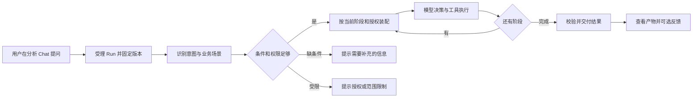
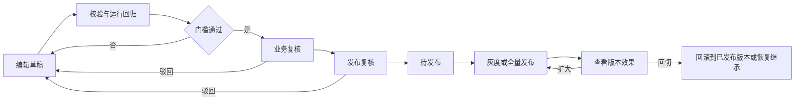

# Compass 第 21 课 PRD · 系统提示词与 Context Runtime

> 状态 draft ｜ Profile standard ｜ 负责人见需求简报 ｜ 2026-11-17

[需求简报](../BRIEF.md) · [原始需求清单](../context/lesson-21-requirements.png) · [项目 PRD 模板](../../_templates/PRD.tmpl.md)

## 1. 背景与目标

Compass 已能在分析 Chat 发起持久 Run、选择模型、执行工具，并在暂停或中断后恢复。现有模型指令分布在意图路由、分析 Harness 和工作流中。新增一个场景时，开发者需要分别定位各处指令。管理员也缺少可以直接预览、验证、审批和回切提示词的统一入口。

经营人员在分析 Chat 提问，Compass 识别业务场景，在每个决策阶段按当前授权装配上下文并交付结果。运营和管理员在 PromptOps 管理页维护模块与配置，先测试再发布。队列中的旧 Run、等待用户决定的 Run 和恢复中的 Run 继续使用受理时固定的版本。发布或回滚后的新 Run 依据新的有效配置受理。

六类场景都进入本课功能和用例清单，场景数量及其余指标保留原图门槛，见 [§6.2](#62-量化门槛与口径)。

## 2. 用户与场景

| 故事  | 用户                       | 触发场景与目标                                                                       | 关联                       |
| ----- | -------------------------- | ------------------------------------------------------------------------------------ | -------------------------- |
| US-01 | 经营人员、数据分析师       | 在分析 Chat 提问，得到符合指标口径、当前数据权限和任务阶段的回答、报告、看板或建议。 | FR-01、FR-06、FR-09        |
| US-02 | 平台提示词维护者           | 把分散指令整理成可复用模块，按场景、阶段和作用域预览，并提交可审阅的版本。           | FR-02、FR-03、FR-04        |
| US-03 | 租户或工作空间维护者       | 继承授权范围内的模板，在允许的字段内维护风格、口径说明和部门差异。                   | FR-02、FR-07               |
| US-04 | 业务复核员、平台发布复核员 | 查看变更、固定用例结果和目标作用域，分级审批后灰度、全量或回滚，检查版本表现。       | FR-03、FR-04、FR-05、FR-08 |
| US-05 | Runtime 值班人员           | 通过 Run 与 Step 记录定位当时使用的场景、阶段、版本、模块和裁剪原因。                | FR-06、FR-08、FR-09        |

### 2.1 六类业务场景

| 场景 / Profile                      | 示例请求                                               | 执行阶段示例                           | 可验收交付                                                                                     |
| ----------------------------------- | ------------------------------------------------------ | -------------------------------------- | ---------------------------------------------------------------------------------------------- |
| 经营问答 / `business_qa`            | “上周 GMV 多少？口径含退款吗？”                        | 识别 → 查询（口径解释可跳过）→ 生成    | 提供指标、口径、期间、单位和数据依据，列明缺项。                                               |
| 数据分析 / `data_analysis`          | “对比两个周期的渠道 GMV，找出变化最大的渠道。”         | 识别 → 规划 → 查询 → 分析 → 生成       | 给出可回溯的对比、贡献拆解、主要变化和局限。有明细时沿用授权 CSV 交付。                        |
| 看板创建 / `dashboard`              | “生成一个看板，展示近四周 GMV、订单量和各渠道占比。”   | 识别 → 规划 → 查询 → 分析 → 生成       | 在本轮生成可重开的持久看板，通过白名单组件呈现指标卡、图表及布局，展示范围和数据出处。         |
| 经营报告 / `business_report`        | “生成上周经营周报，含指标摘要、变化、风险和行动建议。” | 识别 → 规划 → 查询 → 分析 → 生成       | 在 Chat 中展示结构化报告，支持重开与下载，保留指标、依据、限制和建议。                         |
| 异常诊断 / `anomaly_diagnosis`      | “为什么昨天支付转化下滑？分渠道查证。”                 | 识别 → 规划 → 查询 → 分析与核验 → 生成 | 给出已核验事实、优先原因假设、支持或反对证据和待验证项。计算口径和分母一致。                   |
| 库存调拨建议 / `inventory_transfer` | “为缺货门店找调出候选，保留安全库存。”                 | 识别 → 规划 → 查询 → 分析与核验 → 生成 | 输出 SKU、调出与调入位置、建议数量、约束、风险和人工审批提示。实际调拨由经营方按业务流程审批。 |

阶段为意图识别、规划、查询、分析、生成。查询与分析可按执行事实交替。纯口径解释直接生成。数据、授权或约束不足时给出缺项并保留问题。模型回复里的阶段名称不触发阶段切换。后续追问按新 Run 重新识别，历史可提供指代，跨场景时切换 Profile。

## 3. 总体业务流程

### BF-01 · 提问到交付



分析过程和控制操作沿用分析 Chat。每个阶段读取必要的授权数据并记录装配摘要。结果校验失败时展示具体缺项、验证失败或运行状态。

### BF-02 · 编辑到发布与回滚



草稿、测试证据和审批绑定同一候选。维护者提交后可撤回，修改后重新测试和审批。回滚保留历史版本、审批和旧 Run 引用，并追加操作记录。

## 4. 功能需求

### 4.1 新增需求

| 需求                   | 触发与输入                                 | 产品行为                                                                                                                                                                                                                                                 | 观察结果                                                                                   |
| ---------------------- | ------------------------------------------ | -------------------------------------------------------------------------------------------------------------------------------------------------------------------------------------------------------------------------------------------------------- | ------------------------------------------------------------------------------------------ |
| FR-01 场景与阶段       | 受理任务，获得问题、授权空间和实际执行状态 | 覆盖 §2.1 六类场景，映射独立 Profile，按角色、阶段和范围选择指令。对缺信息、越权或范围外请求走对应的补充或受限路径。                                                                                                                                     | Run 有可查场景，适用 Step 有阶段，受限任务有明确结果。                                     |
| FR-02 模块与模板       | 在平台、租户或部门适用空间配置             | 四层分别为全局基础、业务场景、执行阶段、租户/部门扩展。可复用角色定位、业务规则、输出规范、工具约束、分析方法、业务背景六类 Fragment。声明变量类型、必填、依赖和可覆盖字段。                                                                             | 预览显示模块来源、版本、实际生效值和继承关系。                                             |
| FR-03 版本管理与对照   | 保存草稿、选择两个版本或提交评审           | 保留候选与发布历史、作者、范围和变更说明。支持正文及结构 Diff，包含模块增删、变量、路由变化。提交后锁定候选。                                                                                                                                            | 历史可回查，Diff 说明基线和候选，审批对象可唯一定位。                                      |
| FR-04 测试与评估       | 选择候选、固定评测集及授权样例环境         | 支持单样例装配预览、静态校验和行为回归，对照稳定版。检查路由、组合、变量、冲突、输出和关键业务行为。                                                                                                                                                     | 报告可重进和导出，列出逐例结果、原因、数据和模型版本、分母。缺失、过期或未通过时阻断审批。 |
| FR-05 审批、发布与回滚 | 有权限人员对同一候选完成复核               | 两级审批后按指定作用域和比例灰度或全量。支持调整比例、转全量、撤回灰度和回切本范围已发布版本。恢复继承时预览生效父配置。                                                                                                                                 | 显示范围、版本和覆盖比例；竞争变化需重新确认；保留操作记录。                               |
| FR-06 Context Runtime  | 模型决策需要当前任务、规则、状态或工具     | Provider 提供系统指令、用户任务、历史、运行状态、已登记业务上下文、工具定义与观察、产物引用。Assembler 与 Policy 完成校验、预算与拼装。Context Store 保存可复用引用和本次装配记录。统一 Schema 记录类型、来源、版本、权限、可信度、有效期与 Token 成本。 | 每个受管调用有装配结果或明确错误，裁剪可追踪。                                             |
| FR-07 继承、覆盖与隔离 | 平台提供默认版，租户或部门维护扩展         | 部门绑定已授权的工作空间；扩展只覆盖父级明确标注的槽位。页面显示当前范围，对配置的读写、试跑、审批和发布分别授权。                                                                                                                                       | 有明确生效链及父版本。强制规则和工具权限上限由 Runtime 执行。                              |
| FR-08 追踪、监控与反馈 | 管理员查看发布效果，使用者反馈已完成结果   | 按授权范围、版本和时间查看 Run 使用量、完成率及“有帮助/需改进”计数。授权诊断展示 Profile、阶段、模块版本、变量记录和失败原因。                                                                                                                           | 可对照版本效果；同一 Run 反馈可更新；公开执行流只含可公开字段。                            |

### 4.2 变更需求

| 需求                   | 现有入口                               | 本期行为                                                                                                                               | 观察结果                                                     |
| ---------------------- | -------------------------------------- | -------------------------------------------------------------------------------------------------------------------------------------- | ------------------------------------------------------------ |
| FR-09 动态装配与热更新 | 分析 Chat 持久 Run、意图路由、模型执行 | 受理时固定发布快照和命中范围，按实际阶段组装输入。排队、暂停、继续、人工等待、重试及接管保留原快照。结果、工具和数据仍受实时授权约束。 | 发布前后受理的 Run 可并行，Trace 能按 Run、Step 和版本核对。 |

## 5. UI 视觉与交互

### UI-01 · PromptOps 管理

拟议线框。平台侧从「平台管理 → PromptOps」进入，工作空间侧从「Agent 与能力 → PromptOps」进入。遵循 [Compass UI 规范](../../../docs/ui-style-guide.md)。

```text
PromptOps                 当前范围 [平台全局 / 租户 / 工作空间]
[模块与模板] [版本与评测] [发布与效果]
场景 [全部 ▾]   阶段 [全部 ▾]            [新建草稿]
名称 / 状态 / 生效版本 / 继承来源 / 更新时间
──────────────────────────────────────────────────────────
版本详情        模块与变量 | 配置预览 | 版本对比 | 评测报告 | 审批记录
变更与范围      评测结果、两级复核、生效版本和灰度比例
当前步骤        [保存草稿 / 运行回归 / 提交审批 / 发布]
```

| 区域       | 交互                                                                                                                           |
| ---------- | ------------------------------------------------------------------------------------------------------------------------------ |
| 模块与模板 | 按类型、场景和阶段筛选。编辑区标出可编辑项、继承项、受保护槽位和字段错误。预览选定场景、阶段、角色样例和范围后显示各模块来源。 |
| 版本与评测 | 从列表打开草稿、Diff、审批记录和逐例报告。评测可重新打开查看或继续未完成用例。提交审批后编辑禁用，可撤回再改。                 |
| 审批与发布 | 按角色与范围展示待办。驳回需说明理由。发布与回滚弹窗列出当前版本、目标版本、影响范围及灰度比例，完成后刷新生效状态。           |
| 发布与效果 | 可按版本、范围和时间筛选。显示已受理数、已结束数和完成率分母，零样本显示空态，具备相应权限时展开脱敏诊断。                     |

### UI-02 · 分析 Chat

看板卡按已校验布局呈现指标和图表，报告沿用文本阅读与附件入口，库存建议列明数量约束及审批提示。只在已完成且有结果的 Run 上显示可选反馈。暂停、继续、终止和人工确认沿用既有交互。

窄屏上表格和代码局部滚动，页面保留键盘焦点。确认框支持 Esc 和焦点返回。请求处理中禁用同一提交。保存冲突保留表单，刷新后重新确认。

| 文案    | 触发状态     | 显示文字                                                                     |
| ------- | ------------ | ---------------------------------------------------------------------------- |
| COPY-01 | 管理列表空态 | 当前范围暂无草稿。                                                           |
| COPY-02 | 必填变量缺失 | 缺少必填变量「{变量名}」，请补齐后重新验证。                                 |
| COPY-03 | 回归未过     | 回归未通过。查看失败用例后重新运行。                                         |
| COPY-04 | 版本竞争     | 版本已更新。刷新后确认最新变更。                                             |
| COPY-05 | 发布确认     | 发布到「{范围}」后，符合条件的新任务将使用「{版本}」。已受理任务保留原版本。 |
| COPY-06 | 回滚确认     | 将「{范围}」的新任务回切到「{版本}」。已受理任务保留原版本。                 |
| COPY-07 | 业务数据不足 | 缺少完成任务所需的授权数据。请核对数据来源或补充范围。                       |
| COPY-08 | 结果反馈     | 有帮助 / 需改进                                                              |
| COPY-09 | 无访问权限   | 当前账号没有此范围的操作权限。                                               |
| COPY-10 | 回归中断     | 评测尚未完成。可从评测报告继续。                                             |
| COPY-11 | 发布完成     | 已更新「{范围}」的有效版本。                                                 |

动态值使用已选范围显示名、不可变版本标识和字段标签；缺省平台范围显示“平台默认”，超长值换行。图标按钮提供与操作一致的可访问名称，进行中、空态、成功和错误同时提供文字反馈。

## 6. 业务规则与约束

### 6.1 业务规则

| 规则               | 行为                                                                                                                                                                                 |
| ------------------ | ------------------------------------------------------------------------------------------------------------------------------------------------------------------------------------ |
| BR-01 范围和继承   | 查找顺序为工作空间、租户、平台默认。部门扩展绑定已存在且已授权的工作空间。发布固定父版本；父级业务配置升级后，管理员可显式同步、重新测试和发布。强制策略与实时授权对各范围一致生效。 |
| BR-02 模块合并     | 按全局、场景、阶段、范围合并。同层结构冲突、循环依赖、变量缺失、非法覆盖和受保护字段写入须阻断。业务文本冲突进入复核与行为验证。                                                     |
| BR-03 生命周期     | 草稿 → 待业务复核 → 待发布复核 → 待发布。驳回或撤回后可再编辑。编辑后旧评测和审批保留历史，新的候选重新执行。灰度、全量和回切以发布记录表示。                                        |
| BR-04 职责与审批   | 平台维护者管理全局。授权维护者管理本租户或工作空间。一级由范围内业务复核员审批，二级由平台发布复核员审批。两级审批人与该候选作者分离，且为不同人员。平台发布权限决定发布和回滚资格。 |
| BR-05 灰度和版本   | 按稳定用户分组和明确比例灰度，首次局部灰度未命中继续查找继承稳定链。发布、提升、撤回和回滚只改变未来受理。同一请求 ID 重试返回原受理结果。                                           |
| BR-06 上下文信任   | 服务端授权、工具调度和资源所有者共同实施访问控制。输入、历史、检索文本和工具回包保持数据角色。授权撤销阻断之后的敏感访问，并给出受限或可恢复状态。                                   |
| BR-07 Token 与缺项 | 优先保留受保护规则、当前任务及必需且完整的工具调用和观察。可选数据按预算裁剪。必需内容超限或不可用时停止本次模型调用并返回明确状态。                                                 |
| BR-08 可追溯       | 管理日志记录操作者、时间、对象、范围、版本和结果。变量值与模型输入按私有状态机制保存，诊断只返回授权摘要。公开消息、错误和导出排除系统提示词、凭据、内部推理和他租户数据。           |
| BR-09 存留与旧数据 | Run 引用的版本在对应记录保留期内可读。既有会话、结果与未完成 Run 保持可读或可恢复。未记录受管快照的历史显示为历史模式。                                                              |
| BR-10 业务执行     | 看板和报告作为 Chat 持久结果。库存调拨只提出建议，沿用已授权的只读工具与已有审批边界。                                                                                               |
| BR-11 反馈与分母   | 每个 Run 只计一次用量。成功完成数 / 已结束数为完成率，已结束含失败和取消，进行中单列。所有者可更新一条有枚举值的当前反馈。                                                           |

### 6.2 量化门槛与口径

使用隔离训练环境、固定业务数据、两个租户、不同角色和至少两个独立执行进程。测试前锁定用例、期望行为、评测模型绑定、数据快照和候选版本。未完成用例计入固定分母。

| 指标             | 原图门槛   | 本课测量口径                                                                                                               | 验收                |
| ---------------- | ---------- | -------------------------------------------------------------------------------------------------------------------------- | ------------------- |
| 场景覆盖         | ≥5 类      | 六类逐类跑端到端链路。路由、关键阶段与可用交付齐全才计入。                                                                 | AC-01               |
| 动态装配正确率   | ≥98%       | 固定 120 条，六类各 20 条。逐例比对 Profile、模块顺序/版本、变量、数据角色、授权工具及预期拒绝。至少 118 条通过。          | AC-02、AC-03        |
| 新版本回归通过率 | ≥95%       | 固定 20 条行为用例，候选和稳定基线使用相同模型、数据和权限。依据结构、证据和关键动作判分。至少 19 条通过。                 | AC-04、AC-09        |
| 热更新生效延迟   | ≤1 分钟    | 从发布或回切提交到每个健康入口观察到正确版本的新 Run，取最慢值。分别核对灰度命中组与未命中组。                             | AC-06               |
| 运行稳定性       | 0 关键中断 | 发布、扩大灰度和回切时保留排队、执行、等待人工确认与接管任务，统计由 Prompt 变更引发的中断、失败、版本漂移和重复外部动作。 | AC-07               |
| 租户隔离与安全   | 100% 通过  | 两租户用例覆盖配置读写、审批发布、变量与工具边界、数据角色、实时撤权、Trace 和导出。安全失败独立阻断发布。                 | AC-05、AC-08、AC-09 |

## 7. 范围与依赖

- **交付**包括场景与阶段定义、模块和模板库、PromptOps 管理后台、Provider / Assembler / Policy / Context Store、六个 Prompt Profile，以及验证用例和效果回归报告。
- **依赖**为分析 Chat、意图分类、Agent 持久 Run 与恢复、工具与数据授权、模型 Runtime、授权诊断和已准备的合成零售数据。库存建议使用授权库存数据或固定样例，安全库存、调出余量与调入需求来自数据或已确认经营参数。
- **边界**为独立看板编辑器、报告协作空间、通用评测平台、正式记忆服务、真实库存调拨写入和运行中 Run 自动配置迁移。这些能力另行设计。

## 8. 研发资源

| 资源                   | 维护位置                                       | 用途                                   |
| ---------------------- | ---------------------------------------------- | -------------------------------------- |
| 第 21 课原始清单       | [原图](../context/lesson-21-requirements.png)  | 原始功能范围、交付和验收指标。         |
| 场景、阶段、交互与文案 | 本文 §2.1、§5                                  | 初始 Profiles、固定题、UI 验收对照。   |
| Compass 合成零售数据   | [零售数据说明](../../../data/retail/README.md) | 用于授权查询和固定样例。               |
| 第 20 课工程前置       | Git 标签 `compass/L20-complete`                | 持久 Run、消息、恢复、队列与观测基线。 |

## 9. 验收标准

| ID                     | 前置条件与执行                                                     | 通过标准                                                                                                     | 关联                              |
| ---------------------- | ------------------------------------------------------------------ | ------------------------------------------------------------------------------------------------------------ | --------------------------------- |
| AC-01 场景闭环         | 准备授权数据和工具，在分析 Chat 运行六类固定题。                   | 分场景核对路由、关键阶段、证据和可用结果；看板可重开，报告可重开和下载，库存建议无实际调拨写入；记录达标数。 | FR-01、FR-06、FR-09               |
| AC-02 精确装配         | 运行固定 120 条矩阵，含阶段、角色、范围和预算变化。                | 达到装配指标，能核对模块顺序、版本、授权工具和裁剪原因。                                                     | FR-01、FR-02、FR-06、FR-09        |
| AC-03 无效配置         | 准备非法覆盖、变量缺失、循环依赖、同层冲突及预算超限的输入。       | 管理端定位问题并阻断发布；运行端必需内容超限时有具体失败原因；合法可选内容可裁剪。                           | FR-02、FR-04、FR-06、BR-02、BR-07 |
| AC-04 版本与评测       | 比较两版、运行固定回归，之后修改草稿。                             | Diff 含结构差异，报告可查看和导出；旧证据仍可查，修改后的候选需重新测试与审批。                              | FR-03、FR-04、BR-03               |
| AC-05 分级治理与继承   | 用作者、两级复核、发布人及无权限账号执行全局、租户与工作空间流程。 | 拒绝自审、越权与跳过审批。正确展示继承、覆盖、审批顺序、驳回、撤回、并发冲突和治理记录。                     | FR-03、FR-05、FR-07、BR-01、BR-04 |
| AC-06 灰度、发布与回切 | 用灰度组、对照组和两个健康入口提交新 Run，重复同一请求 ID。        | 作用域与命中正确，发布和回切符合时延指标；重复请求原样返回原受理结果。                                       | FR-05、FR-09、BR-05               |
| AC-07 在途一致性       | 发布和回切期间保持排队、运行、暂停、人工等待及接管 Run。           | 已受理 Run 全程固定原版本，恢复沿用已确认结果，关键中断为零。旧 Run 走兼容路径。                             | FR-06、FR-09、BR-09               |
| AC-08 权限与隔离       | 用两个租户和不同空间验证越权拒绝、脱敏与运行时撤权。               | 安全集 100% 通过，错误、公开流、导出和诊断均符合权限边界。                                                   | FR-06、FR-07、FR-08、BR-06、BR-08 |
| AC-09 回归与效果       | 对照稳定版运行 20 条行为用例，产生成功、失败及有/无反馈 Run。      | 候选达到回归门槛，关键行为及安全全部通过。效果按同版本和范围准确汇总，相同 Run 的反馈可更新。                | FR-04、FR-08、BR-11               |
| AC-10 管理与结果交互   | 平台、租户及普通角色在桌面、390 px 窄屏和键盘操作。                | 空态、等待、权限、校验、发布确认、可恢复错误、对照、附件与焦点行为符合 §5。                                  | FR-02–FR-05、FR-08、UI-01、UI-02  |

## 待评审的产品取舍

| 项目       | 本稿口径                                                                             |
| ---------- | ------------------------------------------------------------------------------------ |
| 看板与报告 | 在分析 Chat 交付带权限的持久产物。                                                   |
| 部门扩展   | 使用现有工作空间表达部门配置范围。                                                   |
| 继承版本   | 扩展固定父版本，显式同步并走测试和审批。                                             |
| 灰度与评测 | 稳定用户分组；120 条装配和 20 条行为用例。固定题面、数据快照与具体模型在实现时登记。 |
| 库存建议   | 只读查询与可核对的建议，显示人工审批提示。                                           |

## 变更记录

| 日期       | 变更                                       |
| ---------- | ------------------------------------------ |
| 2026-11-17 | 从课程负责人提供的第 21 课需求图建立首版。 |
