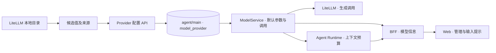

# Runtime 模型元数据与默认生成参数技术方案

> Feature 976 · Profile standard · 待评审  
> 模板来自 [项目标准技术方案模板](../../_templates/TECH_DESIGN.tmpl.md)。代码基线为当前工作区，HEAD `9b62205`，包含工作区内的 Runtime 和 0012 迁移变更。

## 需求依据与验收

需求来自 [BRIEF](../BRIEF.md)、[调研记录](../context/_INDEX.md)及 2026-11-14 会话。本期交付模型元数据存储与管理 API、默认参数解析和上游错误回传。Agent Runtime 上下文工程与 Web 输入提示仅保留接口设计。

| 编号  | 阶段           | 验收                                                                                                                                                                   |
| ----- | -------------- | ---------------------------------------------------------------------------------------------------------------------------------------------------------------------- |
| AC-01 | A · LM Runtime | 管理员能读取 LiteLLM 候选值、配置或清空指定部署的上限与参数。保存后可查有效值、来源和版本。两个同型号部署可配置不同上限。旧 Provider 升级后可继续使用。                |
| AC-02 | A · LM Runtime | 显式值、部署默认值和场景回退依序生效。在合法请求中，即使输入或输出超过登记的模型容量，仍原样发起调用。同步和流式路径都将明确的上游容量或输入错误回传给 Agent Runtime。 |

阶段 A 通过现有 Provider API 管理。阶段 B、C 是后续接入设计。

## 1. LiteLLM 调研与总体方案

当前锁定 `litellm-core==1.106.6`，`llm/sdk.py` 已启用本地模型目录。检查安装包的 `model_prices_and_context_window_backup.json` 和 SDK 入口后，采用以下映射。

| 本地 SDK 数据                                       | Compass 处理                                                                                                                               |
| --------------------------------------------------- | ------------------------------------------------------------------------------------------------------------------------------------------ |
| `max_input_tokens`、`max_output_tokens`             | 作为对应上限的候选值，仅接受精确匹配且大于零的整数。可分别缺失。如 `gpt-4o` 为 128000 / 16384，`deepseek/deepseek-chat` 为 131072 / 8192。 |
| `max_tokens`                                        | 旧字段在同一目录里既可能等于输出上限，也可能等于输入上限。Compass 只导入显式字段。                                                         |
| `context_window_tokens`                             | 本地目录没有独立总窗口列。仅从管理员核实的部署规格录入。输入、输出各自的最大值可以出现在不同请求，分别保留。                               |
| `supports_*`、`get_supported_openai_params`         | 继续复用当前能力探测和 SDK 参数转换。支持性和供应商默认值分别处理。参数支持状态可为未知。                                                  |
| `temperature`、`top_p` 及价格                       | 本地目录无前两项的默认值列，由 Compass 部署配置或供应商默认决定。受控自治价格和费用预算沿用已有 profile。                                  |
| `token_counter(model=..., messages=..., tools=...)` | 作为本地估算接口候选，需按适配器验证覆盖、耗时、离线性和工具计数。返回值按估计使用。                                                       |

目录按现有适配器解析后的带供应商模型键查找。裸键仅允许条目供应商与当前绑定匹配。标准端点可导入候选值，自定义 endpoint、代理别名及定制部署由管理员核实后显式配置。遇到未知型号直接返回缺失值，目录路径只读取本地数据。LiteLLM 通用模型查询还可能应用回退规则，本文采用锁定版本的精确条目。 [LiteLLM 元数据回退说明](https://docs.litellm.ai/docs/fallback_generalizations)



## 2. 阶段 A · LM Runtime

### 2.1 数据归属与字段

模型配置归 `agent/main`。在已有 `model_provider` 增加可空 `generation_profile` JSONB，承载一组须一起校验和版本化的设置。Provider 已拥有绑定、审计、鉴权、幂等和版本控制，本期复用对应入口。

| JSON 字段                                | 语义                                                                                                          |
| ---------------------------------------- | ------------------------------------------------------------------------------------------------------------- |
| `limits.context_window_tokens`           | 共享上下文窗口，输入与输出预留的合计上限。正整数或 null。                                                     |
| `limits.max_input_tokens`                | 单次请求的输入上限，涵盖消息、工具及适配器附加输入。正整数或 null。                                           |
| `limits.max_output_tokens`               | 模型单次生成上限，按供应商计法包含消耗该上限的推理 token。正整数或 null。                                     |
| `defaults.max_tokens`                    | 部署单次请求的默认输出预留。正整数，遵守 Compass 应用上限 32768。                                             |
| `defaults.temperature`、`defaults.top_p` | 可空有限小数。应用入口先校验 0 到 2、0 到 1，模型约束由上游处理。保留 0。                                     |
| `catalog_snapshot`                       | 由服务端写入，含精确目录键、SDK 版本及已导入的输入、输出上限。刷新由管理员显式触发，升级 SDK 后仍保留已存值。 |

`limits` 为人工覆盖。省略具体键继承已导入值，显式 null 将该上限设为未知。有效上限优先使用人工覆盖，再使用目录快照。管理员可独立录入三项，经服务端验证后保存。窗口为已知时，独立上限允许高于有效窗口，由运行时求交集。部署默认输出超过有效输出上限，或在共享窗口内连 1 token 输入都无法预留，保存失败。模型原始上限允许高于 32768，应用边界继续单独生效。

已有行迁移为 SQL NULL。旧行读取为空配置，目录接口仍可提供候选值。管理员按部署逐一导入，发布过程无需批量推测或改写旧部署值。新建标准端点预填目录候选，并由提交确认导入。API 调用者可显式采用目录快照。管理员更换型号或端点时须同时重新确认配置或显式清空旧配置，换密钥时沿用该部署的配置。

### 2.2 HTTP 与内部接口

| 入口                                                                    | 变更                                                                                                                                                                                                                                                                                           |
| ----------------------------------------------------------------------- | ---------------------------------------------------------------------------------------------------------------------------------------------------------------------------------------------------------------------------------------------------------------------------------------------- |
| `GET /v1/models/catalog`                                                | `CatalogItem.token_limits` 返回候选的输入、输出上限及 SDK 版本。复用平台管理权限和分页。                                                                                                                                                                                                       |
| `POST /v1/models/providers`、`PATCH /v1/models/providers/{provider_id}` | 增加可选 `generation_profile`，对象整组替换，服务端生成目录快照。`import_catalog=true` 触发重新读取精确候选。`PATCH` 缺字段保留原配置，传 null 清空。沿用 `operation_id`、`expected_version`、请求摘要和 `ModelChange`。                                                                       |
| `GET /v1/models/providers/{provider_id}` 及列表                         | 返回可编辑覆盖、生成默认值、导入快照和解析后的逐字段来源。沿用平台管理权限。                                                                                                                                                                                                                   |
| `GET /v1/models/available`                                              | 追加可选 `generation` 对象，包含 `binding_version`、有效 `limits`、`default_max_tokens`、受支持生成参数及应用输出上限。沿用可见模型筛选和租户授权。连接私有字段留在服务端。                                                                                                                    |
| 现有生成输入及调用结果                                                  | `GenerateInput.max_tokens` 支持省略，新增可选 `temperature`、`top_p`。沿用已发布上限 32768。失败码增加 `input_token_limit_exceeded`、`output_token_limit_exceeded` 及 `invalid_model_input`（拟议），映射结构化错误与对应调用终态。可选脱敏字段包括上游明确给出的限额与本次发送的 max_tokens。 |

仅有 LLM 生成能力的绑定开放 profile。Decision 接口保持自己的输入契约。所有接口继续走 Agent DTO、OpenAPI 生成和 BFF 运行时校验。BFF 内部契约不兼容按原规则返回 503，业务超限通过既有失败响应或 SSE 终态传递。

### 2.3 参数解析、调用与错误回传

`max_tokens` 依次取显式请求值、部署默认值、调用场景回退值。保留当前通用 8192 回退，以及分类 512、标题 96 和 Harness 已显式传入的值。`temperature` 和 `top_p` 依次取显式值、部署默认值、旧连接参数，三处均缺省时由供应商决定。数值 0 保持原值。

配置写入仍校验字段类型及默认值的内部一致性。执行层沿用 API 请求结构、绑定授权和既有执行策略。模型窗口、输入上限和输出上限作为元数据供调用方读取。模型执行层直接发送解析后的参数，不运行 token 计数，不按元数据拒绝请求或缩小 `max_tokens`。

上游明确拒绝共享窗口或输入 token 超限时，归类 `input_token_limit_exceeded`；明确拒绝请求的输出 token 上限时，归类 `output_token_limit_exceeded`；明确指出其他生成输入或参数无效时，归类 `invalid_model_input`。优先使用 LiteLLM 类型化异常和已验证的供应商结构化错误码。无法判断原因时沿用既有通用错误。通过同步结果或流式终态、现有 Agent 调用结果传递错误类别与有限数值，不传原始错误正文。明确拒绝的请求不自动重发同一载荷，由 Agent Runtime 决定后续动作。

### 2.4 供评审的代码设计

拟议代码。Provider 仓储在已有事务内保存配置与审计，并在准备调用时将绑定版本、默认值和元数据放进同一份 ModelSpec 快照。默认配置变更沿用已有绑定变化语义，已开始的调用使用原快照。

```python
def resolve_max_tokens(requested, deployment_default, fallback):
    if requested is not None:
        return requested
    if deployment_default is not None:
        return deployment_default
    return fallback
```

ModelService 将同一份有效参数交给 SDK、逻辑调用记录和既有尝试预算。接入校验以实际发送记录和失败终态为准。旧 Run 继续沿用已有请求签名，绑定变化时使用既有失败语义。

## 3. 后续接入 · Agent Runtime 上下文工程

Agent Runtime 通过 `ModelService` 的内部方法 `generation_for_route(provider_id, expected_binding_version)` 读取配置。扩展已有路由结果和运行快照的模型字段 `binding_version`、`generation_limits`、`default_max_tokens`，仅记录公开配置的纯数据。主 Agent、子 Agent 和模型重新路由分别使用实际选中的绑定。复用现有 durable journal 记录使用的预算和裁剪结果，历史账本继续按原格式重放。新旧账本格式以 Run 契约版本区分，在应用发布前用旧 Run 固定样本验收。

1. 每次构建请求预留输出，再用窗口和输入上限计算输入预算。受控自治同时检查调用、工作区费用和 token 预算，未知模型窗口不会扩大已有预算。
2. 优先保留系统指令、当前用户消息、当前轮次中的完整工具调用与结果、供应商续传约束。超预算时由旧到新移除完整的历史轮次组，保留原始持久消息。已有 continuation 绑定消息序列时保留其要求的历史，预算不足走明确失败。
3. 每轮工具回填后重新估算。必留内容仍超限时终结该轮，给出缩短问题、减少附件或换模型的恢复方式。首期上下文工程使用确定性裁剪，摘要与产物引用替换作为后续独立行为设计。
4. Agent Runtime 消费上游超限类别，按后续上下文策略重建请求或结束本轮。预留在接近阈值时主动压缩的入口，阈值、摘要策略和失败后的重试次数由上下文工程单独确定。

## 4. 后续接入 · Web 管理与输入额度

管理页沿用已有 Provider 页面和 BFF，显示目录候选、已导入值、人工覆盖和最终生效值，分设模型窗口、输入限制、输出限制和默认输出四个字段，并提供 temperature、top_p 输入。默认值提交错误定位到字段并保留已编辑值。

聊天选择器使用 `available.generation` 显示模型能力。上下文预算由 Agent 计算。在现有会话受权路径下新增拟议 `POST /v1/runs/input-budget`，Web 通过同源 BFF 转发。入参为可空会话 ID、Provider ID、绑定版本和可选草稿。请求只读，无模型调用，沿用 chat 权限、会话归属与模型可见性。有会话时按服务端最新消息和必留上下文计算，空会话按新对话预算计算。前端对模型、会话变更立即刷新，只在页面焦点内对草稿防抖，取消或丢弃过期响应。复用请求大小限制，预算接口和 BFF 日志均不记录草稿正文。

| 响应字段                                                   | 含义                                                                        |
| ---------------------------------------------------------- | --------------------------------------------------------------------------- |
| `binding_version`、`context_cursor`                        | 计算所用绑定与会话消息游标。会话或模型变化后失效。                          |
| `input_budget_tokens`、`reserved_output_tokens`            | 该场景的输入预算和输出预留。未知额度返回 null。                             |
| `remaining_input_tokens_estimate`、`draft_tokens_estimate` | 前者扣除必留上下文、未扣草稿。后者基于提交的草稿估算。无法覆盖时返回 null。 |
| `question_max_chars`                                       | 现有服务器字符上限 8000。适用于客户端字符约束，独立于估计 token。           |

输入框提示估计的可用额度。超额时提示修改草稿或更换模型，保留文本。未知时保留现有输入方式。后续由 Agent Runtime 在提交执行时重新评估上下文预算，防止上下文、绑定或模型路由发生变化。中英文、emoji 与工具 schema 的 token 密度不同，字符限制继续用现有 API 口径。管理输入、错误关联、键盘和窄屏照 [Compass UI 样式规范](../../../docs/ui-style-guide.md) 验收。

## 5. 数据库发布与恢复

遵循 [数据库迁移管理规范](../../../docs/database-migrations.md)。Owner 为 `agent/main`，当前基线为 0012，拟升 0013。实现前核对最新迁移头。唯一迁移源拟为 `apps/agent/migrations/versions/0013_model_generation_profile.py`。交付 `apps/agent/db/main/sql/bootstrap.sql`、`sql/upgrades/0012__0013.sql` 及现有导出策略要求的历史起点到 0013 增量，登记到 SQL manifest，旧增量内容保持原字节。更新受管工具目标、readyz 及数据库文档。Web 只更新 HTTP 契约。

发布前暂停新 Run 和配置写入，收口在途请求并记录待恢复 Run，备份 Agent 库及对应加密密钥。先迁移，再发布 Agent 与已更新契约的 Web，检查 readyz、旧 Provider 路径和新版 CRUD，再开放入口。受管迁移失败验证事务回滚及起始版可用。应用回退选择与原构建匹配的备份，恢复到独立 Agent 库、核验版本和密文后切换，保留升级库供核对。启用新字段后使用升级库备份恢复时，配置和调用历史随库恢复。运行角色沿用 Provider 读写权限，继续禁止 DDL 和篡改历史审计。

## 6. 实施任务与检查

| 顺序 | 路径与改动                                                                                                                 | 交付验证                                                                                                                                                                            |
| ---- | -------------------------------------------------------------------------------------------------------------------------- | ----------------------------------------------------------------------------------------------------------------------------------------------------------------------------------- |
| A1   | 新增 Agent 迁移；修改 `models/entities.py`、`models/repository.py`、`scripts/database.py`、`main.py` 及 Agent SQL 交付     | PostgreSQL 17 空库、旧库升级、未知起始版拒绝、权限、重跑、SQL 再生成和恢复。运行 `pnpm db:sql:check -F agent`、`pnpm test:integration -F agent`。                                   |
| A2   | 修改 `llm/catalog.py`、`llm/contracts.py`、`models/service.py`、`models/attempts.py`、`llm/litellm_chat.py` 和现有错误映射 | 验证缺值、0 值、参数优先级。登记上限小于请求值时仍原样调用。同步与流式回传上游错误，明确拒绝只发送一次。                                                                            |
| A3   | 修改 `schemas.py`、`api/models.py` 与 Web 对应 BFF 契约                                                                    | 权限、幂等、并发更新、清空字段、旧 Provider、更换绑定与审计。执行 `pnpm contracts`、`pnpm contracts:check` 和 Agent/Web lint、typecheck、test。迁移、重复 Agent seed 后执行 smoke。 |

实施时验证至少一个原生和一个兼容端点的输出参数映射及错误分类。计数覆盖验证随上下文工程交付。数据库检查使用专用测试凭据。各项实施验收在对应阶段执行，本次交付为设计评审材料。
