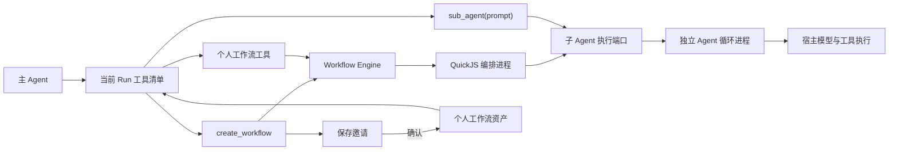

# 动态 Workflow 与 SubAgent 技术方案

> Feature 977 · standard · 项目 TECH_DESIGN 模板 · 基线 main / 9b62205 与当前工作区 · 实施中

[返回需求简报](../BRIEF.md) · [PRD 与验收](../spec/PRD.md)

## 1. 执行架构



`create_workflow` 在当前 Run 试跑模型生成的 JS。JS 接收 `args`，可调用 `agent("sub_agent", { prompt })` 与 `parallel([...])`。脚本根据参数、已完成任务的返回值和正常 JS 控制流决定下一步，最终返回可序列化业务结果。运行层负责验证入口、开关、权限、期限和返回值。试跑结果交还主模型，成功的定义进入已有保存确认卡。

个人资产按可信当前主体装配为命名函数 `workflow_<asset UUID hex>`。函数稳定身份与资产 ID 对应，display name 和能力说明进入工具描述，参数沿用已验证的 schema。主模型使用普通 Chat 消息和本轮工具清单决策。复用调用以新参数执行相同脚本并在执行树上呈现资产名和版本。

## 2. 契约与实现边界

### 工作流引擎

`workflows/engine.py`，持有 DSL 入口、定义验证和试跑/复用的共同调用。复用 `workflows/script.py` 与 QuickJS runner。guest 环境只有标准 JavaScript 和约定的宿主函数，无文件、网络、进程、连接凭据。单次 runner 最多三个子任务、同时两个。试跑和复用均先验证 JSON 参数再启动脚本。返回值和桥接消息受现有帧大小与工具观察限制。

`create_workflow` 接收 `name`、`description`、`parameters`（有界 JSON Schema 对象）、`scriptSource`、`args`。调用者须在取得有完整业务语义的试跑结果后生成保存邀请。资产定义的名称以管理列为准。版本 1 绑定不可变的说明、参数契约及源码。管理接口沿用原路径。

### 子 Agent

`tools/builtin/sub_agent` 只公开 `prompt`，经可信宿主端口进入同一个子 Agent 执行器。子进程复用 Harness 循环，接收初始化参数和本次授权的只读工具声明。宿主通过本地有界 JSON 帧提供模型调用、工具派发和取消控制。子进程独立保存消息、模型续接及工具观察，父 Chat 消息流仅追加最终工具观察。宿主校验调用名、参数、作用域和结果，并经原有模型服务和 Dispatcher 记录调用。子 Agent 可做数据库发现和授权查询。凭据由宿主持有，任务结束或取消时等待子进程退出。

```js
// 示例是一个脚本体。模型在函数调用里填写 args。
const first = await agent("sub_agent", { prompt: "核对时段 " + args.window });
const [detail, review] = await parallel([
  () => agent("sub_agent", { prompt: "拆解 " + first.answer }),
  () => agent("sub_agent", { prompt: "复核 " + first.answer }),
]);
return { status: "ok", result: { detail: detail.answer, review: review.answer } };
```

### 资产目录与状态

保留 16 个工具的模型接口上限。静态与已有 MCP 工具优先保留，工作流按服务端顺序在可用槽位内装配，不能因资产数量破坏原有 Chat。执行前再次按身份读取启用资产并核验源码摘要。持久 Run 重用已冻结的能力声明，执行时重新校验授权及资产状态。新 Run 读取最新可用资产。旧零售入口契约继续走既有管理路径。

### 持久化与发布

子 Agent 归父 Run，使用 `agent_step.kind = 'subagent'`、`parent_step_id` 和现有 Attempt/Checkpoint 保存执行关系，执行树使用已有 `subagent` 类型。子任务本身无需新表或新字段。子任务的模型调用及工具观察持久化在原有 Agent Attempt 中，续接状态由原有加密检查点保护。这也让父级恢复时能以稳定调用标识回读已接受的子步骤。

工作流资产需要保存模型可见的说明与独立的函数参数契约。由 `agent/main` 迁移 `0011 → 0012` 给 `workflow_asset` 增加可空 `description`、`parameters`，以 `entry_contract` 区分新通用契约。旧资产无新字段，原有源码、身份及管理字段完整保留。新资产沿用同一主体、契约、runner 版本及源码摘要的唯一键。重复源码与相同参数 schema 复用原资产，参数 schema 冲突时提示调整后重试。保存邀请继续使用 `agent_workflow_draft.validation_summary`。既有公开草稿补充可选通用参数和定义说明。

迁移真源为 `apps/agent/migrations/versions/0012_dynamic_workflow.py`。通过 `pnpm db:sql -F agent` 派生 `apps/agent/db/main/sql/bootstrap.sql`、版本增量和 manifest。上线前备份并核对活动任务，先迁移 Agent，再部署 Agent 和 Web。恢复时保留升级库并从备份恢复独立的 0011 数据库与对应镜像。验收空库、0011 原生及 SQL 升级、权限、生成一致性和恢复。遵循[数据库迁移规范](../../../docs/database-migrations.md)。

AC-08 通过 `DELETE /v1/analysis/workflows/{asset_id}` 提交 `metadataRevision`。Agent 按租户、工作区和用户校验归属，用行锁串行化删除，版本冲突时返回 409。已删除资产保留脚本与历史引用。管理查询和工具目录只读取未删除资产，执行时按同一规则复查授权和状态。历史草稿重复确认沿用已保存的资产 ID。新的草稿可重新保存相同脚本。

由 `agent/main` 的 [0014 迁移](../../../apps/agent/migrations/versions/0014_workflow_asset_deletion.py) 从 `0013` 升级。新增可空 `deleted_at`，脚本唯一索引限定在未删除资产，Runtime 获得该字段的更新权限。派生交付见 [0013 → 0014 SQL](../../../apps/agent/db/main/sql/upgrades/0013__0014.sql) 和 [bootstrap](../../../apps/agent/db/main/sql/bootstrap.sql)。备份 0013 并核对活动任务，迁移后发布 Agent 和 Web。失败时恢复至独立 0013 数据库，使用对应版本应用。验证原生与 SQL 升级、空库、权限和备份恢复。

## 3. 实施任务

| 任务 | 主要文件                                                                    | 验收                                                               |
| ---- | --------------------------------------------------------------------------- | ------------------------------------------------------------------ |
| T1   | `workflows/`、`tools/builtin/create_workflow/`、`schemas.py`、0012 迁移     | 参数、DSL、试跑、草稿和资产确认。AC-01、AC-02、AC-06               |
| T2   | `tools/builtin/sub_agent/`、`harness/`、`runtime/`                          | 子进程内的复用循环、授权工具、父子记录、取消。AC-04、AC-06         |
| T3   | `workflows/`、`tools/catalog.py`、`api/runs.py`、`runtime/tool_bindings.py` | 按作用域注入资产、运行前复验、同一引擎按新参数执行。AC-03、AC-05   |
| T4   | Web Chat 预置、工作流保存卡与资产管理页、生成契约                           | 点击与键盘、运行过程、刷新恢复和真实模型跨会话复用。AC-01 至 AC-07 |
