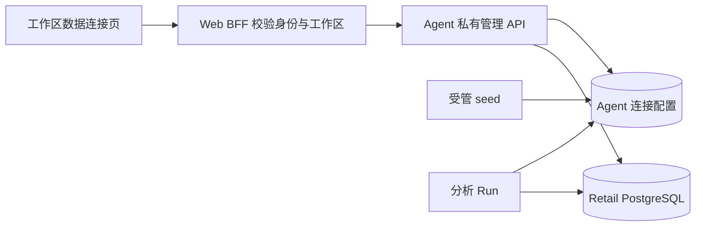

# 数据连接管理与默认 Retail 接入技术方案

> Feature 982 · standard · 模板 `mai-specs/_templates/TECH_DESIGN.tmpl.md` · 代码基线 `9b62205` 与当前工作区

[返回需求简报](../BRIEF.md) · [有效需求与验收](../spec/PRD.md)

## 1. 最小方案

Web 复用产品壳、工作区鉴权和 BFF 私有请求。Agent 管理一张工作区连接表，每条连接有独立 UUID 和版本。新 Run 在选模完成后读取一次默认 Retail 连接快照。默认配置通过既有 Agent seed 导入。Retail 工具继续使用固定 SQL、只读事务和有界取消。



复用 `SecretStore` 的目的绑定密封和现有模型加密密钥。只读账号密码加密，连接参数结构化保存，管理接口返回字段白名单。部署可通过 `COMPASS_RETAIL_ALLOWED_ENDPOINTS` 配置精确主机和端口，默认允许本地宿主及 Compose 的 PostgreSQL。通用连接另外接受 `COMPASS_DATA_ALLOWED_ENDPOINTS`，预置本机常见 PostgreSQL/MySQL 端口。驱动接收显式参数生成的连接串。Legacy 导入只接受单端点以及 host、port、dbname、user、password、sslmode，拒绝 libpq 额外选项。

## 2. 数据与契约

Agent `data_connection` 以 `id` 为 UUID 主键。每行保存 `workspace_id`、`tenant_id`、`name`、`engine`、主机与端口、数据库、角色、TLS 模式、可空 Retail 租户 ID、密码密文和正整数版本。同工作区名称唯一。普通连接随机分配 UUID，默认 Retail 的 ID 固定为工作区 UUID，数据库约束保证只有这条记录可携带 Retail 租户 ID，且引擎为 PostgreSQL。查询同时匹配租户、工作区和连接 ID。

| Web 方法 / 路径                   | Agent 路径                       | 规则                                                                     |
| --------------------------------- | -------------------------------- | ------------------------------------------------------------------------ |
| GET / POST `data/connections`     | `/v1/data/connections`           | 列表只返回安全字段。创建使用版本 0，需密码。                             |
| PATCH `data/connections/{id}`     | `/v1/data/connections/{id}`      | 比较指定记录的版本后更新，冲突返回 409。引擎和 Retail 用途在创建时确定。 |
| POST `data/connections/{id}/test` | `/v1/data/connections/{id}/test` | 测试指定记录的快照，返回状态及版本。                                     |
| 既有 `data/retail-connection`     | `/v1/data/retail-connection`     | 保持原接口形状，读写同一条默认 Retail 记录。                             |

普通 PostgreSQL 使用 psycopg，MySQL 使用 PyMySQL，探测固定执行 `SELECT 1`。MySQL 提供验证主机和证书的 TLS 模式及显式关闭 TLS 的选项，探测设置连接与读写超时。默认 Retail 沿用原身份检查。密码密封绑定租户、工作区和记录 ID，默认 Retail 沿用迁移前的目的标识。

Web 从 query 接收工作区标识，经现有权限服务核验活跃工作区与 `module.admin.data`，并要求平台管理员。写操作复用同源与 CSRF。Agent 要求服务令牌及独立的 `data_manage` 可信用途，读取上下文中已授权的工作区。两端使用 no-store。BFF 使用生成 schema 校验输入和上游响应，转发在 Web 事务结束后执行。

测试和运行共用固定只读身份检查，核对会话角色、事务只读、事实表与 channel、sku、spu 三张维表的行级权限、这四张表的写权限以及配置的 Retail 租户可见性。测试的连接和 SQL 有界，失败折叠为安全分类。Run 在有 Tools 能力的经营分析路由下加载配置，缺行、解密失败或端点不在允许列表时使用零工具路径。已开启的 Run 保留其快照。

## 3. 初始化、版本与恢复

- Owner 为 `agent/main`，Web 与 Retail 源库无 schema 迁移。Alembic `0005 → 0006` 新增通用表，在同一事务复制旧记录为「本地 Retail」，沿用租户、工作区、凭据、配置和 revision，随后移除旧表。受管工具登记两版表形态，给 runtime 角色 SELECT / INSERT / UPDATE。
- 新增 `apps/agent/migrations/versions/0006_data_connections.py`，更新 `apps/agent/db/main/sql/bootstrap.sql`、清单和各历史 revision 到 0006 的增量 SQL，原历史区间保持原字节。使用 `pnpm db:sql -F agent` 生成，`pnpm db:sql:check -F agent` 比对。
- 执行顺序为备份应用库和加密密钥、迁移 Agent、用 runtime 账号 seed、发布 Agent/Web。原 `COMPASS_RETAIL_RUN_SCOPE` 和 `COMPASS_RETAIL_RUN_READONLY_DSN` 由 seed 读取，目标采用部署可达地址。均空时跳过，成对配置时用插入冲突忽略导入。应用请求和启动阶段不读旧值决定连接。Compose 把导入配置交给一次性 migrate/seed 服务。
- 回退保留故障库和旧配置。需要回退到严格检查 0005 的构建时，将已验证的升级前备份和密钥恢复到独立库，再切换旧构建。升级验收在专用 PostgreSQL 上覆盖空库、旧库、权限、生成一致性和恢复。

## 4. 供评审的代码设计

以下为关键分支示意。省略了 DTO 转换和响应包装。

```python
# Agent 保存。唯一工作区键与条件更新处理并发首次创建和旧版本写入。
current = find(scope.tenant_id, scope.workspace_id, connection_id)
if (current.revision if current else 0) != command.revision:
    raise conflict
## login_target 含 host、port、database、role 和 sslmode。
if command.password is None and (
    current is None or current.login_target != command.login_target
):
    raise validation_failed
assert_allowed_endpoint(command.host, command.port)
ciphertext = seal_for_scope(command.password) if command.password else current.ciphertext
if command.revision == 0:
    saved = insert_if_absent(scope, connection_id, command, ciphertext)
else:
    saved = update_where_revision_matches(scope, connection_id, command, ciphertext)
if saved is None:
    raise conflict
```

```python
# 分析请求在受控执行阶段读取已授权范围，Agent DB 事务在 Retail 查询前关闭。
scope = trusted.scope
if retail_tools_allowed and scope.kind == "tenant":
    snapshot = await control.perform(lambda: load_retail_binding(scope))
else:
    snapshot = None
# load_retail_binding 只返回匹配范围、凭据可解密且端点仍被允许的快照。
```

## 5. 任务与验证

| 任务 | 文件与模块                                   | 验收                |
| ---- | -------------------------------------------- | ------------------- |
| T1   | Agent 数据模型、迁移、SQL 工具及 seed        | AC-03、AC-06        |
| T2   | Agent 管理接口、连接检查、Run 绑定及生成契约 | AC-02、AC-04、AC-05 |
| T3   | Web 工作区鉴权、BFF、数据连接页              | AC-01、AC-02、AC-05 |
| T4   | 本地启动说明、PostgreSQL 和浏览器验收        | AC-01 至 AC-09      |
