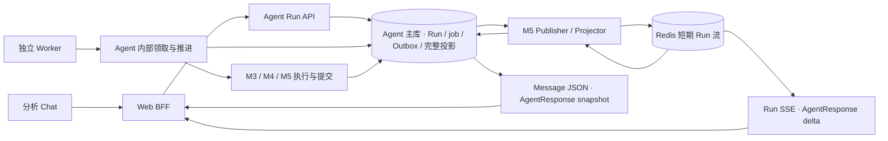
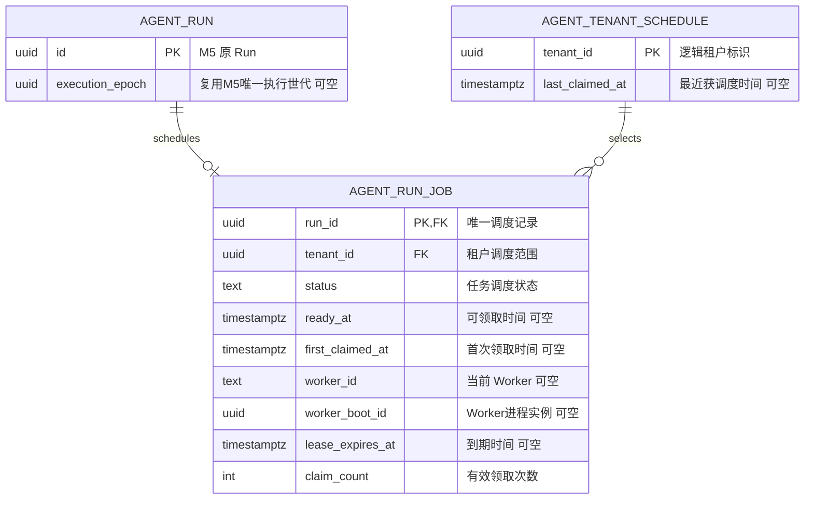
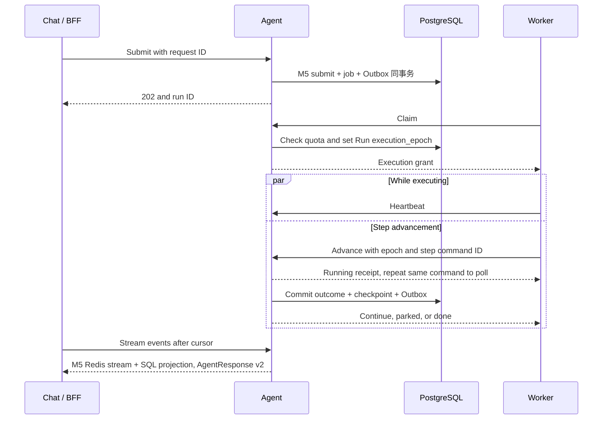

# 第 20 课 · 异步 Run、Worker 接管与过程展示技术方案

[需求简报](../BRIEF.md) · [有效 PRD](../spec/PRD.md) · [标准模板](../../_templates/TECH_DESIGN.tmpl.md) · [第 19 课持久运行](../../985-lesson-19-durable-runtime-hitl/design/TECH_DESIGN.md) · [代码设计](CODE_DESIGN.md)

> Feature 984 · Profile `standard` · 2026-11-12 修订 · 代码基线 `9b6220525f25` 及当前未提交工作区。沿用标准模板增量维护；[评审与复核](../review/design_review.md)记录本次修正。方案有条件通过，实施依赖 M5 交付；本轮仅评审和修订设计。

## 需求依据与验收

以 [FR-01～FR-09、BR-01～BR-11、NFR-01～NFR-04 和 AC-01～AC-11](../spec/PRD.md) 为准。现有 [Worker 入口](../../../apps/worker/src/compass_worker/main.py) 只支持进程生命周期和信号退出；[Run API](../../../apps/agent/src/compass_agent/api/runs.py)与 [BFF](../../../apps/web/src/server/http/analysis-run-handler.ts)仍使用进程内 v1 链路，断开会请求取消。当前迁移源到 0008，M5 的 0009、持久 Session/Run、Redis 发布投影及 HITL 尚未实现。

M6 的前置合同采用第 19 课 2026-11-12 修订版：[双接口与执行生命周期](../../985-lesson-19-durable-runtime-hitl/design/TECH_DESIGN.md)、[数据结构](../../985-lesson-19-durable-runtime-hitl/design/DATA_DESIGN.md)、[Redis](../../985-lesson-19-durable-runtime-hitl/design/REDIS_DESIGN.md)及 [HITL](../../985-lesson-19-durable-runtime-hitl/design/HITL_DESIGN.md)。M5 已负责 202 接单、连接解耦、Message 快照和 Run 续流；M6 增加队列准入、Worker 执行权、自动接管及相应展示。T0 验证前置实现后才进入 M6 开发，不在本课复制一套持久化底座。

## 1. 方案概述

Agent 在 M5 的同一 PostgreSQL 受理事务中增加 job。Worker 经 Agent 专用接口领取、续租和请求推进到下一持久边界；Agent 执行模型、工作流和工具。复用 M5 的 SQL 状态/Outbox、Redis 短期流与 SQL 完整投影，通过同一 AgentResponse v2 向 Chat 展示结果。Worker 失联时，Agent 收回其驱动权，清理对应执行任务，另一 Worker 从有效 Checkpoint 继续。

### 整体架构



### 关键决策

| 决策                              | 取舍                                                                                                                                                                                         |
| --------------------------------- | -------------------------------------------------------------------------------------------------------------------------------------------------------------------------------------------- |
| 同库队列与状态                    | Queue 只在 Agent 内。提交 Session/Run、消息、命令回执、关键 Outbox 和 job 同事务写入；复用 M5 幂等。课堂以短调度事务执行公平选择，省去独立 Scheduler 和任务 Broker。Redis 继续只承载运行流。 |
| Worker 驱动、Agent 拥有业务执行   | Worker 领任务并通过内部 HTTP 驱动一个个 Step，独立协程发心跳。它持有不透明执行权，业务上下文、SQL 凭据、模型与持久事务都留在 Agent。引入一次内部往返，保留项目应用边界和唯一数据所有者。     |
| 租约负责接管，Checkpoint 决定位置 | 只在有效 Lease、正确 epoch 和 Step 边界下推进。失效先停止旧执行，核对资源和动作效果，再按 M5 最近有效边界接管。重发同一 Step 命令可取回原回执。                                              |
| 复用完整展示投影与短期流          | 在 M5 的公开业务包里增加调度 Timeline；所有读取复用当前权限过滤和 reducer。基线采用确定性旁白、成功边界一次发布完整回答，省去可选模型摘要及新增分段回答分支。                                |

部署保持一个 Agent 执行所有者、一个 PostgreSQL、M5 已引入的一个 Redis，以及两个独立 Worker 进程。M5 的 Agent 所有者锁、Publisher 和 Projector 生命周期继续保留。Worker 扩展的是驱动与调度槽；模型、工具执行仍占用 Agent 资源。Agent 多副本、独立计算 Worker、独立 Scheduler 和租户专属进程池留给实测后的拓扑调整。

## 2. 调度、接管与数据边界

### 新增数据

现有 M5 的 Run、Step、Attempt、Wait、Artifact、Checkpoint、Outbox 与公开投影结构沿用第 19 课。以下是本次新增的所有持久对象。队列只存调度所需标识与状态，实际恢复数据仍由原 Checkpoint 持有。



图中 Run 只列调度关联字段，完整定义沿用 M5。仅新增 `agent_run_job`、`agent_tenant_schedule` 两张表；后者只保存租户最近获调度时间，配置使用 Agent 受信任的默认值和按 tenant ID 覆盖值，不建配置管理页面或配置表。

- `run_id` 是 job 的主键及 Agent 本库 FK；`tenant_id` 从 Run 的 Session 归属读取，入库时核验，FK 只指向本库 `agent_tenant_schedule`。默认不删除调度记录。`status` 初值 ready，`claim_count` 初值 0 且非负；其余可空字段按图声明。
- `ready` 必须有 `ready_at`；`leased` 必须有 Worker/boot/expiry，且 Run 有 execution_epoch；`reclaiming` 保留原 Worker/boot/expiry 供清理，Run epoch 已撤销。`parked/done` 清空当前租约字段；旧执行权在持久命令和 Attempt 中保留。跨表不变量由同一事务维护。
- 就绪索引 `(tenant_id,ready_at,run_id) WHERE status='ready'`、过期索引 `(lease_expires_at) WHERE status='leased'`；Worker 部分唯一索引覆盖 `leased/reclaiming`，保证同一配置 Worker 槽最多占用一个 Run。占用统计包含 reclaiming，租约到期本身不释放资源。
- 首次提交和控制继续使用 `agent_command` 的作用域/requestId/摘要。内部 advance 扩展 `kind=worker_advance`，复用该表记录派发中与最终回执；规范键、绑定和读取限制见代码设计。job 不重复保存提交键、请求摘要或第二份 execution_epoch。
- 旧 M5 终态直接读取。旧 created/waiting/paused 无 job 时，在首次 Resume 或有效批准的事务中按容量补建；满额返回 429，保留原状态、决定和 requestId 可重试。新版本已受理的 parked job 持有积压位置，批准/恢复无需再次占位。暂停、等待和终态只在实际资源已确认释放后转 parked/done。

### 受理、配额与公平

- 接单沿用 M5 的 `POST /v1/analysis/sessions/submit`。当前授权通过后，复用 `agent_command` 查重，先返回有效旧回执，再检查新接单容量。同键不同命令 409；新 Session/Run、消息、初始投影、Outbox、命令与 job 同事务提交，返回 202 的 sessionId/runId/streamUrl。数据库接收成功后即使进程中断，ready job 仍可领取；Redis 发布依照 M5 补发，领取/派发等待必要投影就绪。
- 初始课堂档为两个 Worker 槽、全局最多 2 个在途执行、每租户最多 1 个在途执行、每租户最多 4 个已受理未结束 Run、全局 12 个。受理上限涵盖队列、执行和已接受的待恢复任务，后者保留再入队位置。等待和暂停在安全边界确认资源释放后立即归还执行槽，其他租户仍可获调度。取消中的实际资源占用直到清理确认。超限返回 429 和可重试提示，拒绝不创建 Run。容量和耗时阈值是课堂档位，待实际负载确认。
- 受理、领取及可能为旧 Run 新增 job 的 Resume/批准共用事务级调度锁。全局锁序为 **调度锁（需要时）→ Session → Run → job → Step/Attempt → Wait/Action**。控制、提交及清理不反向获取调度锁；操作如果可能增加积压，必须从事务起点先取调度锁。Projector 只取 Run 并写其投影，不反向锁 Session。所有事务保持短小，权限、模型、Sandbox 和 Redis 调用在事务外。
- 领取先过滤无容量租户，按 `last_claimed_at NULLS FIRST, tenant_id`，再按 `ready_at,run_id` 选择。逐候选先锁 Session、再锁 Run，使用 `SKIP LOCKED`；跳过争用候选后继续扫描其他有容量租户。拿到 job 后重验状态与容量；成功领取才更新 `last_claimed_at`。仅以数据库当前占用判断，避免并发双领和单租户阻塞其他候选。[PostgreSQL 锁与跳过规则](https://www.postgresql.org/docs/17/sql-select.html)用于这一短事务；[统一加锁顺序](https://www.postgresql.org/docs/17/explicit-locking.html)覆盖 M5/M6 共同写入路径。

### Worker 交互与状态



- job 使用 `ready / leased / reclaiming / parked / done`；Run 保持 M5 的小写状态。首次领取将 created 转 running。Resume/批准事务只把 job 设 ready、保存原 Run 的可恢复状态及控制回执；ready 阶段公开 reasonCode=queued，Chat 显示“等待执行”；清除已满足的 pause 意图，重复新恢复命令按既有状态冲突返回。只有 claim 能授予新 epoch 并转 running。所有 M5 直接创建执行任务的 submit、Resume、审批/外部事件及 v1 适配器均改走此路径。Agent 根据任务回执推进一段执行，禁止这些入口绕过配额自行启动。
- 内部路由统一为 `/internal/runtime/jobs/{claim,heartbeat,advance,release}`。Agent 配置两份独立 Worker 凭据，凭据绑定 workerId；进程启动生成 bootId，绑定本次 grant。grant 含 runId、workerId、bootId、epoch、expiresAt、checkpointNo，不含用户输入或数据源凭据。BFF 用户凭据与 Worker 凭据互不通用。claim 响应丢失后，同一身份/boot 重试返回仍有效的原 grant；不同 boot 等待旧 grant 清理。无任务返回 204 和建议重试间隔。
- 心跳每 3 秒，TTL 15 秒；Agent 监督与 Worker 空队列轮询上界各 1 秒。续租、派发和提交均在取得行锁后读取 PostgreSQL `clock_timestamp()`，比较 `expiry > now`；过期心跳返回 409 `lease_lost`，不复活旧 epoch。心跳只更新 expiry，不增加 Run.version、不写逐次 Outbox。Worker 收到 lease_lost 或无法在本地保守截止前确认续租时停止 advance。租约校验采用[实际当前时间](https://www.postgresql.org/docs/17/functions-datetime.html#FUNCTIONS-DATETIME-CURRENT)，避免事务开始时间在等锁期间保持不变。
- advance 只接收 grant 和 expectedCheckpoint；服务端按 Run/epoch/边界生成稳定内部命令 ID，Worker 持同一命令重试。Agent 先持久登记运行中回执，再启动独立于 HTTP 的单 Run 任务，立即返回 running；同一命令轮询返回 running 或最终 continue/parked/done 回执。每次只推进到下一个可恢复边界，内部 Workflow 子步骤仍按 M5 独立落盘。HTTP 超时不新建 Attempt，不更换命令；原回执带原 grant，旧 grant 只可读自己的已提交回执，新推进仍返回 lease_lost。
- 每次实际模型/工具派发、业务提交及公开 delta 回调都经过当前 epoch/状态门禁。批准后真实效果仍用 M5 演示适配器的独立短事务，按共同锁序复查租约、取消、权限与 Action ID。正常 Worker 退出先停 claim，保持心跳直到有界当前步骤完成或清理收口；release 仅提交释放意图，由 Agent 确认边界和资源后转 ready/parked/done。请求结束不直接清空租约。
- 到期扫描先撤销 Run.execution_epoch、job 转 reclaiming，并保存接管原因和旧 Attempt。进程内监督任务中止对应执行及流写入；接管前等待旧回调排空，已确认输出沿 M5 保存为完整结果或 incomplete，未决写入按 M5 核对。已提交的合法 Outbox 仍可补发，新 epoch 不接收旧回调。资源和外部效果未确认时保留隔离占用；单凭到期不把 job 改 ready。清理确认后才检查 Checkpoint、权限、版本、预算与原 Action 回执，再排队。取消优先收口、人工暂停/等待保持 parked，可安全重试的中断步骤才生成新 Attempt。
- Agent 重启先恢复 M5 所有者锁、Redis/Outbox/投影，关闭 claim/advance。对原 leased/reclaiming job 撤销旧 epoch并核对资源；其余 ready、parked 和 done 保留语义。仅故障中断且满足 M5 恢复条件的 Run 自动进入 ready；显式暂停、未决审批、未知远端效果继续等待。启动复核完成后开放调度。两个 Worker 的接管测试包含真实进程退出；Agent 重启另验所有者和旧回调隔离。

MCP 接管继续使用 M4 的原目录快照和 M5 的配置版本核对规则。凭据按当前授权重新取得，不跨用户复用会话；旧 Attempt 的远端结局未知时保持待核对，禁止因租约过期自动重放 tools/call。批次策略随节点定义恢复，已提交结果继续复用。

## 3. 对话事件与可观测

### HTTP 接口与同一展示协议

- 完整沿用 M5 的 sessions/submit、sessions 列表、sessions/{id}/messages、runs/{id}/events、pause/resume/cancel、decisions 和 artifacts 路由。Get Status 通过 Message `runId` 过滤返回该 Run 的已提交公开状态、结果和恢复信息。新增内部 Worker API、只读运行诊断和租户用量查询；BFF 使用已有同类鉴权、CSRF 和 Schema 校验。v1 `POST /v1/analysis/runs` 继续作为 M5 适配器，内部进入同一 job 队列，保留它自己的断线取消行为；Web 全部使用 v2。
- Message 从 SQL 一致快照返回 `AgentResponse(mode=snapshot)`，Run 从 Redis 返回 `AgentResponse(mode=delta)`。沿用 `message.upsert/message.delta/run.upsert/view.upsert`，复用同一 validator/reducer；调度变化编码为公开 `timeline` 对象及必要 run.upsert，经现有 Outbox/Projector 提交。对象 ID/revision、父子节点和用户展开状态保持 M5 规则。
- 游标使用原 Redis Stream ID 字符串，按两段整数比较；SSE id 为 `runId:seq`。刷新先加载 Message 与 projected_seq，再续接该 Run。终态流过期返回 409 `history_reload_required`，重新加载完整 Message；活跃流丢失返回 410 `stream_data_lost` 并保持 recovery_required；依赖暂不可用返回 503，历史 SQL 读取仍可用。连接 60 秒轮转，权限最长 5 秒复查，慢连接仅断开订阅。M5 的批次投影门禁与流保留规则保持原样。
- 公共流只写通过展示白名单的业务字段，读取 Message、SSE 与重连继续复查当前范围。Retail 摘要允许日期、维度、成功状态和行数，渠道名称按当前数据权限决定；工具正文和私有执行输入留在其原受控记录。既有获准的 Workflow 源码沿 M5 原展示策略，不另扩展权限。旁白使用确定性模板。运维 Worker/租约详情由独立授权查询从 job、命令及 Attempt 关联，不混入用户流。
- 为兼容 M5 的整帧校验，筛选后保留包的 packetId/seq/revision；被隐藏的整个 `view.upsert` 编码为相同身份和 revision 的安全占位对象，去掉详情、只保留可见状态。一个请求的全部流包仍有对应位置，cursors 等于最后包 seq，无需新增纯游标帧。权限变化或视图范围变更后清除旧视图并重载 Message；不可见整个 Run 时直接拒绝。快照和增量共用这套过滤，严格维护有序 delta 和消息 revision。
- 最终回答基线一次提交：同一关键批次包含助手 `message.upsert(status=completed)` 和 `run.upsert(status=completed)`；SQL 完整投影提交后才向用户公开。客户端整帧应用后，看到同一 Run 的完整助手消息与 completed 才自动折叠一次。旁白与工具文本只更新 view 对象。失败/取消沿 M5 保留 incomplete 消息且不当作成功答案；重连与快照使用同一判断。PRD 的 finalAnswer 是该完整答案的业务称谓，v1 适配器继续输出原字段。本期不启用可选分段回答与模型旁白。

### Timeline 与度量

- 调度/接管的必要 Timeline 作为 M5 `public_view` 中独立稳定 ID 的 timeline 对象持久保存，Redis 过期后仍能读取。Run/Step/Attempt/Tool/Workflow 与 modelCallId/Trace 沿用已有字段。Heartbeat 不生成 Timeline。运维查询要求当前 isPlatformAdmin；租户统计要求当前 tenantRole=admin 与有效成员身份，单个工作区授权不开放整个租户统计。Agent 通过 M5 Web 核验接口确认，不接受浏览器指定租户扩大范围。
- 拟新增 `GET /v1/analysis/runs/{id}/timeline` 供平台运维读取该 Run 的安全阶段、时间、原因及关联 ID，通过既有持久 Timeline、内部命令和 Attempt 拼合；返回有类型只读诊断 DTO，按稳定条目 ID 去重，不返回消息正文、工具原文、凭据或 Checkpoint 密文。用户过程仍通过原 Message/Run 接口读取，不新增诊断页面。
- 拟新增 `GET /v1/analysis/runtime/usage`，只返回当前授权租户的限额、ready/leased/reclaiming/parked 数、积压和占用、已结算 token/成本与未知保守占额。租户明细从 job 与 M5 预算/Attempt 聚合，无新计费账本或管理页；预算沿用 M2 StopPolicy 与 M5 Checkpoint，恢复时保留已用额度。未知成本保留 null 和占额，不记作零成本。
- Retry 新建 Attempt，Resume 接续原 Run，Replay 只读历史。记录正常与 Worker Crash、重复投递、超时、取消竞态。恢复成功率以需接管 Run 为分母，受阻项单列且计入总数；排队时间为 Run.created_at 到 job.first_claimed_at，报告按租户 p50/p95/最大值；槽位利用率按 Timeline 的领取到确认释放区间累计除以观察窗×有效容量，清理隔离占用单列。费用与实际效果计数分别报告，外部观测出口失败不影响这些持久查询。

课堂基线设计目标：两个租户、两个真实 Worker，各用 4 个独立 Session 受理任务；夹具在边界保持 A 的积压，再提交额外请求验证 429，B 在可用槽下推进。对无未决远端效果的可恢复夹具，恢复成功率要求全部成功，旧 epoch 新提交和重复业务效果均为 0；另逐项列出未知效果/清理受阻夹具。固定夹具清理上界 2 秒、监督和轮询上界各 1 秒、HTTP 往返与本机抖动总预留 2 秒时，停止心跳到新合法领取目标 ≤21 秒（15+2+1+1+2）；有空闲槽的无故障 B 任务首次领取目标 ≤3 秒（轮询 1 秒+预留 2 秒）。这是待测的本机课堂目标，运行报告记录实际值和失败项，不改变未知效果的阻塞规则，也不作生产 SLA。

## 4. 迁移、发布与回退

归属 **agent/main**，规划 **0009 → 0010**；0009 目前为 M5 待实施版本，实际编码前核对单一 head 和前置交付。拟新增 `apps/agent/migrations/versions/0010_run_scheduler.py`，包含两张调度表、索引和 `agent_command.kind` 的内部 worker_advance 枚举/约束扩展。epoch 继续使用原 Run 字段。同步 ORM、Alembic、受管版本与运行角色授权；Worker 无数据库凭据。生成完整 bootstrap、支持起点到 0010 的升级 SQL 和 manifest，保留已共享 revision 与历史交付。Web、Worker、Retail 无业务库迁移。

发布按「停接并排空 M5 活动执行 → 按 M5 保存主库、Redis 卷与加密材料 → 迁移至 0010 → 发布保留单所有者的 Agent → 启动双 Worker 并确认领取 → 切换 Web」进行。旧 waiting/paused/created 无 job 的状态保留，首次显式恢复走容量准入；升级不自动派发全部遗留 Run。Agent 就绪检查覆盖主库版本、Redis/投影和所有者；Worker 启动日志需区分依赖不可用、空队列和真正领取，进程存活不作为消费验收。

迁移验证空库、0009 含 waiting/completed/created 数据的旧库、SQL 一致性、权限及协调恢复。回退先停接与 Worker，保留 0010 的 Run/job/流；优先用兼容 0010 的构建恢复读取。回到只接受 0009 的构建时恢复对应备份到独立库及隔离 Redis 命名空间/卷，核对 projected_seq、Outbox、原 Action ID 与效果；保留原库和卷。无法核对的活跃流保持 recovery_required。完整 SQL 和增量的实际生成与验收留在实施阶段。

## 5. 实施任务与验证

```diff
+ apps/agent/src/compass_agent/runtime/run_scheduler.py  受理、配额、租约与接管
+ apps/agent/src/compass_agent/api/worker_runs.py  Worker专用鉴权与领取/续租/推进/释放
! apps/agent/src/compass_agent/api/{sessions,runs}.py  复用M5接口，所有可运行入口入队
! apps/agent/src/compass_agent/runtime/{entities,store,checkpoints,hitl}.py  M5前置：原子job、回执与租约约束
! apps/agent/src/compass_agent/runtime/{service,control}.py  M5前置：一次推进边界、停止及回收
! apps/agent/src/compass_agent/runtime/{message_reader,run_events,public_projection,outbox_publisher}.py  M5前置：调度视图、权限与过期epoch门禁
! apps/agent/src/compass_agent/tools/dispatcher.py  每次实际派发复查执行权
! apps/agent/src/compass_agent/{schemas,settings,main}.py  运行 DTO、配置与路由
+ apps/agent/migrations/versions/0010_run_scheduler.py  主库队列增量
! apps/agent/{migrations/env.py,scripts/database.py,db/main/README.md,db/main/sql/}  受管迁移与派生 SQL
! apps/worker/src/compass_worker/main.py  消费者与信号收口
+ apps/worker/src/compass_worker/run_consumer.py  HTTP 驱动与心跳
! apps/worker/{pyproject.toml,README.md}  HTTP 依赖和消费运行说明
! apps/worker/package.json  保持独立lint/typecheck/test入口
! apps/agent/package.json  新真库测试接入test:integration
! apps/web/src/server/http/analysis-run-handler.ts  诊断/用量授权、v1及v2代理
! apps/web/src/server/modules/models/application/authorize.ts  显式诊断/租户统计用途，沿用现有管理员身份
+ apps/web/src/app/api/analysis/ 下对应运行诊断与用量路由  接入已有handler
! apps/web/src/server/analysis-agent-client.ts  HTTP 契约校验和游标
! apps/web/src/client/analysis-run.ts  断线续接和事件去重
! apps/web/src/components/{analysis-composer,analysis-run-turn}.tsx  进度与最终回答
! deploy/compose/compose.yaml  Worker 配置、接管与验证环境
! deploy/README.md  运行与故障演练
! .env.example  分离 Worker 连接与授权配置
! scripts/export-contracts.py  派生M5 v2及新增调度契约
! contracts/ 与 apps/web/src/generated/  只由生成入口更新
! apps/agent/README.md 与 manifest.yml  对齐调度职责与运行入口
! uv.lock  工作区 HTTP 依赖锁定
+ apps/agent/tests/test_run_scheduler_integration.py  配额、重启与有效租约
+ apps/worker/tests/test_run_consumer.py  续租、信号和重复回执
! apps/web/tests/e2e/analysis-composer.spec.ts  重连、权限与折叠
+ docs/adr/0005-async-runtime.md  部署拓扑和扩展触发条件
+ mai-specs/984-lesson-20-production-agent-runtime/test/FAILURE_MATRIX.md  按故障记录实际结果
+ mai-specs/984-lesson-20-production-agent-runtime/IMPLEMENTATION.md  实际交付与运行恢复报告
```

| 任务                            | 顺序   | 验收                                                                                                                                     |
| ------------------------------- | ------ | ---------------------------------------------------------------------------------------------------------------------------------------- |
| T0 M5 前置接缝核验              | 实施前 | 0009、Session/Run/Checkpoint/HITL、Redis/Outbox/投影、当前授权及v1适配器已实现；确认一次执行边界入口、锁序和已有验收可复跑。当前待交付。 |
| T1 受管迁移、原子受理与租户准入 | T0 后  | AC-01、AC-03、AC-07、AC-09。重复受理、所有控制入口入队、旧Run容量与M5数据兼容。                                                          |
| T2 Worker、租约与恢复           | T1 后  | AC-03～AC-06。实际终止 Worker 并接管，验证重复领取、旧 epoch、超时、取消及动作只执行一次。                                               |
| T3 用户事件与 Chat              | T2 后  | AC-02、AC-08、AC-10、AC-11。注入受限字段，验证实时、历史、撤权及重连，回归 M1 同步路径。                                                 |
| T4 验收报告与部署               | T3 后  | AC-07～AC-09。测两个租户实际延迟、恢复和利用率，形成 Failure Matrix、运行与恢复报告及拓扑 ADR。                                          |

实施验证须运行 Agent、Worker 和 Web 的 lint/typecheck/test，生成并校验网络契约，执行 Agent PostgreSQL 的空库、0009 升级、权限、派生 SQL 和备份恢复，跑真实双 Worker 进程与 Web 浏览器验证。按跨应用规范运行 `pnpm check`、`pnpm build`、相关 Compose profiles 和 smoke。课堂 Lease 档位及延迟由实测确认，当前设计未运行服务或迁移。

针对本次修正补充验收输入：claim 响应丢失后的重试、advance 受理和结果提交各自的断连、等行锁跨越租约到期、过期心跳、批准/Resume/v1 的配额绕过、取消与批准/接管交错、旧 delta 回调与新 epoch 交错、Redis 终态流过期后 Message 重载、M5 的 Session 锁与新调度路径并发。新用例接入已有测试入口，代码和浏览器验收由后续实施执行。本轮只验证文档、链接、设计片段及阅读版。

## 统一执行过程的前置交接

生产展示沿用第 17 课的统一执行节点及 UiExecutionTree，第 18 课补齐真实工具元数据，第 19 课负责统一协议和持久展示。M6 续接沿用 Run/Redis Stream ID 与对象 revision，保留父子关系、并行组和展开状态；最终回答采用本方案第 3 节的完整消息与成功状态判断。

字段真源与本课前置交互见[第 17 课统一执行过程](../../987-lesson-17-hybrid-workflow/design/TECH_DESIGN.md#7-统一执行过程节点)。本节不改变本课原有工具、存储和生产执行的交付范围。
