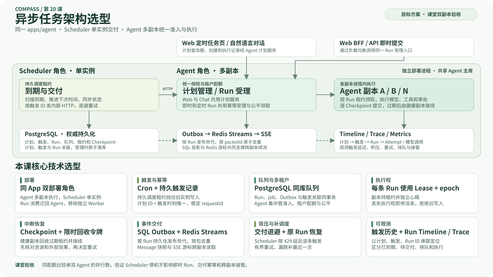
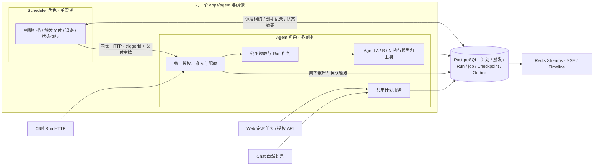
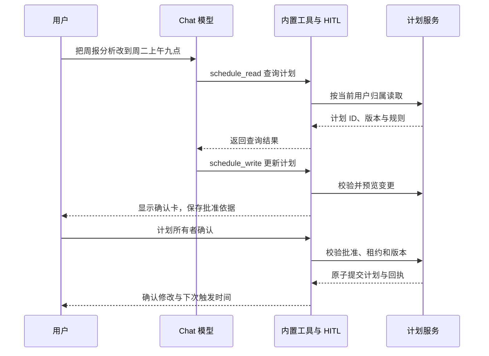
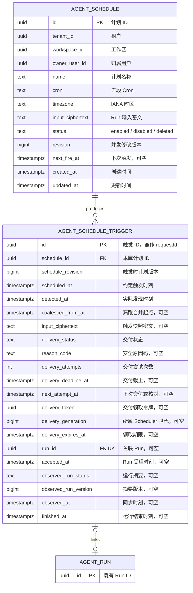
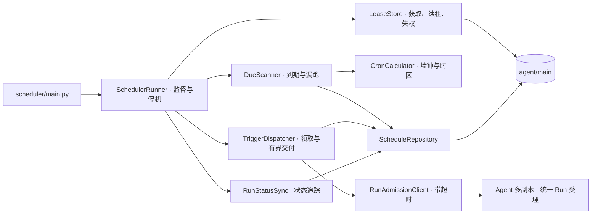
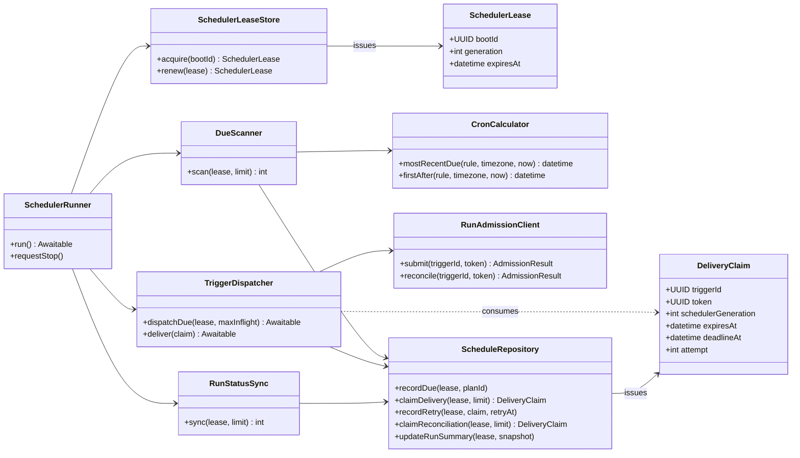
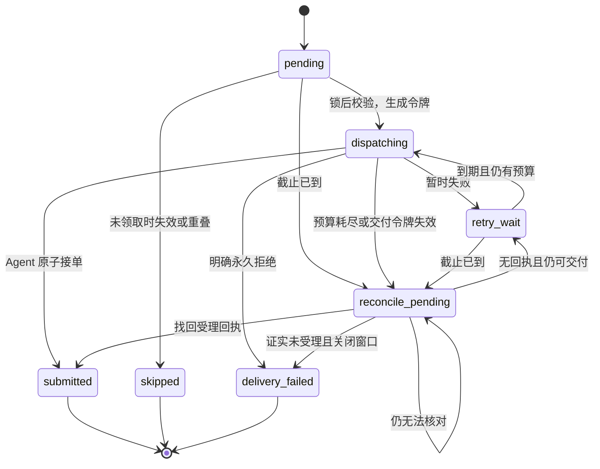
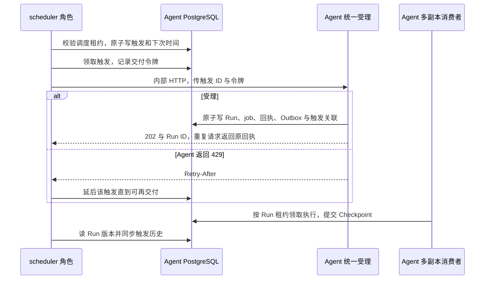

# 第 20 课 · 定时任务与 Agent 异步执行技术方案

[需求简报](../BRIEF.md) · [产品需求](../spec/PRD.md) · [标准模板](../../_templates/TECH_DESIGN.tmpl.md) · [代码设计](CODE_DESIGN.md)

> Feature 984 · Profile `standard` · 2026-11-16 修订。依据本轮会话确认的部署边界与 PRD AC-01～AC-21。此版待评审和实施。既有实施、评审和验收记录对应双 Worker 基线。

## 本课目标

从单进程 Agent 改为**支持多副本的分布式 Agent**，并在这套执行底座上接入定时任务。将执行所有权从整库单进程锁改为每条 Run 的租约。各副本都能接单、执行、查询和续流；发生故障时，其他实例接续原 Run。用相同配额和可控依赖验证从一个执行槽扩展到两个副本并行，覆盖 AC-04、AC-18、AC-19。

定时任务由 Web 和自然语言双入口管理。同一 `apps/agent` 部署单实例 Scheduler 角色，负责把到期计划可靠地变成 Run，覆盖 AC-12～AC-17。

## 1. 同 App 双部署角色

同一个 `apps/agent`、同一构建与镜像，部署两个运行角色。计划、触发和 Run 同属 `agent/main`，由 PostgreSQL 持久化。角色使用不同入口、服务凭据与权限。Scheduler 的数据库权限限于计划扫描/下次时间、触发的交付和摘要、调度租约及安全 Run 摘要。Agent 的内部 HTTP 收口负责真正创建 Run 和关联触发。

| 角色          | 规模与启动边界                                                             | 职责                                                                                                                              |
| ------------- | -------------------------------------------------------------------------- | --------------------------------------------------------------------------------------------------------------------------------- |
| **Agent**     | 多副本，负载均衡暴露 HTTP。每副本配置内部 Run 消费槽。                     | Web/Chat/API 计划管理；即时与定时 Run 的统一授权、准入、配额、公平领取、执行、接管和结果查询。                                    |
| **Scheduler** | 单实例，同镜像以独立常驻进程启动。启动和滚动切换用数据库调度租约保护写入。 | 到期扫描、持久触发、通过 HTTP 交付、退避、交付状态及运行摘要同步。按记录就绪时间作有界处理，Run 准入和租户公平规则由 Agent 决定。 |

Scheduler 停机仅延迟新的定时交付。Agent 保持即时受理、既有队列执行和订阅，Scheduler 恢复后补扫描和交付。两个角色由同一应用发布，可分别启动、停止、重启。独立 Worker App 在消费迁回后移除。

### 执行和测试容量

| 门禁         | 集群 | 每租户 |
| ------------ | ---: | -----: |
| Run 执行上限 | 1000 |    200 |
| Run 积压上限 | 3000 |     20 |

根 `.env` 与 `.env.example` 通过运行环境提供这些测试值。目标方案允许租户覆盖降低积压上限，超过 20 的覆盖在配置校验阶段拒绝。所有副本使用同一集群策略。目标双 Agent 的本地槽数由部署配置决定。1000/200 是策略上限，运行中计入积压，标准配置下同租户先受积压 20 约束。实际并行仍受本地槽、模型执行、数据连接和 Sandbox 容量约束。现有两个单槽 Worker 最多同时推进两个 Run，迁移后以真实 Agent 消费槽为准。

小配额场景在隔离测试中显式覆盖 2/1 执行与 12/4 积压，保留背压和公平行为测试。另用合成待执行记录验证 3000/20 边界和锁等待。单/双副本对比保持同一集群配额与依赖。积压按现有 ready/leased/reclaiming 与可继续的 parked 口径计数，已阻塞 parked 不占积压，reclaiming 占执行槽直至安全释放。

### 整体架构

[详细架构图](architecture.svg)

| 现有能力                                                                    | 本次接入                                                                                                                                                          |
| --------------------------------------------------------------------------- | ----------------------------------------------------------------------------------------------------------------------------------------------------------------- |
| `POST /v1/analysis/sessions/submit`、`RuntimeStore.submit`、`agent_command` | 复用 202、作用域 + requestId 幂等。命令回执、Session、Run、初始投影、Outbox 和 job 同事务受理。内部交付路由调用同一授权、受理和观测服务，并在受理事务中关联触发。 |
| `RunScheduler`、`agent_run_job`、`agent_tenant_schedule`                    | 复用公平领取、租户配额、Lease/epoch、advance 回执与回收。迁回 Worker 消费循环。                                                                                   |
| `DurableRuntime`、`ExecutionJournal`、模型和工具装配                        | 复用 Checkpoint、工具/模型预算、Sandbox/MCP、人工确认、动作核对和取消。提取与 HTTP Request 解耦的 Runtime 装配入口。                                              |
| PostgreSQL、Redis Streams、Outbox、公开投影                                 | 增加计划和触发两张表。Run 恢复、消息、产物和实时 SSE 沿用原路径。                                                                                                 |
| Timeline、用量、模型 Trace、Web/BFF 权限                                    | 复用 Run 诊断、授权和脱敏。新增计划、触发的关联与调度指标。                                                                                                       |

## 2. 定时任务增删改查

Web、Chat 与 API 共用 Agent 内的计划服务。对话按统一工具目录登记 `schedule_read` 与 `schedule_write`。读工具支持列表、详情和历史，写工具的参数分支为创建、修改（含启停）和删除。分开登记可直接沿用现有工具级审批策略。定时 Run 只启用读工具，写操作仍在执行校验处拒绝。Run 的服务端私有快照在受理时记录定时来源及 ID。

| 请求            | 授权与确认                                                                                                                                                                                                                                                                                |
| --------------- | ----------------------------------------------------------------------------------------------------------------------------------------------------------------------------------------------------------------------------------------------------------------------------------------- |
| Web / 授权 API  | 绑定当前可信用户、租户和工作区。校验 `module.automations` 与计划归属。创建与变更执行内容还校验分析权限。                                                                                                                                                                                  |
| Chat 查询和提案 | 同一计划权限及归属规则。计划所有者可确认自己发起的计划提案。等待查询、确认提交和任何副本的恢复执行均从同一持久提案抽取种类与确认主体。服务端选择所有者确认分支。业务类提案继续使用现有管理员审批。                                                                                        |
| Chat 实际写入   | 在边界前重新校验现行权限，以已批准提案绑定原作用域、计划版本、规范化参数和稳定 Action ID。数据库事务验证 Run 当前租约、epoch、未取消且 Action 批准，随后同事务写入计划、命令、Action 效果回执、已接受的工具 Attempt 输出、Checkpoint 和必要 Outbox。已有受理结果沿持久 Journal 只读复用。 |
| Scheduler 交付  | 专用内部凭据限定交付接口。请求只传触发 ID 和交付令牌。Agent 从主库加载归属与冻结输入，使用专用授权用途复核计划权限、分析权限和用户/工作区有效性。撤权后拒绝尚未受理的交付。已受理 Run 沿用原运行权限规则。                                                                                |

Web 权限保留在 Web 的授权服务中。Agent 扩展现有回调的服务端用途，分列计划管理、计划所有者确认及定时执行所需检查。调用方在进入 Agent 写事务前重新授权，事务内使用绑定的已核验上下文与持久归属核验。定时服务凭据不提供用户身份、任意 Run 输入、计划管理和执行权限。普通用户和工具只读取当前授权范围的 DTO。

| 拟议 Agent API                                                  | 语义                                                                                         |
| --------------------------------------------------------------- | -------------------------------------------------------------------------------------------- |
| `POST /v1/analysis/schedules`                                   | 提交名称、分析输入、模型选择、Cron、IANA 时区和启用状态，返回计划 ID、版本、状态和下次触发。 |
| `GET /v1/analysis/schedules`、`GET /v1/analysis/schedules/{id}` | 分页列表或按 ID 查看，支持查询已删除计划的历史。                                             |
| `PATCH /v1/analysis/schedules/{id}`                             | 按 `expectedRevision` 更新。变更规则或重新启用时按当前数据库时间计算下一次触发。             |
| `DELETE /v1/analysis/schedules/{id}`                            | 按 `expectedRevision` 软删除，保留触发历史。                                                 |
| `POST /v1/analysis/schedules/preview`                           | 校验 Cron 与时区，返回预览触发时间。                                                         |
| `GET /v1/analysis/schedules/{id}/triggers`                      | 按计划时刻和触发 ID 分页，返回交付状态、运行摘要、原因和授权可见的 Session/Run 引用。        |

计划服务在所有读写中限定可信 tenant/workspace/owner，Web/BFF 核验当前用户及作用域。授权 API 直接提交管理命令。写命令复用 `agent_command` 的作用域、requestId、摘要与回执机制，迁移将 command.session_id 调整为可空，约束仅计划命令允许 Session/Run 引用同时为空，回执只保存 ID、版本、状态及下次触发。相同键和请求返回原回执，摘要或版本冲突返回 409。

计划保存允许的 Run 输入模板，包括问题、模型选择、可选工作流引用和约束。问题与触发快照按用途加密。临时授权故障重试，明确撤权记录为交付拒绝。每次触发提交使用新 Session，权限与结果可见性沿用原 Run。

### Web 页面与 Chat 接入

- 复用 `apps/web/src/lib/page-catalog.ts` 中的 `automations` 模块，接通 `/automations`、`/automations/new`、`/automations/history`。列表行打开编辑表单或任务历史。执行记录页先选择计划，历史筛选可以选已删除计划。共用现有表单、状态反馈和确认弹窗。
- 在现有 Web API 分发下接入 `/api/web/v1/analysis/schedules` 及其详情、触发历史。按当前用户、租户和工作区构造可信上下文，复用 `module.automations` 入口授权及分析权限检查。BFF 校验输入与生成的 Agent 响应契约，权限拒绝、版本冲突和服务不可用保留现有错误语义。计划和触发仍由 Agent 持有。
- Agent 列表接口增加 `q`（名称）、`status` 和游标参数，作用域过滤后再分页。普通列表默认只查启用与停用计划。历史页显式查询已删除计划。列表和历史标明同步摘要的更新时间。`POST /v1/analysis/schedules/preview` 使用同一 Cron 和时区校验规则预览下次触发，保存以服务器当前时间重新计算。
- 表单提交为一次用户操作生成一个 requestId，同一请求重试复用该键。编辑与删除携带已读 revision，冲突后获取最新数据并让用户复核。写入成功局部刷新列表、详情及相关历史。页面加载和切回时重新请求，能读取 Chat 已提交的变更。
- Chat 从模型自然语言意图调用读工具或写工具。先按当前作用域查询用以消歧，再用计划 ID 和版本构造写提案。所有者确认后经当前执行权门禁调用同一计划服务。查询直接返回当前持久数据，写入结果以服务回执为准。历史链接走现有会话访问权限。

### 自然语言内置工具

模型根据用户意图选择工具，业务参数使用服务端校验后的 DTO。写操作先生成可审阅提案，再经已有 HITL 回到原 Run 执行。公共视图只显示可公开的摘要和引用，批准依据使用持久私有快照。

| 工具             | 分支与入参                                                                                                                                                       | 成功结果                                                                                                 |
| ---------------- | ---------------------------------------------------------------------------------------------------------------------------------------------------------------- | -------------------------------------------------------------------------------------------------------- |
| `schedule_read`  | `list` 支持 `q/status/cursor`；`get` 按 `scheduleId`；`history` 按 `scheduleId/cursor` 分页。                                                                    | 列表含计划 ID、版本、规则与时区、启停状态、下次触发和最近执行。历史返回交付/Run 状态及授权可见的原会话。 |
| `schedule_write` | `create` 传名称、分析输入、现有模型选择、Cron、IANA 时区与启用状态；`update` 传 `scheduleId/expectedRevision/patch`；`delete` 传 `scheduleId/expectedRevision`。 | 确认前为等待确认；批准写入成功后回传 ID、版本、状态及下次触发。删除回传软删除状态，原历史保留。          |

按名修改或删除时先读取并绑定唯一任务 ID 和版本。多个同名结果由用户选择。缺输入或时间含糊时先澄清。更新只改用户给出的字段，时区沿用原计划，模型选择按现有有权配置校验。工具参数不包含租户、工作区、用户、Action ID、审批决定或执行权。

计划版本竞争时返回冲突，重新读取并询问用户是否提交新提案。拒绝、超期、取消、撤权或旧执行权均无新写入。复用现有确认卡和 `allowedActions`，决策、待确认查询以及换副本恢复执行都按已存提案种类选择所有者授权分支。审批回执和计划效果回执分别展示。工具类型、登记和执行设计见[附录](CODE_DESIGN.md#内置定时任务工具契约)。

### 工具容量与崩溃恢复边界

- 在支持工具的普通 Chat Run 中，先装配必要内建工具并给可授权的计划工具保留目录名额，再按目录既有顺序填充可选 MCP 和 Workflow 声明。沿用 16 个工具、总计 64 KiB、厂商 Schema 上限。可选工具被跳过时记录原因；显式依赖的工具缺失应明确返回。按 Run 冻结同一份定义和绑定；旧 Run 的快照恢复不补进新增工具。无工具能力的模型使用 Web 管理回退提示。
- `schedule_write` 即使在全局 parallel 模式也通过专用串行单次派发。与多条调用混发时回传需独立重发，未进入审批或产生写入。审批恢复按原已冻结调用串行派发，与通用不安全工具的并行拒绝规则独立。
- 采用本地同库效果适配器。在有效 Run epoch 和已批准 Action 下，同一事务提交计划写入和 Journal 完成边界。通用工具的「先记派发未知、调用外部服务、再提交」路径继续负责外部工具。本地计划写入走专用回执路径。读到已接受 Attempt 时复用工具输出和 Checkpoint；无提交且租约过期时，在验证当前权限及批准后可重新派发。拒绝取消后新写、旧版本及旧 epoch。故障点见 AC-20。

## 3. 状态持久化和到期交付

### Scheduler 内部架构

同一镜像的 Scheduler 入口只组装数据库、租约和内部 HTTP 客户端。一个受监督的进程负责以下循环。计划管理服务和 Run 受理继续在 Agent 角色运行。

| 模块                                        | 职责与边界                                                                                                                                                                  |
| ------------------------------------------- | --------------------------------------------------------------------------------------------------------------------------------------------------------------------------- |
| `scheduler/main.py`、`runner.py`            | 检查迁移及写模式，获取角色租约后启动扫描、交付、同步和独立心跳。停机先停止领取并限时等待在途 HTTP，未完成触发由下次启动回收。失权后停止写入，Agent 内部受理也会拒绝旧令牌。 |
| `scheduler/lease.py`                        | 以数据库时钟维护进程 boot ID、世代和租约到期。每个写事务锁定当前租约并比较令牌和到期时间。                                                                                  |
| `scheduler/scan.py`、`cron.py`              | Cron 计算只接收规则、时区和参考时刻。扫描按到期索引批量选取，锁计划后写本次触发及下次时点。                                                                                 |
| `scheduler/delivery.py`、`client.py`        | 领取可交付触发，提交数据库事务后发 HTTP，按响应安排退避或核对。收到 202 时接受 Agent 已写好的关联。                                                                         |
| `scheduler/status_sync.py`、`repository.py` | 批量读取已关联 Run 安全摘要，以当前角色租约和 Run 版本更新触发视图，保留终态与历史。                                                                                        |

同步和心跳不会等交付循环处理完当前批次。空闲或短时依赖失败按有界间隔重试；未持租约时不生成、领取或更新触发。只有 Agent 内部受理在准入事务中创建 Run 和 job 并关联触发。原始结果和工具输出继续走 Run 权限。

### Scheduler UML 类型设计

`SchedulerLease` 约束整个 Scheduler 角色的写入，`DeliveryClaim` 约束一条触发的一次交付。Agent 的 `RunLease` 属于执行层，Run 被受理后由不同副本独立持有。Scheduler 只以持久记录和安全摘要恢复，不持有执行期上下文。字段定义和控制分支见[代码设计](CODE_DESIGN.md)。

### 到期与交付合同

- `agent_schedule` 按归属索引，启用计划按 `(next_fire_at,id)` 建部分索引。触发唯一键 `(schedule_id,scheduled_at)`，`run_id` 非空时唯一。触发索引支持可交付时间、历史分页和待同步关联。
- Scheduler 持有 `agent_runtime_control` 的 Scheduler 租约行（持有者 boot ID、单调令牌、到期时间），用数据库时钟续租。课堂初值心跳 3 秒、TTL 15 秒。扫描、领取、重试更新及状态同步只允许当前未过期持有者；独立控制行记录运行协议模式。第二实例拿不到租约时退出或等待，并报告未就绪。Agent 的可用性独立于 Scheduler 租约。
- 五段 Cron 分钟粒度，按 IANA 墙钟计算并存 UTC。夏令时缺失跳过、重复墙钟取较早 UTC。停机漏跑仅补最近一次，记录合并区间起点。每个计划最多一个未收口交付或非终态 Run，包括排队、等待人工、暂停及取消中。重叠的时点写跳过记录。用户从历史查看原因并通过原 Run 继续或取消。
- 持计划行锁复查状态与版本，在一个事务写触发及更新下次时间。规则变更、停用和删除与首次领取以「计划 → 触发」取锁。未领取的旧触发记跳过；已开始交付的使用原快照在交付期限内收口。要停止已受理 Run，走原控制 API。显式重试已失败 Run 使用原会话入口，原触发历史保存其原关联与结果。
- 交付状态包含 `pending / dispatching / retry_wait / reconcile_pending / submitted / delivery_failed / skipped`。Scheduler 对可就绪记录按 `next_attempt_at, scheduled_at, id` 取有界批次，同时限制 HTTP 在途数。Agent 统一决定租户配额、公平领取和执行预算。429 延后该记录，其余记录继续推进。延迟取 `max(Retry-After, 有界指数退避 + 抖动)`。
- 课堂初值每次扫描最多 32 条、HTTP 在途最多 4；交付最多 8 次尝试，且自发现起至多 30 分钟受理。网络故障、429 和暂态 5xx 按有上界退避，Retry-After 作为最早可重试时间。第 8 次已领取的尝试可以在截止前完成。该尝试失败或到达时间上限后只核对回执；若 Retry-After 超过截止，直接安排到期核对。明确撤权或永久拒绝可直接收口。待交付容量由每计划一条、有界批次和期限约束，执行积压额度始终由 Agent 控制。
- `POST /internal/scheduler/triggers/{id}/submit` 验证专用凭据、当前调度租约和交付令牌。Agent 使用触发 ID 作为稳定 requestId，在受理事务查找原回执并校验请求种类和归属，核对令牌及交付截止。新受理原子写 Session、Run、job、Outbox、回执与触发 `run_id/submitted/accepted_at`，校验并持有触发行锁至事务结束。现有锁顺序扩展为运行模式、安全调度租约、准入锁、命令键、Session/Run/job、计划/触发，按所需取锁。首次领取事务释放计划和触发行锁后再发 HTTP。
- 超时、丢响应或调度进程失联后，同一触发重放原 requestId。Agent 通过内部命令回执核对已受理事实。已提交的触发即使清除交付令牌或会话软删，仍可返回原回执。预算耗尽时按同一锁序读取回执并关闭受理窗口，确认无受理回执才标记 `delivery_failed`。数据库暂不可用时维持待核对，期间禁止新增此触发的 Run。
- `submitted` 和 Run 的运行状态分别维护。Scheduler 批量读授权边界内的 Run 安全摘要，按权威版本和 `observed_at` 条件同步状态。结果正文和产物走原会话权限。更新只在当前调度租约下生效，调度进程故障不会影响 Agent 的权威 Run 状态。

| 当前状态或结果                                              | 裁决与下一步                                                                                                                                                                                |
| ----------------------------------------------------------- | ------------------------------------------------------------------------------------------------------------------------------------------------------------------------------------------- |
| `pending` / `retry_wait` 到期且有预算                       | 领取并写 `dispatching`、交付令牌、Scheduler 世代、令牌期限和尝试次数。预算到限直接进入 `reconcile_pending`。                                                                                |
| Agent 202 / 已有该触发回执                                  | Agent 受理事务已置 `submitted`。按同触发归属取得原 Run ID。                                                                                                                                 |
| 429、网络超时、暂态 5xx                                     | 仍可尝试时置 `retry_wait` 并保存下次时间；耗尽预算转 `reconcile_pending`。                                                                                                                  |
| 已明确拒绝的 403 / 无法执行的永久错误                       | 锁后确认无受理回执时写 `delivery_failed`；保留可公开原因。                                                                                                                                  |
| 当前调用收到旧令牌 409 / `dispatching` 的令牌过期或世代失效 | 旧调用退出。现任 Scheduler 领取原记录；先核对账本，若仍可提交则分配新令牌。                                                                                                                 |
| `reconcile_pending`                                         | 交付循环用单独的就绪索引查询按时、有界领取。调用 `POST /internal/scheduler/triggers/{id}/reconcile`，在与受理相同的锁序下只读原回执或确认关闭，绝不创建 Run。暂时无法查库时安排下一次核对。 |
| 计划停用、修改、删除早于首次领取，或已有运行/交付重叠       | 标记 `skipped` 并记录原因。已开始的交付在截止内按快照收口。                                                                                                                                 |

角色和交付令牌共存于主库，交付令牌与领取时的 Scheduler 世代绑定。按固定顺序锁运行模式、角色租约、准入与命令键（如需）、计划及触发相关行，再读取数据库实际时间作最终校验。持锁到提交，租约过期或世代不符禁止第一次写入。Scheduler 本身的扫描和同步同样在业务锁后复查角色租约。只核对模式也要使用当前领取令牌；已受理的原回执允许只读重取。

## 4. 从单进程 Agent 到多副本分布式 Agent

1. 从 `api/worker_runs.py` 提取进程内领取、续租、推进和释放接缝。复用 `RunScheduler.claim/heartbeat/prepare_advance/release`、advance 回执和 `DurableRuntime.start_boundary`。推进前从持久 Run 加载可信上下文、重新授权，通过脱离 HTTP Request 的工厂构造执行器。实际派发、提交和回调仍校验 epoch。
2. 每个 Agent 副本通过主库、Redis、迁移和配置就绪检查后启动本地消费槽。槽身份由全局唯一 boot ID 与本地槽号组成。沿用 3 秒心跳、15 秒租约和逐 Checkpoint 回执。推进、外部派发、持久提交均校验当前 Run 租约和 epoch。
3. 停机先停新领取，让在途边界有界收口。失联时由健康副本回收过期租约，从 Checkpoint 接续。启动保留其他副本有效租约。暂停与取消写共享状态，当前持租者在不超过 1 秒的控制轮询及派发边界观察共享意图，停止后继派发并确认清理后释放。其他实例不得根据本地无任务强制撤权，只能走过期回收。未决审批和未知外部效果沿用既有处理。
4. 迁移后移除 Worker 的应用注册、源码入口、凭据、容器、Compose 与 CI 接线。同步 workspace、启动/部署脚本、工具测试、运行文档及 manifest。

### 4.1 多副本共享状态

| 边界                 | 设计                                                                                                                                                                                                                                                                                                                                                                                                                                                                                                                       |
| -------------------- | -------------------------------------------------------------------------------------------------------------------------------------------------------------------------------------------------------------------------------------------------------------------------------------------------------------------------------------------------------------------------------------------------------------------------------------------------------------------------------------------------------------------------- |
| Run 领取与配额       | 保留数据库短事务准入锁和既有 Session → Run → job 锁序。按租户公平排序、复查集群与租户占用后授予 epoch。模型和工具在事务外并行。验收同时测量准入锁等待。                                                                                                                                                                                                                                                                                                                                                                    |
| 跨实例回收           | 删除启动时全局强制撤权。健康副本按行锁和数据库时间确认租约过期，撤销旧 epoch 并持久化限时回收令牌。清理、效果核对和 Checkpoint 校验完成后按令牌收口。回收者失联时可重领令牌，未确认资源继续占槽。旧实例续租失败后停止派发，迟到写入受 epoch 拦截。                                                                                                                                                                                                                                                                         |
| 状态维护             | Scheduler 角色独自扫描计划和同步触发状态。Agent 的审批到期和资源回收按记录协调，避免重复收口。                                                                                                                                                                                                                                                                                                                                                                                                                             |
| Outbox、Redis 和投影 | 补齐跨进程发布互斥。公开 delta 先在 SQL 中校验执行 epoch 并持久登记，与其他 Outbox 包进入同一有序发布路径。每 Run 持久发布租约使用单调世代。Redis 原子脚本校验发布世代、按稳定 packetId 去重并追加，投影按游标条件更新。发布者失联可重领，Redis Stream、去重索引和发布世代作为同一生命周期处理。活跃流缺失或游标超前时暂停发布并按既有安全路径重载或标记恢复受阻，禁止空索引继续追加。终态且投影完成后共同清理，过期游标回到 Message 快照。公开增量按既有内容上限与刷新节拍批量落 Outbox，验收同时测发布延迟和领取锁等待。 |
| 路由与容量           | 所有就绪副本可接单、查询和续流，无须粘性会话。副本共用 Runtime 密钥、配置和对应 Sandbox 资源池身份。进程内 Provider 限流仍按实例生效，课堂按共享上游额度分配各副本额度，测量聚合容量。                                                                                                                                                                                                                                                                                                                                     |

### 4.2 共享策略和跨世代记账

- 新 Agent 的就绪检查比对当前部署的策略指纹。包含集群/租户的准入和覆盖值、预算档案版本及协议配置。比较字段限于非敏感配置，凭据只比较部署指定版本。副本本地槽数和分配给它的 Provider 并发可独立设置。同一 Run 从受理快照恢复预算上限、档案版本与生效的绑定，配置漂移导致无匹配策略时标明恢复受阻，禁止换大额度继续。凭据与权限仍按当前状态复核。
- Run 期限和已消耗活动时间按已接受边界与 Attempt 的持久记账恢复。每次根执行边界在事务释放执行权前结算已确认时间和工具/步骤计数。进程失联时用数据库记录的最后活动区间至最后有效租约时刻保守补记在途尾段，避免把队列、人工等待计入活动时长。物理模型 Attempt 的已结算成本和未知预留按唯一尝试 ID 只扣一次；接管不得因重新创建内存计数器补发未知动作。
- 3000 积压档位下，Agent 领取使用有序的就绪/租户索引和有界候选扫描。在短准入锁内校验集群及租户状态并授予执行权，按候选页继续跳过租满和争用租户。使用合成积压检查锁等待和领取吞吐。Scheduler 交付仍只读取按时间就绪的触发记录。当前 ready job 依赖初始 Outbox 已投影，发布端按 Run 选取有界批次并做受控跨 Run 并发，维持单 Run 的发布世代与顺序。移除旧的逐 Run 固定等待在大积压下形成的串行节流，验收测量从已受理到首次可领取的延迟、最老未发布时长及数据库压力。

### 4.3 Worker 依赖迁移与退出

| 领域              | 现状依赖与目标处理                                                                                                                                                                                                                                                                                                                                                              |
| ----------------- | ------------------------------------------------------------------------------------------------------------------------------------------------------------------------------------------------------------------------------------------------------------------------------------------------------------------------------------------------------------------------------- |
| 运行入口和管理    | `scripts/start.mjs` 的双 Worker 拉起和环境前置校验，`scripts/deploy.mjs` 的 worker 选择、第二副本、状态/日志/下线，改为 Agent 多副本和单 Scheduler 进程。校验实际领取和调度就绪。根 start/dev 的角色与端口必须可重复启停。Agent 档部署按应用统一管理两角色，状态和日志按角色区分；扩容只调整 Agent 副本。Scheduler 用租约/循环状态报告就绪，不把其就绪作为 Agent 接单前置条件。 |
| 工作区与镜像      | 移除 `apps/worker` 包、Worker Dockerfile 和 Compose 两个 Worker 服务。同步 `manifest.yml`、pnpm/uv workspace、`pyproject.toml` 的测试/类型路径、锁文件及 Turbo 任务和变量，保留 Agent 同镜像双入口。                                                                                                                                                                            |
| 旧执行 API 和凭据 | 切换阶段保留受协议模式限制的 `/internal/runtime/jobs/*` 与 Worker 凭据，停止旧消费者且确认无旧写权后移除安装和发布入口。清理 Agent worker router/配置和 Turbo 环境，按真实 DTO/路由重新生成 OpenAPI 及 Web 类型。旧鉴权只存在于回退构建。                                                                                                                                       |
| 持久队列与恢复    | 继续使用原 job、租约历史、`worker_id/worker_boot_id` 和已有 advance 回执字段，按兼容方式解释为消费槽和实例身份，避免为命名重写存量。切换期间保留 parked/ready/未确认资源、已发布游标及人工审批。关闭旧启动时全量撤权，未过期的新副本不被启动扫描修改。                                                                                                                          |
| CI、脚本和 E2E    | 迁移 Worker 信号、续租和消费合同用例到 Agent 的进程测试。更新 `.github/workflows/compass.yml`、`scripts/start.test.mjs`、`scripts/deploy.test.mjs`、`scripts/tasks.test.mjs` 和浏览器真实队列夹具。用两个 Agent、一个 Scheduler 替代旧双 Worker。保留旧数据回归、health/readiness/主动消费的区别、原环境变量移除边界及跨副本 SSE。                                              |
| 文档与回退        | 同步根与各 App/部署 README、运行说明和项目规则中的五应用/Worker 条目。历史验收仍归原拓扑。会话标题后台循环、Outbox 和 Sandbox 回收继续由 Agent 角色承担，随多副本按记录协作。                                                                                                                                                                                                   |

## 5. 可观测与验收

- 串起 `scheduleId → triggerId/requestId → runId → step/attempt/modelCall`。管理员 Timeline 增加授权后的触发关联，用户从触发历史跳转至原会话。SSE 沿用 AgentResponse v2。
- 持久化交付阶段与最新结果，通过结构化日志记录到期、领取、背压、重试、跳过、关联及同步。指标覆盖发现延迟、受理延迟、待交付量与最老等待、重试/失败/跳过计数、结果同步滞后。复用 Run 排队耗时、执行槽占用、预算和恢复指标。聚合指标使用有限结果码，ID 留在授权诊断和结构化日志中，任务正文、凭据和原始工具输出排除在遥测之外。
- Web 保存计划和预览时检查可提前确认的权限、规则与固定模型当前资格。自动模式展示可同时验证的路由配置，实际分类和模型选择仍在执行时决定。到期交付重查权限，执行时重查 Provider、预算和数据连接。保存成功仅显示计划与预计触发时间。
- 接单、交付和运行历史使用稳定的阶段与安全原因码。至少区分授权、全局/租户积压 429、已入队等待执行、Provider/模型容量或上游限流、单 Run 预算、数据/工具、等待确认和恢复待核对。BFF 保留实际安全错误码和 Retry-After；前端根据阶段给出换模型、等待、刷新、核对权限或打开原会话等动作。计划已提交后失败保留 Run ID，SSE 断开优先续接；用户无权时隐藏敏感详情。具体配置见[失败配置盘点](../review/runtime-failure-config.md)。
- 使用真实 PostgreSQL、Redis 和两租户工作负载，分别在生成触发后、Run 与触发关联已提交但 HTTP 响应未收到、Checkpoint 已提交和 Run 结束未同步时中断。核对幂等、权限、结果状态和外部效果。既有 [Failure Matrix](../test/FAILURE_MATRIX.md) 作为基线，实施时按 AC-12～AC-21 新增案例，用真实 Agent 副本强杀及跨实例接续替换原 Worker 崩溃用例，另验收双副本同时执行、不同副本启动与跨副本续流。

## 6. 数据迁移、发布与实施任务

- Owner 为 `agent/main`，当前 head 为 `0014`。拟新增 `0015_scheduled_tasks.py`，登记计划与触发实体、命令 Session 可空约束、Run job 回收令牌、Run 发布租约与世代、触发世代/核对状态、共享策略指纹及 Run 预算快照、运行协议模式、Scheduler 租约控制行、相关索引和权限。沿用 `0010` 队列与既有 Run 数据。以 Agent Alembic 为真源，通过 `pnpm db:sql -F agent` 生成完整及 `0014 → 0015` 增量 SQL，用 `pnpm db:sql:check -F agent` 校验。实施前复核并行迁移是否占用版本。
- 发布前备份主库、Redis 卷和 Runtime 密钥。先迁移并部署可识别互斥协议模式的过渡构建。撤下旧受理入口，停旧 Worker 和单所有者，排空或受控回收。切模式前关闭旧 PostgreSQL 与 Redis 写凭据并断开旧连接，再给新模式实例启用写凭据。健康检查和新写事务同时校验持久模式；旧构建即使误启动也无共享写权。先验证双 Agent 的受理、消费、审批、跨副本续流及旧 Run 读写，再单独启动 Scheduler 并开放定时管理。
- 回退先停 Scheduler，保留未交付触发，排空或回收内部执行槽。按相反顺序隔离新协议的写凭据，再切互斥模式。停止所有副本的执行和发布后，优先用兼容 0015 的过渡构建恢复单所有者与 external 模式，并核对事件游标。若回到仅支持 0014 的构建，恢复对应备份至隔离环境，保留 0015 数据，并核对备份后已受理 Run 与副作用再开放消费。验收空库、旧库、权限、SQL 一致性与恢复。

| 顺序 | 拟议改动                                                                                                        | 验收                                                       |
| ---- | --------------------------------------------------------------------------------------------------------------- | ---------------------------------------------------------- |
| 1    | Agent `runtime/`、`api/worker_runs.py`、`main.py` 提取消费和装配，接入内部槽                                    | AC-01～AC-11、AC-17～AC-19                                 |
| 2    | 新增同 App 的 Scheduler 入口与迁移，内部 HTTP 接入统一 Run 受理                                                 | AC-13～AC-16                                               |
| 3    | 增加 `api/schedules.py`、`tools/builtin/schedule_read/` 与 `schedule_write/`、Web 管理页面、BFF、DTO 和派生契约 | AC-12、AC-15～AC-16、AC-20，覆盖 Web/Chat 双入口与交叉读取 |
| 4    | 接入 Timeline 和指标，调整 Compose、workspace、CI 为双角色，移除独立 Worker                                     | AC-16～AC-21 及全链路回归                                  |

实施时执行契约生成/检查、Agent 与 Web 应用检查、真库与浏览器验收，以及跨应用 `pnpm check`、`pnpm build`、容器 smoke。具体场景见[业务测试计划](../test/TEST_PLAN.md)及[故障矩阵](../test/FAILURE_MATRIX.md)。当前阶段只更新文档与图。
