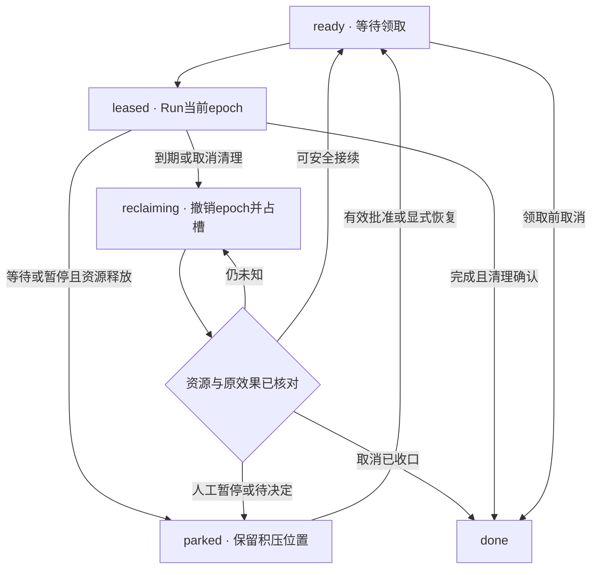
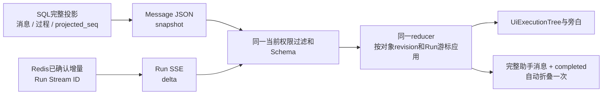

## 目标

| 核心问题                        | 实现目标                                              | 量化指标（设计目标）                                   |
| ------------------------------- | ----------------------------------------------------- | ------------------------------------------------------ |
| 持久提交后需要后台排队          | 在已有 Session/Run 受理事务中增加 job，复用命令去重   | 同一主体、requestId、命令摘要对应 1 个 Run             |
| Worker 退出或旧实例迟到回报     | 撤销执行权、清理资源，再从原 Checkpoint 接管          | 租约 15 秒；心跳 3 秒；受控夹具恢复目标 ≤21 秒         |
| 一个租户持续超额提交            | 公平选择有容量租户，隔离占用和积压                    | 全局在途 2、每租户 1；未结束 Run 每租户 4、全局 12     |
| 同一会话刷新与续流              | 复用 Message 快照、Run 流和同一个 reducer             | Run 游标使用 Redis Stream ID；每 Run 自动折叠至多 1 次 |
| 双 Worker 调度与 Agent 执行边界 | Worker 管理领取和续租，Agent 持有模型、工具和持久事务 | 单 Agent 执行所有者；两个 Worker 槽                    |

时间指标适用于清理上界 2 秒、监督和轮询各 1 秒、往返与抖动预留共 2 秒的本机课堂夹具。未决外部效果继续保持待核对。

## 1. 方案概述

### 1.1 三条链共用持久运行底座

{{code:architecture}}

| 模块                      | 职责                                        | 关键边界                                                             |
| ------------------------- | ------------------------------------------- | -------------------------------------------------------------------- |
| 分析 Chat / BFF           | 提交、加载完整消息、按游标订阅              | 沿用 sessions/submit、messages 和 runs/events；共享 AgentResponse v2 |
| Agent Run API / Scheduler | 同事务写入 job，检查配额，授予和撤销执行权  | 唯一业务 owner；一个 Agent 保持执行所有者锁                          |
| Worker                    | claim、heartbeat、advance、release          | 独立服务凭据绑定 Worker 槽；不持有数据库或模型凭据                   |
| 执行链                    | 每次推进到可恢复边界，提交结果和 Checkpoint | 每次实际派发、业务提交及流回调核对当前 epoch                         |
| Publisher / Projector     | Outbox 补发、Redis 短期流、SQL 完整投影     | 沿用持久化底座；终态与回答的完整投影提交后才公开                     |

Worker 增加驱动与调度槽。模型、工具和工作流仍在 Agent 执行，Agent 计算容量沿用现有工具/模型并发控制。独立调度服务、任务 Broker 和专属进程池按后续实测决定。

### 1.2 接单、领取和逐边界推进

{{code:worker-sequence}}

原子提交保存 Session/Run、消息、Outbox、命令回执和 job。收到 202 后可查询和订阅；断开订阅不影响后台调度。advance 立即返回运行中回执，重复同一命令轮询到下一持久边界。

## 2. 调度数据和执行权

### 2.1 只增加两张调度表

{{code:queue-data}}

| 数据                         | 唯一维护位置                          | 用途                                 |
| ---------------------------- | ------------------------------------- | ------------------------------------ |
| 提交与控制幂等               | 既有 agent_command                    | 复用作用域、requestId、摘要和回执    |
| 当前执行世代                 | 既有 agent_run.execution_epoch        | grant 与 Attempt 引用同一值          |
| 积压、执行占用和 Worker 绑定 | agent_run_job                         | ready/leased/reclaiming/parked/done  |
| 公平排序                     | agent_tenant_schedule.last_claimed_at | 选择最久未获调度的有容量租户         |
| 内部 advance 回执            | agent_command 的 worker_advance kind  | 记录原 grant、运行中状态和已提交回执 |

job 的租户取自 Run 的 Session；外键仅在 Agent 本库内。leased/reclaiming 都占执行槽，同一 Worker 的这两种状态最多一条。parked 保留积压位置，完成清理后才释放执行槽。心跳只更新 expiry，不增加业务版本或流事件。

### 2.2 接管状态与清理



| 边界           | 规则                                                                       |
| -------------- | -------------------------------------------------------------------------- |
| 租约判断       | 取得行锁后读 clock_timestamp；过期心跳返回 lease_lost                      |
| 锁序           | 调度锁（需要时）→ Session → Run → job → Step/Attempt → Wait/Action         |
| 公平领取       | 先选有容量租户，再选最早 ready job；争用 Session/Run 时继续其他候选        |
| 旧 Worker 回执 | 原凭据、boot、epoch 和摘要匹配时只读已提交回执；后继执行重新校验当前 grant |
| 旧流回调       | 撤权后停止新输出；已确认包核对落盘，排空旧回调后才允许新 epoch             |
| Agent 重启     | 保留单执行所有者约束；先补流和投影，再核对旧执行，最后开放调度             |

### 2.3 所有入口使用同一调度规则

submit、Resume、批准、外部等待条件满足和 v1 适配器都进入 job 队列；只有 claim 可授予 epoch。旧版无 job 的 Run 在首次显式恢复时检查积压容量，超限保持原状态可重试。已受理 parked 任务保留位置，有效决定后只改变其可调度状态。

## 3. 消息、事件和回答



| 场景           | 行为                                                                                                           |
| -------------- | -------------------------------------------------------------------------------------------------------------- |
| 刷新、打开历史 | 先加载 Message 完整快照，非终态 Run 从 projected_seq 续流                                                      |
| 终态短期流到期 | 409 history_reload_required，重新加载 SQL 历史                                                                 |
| 活跃流丢失     | 410 stream_data_lost，保留投影并展示恢复受阻                                                                   |
| Redis 暂不可用 | 流返回 503；SQL 历史继续可读，执行依照原持久化门禁暂停派发                                                     |
| 权限过滤       | 当前范围校验覆盖快照、流和重连；安全占位保留 seq/revision，私有详情被移除；整对象不可最低展示时拒绝该 Run 读取 |
| 最终回答       | 同一成功边界的完整助手 message.upsert 与 completed run.upsert，投影提交后可见                                  |
| 失败与取消     | incomplete 消息保留未完成标记，过程文字不触发答案切换                                                          |

旁白采用确定性模板。调度 Timeline 也保存进完整投影，短期流过期后仍可查看；Worker/租约内部细节通过当前平台管理员身份读取；租户用量要求当前租户管理员。首期不启用模型旁白和新增分段回答。

### 用量与运行指标

| 项目       | 读取口径                                                       |
| ---------- | -------------------------------------------------------------- |
| 租户用量   | 当前授权租户的限额、各 job 状态数量、积压、占用与预算汇总      |
| 排队时间   | Run.created_at 到 job.first_claimed_at，按租户统计             |
| 槽位利用率 | 领取到确认释放的 Timeline 区间 / 观察窗×有效槽数；隔离占用单列 |
| 恢复成功率 | 成功接续数 / 需要接管数；受阻任务单列且包含在总数中            |
| 成本       | 已结算用量、未知保守占额和效果计数分别展示                     |

## 4. 变更文件

```text 拟议变更文件树
compass/
├─ apps/agent/
│  ├─ src/compass_agent/
│  │  ├─ api/worker_runs.py                 [新增] Worker身份与内部调度接口
│  │  ├─ api/{sessions,runs}.py             [调整] 所有运行入口通过队列
│  │  ├─ runtime/run_scheduler.py           [新增] 准入、公平、租约和回收
│  │  ├─ runtime/{entities,store,checkpoints,hitl}.py [调整] 前置持久数据与控制事务
│  │  ├─ runtime/{service,control}.py       [调整] 单边界推进与资源收口
│  │  ├─ runtime/{message_reader,run_events,public_projection,outbox_publisher}.py
│  │  │                                    [调整] 复用协议、投影和执行权门禁
│  │  ├─ tools/dispatcher.py               [调整] 实际派发前复查执行权
│  │  └─ {schemas,settings,main}.py         [调整] DTO、配置与生命周期
│  ├─ migrations/versions/0010_run_scheduler.py [新增] 两张表和内部命令kind约束
│  ├─ migrations/env.py                    [调整] ORM元数据
│  ├─ scripts/database.py                  [调整] 受管迁移登记与校验
│  ├─ db/main/{README.md,sql/}              [调整/生成] 完整与升级SQL
│  ├─ package.json                         [调整] 真库测试入口
│  ├─ README.md                            [调整] 调度职责与运行入口
│  └─ tests/test_run_scheduler_integration.py [新增] 调度与租约集成验证
├─ apps/worker/
│  ├─ src/compass_worker/{main,run_consumer}.py [调整/新增] 消费、心跳和信号退出
│  ├─ {pyproject.toml,package.json,README.md} [调整] HTTP依赖与运行入口
│  └─ tests/test_run_consumer.py            [新增] 协议与重试验证
├─ apps/web/
│  ├─ src/server/{analysis-agent-client.ts,http/analysis-run-handler.ts}
│  │                                       [调整] 已有鉴权、v2契约与用量代理
│  ├─ src/server/modules/models/application/authorize.ts [调整] 诊断与租户统计授权
│  ├─ src/app/api/analysis/                [新增路由] 运行诊断与用量handler入口
│  ├─ src/client/analysis-run.ts            [调整] 复用快照、续流和去重
│  ├─ src/components/{analysis-composer,analysis-run-turn}.tsx
│  │                                       [调整] 调度状态与完整回答切换
│  ├─ src/generated/                       [生成] 网络合同
│  └─ tests/e2e/analysis-composer.spec.ts   [调整] 当前权限、重连与折叠
├─ scripts/export-contracts.py             [调整] 派生调度合同
├─ contracts/                             [生成] OpenAPI及Schema
├─ deploy/{compose/compose.yaml,README.md} [调整] 双Worker配置与运行说明
├─ {.env.example,uv.lock,manifest.yml}     [调整] 凭据、依赖与职责
└─ docs/adr/0005-async-runtime.md          [新增] 拓扑适用条件
```

持久运行相关文件依赖前序交付；本次只新增 Scheduler 与 Worker 驱动，复用其余运行数据和协议。

## 5. 核心类型与代码

### 5.1 不透明执行权

以下均为设计示意。Worker 只带执行权和期望边界，实际输出由 Agent 产生。

{{code:grant}}

### 5.2 受理与公平领取

{{code:admission}}

### 5.3 续租、幂等推进与结果提交

{{code:scheduler}}

### 5.4 审批再入队与到期回收

{{code:recovery}}

### 5.5 沿用公共业务包

{{code:projection}}

### 5.6 完整回答只触发一次切换

{{code:answer}}

实际 MCP 接管继续核对原目录、配置版本和远端效果。已提交子结果直接复用；未知远端调用保持待核对。统一执行树保留原节点、并行组、revision 和用户展开选择。
