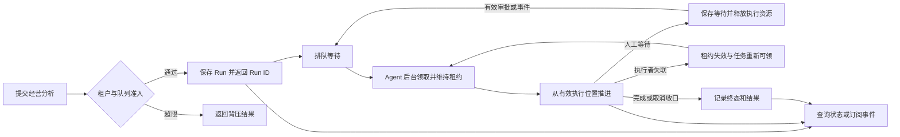

# PRD｜第 20 课｜从单进程到企业级 Runtime：实现异步调度、资源治理与可靠性验证

> Feature 984 · M6 · 状态 `draft` · 负责人 andy · Profile `standard`

[返回需求简报](../BRIEF.md) · [项目 PRD 模板](../../_templates/PRD.tmpl.md)

本文是本 Feature 的需求与验收维护入口。课次范围与工程约束分别登记在 [原始上下文](../context/source_context.md) 和 [实施上下文](../context/implementation_context.md)。

## 1. 背景与目标

Compass 已具备异步 Run 受理、队列、租约、Checkpoint、人工确认和运行追踪。本课让用户通过 Web 定时任务页、自然语言对话或授权 API 管理定时经营分析，并让到期任务进入这条执行链。用户可看到下次触发时间、本次交付和运行结果。

1. **将单进程 Agent 演进为支持多副本的分布式 Agent。** 从整库独占的执行所有者切换到按 Run 分配执行权。多个 Agent 副本可同时接单、执行不同 Run、跨副本查询和续流。执行者失联后由健康副本从 Checkpoint 接续。扩容仍遵守集群与租户配额，对应 AC-04、AC-18、AC-19。
2. **支持两种入口管理定时计划。** 用户从 Web 定时任务页或用自然语言完成创建、查询、修改、删除，两个入口读取同一计划。授权 API 提供同等能力，对应 AC-12。
3. **可靠地把到期计划交付为 Run。** 单实例 Scheduler 处理到期、交付重试和状态同步。即时与定时 Run 共用 Agent 的受理、配额和公平领取，对应 AC-13～AC-17。
4. **从计划追踪到运行结果。** 串联计划、触发、Run 和模型 Trace，区分交付延迟、执行排队及故障恢复，对应 AC-08、AC-16。

## 2. 用户与场景

| 用户故事 ID | 目标用户                | 触发场景                       | 用户故事                                                                 | 关联需求                          |
| ----------- | ----------------------- | ------------------------------ | ------------------------------------------------------------------------ | --------------------------------- |
| US-01       | 经营分析员              | 提交长时间经营分析             | 我希望离开后能返回同一任务，查看安全的过程摘要、继续阅读回答或取消任务。 | FR-01、FR-02、FR-03、FR-08、FR-09 |
| US-02       | 有权限的审批人          | 异步任务等待人工决定           | 我希望按原 Run 和提案提交决定，并能看到后续状态。                        | FR-02、FR-03                      |
| US-03       | 租户管理员              | 多人同时运行经营分析           | 我希望任务遵守本租户的并发、排队和预算边界，并可检查用量。               | FR-05、FR-06                      |
| US-04       | 开发者或运维人员        | Agent 中断、超时或发生重复投递 | 我希望原 Run 能安全接管，并能用事件和故障验收定位处理结果。              | FR-04、FR-06、FR-07               |
| US-05       | 经营分析员或 API 调用方 | 希望固定时间自动运行分析       | 我可以创建、查找、修改、删除计划，并查看每次触发和对应结果。             | FR-10～FR-13                      |

## 3. 总体业务流程

### BF-02｜从定时计划到运行结果


用户提交「每周一上午 9 点分析上周经营情况」，确认规则、时区和分析内容后保存计划。到期时后台生成触发记录并提交。用户可从计划历史打开原 Run，按现有权限查看分析结果、产物或等待人工确认的事项。

### BF-01｜接单、排队、消费与故障接管

经营分析员发起异步 Run，Agent 完成授权和准入，持久接收后返回 Run ID。Agent 后台消费者按队列调度和租户容量领取，以当前 Lease 推进 Run。用户可在独立连接上查询或订阅进度。



任务接收与结果返回分离。等待人工决定的任务释放执行容量，有效决定使原 Run 重新进入可调度状态。实例失联后，其他健康 Agent 经恢复检查并取得新执行权后接续。同一 Run 的排队、尝试、等待与终态可由事件流和 Timeline 核对。关联 FR-01 至 FR-06。

用户从 Chat 订阅同一 Run。服务端按当前权限从已提交的事件生成用户可见内容，浏览器按明确的回答阶段分别呈现「分析过程」与最终回答。断线后使用游标续接。关联 FR-08、FR-09。

## 4. 功能需求

### 4.1 复用能力

| 需求编号 | 触发条件                                    | 输入                                                                  | 预期行为                                                                                                                                             | 可观察结果                                                                               | 关联                                |
| -------- | ------------------------------------------- | --------------------------------------------------------------------- | ---------------------------------------------------------------------------------------------------------------------------------------------------- | ---------------------------------------------------------------------------------------- | ----------------------------------- |
| FR-01    | 客户端提交经营分析                          | 任务输入、授权上下文、可选 Session 关联                               | 执行授权和准入。持久接收后返回 Run ID 及可查询的初始状态，后续由后台调度。                                                                           | 客户端收到接收结果时，任务已能被查询并可由 Agent 后台领取。请求结束或断开后任务继续。    | BR-01、BR-02                        |
| FR-02    | 客户端查看、取消、恢复或提交审批            | Run ID、授权上下文、控制动作或审批关联                                | Get Run Status 读取当前状态和结果摘要。Cancel / Resume 和人工审批回调复用 M5 的状态、授权和幂等约束，能继续的 Run 重新参与调度。                     | 各操作获得可判定结果，Run ID 和已经提交的记录持续可用。                                  | BR-01、BR-03、BR-06                 |
| FR-03    | 客户端订阅 Run Event 或断线重连             | Run ID、授权上下文、最后已确认事件游标                                | Stream Run Events 推送已提交的进度和终态。按 Run 内事件序号续接，在历史和实时事件交接时保持顺序与完整性。                                            | 客户端可续收断开期间的有效事件，并通过序号去重。订阅关闭后 Run 可继续执行。              | BR-01、BR-04                        |
| FR-04    | 任务已就绪、重复投递或执行者失联            | Queue 消息、Run ID、执行身份、Lease 与 Heartbeat                      | Agent 后台受控领取任务并维持 Lease，成功或终止后释放资源。处理可见性超时与重复投递，失联后从 M5 持久位置接管。                                       | 同一 Run 出现可区分的执行尝试和接管记录，失效执行者的提交被拒绝，已提交效果保持一次。    | BR-02、BR-05、BR-06                 |
| FR-05    | 多租户提交任务或调度准备执行                | 可信租户、并发和排队占用、执行预算与可用容量                          | 执行租户并发配额、队列上限和预算，返回可识别的背压结果。共享执行容量按租户隔离和公平准入，统计资源与成本。                                           | 可检查每租户排队、运行、预算和释放情况，超限租户的任务受限，其他有容量的租户可继续推进。 | BR-01、BR-07                        |
| FR-06    | Run 经过调度、Workflow、Step、工具或模型    | Run、Step、Attempt、Workflow 节点、Tool Execution Event、模型调用标识 | 在安全 Timeline 中关联阶段、状态、错误分类、执行者变化及模型 Trace。运维可区分 Retry、Resume 与用于查看历史的 Replay 语义。                          | 可从同一 Run 找到排队、工具、模型、接管和终态记录，并解释恢复动作。                      | BR-04、BR-08、NFR-03                |
| FR-07    | 执行 M6 课堂验收                            | 合成经营分析任务、测试租户、可控故障点                                | 对比正常负载和 Agent 进程中断、重复投递、超时、取消竞态四类故障。记录不变量、恢复成功率、排队时延、资源利用率和实际结果。                            | 形成可复跑的故障验收、部署拓扑 ADR、Failure Matrix 和运行与恢复验收报告。                | BR-05、BR-06、BR-09、NFR-01、NFR-02 |
| FR-08    | Chat 订阅、续接或查询运行过程               | 已提交运行事件、工具输入输出、可信主体及可见性规则                    | 服务端按租户、工作区、角色与工具事件筛选允许的字段，生成进度旁白及有限的参数和结果摘要。首期支持确定性规则和模板，旁路模型摘要可选。                 | 浏览器仅收到获准展示的字段、旁白和状态。相同可见范围下，续接或重放可还原同一过程。       | BR-04、BR-10、NFR-03                |
| FR-09    | Chat 收到进度、最终回答或终态，或重连原 Run | Run ID、事件游标、已提交的回答阶段与终态                              | 复用第 15 课的 `finalAnswer`，按结构化阶段区分过程与答案。若答案分段输出，先发送显式的最终回答开始事件。客户端按阶段切换并自动折叠过程，可手动重开。 | 回答阶段可通过同一 Run 的状态和事件重建。失败、取消和未提交的回答有可辨认的状态。        | BR-04、BR-11                        |

### 4.2 定时任务新增需求

| 需求编号 | 功能         | 预期行为                                                                                                                                                                       |
| -------- | ------------ | ------------------------------------------------------------------------------------------------------------------------------------------------------------------------------ |
| FR-10    | 管理计划     | Web 定时任务页、自然语言对话和授权 API 均可创建、列出或查询、修改和删除计划。支持计划名称、分析输入、模型选择、时区和定时规则。返回计划 ID、计划版本、启停状态和下次触发时间。 |
| FR-11    | 到期触发     | scheduler 为到期计划持久化触发记录。每次触发以稳定请求标识提交，重复投递归并到同一个 Run。暂时失败和超限可重试，交付失败原因可查。                                             |
| FR-12    | 查看触发历史 | 可按计划查询触发时间、交付阶段、关联 Run 和结果状态，打开现有会话查看详情。重启后继续交付或同步状态。                                                                          |
| FR-13    | 治理与追踪   | 按租户公平交付，观测任务积压、迟到、重试、跳过和状态同步滞后。按授权从计划与触发查到 Run、Attempt、模型和工具。                                                                |

### 4.3 消费迁移

复用即时 Run 的提交、审批、控制、事件与回答展示。消费循环迁入 Agent，每个 Agent 副本都能领取、续租和推进不同 Run。副本重启只影响它持有的执行权，健康副本可继续接单、执行和续流。

## 5. UI 视觉与交互

### Web「定时任务」

复用现有导航下的「全部任务」「新建定时任务」「执行记录」。列表管理当前工作区内本人拥有的计划，页面和对话读取同一份计划与触发历史。

```text
定时任务 / 全部任务                              [新建定时任务]
[搜索任务名称]  [全部状态 ▾]
名称         计划与时区        状态     下次触发      最近执行
周报分析     每周一 09:00      已启用   11-16 09:00   已完成   [更多 ⋯]
            Asia/Shanghai                                     编辑 / 停用 / 执行记录 / 删除
```

| 页面或操作 | 交互与状态                                                                                                                                                                                 |
| ---------- | ------------------------------------------------------------------------------------------------------------------------------------------------------------------------------------------ |
| 全部任务   | 查询分页列表，按名称和启用状态筛选，显示任务名、周期与时区、启停状态、下次触发和最近执行摘要。空列表显示「暂无定时任务」及创建入口。失败显示「加载失败」和「重试」。                       |
| 新建、编辑 | 共用表单，填写名称、分析内容、模型、周期、时区，允许查看规范化规则和下次触发预览。编辑预填原值。保存失败保留输入，版本冲突展示「任务已更新，请刷新后重试」并允许加载最新数据后再提交。     |
| 启停、删除 | 在列表行操作。删除弹窗说明会停止未来触发、保留执行历史，默认聚焦取消。提交期间防止重复操作，成功后刷新列表和受影响详情。预览检查当前固定模型、权限与规则；自动路由和未来配置按执行时校验。 |
| 执行记录   | 从导航或任务行进入，可按任务查看触发时间、交付与运行状态。已受理的记录可以打开原分析会话，已删除计划仍可查询历史。分别显示交付与执行阶段、可读原因和操作；退避显示下次尝试。               |

窄屏按字段换行或让表格局部滚动，页面避免整体横滑。支持键盘操作、确认后恢复焦点，状态使用可读文字。

### 自然语言对话

在分析 Chat 中用日常语言完成四种操作。例如「每周一 9 点分析上周经营情况」「有哪些定时任务」「把周报分析改到周二上午」「删除周报分析」。查询返回真实计划和最近触发，由计划所有者确认写操作，复用现有确认卡展示计划、输入、时区和影响，修改时展示前后值。命中多个计划或时间、时区有歧义时询问用户。确认成功后显示「已确认，等待执行」，只有工具收到持久化结果后才显示计划已更新。不具备工具能力的模型提示切换模型或使用 Web 定时任务入口。

| 区域       | 本课行为                                                                                                                                                                  | 关联         |
| ---------- | ------------------------------------------------------------------------------------------------------------------------------------------------------------------------- | ------------ |
| 分析过程   | 运行中默认展开，显示简短旁白和工具状态。卡片按需展开，仅展示服务端允许的参数和结果摘要。无可见详情时仅显示状态与旁白。                                                    | FR-08        |
| 最终回答   | 首次收到明确的最终回答阶段时自动折叠过程。若一次返回答案，以有效 `finalAnswer` 为切换点。过程可用鼠标或键盘重新展开，重复事件不覆盖用户的展开选择。                       | FR-09        |
| 连接与失败 | 断开时保留已收到的获准内容，显示「正在重新连接…」。恢复后按服务端阶段续接。重连失败显示「连接中断」并提供「重新连接」。Run 失败或取消时展示对应状态，保留可见过程供查看。 | FR-03、FR-09 |

## 6. 业务规则与约束

| 规则 ID | 规则                                                                                                                                                                                                                                                      | 关联需求                          |
| ------- | --------------------------------------------------------------------------------------------------------------------------------------------------------------------------------------------------------------------------------------------------------- | --------------------------------- |
| BR-01   | Agent 持有权威 Run、执行进度和租户作用域。Session 可用于任务归组，请求连接和 Session 状态不决定 Run 的执行生命周期。若经 Web 访问，BFF 核验当前用户及租户和工作空间授权。Agent 核验资源范围与操作权限。Agent 后台消费者受控领取、推进并提交执行结果。     | FR-01、FR-02、FR-03、FR-04、FR-05 |
| BR-02   | 接收成功的 Run 持久可查并可调度。排队与持久接收之间发生中断时，系统可补交付同一 Run。重复投递通过同一 Run 的当前状态和执行权收敛。                                                                                                                        | FR-01、FR-04                      |
| BR-03   | 审批决定沿用 M5 的提案、主体和等待点校验。批准或外部事件满足等待条件后，Run 按当前调度与配额规则接续。取消收口后为终态，恢复不得改变终态。                                                                                                                | FR-02                             |
| BR-04   | 一个 Run 内已提交事件的序号单调递增。游标限定于原 Run，连接中断后的重连重新校验权限并续接已确认位置。Timeline 和流使用同一执行事件语义。                                                                                                                  | FR-03、FR-06                      |
| BR-05   | 只有当前有效 Lease 的执行者可推进或提交。Heartbeat 延续活跃执行权，Lease 失效后旧执行者的迟到更新不得覆盖新执行者。接管从有效持久位置继续，对外动作沿用 M5 的稳定 Action ID 和结果核对。                                                                  | FR-04、FR-07                      |
| BR-06   | 取消受理后停止派发本 Run 的后继步骤和新业务动作。正在执行的步骤按取消/超时规则收口。已提交效果和结果继续保留，取消、重复投递与接管之间按当前状态和执行权裁决。                                                                                            | FR-02、FR-04、FR-07               |
| BR-07   | 租户配额按可信租户统计。并发达到上限的任务按队列规则等待，队列达到上限时拒绝超出部分并返回背压。预算用尽按前序 StopPolicy 收口。等待审批、完成、取消或失效接管时按状态归还执行容量。                                                                      | FR-05                             |
| BR-08   | Retry 对允许重试的当前步骤新建 Attempt，Resume 从有效持久位置接续原 Run。教学中的 Replay 读取历史事件和结果，用于解释和复核。观测关联保留第 14 课安全边界。                                                                                               | FR-06                             |
| BR-09   | 课堂验收 Agent 内 scheduler 和后台 Run 消费。依照实际触发延迟、运行容量和隔离需求评估后续部署拆分。                                                                                                                                                       | FR-07                             |
| BR-10   | 用户事件由服务端按当前权限生成。工具输入与输出默认只允许明确列入展示范围的字段，实时推送、历史查询和重连都执行同一可见性规则。旁路模型只接收已筛选数据，摘要通过展示校验后才可发布，超时、失败或校验未过时回退规则旁白，原 Run 照常推进。                 | FR-03、FR-08                      |
| BR-11   | 过程、最终回答阶段和 Run 终态分别由 Runtime 明确标识。最终回答分段输出时先发布 `finalAnswer.started`，答案片段关联同一 Run 的回答阶段，成功终态才提交有效 `finalAnswer`。断线续接使用已提交阶段和事件游标。失败或取消时，未提交的答案片段不进入对话历史。 | FR-02、FR-03、FR-09               |

- BR-12　计划由创建用户及其租户、工作区归属限定。API 与工具均校验当前计划权限，后台交付按保存的归属重新校验定时任务和分析执行权限。普通用户可确认对本人计划的写入。查询允许操作、提交确认和恢复派发都以服务端记录的同一种提案授权。原业务动作审批继续使用既有管理员规则。撤销定时任务权限后拒绝该用户的未来交付，已受理 Run 仍按现有运行权限处理。
- BR-13　修改、停用或删除影响尚未开始交付的触发。交付已开始的触发按原快照在重试期限内收口，停用和删除前展示这一影响。已受理 Run 如需停止，使用原 Run 取消入口。删除后保留历史和关联结果。
- BR-14　首期支持常用每日、每周及五段 Cron 周期，时区明确。停机漏过多个触发时每计划至多补最近一次，较早时刻合并并可在历史中识别。同一计划如有未结束的交付或关联 Run（含排队、等待人工、暂停和取消中），新到期时刻记为跳过。可从执行历史查看原因，并通过原 Run 的入口继续或取消。
- BR-15　区分交付失败、Run 失败和等待人工处理。交付重试使用原触发，Run 恢复使用原 Run。Run 明确失败后可通过原会话显式重试。原触发历史保留其原 Run 和结果。

- BR-16　一个应用部署两种角色。Agent 多副本负责共享 Run 受理、配额和公平领取。Scheduler 单实例管理到期、交付和状态，通过 Agent 受理触发；Agent 的 `429` 决定背压，Scheduler 按返回的 `Retry-After` 安排该触发的下一次尝试。
- BR-17　Scheduler 停机期间，即时提交和已受理 Run 继续；重启后按触发记录恢复，漏跑规则继续生效。交付失败、等待重试、跳过和运行状态在历史中各有可识别的原因。达到交付预算后按受理账本核对原请求结果，明确未受理时才标记交付失败。

- BR-18　交互测试环境的 Run 执行槽为全局 1000、每租户 200，积压为全局 3000、每租户最高 20。积压包含计入准入的未结束 Run；即时与定时共用计数。测试可显式使用更小限额验证背压规则，配额参数与实际执行槽容量分别记录。运行中计入积压，因此标准配置下每租户最多受理 20 条计入积压的未结束 Run。
- BR-19　Chat 确认后的计划变更与工具结果、Checkpoint 同一事务提交。进程中断后，已提交的内容从原记录恢复，未提交的操作仍需取得有效执行权和通过当前授权。
- BR-20　用户能区分提交拒绝、入队等待、执行失败、人工确认和待核对。至少区分租户/集群积压、执行槽排队、模型路由/授权、模型容量/上游限流、单 Run 预算、工具/数据源和流续接。历史保留安全原因及可执行动作。

| 非功能 ID | 要求                                                                                                          | 验证口径                                                                                                                                       |
| --------- | ------------------------------------------------------------------------------------------------------------- | ---------------------------------------------------------------------------------------------------------------------------------------------- |
| NFR-01    | 接管可跨进程验证。超时、重复投递和取消竞态下，Run 状态、已提交结果和动作效果可核对。                          | 在受控环境强制终止一个真实 Agent 实例，由仍在线的实例接续。另对超时、重复投递和并发操作注入故障，核对状态、事件、执行权和动作计数。            |
| NFR-02    | 记录恢复成功率、排队时延、资源利用率与资源和成本统计口径。                                                    | 同一验收负载记录需恢复的任务数和成功接续数、接收至首次合法领取的耗时、观察窗口内执行容量占用、各租户用量及可归集成本。量化阈值由技术设计确定。 |
| NFR-03    | Run 控制与可观测查询按授权范围暴露信息。遥测沿用已受控的模型 Trace 传播与脱敏，诊断可用性与运行结果分开核验。 | 用不同租户身份查询、控制或订阅。检查 Timeline 与 Trace 输出字段，并验证外部观测出口不可用时持久事件仍可查询。                                  |
| NFR-04    | 沿用 Agent 的运行数据所有权与 M5 持久数据。新增调度持久对象按所属逻辑库登记和验证。                           | 使用 M5 生成的 Waiting、Completed 等记录，回归状态读取与审批接续。若有迁移，执行项目规定的空库、旧库、权限、一致性和恢复验证。                 |

## 7. 范围与边界

- **本课交付**　定时计划、触发交付、运行结果追踪以及 Agent 内后台消费。
- **前置能力**　复用异步 Run API、同库队列、租约与执行权、Checkpoint、HITL、工具权限、SSE、Timeline 及模型 Trace。
- **触发范围**　首期覆盖 API 即时提交和时间计划。定时 Run 复用分析能力与工作流选择。以下能力留待独立需求评估：Webhook、通用心跳触发、专用计算 Worker 池、通知投递。
- **演示入口**　通过分析 Chat 和 BFF 接入异步 Run 及其用户可见事件流，演示接收、等待、运行、终态、拒绝、断线续流和回答切换。运维 Timeline 按其独立权限提供。具体路由和流编码在技术设计中确定。
- **后续课次**　[第 25 课](../../983-lesson-25-long-task-context/spec/PRD.md)复用用户可见事件契约，提供并发 Child Run 的状态摘要和执行轨迹下钻。
- **课堂演示与验收**　并发提交不同租户的任务，观察接单与排队。保存 Checkpoint 后强制终止一个 Agent 实例，由仍在线的实例接续同一 Run。随后演示重复投递、取消与接管竞态、游标续流，并从 Timeline 核对生效的执行权与动作效果。同时核对过程权限、旁白降级与回答切换。对应 AC-01 至 AC-11。另演示在 Web 与 Chat 分别管理计划、到期提交、暂时超限和重试，再从计划历史追踪到结果，对应 AC-12 至 AC-21。

## 8. 研发资源

| 资源 ID | 类型     | 入口                                                                                                                    | 用途                                                        |
| ------- | -------- | ----------------------------------------------------------------------------------------------------------------------- | ----------------------------------------------------------- |
| R-01    | 前置需求 | [运行基线](../../../docs/lesson-20-production-runtime.md)                                                               | Run 状态、Checkpoint、审批与稳定动作标识。                  |
| R-02    | 现有工程 | [Worker 入口](../../../apps/worker/src/compass_worker/main.py)、[Worker 运行说明](../../../apps/worker/README.md)       | 迁移前的消费循环、进程生命周期和租约协议。                  |
| R-03    | 现有工程 | [模型观测说明](../../../apps/agent/src/compass_agent/observability/README.md)、[Web / BFF](../../../apps/web/README.md) | 模型 Trace、服务端身份与授权边界。                          |
| R-04    | 现有规则 | [网络契约](../../../contracts/README.md)、[数据所有权与迁移](../../../docs/database-migrations.md)                      | Run API/事件契约从 Agent DTO 与路由派生。运行数据归 Agent。 |
| R-05    | 教学输入 | [M6 课次上下文](../context/source_context.md#课堂演示)                                                                  | 合成 GMV 诊断任务、并发提交、中断恢复和取消。               |

## 9. 验收标准

### AC-01｜接单与执行解耦

**关联**　FR-01、FR-02、BR-01、BR-02

- **Given**　执行资源暂时不可用，租户队列还有容量。
- **When**　提交经营分析并关闭接单连接，随后启动 Agent 后台消费者。
- **Then**　客户端无需等待任务执行即可得到 Run ID 并查询排队状态。后台消费者随后领取同一 Run，状态更新到执行和终态。接收持久化后、首次交付前发生中断时，同一 Run 仍可补派发。
- **验证方式**　分别检查正常提交与接收后注入中断，核对 Run、队列和任务结果。

### AC-02｜断线后按游标续接

**关联**　FR-02、FR-03、FR-06、BR-01、BR-04

- **Given**　客户端已收到同一 Run 的若干事件并记下最后确认序号。
- **When**　断开连接，等待新事件产生，再使用原 Run 的游标重连。用另一租户身份重复查询、订阅和控制。
- **Then**　合法重连按序得到断开期间以及随后的事件，可按序号去重。Run 在断开期间持续执行。越权访问得到安全错误，响应中无该 Run 的事件或状态。
- **验证方式**　对照服务端持久事件序号和客户端实际接收内容，另核对跨租户请求结果。

### AC-03｜人工等待释放容量并异步恢复

**关联**　FR-02、FR-04、FR-05、BR-03、BR-07、NFR-04

- **Given**　一个可恢复的分析 Run 进入广告预算审批等待，队列另有任务。测试中同时保留来自 M5 的运行记录。
- **When**　等待资源释放，随后提交有效批准与一条重复回调。
- **Then**　其他就绪任务可利用释放的容量。原 Run 消费一次审批结果并重新参与调度，获批动作只产生一次效果。原 M5 记录可读取并按相同状态、审批规则处理。
- **验证方式**　检查队列、执行槽位、回调结果、同一 Run 的 Timeline 和适配器效果。

### AC-04｜跨 Agent 实例接续

**关联**　FR-04、FR-06、FR-07、BR-05、BR-08、NFR-01

- **Given**　Agent 后台消费者已领取 Run 并持久提交至少一个分析步骤。
- **When**　强制终止执行该 Run 的 Agent 实例，保持另一副本运行，由它接管。另验证实例并发启动时已有有效租约不被撤销。另注入失效执行者的迟到提交。
- **Then**　新执行身份从有效 Checkpoint 继续同一 Run，已完成分析结果继续使用。系统记录两次领取及接管原因，拒绝迟到提交。若动作提交结果已可核对，接管使用同一 Action ID 复用结果。
- **验证方式**　核对进程、租约、Attempt、Checkpoint、动作效果和 Timeline。

### AC-05｜重复投递与超时

**关联**　FR-04、FR-06、FR-07、BR-02、BR-05、BR-06、NFR-01

- **Given**　同一 Run 可被重复交付，另有一个可注入超时的执行步骤。
- **When**　并发投递同一 Run，并让超时夹具超过配置的执行期限。
- **Then**　重复交付只产生一次有效推进，已提交动作仍只有一次效果。超时以可识别原因记录，恢复或收口符合本步重试、预算和执行权约束，任务状态和资源计数可核对。
- **验证方式**　注入重复消息和执行超时，检查有效执行权、动作计数、Attempt 与槽位计数。

### AC-06｜取消与接管或动作发起并发

**关联**　FR-02、FR-04、FR-07、BR-05、BR-06、NFR-01

- **Given**　一个存在后继业务动作的 Run，夹具可控制取消和下一执行者领取或动作发起的先后。
- **When**　在当前步骤结束前后与接管边界分别触发取消。
- **Then**　取消受理后没有新业务动作发起，已提交动作结果仍可查询。任务收口到状态机允许的唯一终态，旧执行权和重复交付都无法重新推进。
- **验证方式**　在两种竞争顺序下核对取消受理时间、动作发起记录、终态和 Timeline。

### AC-07｜租户限额、背压与公平准入

**关联**　FR-05、FR-07、BR-01、BR-07、NFR-02

- **Given**　两个教学租户，分别配置并发上限、排队上限与运行预算，并共享可用执行槽。
- **When**　让租户 A 持续超出并发和队列上限，租户 B 同时提交正常负载。另让一条分析任务用尽预算。
- **Then**　A 的有效执行数和排队数受限，超额请求得到背压结果。B 在可用容量下按其准入规则推进。预算耗尽的任务受控停止，释放后的容量可继续领取。各租户的用量和可归集成本可查。
- **验证方式**　并发压测并核对租户统计、排队/开始时间、预算结果和 执行槽占用。

### AC-08｜跨层 Timeline 与模型 Trace

**关联**　FR-03、FR-06、FR-07、BR-04、BR-08、NFR-03

- **Given**　一个异步经营分析 Run 实际经过 Workflow、Agent Step、工具和模型执行，并发生一次 Retry 或 Resume。
- **When**　用 Run ID 检查事件与模型 Trace，读取历史核对其恢复原因。另模拟观测出口不可用。
- **Then**　同一个 Run 可关联 Workflow 节点、Step、Attempt、Tool Event 与模型调用，时间线能区分新 Attempt 和原 Run 接续。输出遵循脱敏边界。外部观测出口异常时持久事件仍可读。
- **验证方式**　对照授权查询、事件关联字段和模型观测记录，覆盖出口异常。

### AC-09｜M6 故障验收收口

**关联**　FR-07、BR-09、NFR-01、NFR-02、NFR-04

- **Given**　正常演示和四类故障夹具，已有约定的验收负载与指标口径。
- **When**　完成多任务并发演示、故障注入、兼容检查及适用的迁移验证。
- **Then**　Failure Matrix 对每个故障列出触发点、预期不变量、实际结果和可判定状态。验收报告包含恢复成功率、排队时延与资源利用率。部署 ADR 记录三种形态的对比和本课基线的适用条件。
- **验证方式**　复跑课堂脚本，按 Run ID 对照报告、事件、资源计数和适用的数据库验证结果。

### AC-10｜过程旁白与工具详情按权限输出

**关联**　FR-03、FR-08、BR-10、NFR-03

- **Given**　同一 Run 的原始工具输入输出含允许展示的字段、受限明细和用于核查泄漏的标记，准备不同权限的访问主体。
- **When**　分别读取实时流、历史与重连结果。若启用旁路摘要，分别模拟模型超时、不可用或产出超出展示范围的内容。
- **Then**　客户端收到的响应和页面详情均符合当前授权。重连或历史查询采用相同展示规则。旁路摘要异常时显示规则旁白，Run 继续执行且最终回答不受影响。
- **验证方式**　检查浏览器收到的响应载荷、旁白、卡片详情、权限撤销后的续接结果及原 Run 的终态。

### AC-11｜明确切换到最终回答并支持续接

**关联**　FR-02、FR-03、FR-09、BR-04、BR-11

- **Given**　Run 已产生多轮进度，至少一条旁白含「最终回答」字样，Chat 正在展示过程。
- **When**　分别运行正常完成、在最终回答阶段前后断线重连、失败和取消场景。若采用分段回答，模拟开始事件重复投递及回答尚未提交时的取消。
- **Then**　过程文本保持在过程区。Chat 仅在收到结构化回答阶段时默认折叠一次并显示独立回答区。重连或重复投递后，已提交的回答和过程各出现一次，手动展开仍有效。失败、取消及未提交回答按各自状态呈现。
- **验证方式**　对照事件类型、游标和浏览器交互，核对显示顺序、自动折叠、手动展开及对话历史。

### AC-12｜Web 与对话均可管理同一计划

- 在 Web 完成新建、列表搜索和状态筛选、编辑、启停、查看执行记录、确认删除。覆盖空态、失败保留输入、版本冲突、同租户他人及跨租户访问。
- 仅用自然语言完成创建、列出或查详情、修改、删除；普通计划所有者可确认写入，取消确认时无写入。验证已批准后与取消、计划版本修改及 Run 接管的竞争，已提交操作重放仅返回原回执。验证同名计划先澄清、失败时不显示成功。
- Web 创建后从 Chat 查询和修改，刷新 Web 后查到同一计划 ID 和新版本。Chat 创建后可在 Web 编辑和删除。删除保留授权历史，旧版本或重复命令按统一规则处理。授权 API 读取与页面同源。

### AC-13｜到期、幂等交付与 Scheduler 重启

分别在持久化到期触发后和 Agent 受理提交后丢失响应时终止 Scheduler。停机期间即时提交继续，已入队任务继续执行；启动后从持久记录恢复，每个到期时刻最多关联一个 Run。模拟误启动第二个 Scheduler 和旧实例迟到，旧租约无法生成或受理新触发。覆盖时区、夏令时、漏跑合并以及已有未结束触发时的跳过。

### AC-14｜统一配额、背压与授权

混合提交 A 租户的即时和定时 Run，让其达到 Agent 的积压上限，B 租户同时提交两种来源的任务。核对两类任务共用计数和公平规则，Scheduler 只按 Agent 的 429 与 Retry-After 延后对应触发。验证持续超限至期限、被撤权的发起人、内部凭据越权和无权限计划查询。核对重试时间、失败原因及 B 可继续交付。

### AC-15｜变更和到期竞争

在交付开始前后并发修改、停用和删除。开始前的旧触发被跳过，开始后的触发使用已持久化快照，已关联 Run 可正常查阅并独立取消。定时 Run 尝试写入计划时拒绝。

### AC-16｜追踪与结果同步

完成、失败、取消和人工等待各产生可区分的历史状态。模拟进程在 Run 完成后、同步前中断，重启后补齐状态。按计划和触发关联 Run Timeline，验证日志脱敏、权限隔离和遥测出口异常时的可查询性。

### AC-17｜标准部署与回退

先用新 Agent 多副本验证即时执行和恢复，再启动独立 Scheduler 进程验证定时触发与批准。切换期间误启旧运行角色或旧发布者时验证其就绪及写入均被拒绝。保留既有 Run、会话与 Checkpoint，验证 0014 升级、空库初始化及回退后的队列可消费。

### AC-18｜多实例并行执行与扩容

部署两个 Agent 副本，经同一入口提交即时和定时 Run。确认两个副本同时就绪并执行不同 Run。用相同集群配额和可控依赖比较一副本与两副本，有容量余量时实际同时执行数增加。集群及各租户的在途、积压和预算仍按既有规则执行。验证共享策略不匹配的副本不参与执行，接管后沿原 Run 的剩余预算继续。

### AC-19｜跨实例触发、故障和事件续接

让多个 Agent 副本竞争同一就绪 Run，核对同一 Run 只有一个有效 epoch。向 B 提交取消或暂停 A 所执行的 Run，核对 A 处理共享意图且 B 不撤销有效租约。强制终止执行者及首个回收者，其他实例从持久边界接续；未决效果保留待核对。跨副本 SSE 在流完整时沿用原游标，Redis 回退或丢流时按约定提示重载或恢复受阻，旧回调不改变已提交结果。

### AC-20｜确认恢复、目录和并行兼容

普通计划所有者确认后切换执行副本，分别在计划事务提交前和提交后、响应前强制退出。只有完成事务才出现成功回执，接续后计划版本只增加一次。覆盖撤权、管理页并发修改、并行工具模式、目录满和不支持工具的模型。

### AC-21｜容量和失败归因

校验本地测试配置 1000/200 个执行槽和 3000/20 的积压限制，在隔离库用合成已排队记录验证边界及同键回执。Web 和计划历史分别显示入队背压、已排队、上游限流、模型/工具权限或预算失败。位置和建议动作与实际状态一致，重连使用原 Run。

## 设计待验证项

- 在课堂多租户负载下测量触发延迟、队列等待和重启恢复时长，确认批量、轮询和重试配置。生产目标按实际部署测量后确定。

## 变更记录

| 日期       | 变更                                                                 | 范围 |
| ---------- | -------------------------------------------------------------------- | ---- |
| 2026-11-10 | 明确 M5 状态恢复与 M6 Worker 接管的交接，细化课堂故障验收路径        | M6   |
| 2026-11-10 | 增加用户可见过程、旁白策略、最终回答阶段与断线展示验收               | M6   |
| 2026-11-15 | 定稿同 App 双角色与统一 Run 准入，补齐管理授权、交付、接管和迁移验收 | M6   |

## 统一执行过程的前置交接

生产展示沿用第 17 课的统一执行节点及 UiExecutionTree，第 18 课补齐真实工具元数据，第 19 课持久化。事件续接以 Run / seq 去重并按节点 revision 更新，保留父子关系、并行组和用户展开状态。旁路旁白改写使用过滤后的公开内容；finalAnswer 的开始和成功提交继续有明确标识。

现有统一执行节点、回复阶段、工具详情和持久化展示的契约继续用于定时 Run。
