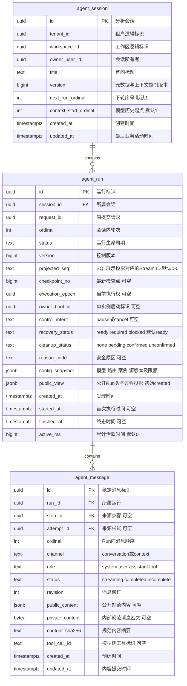
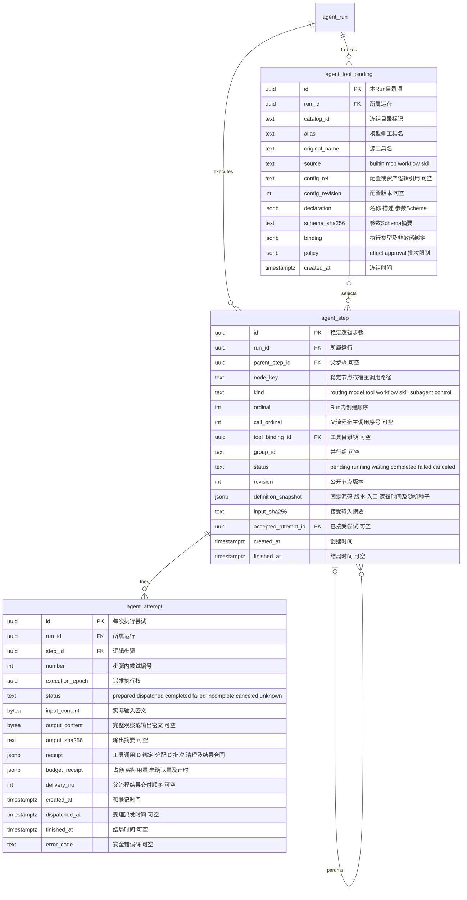
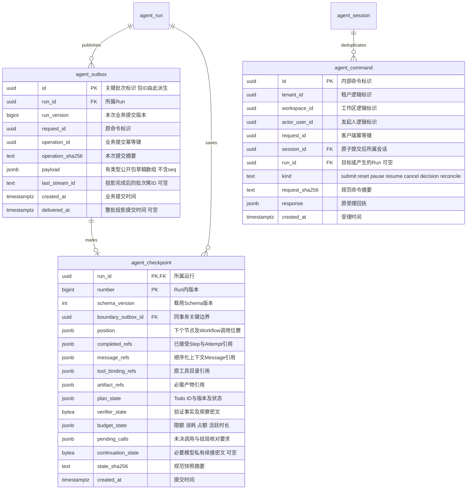
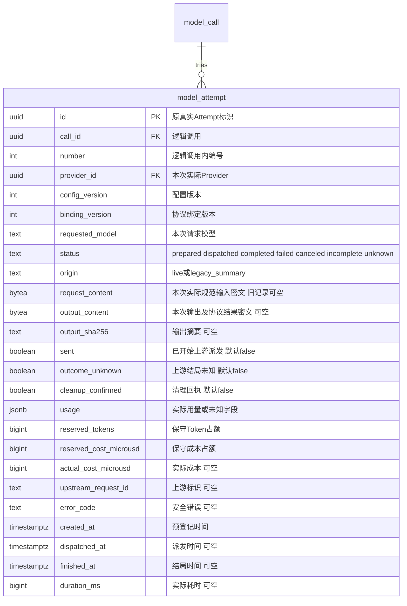
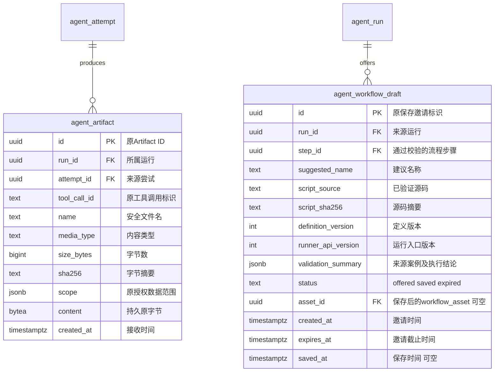
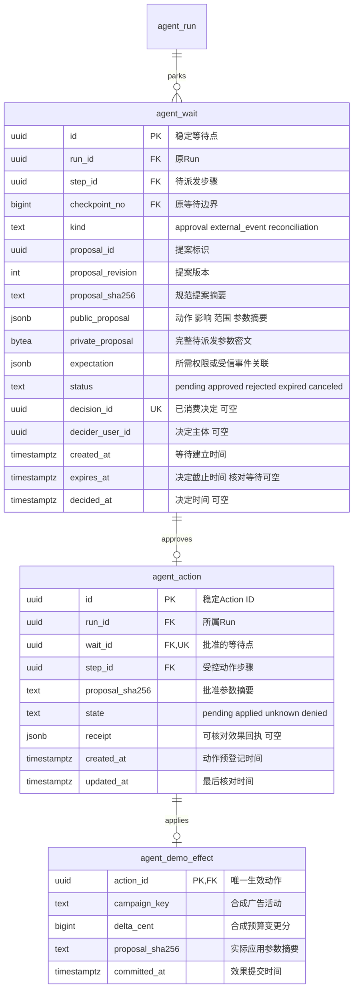

# 第 19 课 · 持久化数据结构

[返回技术方案](TECH_DESIGN.md) · [Redis 数据与部署](REDIS_DESIGN.md) · [HITL 增量](HITL_DESIGN.md) · [PRD](../spec/PRD.md)

> 拟议结构，owner `agent/main`，PostgreSQL 17，规划迁移 0008 → 0009；2026-11-12。以下定义为本课字段与约束的维护源，尚未生成生产迁移。

## 1. 命名与公共约定

- 表名用单数、小写下划线：Agent 运行 `agent_<entity>`，模型执行 `model_<entity>`。保留原 `workflow_asset`、`mcp_connection`、`sandbox_allocation`，不统一重命名已有表。
- 主键 UUID 由服务端生成，外键 `<entity>_id`。模型原主键 `model_call.call_id` 保留。外部 tenant/workspace/user ID 是逻辑关联，禁止跨库 FK。
- 时间使用 `timestamptz`，`created_at` 默认数据库当前时间；`updated_at` 由业务事务更新。持续时间 `_ms`，大小 `_bytes`，成本 `_microusd`，预算变更 `_cent`，摘要为小写 hex SHA-256。
- `pk_ / fk_ / uq_ / ix_ / ck_` + 表名 + 字段/语义；名称超 PostgreSQL 63 字节时使用确定性短后缀，生成器与迁移一致。
- 图中“可空”字段可 NULL，其余 NOT NULL。JSON 均有明确 DTO/schemaVersion 和大小限制；不保存 Python 对象序列化。计数默认 0，version/revision 默认 1，ordinal/attempt number 从 1 开始；流游标为 Redis 原生 ID 字符串，初值 `0-0`。
- 所有同 Run/Session 的引用均验证归属。跨多级关系增加 `(run_id,id)`、`(session_id,id)` 等唯一键并使用复合 FK；仅图中的单列 FK 标记不替代此约束。删除默认 RESTRICT，业务记录本课不做清理或级联删除；Redis 短期流按单独保留规则过期。
- 私有密文为应用加密 envelope：用途、key ID、schemaVersion、owner/Run 绑定和密文，存 bytea；不存模型密钥、连接口令、进程句柄。公开日志和展示投影包含获准展示内容，依靠应用访问控制和数据库角色保护，不进入通用日志。

## 2. 会话、消息与运行

约束及访问路径：

- Session 列表索引 `(tenant_id,workspace_id,owner_user_id,updated_at DESC,id DESC)`。`context_start_ordinal > 0 AND <= next_run_ordinal`。活动时间只在业务提交更新，读取不改变排序。
- Run 唯一 `(session_id,ordinal)` 与 `(session_id,request_id)`。部分唯一索引限制每 Session 一条非终态 Run，覆盖 created/running/waiting/paused/cancelling。状态用小写 `created/running/waiting/paused/cancelling/completed/failed/canceled`，保留原接口 canceled 拼法；课堂文案 Cancelled 表达同一状态。
- 终态要求 finished_at；非终态 finished_at 为空。Run 不存第二份最终回答正文，最终助手 Message 与公开过程投影同事务更新。public_view 为有类型结构 `{schemaVersion, run, objects}`，run 保存与投影前缀一致的 RunPublicSnapshot（ordinal、version、status、reasonCode、recoveryStatus、cleanupStatus），objects 按稳定对象 ID 保存节点、计划、旁白、Workflow、审批、产物元数据和可见 Timeline 的最新完整对象及 revision；正文和文件字节继续引用 Message/Artifact。Message API 一致读取它们及 Run.projected_seq，侧栏状态同样使用 public_view.run。业务 Run.status/version 可先于投影变化，用于执行控制；Projector 不反写业务状态。Redis 依赖故障可能造成投影暂时落后，响应明确保留最后已提交展示状态。
- Message 唯一 `(run_id,ordinal)`。conversation 消息只允许 user/assistant，使用 public_content；context 使用 private_content，两者恰有一个非空。内容为版本化的 text/toolCalls/artifactRefs，完整保留允许展示的内容。
- 每 Run 一个 conversation user 消息、一个 conversation assistant 回答，以部分唯一键保护。实时 message.delta 带 messageId/revision，持久加载和完成收口使用完整 message.upsert；失败时标 incomplete。context 可有多个模型/工具消息，并保留原顺序。

## 3. 步骤、尝试与工具目录

- Tool binding 唯一 `(run_id,alias)`；声明与策略不可变。目录包含本次可用内置/Workflow/Skill/MCP 项，凭据通过 config_ref 当前读取。
- Step 唯一 `(run_id,node_key)`、`(run_id,ordinal)`；宿主调用唯一 `(parent_step_id,call_ordinal)`。父步骤、工具项必须属于同 Run。树父先于子创建，禁止环。accepted_attempt 与 step 同属关系使用延迟复合 FK，完成状态必须有 accepted_attempt。
- Attempt 唯一 `(step_id,number)`；每 Step 仅一条活动尝试的部分唯一索引。并行的是不同子 Step。接受过的结果不可覆写，Retry 新建 number。
- 工具 receipt DTO 包含 toolCallId、toolIndex、batchId、groupId、bindingKind、allocationId、externalRequestId、cleanup、effectStatus、artifactIds、安全错误；模型类 receipt 包含 modelCallIds，Workflow 类包含 runnerVersion 与 childStepIds。完整参数/结果在密文，公开摘要在事件。
- Workflow definition_snapshot 冻结 source/scriptSha256/entryVersion、输入摘要、logicalTime、randomSeed、Skill 文本及资源摘要。输入正文仍在 Attempt。交付顺序在同父 Step 锁内分配，保存结果和 delivery_no 后再送 QuickJS；重放按原顺序消费。后台资源清理可以继续更新 receipt 中的清理段，同时追加公开状态事件，已接受业务结果不变。

## 4. 关键 Outbox、Checkpoint 与命令

高频流式包仅存 Redis Streams，数据库新增表使用 `agent_outbox`，替代前版的全量 `agent_event`。每个关键业务事务写一条 Outbox，其 payload 可以包含多个公开包；文本 delta 不创建 Outbox 行。

- Outbox 唯一 `(run_id,operation_id)`、`(run_id,run_version)`；待投递部分索引 `(run_id,run_version) WHERE delivered_at IS NULL`。关键事务在 Run 行锁内递增业务版本，发布按该顺序串行执行；同 operation 不同摘要拒绝。仅内部状态变化可不生成公开 Outbox，版本无需连续。
- payload 为 `{protocolVersion:2, packets:[{packetId,requestId,occurredAt,event}]}`；packetId 由 Outbox ID 与包下标稳定派生，event 使用唯一公开联合，全部通过 Schema/大小校验。不包含私有上下文、完整工具观察或口令。
- `last_stream_id` 与 `delivered_at` 同有同无；只有整批事件已进入 Redis、完整公开投影与 projected_seq 在同一事务提交时才填写。已投递行保留关键操作回执以便幂等，数量随业务边界增长。
- PostgreSQL 不维护 Redis 最新流尾。Run.projected_seq 只表示已落库的完整展示前缀，连同公开消息/public_view 原子更新；流尾通过 Redis 查询。原生 ID 按两个整数比较，不使用 SQL 序列或额外 Session 计数。
- Checkpoint `(run_id,number)` 主键；Run.checkpoint_no 通过复合延迟 FK 指向它。boundary_outbox_id 使用同 Run 复合 FK，关联同一事务的公开变化；无需在数据库事务中等待 Redis 分配 ID。引用的 Message、工具、产物、Step/Attempt 必须逐项验证归属和有效性。
- Checkpoint JSON 明确结构：position 包含 rootStepId/nextNode/workflowHostOrdinal；completed_refs 为 stepId/attemptId/outputDigest；message_refs 按实际输入顺序保存 ID；预算保留原限额、已确认消耗、未知占额和剩余活跃时长。plan/verifier 复用前课有类型模型，统一加入 schemaVersion。
- Command 唯一 `(tenant_id,workspace_id,actor_user_id,request_id)`；同键同摘要返回原 response，其他输入 409；初次 submit 的 Session/Run/消息、初始投影、Outbox 与命令同事务写入。失败校验不写成功回执。

Redis 使用每 Run 一条 `compass:agent:run:<runId>:events` Stream，条目字段及保留规则见 [Redis 数据合同](REDIS_DESIGN.md#2-流键与游标)。Message 从数据库编码完整 upsert 包，Run 从 Redis 编码增量，两者共同使用 AgentResponse。

## 5. 模型调用与真实尝试

`model_call` 原有字段及约束保留，真源为 [models/entities.py](../../../apps/agent/src/compass_agent/models/entities.py)。原字段包括 call_id、provider_id、config_version、binding_version、requested_model、response_model、purpose、actor_user_id、tenant_id、workspace_id、capability_summary、status、started_at、deadline_at、finished_at、duration_ms、execution、usage、error_code、upstream_request_id、upstream_outcome_unknown。

新增列如下；与全部既有字段共同构成目标模型：

| 字段               | 类型/可空                        | 含义                                                    |
| ------------------ | -------------------------------- | ------------------------------------------------------- |
| run_id             | uuid NULL FK                     | Agent Run 关联；独立模型测试/旧调用可空                 |
| agent_attempt_id   | uuid NULL FK                     | 对应 Agent 步骤尝试，与 run_id 同有同无，复合 FK 验归属 |
| input_message_refs | jsonb NULL                       | 原调用实际使用的有序消息 ID                             |
| request_content    | bytea NULL                       | 必要规范请求快照，密文，不含 API key                    |
| output_content     | bytea NULL                       | 必要规范返回与协议状态密文                              |
| content_status     | text NOT NULL，默认 not_captured | captured / not_captured，旧调用保留事实                 |

唯一 `(call_id,number)`，索引 `(call_id,created_at)`、`model_call(run_id,started_at)`。先保存 prepared/占额，再将派发意图写为 dispatched，随后外呼；崩溃在派发意图与网络发送之间也保守标未知。逐次返回即保存，最后生成原 execution 聚合。恢复不得将 unknown 改成零消耗。

旧 execution 可解析的 Attempt 使用原 ID；缺 ID 时以 call_id+number 确定性派生并标 legacy_summary，保留其实际已知字段。旧记录未记占额的迁移填 0 仅表示“历史无预留记录”，不得作为待恢复预算；旧调用不进入新 Run 恢复。原 execution 原样保留供历史核对。

## 6. 产物与 Workflow 草稿

Artifact 校验 `size_bytes=octet_length(content)`、允许 media type、M4 上限及应用 SHA-256。ID 全局唯一；同 ID 同来源同摘要重放复用，冲突拒绝；索引 `(run_id,created_at)`。本课 PNG/CSV 量级直接 bytea 原子提交。

Draft 的 step 必须同 Run 且已成功，唯一 `(run_id,step_id)`；saved 状态必须有 asset_id/saved_at，assetId 唯一。原 workflow_asset 不复制。邀请过期由控制读取/保存请求按数据库时间判断，更新 expired 并发事件；刷新展示同时读取持久 expiresAt，禁用保存。原草稿 30 分钟 TTL 转为绝对时间，进程重启不刷新有效期。

## 7. HITL 增量实体

Wait 索引 `(run_id,status)`、pending 的 `(expires_at,id)`；一 Run 一个当前 pending 等待点，串行处理多个需审批提案。绑定 step/checkpoint/action 均通过 run_id 复合约束；proposal_revision>0；approval/external_event 要求 expires_at>created_at，reconciliation 允许无截止时间。approved/rejected 必须有 decision/decider/time；expired/canceled 无用户决定。过期核验采用数据库当前时间。

Action 唯一 wait_id，预先生成 ID 不随 Retry 改变；effect 与批准摘要一致。演示 effect 使用独立短事务写入，回执事务可后到，便于核对真实提交后崩溃。具体门禁、授权和竞态见 HITL_DESIGN。

## 8. 生命周期、旧数据和交付清单

新增 15 张表：11 张 Agent 运行主线表、model_attempt、3 张 HITL 表；扩展 model_call。计划/Verifier/节点/脚本有明确承载位置，MCP 配置和 Sandbox 分配复用 0008，已保存 Workflow 复用 0007。

会话、消息、公开展示投影、步骤、调用和产物持续保留。Redis Stream 为短期 Run 增量日志：非终态按原 Run 总量预算保留且不设 TTL；终态投影到流尾、Outbox 全部投递后设置 1 小时整键过期，Message 加载保持可用。agent_outbox 保留少量关键操作及投递回执。终态后清除 continuation_state 及模型输出中同用途的私有续接段，不删公开历史和可核对结果。活跃 HTTP/MCP 会话、内存锁/Task、Sandbox 进程和临时路径只重建或清理；它们的身份与结局记录入库。

迁移必须验证：同 Run/Session 复合归属、终态/状态 CHECK、活动 Run/Attempt 部分唯一、原模型 scope CHECK、旧 execution 的可确定回填、原资产/连接保留、M4 遗留资源清理记录保留、运行角色权限、真库原生链与 SQL 一致性及备份恢复。当前未存在的历史 Session 和消息没有回填来源，升级后首个持久请求开始新历史。

发布、增量文件路径和恢复顺序以[主方案第 6 节](TECH_DESIGN.md#6-数据库发布与恢复)为准。可执行迁移和 ORM 只在 app 中实现，本文件中的 ER 与字段合同用于评审。
