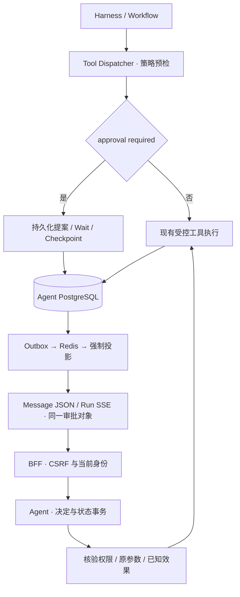
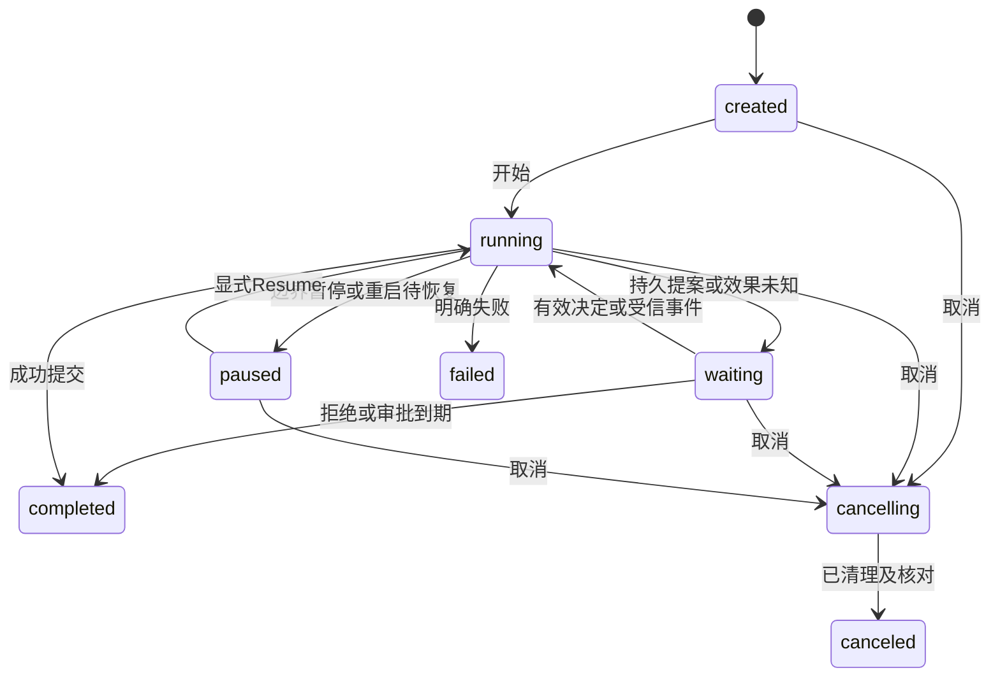
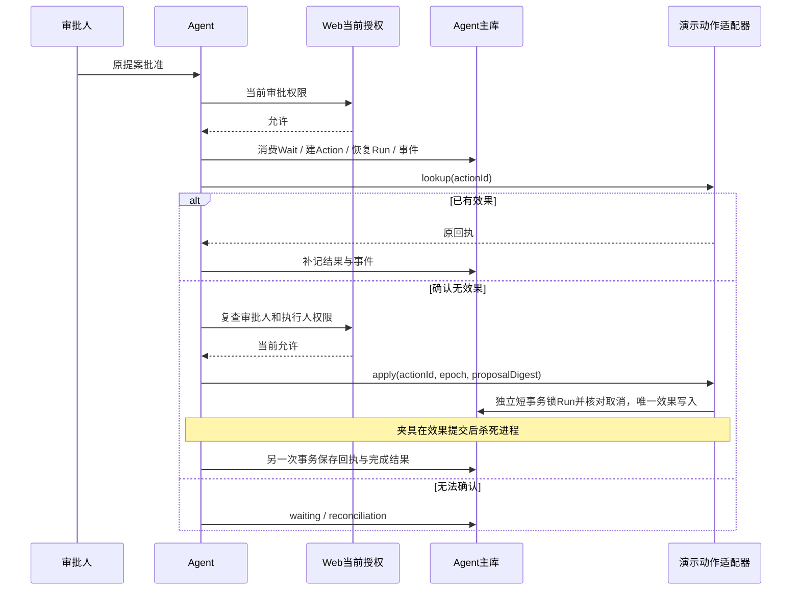

# 第 19 课 · Human in the Loop 增量方案

> Feature 985 · Profile `standard` · 待评审 · 2026-11-12 · 增量基线为本课持久化主方案及第 18 课工具策略。

[返回主方案](TECH_DESIGN.md) · [PRD](../spec/PRD.md) · [字段合同](DATA_DESIGN.md#7-hitl-增量实体) · [代码设计](CODE_DESIGN.md#5-hitl-事务与效果核对) · [HTML 审阅版](HITL_DESIGN.html)

## 1. 增量目标与接入位置

本方案承接 FR-04～FR-06 和 AC-02～AC-06，完整实现人工决定、持久等待、原 Run 接续与动作核对；展示同时遵守 AC-09～AC-11 的刷新一致性。

前置 M4 提供 `ToolPolicy(effect, approval)`、派发入口、执行回执和资源清理。本次把 `approval=required` 的阻断接为可操作的持久等待：冻结提案，保存 Checkpoint，释放执行资源；用户作出决定后从同一 Run 继续。M3 的等待节点同样调用此服务。审批状态通过共享 AgentResponse 中的 view.upsert 表达；Run 接口实时推送，刷新通过 Message 非流式加载同一审批对象。

仅新增 `agent_wait / agent_action / agent_demo_effect`，完整字段在 DATA_DESIGN；共享 Run、Step/Attempt、Command、Outbox、Redis 流、Checkpoint 和 Artifact。迁移随 0009 一起交付，HITL 可作为独立代码切片验收。

## 2. 提案与等待

提案包含 `runId, waitId, stepId, proposalId, proposalRevision, proposalDigest, actionId`、动作类型、作用对象、公开参数摘要、实际参数密文、所需权限和 `expiresAt`。Action ID 在提案时确定：以 waitId 和 proposalRevision 确定性派生，批准后插入 Action，重试和恢复保持原值。

本课支持明确的“批准原提案”或“拒绝”。用户修改参数需要新提案和新等待点，关闭旧提案；旧批准不覆盖新参数。课堂审批有效期 15 分钟，使用数据库时间，服务重启不重新计时。首版每 Run 串行处理一个当前等待点；同批多个需审批动作按原工具顺序逐个等待。

到达门禁时执行同一事务：

1. 锁 Session、Run、目标 Step，检查原执行权、状态、当前授权范围和提案摘要。
2. 保存已完成结果、必要产物及 Checkpoint，创建 Wait，把待派发 Step 标 waiting，Run 标 waiting。
3. 同事务写入含 `view.upsert` 和 `run.upsert` 的关键 Outbox，释放 execution epoch。提交后 Publisher 写 Redis，Projector 强制保存整批审批/节点/Run 投影及游标，再允许流展示。
4. 提交后释放本次模型/工具执行槽和 MCP 会话，按 M4 清理计算资源。工作卷与已接收产物按各自策略保留；清理失败保存回执并禁用后续 Resume，等待核对。

等待期间仅持久记录存在，UI 订阅和应用级小型到期检查可以继续运行。原工具调用尚未派发。资源清理属于结果可观察的一部分，不能只结束 Python 协程便显示清理完成。

## 3. 决定与接口

| 接口                                             | 合同                                                                                                                       |
| ------------------------------------------------ | -------------------------------------------------------------------------------------------------------------------------- |
| `POST /v1/analysis/runs/{runId}/decisions`       | `requestId, expectedVersion, waitId, proposalId, proposalRevision, proposalDigest, decisionId, decision=approve 或 reject` |
| `GET /v1/analysis/runs/{runId}/waits/{waitId}`   | 为获授权审批人返回安全提案和当前决定；不返回私有上下文或整个会话                                                           |
| `POST /v1/internal/analysis/runs/{runId}/events` | 受信外部事件入口，专用服务身份；`eventId, waitId, eventType, correlationKey, payload`                                      |
| `POST /v1/analysis/runs/{runId}/reconcile`       | requestId、expectedVersion、waitId、actionId；显式核对原效果，不授予新效果权限                                             |

BFF 转发用户控制命令前校验会话/CSRF/当前 scope；Agent 校验内部委托及资源归属。审批人沿用现有有效租户管理员和当前工作区 `models.invoke` 权限组合，无新增 Web 权限表迁移；拥有两项资格的发起人可以批准自己的课堂提案。普通分析员可查看自己的待决状态并拒绝/取消自己的 Run，批准仍要求上述资格。其他工作区管理员无权批准。应用角色的实际映射在实施时复用 Web 既有权限解析函数。

决定处理：先核验当前请求人权限，再检查同 requestId/decisionId 的原回执。相同决定返回原结果，参数不同返回 409。首次决定锁定 Wait/Run，检查 pending、版本、范围、摘要和 expiresAt；批准同事务消费 Wait、登记 Action、转换 Run 为 running 并分配新 epoch，记录审批/运行变化的关键 Outbox。提交后登记应用级执行任务，等待 Redis 发布及整批投影完成后再派发获批动作；提交后任务未启动即退出，按主方案恢复原 Run。

有效拒绝或当前提案到期关闭动作分支，使用已保存只读分析形成最终结果和关闭原因，Run 收口 completed；无需再调用模型补一句结论。动作 Step 标 canceled，保留原因。显式取消整个任务收口 canceled，保留已提交内容。旧请求错配或越权返回 404/403，冲突 409，不消费等待点；过期提案返回 409 `approval_expired` 并确保过期状态已记录。

到期由 Agent lifespan 的有界扫描处理 pending approval（每秒一批），启动时补扫，决定入口也在事务内判定到期。Waiting 的相同 Run 行锁裁决批准与到期竞态。外部事件等待按配置的类型和关联键消费，独立于用户审批。reconciliation 等待不因定时到期重新执行动作，保留未决结局。

## 4. 控制状态与竞态

| 操作          | 处理                                                                                                                                              |
| ------------- | ------------------------------------------------------------------------------------------------------------------------------------------------- |
| Pause         | Running 记录 control_intent=pause；当前安全步骤结算后存 Checkpoint 转 paused。正在执行的外部动作先取得或核对回执，不回滚已生效效果。              |
| Resume        | 只从可恢复的 paused 或已满足条件的 waiting 取得新 epoch；校验 Checkpoint、权限、版本、产物和未决调用。pending approval 返回 `decision_required`。 |
| Cancel        | 原子标 cancelling，禁止后继派发；未派发的 Wait 标 canceled。正在执行资源按 M4 清理；结局未明继续 cancelling/cleanup_unconfirmed 并可查询。        |
| 重复决定/控制 | 同 requestId 同输入返回原回执；新 requestId 使用过期 expectedVersion 返回冲突并要求读取最新状态。                                                 |
| 批准与取消    | 共用 Session/Run 行锁。取消先提交，批准失效；批准先提交，实际效果提交前仍再次检查取消。                                                           |
| 终态后 Resume | 拒绝，保留原终态和事件。重新分析创建新 Run。                                                                                                      |

现有 `cleanup_unconfirmed` 表达为清理结果，映射到新 Run 的 cleanup_status 与安全原因，待核对时不宣告资源已释放。v1 适配器维持其原终态包语义。

## 5. 动作核对与权限复查

执行前复查当前审批人资格、发起人分析权限、workspace 状态、原参数摘要、工具目录及依赖产物。授权与 Agent 数据分属不同服务，复查针对本次派发，返回后立即进入派发门禁；取消仍在 Agent 事务中线性裁决。不得声明跨库原子撤权。

课堂适配器在 agent/main 的独立事务保存 `agent_demo_effect`，锁顺序与运行事务一致。已存在 actionId 则校验同一提案摘要并返回原效果；新增时检查 epoch、当前状态和取消意图，唯一键保证同 Action 只生效一次。随后另一事务保存 agent_action receipt 和 Step/Run 状态。效果查询不产生新副作用，撤权后内部仍可补记既有回执；新效果必须重新获得当前权限。

对普通 MCP 的非幂等写操作，提交后失联只进入待核对，不承诺远端恰好一次。M4 的未知副作用策略继续生效。本课自动接续副作用的课堂验收使用可按 Action ID 查询的受控适配器。

## 6. 用户视图与刷新

审批卡片嵌入原执行树，绑定同一 nodeId/waitId。公开字段为动作、作用范围、参数摘要、有效期、允许的操作、决定状态与安全原因；完整参数、密文和授权委托不输出。用户按主 PRD 文案操作。

等待与决定先保存业务记录及关键 Outbox，再经 Redis 强制投影到 public_view 的审批对象。Redis 暂时不可用仍可按数据库事务受理批准/拒绝/取消，决定已受理期间保留同步状态，恢复发布与投影后才允许新增动作；等待计时不依赖 Redis TTL，waiting 流保持保留。Run 实时推送和 Message 非流式加载都返回同一 view.upsert，由相同 reducer 恢复按钮状态和提案修订。短期增量日志清理后，完整审批对象仍可读取。已到期但扫描尚未提交时，根据 expiresAt 禁用按钮并展示“确认已过期”，等待事件同步；服务端仍以数据库时间裁决。批准请求超时后用同 requestId/decisionId 查回原结果，禁止自动新建第二个决定。

## 7. 实施与验证

先完成持久化主方案的 T1～T4，再实现 runtime/hitl.py、Dispatcher 门禁和 Workflow 等待接缝；API/Schema 与前端卡片随 T5/T6 集成。数据模型和密文用途复用 DATA_DESIGN；所有状态事件走同一 Store，不另设 HITL 事件库或客户端 reducer。

必须覆盖：真实重启后批准与读取原图表；重复/过期/错配/撤权；暂停与取消竞态；动作已提交但回执丢失；效果未知；拒绝/到期的确定性只读结论；审批卡片刷新一致；等待资源释放；外部事件关联。模型/工具计数、实际字节与效果计数纳入业务断言。

实现和上述验证尚未执行。独立方案可与持久化主线分别评审，最终在同一案例矩阵验收。
