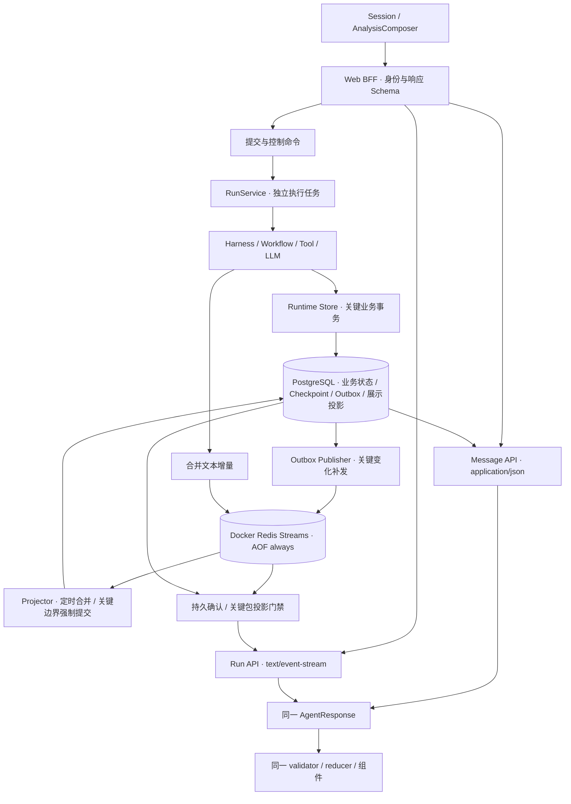
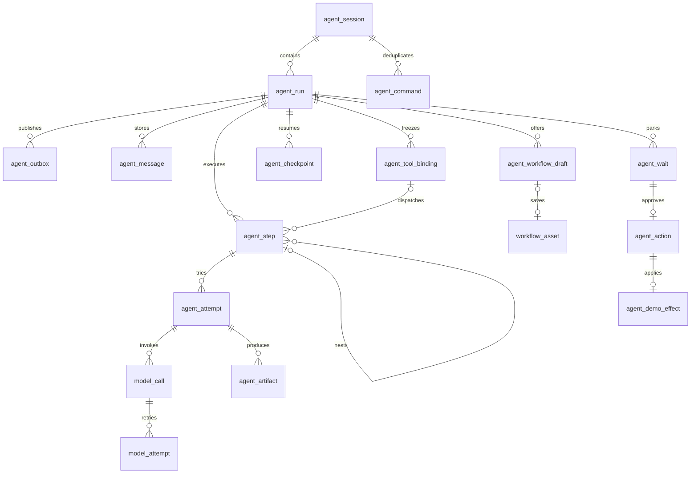
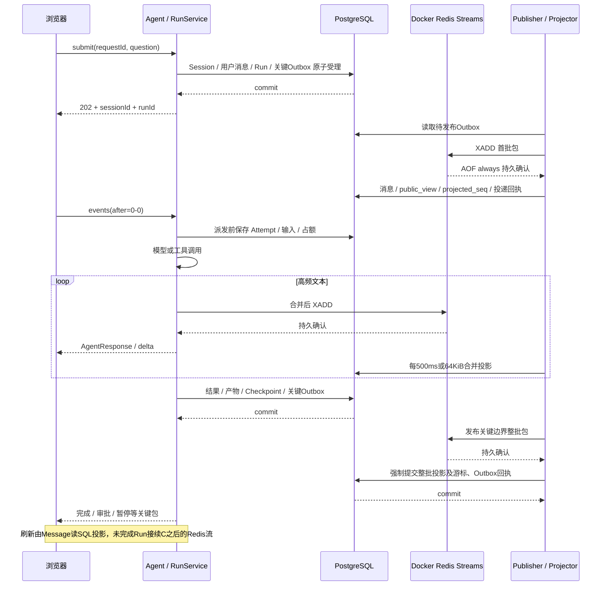

# 第 19 课 · 完整运行持久化与 Message / Run 统一协议

> Feature 985 · Profile `standard` · 待评审 · 2026-11-12 · 代码基线 `9b6220525f25` 及当前未提交工作区；工作区已有 0008 迁移文件；数据库实际应用版本待实施前核验。

[需求简报](../BRIEF.md) · [有效 PRD](../spec/PRD.md) · [标准模板](../../_templates/TECH_DESIGN.tmpl.md) · [完整数据设计](DATA_DESIGN.md) · [Redis 与本地部署](REDIS_DESIGN.md) · [代码设计](CODE_DESIGN.md) · [HITL 增量方案](HITL_DESIGN.md) · [HTML 审阅版](TECH_DESIGN.html)

## 1. 目标与设计边界

本方案负责 PRD FR-01～FR-03、FR-07～FR-16 的持久化主线；[HITL 增量方案](HITL_DESIGN.md)负责 FR-04～FR-06 及控制竞态。共同满足 AC-01～AC-19，验收编号只在 PRD 维护。

目标路径是：问一次便有持久 Session，前序案例执行后刷新能从左侧打开原会话，恢复相同的消息、过程和结果；执行中断线可继续订阅，服务重启可读取完整历史并显式接续有效边界。内容读取采用 Message 非流式接口和 Run 流式接口，响应共用 AgentResponse、一套业务包 Schema 和同一个 reducer。

当前复用与补齐：

| 对象/现状入口                                                             | 现状                                                                  | 本课处理                                                            |
| ------------------------------------------------------------------------- | --------------------------------------------------------------------- | ------------------------------------------------------------------- |
| `apps/web/src/components/shell/app-shell.tsx`                             | 会话列表空占位                                                        | 加载 Agent 所有的 Session 元数据，稳定会话地址和分页                |
| `apps/web/src/components/analysis-composer.tsx`、`client/analysis-run.ts` | `turns` 内存，浏览器选择历史后随请求发送                              | Message加载与Run增量驱动同一视图；追问历史由服务端组装              |
| `runtime/control.py`、`api/runs.py`                                       | Registry 和终态摘要在内存；断线取消执行                               | 数据库管理业务状态；进程管理执行句柄；订阅关闭不取消 Run            |
| `harness/context.py`、`harness/controlled_run.py` 及计划/Verifier 模块    | 消息、计划、证据和预算在内存                                          | 消息实体、步骤结果、版本化 Checkpoint                               |
| `runtime/execution_trace.py`、`stream.py`                                 | 临时节点、序号、实时编码                                              | 稳定节点与展示投影；Run 增量与 Message 完整内容包共用协议           |
| `models/entities.py`、`llm/executor.py`                                   | `model_call` 有元记录和收口后的 execution 摘要；中途 Attempt 尚在内存 | 保留原表，增加关联和必要内容引用；真实 Attempt 派发前登记、逐次保存 |
| `workflows/assets.py`、`workflows/drafts.py`、`workflows/script.py`       | 已保存资产入库；草稿、QuickJS 位置和子调用在内存                      | 复用资产；持久草稿、冻结脚本、步骤日志和已完成子结果                |
| M4 的 `tools/` 目标模块                                                   | 0008 已有配置/分配迁移；运行目录、结果与产物仍需运行级提交            | 复用配置/分配，补每 Run 目录、调用记录、产物字节与恢复关系          |

M4 的 `api/runtime/harness/workflows/tools` 拆分源码已存在；实施核对[前置迁移映射](../../986-lesson-18-tool-execution-sandbox/design/TECH_DESIGN.md#现有实现的迁移映射)与当前工作区一致。本文清单中的本课新增路径仍为拟议实现。

### 整体架构



- PostgreSQL 业务存储归 `agent/main`；Redis 运行流由 Agent 独占读写。Web 通过 HTTP 访问，Memory/Worker 本课无新表。
- Message 从持久消息、Run 和公开展示投影读取，完整刷新不依赖短期流日志。
- **本地 Docker Redis 为必选依赖。** Run 从 Redis Streams 按游标读取短期增量；高频文本不逐包写数据库。数据库按批次保存完整消息和展示投影，完成、等待、审批等关键边界强制提交；关键变化使用少量 `agent_outbox` 记录补发。
- 执行恢复使用私有 Checkpoint、上下文和原结果；公开展示投影不含私有续接数据或凭据。
- M5 单实例执行与连接解耦；M6 的调度变更继续复用这两个接口和同一响应协议。

## 2. 持久化对象与命名

新增表采用现有 Agent 单数 `lower_snake_case` 风格。Agent 运行域使用 `agent_`，模型域沿用 `model_`；复用 `workflow_asset`、`mcp_connection`、`sandbox_allocation`，保留既有名字。本课不创建按课号命名的表。



完整字段表与约束在 DATA_DESIGN 中唯一维护。Todo/Verifier/预算放 Checkpoint 的有类型 JSON；Workflow/Skill 源码和版本放所属 Step 定义快照，宿主调用日志复用子 Step/Attempt；不为这些对象建立无查询用途的重复表。

## 3. Message 与 Run：两个接口，同一响应协议

### 3.1 接口职责

以下为拟议接口，BFF 统一加 `/api`，沿用可信范围、委托身份和 CSRF 机制。

| 接口                                                | 输入                                                | 返回与职责                                                                     |
| --------------------------------------------------- | --------------------------------------------------- | ------------------------------------------------------------------------------ |
| `POST /v1/analysis/sessions/submit`                 | requestId、可选 sessionId、question、模型及案例参数 | 202 受理回执含 sessionId/runId/streamUrl；原子创建首问，重复请求返回原运行     |
| `GET /v1/analysis/sessions`                         | 当前身份、limit、分页游标                           | 会话列表元数据及最近 Run 状态                                                  |
| `GET /v1/analysis/sessions/{id}/messages`           | 历史分页游标，可选 runId 用于重载指定轮次           | **Message 接口：application/json，响应体为 AgentResponse，加载持久消息与过程** |
| `GET /v1/analysis/runs/{id}/events?after=0-0`       | 原 Run、最后已应用的 Redis Stream ID                | **Run 接口：text/event-stream，每个 data 为 AgentResponse，输出运行增量**      |
| `POST /v1/analysis/sessions/{id}/context-reset`     | requestId、expectedVersion                          | 持久上下文起点及元数据回执                                                     |
| `POST /v1/analysis/runs/{id}/{pause,resume,cancel}` | requestId、expectedVersion                          | 控制回执；运行变化经 Run 流推送，Message 可重新读取                            |
| `POST /v1/analysis/runs/{id}/decisions`             | HITL 决定                                           | 决定回执；卡片状态经相同业务包更新                                             |
| `GET /v1/analysis/runs/{id}/artifacts/{artifactId}` | 当前权限                                            | 原字节、类型与文件名，private/no-store                                         |

Message 与 Run 是两条内容读取路径。提交、列表、控制和下载保留各自职责。用户刷新先加载 Message；存在未结束 Run 时，再使用响应中的该 Run 游标续流。完成的历史直接呈现完整内容。

### 3.2 共享 AgentResponse

JSON 响应体和每个 SSE `data` 采用完全相同的外层类型及业务包联合；仅传输方式、包数量和 snapshot/delta 语义不同。该版本仍为待实现的 `compass.run@2`。

```typescript
type AgentResponse = {
  protocol: "compass.run";
  version: 2;
  sessionId: string;
  mode: "snapshot" | "delta";
  packets: AgentPacket[];
  cursors: { runId: string; seq: string }[];
  page: { nextCursor: string | null } | null;
};

type AgentPacket = {
  packetId: string;
  runId: string;
  seq: string | null; // delta为Redis Stream ID，如"1731400000000-0"；snapshot为null
  requestId: string;
  occurredAt: string;
  event: AgentEvent; // 唯一Pydantic判别联合，见CODE_DESIGN
};
```

- Message 使用 `mode=snapshot`，page 给出分页位置；cursors 仅包含本页完整装载的 Run 及其提交边界。
- Run 使用 `mode=delta`，page 为 null；每帧包含一个或一批有序包，cursors 只包含该 Run 的最后 Stream ID。SSE id 为 `runId:seq`；seq 始终是字符串，起点为 `0-0`。
- snapshot 通过完整 upsert 包创建或替换对象，delta 可以携带相同 upsert 或文本增量。业务渲染不判断响应来自哪个接口。
- Message 的派生包使用对象 ID/revision 生成稳定快照 packetId，seq 为 null；保留真实业务时间。流式包保留原事件 ID、时间和序号。快照包不承担原始逐字拆分的身份。
- 用户和助手正文使用 `message.upsert`；Run 使用 `run.upsert`；节点、计划、旁白、脚本、审批、产物和 Timeline 使用有类型 `view.upsert`。实时文本另用 `message.delta`。完整字段见代码设计。

### 3.3 持久加载与续流衔接

1. Message 在一次一致数据库读取中获取本页完整 Run 的公开消息、public_view 及 projected_seq=C，编码 AgentResponse。Run 的展示状态取 public_view.run，和内容属于同一投影前缀；权限覆盖全部读取对象。
2. 历史分页以完整 Run 为单位，固定上界 ordinal；前序已终态 Run 内容稳定。当前活跃 Run 只在一页中完整加载，按当前 4 MiB Run 公开内容预算限制单 Run 投影。响应按字节预算减少整 Run 数量，完整装载边界不被拆开。
3. 页面应用 snapshot 后，将对应 Run 的游标设为 C；只对非终态 Run 订阅 `after=C`。加载期间产生的 C 之后增量继续从日志读取。
4. 同一 Run 的 seq 使用 Redis 原生 `毫秒-序号`，按两个整数比较、严格递增，允许数值间隔；相同包重放幂等。服务端校验游标对应的保留记录及流完整性，禁止用整数加一判断缺包。流已到期返回 `409 history_reload_required`，客户端重新调用 Message；活跃流意外丢失进入 recovery_required，保留数据库投影，停止自动续接。
5. Run 每个连接至多 60 秒或达到传输预算后轮转。网络 EOF 不更改业务状态；终态已送达则结束该 Run 订阅，新一轮使用新的 Run 接口连接。waiting/paused 仍属于未终态。
6. 两类读取均校验当前权限；长连接最长每 5 秒重新核验。退出或切换会话只停止加载与订阅。
7. snapshot 与已经应用的实时更新相遇时按对象 revision 和 Run 游标处理，旧快照不覆盖新状态。分页完成后核对列表中的最近 Run，其他页面新建的轮次通过 Message 补载。

Message 的分页和 Run 的续流游标分别传递，具有独立用途。浏览器临时缓存只保存读取进度；问答和运行历史以数据库为准。

### 3.4 同一 reducer 与展示投影

`applyAgentResponse` 先按同一 Schema 校验，再按 mode 处理快照基线或增量顺序，最后统一交给 `reduceAgentPacket`。两类传输适配器只负责 JSON 读取与 SSE 解帧。

Message 正文由 agent_message 保存；Run 的 `public_view` 保存公开 Run 头和其他已展示对象的完整投影，包括节点树、公开旁白、计划、脚本、审批、产物引用和需要展示的 Timeline。对象均有稳定 ID/revision，正文与产物字节通过引用复用。Projector 在同一 PostgreSQL 事务更新公开消息、public_view 和 projected_seq，保证快照对应完整流前缀。运行控制使用业务 Run 行；Message 和侧栏的运行状态使用公开投影。私有模型上下文、完整工具观察及执行 Checkpoint 按执行边界直接保存。

实时最终视图与 Message 加载视图通过 `normalizeBusinessView` 比较全部业务字段。快照数量、流式拆包次数、网络标志、滚动位置和本地展开偏好不参与比较。清理终态短期日志后仍须通过同一比较。

## 4. 执行写入与恢复

### 4.1 事务与顺序

锁顺序统一为 `Session → Run → Step/Attempt → Wait/Action`。业务行锁只覆盖短事务，外部模型、工具和 Redis 调用都在事务外。每 Run 的流写入由单实例内的串行发布通道负责；并行子调用的结果按接受顺序入通道。Session 使用 version 管理元数据，无独立流游标。



- 首问去重键按 `(tenant, workspace, actor, requestId)` 唯一；首次创建使用事务级 advisory lock 序列化同键请求，原子保存 Session/Run、用户与空助手消息、初始公开视图、命令回执和首批 Outbox。同键不同输入返回 409。初始投影游标为 `0-0`；首批 Outbox 投影完成后再派发模型。
- **高频文本路径：** 50 ms 或 8 KiB 合并为一个包 → XADD → 获得 AOF 持久确认 → 允许 SSE 读取。每 Run 的 Projector 每 500 ms 或累计 64 KiB 提交一次完整投影与 projected_seq。阈值是本课初值，实施以原有单帧/单 Run 预算验证；数据库中没有逐 token 或逐 delta 行。
- **关键业务路径：** Attempt 派发意图、预算、已接受结果、产物字节、私有上下文、Checkpoint、Wait/Action 和命令回执在各自业务事务持久化；涉及公开变化时同事务插入 `agent_outbox`。Checkpoint 以 boundary_outbox_id 关联该边界，Redis ID 在提交后生成。
- Publisher 按 Run 的业务版本发布关键包，先补齐前序流，再按 Outbox 内顺序 XADD。Projector 只提交完整关键批次；公开消息、public_view、projected_seq、Outbox 投递回执同事务更新。SSE 在该事务提交后才放行整批关键包。终态的完整回答与展示状态因此先落库；下一执行步骤和下一轮也等待所需关键投影完成。
- PostgreSQL 与 Redis 使用可重试补发，无跨存储事务。Outbox 的 operationId、摘要和包 ID 稳定；发布结果不明时先在本 Run 的有界流中查相同包 ID/内容，再补缺项。禁止写命令自动盲重试。高频包采用相同的确认规则，投影按游标和对象 revision 幂等。
- Redis 或投影失败停止新派发，已返回的模型/工具结果仍先提交数据库及 Outbox，恢复后补发。不得发送尚未取得持久确认的文本或未完成投影的成功终态。具体缓存键、重试、保留与故障处置见 [Redis 方案](REDIS_DESIGN.md)。

### 4.2 单实例生命周期

Agent lifespan 持有专用 PostgreSQL advisory lock 连接以确保一个执行所有者；拿不到锁时持久执行入口不就绪。每次启动生成 boot ID，Run 的 execution epoch 与此关联。丢失所有者连接立即停止新派发并停止当前资源；每次提交验证当前 epoch。该设计覆盖本课单实例环境，跨实例接管由 M6 租约承接。

submit 提交成功后创建应用级任务，不依附 SSE response generator。启动先建立 Redis 连接、核对保留流并重建已确认流尾，再补发未投递 Outbox、补齐数据库投影；完成这些步骤后才允许执行恢复。Publisher、Projector 与 Run 任务统一由 lifespan 管理。启动函数按 Run ID 幂等登记，锁 Run 并以状态/version 领取 epoch；重复受理回执不重复启动执行。受理后尚未启动即崩溃，保留 Created；启动后遇到遗留 Running，保存关键 Outbox，并以 `run.upsert` 标记 Paused/recovery_required 并核对未决 Attempt；无法确认资源时先保持待核对，不直接派发。Waiting/Paused 原样保留，Cancelling 只收资源回执，终态只读。M5 提供显式恢复，进程内任务创建失败也标记可恢复并向客户端返回已受理 Run。

### 4.3 Checkpoint 的完整内容

Checkpoint DTO 有独立 schemaVersion，字段合同见 DATA_DESIGN：固定运行配置和源版本、按顺序的上下文 Message ID、模型绑定与服务端私有续接数据、Todo/Verifier、剩余预算和占额、完成结果、下一执行位置、未决调用、工具目录和产物引用。恢复校验 schema、源码摘要、绑定/目录版本、权限及产物完整性后再申请执行权。

已完成 Run 只需重建视图；未完成 Run 从有效边界继续。普通模型流的 TCP 连接和 QuickJS 内存栈不落库。模型中断时立即将 Attempt 结局持久标记为 incomplete/unknown；Redis 可读后补投影已确认片段，再发布公开恢复状态。遵守原可重试分类；内容已暴露、上游结局未知或效果未知时先进入可诊断阻塞，禁止把已有片段拼接为成功输出。显式重试产生新的 Attempt，旧记录保持可读。

LLM 私有续接状态由服务端解封后使用独立 runtime-state 用途加密保存，绑定 owner/Run/provider/binding version/schema；恢复通过内部调用路径重建，保持面向浏览器 continuation token 原有 TTL，不延长旧令牌。仅保存 SDK 继续工具对话所必需的 opaque 状态；供应商密钥按当前配置取得，不进 Checkpoint。终态可清除私有续接段，保留展示消息和运行记录。

### 4.4 LLM Runtime

现有 `model_call` 保留逻辑调用摘要和模型管理查询语义；新增 `model_attempt` 保存实际调用尝试，先登记再发送。路由模型、主模型、Fallback 和子 Agent 都关联各自 agent_attempt，Standalone 模型测试允许无 Run 关联。`model_call.execution` 继续作为向后兼容的聚合字段，由 model_attempt 在收口时生成。

派发前记录保守用量/成本占额，结果到达后写真实用量；未确认项保留未知值和占额。恢复不重置预算；等待/暂停不增加活跃耗时。每个真实 Attempt 的实际请求和必要输出写受控记录，model_call 的内容列保留逻辑请求与最终接受结果，Trace/日志继续只记录安全元数据。

### 4.5 Workflow、Skill 与工具

- 每 Run 冻结工具别名、声明、Schema 摘要、策略、执行绑定及配置版本；恢复按原版本核验并重建 MCP 会话。变化返回 `tool_catalog_changed`。内置源码继续留在仓库，数据库保存版本与运行快照。
- 每个工具/子 Agent/流程节点有稳定 Step；每次执行有独立 Attempt。完整输入输出加密，安全预览和节点快照进入公开事件。Sandbox 分配记录沿用 M4，恢复不把临时文件路径当产物内容。
- Workflow Step 冻结源码、摘要、入口版本、参数和运行环境版本。QuickJS 恢复从相同脚本入口重放纯计算，通过宿主调用日志复用完成的 Step 结果；已执行模型和工具不再调用。宿主调用身份为 `(parent_step_id, call_ordinal)`，核对名称和输入摘要。
- 为保持脚本分支一致，冻结脚本可见时间和随机种子，按已提交的 delivery_no 重放 Promise 结果；所有外部能力经过宿主桥，禁止额外时钟/IO。原 `parallel` 的各子结果独立保存，Join 后再提交父 Step。恢复中调用顺序或摘要不匹配返回 `workflow_replay_mismatch`。具体算法见 CODE_DESIGN。
- Skill 保存实际加载的正文/资源版本或内容摘要及必要内容，不仅保存易变的磁盘路径。引用的 Workflow 资产即使后续停用/修改，历史展示使用原快照；后续实际执行仍核验当前权限和配置。
- `agent_workflow_draft` 保存通过运行校验的脚本与来源，沿用 30 分钟保存邀请有效期；保存资产和 `workflow.saved` 同事务完成，重复请求返回同一 assetId。过期草稿仍可展示源码与失效状态。

## 5. 权限、容量与兼容

Session 默认按 owner/tenant/workspace 隔离；Run、消息、事件、产物通过同一归属约束查询。审批人仅获提案所需范围，独立提案查询不等于获得完整会话。Agent 使用现有可信委托，并通过拟新增 Web 内部权限核验接口查询当前身份；接口不依赖过期浏览器会话，不跨库查询。授权失败关闭读取或推进。

沿用原单帧/单 Run 预算，并为 Run 流分连接累计传输预算。artifact 大小沿用 M4；私有 JSON 按原消息、模型输入和工具输出上限校验。到达限额保存明确失败状态，禁止静默截掉历史或恢复字段。业务消息、运行记录和完整展示投影持续保留。Run 已终态、投影追到流尾、Outbox 全部投递后，才给整条 Redis Stream 设置 1 小时 TTL。活跃/等待/暂停流不设置 TTL，不使用 MAXLEN 裁剪；沿用每 Run 容量限制，达到 Redis noeviction 上限时停止派发并保留已有内容。缓存到期后 Message 仍可加载完整历史。

本地依赖采用固定版本 Redis Docker 镜像、命名卷和 AOF always；宿主绑定 `127.0.0.1:56379`，Agent 容器使用 `redis:6379`。`/healthz` 保持进程检查，持久执行的 `/readyz` 同时检查 PostgreSQL、Redis 和所有者就绪。Redis 故障期间，直接访问 Message 的数据库历史读取仍可用；前端不因流依赖故障屏蔽历史页。配置、拟议 Compose 片段及启动方式见 [REDIS_DESIGN.md](REDIS_DESIGN.md)。

现有 v1 协议的 `POST /v1/analysis/runs` 保留为过渡适配器：内部同样调用持久 submit，以独立 Session 保存调用，不再走内存执行分支；外部仍编码 v1 事件，不提供历史读取。v1 的旧 history 仅在该适配器校验导入，记录为导入上下文，不能冒充旧 Session。新 Web 全部切换 v2；老客户端遇到 HITL 所需的新能力返回明确不支持。原 v1 断线取消仅保留在适配器，v2 不继承。客户端升级后移除适配器需另行确认实际消费者。

## 6. 数据库发布与恢复

遵循[数据库规范](../../../docs/database-migrations.md)。owner **agent/main**，规划 **0008 → 0009**，拟新增 `apps/agent/migrations/versions/0009_durable_runs.py`，一次包含持久化与 HITL 表；代码可分切片，迁移区间保持不变。0008 源文件已在当前工作区，实施先核对实际单一 head 与应用版本；出现冲突调整未发布 revision 及下游规划，保留已共享历史。

- 同步 ORM、Alembic env、受管版本映射、结构核验、运行角色授权及 readyz。真源在 app，Feature 不放可编辑 SQL 副本。
- 生成 `apps/agent/db/main/sql/bootstrap.sql`、`upgrades/0008__0009.sql` 及受支持起点到 0009 的增量，更新 manifest 和 README；保留原 migration、历史 SQL。
- 旧 model_call 新关联列 nullable；已有 execution 尝试摘要可确定性回填 model_attempt 并标记 legacy_summary。没有保存过的正文/Session 不回填，内容状态标记 not_captured。M4 历史 Sandbox 行无对应 Run 时继续作为遗留清理记录保留，不强加破坏性外键。
- 发布顺序：停接并排空前版执行 → 备份 agent/main 和既有/新增加密材料 → 部署本地 Redis 并检查卷、AOF、口令和健康状态 → 迁移和权限核验 → 发布 Agent 与生成契约/BFF → 切换 Web 会话页 → 冒烟和刷新验证。
- 恢复优先使用兼容 0009 的构建保留全部运行数据；回旧 schema 时把升级前备份恢复至独立库后切换，保留 0009 库。动作效果和 Action ID 一并核对，避免恢复后重复施效。无删除新表的常规回退步骤。
- 后续备份先停止新派发，等待关键 Outbox 和投影提交，再协调保存 PostgreSQL 与 Redis 卷。恢复时核对原 Run 流及 projected_seq；缺失或落后的活跃流保持 recovery_required，不重建同名空流后自动接续。命名卷保留、容器重启验收与主动损坏后的处置见 Redis 方案。
- Web/Memory/Worker/Retail 无新业务迁移。恢复密钥配置拟为 `COMPASS_RUNTIME_STATE_KEY`，缺失拒绝开启持久运行；密钥丢失时历史公开视图可读，私有执行恢复返回明确错误。

## 7. 实施任务与评审重点

以下均为拟实施路径，`!` 表示修改现有或 M4 前置目标，`+` 表示本课新增。

```diff
+ apps/agent/src/compass_agent/runtime/entities.py
+ apps/agent/src/compass_agent/runtime/store.py
+ apps/agent/src/compass_agent/runtime/checkpoints.py
+ apps/agent/src/compass_agent/runtime/{message_reader,run_events,public_projection}.py
+ apps/agent/src/compass_agent/runtime/{redis_stream,outbox_publisher}.py
+ apps/agent/src/compass_agent/runtime/hitl.py
! apps/agent/src/compass_agent/runtime/{service,control,stream,execution_trace}.py
! apps/agent/src/compass_agent/harness/{executor,context,controlled_run,autonomy}.py
! apps/agent/src/compass_agent/workflows/{script,assets,drafts}.py
! apps/agent/workflow-runner/run.mjs
! apps/agent/src/compass_agent/tools/{loader,dispatcher,artifacts}.py
! apps/agent/src/compass_agent/models/{entities,repository,service}.py
! apps/agent/src/compass_agent/llm/{contracts,executor,continuation}.py
+ apps/agent/src/compass_agent/api/sessions.py
! apps/agent/src/compass_agent/api/runs.py
! apps/agent/src/compass_agent/{schemas,main,settings}.py
+ apps/agent/migrations/versions/0009_durable_runs.py
! apps/agent/migrations/env.py
! apps/agent/scripts/database.py
! apps/agent/db/main/{README.md,sql/}
! apps/web/src/{client,contracts}/analysis-run.ts
+ apps/web/src/server/http/analysis-session-handler.ts
+ apps/web/src/server/http/analysis-run-authz-handler.ts
! apps/web/src/server/{analysis-agent-client.ts,http/analysis-run-handler.ts}
! apps/web/src/server/http/handler.ts
! apps/web/src/components/{analysis-composer,analysis-run-turn}.tsx
! apps/web/src/components/shell/app-shell.tsx
! scripts/export-contracts.py
! contracts/ 与 apps/web/src/generated/  只由契约生成器更新
+ apps/agent/tests/test_durable_runtime_integration.py
+ apps/web/tests/e2e/durable-sessions.spec.ts
! apps/agent/tests/test_database_tools_integration.py
! apps/web/tests/analysis-run-stream.test.ts
! apps/agent/package.json  将新增真库测试纳入 test:integration
! apps/agent/pyproject.toml 与 uv.lock  Redis asyncio 客户端
! deploy/compose/compose.yaml
+ deploy/redis/redis.conf
! .env.example
! deploy/README.md、apps/agent/README.md 与受影响 manifest.yml
```

| 任务               | 依赖与交付                                                                 | 验收                       |
| ------------------ | -------------------------------------------------------------------------- | -------------------------- |
| T0 本地 Redis      | T2 前交付 Compose、AOF/卷、口令、客户端、健康检查与启动说明                | AC-19                      |
| T1 对象清单和迁移  | 核对 M4 基线；落完整实体、约束、密钥用途、SQL、旧数据兼容                  | AC-01、AC-07、AC-08        |
| T2 Session/消息/流 | 原子 submit、幂等、Redis Streams、关键 Outbox、批量/强制投影、双接口与列表 | AC-09、AC-10、AC-17～AC-19 |
| T3 逐层运行持久化  | LLM Attempt、工具目录/结果、计划、Verifier、预算、Workflow/Skill/草稿      | AC-13～AC-16               |
| T4 执行恢复        | 独立任务、Checkpoint、QuickJS 日志重放、未知结局和原产物读取               | AC-01、AC-03、AC-05、AC-11 |
| T5 Web 统一渲染    | AgentResponse schema、JSON/SSE BFF、同一 reducer、真实侧栏、刷新/切换/追问 | AC-09～AC-12、AC-18        |
| T6 HITL 增量       | 按独立方案实现审批/控制/动作核对，复用 T1～T5                              | AC-02～AC-06               |
| T7 全案例验收      | 固定前序案例矩阵，浏览器刷新比对、实际重启和迁移恢复                       | 全部 AC                    |

本次必须评审：Redis 持久确认、关键 Outbox 补发、消息/展示投影与游标原子性、终态展示门禁、LLM 派发记录、QuickJS 重放确定性、旧模型记录兼容、v1 过渡、HITL 取消竞态。代码骨架见 CODE_DESIGN；详细字段见 DATA_DESIGN。最高优先验证为“提交后发送前退出仍可经 Message 加载，接续 Run 无重复”和“并行 Workflow 完成一个子调用后重启，完成项不再调用”。

实施时执行 Agent/Web lint、typecheck、test，`pnpm contracts` 与 `pnpm contracts:check`；真实 PostgreSQL 和本地 Docker Redis 下执行 `pnpm test:integration -F agent`、`pnpm db:sql:check -F agent`、migrate、重复 seed 和 smoke；按跨应用变更执行 `pnpm check`、`pnpm build`，浏览器用实际登记入口验收。新增集成测试入口须先接入 package.json，不能以未登记命令报告通过。

本次仅更新设计。数据库迁移、模型调用、浏览器业务回归和重启验收均待实施；文档与 HTML 检查单独记录，不代替这些业务结果。
