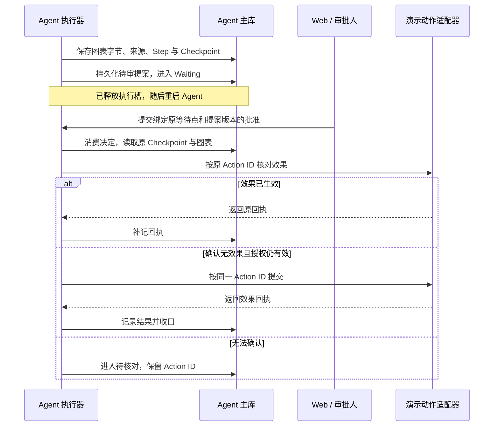
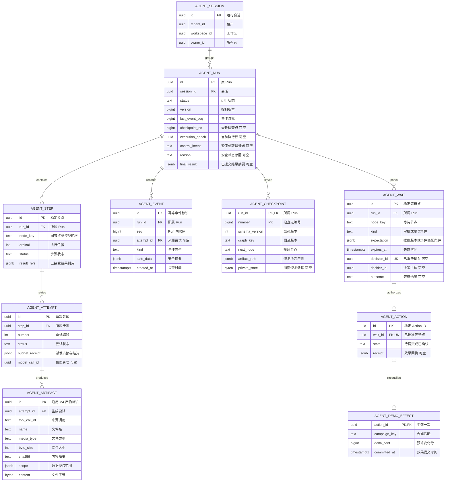

## 0. 先分清 Step、Attempt 和 Checkpoint

第 17 课定义了待人审节点，第 18 课定义了容器绘图和产物接收。第 19 课接上这两条链路：服务可以停掉，审批人晚些回来，系统还能继续同一个 Run，读取同一份图表。

| 概念            | 保存的是什么                                        | 如何使用                                           |
| --------------- | --------------------------------------------------- | -------------------------------------------------- |
| Session / Run   | Session 归组任务，Run 表示一次运行                  | 通过逻辑身份和工作区关联，不跨库引用 Web 登录会话  |
| Step / Attempt  | Step 是稳定执行位置，Attempt 是该位置的一次执行尝试 | Retry 新建 Attempt，保留先前的执行和费用记录       |
| Checkpoint      | 图版本、下一节点、已完成结果与恢复所需引用          | Resume 从原 Run 的有效检查点继续，复用已提交的结果 |
| Wait / Decision | 稳定等待点、提案版本、有效期和已消费决定            | 审批或匹配的受信事件只消费一次                     |
| Action / Effect | 动作标识、执行回执和演示效果账本                    | 用同一 Action ID 先核对效果，处理提交后回执丢失    |
| Artifact        | 来源、授权范围、文件大小、摘要和实际字节            | 读取时复验当前权限及内容完整性                     |

## 目标

| 核心问题                 | 实现目标                            | 量化指标（设计目标）                                      |
| ------------------------ | ----------------------------------- | --------------------------------------------------------- |
| 重启后从头分析           | 从已提交位置接续原 Run              | 已提交 Step 重跑次数为 0                                  |
| 图表引用存在但内容未落盘 | 文件、步骤、事件与检查点一致提交    | 采用 1 个主库事务；必需文件不可读时不提交依赖它的新检查点 |
| 人审等待占着执行槽       | 持久化审批等待并释放资源            | 课堂审批有效期初值 15 分钟                                |
| 动作已生效、回执未写     | 用稳定 Action ID 查账本并补记原回执 | 同一 Action ID 至多产生 1 次演示效果                      |

## 1. 方案概述

### 1.1 Compass 职责分工

{{code:architecture}}

| 层               | 负责的事                                                  | 边界                                                   |
| ---------------- | --------------------------------------------------------- | ------------------------------------------------------ |
| Web / BFF        | 解析登录主体，检查当前角色、工作区及 CSRF，代理控制和读取 | Web 归属身份和权限，通过服务接口为 Agent 复核授权      |
| Durable Run API  | 运行资源的创建、查询、控制、产物读取和安全 Timeline       | Agent 是运行数据所有者；既有同步 v1 入口仍有自己的契约 |
| Durable Executor | 用 M3 Workflow 和 M4 工具执行，按 Step 提交边界           | 模型、SQL、Sandbox 和网络鉴权放在事务外                |
| Agent PostgreSQL | 保存 Run、事件、Checkpoint、产物、审批和演示效果          | 有界 PNG 使用 `bytea`，与当前 Step 和事件一起提交      |

### 1.2 从绘图到重启后获批



## 2. 持久对象和恢复边界

### 2.1 一张运行数据地图



| 关系                        | 唯一性或一致性约束                                  | 用途                                 |
| --------------------------- | --------------------------------------------------- | ------------------------------------ |
| Run → Step → Attempt        | `(run_id, ordinal)` 与 `(step_id, number)` 唯一     | 查清位置、失败尝试和成功结果         |
| Run → Event                 | `(run_id, seq)` 唯一，事件 ID 用于幂等              | 以已提交顺序组装 Timeline            |
| Run → Checkpoint            | 编号在同一 Run 内递增，引用写入前核对归属和可读内容 | 恢复已知图版本与下一节点             |
| Attempt → Artifact          | 沿用第 18 课的 ID，复验来源、字节数和 SHA-256       | 容器清理或进程重启后读回原文件       |
| Wait → Action → Demo Effect | 等待点消费一次，效果账本以 Action ID 唯一           | 重启后定位已产生的业务效果并补记回执 |

### 2.2 Step 提交前后分别能恢复什么

| 时刻                           | 已持久化                           | 恢复行为                                   |
| ------------------------------ | ---------------------------------- | ------------------------------------------ |
| 外部 Attempt 派发前            | 当前步骤和保守预算占额             | 失联后未确认用量按占额处理，恢复不重置预算 |
| 步骤执行中                     | Attempt 状态、已提交的历史位置     | 尚未提交且允许重试的步骤可新建 Attempt     |
| 步骤提交成功                   | 文件字节、步骤结果、检查点和事件   | 直接复用原内容与原引用                     |
| 文件写入或校验失败             | 上一个有效 Checkpoint 和原步骤记录 | 本次边界回滚，旧进度仍可查询               |
| 恢复时必需文件缺失、损坏或越权 | 原检查点和已提交记录               | 返回 `artifact_unavailable`，后继步骤暂缓  |

Checkpoint 只保留接续需要的数据。可恢复的模型消息、已验证证据和 Todo 跟随当前加密快照。需要供应商续接的档位复用服务端密封令牌。图或绑定变化、密钥丢失、令牌过期和权限撤销都有明确恢复错误。课堂审批等待点在分析和绘图之后，获批后直接继续动作路径。

### 2.3 状态机与权限

{{code:states}}

| 请求或冲突               | 哪个条件决定结果                                                                             |
| ------------------------ | -------------------------------------------------------------------------------------------- |
| 暂停与只读 Step 同时推进 | 控制请求比较 Run 版本；执行提交比较当前执行权和前一个 Checkpoint。当前步骤可以提交到暂停边界 |
| Cancel 与审批并发        | 由 Run 主行锁裁决生效顺序；取消获胜后禁止新派发                                              |
| 取消后资源退出未确认     | 保持可诊断的 Cancelling，确认清理后转入 Cancelled                                            |
| 审批与提案版本不符或重复 | 比较 Run、等待点、提案 ID、版本及决定 ID；相同决定幂等返回                                   |
| 获批后权限变化           | 新效果提交前重新检查审批人资格、发起人数据范围和工作区；取消状态与执行权在效果写入前再次检查 |

已有的状态和运行数据由 Agent 管理。前置 M4 已规划工具配置与 Sandbox 分配记录 0008；本课迁移规划为 `agent/main` 0008 → 0009，增加持久对象及受管 SQL；Web 与 Retail 沿用各自数据库结构。

## 3. 文件变化与评审入口

```text 拟议变更文件树
compass/
├─ apps/
│  ├─ agent/
│  │  ├─ src/
│  │  │  └─ compass_agent/
│  │  │     ├─ runtime/
│  │  │     │  ├─ durable_store.py  [新增] 状态、事件、Checkpoint 与事务
│  │  │     │  ├─ durable_executor.py  [新增] 接续、等待、动作与预算
│  │  │     │  ├─ durable_entities.py  [新增] Agent 持久对象
│  │  │     │  ├─ workflow.py  [调整] 步骤与产物提交接缝
│  │  │     │  ├─ executor.py  [调整] 步骤与产物提交接缝
│  │  │     │  └─ artifact.py  [调整] 步骤与产物提交接缝
│  │  │     ├─ durable_run_api.py  [新增] 受权控制、Timeline 与产物读取
│  │  │     ├─ schemas.py  [调整] 契约、入口、配置
│  │  │     ├─ main.py  [调整] 契约、入口、配置
│  │  │     └─ settings.py  [调整] 契约、入口、配置
│  │  ├─ migrations/
│  │  │  ├─ versions/
│  │  │  │  └─ 0009_durable_runs.py  [新增] 主库演进
│  │  │  └─ env.py  [调整] 注册元数据
│  │  ├─ scripts/
│  │  │  └─ database.py  [调整] 版本、授权和 SQL 生成
│  │  ├─ db/
│  │  │  └─ main/
│  │  │     ├─ README.md  [调整] 受管交付与恢复说明
│  │  │     └─ sql/  [生成] 受管交付与恢复说明
│  │  └─ tests/
│  │     ├─ test_durable_run_integration.py  [新增] 重启、并发、审批与产物
│  │     └─ test_database_tools_integration.py  [调整] PostgreSQL 迁移和恢复
│  └─ web/
│     └─ src/
│        └─ server/
│           ├─ http/
│           │  ├─ analysis-run-handler.ts  [调整] 持久路由代理与授权
│           │  └─ analysis-run-authz-handler.ts  [新增] Agent 内部实时授权查询
│           └─ modules/
│              └─ models/
│                 └─ application/
│                    └─ authorize.ts  [调整] 复用有效租户及工作区权限
└─ docs/
   └─ adr/
      └─ 0004-durable-run.md  [新增] 持久边界与动作核对
```

## 4. 核心代码走读

### 4.1 durable_store.py · 提交文件、步骤与 Checkpoint

以下为拟议代码。事务入口先看该操作是否已提交，再核对当前执行权和上一个检查点。先接收产物字节并复核引用，再提交 Attempt、Step、Checkpoint 与事件。取消清理有单独分支。

{{code:commit}}

### 4.2 durable_executor.py · 动作生效后回执丢失

效果写入与运行回执处于两个提交边界。先读效果账本，再判断是否需要按原 Action ID 提交。已确认结果走补记路径，未知结果停在 `action_reconciliation`。新效果只在当前权限仍有效时发起。

{{code:action}}

第 20 课沿用这套状态机、原文件引用和动作合同。Worker 接管会追加租约验证，续接位置仍由原 Checkpoint 决定。

### MCP 目录的恢复边界

Checkpoint 保留本 Run 工具名称映射、配置版本、Schema 摘要与策略，恢复时重建本人会话并重新授权。目录变化要求重新发起任务；MCP 在途结局未知时保留待核对状态，禁止自动重放。

## 统一执行过程的继承

| 前置能力                   | 本课接入                                                                                                                                                                                                                                                                    |
| -------------------------- | --------------------------------------------------------------------------------------------------------------------------------------------------------------------------------------------------------------------------------------------------------------------------- |
| 第 17 课统一节点与树形展示 | 持久事件继承第 17 课 compass.execution.node@1 的节点身份、父子关系、revision、来源、环境、分组和安全展示字段。将公开快照写入已有运行事件边界；Checkpoint 与完整内部观察继续使用各自权限及存储。恢复时按已提交节点身份续接，新的执行尝试使用独立调用节点，保持历史终态稳定。 |

### NFS 工作卷与持久产物

第 18 课的 OpenSandbox + NFS-Ganesha 保存工作文件，工作卷由 `tools/sandbox` 管理。第 19 课将 Agent 已接受的不可变字节与 Step 一起提交，Checkpoint 恢复独立于工作卷保留期。推理循环归 `harness`，工具实现归 `tools`，持久 Run 继续扩展 `runtime`。
