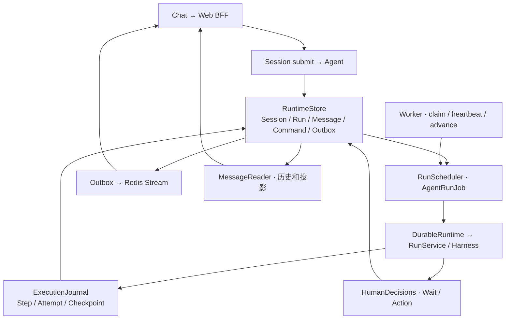
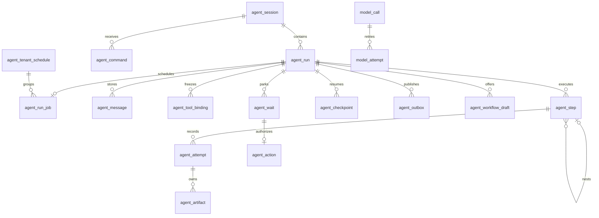

## 本课目标

- **恢复会话历史**：持久化每轮消息、执行过程和结果，刷新页面后可打开原会话。
- **断线继续接收**：通过 Message 加载历史，再按 Redis Stream 游标续接 Run 的增量事件。
- **重启后接续运行**：从 Checkpoint 继续原 Run，复用已保存的结果，并核对结果未知的工具调用。
- **人工确认**：保存待审提案和审批决定，在获准后继续执行对应动作并记录回执。

## 整体架构



| 入口或模块 | 当前职责 |
| --- | --- |
| `api/sessions.py` | 受理、会话列表及元数据、消息、Run 事件、暂停/继续、审批与核对。 |
| `runtime/store.py`、`session_management.py`、`history.py` | 原子受理、会话管理及历史上下文；使用请求 ID 幂等。 |
| `api/worker_runs.py`、`runtime/run_scheduler.py` | Worker 领取、心跳、推进和释放；Agent 维护租约、执行代次和租户配额。 |
| `runtime/durable_service.py`、`journal.py` | 监督执行，保存实际派发、回执和恢复边界。 |
| `runtime/redis_stream.py`、`message_reader.py` | 发布 Outbox、读取 Redis 游标与数据库历史。 |

## 当前持久化对象



| 对象 | 字段与职责 |
| --- | --- |
| Session / Run | Session 保存租户、工作区、所有者与列表元数据。Run 保存请求快照、状态、版本、公开投影、Checkpoint 指针、执行代次和累计活跃时间。 |
| RunJob / TenantSchedule | 独立保存排队状态、Worker 身份、租约到期时间和租户领取顺序。 |
| Message | `conversation` 保存公开正文；`context` 保存加密模型消息，可关联 Step、Attempt 和 ToolCall。 |
| Step / Attempt | Step 按 Run 内键定位，可嵌套且指向已接收 Attempt。Attempt 记录派发、输出摘要、回执、预算回执与交付序号。供应商请求尝试另由 `model_attempt` 跟踪。 |
| Checkpoint | 指向 Outbox 边界，保存已完成、消息、绑定和产物引用，以及计划、预算、待派发和加密验证/续接状态。 |
| Artifact / Draft | Agent 保存已接受的产物字节。工作流试跑写待确认草稿，保存确认后关联工作流资产。 |
| Wait / Action | Wait 保存审批或等待的条件和版本，Action 跟踪获准效果、回执与核对状态。 |

## 回放与停止

1. 受理事务创建或复用 Session 下的 Run，保存消息、命令、初始事件及调度记录。Worker 持租约和执行代次推进，主执行边界交回调度器。
2. Journal 在业务派发前确定节点键和请求摘要。回执提交后，Attempt、Step、Checkpoint 和 Outbox 一起更新。恢复时比对摘要，复用已记录结果与计量，继续未完成步骤。
3. 子 Agent 的工具观察保存模型实际收到的 JSON 文本，回放复用相同文本。工作流在派发子任务前被脚本 runner 拒绝时记录失败回执，恢复直接返回原错误码。有外部效果的未知派发进入核对。
4. `GET /v1/analysis/sessions/{id}/messages` 返回历史快照。 `GET /v1/analysis/runs/{id}/events?after=…` 以 SSE 输出运行增量。两者使用 `AgentResponse`。公开投影保存可见消息、执行节点和审批状态。
5. 用户暂停与恢复使用原 Run 的配置和剩余活跃预算。审批在可信权限及版本校验后提交；外部效果未知时按 Action ID 核对。工作流保存确认与高影响工具执行审批通过各自入口完成。

## 发布与恢复核对

| 对象 | 核对方式 |
| --- | --- |
| PostgreSQL | 保持已部署迁移历史，备份 Agent 主库与加密密钥。恢复时校验 Checkpoint 摘要、已接受 Attempt、目录绑定和产物摘要。 |
| Redis | 已确认 Outbox 与公开投影以流游标对齐。终态完成投影后流保留一小时，持久消息和投影仍可从 PostgreSQL 读取。 |
| 审批与未知效果 | 复验当前权限、提案版本与 Action ID；待核对状态通过独立控制入口处理。 |
| 验收路径 | 比较刷新与重连结果、跨 Worker 检查点恢复、审批重复提交和未知外部效果的核对路径。 |

## 当前文件清单

```text
apps/agent/
├── src/compass_agent/
│   ├── api/
│   │   ├── sessions.py           会话、历史、SSE 与控制
│   │   └── worker_runs.py        Worker 租约与推进
│   └── runtime/
│       ├── entities.py          运行域 ORM 与约束
│       ├── store.py             受理及运行状态事务
│       ├── durable_service.py   持久执行监督
│       ├── journal.py           Attempt、Checkpoint 和回放
│       ├── run_scheduler.py     排队、领取与租约
│       ├── private_state.py     私有内容加密
│       ├── subagent.py          子任务消息与工具回执
│       ├── redis_stream.py      Outbox 发布与游标
│       ├── message_reader.py    持久历史读取
│       ├── public_projection.py 公开事件投影
│       ├── hitl.py              等待、审批与动作核对
│       └── resources.py         产物与待确认工作流
└── migrations/versions/
    ├── 0009_durable_runs.py              持久 Run 基线
    ├── 0010_run_scheduler.py             调度与租约
    ├── 0011_session_management.py       会话管理
    ├── 0012_dynamic_workflow.py          动态工作流
    ├── 0013_model_generation_profile.py  模型生成配置
    └── 0014_workflow_asset_deletion.py   工作流资产删除
```

Agent 主库的迁移真源位于 `apps/agent/migrations/`，完整及增量 SQL 位于 `apps/agent/db/main/sql/`。恢复联合核对数据库投影、Redis 流位置和私有状态密钥。
