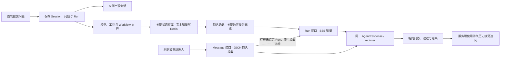
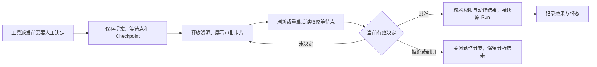

# PRD｜第 19 课｜完整运行持久化与 Human in the Loop

> Feature 985 · M5 · 状态 `draft` · 负责人 andy · Profile `standard` · 更新 2026-11-12

[返回需求简报](../BRIEF.md) · [项目 PRD 模板](../../_templates/PRD.tmpl.md) · [技术方案](../design/TECH_DESIGN.md) · [HITL 增量方案](../design/HITL_DESIGN.md)

本文是需求与验收标准的有效维护入口。2026-11-12 课程负责人重新明确两项交付：补齐第五篇前序课程涉及的全部必要持久化；在持久化基座上完整实现 Human in the Loop。[原始课次材料](../context/source_context.md)保持原样，本次范围按本文执行。

## 1. 背景与目标

第 15–18 课逐步建立 Agent 执行内核、受控自主循环、Workflow 和受控工具执行。当前问答、执行状态、过程节点及待保存 Workflow 草稿主要依赖浏览器或进程内存。已保存的 Workflow 资产以及模型配置、调用元记录已有数据库存储，仍需补齐它们与 Session、Run 和恢复上下文的关联。

本课完成两个目标：

1. **完整持久化与刷新恢复。** 保存 Session、Message、Agent Runtime、底层 LLM Runtime、工具、Workflow、产物及恢复所需状态，交付完整数据结构、表名规范、迁移与关联规则。用户只问一次，左侧就出现持久 Session；刷新、重新进入、服务重启后仍能打开完整会话。
2. **Human in the Loop。** 在前一课工具派发门禁和执行策略上补齐人工等待、批准、拒绝、到期、暂停、取消和原 Run 接续，单独形成增量技术方案。

**首要验收：逐个执行前序案例 → 等待结果 → 刷新页面 → 从左侧打开同一 Session → 核对问答、过程、工具、产物和终态全部保留。** Run 流式接口与 Message 非流式持久加载接口使用同一响应 Schema、业务数据包和前端 reducer；刷新不触发模型、工具或 Workflow 再执行。

本文将底层模型执行层统一称为 **LLM Runtime**，对应 `compass_agent/llm` 与 `models`；本次口述中的“ARM runtime”按该上下文承接。

## 2. 用户与场景

| 用户故事 | 场景                   | 预期结果                                           | 关联需求                                |
| -------- | ---------------------- | -------------------------------------------------- | --------------------------------------- |
| US-01    | 分析员第一次提问后刷新 | 左侧存在该会话，问题、结果与状态完整可读           | FR-09、FR-10、FR-13                     |
| US-02    | 查看前序案例或继续追问 | 过程、产物、计划和关联信息保留；追问使用服务端历史 | FR-01、FR-08、FR-10–FR-14               |
| US-03    | 执行中刷新或网络重连   | 恢复已提交过程并继续接收新增事件，原任务保持执行   | FR-02、FR-03、FR-13                     |
| US-04    | 审批人处理提案         | 查看原提案，批准或拒绝；刷新后决定与执行结果一致   | FR-04–FR-07                             |
| US-05    | 开发者重启服务         | 查询运行各层数据，接续有效边界，已完成调用不重复   | FR-01–FR-03、FR-05、FR-11、FR-12、FR-15 |

## 3. 总体流程

### BF-01｜提问、持久化、刷新与追问



首问受理后即保存 Session，空白输入页不创建空会话。成功、失败和取消都保留提交及已提交过程。浏览器断线只停止订阅；“取消执行”明确表达停止任务的意图。

### BF-02｜持久人工等待与接续



## 4. 功能需求

保留原 FR-01～FR-08 编号和有效要求，FR-09 起补齐本次范围。

| 编号  | 触发与输入                            | 行为及可观察结果                                                                                                                                         |
| ----- | ------------------------------------- | -------------------------------------------------------------------------------------------------------------------------------------------------------- |
| FR-01 | 创建、推进或查询 Run                  | 保存 Session → Run → Step → Attempt，以及 Message、模型/工具调用、Workflow/Skill/SubAgent、关键变化与产物的关系；可沿同一 Run 查询各层状态。             |
| FR-02 | 创建、执行、等待、暂停、取消、结束    | 保存状态、版本及原因，拒绝非法转换和过期更新；终态、失败和取消记录持续可读。                                                                             |
| FR-03 | 推进边界或接续                        | 保存关键变化与 Checkpoint，包括上下文、计划、Verifier、预算、执行位置和未决调用；重复发布去重，Resume 复用已完成结果。                                   |
| FR-04 | 工具/Workflow 需要人工决定或受信事件  | 创建持久等待点并释放资源；核验主体、范围、提案版本、期限与关联；覆盖批准、拒绝、到期、错配和重复回调。                                                   |
| FR-05 | Pause、Resume、Cancel                 | 暂停停在有效边界，恢复沿用原 Run；取消受理后禁止后继派发，保存清理结果。刷新与控制操作分离。                                                             |
| FR-06 | 获批动作执行或回执中断                | 稳定 Action ID 贯穿审批、执行和核对；课堂受控动作至多产生一次效果，未知结果进入待核对。                                                                  |
| FR-07 | 查看分析过程                          | 实时增量与持久投影均能恢复执行树、旁白、父子/并行关系、尝试、等待、审批和终态；最小 Timeline 保留实际展示的历史。                                        |
| FR-08 | 生成/读取 CSV、图表及有界产物         | 保存真实内容、摘要、原 ID、来源和授权范围；刷新及重启后可读取下载；提交成功后发布可用引用。                                                              |
| FR-09 | 首问、重新进入、切换会话              | 保存 Session 标题、所有者、租户、工作区和活动时间；左侧显示真实列表，一次提问即可形成会话；稳定地址恢复选中项，按活动时间分页，支持新建分析。            |
| FR-10 | 多轮对话、刷新后追问                  | 保存用户消息、助手正文和各层运行消息，区分公开展示和内部上下文；服务端使用持久历史组装输入，保留原截取规则及显式上下文重置边界。                         |
| FR-11 | 路由、生成、重试、Fallback、中断      | 复用模型配置和调用元记录，补齐 Run/Step 关联、每次模型 Attempt 的派发与结局、用量/成本及必要输入输出；重启后仍可核对已派发与未知结局。                   |
| FR-12 | 工具、计划、Workflow、Skill、SubAgent | 保存本 Run 工具目录/版本、参数/结果、批次、资源回执；保存计划/Verifier/预算、脚本与 Skill 版本、位置、子调用关系及待保存 Workflow 草稿。原资产继续复用。 |
| FR-13 | 首次展示、刷新、切换或重连            | Run 接口返回流式增量，Message 接口以非流式 JSON 加载持久内容；两者响应均为同版 AgentResponse，复用业务包、校验器、reducer 和渲染组件。                   |
| FR-14 | 前序案例验收                          | 逐个验证第 15–18 课承诺案例的完整持久化、刷新一致、重启可读和必要恢复，覆盖成功、失败、取消、并行与等待。                                                |
| FR-15 | 数据库实施与发布                      | 交付对象清单、字段、类型、关系、索引、约束、命名及生命周期；按 agent/main 交付完整/增量 SQL，保留旧配置与数据。                                          |
| FR-16 | 本机启动、运行续流、投影与恢复        | 引入本地 Docker Redis Streams，命名卷与 AOF 持久化；高频增量短期保留，完整消息/展示状态批量写库，关键边界强制提交，覆盖发布失败补发和保卷重启。          |

既有行为变化：内存问答改为服务端历史；会话列表空占位改为真实列表；断线不再触发业务取消；RunRegistry 只保留活跃句柄；Message 历史加载与 Run 实时输出共用响应协议。模型管理、已保存 Workflow 资产和原分析能力继续适用。

## 5. 界面与交互

遵循 [UI 样式规范](../../../docs/ui-style-guide.md)，复用 AppShell、AnalysisComposer、AnalysisRunTurn、UiExecutionTree 和 UiCodeBlock。以下为拟议布局，产品验收待实施。

```text
┌─────────────────────┬──────────────────────────────────────┐
│ 新建分析             │ 本周 GMV 为什么下降？                 │
│ 分析会话             │ 用户问题                              │
│ ● 本周 GMV 为什么…   │ 分析过程 ▾                            │
│   已完成 · 今天      │   计划 / 模型 / 工具 / Workflow        │
│   渠道表现对比       │   参数、摘要、图表及下载                │
│   等待确认 · 今天    │                                      │
│ 加载更多             │ [待确认提案、影响、期限]                │
│                     │ [批准并继续] [拒绝]                    │
│                     │ 最终回答                              │
│                     │ [继续提问…]                   [发送]   │
└─────────────────────┴──────────────────────────────────────┘
```

| 区域       | 行为与状态                                                                                                                                 | 关联         |
| ---------- | ------------------------------------------------------------------------------------------------------------------------------------------ | ------------ |
| 左侧列表   | 受理首问即显示，默认标题取首问前 40 个字符，完整标题供辅助阅读；按业务活动排序，刷新重新读取，分页保留已加载项。“按主题”占位入口本期隐藏。 | FR-09        |
| 内容区     | 通过 Message 加载持久内容，直接呈现已保存正文和过程；有未结束 Run 时按加载游标订阅流。历史加载不逐字动画、不抢焦点，过程默认折叠。         | FR-07、FR-13 |
| 运行中     | 重连显示同步状态，保留原内容；切换会话仅关闭订阅。                                                                                         | FR-02、FR-13 |
| 审批卡片   | 展示动作、作用范围、参数摘要、期限与结果；提交期间禁用；已决定或失效保持可读；失败保留提案。                                               | FR-04、FR-06 |
| 输入与控制 | 同一 Session 存在非终态 Run 时禁止下一轮；保留相应暂停、恢复、取消操作。新建分析进入空白页；上下文重置保存服务端边界，历史继续可读。       | FR-05、FR-10 |

390 px 下列表沿用侧栏，按钮换行，代码和图表局部滚动。会话项使用链接和选中标记，列表、折叠、审批、控制均可键盘操作。刷新不自动聚焦审批按钮；弹层按原规范管理焦点。

| 文案 ID | 位置              | 文案                                                      |
| ------- | ----------------- | --------------------------------------------------------- |
| COPY-01 | 列表加载/空/失败  | 正在加载会话 / 暂无分析会话 / 会话加载失败，请重试        |
| COPY-02 | 内容加载/重连     | 正在恢复会话 / 正在同步执行进度                           |
| COPY-03 | 审批              | 等待你的确认 / 批准并继续 / 拒绝                          |
| COPY-04 | 决定后            | 已批准 / 已拒绝 / 确认已过期                              |
| COPY-05 | 重启后可恢复      | 执行已中断，可从已保存位置继续 / 继续执行                 |
| COPY-06 | 未知结果/恢复失败 | 执行结果待核对，请稍后重试 / 暂时无法恢复，请查看执行详情 |
| COPY-07 | 保存/读取失败     | 保存失败，请重试 / 内容加载失败，请重试                   |
| COPY-08 | 无访问权限        | 当前无法访问此会话                                        |

## 6. 业务规则与约束

| 规则  | 内容                                                                                                                                                                                                        |
| ----- | ----------------------------------------------------------------------------------------------------------------------------------------------------------------------------------------------------------- |
| BR-01 | Agent 拥有分析 Session、消息和运行数据；Web 拥有登录 Session、账户与权限。外部身份以逻辑 ID 关联，跨 app 使用 API。                                                                                         |
| BR-02 | 保留 Created、Running、Waiting、Paused、Cancelling、Completed、Failed、Cancelled 生命周期；转换校验版本和执行权，终态不可逆；清理未知独立记录并持续可见。                                                   |
| BR-03 | 公开对象有稳定 ID/revision，运行增量按 Redis Stream ID 排序，发送前取得持久确认；关键业务变化与 Outbox 同事务保存，关键包在完整投影提交后发布。公开消息/展示投影与投影游标同事务更新。                      |
| BR-04 | Checkpoint 保存执行位置、结果引用、上下文、未决调用与预算。Resume 接续原 Run，Retry 新建当前步骤 Attempt；网络连接和进程句柄按新生命周期重建。                                                              |
| BR-05 | 决定绑定 Run、等待点、提案版本和决定 ID；执行前核验当前授权；参数变更重新提案。                                                                                                                             |
| BR-06 | Waiting 释放资源；拒绝和到期关闭动作分支；错配、越权不消费等待点；同一决定重放返回原结果。                                                                                                                  |
| BR-07 | Pause 停在有效边界；Cancel 受理后禁止新派发。竞态按提交顺序收口；刷新、断线和切换不发业务 Cancel。                                                                                                          |
| BR-08 | 已提交效果按同一 Action ID 核对；未知效果保持待核对，非幂等远程调用禁止自动重放。                                                                                                                           |
| BR-09 | 产物内容持久可读后才发布引用；同 ID 不覆盖不同内容；有效 Checkpoint 依赖期间保留；读取校验当前 Session 和数据范围权限。                                                                                     |
| BR-10 | 首问的 Session、用户消息、Run、初始展示投影和首批关键 Outbox 原子受理；重试沿用请求 ID。失败不产生空会话，重复不产生第二个 Run。                                                                            |
| BR-11 | 公开事件保存获准展示内容；内部消息、完整工具观察和私有续接数据保存在受控恢复存储，禁止进入公开流或日志；读取校验当前权限。                                                                                  |
| BR-12 | Run 增量和 Message 完整内容包经同一 reducer 产生相同业务视图：回答、顺序、节点/revision、计划、脚本、产物和终态一致。网络状态、滚动位置和本地展开偏好不计入比较。                                           |
| BR-13 | 追问从服务端当前 Session 已完成问答构建，遵守原上下文上限和重置规则；客户端不回传权威历史。失败/取消记录保留展示，默认不进入模型历史。                                                                      |
| BR-14 | 会话、运行业务记录和完整展示投影持续保留。终态 Run 的短期流记录可在投影完整及重连保留期结束后清理，刷新继续从 Message 加载。临时凭据、连接和工作卷独立管理；Workflow 保存邀请到期仍保留展示记录并禁用保存。 |

| 非功能要求 | 验收口径                                                                                                                                                       |
| ---------- | -------------------------------------------------------------------------------------------------------------------------------------------------------------- |
| NFR-01     | 清空浏览器内存、实际重启 Web/Agent、清理原 Sandbox 后，已提交数据仍可读取；执行恢复以真实进程重启验证。                                                        |
| NFR-02     | 真 PostgreSQL 验证空库、旧库、完整/增量 SQL、最小权限与备份恢复，保留模型、数据连接和 Workflow 数据。                                                          |
| NFR-03     | 会话默认仅当前用户/租户/工作区可见；审批人按明确授权访问提案；覆盖越权、撤权和内部数据泄露。                                                                   |
| NFR-04     | Message JSON 与 Run SSE 共用一套响应协议和 reducer；历史分页、流背压和游标过期后的重新加载保持内容完整。                                                       |
| NFR-05     | 桌面、390 px、键盘、加载、空、失败、等待与禁用遵循现有 UI 规范。                                                                                               |
| NFR-06     | 本地 Redis 配置 AOF always、命名卷和 noeviction；已确认流在保卷重启后可补投影。活跃流不按 TTL 淘汰，终态投影完成后保留 1 小时；磁盘/卷永久丢失时明确恢复受阻。 |

## 7. 范围与前置依赖

| 前序能力                          | 本课必须保存及恢复                                                                                |
| --------------------------------- | ------------------------------------------------------------------------------------------------- |
| 第四篇被 Agent 使用的 LLM Runtime | 路由/模型绑定、逻辑调用及实际 Attempt、重试/Fallback、必要输入输出、用量/成本、续接数据和未知结局 |
| 第 15 课执行内核                  | 首问、多轮消息、Run/Step、工具结果、最终回答与 CSV                                                |
| 第 16 课受控自主                  | 计划/Todo、Verifier、观察、预算、停止原因和成功/失败过程                                          |
| 第 17 课混合编排                  | Workflow/Skill/SubAgent 源版本、脚本、父子/并行关系、已完成子结果、待保存草稿及资产引用           |
| 第 18 课工具执行                  | 本 Run 工具目录、MCP 映射/版本、策略、参数/结果、Sandbox 分配/清理回执、产物字节和来源            |

第 18 课工具/Sandbox 当前仍有待实现方案，本课按最终交付合同接入并验收。单进程任务脱离 SSE 连接执行、本地 Docker Redis、流持久确认与批量投影均属于本课必要能力。第 20 课承接同一存储、Message/Run 接口及响应协议，增加 Queue、Worker、Lease、自动失联发现与接管、多租户调度和容量治理。长期记忆、通用知识文件管理和真实广告生产系统接入留在后续范围。

## 8. 验收标准

### 运行与 HITL：保留原验收编号

| ID    | Given / When                                            | Then 与验证方式                                                           |
| ----- | ------------------------------------------------------- | ------------------------------------------------------------------------- |
| AC-01 | 同一 Run 有步骤重试，重复交付已记录事件                 | 各 Attempt、产物、Checkpoint 可查，事件不重复推进；真库对照关系及计数。   |
| AC-02 | 两个控制请求使用同一版本，另恢复已终态 Run              | 仅合法版本生效，冲突可区分，终态不变，状态和事件一致。                    |
| AC-03 | GMV 图表已保存、原 Sandbox 已清理、Run 等待；重启后批准 | 原等待点和 Run 接续，图表原 ID/字节/来源一致，诊断工具调用数不增加。      |
| AC-04 | 拒绝、到期、重复批准、错配、跨租户、撤权及受信事件      | 拒绝/到期关闭动作分支；重复仅消费一次；错配不推进，执行前撤权无新增效果。 |
| AC-05 | 运行中暂停、恢复、取消，另提供损坏或不兼容 Checkpoint   | 恢复同 Run；取消保留过程；无效恢复明确报错且不重跑已完成步骤。            |
| AC-06 | 动作已生效，在 Run 回执保存前杀死进程                   | 重启按原 Action ID 补回执，效果次数为 1；未知效果保持待核对。             |
| AC-07 | 空库和包含旧模型/调用/连接/Workflow 数据的旧库升级      | 迁移、SQL 一致性、权限与恢复检查通过；旧数据可用；越权失败。              |
| AC-08 | 重复产物、写入失败、内容损坏和越权读取                  | 同 ID 同内容复用、冲突拒绝；失败不发布可用引用，缺失产物不推进依赖步骤。  |

### 完整持久化与刷新一致性

| ID    | Given / When                                                     | Then 与验证方式                                                                                                                                                                                 |
| ----- | ---------------------------------------------------------------- | ----------------------------------------------------------------------------------------------------------------------------------------------------------------------------------------------- |
| AC-09 | 只提交一个问题，在受理后、成功后和失败后分别刷新                 | 左侧保留一个 Session，问题及状态可见，原地址选中同一会话；同 requestId 重试仍只有一个 Run。                                                                                                     |
| AC-10 | 完成各前序案例并记录末帧视图；清理短期流后刷新加载 Message       | Message JSON 与 Run 每帧 data 通过同一响应 Schema；同一 reducer 得到逐字段相同的回答、过程、版本、脚本、产物和终态，模型/工具调用数不增加。                                                     |
| AC-11 | 模型、工具或并行 Workflow 执行中断线、重连                       | 原 Run 继续；Message 加载游标与 Run 增量无遗漏或重复。短暂断线直接续流，游标过期重新加载 Message；覆盖加载期间仍在输出。                                                                        |
| AC-12 | 同一 Session 两轮完成后刷新追问；另保存上下文重置边界            | 服务端历史引用正确，重置不带旧上下文，其他 Session/用户内容不进入输入。                                                                                                                         |
| AC-13 | 路由、重试、Fallback、部分输出和模型派发后崩溃                   | 每次派发有持久 Attempt，可关联 Run/Step；结局、用量及未知项可查，预算不重置，未知用量不按零处理。                                                                                               |
| AC-14 | 计划经历更新、验证失败、成功或预算停止                           | 刷新后计划版本、Todo、Verifier 和停止原因一致；Checkpoint 包含恢复所需观察与预算。                                                                                                              |
| AC-15 | Workflow 串行/并行、Skill、SubAgent 和待保存脚本案例             | 源版本、关系和结果保留；有效草稿可保存一次，已保存卡片恢复，过期显示失效；接续不重复完成的子调用。                                                                                              |
| AC-16 | 内置/MCP/Sandbox 工具分别产生结果、文件或未知结局                | 重启后目录版本、调用 ID、参数/结果、资源回执、文件可查；目录变化与未知副作用阻止盲目重放。                                                                                                      |
| AC-17 | Redis 写入、SQL 投影或关键事务失败，或提交后发送前退出           | 未确认文本和未提交完成投影的成功状态不输出；已确认流可补投影，关键 Outbox 可补发；完整结果先落库再发布终态，原有效 Checkpoint 保留。                                                            |
| AC-18 | 长历史跨批次；重复、乱序、错误游标和读取期间撤权                 | Message 分页完整；Run 增量去重、非法游标拒绝、过期游标触发 Message 重载；两类接口均校验权限，桌面、390 px、键盘操作可用。                                                                       |
| AC-19 | 本地 Docker Redis 保卷重启、发布中断、写满、投影落后及终态流过期 | 已确认增量恢复、Outbox 补发幂等、已完成调用不重复；写入失败停止新派发，活跃尾部保留；终态流过期后 Message 独立恢复完整视图。隔离测试中模拟活跃流丢失须明确受阻；文本增长不产生等量 SQL 事件行。 |

每个前序案例登记模式、Session/Run ID、对应 AC、刷新视图比较与当前结果。静态协议示例单列，前置能力未实现的案例保持待验。全部必需案例通过后完成验收。

## 9. 研发入口与状态

[实施上下文](../context/implementation_context.md)、[持久化方案](../design/TECH_DESIGN.md)、[完整数据设计](../design/DATA_DESIGN.md)、[Redis 与本地部署](../design/REDIS_DESIGN.md)、[HITL 增量方案](../design/HITL_DESIGN.md)、[代码设计](../design/CODE_DESIGN.md)承接本文。范围已按本次指示明确；技术方案待评审，迁移、产品实现及业务验收待实施。

| 日期       | 变更                                                                                                           |
| ---------- | -------------------------------------------------------------------------------------------------------------- |
| 2026-11-10 | 明确持久运行、产物保存及重启复用。                                                                             |
| 2026-11-12 | 扩展为前序案例完整持久化；增加 Session/Message/LLM/工具/Workflow 覆盖、双接口同协议及刷新验收；HITL 独立设计。 |

2026-11-12 接口澄清：Message 为非流式持久化加载，Run 为流式运行输出；两者的响应业务结构保持一致。数据库保存完整可恢复内容，无需永久保留逐字包的原始拆分。

2026-11-12 存储决定：Redis 纳入本课必选本地 Docker 依赖。Streams 短期保存增量，数据库保存完整投影和关键业务记录；原全量 SQL 事件表改为关键 Outbox，按 AC-19 验证 Redis 与投影恢复。
