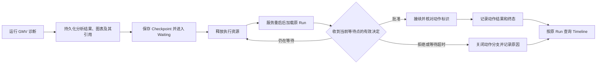

# PRD｜第 19 课｜从内存循环到持久运行：构建 Run State、Checkpoint 与 Human-in-the-Loop

> Feature 985 · M5 · 状态 `draft` · 负责人 andy · Profile `standard`

[返回需求简报](../BRIEF.md) · [项目 PRD 模板](../../_templates/PRD.tmpl.md)

本文是本 Feature 的需求与验收维护入口。课次范围与工程约束分别登记在 [原始上下文](../context/source_context.md) 和 [实施上下文](../context/implementation_context.md)。

## 1. 背景与目标

本课以第 17 课的人工决策等待语义和第 18 课的 Action Adapter、Tool Execution Event、Artifact 为前置。经营分析进入审批等待后，审批可能在另一个请求中到达，原进程也可能已经退出。本课让同一个 Run 从持久状态继续，并保留关键动作的执行结果。

- 用稳定的 Run、Step、Attempt 标识和运行状态机查询进度，保留事件与 Checkpoint。
- 让广告预算建议进入可跨进程保留的审批等待，释放执行资源，经授权决定后推进。
- 从 Step 边界恢复原 Run。持久化已完成步骤所需的 Artifact 文件内容和元数据，重启后凭原引用继续读取，并以稳定动作标识核对外部效果。
- 通过最小 Run Timeline 解释一次审批、恢复和动作结果。

## 2. 用户与场景

| 用户故事 ID | 目标用户         | 触发场景                     | 用户故事                                                                               | 关联需求                                 |
| ----------- | ---------------- | ---------------------------- | -------------------------------------------------------------------------------------- | ---------------------------------------- |
| US-01       | 经营分析员       | GMV 诊断提出广告预算建议     | 我希望分析进入审批等待，稍后能查看同一个 Run 的状态和结果。                            | FR-01、FR-02、FR-04、FR-07               |
| US-02       | 有权限的审批人   | 收到当前建议的待决请求       | 我希望按原提案批准或拒绝，并查到本次决定处理结果。                                     | FR-04、FR-05、FR-07                      |
| US-03       | 开发者或运维人员 | Run 暂停、执行取消或服务重启 | 我希望从保存位置接续，复用已完成步骤生成的产物，并在 Timeline 核对恢复位置和动作效果。 | FR-02、FR-03、FR-05、FR-06、FR-07、FR-08 |

## 3. 总体业务流程

### BF-01｜GMV 诊断、审批与重启接续

经营分析员启动 GMV 诊断，Agent 保存已完成步骤、图表内容、产物引用和行动提案。Workflow 在人工决策点登记待决事项和 Checkpoint，进入 Waiting。审批人随后通过已授权入口提交决定。

恢复可以发生在等待期间，也可以发生在动作提交前后。Waiting 状态持久存在，审批通过后才具备推进动作分支的条件。恢复时按需读取已完成步骤的持久产物，并在推进动作前核对动作记录。关联 FR-03 至 FR-08。

## 4. 功能需求

### 4.1 新增需求

| 需求编号 | 触发条件                                         | 输入                                                                     | 预期行为                                                                                                                                                      | 可观察结果                                                                                                                     | 关联                        |
| -------- | ------------------------------------------------ | ------------------------------------------------------------------------ | ------------------------------------------------------------------------------------------------------------------------------------------------------------- | ------------------------------------------------------------------------------------------------------------------------------ | --------------------------- |
| FR-01    | 执行器建立或推进一次任务                         | Session、任务、租户和工作空间、执行上下文                                | 建立 Session → Run → Task / Step → Attempt → Action / Event 的关联。Step 或 Attempt 关联执行结果和 Artifact 引用，Checkpoint 关联 Run 与执行边界。            | 可从同一个 Run 查询步骤、尝试、动作、事件与产物引用。                                                                          | BR-01                       |
| FR-02    | Run 创建、推进、受控停止或结束                   | Run ID、当前状态与预期版本                                               | 通过 Run State Store 持久化状态、版本和原因，按状态机处理请求，拒绝非法或过期写入。                                                                           | 调用方读到已提交状态与版本。冲突返回可判定结果，终态保留。                                                                     | BR-02                       |
| FR-03    | Step 边界、暂停或进入外部等待                    | 当前执行位置、已完成结果、待执行或等待上下文                             | Event Store 记录关键状态与动作事件并去重。Checkpoint Store 保存可恢复执行位置及上下文，支持重启后从有效边界接续。                                             | 原 Run 的 Checkpoint、Step 结果与事件可读。重复事件不会推进状态。                                                              | BR-03、BR-04                |
| FR-04    | Workflow 到达 Human Decision Node 或外部等待点   | Run、等待点、提案或预期事件的关联标识                                    | 持久化等待信息并释放执行资源。校验回调主体、作用域、关联和有效期，有效决定消费同一个待决点。                                                                  | 等待、批准、拒绝、超时、过期和重复回调的结果可区分。只有符合条件的分支继续。                                                   | BR-05、BR-06                |
| FR-05    | 收到 Pause、Resume 或 Cancel 控制请求            | Run ID、授权主体、运行状态、控制意图                                     | 在允许的状态处理暂停、继续或取消。Resume 读取有效 Checkpoint。Cancel 确认后停止后续步骤推进，并在当前处理收口后结束。                                         | 同一 Run 继续或进入对应状态，保留已有执行记录。                                                                                | BR-02、BR-04、BR-07         |
| FR-06    | 有副作用的获批步骤即将执行或从中断恢复           | 稳定 Action ID、获批提案引用、执行结果记录                               | 以稳定 Action ID 核对受控适配器的执行结果。确认已提交时复用结果，确认尚未提交且授权有效时按同一标识执行。无法确认时保持可核对的待处理状态。                   | 重启或重试后可查到动作最终效果，同一获批动作至多产生一次业务效果。                                                             | BR-05、BR-08                |
| FR-07    | 授权用户查询一次 Run                             | Run ID、访问上下文                                                       | 按执行顺序给出最小 Run Timeline，记录状态变化、Step/Attempt、等待和审批结果、暂停/恢复/取消与动作状态。                                                       | 同一条时间线可解释任务停在哪里、如何恢复、最终执行了什么。                                                                     | BR-01、BR-03、NFR-03        |
| FR-08    | 已校验的产物随 Step 提交，或恢复后的步骤请求读取 | M4 Artifact ID、文件内容、元数据、Run、Step、Attempt、来源调用和授权范围 | 由 Agent 保存实际文件内容和元数据，保留原 Artifact ID 及来源关系。Checkpoint 保存恢复所需的引用。读取时校验当前权限，文件缺失或损坏时返回可诊断的不可用状态。 | Agent 重启后，获授权步骤能凭原引用读取同一份文件并继续执行。重复提交同一产物可查到同一记录，未持久化成功的产物不会显示为可用。 | BR-04、BR-09、NFR-01–NFR-03 |

### 4.2 变更需求

M3 的进程内人工等待语义接入 M5 的持久等待和恢复。M4 的 Action Adapter 接收稳定动作标识，并提供恢复时可核对的执行结果。既有 Chat 与模型调用契约继续适用。

## 6. 业务规则与约束

| 规则 ID | 规则                                                                                                                                                                                                                                                                                                                                                                                   | 关联需求            |
| ------- | -------------------------------------------------------------------------------------------------------------------------------------------------------------------------------------------------------------------------------------------------------------------------------------------------------------------------------------------------------------------------------------- | ------------------- |
| BR-01   | Agent 拥有 Run 及运行数据。Agent 运行 Session 用于归组执行任务。Web 登录会话与身份权限归 Web 所有。跨应用以受权契约和逻辑标识关联。                                                                                                                                                                                                                                                    | FR-01、FR-07        |
| BR-02   | 创建后进入 Created。开始后为 Running，可进入 Waiting、Paused、Cancelling、Completed 或 Failed。Waiting 在匹配的决定或外部事件到达后按业务分支恢复或关闭，也可取消。Paused 可从有效 Checkpoint 恢复或取消。Created 也可接受未开始任务的取消。取消受理后进入 Cancelling，收口到 Cancelled。Completed、Failed、Cancelled 为终态。并发更新须校验当前状态与版本，过期操作不得覆盖生效结果。 | FR-02、FR-05        |
| BR-03   | 事件具有稳定标识并关联 Run，关键状态、事件与 Checkpoint 提交后可相互核对。重新投递同一事件保留一条已生效记录，Timeline 可还原执行顺序。                                                                                                                                                                                                                                                | FR-03、FR-07        |
| BR-04   | Checkpoint 至少保存执行位置、已完成结果引用和待执行或等待上下文。Resume 接续原 Run 的有效边界，Retry 在允许的策略下对当前失败步骤建立新的 Attempt。遇到缺失或无效的 Checkpoint 时返回可诊断结果，保持已提交状态和动作记录。                                                                                                                                                            | FR-03、FR-05        |
| BR-05   | 审批决定绑定到原 Run、等待点和当前提案。审批主体须在有效租户与工作空间内具备对应权限。执行前按既有权限边界核验当前授权及提案版本，拒绝越权、错配或过期请求。                                                                                                                                                                                                                           | FR-04、FR-06        |
| BR-06   | Waiting 期间释放执行资源。重复回调至多消费一次决定。有效拒绝、当前待决提案过期或等待超时，均关闭对应动作分支并保留原因。其他等待点的回调不得改变当前待决事项。                                                                                                                                                                                                                         | FR-04               |
| BR-07   | Pause 保留接续所需的进度，下一步等待显式 Resume。Cancel 与审批回调或推进并发时，以已生效的合法状态转换为准。取消受理后禁止发起后继业务动作，已提交结果仍可查询。                                                                                                                                                                                                                       | FR-02、FR-05        |
| BR-08   | 同一个逻辑动作的 Action ID 在重试、重启和恢复期间保持稳定。提交与结果记录之间发生中断时，恢复流程先核对已知效果。结果未知时进入待核对路径，保留关联标识与原因。                                                                                                                                                                                                                        | FR-06、FR-07        |
| BR-09   | 产物内容可从持久存储读取后，才可提交依赖该产物的新 Checkpoint。同一 Artifact ID 重复提交时保留原记录和内容，拒绝以同一 ID 覆盖。只要有效 Checkpoint 仍依赖该产物，就保留内容及元数据。读取须同时满足当前 Run 访问权限和产物授权范围。必需产物缺失、损坏或不可访问时，依赖它的步骤保持未执行，保留已提交记录并返回明确状态。Resume 不自动重跑已完成步骤。                               | FR-03、FR-05、FR-08 |

| 非功能 ID | 要求                                                                                                                                | 验证口径                                                                        |
| --------- | ----------------------------------------------------------------------------------------------------------------------------------- | ------------------------------------------------------------------------------- |
| NFR-01    | 运行状态和已提交的产物脱离进程与 Sandbox 生命周期，覆盖真实重启与并发控制。                                                         | 使用同一持久环境终止并重启 Agent，检查原 Run、持久记录及产物文件内容。          |
| NFR-02    | 状态存储由 Agent 管理。本期涉及 `agent/main` 数据模型增量，已有数据和模型调用链保持兼容。迁移按项目规范交付。                       | 目标 PostgreSQL 上验证空库安装、旧库升级、角色权限、受管 SQL 生成一致性和恢复。 |
| NFR-03    | 运行与审批查询按租户和工作空间授权。产物读取同时校验其授权范围。Timeline 输出安全状态、标识和摘要，敏感正文及凭据留在相应受控存储。 | 检查跨租户、跨工作空间、权限撤销后的产物读取及事件对外字段。                    |

## 7. 范围与边界

- **本课交付**　M5 Durable Agent Runtime、统一状态机、Step 边界的 Event / Checkpoint / Resume、HITL 与最小 Run Timeline。Agent 管理运行数据、状态转换，以及原 Run 产物的文件内容、元数据和授权读取。产物元数据随运行数据按 `agent/main` 的迁移规范管理，文件内容存储方式在技术设计中确定。
- **前置能力**　复用 M1 的 Agent 执行契约、M3 的人工决策等待语义、M4 的工具执行、Artifact 与 Action Adapter。模型、工具和动作继续按各自接口执行。
- **本课边界**　M5 提供从持久位置接续原 Run 的状态与控制入口。工具后端的实际终止与清理由 M4 执行，Queue/Worker 的自动接管、异步提交和客户端事件续流由 M6 交付。提示词资产管理、生产 Action 治理和跨任务长期记忆留在后续范围。
- **课堂演示与验收**　用合成 Retail 数据生成 GMV 图表和受控广告预算提案，保存等待点并释放资源。终止并重启 Agent 后提交有效审批，从原 Run 的 Checkpoint 接续，并凭原引用读取图表。核对已完成步骤未重跑、重复审批不二次推进、动作回执中断可核对。对应 AC-03 至 AC-06 和 AC-08。
- **选型范围**　比较关系数据库状态机、框架 Checkpointer 和持久工作流引擎。Step 边界持久化的具体实现与事务范围留在技术设计。

## 8. 研发资源

| 资源 ID | 类型     | 入口                                                                                                                      | 用途                                                                   |
| ------- | -------- | ------------------------------------------------------------------------------------------------------------------------- | ---------------------------------------------------------------------- |
| R-01    | 前置需求 | [M3 需求](../../987-lesson-17-hybrid-workflow/BRIEF.md)、[M4 PRD](../../986-lesson-18-tool-execution-sandbox/spec/PRD.md) | Workflow 等待、受控工具、Artifact 生成和动作边界。                     |
| R-02    | 现有工程 | [Agent 路由入口](../../../apps/agent/src/compass_agent/main.py)、[网络契约](../../../contracts/README.md)                 | 当前运行控制待接入 Agent。若增加 HTTP 契约，从 Agent 路由和 DTO 派生。 |
| R-03    | 现有规则 | [数据所有权与迁移](../../../docs/database-migrations.md)、[Agent 主库迁移](../../../apps/agent/db/main/README.md)         | 当前 Agent 数据库版本和数据保留要求。                                  |
| R-04    | 教学输入 | [M5 课次上下文](../context/source_context.md#课堂演示)                                                                    | 合成 GMV 诊断与广告预算提案，含审批等待和动作结果核对。                |

## 9. 验收标准

### AC-01｜同一 Run 下可查询步骤和尝试

**关联**　FR-01、FR-02、FR-03、FR-07、FR-08、BR-01、BR-03

- **Given**　合成经营分析 Session 启动一个 Run，执行有工具产物的 Step。
- **When**　同一个 Step 经允许的重试后完成，并重复交付一条已记录事件。
- **Then**　原 Run 下可查询该 Step 的不同 Attempt、Artifact 引用、最终状态及对应的 Checkpoint。重复事件未增加执行进度，Timeline 只呈现一条生效记录。
- **验证方式**　运行固定夹具，对照查询返回、持久记录和事件顺序。

### AC-02｜非法转换、并发冲突和终态保护

**关联**　FR-02、FR-05、BR-02、BR-07、NFR-01

- **Given**　两个操作读取到同一个 Run 版本。
- **When**　提交互相冲突的控制更新，再对已结束 Run 提交 Resume。
- **Then**　只有匹配当前状态与版本的转换生效，调用方可区分冲突、非法转换与已结束。已提交状态与 Timeline 一致。
- **验证方式**　并行发出控制请求，在状态存储中核对版本和事件结果。

### AC-03｜等待中的 Run 在真实重启后继续

**关联**　FR-03、FR-04、FR-05、FR-07、FR-08、BR-03、BR-04、BR-05、BR-06、BR-09、NFR-01

- **Given**　GMV 诊断生成图表和广告预算提案。图表已持久化并清理原 Sandbox，Run 进入 Waiting 并保存含原 Artifact 引用的 Checkpoint。
- **When**　确认执行资源已释放，终止原 Agent 进程并启动新进程，再由有权限的审批人批准同一提案。
- **Then**　新进程能查询原等待点，并从保存位置接续同一 Run。后续步骤凭原 Artifact ID 读取相同的图表内容和来源记录，诊断步骤未重复执行。Timeline 记录等待、批准和接续，后续可查到受控动作的结果。
- **验证方式**　实际终止并重启 Agent，对照重启前后的 Run ID、Checkpoint、Artifact ID、图表内容摘要、来源记录、诊断工具调用计数及 Timeline。

### AC-04｜审批拒绝、超时、越权与回调重放

**关联**　FR-04、FR-06、FR-07、BR-05、BR-06、NFR-03

- **Given**　一组处于 Waiting 的同租户及其他租户 Run。
- **When**　分别提交有效拒绝、过期决定、超时事件、重复批准、跨租户或权限已撤销的回调，以及批准后在动作发起前撤回执行权限。另对外部事件等待分别投递正确关联和错误关联的事件。
- **Then**　拒绝或超时可查询到关闭原因。错配、过期和越权操作不得推进任务。重复批准只消费一次。已获批动作在发起前失去权限时停止推进，适配器无新增效果。外部事件只可接续与它匹配的等待点。
- **验证方式**　逐个比较待决记录、状态、Timeline 和适配器执行计数。

### AC-05｜暂停、恢复与取消

**关联**　FR-02、FR-03、FR-05、BR-02、BR-04、BR-07

- **Given**　一个处于 Running 且已有持久 Step 结果的 Run。
- **When**　请求暂停并从有效 Checkpoint 恢复，再在后继动作获准发起前取消。
- **Then**　暂停时保留进度，恢复沿用 Run ID。取消经过 Cancelling 并结束于 Cancelled。已提交记录仍可查询，取消生效后的后继动作未发起。另测 Checkpoint 不可用时可定位失败原因并保留已有记录。
- **验证方式**　用可控 Step 边界发出控制请求，检查状态、调用计数和事件。

### AC-06｜动作已提交但回执中断

**关联**　FR-03、FR-06、FR-07、BR-04、BR-08、NFR-01

- **Given**　广告预算提案已获批，适配器已按稳定 Action ID 提交效果，Run 尚未记录执行结果。
- **When**　终止进程，启动新进程并接续原 Run。
- **Then**　恢复流程按原 Action ID 核对效果并补记结果，外部效果计数仍为一次。对适配器暂无法核对的分支，Run 保留待核对信息，后续外部动作没有启动。
- **验证方式**　在受控适配器注入提交后断点，分别检查已确认效果及结果未知的路径。

### AC-07｜应用库兼容与查询权限

**关联**　FR-01、FR-02、FR-07、BR-01、NFR-02、NFR-03

- **Given**　一个空 Agent 数据库和一个包含当前模型配置、调用记录与演示数据的旧库。
- **When**　按项目规范分别安装与升级，并以授权和未授权主体查询 Run 和 Timeline。
- **Then**　目标库结构与版本可核对，既有数据及模型调用行为可用。运行账号仅访问所属对象，跨租户查询失败且返回安全错误。迁移与恢复达到项目规范中适用的验证要求。
- **验证方式**　在目标 PostgreSQL 执行受管迁移、SQL 和恢复检查，回归既有模型与 Agent smoke 链路。

### AC-08｜产物重复提交、缺失与越权读取

**关联**　FR-03、FR-05、FR-08、BR-09、NFR-01、NFR-03

- **Given**　一个已持久化图表的 Run 和一个等待提交新产物的 Step。
- **When**　分别重复提交原图表、在提交新产物时注入文件写入失败、在恢复前移除或损坏 Checkpoint 所需的图表，并以其他租户、其他工作空间和权限已撤销的主体尝试读取图表。
- **Then**　重复提交只保留同一条可用记录及原内容。写入失败时没有新的可用引用或依赖它的有效 Checkpoint。恢复所需产物缺失或损坏时返回明确状态，依赖步骤未推进，已完成步骤未重跑。越权请求无法读取文件。
- **验证方式**　注入存储故障并核对产物记录、原文件、Checkpoint、调用计数及授权读取结果。

## 待确认事项

| 问题                                                          | 影响范围                   | 状态           |
| ------------------------------------------------------------- | -------------------------- | -------------- |
| Step 边界持久化的组件、事务写入范围、迁移目标版本和恢复方案。 | FR-02、FR-03、NFR-02       | 技术设计确认。 |
| 审批凭据、权限映射、过期时间与回调协议。                      | FR-04、BR-05、BR-06        | 技术设计确认。 |
| Action ID 的生成方式、受控适配器的结果核对协议与待核对处置。  | FR-06、BR-08               | 技术设计确认。 |
| 运行控制入口和 Timeline 演示方式。                            | FR-05、FR-07               | 技术设计确认。 |
| 产物内容存储、完整性校验、提交失败的补偿、保留和清理策略。    | FR-08、BR-09、AC-03、AC-08 | 技术设计确认。 |

## 变更记录

| 日期       | 变更                                               | 范围 |
| ---------- | -------------------------------------------------- | ---- |
| 2026-11-10 | 补充持久运行与后台接管的职责边界和重启演示路径     | M5   |
| 2026-11-10 | 增加产物内容与引用持久化、重启复用及故障和权限验收 | M5   |
