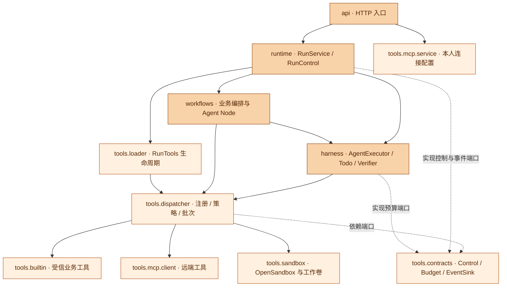
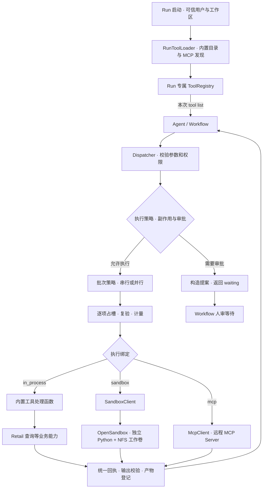
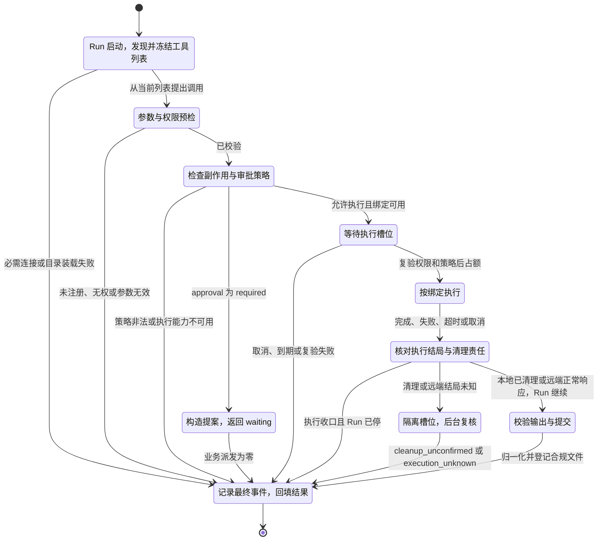
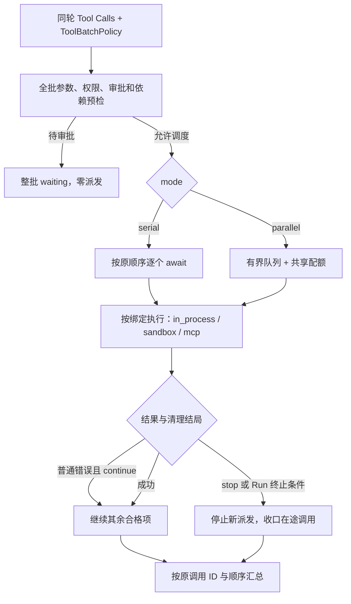
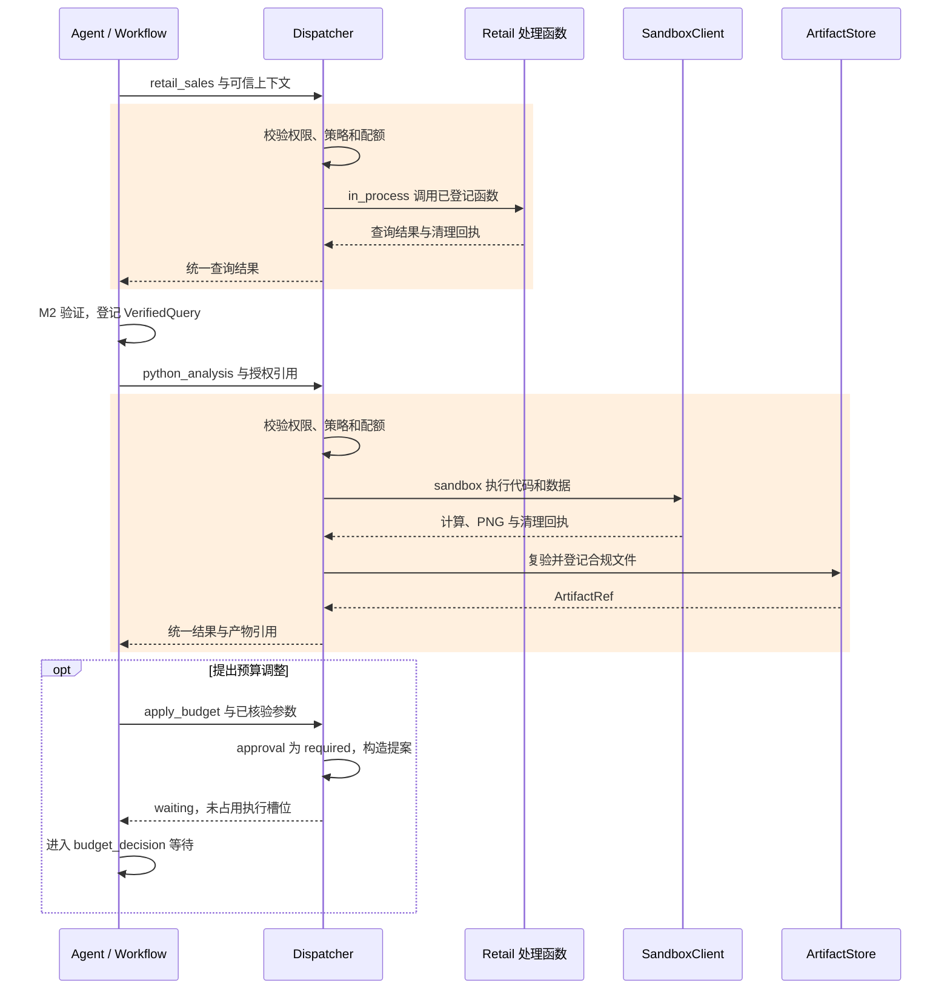
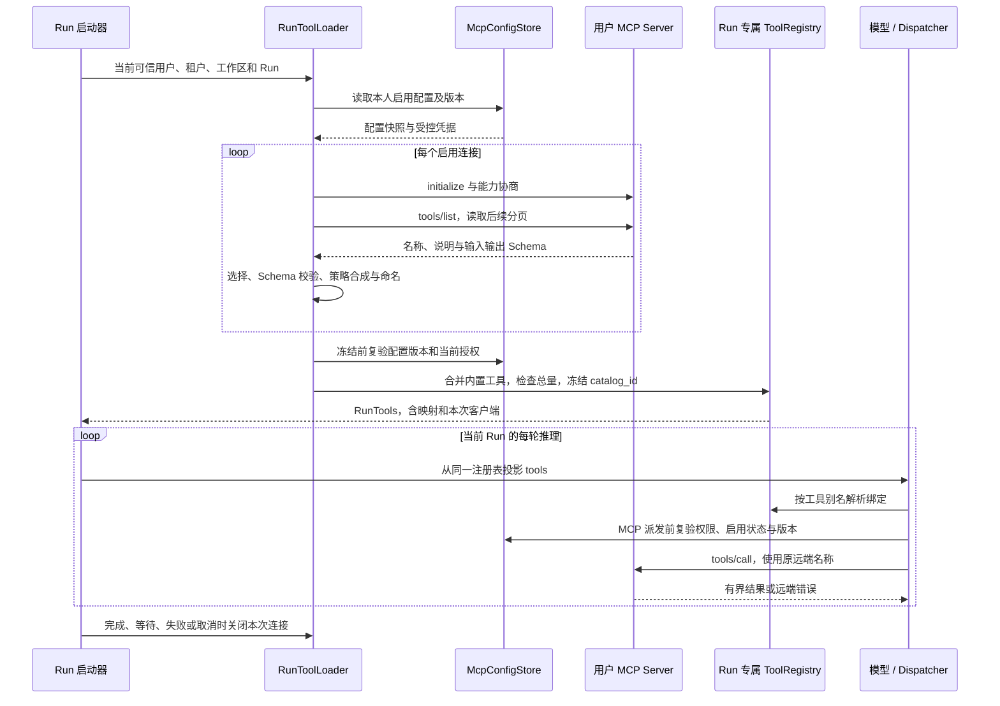
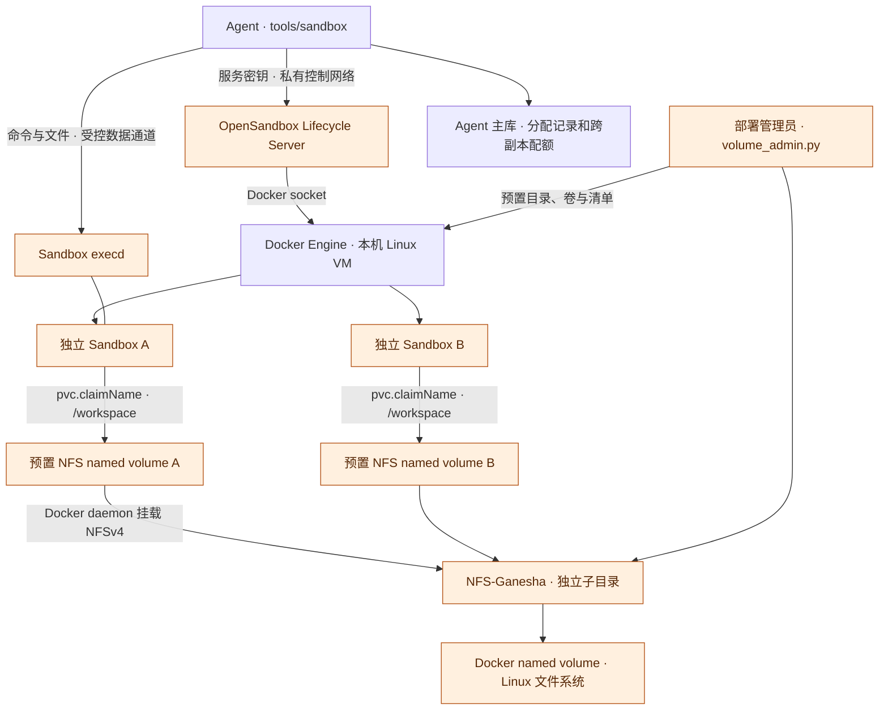
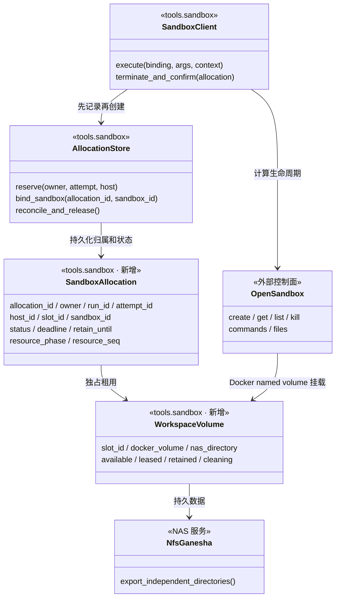
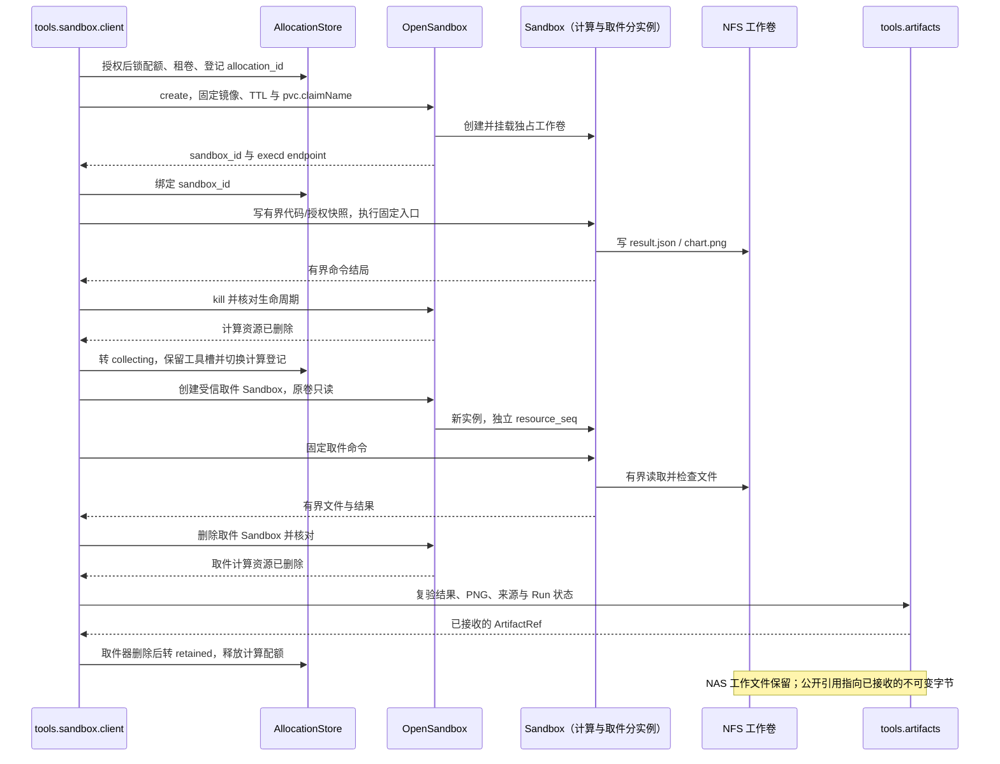

# 第 18 课 · 统一工具执行、MCP 与 Sandbox 技术方案

[需求简报](../BRIEF.md) · [有效 PRD](../spec/PRD.md) · [标准模板](../../_templates/TECH_DESIGN.tmpl.md) · [第 17 课方案](../../987-lesson-17-hybrid-workflow/design/TECH_DESIGN.md) · [Sandbox 选型 ADR](../../../docs/adr/0003-tool-sandbox.md)

> Feature 986 · Profile `standard` · 待评审 · 2026-11-12 · 代码基线 `9b6220525f25` 与当前工作区的 M1–M3 Runtime。

## 需求依据与验收

以 [FR-01～FR-09、BR-01～BR-11、NFR-01～NFR-04 和 AC-01～AC-13](../spec/PRD.md) 为准。沿用 M3 的外层 Run 收口、Agent Node 和 `RunWaiting`。当前 [retail.py](../../../apps/agent/src/compass_agent/tools/builtin/retail/handler.py) 已有固定参数化 SQL、身份复验和取消清理。现有 [artifact.py](../../../apps/agent/src/compass_agent/tools/builtin/export.py) 负责 M1 的有界 CSV。新图表产物通过统一执行层交给分析流程，既有 CSV 仍按原契约交付。当前工程尚无 MCP 接入；本次增加用户连接配置、任务启动发现与 Run 专属工具列表。现有 `generate_input` 使用固定工具和 `extra_tools` 拼接，本课改为从同一 Run 注册表投影声明，沿用单次最多 16 个工具的模型契约。

## 1. 方案概述

统一执行层分别描述执行绑定、单工具策略和批次调度策略。执行绑定描述工具处理器在哪里运行，单工具策略描述副作用范围与审批要求，批次策略控制串行/并行和失败处理。Retail 查询是受信的系统内置工具，其处理函数在 Agent 进程中运行，通过受限连接调用 PostgreSQL。模型生成的 Python 交给 Sandbox，用户配置的远程工具通过 MCP 调用。每次 Run 启动时读取当前用户配置、发现 MCP 工具，与内置工具合并为本次不可变注册表。Dispatcher 先检查执行策略，再选择执行环境，并统一处理预算、结果和资源回收。

### 模块边界与依赖方向

本课把 Agent 内的职责按 `api / runtime / harness / workflows / tools` 组织。目录和代码片段均为拟议变更；当前实现仍使用前述基线路径。`llm`、`models`、`routing`、`observability` 和 `reliability` 保持各自模块。

| 模块              | 拥有的职责与类型                                                                                         | 对外入口                                     | 依赖约束                                                                     |
| ----------------- | -------------------------------------------------------------------------------------------------------- | -------------------------------------------- | ---------------------------------------------------------------------------- |
| `api/`            | HTTP 身份入口、DTO 转换、状态码、SSE 连接                                                                | `runs.py`、`mcp.py`、`models.py` 等 Router   | 调用应用服务；HTTP DTO 继续以根 `schemas.py` 为契约源                        |
| `runtime/`        | Run 启停、期限、资源收口、结果提交和事件流；`RunService`、`RunControl`、`RunWriter`                      | `service.py`                                 | 组合 Harness、Workflow 与 RunTools；协调生命周期                             |
| `harness/`        | 模型推理循环、上下文组装、Todo、Verifier、自主性预算；`AgentExecutor`、`ControlledRun`、`AutonomyBudget` | `executor.py`、`contracts.py`                | 调用模型服务和工具入口；通过注入的能力使用 Workflow，避免反向依赖            |
| `workflows/`      | 固定/动态业务流程、Agent Node、流程资产与待审提案；`HybridWorkflows`                                     | `service.py`、`catalog.py`                   | 调用 Harness 节点和工具入口；返回完成/等待结果，由 Runtime 提交              |
| `tools/`          | 注册、Run 目录装载、准入、批次调度、统一结果与产物                                                       | `loader.py`、`dispatcher.py`、`contracts.py` | 通过类型化端口取得预算、取消和事件能力；不导入 Runtime/Harness/Workflow 实现 |
| `tools/builtin/`  | Retail、受限数据查询、CSV 和 Python 分析等具体工具                                                       | 受信 handler 与注册项                        | 参数、业务授权、SQL 和结果契约归具体工具；环境通过 binding 选择              |
| `tools/mcp/`      | 连接配置、凭据用途、发现、协议客户端及绑定映射                                                           | `service.py`、`client.py`                    | MCP ORM 和 repository 留在该模块；HTTP 路由在 `api/mcp.py`                   |
| `tools/sandbox/`  | OpenSandbox SDK 封装、分配记录、工作卷租用、停止核对与清理                                               | `client.py`、`allocations.py`                | 使用固定运行配置与受管卷清单；不承担模型决策和业务审批                       |
| `deploy/sandbox/` | OpenSandbox、NFS-Ganesha、镜像、网络及工作卷预置                                                         | Compose、配置与管理员脚本                    | 运维资产，不导入 Agent 源码；Docker 权限保留在控制面与预置脚本               |



依赖箭头表示导入或调用方向。浅橙为本课新增模块边界（包含迁入的现有实现），深橙为拆分或调整的已有职责。`tools/contracts.py` 定义 `ToolControl`、`ToolBudget` 和 `ToolEventSink` 的最小协议；Runtime 的控制器和 Harness 的预算对象实现协议。工具结果通过返回值和事件端口交回调用方，工具模块内部不实例化 Run 或推理循环。

`update_todo`、`submit_answer` 等控制工具的状态逻辑保留在 `harness`。Runtime 在组装时把 Harness 提供的受信注册项交给 `tools.loader`；Workflow 同样提供流程注册项。Loader 只合并输入目录、发现 MCP、冻结注册表。业务模块注册函数是调用方提供的值，`tools` 无需导入 Harness 或 Workflow。

### 现有实现的迁移映射

| 当前文件或符号                                                                         | 本课目标位置                                                          | 拆分规则                                                                                                         |
| -------------------------------------------------------------------------------------- | --------------------------------------------------------------------- | ---------------------------------------------------------------------------------------------------------------- |
| `runtime/executor.py`                                                                  | `runtime/service.py` + `harness/executor.py` + `harness/contracts.py` | Run 外层收口进入 service；模型循环与观察处理进入 harness；`AgentState / Step / ToolResult` 成为 Harness 内部类型 |
| `runtime/context.py`、`controlled_run.py`、`autonomy.py`、`plan.py`、`verifier.py`     | `harness/` 同名文件                                                   | 保留 M2 控制语义；context 从 RunTools 取得声明，不自行拼接业务工具                                               |
| `runtime/control.py`、`stream.py`、`execution_trace.py`                                | `runtime/` 原位                                                       | 管理运行控制、流与轨迹；对 tools 提供窄端口                                                                      |
| `runtime/retail.py`、`retail_sql.py`                                                   | `tools/builtin/retail/handler.py`、`sql.py`                           | 保留受限连接、SQL、身份核验与真实取消；将 RunControl 的直接导入改为控制端口                                      |
| `runtime/database_query.py`                                                            | `tools/builtin/database.py`                                           | 受限库查询工具；复用 Retail 连接能力，不定义新的 Adapter                                                         |
| `runtime/artifact.py`                                                                  | `tools/builtin/export.py`                                             | 保留 CSV 生成合同；通用 PNG 接收与登记新增于 `tools/artifacts.py`                                                |
| `runtime/workflow_showcases.py`、`workflow_catalog.py`、`workflow_runner.py`           | `workflows/service.py`、`catalog.py`、`script.py`                     | 编排与资产执行归 Workflow；保留现有 QuickJS 编排运行器，业务工具调用转交 Dispatcher，Agent Node 调用 Harness     |
| 根 `workflow_assets.py`、`workflow_drafts.py`                                          | `workflows/assets.py`、`drafts.py`                                    | 流程业务配置与版本归属本模块                                                                                     |
| 根 `retail_connections.py`、`retail_connection_entity.py`                              | `tools/builtin/retail/connections.py`、`entities.py`                  | 受限业务连接的配置与 ORM 归对应能力                                                                              |
| 根 `run_api.py / model_api.py / retail_connection_api.py / workflow_asset_api.py`      | `api/runs.py / models.py / retail.py / workflows.py`                  | URL、DTO、委托用途与响应保持兼容；根 `main.py` 负责装配 Router                                                   |
| 原方案新增的 `runtime/tool_executor.py / tool_loader.py / mcp.py / sandbox.py`         | `tools/dispatcher.py / loader.py / mcp/client.py / sandbox/client.py` | 注册表和批次分别拆到 `registry.py / batch.py`；按职责落位                                                        |
| 原方案新增的根 `mcp_connections.py / mcp_connection_entity.py / mcp_connection_api.py` | `tools/mcp/service.py / entities.py` 与 `api/mcp.py`                  | 持久查询归 `tools/mcp/repository.py`，根目录不增加 MCP 业务文件                                                  |

实施先迁移现有职责与更新所有导入，再增加 M4 工具能力。迁移、主应用装配、Alembic 元数据和契约导出入口在同一切片更新；不长期保留两份实现或双向兼容导入。现有测试先做路径适配并保持断言，随后补模块依赖检查与本课行为用例。后续 M5/M6 在 `runtime` 增加持久运行和调度，工具后端继续归 `tools`。本次交付仅更新技术设计，源代码迁移列入实施任务。

### 整体架构



### 执行环境与执行策略

| 维度     | 类型与字段                                             | 含义                                                                                                                                                                                            |
| -------- | ------------------------------------------------------ | ----------------------------------------------------------------------------------------------------------------------------------------------------------------------------------------------- |
| 执行绑定 | `InProcessBinding` / `SandboxBinding` / `McpBinding`   | 分别绑定受信函数、固定隔离配置、当前 Run 的 MCP 连接和远端工具名。执行绑定决定调用方式与资源管理责任。                                                                                          |
| 执行策略 | `ToolPolicy(effect, approval)`                         | `effect` 为 `read_only / local_artifact / external_write / unknown`，分别表示读取业务数据、生成本次 Run 的临时产物、改变外部业务状态、远端副作用尚未确认。`approval` 独立取 `none / required`。 |
| 批次策略 | `ToolBatchPolicy(mode, max_concurrency, failure_mode)` | 控制同一轮多个调用的串行/并行、并发上限，以及普通失败后的停止或继续；由服务端节点配置决定。                                                                                                     |
| 业务身份 | `RegisteredTool.definition`、参数解析与授权            | 工具名称表达 Retail 查询、Python 分析、预算调整等业务能力。具体权限、SQL 模板及结果类型由工具维护。                                                                                             |

执行环境描述 Agent 工具处理器的宿主。Retail 处理函数在当前进程内管理连接、查询和取消，SQL 语句由 PostgreSQL 执行。内置工具也可以调用外部 HTTP API，其执行绑定仍可为 `in_process`。用户配置的 MCP Server 通过 `mcp` 绑定访问。MCP 表达远程协议接入，其服务内部可采用自己的进程或隔离环境。

| 工具或策略组合                    | 执行绑定                            | effect                         | approval        | 本课行为                                                 |
| --------------------------------- | ----------------------------------- | ------------------------------ | --------------- | -------------------------------------------------------- |
| `retail_sales`                    | `in_process`，受信 Retail 处理函数  | `read_only`                    | `none`          | 授权后执行受限查询，报告数据库取消与清理结局             |
| `python_analysis`                 | `sandbox`，固定 Python 环境         | `local_artifact`               | `none`          | 计算授权数据，生成受控 PNG                               |
| 用户配置的 MCP 工具               | `mcp`，固定连接 ID 与远端工具名     | 按本地有效配置，缺省 `unknown` | 缺省 `required` | 启动时自动发现并加入本 Run；明确授权的只读工具可直接调用 |
| `apply_budget`，M3 提案对应的动作 | M4 仅登记提案，执行绑定留待 M5 接入 | `external_write`               | `required`      | 返回 `waiting`，实际动作派发数为零                       |
| 敏感只读导出，策略组合示例        | `in_process`                        | `read_only`                    | `required`      | 同样先进入审批，说明读取权限和审批策略可以独立配置       |

本课所有 `external_write` 和 `unknown` 请求都要求审批。`read_only` 与 `local_artifact` 可按已登记策略要求审批。内置绑定由代码确定；MCP 绑定来自已鉴权的配置与本次发现结果，执行策略由本地配置和工作区限制合成，模型仅提交工具名和业务参数。使用 `in_process` 的处理函数须为系统受信代码，模型生成的代码固定交给 Sandbox。

### 关键决策

| 决策                         | 取舍                                                                                                                                                              |
| ---------------------------- | ----------------------------------------------------------------------------------------------------------------------------------------------------------------- |
| 业务工具直接注册处理函数     | Retail 的参数、受限连接、查询及取消逻辑留在业务模块，Dispatcher 通过统一签名调用。新增业务工具时登记处理函数和策略。                                              |
| 审批先于执行准入             | 需要审批时构造提案，立即返回 `waiting`。执行槽位、执行次数及 Sandbox 创建数均保持为零。M5 承接持久审批和恢复。                                                    |
| 三种实际执行绑定             | 进程内调用使用函数，Sandbox 使用持有远程客户端和执行句柄的 `SandboxClient`。MCP 使用当前 Run 专属的 `McpClient` 和映射。首版用三种类型的明确分支分发。            |
| Run 专属工具表，复用 M2 控制 | 每次任务装配内置目录与用户 MCP 工具，冻结声明和绑定。Todo、Verifier 与提交由 M2 管理。同轮调用按 `ToolBatchPolicy` 串行或有界并行，统一预检、失败处理与结果顺序。 |
| OpenSandbox + NFS-Ganesha    | 每次 Python 调用独立分配计算与工作卷；计算完成回收，NAS 文件保留 24 小时。课堂 Docker，云端 gVisor + 托管 NAS。                                                   |
| Run 内有界产物存储           | Agent 接收并校验 PNG 后发布引用，Run 结束释放。M5 将已接受的内容与 Step 一起持久化。                                                                              |

## 2. 详细设计

### 工具角色与类型 UML

绿色表示沿用，浅橙表示第 18 课拟新增，深橙表示本课扩展已有模块。`ToolPolicy` 与执行绑定是注册项的独立组成。`RetailTools` 迁入 `tools/builtin/retail`，进程内绑定持有其受信处理函数。类框中的包名对应模块图；新增类用浅橙，迁移或拆分的已有类用深橙。

```mermaid
---
config:
  class:
    nodeSpacing: 24
    rankSpacing: 45
    hideEmptyMembersBox: true
  themeCSS: |
    .m4 path[stroke=none], .m4 rect.background { fill: #fff0df !important; }
    .m4 path[fill=none] { stroke: #b45316 !important; }
    .extended path[stroke=none], .extended rect.background { fill: #f8d2a9 !important; }
    .extended path[fill=none] { stroke: #8d450f !important; }
---
classDiagram
    direction TB
    class AgentExecutor {
        <<harness · 拆分>>
        run() RunResult
    }
    class HybridWorkflows {
        <<workflows · 迁移>>
        budget_proposal() RunWaiting
    }
    class ToolCall {
        id: str
        function: ToolCallFunction
    }
    class ToolDefinition {
        <<模型声明>>
        function: ToolFunction
    }
    class ToolResult {
        <<harness · 迁移>>
        tool_call_id: str
        observation_json: str
    }
    class ToolDispatcher {
        <<tools · 新增>>
        dispatch(call, context)
        dispatch_batch(calls, policy)
    }
    class RunToolLoader {
        <<tools · 新增>>
        open(context) RunTools
        discover_and_validate()
    }
    class RunTools {
        <<tools · 新增>>
        catalog_id / config_revisions
        registry: ToolRegistry
        clients: McpClient collection
        close()
    }
    class McpConfigStore {
        <<tools.mcp · 新增>>
        load_enabled(trusted)
        recheck_revision(binding)
    }
    class ToolRegistry {
        <<tools · 新增>>
        catalog_id / frozen
        resolve(name) RegisteredTool
        visible_definitions(trusted)
    }
    class RegisteredTool {
        <<tools · 新增>>
        definition: ToolDefinition?
        policy: ToolPolicy
        binding: ExecutionBinding?
        parse_arguments(raw)
        authorize(args, context)
        validate_payload(raw)
        prepare_proposal(args, context)
    }
    class ToolBatchPolicy {
        <<tools · 新增>>
        mode: serial or parallel
        max_concurrency: int
        failure_mode: stop or continue
    }
    class ToolPolicy {
        <<tools · 新增>>
        effect: EffectScope
        approval: none or required
    }
    class ToolExecutionContext {
        <<tools · 新增>>
        run_id, step_id, tool_call_id
        trusted: TrustedContext
        caller: model or workflow
        batch_policy: ToolBatchPolicy
        control: ToolControl
        budget: ToolBudget
        deadline / stop
    }
    class PreparedToolCall {
        <<tools · 新增>>
        call_id: str
        tool: RegisteredTool
        args: validated input
    }
    class InProcessBinding {
        <<tools · 新增>>
        environment: in_process
        handler(args, context)
    }
    class SandboxBinding {
        <<tools · 新增>>
        environment: sandbox
        runtime_profile: str
    }
    class McpBinding {
        <<tools · 新增>>
        environment: mcp
        connection_id / revision
        remote_name / schema_hash
    }
    class McpClient {
        <<tools.mcp · 新增>>
        initialize / list_all_tools
        execute(binding, args, context)
        cancel / close
    }
    class RetailTools {
        <<tools.builtin · 迁移>>
        prepare_retail_call()
        query_retail()
    }
    class SandboxClient {
        <<tools.sandbox · 新增>>
        execute(binding, args, context)
        allocate / execute / terminate
        collect / retain_workspace
    }
    class ExecutionReceipt {
        <<tools · 新增>>
        execution_id
        status / reason_code
        cleanup: CleanupState
        typed_payload / file
    }
    class ToolExecutionResult {
        <<tools · 新增>>
        call_id / status / reason_code
        cleanup / typed_payload
        artifact_status / artifact_refs
    }
    class ToolExecutionEvent {
        <<tools · 新增>>
        run_id, step_id, tool_call_id
        environment / effect / approval
        status / cleanup / elapsed
    }
    class ArtifactStore {
        <<tools · 新增>>
        register(file, origin)
        read(artifact_id, trusted, run_id)
    }
    class ArtifactRef {
        <<tools · 新增>>
        id / name / media_type
        run_id / step_id / tool_call_id
        byte_size / sha256
    }
    RunToolLoader --> McpConfigStore : 读取本人配置
    RunToolLoader ..> RunTools : 组装一次
    RunTools --> AgentExecutor : tool list
    AgentExecutor --> ToolDispatcher : 模型调用
    HybridWorkflows --> ToolDispatcher : 编排调用
    AgentExecutor ..> ToolCall : 接收请求
    ToolCall -- ToolDispatcher : 输入
    ToolExecutionContext -- ToolDispatcher : 可信上下文
    ToolExecutionContext *-- ToolBatchPolicy : 批次调度策略
    ToolDispatcher --> ToolRegistry : 查找
    ToolRegistry "1" o-- "*" RegisteredTool
    ToolDefinition -- RegisteredTool : 模型声明
    RegisteredTool *-- ToolPolicy : 执行策略
    RegisteredTool --> InProcessBinding : 执行绑定可选一
    RegisteredTool --> SandboxBinding : 执行绑定可选一
    RegisteredTool --> McpBinding : 执行绑定可选一
    ToolDispatcher ..> PreparedToolCall : 校验后构造
    InProcessBinding --> RetailTools : 绑定业务函数
    SandboxBinding --> SandboxClient : 隔离执行
    McpBinding --> McpClient : 映射远端调用
    RetailTools ..> ExecutionReceipt : 处理函数封装回执
    SandboxClient ..> ExecutionReceipt : 后端回执
    McpClient ..> ExecutionReceipt : 远端响应与本地收口
    ExecutionReceipt -- ToolExecutionResult : Dispatcher 归一化
    ToolExecutionResult -- ToolExecutionEvent : 安全元数据
    ExecutionReceipt -- ArtifactStore : 复验并接收
    ArtifactStore ..> ArtifactRef : 登记后发布
    ToolExecutionResult o-- "*" ArtifactRef
    ToolExecutionResult -- ToolResult : 观察投影
    classDef m4 fill:#fff0df,stroke:#b45316,color:#582908,stroke-width:1.5px
    classDef extended fill:#f8d2a9,stroke:#8d450f,color:#532405,stroke-width:2px
    cssClass "RunToolLoader,RunTools,McpConfigStore,McpBinding,McpClient,ToolBatchPolicy,ToolDispatcher,ToolRegistry,RegisteredTool,ToolPolicy,ToolExecutionContext,PreparedToolCall,InProcessBinding,SandboxBinding,SandboxClient,ExecutionReceipt,ToolExecutionResult,ToolExecutionEvent,ArtifactStore,ArtifactRef" m4
    cssClass "AgentExecutor,HybridWorkflows,ToolResult,RetailTools" extended
```



| 角色             | 职责与边界                                                                                                                                                     |
| ---------------- | -------------------------------------------------------------------------------------------------------------------------------------------------------------- |
| Registry         | 持有本 Run 的不可变注册项，按权限和节点能力投影模型声明。内置目录随进程加载，用户 MCP 目录在每次 Run 启动时发现。检查名称唯一、Schema、策略和绑定合法。        |
| Dispatcher       | 解析、授权、策略判断、占槽和计量，再根据绑定调用函数或 Sandbox，最后归一化结果并登记产物。                                                                     |
| 内置工具处理函数 | 使用受信代码访问业务资源，管理自身连接和取消。Retail 复用 `prepare_retail_call`、`query_retail`，由所属业务模块把查询结果及清理状态封装成 `ExecutionReceipt`。 |
| SandboxClient    | 封装 OpenSandbox，租用独占 NFS 工作卷，创建和删除计算环境、取件并核对清理。Python 输入只包含当前 Run 中已验证的授权数据。                                      |
| 策略与提案       | `ToolPolicy` 保存副作用和审批声明。`prepare_proposal` 是有界、同步的纯提案构造函数，由 Dispatcher 在需要审批时调用，使用已经核验的数据。                       |
| 结果与产物       | 后端回执归一化为内部结果，再按原 ID 投影为 `ToolResult`。事件只记安全元数据。ArtifactStore 保存已接收字节与来源范围。                                          |

`ExecutionBinding` 为 `InProcessBinding | SandboxBinding | McpBinding`。M4 的 `apply_budget` 复用 M3 的 continuation 名称与提案合同，只提供策略和纯提案构造函数，`binding=None` 表示尚未接入实际执行。它是 Workflow 内部调用项，`definition=None`，模型入口沿用 `prepare_budget_proposal`。Dispatcher 根据 Runtime 提供的可信调用来源限制内部项，模型无法通过猜测名称调用。注册校验要求 `approval=required` 的工具提供提案构造函数，`approval=none` 的工具必须有可用绑定。进程内处理函数统一为 `async handler(args, context) -> ExecutionReceipt`，工具名直接映射到已登记函数。

每个业务工具维护自己的输入和输出契约。`validate_payload` 按注册项校验有界结果：Retail 返回查询数据，Python 返回计算结果；统一执行层保留对应类型，再由既有 M2 Verifier 判断分析是否成立。

`RunToolLoader` 负责读取本人配置和工具发现，`RunTools` 持有本次注册表、配置版本与 MCP 客户端。`McpClient` 负责协议通信、远端错误和取消状态映射，业务工具仍通过统一 Dispatcher 调用。

### 工具生命周期

内置工具目录随 Agent 代码发布。每个新任务先创建 Run 专属注册表，再将可用声明传给模型；当前 Run 内的后续推理轮次复用相同快照。模型提出调用，Runtime 校验参数、权限与依赖，随后判断审批策略。允许执行的调用进入资源准入，待审批调用交给 Workflow 保存提案与等待状态。



- **策略检查**　注册项不可变，校验后的参数固定到本次调用。每次 MCP 派发还复查本人配置仍启用、版本相同、当前授权有效；变更后返回 `tool_config_changed`，当前 Run 不静默改绑。M4 遇到 `approval=required` 时返回 `waiting`、提案 ID 和原因，`cleanup=not_started`。已授权主体仍须经过审批策略，审批要求也适用于进程内工具。
- **审批交接**　M3 的 `prepare_budget_proposal` 入口完成日期、绑定和证据准备后，将 `apply_budget` 意图交给 Dispatcher。策略挂钩复用纯提案构造逻辑，Workflow 生成既有 `RunWaiting`。M5 持久化提案及审批决定，恢复执行前核对动作标识、工具版本、规范化参数和作用域，并重新检查当前权限与策略。
- **批次准入**　同轮调用先全批预检，再按 `ToolBatchPolicy` 串行或有界并行；待审批项使整批暂停派发。排队期间和取槽后复验停止、期限、权限与预算。结果按原顺序回填，具体失败和取消行为见下节。
- **实际终止**　进程内 Retail 处理函数确认数据库查询取消、事务与连接清理后才返回回执。通用异步函数使用协作式取消，执行环境无法强制终止时保留占用并报告清理未确认。需要硬终止的计算使用 Sandbox。Python 取消须核对容器和运行时任务均退出。
- **结果发布**　状态为 `ok / empty / rejected / error / timeout / canceled / limit / waiting`。清理或远端结局未确认返回 `error`，原因分别为 `cleanup_unconfirmed / execution_unknown`，交给 RunControl 收口。每个调用有一个最终事件，事件记录目录 ID、环境、副作用类别及审批要求。迟到输出丢弃，已接收产物在 Run 内授权读取，Run 结束释放。

既有 `ToolResult.status` 保持 `ok / empty / error`：正常结果直接投影，可反馈模型的拒绝和执行错误使用 `error` 并保留安全原因。`waiting` 交给 Workflow 的 `RunWaiting`；Run 取消、总期限耗尽或清理未确认交给 RunControl，结束当前模型循环。

### 多工具的串行与并行策略

**同轮多个 Tool Call 使用独立的 `ToolBatchPolicy`。** 每个工具的 `ToolPolicy` 描述副作用和审批；批次策略描述一组工具如何调度。三种执行绑定共用批次调度器。`serial` 仅约束当前批次，其他 Run 仍受全局并发配额管理。

| 字段              | 值与默认                      | 作用                                                                                             |
| ----------------- | ----------------------------- | ------------------------------------------------------------------------------------------------ |
| `mode`            | `serial`（默认）或 `parallel` | 串行按模型输出顺序逐项等待完成；并行由有界调度器派发                                             |
| `max_concurrency` | 默认 2；串行实际为 1          | 并行实际值取批次配置、Run 剩余配额和进程配额的最小值；本课仍为每 Run 2、进程 4                   |
| `failure_mode`    | `stop`（默认）或 `continue`   | 普通工具失败后停止剩余调用，或保留错误并继续独立项；取消、总期限耗尽、撤权和执行结局未知一律停止 |

策略来自服务端 Run/节点配置，启动时冻结到 `ToolExecutionContext`；首版由 Agent 定义配置，模型只提交调用，不指定调度策略。Workflow 可为独立节点组配置 `parallel`，模型同轮返回的多个调用也可按当前节点的 `parallel` 策略执行。并行批次只接受输入已完整解析、彼此无输出依赖、资源可隔离的调用；同批次引用其他调用尚未产生的结果时，在预检阶段拒绝。存在前后依赖时，Workflow 分批调度，或由模型读取上一轮观察后再发出下一轮调用。

| 场景                | 调度和结果规则                                                                                                                                |
| ------------------- | --------------------------------------------------------------------------------------------------------------------------------------------- |
| 批次预检            | 先完成每项名称、参数、权限和审批检查，再启动任何执行。默认 `stop` 下有预检错误则整批不派发；`continue` 可保留该项拒绝结果并运行其余合格项     |
| 任一项待审批        | 无论串行或并行，整批暂停派发；待审批项返回 `waiting`，其余合格未执行项返回 `rejected / batch_waiting`，占槽和后端调用数为零                   |
| 串行执行            | A 清理完成并提交结果后才启动 B，保持原调用顺序。A 普通失败时按 `failure_mode` 决定 B；`stop` 下未派发项返回 `rejected / batch_stopped`        |
| 并行执行            | 一个有界队列管理尚未派发项，工作协程取项前复验批次停止状态；不同绑定可混合执行，共用配额。结果按原 Tool Call 顺序回填，事件按真实完成顺序记录 |
| 并行失败且 stop     | 立即停止从队列取新调用，对在途同组调用发停止请求并等待各自收口。已完成项保留其结果；已经发生的业务效果按实际回执记录                          |
| 并行失败且 continue | 普通错误保留为该项结果，其他独立项继续。任一资源清理或 MCP 执行结局未确认时升级为整个 Run 停止，并隔离占用                                    |
| 超时或用户取消      | 取消排队项，停止在途项；每个原调用 ID 都有最终状态。Run 已停止后丢弃迟到输出，禁止新产物发布                                                  |

M4 的 `external_write / unknown` 调用都会先进入审批，课堂可并行的是已获准的只读工具和输出目录独立的计算工具。新增工具的并行资格由服务端登记规则决定；MCP 使用各调用独立 request ID，每个连接还受 `max_inflight` 约束；值为 1 时该连接内部串行，其他连接与内置工具仍可并行。



批次协调器负责 `prepare_batch → admission_results → schedule → collect`。串行分支使用逐项 `await`；并行分支使用最多 `max_concurrency` 个工作协程和同一停止令牌，禁用为每个调用无界创建任务的写法。`execute_prepared` 只负责单项准入与实际执行；预算在各项真正派发前扣减，等待审批和未派发项不扣工具执行次数。

### 一次工具调用涉及的角色



Retail 连接来源由服务端工作区配置和已校验角色决定，源端继续限定租户、区域和成本权限。`python_analysis` 只接受当前 Run、同一发布绑定下的 `source_query_id` 和有界代码，Agent 筛选允许的列和行。Todo、Verifier 和提交控制沿用 M2，模型不决定执行环境或审批策略。

### 每次任务启动的 MCP 工具装载

**结论：增加 `McpBinding`，采用官方 Python MCP SDK 的 Streamable HTTP 客户端，每个 Run 读取本人配置、发现工具、构造独立注册表。** 首版计划锁定 SDK `1.30.0` 和协议 `2025-11-25` 的兼容测试；升级时重跑协议夹具。客户端依次初始化、检查服务端工具能力、分页读取 `tools/list`，调用使用 `tools/call`。这些过程由 SDK 封装。[官方 Python 客户端](https://github.com/modelcontextprotocol/python-sdk/blob/v1.30.0/docs/client.md) · [MCP 生命周期](https://modelcontextprotocol.io/specification/2025-11-25/basic/lifecycle)

云端首版连接远程 HTTPS MCP Server。用户配置 `stdio` 命令时提示先将服务部署到独立的 MCP 宿主；Agent 不负责启动用户提供的本机命令。现有 Sandbox 继续只执行有界 Python，MCP Server 自己管理服务资源。本课提供带身份的最小配置 API 与教学调用示例，完整 MCP 管理页面、OAuth 授权向导、Resources、Prompts、Sampling、Elicitation 和异步 Tasks 留给后续专门设计。

#### 配置、身份与版本

MCP 配置属于 `tools/mcp` 模块，owner 为 `agent/main`。新增 `mcp_connection` 表，按 `(tenant_id, workspace_id, actor_user_id)` 查询本人记录。身份从 BFF 的当前会话取得，Agent 验证服务委托和资源所有者。首版配置只供本人使用，跨用户共享另行设计。

| 配置字段                                        | 语义与约束                                                                                       |
| ----------------------------------------------- | ------------------------------------------------------------------------------------------------ |
| `id / tenant_id / workspace_id / actor_user_id` | 连接 ID 和完整所有者范围；跨应用身份为逻辑 ID，无跨库外键                                        |
| `name / endpoint / transport`                   | 显示名、HTTPS MCP 地址，首版 `transport=streamable_http`；显示名在本人当前工作区内唯一           |
| `enabled / required / revision`                 | 是否加载；失败是否阻止 Run；乐观锁版本。默认启用、可选，修改、凭据轮换和禁用均递增版本           |
| `auth_type / credential_ciphertext`             | `none / bearer`；复用 `SecretStore`，用途绑定完整所有者范围和连接 ID。返回视图仅含是否已配置凭据 |
| `max_inflight`                                  | 本 Run 内该连接的最大在途调用，默认 1，可配置为 1～2；参与并行调度的连接级配额                   |
| `selected_tools`                                | `all` 或明确远端名称列表；先发现，再按选择过滤；显式选中的工具缺失时报告连接装载失败             |
| `tool_policies`                                 | 按远端名称配置副作用和审批要求，并受服务端工作区策略上限约束；默认 `unknown + required`          |

拟新增 Agent `/v1/mcp/connections` 与 Web BFF `/api/mcp/connections`，提供 GET 列表、POST 新建、PATCH `/{id}`（必须提交 revision）和 POST `/{id}/test`。禁用通过 PATCH；测试只做初始化与发现。配置视图不返回凭据明文，PATCH 未提供凭据时保留原值。BFF 新增 `mcp_manage` 用途，要求当前工作区有效及 `module.analysis` 权限，使用现有会话与 CSRF 机制；Agent 仅接受该用途的本人配置操作。任务调用继续要求既有分析及模型调用权限。

用户可配置部署允许的 HTTPS 地址。平台出站规则限定可访问来源，建连时检查实际解析目标、阻止环回/链路本地/云元数据等地址，关闭自动重定向，防止凭据转发到其他来源。私网 MCP 由部署方显式登记可达网段。凭据只发送到绑定来源；模型声明、观察、事件与快照均不含凭据。工具描述与返回文本作为外部内容处理，保持系统指令及本地授权规则的优先级。

#### 启动、发现与冻结



| 环节         | 明确行为                                                                                                                                                                                                           |
| ------------ | ------------------------------------------------------------------------------------------------------------------------------------------------------------------------------------------------------------------ |
| 进程启动     | 加载内置目录、SDK 与出站策略；用户 MCP 连接在实际 Run 启动时建立                                                                                                                                                   |
| 配置快照     | 在短事务内读取本人启用配置与版本；网络发现放在事务外。冻结前重新核对所选版本，变更返回 `tool_config_changed`                                                                                                       |
| 有界发现     | 每 Run 最多 4 个连接，发现并发最多 2；单连接最多 8 秒，总装载最多 10 秒且计入 Run 期限。分页读取至 `nextCursor` 为空；重复游标、超过 256 个发现项或 512 KiB 元数据时该连接失败                                     |
| 参数合同     | 将 `inputSchema` 映射为现有 `ToolDefinition.function.parameters`，按同一 Schema 校验调用参数。只接受当前模型与 JSON Schema 校验器共同支持的结构；拒绝外部 `$ref`、不兼容 Schema 和重复远端名称，报告具体工具不可用 |
| 本地策略     | 远端 `readOnlyHint`、`destructiveHint` 等只供配置参考。最终策略由本人配置和服务端限制决定；未配置项按 `unknown + required` 装载，调用时进入审批挂钩                                                                |
| 稳定名称     | 模型名为 `mcp_<连接UUID的32位hex>_<远端原名SHA256前24位hex>`，共 61 字符；注册表保留原名映射。重复别名返回冲突，内置名称不被覆盖；描述保留有界的连接显示名和原工具名                                               |
| 声明上限     | 沿用模型请求最多 16 项，包含本轮需要的内置控制工具；全部声明总长最多 64 KiB，单项描述最多 2000 字符。超过上限返回 `tool_catalog_limit`，要求缩小所选工具，不静默截断                                               |
| 部分失败     | 可选连接失败时关闭该连接，保留其他工具并记录装载摘要；`required=true` 的连接失败时在首次模型调用前结束 Run。本人配置读取或授权失败时整体拒绝；没有配置时照常使用内置工具                                           |
| Run 中途变化 | 配置修改、禁用、撤权以及收到 `tools/list_changed` 时，当前连接不再接受新调用，返回 `tool_config_changed` 或 `tool_catalog_changed`。不替换当前列表；下次任务重新发现。已派发调用请求取消，迟到输出丢弃             |
| 隔离与释放   | 注册表、会话、映射和结果缓存按 Run 所有，禁止跨用户复用授权会话。Run 结束或进入等待时关闭本次客户端。M5 恢复时用原别名、配置版本和 Schema 摘要重建并核对，差异要求重新发起任务                                     |

MCP 工具列表支持分页，工具 annotations 需按来源信任处理。[MCP 工具协议](https://modelcontextprotocol.io/specification/2025-11-25/server/tools)

`generate_input` 改为接收当前节点从 `RunTools.registry` 投影的声明，替换分散的固定列表与 `extra_tools` 拼接。M2 的 Todo/Verifier 和 M3 Workflow 工具也从该目录投影，处理职责保持各自所有。即使当前没有 Retail 连接，也能在模型支持工具调用时使用已加载的 MCP 工具。每轮模型实际看见的名称集合同时交给 Dispatcher，猜测未暴露工具名时拒绝执行。

#### MCP 调用、取消与结果

`McpBinding(connection_id, revision, remote_name, schema_hash)` 绑定本次会话。McpClient 使用原始远端名称提交 `tools/call`，按原 Tool Call ID 返回统一结果。`isError=true` 映射业务执行错误，JSON-RPC 或网络错误保留独立安全原因。首版接收有界文本和 `structuredContent`，存在 `outputSchema` 时复验结构化输出；二进制、资源链接与嵌入资源返回 `unsupported_mcp_content`，不自动访问 URI 或登记为 Artifact。第三方返回值经工具契约与业务验证后才能进入分析证据。

| 回执情形                                       | `cleanup`        | 调度行为                                                             |
| ---------------------------------------------- | ---------------- | -------------------------------------------------------------------- |
| 预检拒绝或等待审批                             | `not_started`    | 未占用执行资源                                                       |
| 进程内资源或 Sandbox 已回收                    | `confirmed`      | 按结果释放槽位                                                       |
| MCP 收到完整响应且本地请求已收口               | `remote_managed` | 释放本地 RPC 槽，远端服务资源由 MCP Server 管理                      |
| MCP 调用发出后超时、断线或取消，远端结局未核对 | `unconfirmed`    | 隔离本次占用，返回 `execution_unknown`，Run 停止继续派发，不自动重试 |

`ExecutionReceipt.cleanup` 使用上述四态，替代通用层原来的布尔字段；SandboxClient 根据 OpenSandbox 生命周期和取件器的删除确认映射回执，NAS 文件保留由独立生命周期管理。MCP 调用时间上限为 20 秒且受 Run 剩余时间约束，结果上限 64 KiB。客户端对已初始化的在途调用发送协议取消通知并关闭本地等待；初始化超时直接关闭连接。取消通知为可选协议行为，远端可以无法取消，平台按 `unconfirmed` 记录。隔离占用仅在服务方提供执行结局、终止上界得到验证或经受控运维核对后释放；重新连接或重启不作为自动重试条件。[MCP 取消语义](https://modelcontextprotocol.io/specification/2025-11-25/basic/utilities/cancellation)

MCP 并发配额限制本 Agent 发出的在途请求，远端计算容量由 MCP Server 控制。M4 保持进程内未知调用记录，跨重启的持久核对由 M5/M6 承接；本课不提供远端执行容量的跨进程保证。

首版不声明 MCP Tasks、Sampling 或 Elicitation 客户端能力，不接受工具启动长期后台任务的扩展结果。M4 的外部写入与未知副作用仍停在审批边界；第三方写入跨重启重试需先接入可核对的动作协议。

#### 代表性装载代码

以下为拟新增 `tools/loader.py` 的流程示意。`discover_selected` 管理每连接资源、分页、有界并发及所选工具的 Schema 检查；任一所选项不兼容时按连接失败处理，失败连接在返回报告前关闭，可选连接整体排除，必需连接失败抛出装载错误。`materialize` 执行 Schema 检查、本地策略合成与固定名称映射；需要审批的 MCP 项绑定通用纯提案构造函数，提案关联本 Run、连接 ID/版本、工具原名、Schema 摘要、规范化参数摘要及授权范围，敏感参数只保留在受控运行状态。外围鉴权、事件和 SDK 包装按上表合同实现。

```python
@asynccontextmanager
async def open_run_tools(context, configs, base_catalog, mcp):
    context.require_running()
    snapshot = await configs.load_enabled(context.trusted)
    async with mcp.run_scope(context) as clients:
        report = await clients.discover_selected(snapshot, context.deadline)
        entries = list(base_catalog.for_run(context))
        for discovered in report.loaded_tools:
            entries.append(materialize(discovered, snapshot, context.trusted))
        await configs.recheck_snapshot(snapshot, context.trusted)
        registry = ToolRegistry.freeze_unique(entries, owner=context.origin)
        registry.validate_model_limits(max_tools=16, max_bytes=64 * 1024)
        run_tools = RunTools(registry, clients, report.safe_summary())
        try:
            yield run_tools
        finally:
            await clients.stop_inflight_and_close()

```

`runtime/service.py` 在 `async with open_run_tools(...)` 内调用 Harness 或 Workflow。Loader 不调用推理循环。每轮 GenerateInput 与 Dispatcher 使用同一注册表；注册项由 Runtime 组合业务、Harness 控制与 Workflow 目录后注入。

#### 工具配置与分配记录迁移

规划 owner **agent/main**，**0007 → 0008**，拟新增 `apps/agent/migrations/versions/0008_tool_runtime.py`。本次新增 `mcp_connection` 和 `sandbox_allocation` 两张表。`mcp_connection` 添加完整 owner 范围索引、本人范围内名称唯一约束、正 revision 和 transport/auth_type 检查；配置列表及策略为有界 JSON，密文为 Text。同步 ORM、Alembic 元数据、运行角色最小授权、受管版本工具与 `readyz`。配置视图和管理 API 从 Agent DTO 生成 HTTP 契约；Web 通过 API 管理，不直连 Agent 表。

`sandbox_allocation` 保存完整 owner、Run/Step/ToolCall/Attempt 逻辑 ID、host/slot、请求摘要、Sandbox ID、状态、期限与保留期；来源 ID 暂无 Run 外键。owner + attempt 唯一，未释放 slot 建唯一部分索引，状态和期限做 CHECK；主机/租户配额在事务内统一加锁。两模块 ORM 分别在 `tools/mcp/entities.py` 和 `tools/sandbox/entities.py`，统一登记到 Agent 元数据。计算资源与卷的清理结果经核对后更新，清理失败继续占用。

完整 SQL 从原迁移链生成到 `apps/agent/db/main/sql/bootstrap.sql`，增量覆盖所有已支持起点到 0008（包含 `0007__0008.sql`），更新该目录 `manifest.json` 和数据库 README。现有迁移及历史增量保持不可变。发布按备份主库与原加密密钥、迁移、发布 Agent/契约、发布 BFF、验证本人配置、发现与卷分配的顺序进行；回滚优先保留 0008 数据并关闭 MCP 与 Sandbox 新分配入口。需要旧版本库时恢复备份到独立库，保留原库及密钥。

验证空库、0007 升级、完整和增量 SQL 一致性、角色权限、密文用途绑定与备份恢复。第 19 课和第 20 课的尚未落地迁移规划顺延为 **0008 → 0009（Durable Run）**、**0009 → 0010（Scheduler）**，对应文档同步。M5 Checkpoint 保存目录 ID、工具别名/原名、配置版本、Schema 摘要和策略快照，不保存凭据或活跃会话；M6 接管沿用相同核对规则。

### Sandbox 技术选型

**决策：课堂采用 OpenSandbox Docker 后端 + NFS-Ganesha，Docker Compose 启动控制面与 NAS；Python 工具通过官方 SDK 使用独立 Sandbox。** 云端保持 OpenSandbox 接口，计算部署到专用 Linux VM 的 Docker + gVisor `runsc`，存储接托管 NFS/NAS。本课交付本地可复现的分配、执行、保留文件、重新挂载与回收演示；云端环境另做上线验收。

| 组合                               | 优点                                                                           | 代价与限制                                                                                  | 本课决定                           |
| ---------------------------------- | ------------------------------------------------------------------------------ | ------------------------------------------------------------------------------------------- | ---------------------------------- |
| 自建 Docker 执行服务 + 本地目录    | 组件少，执行入口可完全定制                                                     | 自行维护生命周期 API、SDK、异常回收；本地目录跨节点共享需另接存储                           | 用 OpenSandbox 承接计算控制面      |
| **OpenSandbox + NFS-Ganesha**      | SDK 与生命周期接口统一；容器可单独分配，NAS 文件跨容器保留；本地 Docker 可搭建 | 需要配置 NFS 卷、网络、UID/GID 和独立保留期；Ganesha 单实例与 Docker 单机有容量及可用性边界 | **课堂默认**                       |
| OpenSandbox + 云 NAS + gVisor      | 沿用工具接口、卷挂载与镜像；增强云端隔离，存储跨计算节点可用                   | 云 NAS 成本、VM 运维、运行时兼容和 NFS 故障测试                                             | **云端默认演进**                   |
| Kubernetes + OpenSandbox + NAS CSI | 调度和卷供应接入已有集群                                                       | 增加集群、CSI 和节点运行时的运维与教学成本                                                  | 已有集群且需要自动跨节点调度时接入 |
| 托管 Sandbox 服务                  | 供应商管理计算容量                                                             | 本地同构演示、私网 NAS、地域、计费和终止能力需逐项验证                                      | 本课采用自托管组合                 |

OpenSandbox 提供 Sandbox 生命周期、命令执行和文件接口；Docker 后端的 `pvc.claimName` 指向**已存在的 Docker named volume**。该卷可以使用 Docker `local` driver 挂载 NFS。课程使用这条已提供的路径，SDK 请求只包含 `pvc`，不使用提案中的直接 `nfs` 字段。[OpenSandbox 卷挂载](https://github.com/opensandbox-group/OpenSandbox/blob/main/docs/examples/docker-pvc-volume-mount.md) · [Docker NFS 卷](https://docs.docker.com/engine/storage/volumes/#create-a-service-which-creates-an-nfs-volume)

OpenSandbox 的服务密钥控制服务访问；Compass 负责用户授权、租户归属、配额、卷选择和审批。gVisor 属于云端运行时配置，课堂 Docker Desktop 先用 `runc` 验证生命周期与 NAS；云端启用前验证 gVisor 生效和 Python 镜像兼容性。[OpenSandbox 安全运行时](https://github.com/opensandbox-group/OpenSandbox/blob/main/docs/guides/secure-container.md)

### 本地部署与 NAS 挂载



| 部件         | 课堂配置与职责                                                                                                                                                                                                                         |
| ------------ | -------------------------------------------------------------------------------------------------------------------------------------------------------------------------------------------------------------------------------------- |
| Compose      | 独立 Sandbox profile，启动 OpenSandbox、Ganesha 和持久卷；停止服务保留 NAS 数据。Sandbox 工作负载由 OpenSandbox 动态创建                                                                                                               |
| NAS 服务     | NFS-Ganesha 的 `ganesha.nfsd` + FSAL VFS，服务数据放 Docker Linux VM 的 named volume；避免依赖 macOS bind mount 的文件句柄语义。使用 NFSv4，配置客户端范围、UID/GID 和 root squash                                                     |
| 卷供应       | `deploy/sandbox/volume_admin.py` 在部署阶段预置有界工作卷池，逐卷创建独立 NFS 子目录和 named volume，输出只含 slot ID、host ID、卷名的受管清单。课堂初始 16 个 slot，可显式扩容                                                        |
| 运行期分配   | `tools/sandbox/allocations.py` 原子租用空闲 slot，绑定可信 tenant/workspace/user/run/tool-call/attempt；一个 slot 同时只归一个调用。槽满返回 `sandbox_storage_capacity`，保留中的文件不会被挤掉                                        |
| 卷挂载       | 每个卷的 NFS device 固定到自己的子目录，OpenSandbox 挂到 `/workspace`；不挂 NAS 根、不由模型传入卷名、不依赖 `subPath` 的宿主路径转换                                                                                                  |
| NAS 可达性   | NFS 的客户端是 Docker daemon，地址必须从其 Linux VM 可达；预置脚本探测并记录该地址。Compose 服务 DNS 仅供容器网络使用，不能直接当作 daemon 的 NFS 地址                                                                                 |
| 执行数据通道 | Agent 使用可达的 execd endpoint；固定 bridge 网络和发布地址，控制端口仅对 Agent 开放，部署初始化同步验证非授权容器的入站拒绝。禁止 `network_mode=host`；网络策略允许必要控制响应，阻断 Sandbox 主动访问公网、业务库、元数据和 NAS 服务 |
| Docker 权限  | OpenSandbox 控制面与部署管理员脚本持有；Agent、Python Sandbox 均无 Docker socket。卷预置在管理阶段完成，课堂运行期无需新增特权供应服务                                                                                                 |

Ganesha 的 backing volume 需要支持 FSAL VFS 的 Linux 文件系统。Compose 中直接运行 NFS 服务，Kubernetes external provisioner 不进入课堂拓扑。[NFS-Ganesha 存储要求](https://github.com/kubernetes-sigs/nfs-ganesha-server-and-external-provisioner#quickstart)

数据通道、Docker bridge 发布地址与 egress 要显式配置；当前 OpenSandbox 文档将 server proxy 标记为维护模式。本方案使用可达 endpoint，云端若需要网关则选官方 ingress 接入。`--network none` 会阻断 execd 数据通道，课程需要按上述拓扑测试连通和出站拒绝。[OpenSandbox 网络配置](https://github.com/opensandbox-group/OpenSandbox/blob/main/server/configuration.md)

以下是**卷映射设计示意**，变量由部署管理员和服务端清单提供。真实版本、镜像 digest、Ganesha 权限与各平台挂载参数在实施时锁定并验证；当前未运行这套组合。

```bash
# 管理阶段：先创建对应的 NAS 子目录，再创建卷；不在 Agent 请求中执行。
docker volume create --driver local \
  --opt type=nfs \
  --opt "o=addr=${NAS_DAEMON_REACHABLE_IP},nfsvers=4,rw" \
  --opt "device=:/${NAS_SLOT_PATH}" \
  "${SANDBOX_VOLUME_NAME}"
```

```python
# tools/sandbox/client.py：SDK 调用形状示意；lease 来自已授权的分配记录。
from opensandbox import Sandbox
from opensandbox.models.sandboxes import PVC, Volume

sandbox = await Sandbox.create(
    image=profile.image_digest,
    connection_config=profile.connection,
    timeout=lease.sandbox_ttl,
    metadata={"compass_allocation_id": str(lease.id),
              "compass_resource_seq": str(lease.resource_seq)},
    ready_timeout=lease.create_budget,
    resource=profile.resource_limits,
    network_policy=profile.network_policy,
    volumes=[Volume(
        name="workspace",
        pvc=PVC(claimName=lease.volume_name),
        mountPath="/workspace",
        readOnly=False,
    )],
)
```

### Sandbox 分配与工作卷生命周期 UML

每个 Run 拥有逻辑工作空间，每次 Python Tool Call/Attempt 独立租用工作卷并创建 Sandbox。默认调用结束就销毁计算容器；同 Run 后续步骤由 Agent 将已接受的数据传入新 Sandbox。并行调用各用一个容器和工作卷。需要检查历史文件时，通过受控入口把原卷只读挂到新的检查 Sandbox；原 owner 和保留期保持不变。



| 生命周期     | 状态和规则                                                                                                                                                                                                                    |
| ------------ | ----------------------------------------------------------------------------------------------------------------------------------------------------------------------------------------------------------------------------- |
| 分配记录     | `reserved → creating → running → terminating → collecting → retained → cleaning → released`；异常转 `unknown`，核对后恢复清理；未创建容器的失败可直接进入清理                                                                 |
| 计算资源     | 单次工具执行上限 20 秒，创建等待上限 30 秒，均截断到 Run 剩余期限。服务器 Sandbox TTL 初值 120 秒，到期不续租；TTL 是 Agent 失联时的兜底，正常路径主动销毁                                                                    |
| 活跃计算配额 | Run 2、Agent 进程 4；共享主机初值 4、单租户 2。创建中、停止中和 unknown 仍占计算配额，跨 Agent 副本按数据库事务锁核对                                                                                                         |
| 工作卷保留   | 容器清理后数据仍在 NAS，初始保留 24 小时供课堂检查；保留期独立于 Sandbox TTL，占用存储 slot。未接受文件标记为未验证，正常产物读取只走 Artifact API                                                                            |
| 卷重用       | 保留期到期且所有挂载计算已确认删除后，维护协程创建固定镜像的受信清理 Sandbox，仅挂该卷并清空目录、复核目录为空、删除清理 Sandbox，再将 slot 置 available；失败保留 cleaning。清理只限明确租用的 slot，不执行全局 volume prune |
| 只读检查     | 仅当前授权主体可申请，复验完整归属并占检查计算配额；按相同期限创建临时 Sandbox，原卷只读挂载；检查期间阻止工作卷回收                                                                                                          |

工作卷池是课堂的存储供应方式。OpenSandbox 接管计算创建，Compass 管分配记录，部署脚本预置卷，三者职责明确。云端可按 NAS 容量预置更多 slot；后续接 Kubernetes 时再用 PVC/CSI 替换卷供应，工具契约保持一致。

### Sandbox 执行与取件



`tools/builtin/python_analysis.py` 解析 `source_query_id` 和代码，输入只取同 Run、同授权范围已验证的数据。代码上限 16 KiB、输入 JSON 128 KiB、计算结果 64 KiB、PNG 512 KiB、每 Run 已接收产物 2 MiB。由 SDK 文件通道写入工作卷，再执行镜像内固定入口；源码作为文件内容传递，不拼接进 shell 命令。镜像包含 Python 和绘图依赖，课堂初始资源为 1 CPU、512 MiB、64 PIDs；指标为设计初值，需含 execd 开销实测。

Sandbox 使用非 root 用户、移除额外 capabilities、`no_new_privileges`、seccomp 与受限出站；工作卷只暴露本次分配目录。临时系统写入与 NAS 存储分别限制。Docker named volume 的 NFS 挂载本身不提供目录容量配额；课堂由管理员预置每 slot 64 MiB 的定容 backing filesystem，具体 Linux VM 挂载和权限配置纳入容器验收，未完成前只运行受控合成代码演示。云端使用 NAS 目录配额并验证硬上限。输出大小校验单独执行。

正常完成、异常、取消和超时都主动删除本次 Sandbox。`cleanup=confirmed` 表示计算资源已删除、命令和子进程已收敛，NAS 工作卷按独立保留策略管理。SDK 客户端 `close` 只释放连接，`kill` 返回表示终止请求已受理。客户端继续核对生命周期完成状态；固定 Docker 后端版本需经故障测试确认其终态对应运行资源删除。后端无法给出可核对结局时记 `unknown / cleanup=unconfirmed`，保留计算及卷占用，禁止新执行或发布迟到结果。OpenSandbox TTL 与后台核对兜住 Agent 断线；控制面失联时保留未知记录，待恢复核实。

取件使用只读挂载该卷的受信固定镜像，通过 OpenSandbox 创建临时取件 Sandbox；仍走配额，完成后也确认删除。取件器用目录 fd 和 `O_NOFOLLOW` 打开固定单层文件，检查普通文件、链接数、实际大小、有界读取及 PNG 结构/像素上限。先确认原 Python Sandbox 删除，再启动取件器，避免持续写入；其输出经有界文件通道传回 Agent。通用工具槽在取件器删除后归还；取件器清理未确认同样返回 unconfirmed。工作文件的接受状态由 ArtifactStore 单独登记。

### 分配记录、故障与云端部署

`AllocationStore` 位于 `tools/sandbox/allocations.py`，数据归 `agent/main`。每个分配记录含完整 owner、Run/Step/ToolCall/Attempt、host/slot、请求摘要、Sandbox ID、绝对期限、状态及保留期；不保存源码和业务结果。按 tenant 和 host 固定顺序取事务锁并检查配额、唯一 attempt 和 slot 租用，再提交 reserved 记录，网络创建在事务外执行。创建请求使用 allocation_id 元数据及 resource_seq；同一 attempt 的重复请求只读原记录，参数摘要不一致返回冲突。

每条分配按 compute / collect / inspect / clean 阶段顺序使用计算资源，保存 resource_seq、当前 Sandbox ID 和已结束资源的有界记录；任何时刻最多一个活跃阶段。当前资源阶段的创建、ID 绑定、删除和结果写回均比较预期 resource_seq；过期维护者的写回被拒绝。只读检查与到期清理通过同一分配锁互斥，均先登记并占计算配额。

创建响应丢失时转 unknown，通过 OpenSandbox 列表与 allocation_id/resource_seq 元数据核对原资源；未查明前不再次 create。查到多个资源则全部隔离并清理。已知 sandbox_id 的删除可重复请求并复核不存在；认证、连接错误与查询不存在分别处理。后台核对由 Agent lifespan 的维护协程触发，使用数据库认领保证同一记录只有一个清理者；M4 重启只清理和保留工作卷，不恢复推理循环。OpenSandbox 本身的创建幂等性不作为本方案前提。

云端每个租户路由到受管的 Sandbox 主机配置，OpenSandbox 部署在专用 Linux VM，启用 gVisor；NAS 使用同地域私网服务。节点上预置相同逻辑 slot 对应的 named volume，主库统一控制租用。变更节点前先排空并确认旧计算终止；主机失联时保持 unknown，占用继续保留。卷可被新节点挂载后的文件可读性与旧计算终止确认分别验收。多副本 Agent 的工具配额在本课实现，完整 Run 执行权与恢复由 M5/M6 承接。

### 产物合同与下一课交接

`ArtifactRef(id, run_id, step_id, tool_call_id, name, media_type, byte_size, sha256)` 继续使用稳定来源 ID。Agent 接收不可变字节后登记；同 ID 同内容可复用，冲突拒绝覆盖。读取校验当前用户、可信租户/工作区、Run 访问权与原数据范围，使用 Artifact ID 查记录，不接受客户端 NAS 路径。

NAS 保存可检查、可重新挂载的工作文件；`tools/artifacts.py` 保存本 Run 已接受的 PNG 副本。已登记引用与可修改工作卷分离，后续修改工作文件不改变既有产物。M4 已接受产物仍为 Run 内有界存储，M5 按原合同把字节、摘要、来源与 Step 一起持久化；M1 CSV 形状保持。NAS 保留期与 M5 Checkpoint/Artifact 保留期分别管理，恢复读取已提交产物，不依赖工作卷仍存活。

### 供评审的代码设计

以下是 `tools/dispatcher.py` 的设计示意，尚未执行。`prepare` 负责严格参数解析及初次授权，构造不可变的 `PreparedToolCall`。外围 DTO、错误到安全结果的映射和执行事件包装省略。

```python
def admission_result(prepared, context):
    context.require_running()
    tool = prepared.tool
    tool.authorize(prepared.args, context)
    policy = tool.policy
    if policy.effect in {"external_write", "unknown"} and policy.approval != "required":
        return ToolExecutionResult.rejected(prepared.call_id, "invalid_policy")
    if policy.approval == "required":
        proposal = tool.prepare_proposal(prepared.args, context)
        return ToolExecutionResult.waiting(prepared.call_id, proposal)
    if tool.binding is None:
        return ToolExecutionResult.rejected(prepared.call_id, "tool_unavailable")
    return None


async def execute_prepared(prepared, context, slots, sandbox, mcp, artifacts):
    decision = admission_result(prepared, context)
    if decision is not None:
        return decision

    async with slots.acquire(context.deadline, context.stop) as slot:
        decision = admission_result(prepared, context)
        if decision is not None:
            return decision
        binding = prepared.tool.binding
        context.budget.start_tool()
        # 调用方取消也要等待实际资源回执，未确认时隔离槽位。
        if isinstance(binding, InProcessBinding):
            receipt = await binding.handler(prepared.args, context)
        elif isinstance(binding, SandboxBinding):
            receipt = await sandbox.execute(binding, prepared.args, context)
        else:  # McpBinding；内部再次复查配置版本与当前权限。
            receipt = await mcp.execute(binding, prepared.args, context)
        if receipt.cleanup == "unconfirmed":
            slot.quarantine(receipt.execution_id)
            return ToolExecutionResult.unconfirmed(prepared.call_id, receipt.reason_code)
        if context.stop.is_set() or context.deadline_expired():
            return stopped_tool_result(prepared.call_id, context.stop_reason())
        if receipt.status != "ok":
            return normalize_tool_result(prepared.call_id, receipt)
        result = prepared.tool.validate_payload(receipt.typed_payload)
        artifact_status, refs = receive_file_or_safe_error(
            receipt.file, context.origin, artifacts
        )
        return ToolExecutionResult.ok(prepared.call_id, result, artifact_status, refs)
```

注册阶段验证绑定为三种封闭类型之一，外部输入无法提供处理函数或运行配置。策略评估和提案构造同步完成，等待审批时的 `cleanup=not_started`。提案构造失败返回安全拒绝结果。`slots.acquire` 在等待取消、到期或复验失败时归还尚未派发的预留槽。

进程内处理函数与 SandboxClient 必须把运行异常及取消收束成实际清理回执。SandboxClient 覆盖原计算和取件计算，NAS 卷另按保留策略管理。McpClient 对正常远端响应使用 `remote_managed`，对无法核对的在途调用使用 `unconfirmed`。调用方保留在途任务，外层取消先通知停止令牌并等待回收。发生未预期异常且无法确认后端状态时，包装层隔离槽位并返回 `cleanup_unconfirmed`。Runtime 的协程退出与数据库、容器的实际清理分别核对。结果校验和产物登记在同一 Run 状态修改段内完成。

## 3. 实施任务与验证

```text 拟议目录与职责
apps/agent/src/compass_agent/
├── main.py                         [调整] 装配路由、RunService 与维护协程
├── schemas.py                      [调整] HTTP DTO 唯一源，新增 MCP 管理视图
├── settings.py                     [调整] 工具策略、MCP 与 Sandbox 受管配置
├── database.py                     [沿用] Agent 自有数据库会话
├── api/
│   ├── runs.py                     [迁移] run_api.py，调用 RunService
│   ├── models.py                   [迁移] model_api.py，含委托身份入口
│   ├── retail.py                   [迁移] retail_connection_api.py
│   ├── workflows.py                [迁移] workflow_asset_api.py
│   └── mcp.py                      [新增] 本人配置与发现测试 HTTP 路由
├── runtime/
│   ├── service.py                  [拆分] Run 组装、生命周期与最终提交
│   ├── control.py                  [调整] 实现 ToolControl，保留停止与清理
│   ├── stream.py                   [沿用] SSE 写入与断开处理
│   └── execution_trace.py          [调整] 工具事件映射到运行轨迹
├── harness/
│   ├── executor.py                 [拆分] 模型循环，使用统一 Dispatcher
│   ├── contracts.py                [拆分] AgentState、Step、模型观察 ToolResult
│   ├── context.py                  [迁移] 上下文和本 Run 的工具声明投影
│   ├── controlled_run.py           [迁移] 受控自主性状态
│   ├── autonomy.py                 [迁移] 预算并实现 ToolBudget
│   ├── plan.py                     [迁移] Todo 与控制工具注册项
│   └── verifier.py                 [迁移] 业务证据校验与提交
├── workflows/
│   ├── service.py                  [迁移] HybridWorkflows，注入 Agent Node
│   ├── catalog.py                  [迁移] 流程目录及工具注册项
│   ├── script.py                   [迁移] QuickJS 编排与子节点回调，保留原协议
│   ├── assets.py                   [迁移] 流程资产与版本
│   └── drafts.py                   [迁移] 草稿与提案
├── tools/
│   ├── contracts.py                [新增] 绑定、策略、上下文、回执及窄端口
│   ├── registry.py                 [新增] 注册项与不可变工具目录
│   ├── loader.py                   [新增] 合并注入目录、发现 MCP、管理 RunTools
│   ├── dispatcher.py               [新增] 单项校验、策略、派发与结果
│   ├── batch.py                    [新增] 串行/并行与 stop/continue
│   ├── artifacts.py                [新增] PNG 接收、来源登记和授权读取
│   ├── builtin/
│   │   ├── catalog.py              [新增] 内置业务工具注册
│   │   ├── python_analysis.py      [新增] 授权数据与代码契约，绑定 Sandbox
│   │   ├── database.py             [迁移] 受限数据查询工具
│   │   ├── export.py               [迁移] 现有 CSV 产物生成
│   │   └── retail/
│   │       ├── handler.py          [迁移] 参数、身份核验、查询与真实取消
│   │       ├── sql.py              [迁移] 固定参数化 SQL
│   │       ├── connections.py      [迁移] 受限业务连接配置
│   │       └── entities.py         [迁移] 业务连接 ORM
│   ├── mcp/
│   │   ├── client.py               [新增] SDK 会话、分页发现、调用和取消
│   │   ├── service.py              [新增] 本人配置、版本和发现测试
│   │   ├── repository.py           [新增] 配置查询与乐观锁
│   │   └── entities.py             [新增] mcp_connection ORM
│   └── sandbox/
│       ├── client.py               [新增] OpenSandbox 命令与文件接口封装
│       ├── allocations.py          [新增] 工作卷租用、配额与故障核对
│       └── entities.py             [新增] sandbox_allocation ORM
├── llm/、models/、routing/          [沿用] 模型协议、管理与路由模块
└── observability/、reliability/     [沿用] 观测和可靠性模块

deploy/sandbox/
├── compose.yaml                    [新增] OpenSandbox + Ganesha 本地拓扑
├── opensandbox.toml                [新增] Docker、端点、鉴权和出站配置
├── ganesha.conf                    [新增] NFSv4、FSAL、客户端与身份策略
├── volume_admin.py                 [新增] 管理员预置工作卷、扩容与清单
├── python.Dockerfile               [新增] 固定 Python/绘图/取件镜像
├── entry.py                        [新增] 固定执行入口和有界结果
├── collect.py                      [新增] 只读取件；独立清理模式清空已过期卷
└── README.md                       [新增] 启停、挂载、重挂载与故障演示

apps/agent/migrations/versions/0008_tool_runtime.py [新增] MCP 配置和 Sandbox 分配记录
apps/agent/migrations/env.py、scripts/database.py、db/main/ [调整/生成] 元数据、版本、授权与 SQL
apps/agent/pyproject.toml、uv.lock                 [调整] 官方 MCP / OpenSandbox SDK
apps/agent/tests/test_module_boundaries.py        [新增] 包导入方向及旧模块退场
apps/agent/tests/test_tool_dispatcher.py          [新增] 参数、策略、批次与回执
apps/agent/tests/test_mcp_integration.py          [新增] 真实协议与逐 Run 装载
apps/agent/tests/test_tool_storage_integration.py [新增] PostgreSQL 配置、配额和迁移
apps/agent/tests/test_sandbox_integration.py      [新增] 真容器、NAS 保留和重新挂载
apps/agent/tests/                                [调整] 现有 M1–M3 导入与兼容回归
apps/web/src/server/http/mcp-connection-handler.ts [新增] 本人配置 BFF
apps/web/src/app/api/mcp/connections/             [新增] 配置与测试路由
apps/web/src/server/modules/models/application/authorize.ts [调整] mcp_manage 用途
apps/web/tests/mcp-connections.test.ts            [新增] BFF 身份与 CSRF
contracts/、apps/web/src/generated/               [生成] 从 Agent DTO 派生
apps/agent/README.md、deploy/README.md            [调整] 模块职责与运行入口
docs/adr/0003-tool-sandbox.md                     [调整] OpenSandbox + NAS 选型
```

| 任务                          | 顺序        | 验收                                                                                                                  |
| ----------------------------- | ----------- | --------------------------------------------------------------------------------------------------------------------- |
| T0 模块迁移与依赖边界         | 先做        | 按迁移表拆分 api/runtime/harness/workflows/tools；原 M1–M3 行为、HTTP 契约、导入与 Alembic 元数据保持一致；依赖图无环 |
| T1 Dispatcher、策略与内置工具 | T0 后       | AC-01、AC-02。Retail 进程内执行，核对权限、查询结果与真实取消；控制工具由 Harness 注册                                |
| T2 OpenSandbox 与 NAS         | T1 后       | AC-03、AC-05、AC-06、AC-08、AC-13。启动 Ganesha/OpenSandbox、预置卷、独立分配、计算、删除、只读重挂载和产物接收       |
| T3 分配记录与资源核对         | 与 T2 配套  | PostgreSQL 验证 slot 唯一、跨副本配额、创建丢响应、进程退出、unknown 隔离、保留到期和干净重用                         |
| T4 Workflow 待审              | T1 后       | AC-07。三种绑定统一先审批；整批待审时占槽、派发和写入为零；M3 QuickJS 协议与子节点调用保持兼容                        |
| T5 MCP 配置与 Run 装载        | T1 后       | AC-09～AC-11。本人配置、真实协议、分页与目录上限、逐 Run 快照、取消和未知结局；校验主库 0007→0008 与 BFF 契约         |
| T6 批次策略与全链路回归       | T2/T4/T5 后 | AC-04、AC-12。三种绑定串行/并行，独立 Sandbox/卷、原序回填、stop/continue、预算与清理                                 |

模块迁移先更新现有测试导入并回归断言；新增依赖检查覆盖 tools 禁止导入 runtime/harness/workflows、harness 禁止导入 workflows、HTTP 入口集中于 api，以及旧路径的调用方全部迁移。模块公共入口显式导出，不通过通配重导出掩盖环依赖。

实施执行 Agent lint/typecheck/test；涉及 BFF 时执行 Web 同类检查并生成、检查 HTTP 契约。主库验证空库、0007 升级、派生 SQL、运行角色权限、slot 竞争与备份恢复。容器变更按部署规范构建和启动对应 profile，执行 smoke 与真实 SQL/Python 取消。当前交付是设计与 HTML，本次未实现源码、数据库迁移或容器集成。

### 课堂与云端上线验收

| 验证       | 通过条件                                                                                                                                                                |
| ---------- | ----------------------------------------------------------------------------------------------------------------------------------------------------------------------- |
| 本地启动   | Docker Desktop / Linux 的固定版本组合可启动 OpenSandbox 和 Ganesha；daemon 可挂 NFS，Agent 可访问 execd，受限出站生效；记录架构、镜像 digest、UID/GID 与必需 capability |
| 分配与 NAS | 两租户、两个客户端并发分配，Sandbox ID 和可写卷各自独立；删除计算后只读重挂载原卷，文件 SHA-256 一致；其他 owner 访问被拒绝                                             |
| 持久与重用 | 重启控制面/NAS 后保留文件可读；到期先确认无活跃挂载，清空并核实后重新分配；新 owner 读取旧数据数为零，槽满明确拒绝                                                      |
| 取消与故障 | 注入创建丢响应、重复请求、执行超时、Agent/OpenSandbox 退出、NAS 断开和主机失联；核对未知记录不重复创建、不释放占用、不发布迟到产物                                      |
| 文件边界   | 覆盖符号链接、目录穿越、持续写入、PNG 超限、取件器失败、磁盘用尽与 NFS 卡住；不得发布未接受引用，清理状态符合实际                                                       |
| 云端隔离   | 目标 Linux VM 验证 gVisor、镜像、CPU/内存/PID/磁盘限额和控制网络；阻断公网、业务网、元数据和跨租户文件访问；失败时关闭 Python 入口                                      |
| 云端容量   | 两个 Agent 副本核对租户/主机配额及 unknown 占用；记录创建、执行、取件和删除的时延、内存及 NAS I/O；实测后校准资源初值                                                   |

OpenSandbox、SDK、execd、Ganesha 与 Python 镜像按兼容组合固定版本和 digest。课堂演示先验证合成数据路径，再验证异常路径；生产启用以目标云验证为准。当前文档未将开源组件能力检查计为本地或云端集成通过。
