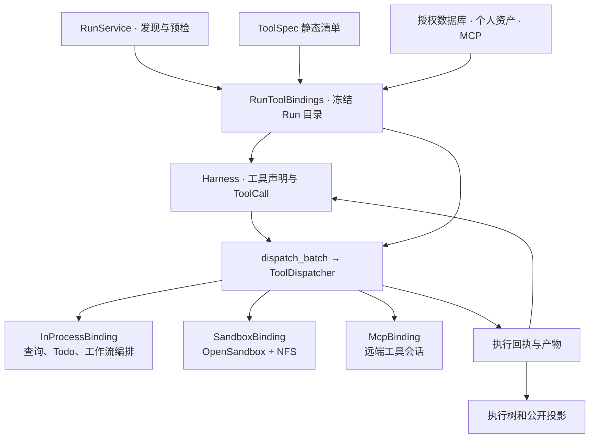
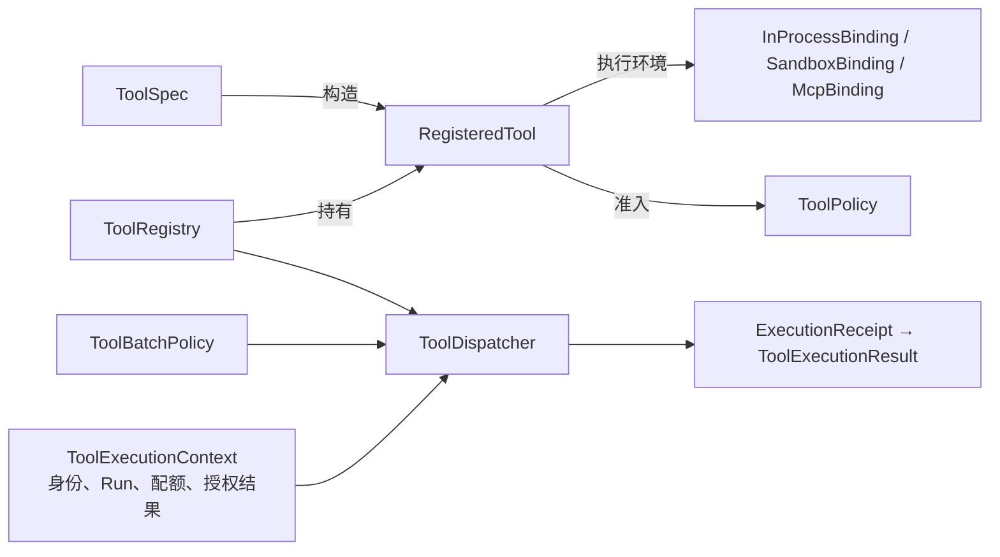

## 本课目标

- **工具目录**：为每个 Run 装配当前可用的内置工具、授权数据连接、个人 MCP 和工作流。
- **统一工具调度**：通过同一入口校验权限和参数，按工具策略处理串行、并行和取消。
- **沙箱运行 Python**：让 Python 在独立 Sandbox 中读取已授权的查询结果并生成图表。
- **文件与图表交付**：通过受管工作卷保存工作文件，并在分析结果中提供图表引用。

## 整体架构



| 模块 | 当前职责 |
| --- | --- |
| `runtime/service.py`、`runtime/tool_bindings.py` | 根据 Agent 定义与可信请求上下文装配目录，向模型和执行器提供同一份注册表，收集回执与产物。 |
| `tools/catalog.py`、`catalog_contracts.py` | `ToolSpec` 统一声明工具名、启用条件、能力组及注册方式。产品选择 todo、database、python、workflow 能力组。 |
| `tools/loader.py`、`tools/mcp/` | 发现并过滤调用人的 MCP 工具。调用前复验配置、绑定和权限。 |
| `data_connections/` | 装配授权数据连接，验证连接身份。只读执行继续受 PostgreSQL 权限、RLS 和 SQL 校验约束。 |
| `tools/batch.py`、`dispatcher.py` | 整批预检，再按顺序或并行派发；原顺序回填结果。 |
| `runtime/workflow_tools.py`、`subagent.py` | 挂接试跑、复用和独立子 Agent，子任务使用父 Run 授权与预算。 |

## 核心类型与工具



| 工具 | 行为 |
| --- | --- |
| `todo_write` | 更新计划和事项状态。 |
| `database_query` | 列出授权连接，发现表与字段，执行受限只读查询。查询结果带 `resultId`。 |
| `python_analysis` | 使用 `source_query_id` 引用本 Run 的授权输入，执行 Python 并接收 PNG。 |
| `sub_agent`、`create_workflow` | 独立子循环与 JS 试跑。成功试跑后提出保存邀请，用户确认后保存。 |
| 个人 MCP 和已启用工作流资产 | 按调用者和工作区动态装配。工具槽位由正式清单、MCP 与资产共同占用。 |

## 调用与失败

1. `dispatch_batch()` 按当前目录预检工具名、参数、授权与审批。待审批会暂停整批。默认 `serial + stop`，有序状态操作保持串行。
2. `ToolDispatcher.execute()` 复验准入，申请槽位与预算，按绑定派发。已完成结果按原 ToolCall ID 和调用顺序回填。事件记录状态、耗时、清理结果。
3. 查询成功后登记 `AuthorizedInput`，Python 执行前复验来源归属和授权。Sandbox 分配槽位，挂载受管卷，执行后读取产物并清理。清理未确认时隔离槽位，停止后续派发。
4. 本地拓扑由 OpenSandbox 提供计算控制面，NFS-Ganesha 提供独立工作卷。启动脚本校验 16 个私有卷；工作卷用于中间文件，已接受 PNG 交给 Runtime 持久保存。MCP 走独立远端会话。

## Sandbox 分配与 MCP 边界

| 环节 | 当前实现 |
| --- | --- |
| 本地启动 | `pnpm start` 启动 OpenSandbox 与 NFS-Ganesha 并加载沙箱配置。控制面监听宿主机回环地址，执行数据使用端口段 20000–29999。 |
| 工作卷 | 预置 16 个槽位，每槽 64 MiB ext4，经 NFSv4 挂载。分配记录用于确认执行环境回收和工作卷可再次使用。 |
| 计算与网络 | Python 运行在非 root 容器，配额为 1 CPU、512 MiB、64 PIDs。默认拒绝主动出网，数据由授权结果引用传入。 |
| MCP | 个人连接的凭据、配置版本与远端工具选择随调用者校验。发现使用 Streamable HTTP，会话随 Run 关闭。 |
| 验收路径 | 分别验证 SQL 转 PNG、同轮多工具、个人 MCP，以及取消或超时后的资源清理。 |

## 当前文件清单

```text
apps/agent/src/compass_agent/
├── runtime/
│   ├── service.py             预检与应用装配
│   ├── tool_bindings.py       冻结工具目录、派发和结果投影
│   ├── workflow_tools.py      试跑、复用和保存确认入口
│   └── subagent.py            独立子循环监督
├── data_connections/          数据源绑定、身份和只读会话
├── tools/
│   ├── catalog.py             正式工具清单
│   ├── catalog_contracts.py   ToolSpec 和能力上下文
│   ├── registry.py            声明、结构与大小限制
│   ├── batch.py               预检、串并行、原序回填
│   ├── dispatcher.py          准入、预算、环境分发与清理
│   ├── builtin/               查询、计划、Python、工作流和子 Agent
│   ├── mcp/                   远端工具发现和调用
│   ├── sandbox/               计算分配与 NFS 清理
│   └── artifacts.py           产物边界与校验
└── api/mcp.py                 个人 MCP 配置入口
deploy/compose/sandbox.yaml   本地计算与 NAS 编排
scripts/sandbox.mjs           本地启动与分配验收
```

工具运行配置由 Agent 主库拥有，第 18 课基线迁移为 `0008_tool_runtime.py`。课程案例使用授权连接和通用工具，演示输入与生产装配保持各自入口。
