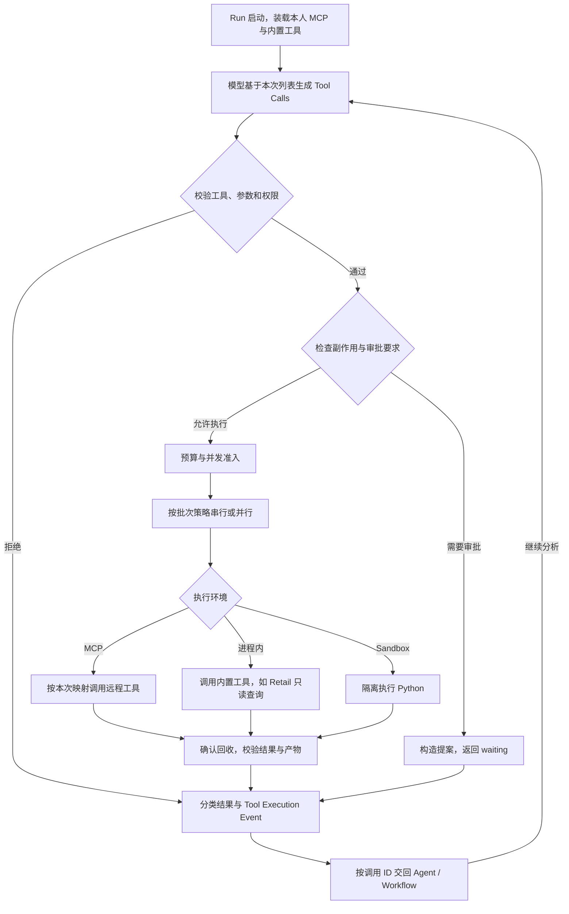

# PRD：第 18 课｜从 Tool Calling 到受控执行：构建 Tool Executor、MCP 与 Sandbox

> 状态 `draft` · 负责人 `andy` · Profile `standard` · 模板 [项目标准 PRD](../../_templates/PRD.tmpl.md)

[返回需求简报](../BRIEF.md)

## 1. 背景与目标

第 15 课以固定的真实 Retail 查询验证 Tool Call 与 Observation 的循环。第 18 课将该查询纳入 `apps/agent` 的统一执行入口，由统一工具模块校验参数、权限和执行策略，再按执行环境分发调用，再将结果回交 Agent。分析示例沿用已发布合成零售数据。

- 在同一个 Run 内通过受限 PostgreSQL 查询取得华东区经营数据，再在真实隔离的 Python 环境计算指标变化并绘图。
- 工具执行遵循参数、预算、并行、时间与输出边界。调用成功、参数或权限拒绝、执行异常、超时、取消与资源超限均可识别。
- 分析流程能生成、登记并读取已校验的 Artifact。Sandbox 清理后，同一 Run 仍可读取已登记的产物，并追溯到生成它的步骤和工具调用。
- 每次任务启动读取当前用户在当前工作区启用的 MCP 配置，自动发现并加载工具到本次推理 tool list；串行或并行执行由服务端批次策略决定。
- 交付 M4 Tool Execution Runtime、Sandbox 接入、部署与清理入口及执行环境选型 ADR。执行策略提供审批挂钩，衔接 M5。

## 2. 用户与场景

| 用户故事 ID | 目标用户     | 触发场景                     | 用户故事                                                                            | 关联需求                   |
| ----------- | ------------ | ---------------------------- | ----------------------------------------------------------------------------------- | -------------------------- |
| US-01       | 经营分析人员 | 发起华东区 GMV 下滑诊断      | 作为分析人员，我希望 Agent 查询我有权访问的数据并返回指标和图表，以便核对分析结果。 | FR-01、FR-03、FR-04、FR-05 |
| US-02       | 课程学员     | 同轮多工具调用或注入执行故障 | 作为学员，我希望观察每项工具结果、停止原因和资源回收，以便确认运行时限制生效。      | FR-01、FR-02、FR-06        |
| US-03       | 经营分析人员 | 诊断产生有副作用的行动建议   | 作为分析人员，我希望系统将待决动作交给审批边界，以便在获准之前保护业务状态。        | FR-07                      |

## 3. 总体业务流程

### BF-01｜从任务装载到 Tool Call 和 Observation

经营分析 Run 先装载本人 MCP 工具，与内置工具形成独立目录，再进入 M3 Agent Node。模型提出 Tool Call，Runtime 校验工具、参数和身份，再检查副作用与审批要求。需要审批时返回等待；允许执行时检查预算，按执行环境派发。结果或拒绝原因经统一格式返回 Agent。

课堂先完成华东区经营数据查询，再以允许的结果子集驱动 Python 计算和绘图。并行场景中的每个结果仍关联原 Tool Call，动作提案交回人工等待路径。超时或取消由执行层处理，事件记录最终结果与清理结局。

## 4. 功能需求

| 编号  | 优先级 | 触发与输入                               | 预期行为                                                                                                                                                                                                  | 可观察结果                                                                                         | 关联需求                    |
| ----- | ------ | ---------------------------------------- | --------------------------------------------------------------------------------------------------------------------------------------------------------------------------------------------------------- | -------------------------------------------------------------------------------------------------- | --------------------------- |
| FR-01 | P1     | 接收模型 Tool Call、Run 与可信授权上下文 | 将 Retail 等内置工具、Python 分析和本 Run 发现的 MCP 工具登记到最小 Tool Registry。统一 Dispatcher 校验参数、权限、副作用与审批要求，通过后按执行环境派发。Retail 作为受信只读处理函数在 Agent 进程内执行 | 未注册、参数无效或拒绝授权时返回分类结果，执行器未启动                                             | BR-01、BR-02、BR-07         |
| FR-02 | P1     | 同一轮返回一个或多个工具调用             | 按服务端批次策略串行或有界并行，默认串行；支持失败停止或继续独立项。统一遵守 Run 预算、并发、期限、取消与清理规则                                                                                         | 每项结果按原 ID 与输出顺序回填；串行无重叠，并行不超过上限，失败和未派发项可辨识                   | BR-02、BR-03、BR-11、NFR-01 |
| FR-03 | P1     | 收到经营数据 SQL 查询请求                | 复用 M1 的受限 Retail 连接，通过统一只读 SQL 入口执行，约束可读租户、区域、字段和查询结果                                                                                                                 | 返回允许的数据。拒绝无权限查询和写入，或按源端权限返回空结果                                       | BR-04、NFR-01               |
| FR-04 | P1     | 收到 Python 分析代码及授权输入           | 使用 OpenSandbox 为每次调用独立分配 Sandbox 和 NFS 工作卷，在本地 Docker 真实运行。约束 CPU、内存、时间、文件系统、网络和输出                                                                             | 成功时返回计算结果。代码异常、资源超限、超时和取消均可观察并清理执行环境                           | BR-03、BR-05、NFR-02        |
| FR-05 | P1     | Sandbox 成功执行 Python，生成图表等文件  | 校验文件路径、类型和大小，由 Agent 接收合规文件，登记 Artifact 并返回稳定引用。产物记录关联 Run、Step 和 Tool Call。                                                                                      | 同一 Run 的获授权主体可在 Sandbox 清理后凭原引用读取实际文件。校验或接收失败时返回明确的产物状态。 | BR-05、BR-06、NFR-02        |
| FR-06 | P1     | 调用进入执行、被拒绝或产生结果           | 以 Tool Execution Result 归一化状态、数据或原因和可用的 Artifact 引用。按 Run、Step 和 Tool Call 记录结构化事件，将安全的 Observation 返回 Agent                                                          | 可对照请求、耗时、结果分类与清理结局，识别同轮每个工具的结果                                       | BR-02、BR-03、BR-06、NFR-03 |
| FR-07 | P1     | 收到按执行策略需要审批的工具请求         | 在占用执行槽位前检查审批要求，构造带稳定引用的提案并返回待审批结果，交回 M3 等待边界                                                                                                                      | 可检查提案和等待原因，待审批调用的槽位占用、实际派发和业务写入均为零                               | BR-07                       |
| FR-08 | P1     | 用户维护本人 MCP 连接配置                | 提供带身份的配置、启用/禁用和发现测试 API，保存端点、所选工具、凭据及版本，配置仅属于本人当前租户和工作区                                                                                                 | 用户可检查保存和发现结果；其他用户无法读取、修改或使用，凭据不回显                                 | BR-08、BR-09、NFR-04        |
| FR-09 | P1     | 新 Run 启动，当前用户有启用的 MCP 连接   | 初始化远程 MCP 会话，分页发现并筛选工具，与内置目录合并为当前 Run 的独立 tool list；支持远端调用、失败与连接关闭                                                                                          | 每次任务自动装载最新有效配置；同 Run 后续轮次保持固定目录；新增配置在下一任务生效                  | BR-08～BR-10、NFR-04        |

## 5. 业务规则与约束

| 规则 ID | 规则                                                                                                                                                                                                                                                                                                        | 关联需求            |
| ------- | ----------------------------------------------------------------------------------------------------------------------------------------------------------------------------------------------------------------------------------------------------------------------------------------------------------- | ------------------- |
| BR-01   | Registry 维护工具标识、输入输出契约、权限、执行环境和执行策略。工具的业务语义由具体实现负责。执行环境与副作用、审批要求独立配置，模型仅提交工具名和业务参数。                                                                                                                                               | FR-01               |
| BR-02   | Tool Call ID 在结果和 Observation 中可关联。并行返回顺序变化时，每项数据和错误仍归原调用。工具并发、调用次数与时间上限受 M2 Run 预算约束。                                                                                                                                                                  | FR-01、FR-02、FR-06 |
| BR-03   | 超时和取消要收束执行。未开始的调用可被取消，已发出的 SQL 或 Python 执行须停止或经后端确认已终止。确认后释放执行槽位与临时资源。迟到结果不覆盖已确定的终态。                                                                                                                                                 | FR-02、FR-04、FR-06 |
| BR-04   | SQL 只连接独立零售库，使用服务端选择的专用受限身份。源端以 `session_user` 限定可读租户、区域和字段。禁止借用应用库、迁移与装载凭据，禁止写入、角色切换及访问隐藏控制或身份映射。成本数据不可读时返回拒绝。                                                                                                  | FR-03               |
| BR-05   | Python 仅接收本次授权输入，临时目录与宿主和其他执行隔离。执行环境不暴露宿主、Agent 或数据库密钥，网络按明确策略约束。调用结束回收计算环境，NFS 工作卷按独立保留期保留；不同调用使用独立可写卷，重新分配前清空并核对。                                                                                       | FR-04、FR-05        |
| BR-06   | 结果和文件服从输出上限。被拒绝、截断或超限时状态可辨识。只接收指定输出目录内的合规文件，拒绝指向目录外的路径或链接。文件接收成功后才发布引用。失败、超时或取消时，未登记文件标记为未验证，禁止发布引用，并随工作卷保留期清理。读取时校验请求方、当前 Run 及产物授权范围。结构化事件只记录安全元数据与引用。 | FR-05、FR-06        |
| BR-07   | 副作用区分只读、Run 内临时产物、外部业务写入和未知，审批要求独立声明。本课所有外部业务写入和未知副作用须审批；只读与产物工具也可要求审批。需审批的请求在实际派发前输出提案和等待原因。第 19 课实现持久审批及恢复，第七篇深化 Action Runtime 治理。                                                          | FR-01、FR-07        |
| BR-08   | MCP 配置以可信租户、工作区和当前用户为所有者，启用连接和凭据从服务端加载。模型仅看工具声明并提交业务参数；外部工具名称不能覆盖内置名称。                                                                                                                                                                    | FR-08、FR-09        |
| BR-09   | 每次 Run 发现后冻结名称、输入输出 Schema、策略和配置版本。派发前复查当前权限与配置；禁用、撤权或版本变化后停止新调用。远端工具提示不直接决定本地权限与审批。                                                                                                                                                | FR-07～FR-09        |
| BR-10   | 可选 MCP 连接装载失败时保留其他工具并公开安全摘要；必需连接失败时在模型调用前结束。工具目录超限须明确拒绝。远端在途调用结局未知时停止后续派发，禁止自动重试。                                                                                                                                               | FR-02、FR-06、FR-09 |
| BR-11   | 批次策略与单工具的副作用、审批策略分别声明。全批先预检，任一项待审时整批零派发。并行项须输入完备且无同批输出依赖；失败时按 stop/continue 处理，总取消、撤权和结局未知始终停止。                                                                                                                             | FR-02、FR-07        |

| 非功能 ID | 要求                                                                                                    | 验证口径                                                                    |
| --------- | ------------------------------------------------------------------------------------------------------- | --------------------------------------------------------------------------- |
| NFR-01    | 工具并发、执行时限和结果大小受已配置的上限约束。SQL 取消可检查数据库端终止。                            | 用同轮多调用、超大结果和真实 PostgreSQL 取消场景验证。                      |
| NFR-02    | Python 使用实际隔离后端并执行 CPU、内存、时间、文件系统、网络与输出策略。环境有可验证的终止与清理路径。 | 在独立容器或远程 Sandbox 上演练正常执行、资源超限、访问拒绝及回收。         |
| NFR-03    | 结构化事件可关联一次调用，含执行环境、副作用类别、审批要求、耗时、终态、分类原因及适用的清理结果。      | 将正常、拒绝及故障路径与 Run 和 Tool Call 对照，并核查敏感信息。            |
| NFR-04    | MCP 发现、目录与结果大小有界，Run 间用户配置和会话隔离；工具列表包含当前模型的工具数量上限。            | 使用真实 Streamable HTTP 夹具验证分页、同名工具、超限、双用户、故障与取消。 |

Tool Execution Result 至少表达调用标识、结果状态及可用数据或安全错误。Artifact 引用关联稳定标识、文件名、类型、大小和来源调用。Agent 负责从 Sandbox 接收文件，后续步骤通过该引用读取。若计算已成功而文件校验或接收失败，结果须区分计算状态与产物状态。精确字段、大小上限、错误代码与日志字段在技术设计中定义。

## 6. 范围与依赖

- **模块组织**　`runtime` 管 Run 生命周期，`harness` 管推理与自主性控制，`workflows` 管业务编排，`tools` 管工具及其 builtin/MCP/Sandbox 实现；HTTP 入口归 `api`。目录迁移保持 M1–M3 既有外部契约。
- **交付范围**　`apps/agent` 内的最小 Tool Registry、统一 Dispatcher、内置查询工具、Sandbox 与 MCP 接入、Run 工具装载、批次调度策略、Tool Execution Result、Artifact、Tool Execution Event、执行策略与审批挂钩。实际隔离环境由 `deploy` 管理接入配置与运行入口。
- **与 M1 的交接**　将已有的固定 Retail 查询接入受控执行路径。沿用 Tool Call ID 与 Observation 契约。用相同数据版本、受限身份和查询参数核对 M1 支持的查询在接入前后的结果。本课增加统一授权、限额、并行、超时、取消、隔离和清理。
- **教学范围**　对比进程内函数、子进程、独立容器和远程 Sandbox 的隔离、时延、资源成本、环境复用和运维差异。实战采用 OpenSandbox + NFS-Ganesha，并在本地 Docker 模拟独立 Sandbox、文件保留与重新挂载，Retail 查询等内置工具作为受信处理函数在 Agent 进程运行，副作用与审批要求由独立策略声明。
- **本课边界**　完成工具执行层治理、NFS 工作文件的独立保留与重挂载、当前 Run 内已接受产物的生成与读取，以及动作审批挂钩。[第 19 课](../../985-lesson-19-durable-runtime-hitl/spec/PRD.md)负责产物内容和引用的跨进程持久化、Checkpoint 与人工审批恢复。本课覆盖用户 MCP 配置的最小 API、任务启动发现与远端工具调用。完整 MCP 管理界面、OAuth 向导、Skill 生命周期、Resources/Prompts 和完整 Action 治理留给后续范围。
- **前置依赖**　[M1 真实 Retail 查询](../../989-lesson-15-agent-execution-kernel/BRIEF.md)、M2 Run 预算、[M3 混合编排](../../987-lesson-17-hybrid-workflow/BRIEF.md)、可用的受限 Retail PostgreSQL 和实际隔离后端。现有模型接口和固定三天样本接口维持其契约。
- **课堂演示与验收**　先通过统一执行入口查询真实 Retail 数据，再在隔离 Python 中计算并取回图表。用权限拒绝、并行上限、超时、取消和资源清理验证执行边界，并展示有副作用请求进入待审批。另演示本人 MCP 配置随每次任务装载，以及三种绑定的串行/并行策略。对应 AC-01 至 AC-13。

## 7. 研发资源

| 资源 ID | 资源                                                                                                                                             | 用途                                   |
| ------- | ------------------------------------------------------------------------------------------------------------------------------------------------ | -------------------------------------- |
| RES-01  | [课次原始上下文](../context/source_context.md)、[实施上下文](../context/implementation_context.md)                                               | M4 教学边界、实战要求和演示            |
| RES-02  | [模型与工具调用 DTO](../../../apps/agent/src/compass_agent/schemas.py)、[Agent 应用说明](../../../apps/agent/README.md)                          | 现有 Tool Call 与 Observation 消息契约 |
| RES-03  | [零售数据发布与受限角色](../../../docs/data-seeding.md#权限失败与回切)、[源端访问约束](../../../tools/data-seed/src/compass_data_seed/access.py) | 合成数据、受限角色与实际 SQL 验收      |
| RES-04  | [部署入口](../../../deploy/README.md)、[观测内容与隐私规则](../../../apps/agent/src/compass_agent/observability/README.md)                       | 隔离环境接入和日志边界                 |

## 8. 验收标准

### AC-01｜拒绝无效调用并执行可信函数

**关联**　FR-01、FR-06、BR-01、NFR-03

- **Given** Registry 登记一个进程内可信只读函数。
- **When** 分别请求合法调用、未知工具、错误参数和无授权调用。
- **Then** 合法调用返回对应结果。其余调用分别标记拒绝原因，后端未启动，Observation 和事件均关联原调用。
- **验证方式**　用可计数的可信函数和事件检查四条路径。

### AC-02｜在真实零售库约束查询权限

**关联**　FR-01、FR-03、FR-06、BR-04

- **Given** 合成 Retail PostgreSQL 已发布。M1 的查询参数和参考结果可复现，并提供绑定租户与区域的受限只读身份。
- **When** 查询华东区经营指标，再尝试其他租户或区域、未授权成本字段、角色切换和写入。
- **Then** 同一数据版本、身份与参数下，M1 支持的查询经 M4 返回相同授权结果。越权查询被拒绝或只返回权限范围内数据。无权限成本查询返回拒绝，角色切换与写入均失败。
- **验证方式**　在真实 PostgreSQL 核对 M1 与 M4 的查询结果、连接身份和返回范围。逐项检查越权、成本字段、角色切换、写入和错误分类。

### AC-03｜从 SQL 数据生成图表并取回产物

**关联**　FR-03–FR-06、BR-05、BR-06、NFR-02、NFR-03

- **Given** 分析流程有合法的华东区经营数据和已配置的 Sandbox。
- **When** Agent 生成并执行 Python 代码，计算 GMV 等指标变化并绘制图表。Sandbox 清理执行环境后，后续分析步骤凭原 Artifact 引用读取图表。
- **Then** 指标结果可与输入数据核对，图表实际内容与生成时一致。产物可追溯到原 Run、Step 和 Tool Call。
- **验证方式**　运行课堂主链，核对参考计算、图表内容、来源记录和清理状态，并在清理后读取图表。

### AC-04｜并行调用受预算与输出限制

**关联**　FR-02、FR-05、FR-06、BR-02、BR-06、NFR-01

- **Given** 多个合格工具调用同时提交，其中有返回超大结果的调用。
- **When** 执行批次并改变各调用完成顺序。
- **Then** 实际在途数量受限，剩余预算不足时停止新增执行。每项结果按调用标识关联。超大结果有明确的限制状态，越限产物不作为有效 Artifact 返回。
- **验证方式**　观察执行计数、预算、结果大小和 Tool Call ID。

### AC-05｜处理 SQL 和 Python 超时与取消

**关联**　FR-02–FR-06、BR-03、BR-06、NFR-01、NFR-02

- **Given** SQL 查询或 Python 分析正在执行，另有等待执行的调用。
- **When** 分别触发执行超时、主动取消在途调用和取消待执行调用。
- **Then** 状态区分超时与取消，待执行调用未启动。可核实数据库查询或 Sandbox 已终止，执行槽位与临时资源已回收。超时或取消前生成的部分文件无可用引用，迟到输出不改变终态。
- **验证方式**　核对后端查询或任务状态、调用计数、终态和清理事件。

### AC-06｜隔离异常与资源超限

**关联**　FR-04–FR-06、BR-05、BR-06、NFR-02、NFR-03

- **Given** Python Sandbox 已启用课堂环境的限制和网络策略。
- **When** 分别触发代码异常、CPU 或内存超限、未授权的文件和网络访问，并尝试提交不支持的文件类型、指向输出目录外的链接，以及接收过程中写入失败的产物。
- **Then** 异常、超限和产物接收失败均有明确状态。被拒绝或接收失败的文件无可用引用，临时环境被回收。其他 Run 或无授权主体无法读取已登记产物，事件仅包含安全字段。
- **验证方式**　在真实后端核对拒绝、限制与清理结果，模拟接收失败，并用不同 Run 和授权身份分别验证产物读取。

### AC-07｜按审批策略拦截实际执行

**关联**　FR-07、BR-07

- **Given** Agent 在诊断结束时提出一项有副作用的经营动作。
- **When** 调用经 Dispatcher 完成参数和授权检查，再评估副作用与审批要求。
- **Then** 返回待审批状态和动作提案引用，Workflow 进入人工等待，执行槽位占用、实际派发和业务写入计数均为零。
- **验证方式**　以合成任务运行建议分支，核对等待结果和副作用计数。分别给进程内、Sandbox 与 MCP 测试工具配置审批要求，确认三种绑定都在派发前进入等待。

### AC-08｜交付可运行环境和选型记录

**关联**　FR-03–FR-06、NFR-01–NFR-03

- **Given** 已有 Compass 环境与本课接入说明。
- **When** 按说明启动 Sandbox，复现查询、Python 绘图及取消演示，再停止演示环境。
- **Then** 运行和清理步骤可复现，ADR 记录各类工具的执行边界、隔离选型和代价。既有模型及样本接口的回归检查通过。
- **验证方式**　按教学说明运行环境及主链，核对 ADR、资源状态和回归结果。

### AC-09｜本人 MCP 工具随每次任务装载

**关联**　FR-08、FR-09、BR-08、BR-09、NFR-04

- **Given** 用户在当前工作区配置并启用两个 MCP 连接，其中存在同名工具；另一个用户配置不同连接。
- **When** 启动任务并检查首次及后续轮次的 tools，执行一个已授权只读 MCP 工具，再新增、禁用或修改配置后启动新任务。
- **Then** 本人的工具经唯一名称映射进入当前 Run，调用命中原远端工具；本 Run 目录固定，新任务读取新配置。另一个用户的工具与凭据不出现。即使没有 Retail 连接，合格 MCP 工具仍可用。
- **验证方式**　两个用户通过配置 API 操作真实协议夹具，核对工具列表、调用原名、版本与身份范围；验证密文用途和不回显。

### AC-10｜发现失败与目录边界

**关联**　FR-08、FR-09、BR-10、NFR-04

- **Given** MCP 夹具分别提供多页目录、重复游标、不兼容 Schema、超时及超过工具数量上限的响应。
- **When** 分别作为可选连接和必需连接启动 Run。
- **Then** 完整发现后按配置选择工具；可选失败保留其他工具并报告，必需失败和总目录超限发生在首次模型调用前。无配置时使用内置工具，不静默截断工具列表。
- **验证方式**　检查请求次数、首个模型调用次数、加载摘要、稳定名称冲突和关闭后的会话数量。

### AC-11｜MCP 策略、取消与未知结局

**关联**　FR-02、FR-06～FR-09、BR-09、BR-10

- **Given** 远端工具声明只读提示，但本地策略要求审批；另一只读调用正在执行。
- **When** 调用待审工具，或对在途请求触发取消、断线、配置禁用和撤权。
- **Then** 待审项实际远程调用数为零。正常响应标记远端资源管理；未知在途结局单独报告并停止 Run 后续调用，保留隔离占用，不自动重试；凭据和原始连接细节不进入公开事件。
- **验证方式**　真实 MCP 夹具模拟忽略取消与响应丢失，核对实际调用数、状态、取消通知和迟到输出；验证配置与工具清单变化后拒绝新调用。

### AC-12｜同轮多工具的串行与并行

**关联**　FR-02、FR-07、BR-02、BR-11

- **Given** 同轮有三个输入完备、互相独立的调用，覆盖内置、Sandbox 和 MCP，服务端分别配置 serial/parallel 与 stop/continue。
- **When** 改变完成顺序，注入中间项失败、待审、超时和用户取消。
- **Then** 串行按原顺序且无重叠；并行受批次、Run 与进程配额约束。普通失败遵循 stop/continue，未派发项状态和计量正确；待审整批零派发。终止条件触发后停止新调用并收口在途，结果仍按原 ID 与顺序回填。
- **验证方式**　记录实际开始/结束时点及派发计数；验证不能把同批尚未产生的结果作为已存在依赖，验证并行失败后未启动的调用不会被抢先派发。

### AC-13｜独立分配与 NAS 文件保留

**关联**　FR-04、FR-05、BR-03、BR-05、BR-06、NFR-02

- **Given** 本地 Docker 已启动 OpenSandbox、NFS-Ganesha 并预置可租用工作卷，存在两个不同租户的测试任务。
- **When** 并行执行 Python 写入各自文件，删除原 Sandbox，再通过受控入口只读挂载原工作卷；到期清理后把 slot 分配给新任务。
- **Then** Sandbox 和可写卷独立，跨 owner 访问被拒绝；删除计算后文件仍存在且摘要一致；计算配额与存储保留分别释放；新任务看不到旧文件。未知清理状态保持占用，槽满明确拒绝。已登记 Artifact 保持原字节。
- **验证方式**　真实 Docker/NFS 演示，覆盖控制面重启、NAS 断开、创建丢响应、保留期清理和双租户并发；不能只用 mock 验收。

## 技术设计承接

| 问题                                                                | 来源                     | 影响范围                     | 决策阶段                                                   |
| ------------------------------------------------------------------- | ------------------------ | ---------------------------- | ---------------------------------------------------------- |
| Sandbox 后端、镜像或运行环境、资源阈值和网络访问策略                | 实施上下文               | FR-02、FR-04、NFR-01、NFR-02 | [技术方案](../design/TECH_DESIGN.md)已给出拟议决策，待评审 |
| 只读查询接口的语句约束方式、课堂受限身份及诊断用时间窗口            | 实施上下文、现有零售数据 | FR-03、AC-02、AC-03          | [技术方案](../design/TECH_DESIGN.md)已给出拟议决策，待评审 |
| Artifact 引用格式、支持的文件类型和大小、Run 内的接收存储与清理机制 | 实施上下文及本次需求补充 | FR-05、FR-06、AC-03、AC-06   | [技术方案](../design/TECH_DESIGN.md)已给出拟议决策，待评审 |

## 变更记录

| 日期       | 变更                                                                                                         | 影响范围                                        |
| ---------- | ------------------------------------------------------------------------------------------------------------ | ----------------------------------------------- |
| 2026-11-09 | 依据第五篇调整材料和 Compass 工程基线建立初稿                                                                | M4                                              |
| 2026-11-10 | 承接 M1 真实查询，补充统一执行治理、兼容性和课堂验收                                                         | M4                                              |
| 2026-11-10 | 明确产物生成、校验、接收、授权读取及与第 19 课的交接                                                         | M4                                              |
| 2026-11-11 | 执行环境与副作用、审批策略独立建模，Retail 查询归入进程内内置工具                                            | FR-01、FR-07、BR-07、AC-07                      |
| 2026-11-11 | 增加本人 MCP 配置、每 Run 动态装载与第三种执行绑定；补充串行/并行批次策略                                    | FR-02、FR-08～FR-09、BR-08～BR-11、AC-09～AC-12 |
| 2026-11-12 | 明确 OpenSandbox + NFS-Ganesha、本地独立分配与 NAS 保留；按 api/runtime/harness/workflows/tools 重组本课方案 | FR-04、BR-05、AC-13、模块组织                   |

## 统一执行过程的前置交接

工具执行沿用第 17 课的统一执行节点。MCP 调用填充公开 serverId / serverName / toolName，Sandbox 填充 runtime / environmentId；来源与环境独立。Tool Executor 为每次调用提供独立节点 ID、父节点、真实并行组和依赖，补全异步任务上下文传播。输入输出先按工具展示白名单投影，再进入节点的 summary / preview。前端复用已有图标、嵌套、并行和代码组件。

字段真源与本课前置交互见[第 17 课统一执行过程](../../987-lesson-17-hybrid-workflow/design/TECH_DESIGN.md#7-统一执行过程节点)。本节不改变本课原有工具、存储和生产执行的交付范围。
