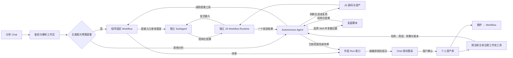
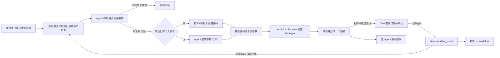
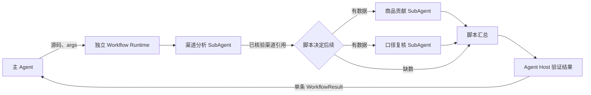
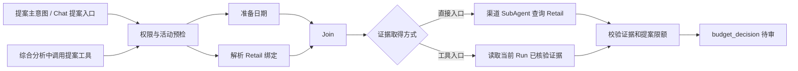
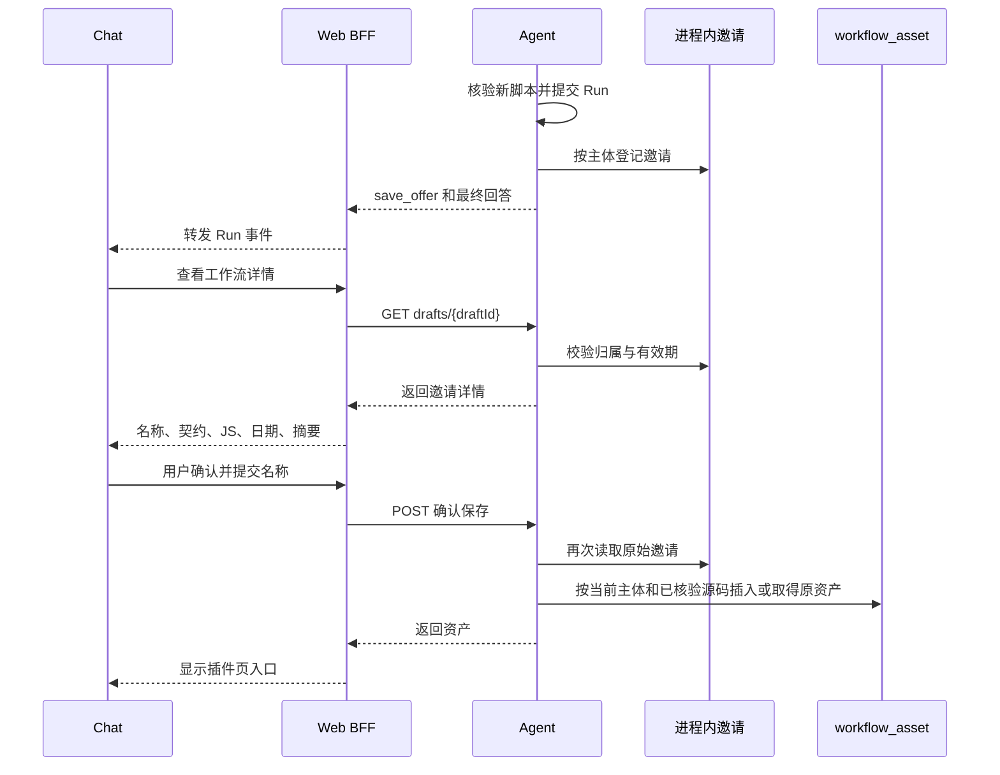
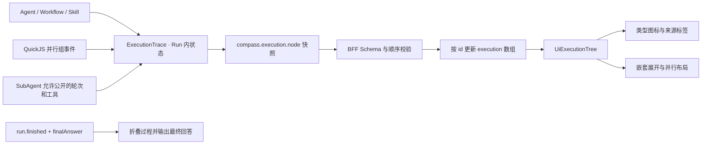

# 第 17 课 · Agent 主导的混合 Workflow 技术方案

[需求简报](../BRIEF.md) · [有效 PRD](../spec/PRD.md) · [标准模板](../../_templates/TECH_DESIGN.tmpl.md) · [第 16 课方案](../../988-lesson-16-controlled-autonomy/design/TECH_DESIGN.md) · [关键代码设计](CODE_DESIGN.md)

> Feature 987 · Profile `standard` · 待评审 · 2026-11-11 · 本文已按第 17 课实现更新，Agent 主库版本为 `0007`。

## 需求依据与验收

以 [PRD 的 FR-01～FR-11、BR-01～BR-06、NFR-01 和 AC-01～AC-19](../spec/PRD.md) 为准。现有 [AgentExecutor](../../../apps/agent/src/compass_agent/runtime/executor.py) 负责 ReAct 和受控分析，[ControlledRun](../../../apps/agent/src/compass_agent/runtime/controlled_run.py) 持有查询、预算、Todo 和验证器，[Verifier](../../../apps/agent/src/compass_agent/runtime/verifier.py) 验证渠道对比和指定渠道商品前三项。复用 [分析 Chat](../../../apps/web/src/components/analysis-composer.tsx)、[模型意图路由](../../../apps/agent/src/compass_agent/routing/service.py)和 Agent 的工作区数据连接。

## 1. 三个 Showcase 共用一条 Run 主链



| 方式              | 谁决定启动                         | 谁维护可执行步骤                         | 交付                           |
| ----------------- | ---------------------------------- | ---------------------------------------- | ------------------------------ |
| Dynamic Workflow  | Agent 判断直接处理、复用或生成脚本 | JS Runtime 执行脚本，脚本调度 SubAgent   | 核验后的汇总和可复用的 JS 源码 |
| 程序固定 Workflow | 主意图分流或 Agent 调用工具        | 程序固定节点和必经门槛                   | 带诊断依据的待审提案           |
| Workflow in Skill | Agent 按 Skill 约束准备证据与调用  | Skill 随代码交付脚本，脚本执行确定性 SOP | 可解释的结构化周报             |

固定提案由 `HybridWorkflows.budget_proposal` 编排，使用 `asyncio.TaskGroup` 并行准备日期和 Retail 绑定。动态路径由 QuickJS runner 执行，Skill 通过受控工具运行内置 Python 脚本。外层 Run 持有授权、预算、取消与唯一终态。显式 Todo 分析沿用 M2 原路径，启动动态工作流时发现活动 Todo 则返回 `plan_conflict`。固定提案和复盘仍可使用已核验的 Todo 证据。

## 2. Dynamic Workflow · 周期性渠道异动诊断

### 2.1 从当次生成到跨对话复用



- 每个新 Run 在首次模型调用前加载当前租户、工作区与用户的已启用资产，注册成 `workflow_<asset_id.hex>_v1` 工具。主 Agent 根据业务目标自主选择工具并提供本轮参数。管理面板提供查看和启停，手动运行保留为辅助调试入口。
- 工具目录同时提供用途、输入输出契约和版本，完整源码只在调用时加载。`find_workflows` 支持按名称查找和游标分页，`reuse_workflow` 可执行目录中的任意兼容资产。
- 新建请求含 `script_source`、`runner_api_version`、`entry_contract` 和本次 `args`。复用请求含 `asset_id`、`definition_version` 和 `args`。两条路径都复验授权、资产状态、契约与预算。
- 日期、已授权数据绑定和结果属于本次执行。课堂首轮用 2025-11-17 至 11-23 作基准，11-24 至 11-30 作本周；第二轮换一组有数据的日期，跨对话和进程重启复用同一份源码。已用 2025-11-10 至 11-16 和 11-17 至 11-23 验证重启后的复用。
- 新编排的保存邀请和确认链路见第 5 节。已保存资产的 JS、运行契约和版本由 Agent 主库持久化。

### 2.2 脚本执行、串并行和上下文隔离



**脚本合同**　v1 脚本为可含顶层 `await` 和 `return` 的 JS 函数体。`args` 是按契约校验后注入的 JSON。`agent(profile, input)` 启动一个 SubAgent，返回经过校验的结构化结果或数据缺口。`parallel(tasks)` 接收任务函数或 Promise，等待各分支汇合。串联由 `await` 表达，分支由 `if` 表达，后续输入可取前一任务的输出。脚本用 JS 变量保存中间结果。`channel_attribution@1` 的示例先查渠道，然后并行商品分析与口径复核。`channel_overview@1` 可运行只含一个 SubAgent 的脚本。

两个入口契约都接收 `{ baseline: { start, end }, current: { start, end } }`，日期窗口沿用 Retail 的左闭右开格式。`channel_attribution@1` 成功需要渠道、商品和复核三类证据。`channel_overview@1` 成功需要渠道证据。脚本只提交 `status` 与本次证据引用，Host 用已校验的数据组装 WorkflowResult。

| 运行层           | 它能读到什么                                                                  | 返回给谁                   |
| ---------------- | ----------------------------------------------------------------------------- | -------------------------- |
| 主 Agent         | 原对话、已授权的资产信息与最终 WorkflowResult                                 | 通过 Run 提交最终报告      |
| Workflow Runtime | 脚本、显式参数和 `agent()` 返回的业务对象。授权与运行状态由 Agent Host 持有。 | 汇总值送回 Agent Host 校验 |
| 每个 SubAgent    | 独立 AgentState、角色指令、本次任务参数与明确授权的证据引用                   | 校验后的结构化结果送回脚本 |

**执行后端**　Agent 每次启动一个受信 Node 24 runner 进程，在独立 QuickJS WebAssembly 实例运行源码。Agent 镜像通过同系构建阶段携带 Node 与锁定的 runner 依赖，开发复用 workspace Node。脚本通过无模块加载器的 guest context 执行。宿主只暴露 `args`、`agent` 和 `parallel`，标准 JS 内建对象可用。宿主进程清除继承环境并使用固定工作目录。模型代码无法直接调用 Node、文件、网络、数据库、密钥或任意工具。为 guest 设置内存、栈和执行中断上限，父进程独立执行硬截止与帧大小限制。构建验收核对所用 WASM 变体的线性内存上限及 runner 的峰值占用。验证通过的脚本仍在同一边界内执行。QuickJS deferred promise 和 pending job 驱动见[运行时文档](https://github.com/justjake/quickjs-emscripten/blob/main/README.md)。

**父子调度**　可信 runner 通过有界 JSON 帧向 Agent Host 请求派发，使用单次执行标识与请求 ID 对应结果。Host 按注册 profile 校验参数、证据来源和当前数据权限，复用第 16 课受控 Agent 执行内核。每个子任务各自持有模型消息、Verifier 和阶段控制。父 Run 的单阶段 `RunControl` 只跟踪整个 Workflow；子阶段由各子任务独立持有。Host 原子预留父预算中的子份额，在确认任务清理后归还未使用部分。课堂一次最多启动 3 个子任务，同时最多运行 2 个；启动顺序不影响结果归属。模型走 Agent 的可信路由策略，脚本只选择获准的只读 profile 和输入。每个 profile 限定工具、目标日期及可访问的渠道。子任务只开放授权 Retail 查询和结构化提交。

**验证与终态**　`channel_compare` 返回已验证首位渠道和证据引用。`product_breakdown` 消费该渠道引用。`scope_review` 独立查询并校验同一发布绑定下的日期、渠道和变化方向。Host 为一次执行固定发布绑定，派发时复验权限，绑定变更时结束该次执行。Host 以工作流执行 ID 维护按子任务归属的证据，并按 `entry_contract` 核对结果所需的角色、证据和状态。成功时返回该次执行的结果与引用，主 Agent 通过 `submit_workflow_report` 引用收据提交报告事实。中间对话不进入主模型上下文。缺数、复核分歧、子任务失败均有显式结果；必需分支异常时取消未完成同组分支。取消或超时停止接受派发，终止脚本进程并等待子任务与下游清理，迟到帧不参与结论。前端只接收阶段、任务状态和获准摘要，主对话终态仍由父 Run 提交。

### 2.3 `workflow_asset` 表结构与索引

`agent/main` 迁移 `0006 → 0007`。一行保存一份实际通过验证的 JS 源码。串联、并行和分支由源码表达。`entry_contract` 引用已登记的输入与输出契约，`runner_api_version` 标识执行 ABI 和子任务 profile 契约。SubAgent 的完整提示在每次调用时由 profile 规则与显式入参组成。迁移中的 PostgreSQL DDL 如下。

```sql
CREATE TABLE workflow_asset (
    asset_id uuid CONSTRAINT pk_workflow_asset PRIMARY KEY,
    tenant_id uuid NOT NULL,
    workspace_id uuid NOT NULL,
    owner_user_id uuid NOT NULL,
    name varchar(80) NOT NULL,
    status text NOT NULL DEFAULT 'active',
    definition_version integer NOT NULL DEFAULT 1,
    runner_api_version integer NOT NULL DEFAULT 1,
    entry_contract varchar(64) NOT NULL,
    script_source text NOT NULL,
    script_sha256 bytea NOT NULL,
    metadata_revision integer NOT NULL DEFAULT 1,
    created_at timestamptz NOT NULL DEFAULT now(),
    updated_at timestamptz NOT NULL DEFAULT now(),

    CONSTRAINT ck_workflow_asset_name CHECK (name = btrim(name) AND name <> ''),
    CONSTRAINT ck_workflow_asset_status CHECK (status IN ('active', 'disabled')),
    CONSTRAINT ck_workflow_asset_versions
        CHECK (definition_version = 1 AND runner_api_version = 1),
    CONSTRAINT ck_workflow_asset_contract
        CHECK (entry_contract = btrim(entry_contract) AND entry_contract <> ''),
    CONSTRAINT ck_workflow_asset_source
        CHECK (octet_length(script_source) BETWEEN 1 AND 16384),
    CONSTRAINT ck_workflow_asset_sha256 CHECK (octet_length(script_sha256) = 32),
    CONSTRAINT ck_workflow_asset_metadata_revision CHECK (metadata_revision >= 1),
    CONSTRAINT uq_workflow_asset_scope_script UNIQUE (
        tenant_id, workspace_id, owner_user_id, runner_api_version, entry_contract, script_sha256
    )
);

CREATE INDEX ix_workflow_asset_scope_updated
    ON workflow_asset (
        tenant_id, workspace_id, owner_user_id, updated_at DESC, asset_id DESC
    );
```

| 索引或约束                        | 对应操作                                                           |
| --------------------------------- | ------------------------------------------------------------------ |
| `pk_workflow_asset`               | 按 UUID 查详情、运行或修改。每次带租户、工作区和用户。             |
| `uq_workflow_asset_scope_script`  | 同一归属、运行时版本和业务契约下，相同源码只存一行。               |
| `ix_workflow_asset_scope_updated` | 管理列表按更新时间和 ID 分页。Agent 查找时可按名称筛选已启用资产。 |

### 2.4 源码版本、保存与复用

| 版本字段             | 规则                                                                                                |
| -------------------- | --------------------------------------------------------------------------------------------------- |
| `runner_api_version` | 选择 JS 执行入口、hook 协议和可用的 profile 版本。资产复用需要兼容此版本。                          |
| `definition_version` | 当前资产下的不可变执行版本，v1 每个资产固定为 `1`。源码或契约变化后，重新执行、验证并保存为新资产。 |
| `metadata_revision`  | 改名和启停以期望 revision 做原子更新，递增 revision 并刷新时间。冲突返回 `409`。                    |

源码将换行统一为 LF 后直接按 UTF-8 字节计算 SHA-256，保留脚本内容。发给 runner 和持久化的是同一份源码。保存使用 `READ COMMITTED`，先 `INSERT ... ON CONFLICT ON CONSTRAINT uq_workflow_asset_scope_script DO NOTHING RETURNING`，冲突后读取原行。停用状态和现有名称保留。运行角色可读、可插入，UPDATE 仅授权管理字段。源码可由资产所有者只读查看，页面按文本渲染。一次运行的参数、模型、具体 SubAgent 提示、证据和运行结果随 Run 处理。

### 2.5 资产注册、发现与自动调用

`workflow_asset` 作为唯一持久化真源。注册目录由每个 Run 按可信主体重新构造，复用既有表即可纳入旧资产，当前无额外迁移。保存、改名、启停在下一轮读取时生效，服务重启后按相同 ID 和版本恢复工具身份。

| 环节     | 规则                                                                                                                                                                |
| -------- | ------------------------------------------------------------------------------------------------------------------------------------------------------------------- |
| 工具身份 | `workflow_<asset_id.hex>_v1`，保持 ASCII 且小于 64 字符。改名保持工具身份。服务端绑定资产 ID 和定义版本，模型只传本轮 `baseline/current`。                          |
| 能力描述 | `entry_contract` 提供可信业务描述及输入输出规则，附资产显示名。当前支持渠道概览和渠道归因两个已实现契约。显示名作为数据处理，源码与历史结果不注入系统上下文。       |
| 首轮发现 | 按归属加载最近一页 20 个启用资产，在系统消息提供目录。保留现有单次模型最多 16 个工具，基础分析 5 个、混合工具 8 个，另直接装配 3 个具名资产工具。                   |
| 继续发现 | 其余目录项可用 `reuse_workflow` 按 ID 调用。`find_workflows` 返回用途、版本、`toolName` 和 `nextCursor`，按名称或游标继续加载，搜索结果提升到下一步的直接工具槽位。 |
| 模型选择 | 任务目标与已有工具匹配时优先调用，用户无需提资产或名称。缺少兼容能力时才生成 JS，用户明确要求新建时仍可生成。显式 Todo 和直接 SQL 保持各自执行契约。                |
| 执行入口 | 根据本轮注册映射解析具名工具，重新检查归属、启用状态、版本和源码摘要，交既有独立 Workflow Runtime。未注册的工具名无法据此构造任意资产 ID。                          |
| 可见状态 | `compass.workflow.node` 的复用事件携带 `assetId/name/definitionVersion`，Chat 展示实际资产名称与版本。复用完成后不生成保存邀请。                                    |

关键类型和派发代码见 [代码设计 1.5](CODE_DESIGN.md#15-资产注册为模型工具)。同一分析换问法、换日期和新开对话，都通过模型看到的能力目录完成选择。日期约束沿用已有左闭右开契约，子任务继续真实查询当前授权 Retail 数据。

### 2.6 参考与课次交接

Claude Code 和 DeepSeek Harness 的共同做法是把串并行控制写入模型生成的 JS，由 Workflow Runtime 调度 SubAgent，再把汇总结果返回给调用方。Compass 沿用此执行结构，使用已注册的只读角色与工作区个人资产。[Claude Code Workflows](https://code.claude.com/docs/en/workflows) · [DeepSeek Harness Workflow](https://github.com/deepseek-ai/deepseek-harness/blob/master/docs/subsystems/workflow.md)

第 17 课的运行在当前父 Run 内完成，JS 资产可跨进程复用。第 18 课通过 Tool Executor 管理子任务调用的工具，并为生成的 Python 分析代码提供 Sandbox。第 19 课可在父 Run 的工作流调用边界保存已完成结果；未提交的只读工作流按新 Attempt 重跑。第 25 课在子任务执行边界上增加持久 Child Run、独立续接和授权轨迹下钻。

## 3. 程序固定 Workflow · 广告预算调整提案



- 点击 Chat 提案入口会提交 `showcase=budget_proposal`。手动输入时，由 `direct_budget_intent` 匹配明确的直接提案请求。直接入口进入 `HybridWorkflows.budget_proposal`。咨询和有条件的综合诊断沿用普通 Agent 路径。
- `prepare_budget_proposal` 向符合权限的普通分析 Run 暴露。Agent 先做自主诊断，达到用户指定的触发条件时携带已核验证据引用调用。课堂综合案例要求异动最大的渠道下滑至少 100 元，固定流程按已验证差额复核。工具进入同一 `budget_proposal`，读取父 Run 的已核验证据，复验日期与渠道匹配。直接入口派发 `channel_compare`，子任务通过 `retail_sales` 查询真实渠道实付并提交核验结果。
- 两个入口都并行准备日期和 Retail 绑定，通过后校验证据与提案限额。课堂候选调整额为 -50 元，绝对值上限为 100 元。通过后提交 `RunWaiting`，其中 `nodeKey="budget_decision"`、`continuation="apply_budget"`。`proposal` 包含 `proposal_id`、`revision`、租户、工作区、活动、调整额和证据引用。等待 ID 由 Run、固定版本与节点键导出。
- 外层 Run 在取消检查后提交唯一等待终态。工具调用取得等待结果时停止模型循环，外层提交同一等待合同。第 18 课在同一等待点前接入 Action Adapter，第 19 课持久化审批与接续。

## 4. Workflow in Skill · 每周经营复盘

将已审查的 Skill 包置于 Agent 内，打包时包含 `SKILL.md` 和 `scripts/build_weekly_review.py`。Agent 调用 `load_weekly_review` 读取内置 `SKILL.md`，获得适用条件、两次单期查询、脚本调用与缺口处理规则。Agent 决定周期、准备证据并提交脚本收据。

| 归属                             | 执行逻辑                                                                                                                                                                  |
| -------------------------------- | ------------------------------------------------------------------------------------------------------------------------------------------------------------------------- |
| `SKILL.md`                       | 约束适用场景、周期选择、证据准备、脚本调用、缺口处理和解释范围。                                                                                                          |
| `build_weekly_review` 工具       | 按两段日期解析本 Run 的单期渠道查询，校验绑定和范围。有数据时读取已核验的行，查无数据时从服务端查询状态取得覆盖标记。通过已注册的 Python 函数传入有界结构化数据。         |
| `scripts/build_weekly_review.py` | 执行日期窗口与覆盖校验。沿用 Retail 单期有记录即有覆盖的语义，按整数分汇总两期实付额和各渠道差额，生成固定周报数据结构，返回 `ok` 或带具体时段和可用部分的 `needs_data`。 |
| Agent 与提交器                   | 工具根据脚本结果渲染本周概览、渠道变化和下周跟踪。Agent 通过 `submit_weekly_review` 引用当前 Run 的脚本收据提交报告。`needs_data` 可生成缺口说明。                        |

脚本只接收经验证的有界数据，由课程代码注册并随版本发布。通过两组有效时段核对同一 Skill 和脚本版本、相同输出形状与变化的数字。第 18 课的 Sandbox 用于运行生成的 Python 分析代码。

## 5. Chat 入口、保存确认与资产管理

### 5.1 Retail 示例入口

| `showcase`         | 启动与路由                                                                     | 真实执行                                                                                                                                                                     |
| ------------------ | ------------------------------------------------------------------------------ | ---------------------------------------------------------------------------------------------------------------------------------------------------------------------------- |
| `dynamic_workflow` | 显式选择渠道诊断。诊断场景 `SC-03`，自动选模使用配置的 Pro，支持用户固定模型。 | 主 Agent 优先选择匹配的已注册资产工具，缺少时生成 JS，再通过 `submit_workflow_report` 提交。三个 SubAgent 通过当前工作区的 `retail_sales` 查询渠道对比、商品贡献和独立复核。 |
| `budget_proposal`  | 显式进入固定流程，自动选模按 `SC-02` 路由。                                    | 渠道 SubAgent 查询当前工作区的实付数据，固定流程校验证据并提交 `RunWaiting`。                                                                                                |
| `weekly_review`    | 显式选择内置复盘 Skill，自动选模按 `SC-02` 路由。                              | `load_weekly_review` → 两次单期 `retail_sales`（`compareTo=null`）→ `build_weekly_review` → `submit_weekly_review`。                                                         |

预设把用户输入的日期转换为左闭右开区间，默认传入 `[2025-11-17, 2025-11-24)` 和 `[2025-11-24, 2025-12-01)`。三条链路复用现有 Run 接口、授权 Retail 绑定与查询核验。请求最多选择一个 `showcase` 或一个 `workflowAssetRef`。`workflowAssetRef` 保留手动调试路径。普通业务问题由模型根据自动注入的资产工具目录选用，执行后引用已核验收据提交。要求商品贡献及独立复核的渠道诊断必须经可完成两项工作的流程，模型仍自主选择已有工具或新编排。

### 5.2 先核验，后确认保存



- `submit_workflow_report` 只在收据属于新生成脚本且状态为 `ok` 时准备邀请。父 Run 成功提交后，Agent 注册邀请并发送可选 SSE 扩展 `compass.workflow.node@1`，使用 `key=save_offer`，`detail` 为邀请 UUID。Chat 在收到成功终态后渲染确认卡。复用、未通过核验、失败或取消均不发布邀请。
- `WorkflowDrafts` 在单个 Agent 进程中按创建顺序保留最多 256 条邀请，有效期 30 分钟。达到上限时淘汰最早的邀请，重启清空。详情和确认使用同一主体范围校验。点击「暂不保存」只关闭当前 Chat 卡片。
- 确认请求仅提交名称。源码与入口契约从服务端邀请读取，实际日期和结果仅作为预览。保存后邀请在有效期内仍可用于重试，同源码的重复确认按数据库唯一约束返回原资产，沿用原名称与启停状态。插件页通过工作区二级导航打开，也可从保存成功卡在新标签页打开。

### 5.3 Web 与 Agent 接口

| 方法与相对路径                      | 契约                                                                                                                          |
| ----------------------------------- | ----------------------------------------------------------------------------------------------------------------------------- |
| `GET /drafts/{draftId}`             | 返回 `WorkflowDraftView`，包含 `name`、`entryContract`、`scriptSource`、`args`、`summary`。过期、无记录或归属不同返回 `404`。 |
| `POST /drafts/{draftId}/confirm`    | `WorkflowDraftConfirm` 仅接收 `name`，返回 `WorkflowAssetView`。                                                              |
| `GET`（集合路径）、`GET /{assetId}` | 列表以 `updated_at`、`asset_id` 游标分页，每页 20 条。详情包含只读源码。                                                      |
| `PATCH /{assetId}`                  | 按 `metadataRevision` 更新名称与启停状态。冲突返回 `409`。                                                                    |

浏览器接口前缀为 `/api/web/v1/analysis/workflows`，Agent 前缀为 `/v1/analysis/workflows`。BFF 根据会话、`tenantId` 和 `workspaceId` 取得可信主体，检查 `module.analysis` 和 `models.invoke`。写请求额外检查同源与 CSRF。Agent 以可信租户、工作区、用户过滤数据。接口使用生成的契约做运行时校验并返回 `no-store`。插件二级页另受 `module.plugins` 导航权限约束。

启用需同时设置 `COMPASS_HYBRID_WORKFLOW_ENABLED` 与 `COMPASS_CONTROLLED_AUTONOMY_ENABLED`。关闭后，普通分析路径可用，Chat 示例和资产入口隐藏，插件页展示能力未开放。固定提案通过 `RunWaiting` 表达待审，外层 Run 只发一次 `run.finished`。

## 6. Agent 主库演进

- **归属和版本**　`agent/main` 通过 `apps/agent/migrations/versions/0007_workflow_assets.py` 从 `0006` 升到 `0007`。迁移同步 Agent ORM、受管工具、最小运行授权、`readyz` 和[数据库说明](../../../apps/agent/db/main/README.md)。资产表初始为空。第 19 课在此基础上持久化 Run 和审批。
- **SQL 交付**　通过 `pnpm db:sql -F agent` 生成完整 `bootstrap.sql`、各受管起点到 `0007` 的增量及 `sql/manifest.json`。保留已有迁移和历史增量。Web 主库及 Retail 无本课迁移。
- **发布和恢复**　关闭本课入口、排空运行并备份 Agent 主库，迁移至 `0007`，校验权限和契约后启用。故障时先关入口，优先恢复兼容 `0007` 的构建并保留资产。需回到仅接受 `0006` 的构建时，恢复升级前备份到独立数据库，核对工作区连接后切换，保留 `0007` 库供核对及恢复。
- **验证**　用真实 PostgreSQL 验空库、`0006` 原生和增量升级、错误起点、运行与迁移账号、并发保存去重、元数据版本冲突、备份恢复及 `pnpm db:sql:check -F agent`。原 Agent 数据和 Retail 连接继续可用。执行 migrate、重复 seed 和 smoke。

## 7. 实现文件与验证

```diff
+ apps/agent/src/compass_agent/runtime/workflow_catalog.py  具名工具、业务描述、参数 schema 与资产目录
+ apps/agent/src/compass_agent/runtime/workflow_runner.py  调度独立 Node runner 与有界帧
+ apps/agent/src/compass_agent/runtime/execution_trace.py  统一节点投影与调用身份
+ apps/web/src/contracts/execution-node.ts  节点顺序、关系及展示策略校验
+ apps/web/src/components/ui/execution-tree.tsx  类型图标、嵌套展开与并行布局
+ apps/web/src/components/ui/execution-example.tsx  预留来源、环境与状态演示
+ apps/agent/workflow-runner/run.mjs  QuickJS WASM、agent 与 parallel
+ apps/agent/src/compass_agent/runtime/workflow_showcases.py  动态执行收据、固定提案、复盘工具
! apps/agent/src/compass_agent/{runtime/executor,routing/service}.py  示例路由、子任务与成功提交
+ apps/agent/src/compass_agent/workflow_drafts.py  进程内保存邀请
+ apps/agent/src/compass_agent/workflow_asset_api.py  邀请详情、确认、资产管理
+ apps/agent/src/compass_agent/workflow_assets.py  归属校验、去重和版本管理
+ apps/agent/migrations/versions/0007_workflow_assets.py  Agent 主库迁移
+ apps/agent/src/compass_agent/skills/weekly-retail-review/  内置 SKILL.md 和复盘脚本
! apps/web/src/server/{http/analysis-run-handler,analysis-agent-client}.ts  BFF 鉴权和契约校验
+ apps/web/src/components/workflow-save-card.tsx  Chat 保存确认
+ apps/web/src/components/analysis-workflows.tsx  查看源码、启停、改名和选择日期复用
! apps/web/src/components/product-content.tsx  挂载插件 Workflow 页面
! apps/web/src/lib/page-catalog.ts  注册插件二级导航
! apps/web/src/components/{analysis-composer,analysis-run-turn}.tsx  预设入口与 Run 投影
! contracts/、apps/web/src/generated/  由 Agent DTO 和路由生成的契约
! deploy/containers/agent.Dockerfile  打包 runner 与 Node 运行时
+ scripts/lesson-17-start.py  固定端口启动真实 Retail 与模型链路
! apps/agent/tests/、apps/web/tests/  调度、PostgreSQL、权限及浏览器验证
```

| 任务                         | 实施顺序与验收                                                                                                                |
| ---------------------------- | ----------------------------------------------------------------------------------------------------------------------------- |
| T1 · Run 主链与 Runner       | 保持 M2 查询、预算和终态，增加节点依赖、汇合和类型校验。AC-01～AC-06、AC-08。                                                 |
| T2 · Dynamic Workflow 与资产 | 接入 JS runner 和 SubAgent，交付源码资产迁移、接口和管理入口。AC-07、AC-08、AC-11、AC-12、AC-14～AC-16。                      |
| T3 · 固定提案与复盘 Skill    | 接入意图分流和固定流程工具，运行两组周期的真实 Skill 脚本。AC-03、AC-04、AC-09、AC-13。                                       |
| T4 · 联调与 Showcase         | 生成契约，用已发布 Retail 数据与真实模型走完三条路径，验证资源限制、数据缺口及浏览器体验。AC-01、AC-02、AC-05、AC-06、AC-10。 |

固定端口体验使用 `pnpm lesson17:start`，Web `8118`、Agent `8017`，本地登录库 `55617`。Agent 主库、授权 Retail 绑定和已启用模型由根 `.env` 配置。第 17 课已用课程 Retail 数据与 DeepSeek 在浏览器实跑三个预设，验证确认前后资产列表及重启后换日期复用。受控模型夹具用于隔离回归，具体范围见[实施记录](../IMPLEMENTATION.md)。

## 7. 统一执行过程节点

本节承接 PRD FR-11、AC-17～AC-19，覆盖协议、现有 Runtime 的展示投影、Chat 与体验指南。使用 `my-create-design` 增量维护现有 standard 方案。无需新增表；节点在本次 Run 内存中维护，第 19 课沿用事件持久化边界保存安全投影。

### 7.1 事件与模型

在 `compass.run@1` 的 `stream.extension` 内新增 `compass.execution.node@1`。每条事件是同一节点的完整公开快照。首次 revision 为 1，后续严格递增；SSE 的 runId / seq 确定运行归属及事件顺序。原 `step.*`、`tool.*` 保留现有文件来源和运行校验，`compass.workflow.node` 保留保存邀请和原事件投影。新客户端收到统一节点后仅渲染统一执行树；旧流继续使用既有展示。Web 与 Agent 同步更新有限流配置；所有受支持历史流完成迁移后可移除旧流展示分支。

| 字段                                | 语义与约束                                                                                                                         |
| ----------------------------------- | ---------------------------------------------------------------------------------------------------------------------------------- |
| `id / parentId / revision`          | 调用实例身份、父节点与快照版本。重复调用生成新 ID；父节点先出现，父子关系保持稳定。                                                |
| `kind`                              | `model / narration / tool / workflow / skill / subagent / group`。准备阶段允许补全实际类型，执行开始后保持类型。                   |
| `status`                            | `preparing / running / completed / empty / failed / canceled / waiting / incomplete`。终态节点不再更新，Run 中断时保留已完成节点。 |
| `title / summary`                   | 允许公开的短标题与旁白；不接受模型原始推理、完整提示词或工具观察记录。                                                             |
| `startedAtMs / endedAtMs`           | 服务端 Unix 毫秒时间。运行中无结束时间，节点结束后给出结束时间。                                                                   |
| `stepId / modelCallId / toolCallId` | 可选的运行关联字段；SubAgent 模型轮次不混入主 Agent 的旧 `step.*` 序列。                                                           |
| `origin`                            | 内置 `builtin` 或 `mcp`；MCP 必须提供 `serverId / toolName`，可补 `serverName`，使用公开逻辑标识。                                 |
| `executor`                          | `service / quickjs / sandbox`，可提供 `runtime / environmentId`。与节点类型、工具来源独立组合。                                    |
| `workflow`                          | `mode=generated / reused / fixed`，以及可用的 `assetId / name / version`。                                                         |
| `skill / subagent`                  | Skill 名称、版本及 `load / script` 阶段；SubAgent 名称和临时 `childRunId`。                                                        |
| `scheduling / dependsOn`            | group 的 `sequential / parallel`，以及已出现节点的依赖引用。父子树表达包含关系，依赖表达先决步骤。                                 |
| `display`                           | `summary / preview` 策略；summary 不含预览，preview 只接收已由工具投影批准的输入输出摘要及语言标记。                               |

每 Run 最多 256 个节点、树深 12 层、1024 条逻辑事件，继续沿用 4 MiB 流及 4 KiB 单扩展上限。现有工具预览每项再裁至约 900 UTF-8 字节，保留截断提示。BFF 与浏览器共享节点顺序校验，拒绝缺父节点、跨树引用、自引用、循环依赖、版本跳跃、终态覆写和摘要策略中夹带预览。服务端 DTO 保留严格字段白名单。



### 7.2 当前执行接入

`ExecutionTrace` 投影主 Agent 的模型轮次、参数准备及工具公开摘要；`bind_calls` 将准备节点绑定到真实 toolCallId。受控调用按实际 outcome 收口。Workflow 保存名称与版本，固定流程两个准备节点归入程序声明的并行组；Skill 加载和脚本执行有各自节点。动态分支使用执行上下文传播 parentId，SubAgent 内部只发统一节点，保持主 Run 的串行旧协议。

QuickJS 的 `parallel` 报告分组开始和结束，并为任务函数直接派发的 `agent` 调用附上 groupId；Host 校验组状态和派发范围。先创建的 Promise 或经过异步延迟才调用 agent 的任务仍执行原有语义，未带组标记的调用留在 Workflow 下。第 18 课完善统一调度的上下文传播和所有工具路径的并行归属。并行关系仅采用执行器报告。

当前 Child Run ID 用于关联本次临时上下文，嵌套内容来自现有授权 Run 流；持久查询、断点恢复及独立轨迹接口由后续课次接入。当前库与业务工具的执行、审批和最终回答合同保持原语义。

### 7.3 前端与后续接入

`AnalysisTurnView.execution` 按节点首次出现顺序存放最新快照，更新保留节点身份与用户展开状态。`UiExecutionTree` 使用统一图标、标题、来源 / 环境标签、耗时和状态栏。模型、Workflow 和分组默认展开；SubAgent、Skill 与调用详情可单独展开。并行子节点采用自适应网格，窄屏纵向排列；输入输出沿用 `UiCodeBlock`，支持局部滚动、复制和换行。未收到终态的活跃节点在断线时显示“结果待确认”，有服务端取消回执时显示取消。

体验指南直接复用该组件，明确标记 MCP / Sandbox 为协议示例，提供多种状态切换。第 18 课接入 MCP server、统一 Tool Executor 和 Python Sandbox 时填充本节字段；第 19 课持久化安全事件；第 20 课续接同一节点身份和明确 finalAnswer 阶段。旁路模型改写、完整工具接入和生产事件重放不在本次实施范围。

| 任务            | 对应改动与验证                                                                                                                                               |
| --------------- | ------------------------------------------------------------------------------------------------------------------------------------------------------------ |
| T5 · 协议与投影 | `schemas.py`、`execution_trace.py`、现有 executor / workflow runner；契约生成、单测、真实 JS 分组及既有 Retail 集成。                                        |
| T6 · 前端执行树 | `contracts/execution-node.ts`、`client/analysis-run.ts`、`ui/execution-tree.tsx`、`ui-system.css` 与体验指南；BFF 校验、节点合并、键盘和 390 px 浏览器验证。 |
| T7 · 课程交接   | 更新 PRD、本文、代码附录、阅读源与 HTML；第 18～20 课记录继承的展示协议和各自执行 / 持久化边界。                                                             |
