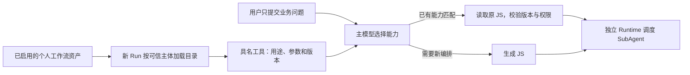
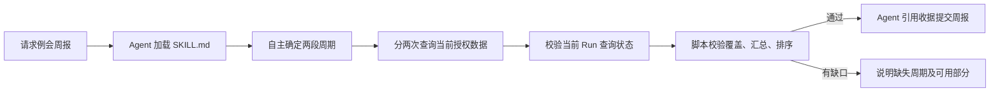

## 本课开发目标

- **动态 Workflow（渠道异动诊断）**：由 Agent 生成 JavaScript，串联和并行调度 SubAgent 完成渠道对比、商品贡献分析和独立复核。
- **动态 Workflow 的保存与复用**：用户可在 Chat 查看并确认保存已验证的脚本，后续分析可用同一脚本处理新的日期范围。
- **程序固定 Workflow（广告预算调整）**：用户直接请求或 Agent 诊断后调用同一套预设流程，校验证据和调整限额，生成待人工审核的提案。
- **Workflow in Skill（每周经营复盘）**：由 Agent 按 Skill 取数并调用内置脚本，校验数据覆盖、汇总渠道变化并生成结构化周报。

## 1. 一个 Agent，三种 Workflow

{{code:architecture}}

| 控制点 | Dynamic Workflow                    | 程序固定 Workflow                     | Workflow in Skill                      |
| ------ | ----------------------------------- | ------------------------------------- | -------------------------------------- |
| 启动   | Agent 判断是否生成或复用 JS         | 主意图进入固定分支，或 Agent 调用工具 | Agent 识别标准复盘需求                 |
| 步骤   | JS 控制 SubAgent 的串联、并行和汇合 | 程序锁定节点，两个入口共用            | Agent 决定何时调用，脚本执行确定性 SOP |
| 交付   | 核验后的结果，可保存的 JS 源码      | 待审提案                              | 结构化周报与已验证来源                 |

三个预设均通过当前工作区的只读连接查询课程发布的 Retail 数据。默认对比 2025-11-17 至 11-23 和 11-24 至 11-30。外层 Run 复用第 16 课的预算、验证和取消，提交唯一终态。

| 预设         | Retail 查询                          | 交付                     |
| ------------ | ------------------------------------ | ------------------------ |
| 渠道异动诊断 | 渠道对比、指定渠道商品贡献、独立复核 | 报告与可确认保存的 JS    |
| 广告预算提案 | 两周渠道实付对比                     | 带证据的待审提案         |
| 每周经营复盘 | 两次单期渠道实付查询                 | 内置脚本生成的三段式周报 |

## 2. Dynamic Workflow · 周期性渠道异动诊断

### 2.1 首次生成，下周复用

{{code:dynamic-diagram}}

| 演示     | 输入或操作                                             | 观察点                                                            |
| -------- | ------------------------------------------------------ | ----------------------------------------------------------------- |
| 首次运行 | 选择「渠道异动诊断」并提交预设问题                     | 诊断场景自动选择配置的 Pro，主 Agent 生成 JS 并在独立上下文执行。 |
| 下周复用 | 新对话只描述业务任务和新日期，模型按能力选择已注册工具 | 同一 ID、版本及源码摘要，脚本生成 0 次，子任务和查询重新运行。    |
| 临时查询 | 「这两周哪个渠道变化最大？」                           | Agent 可直接查数。单子任务工作流也可用同一执行接口。              |

### 2.2 JavaScript 怎样串联和并行调度 SubAgent

{{code:dynamic-runtime}}

{{code:dynamic-request}}

| 运行层           | 上下文与交接                                                                                                    |
| ---------------- | --------------------------------------------------------------------------------------------------------------- |
| Workflow Runtime | 接收源码和显式 `args`。`await` 等待渠道分析，`parallel` 启动商品贡献和口径复核。中间结果保留在脚本变量里。      |
| SubAgent         | 每个任务有独立的模型消息、校验与阶段控制。角色、日期和证据引用由 Host 校验后传入，共享父 Run 的预算和取消约束。 |
| 主 Agent         | 接收一个经验证的 WorkflowResult，再解读和提交。Chat 可展示获准任务状态与摘要。                                  |

`args` 包含基准期和本期。脚本返回状态和本次证据引用，由 Host 组装结果。Node runner 进程中的独立 QuickJS WASM 上下文执行源码。跨进程只交换有界 JSON。Agent Host 根据授权派发只读任务并校验证据。课堂单个 Workflow 最多启动 3 个 SubAgent，同一时间最多运行 2 个。

{{code:dynamic-core}}

### 2.3 Chat 查看详情与确认保存

{{code:save-sequence}}

| 阶段 | 执行规则                                                                                                   |
| ---- | ---------------------------------------------------------------------------------------------------------- |
| 邀请 | 新脚本核验通过、父 Run 完成后，以 `save_offer` 发送邀请 ID。每个 Agent 进程保留最多 256 条，最长 30 分钟。 |
| 详情 | 按当前租户、工作区和用户加载实际执行的 JS、两段日期、契约和查询结论。                                      |
| 确认 | 用户只提交名称，Agent 按邀请中的源码与契约插入或返回已有资产。                                             |
| 管理 | 在「插件 → Workflow」查看脚本、改名和启停。已启用资产在后续推理中自动注册，模型根据业务任务选用。          |

{{code:save-confirmation}}

### 2.4 workflow_asset 源码、索引与版本

`agent/main` 从 `0006` 升到 `0007`。资产保存源码与契约引用，子任务提示按角色和本次入参构造。

{{code:workflow-asset-ddl}}

| 字段或索引                                | 用途                                                                     |
| ----------------------------------------- | ------------------------------------------------------------------------ |
| `script_source`、`script_sha256`          | 保存实际执行的 JS 和 UTF-8 源码摘要。运行时按 ID 读取整份脚本。          |
| `runner_api_version`、`entry_contract`    | 绑定 hook、可用角色和入出参契约。                                        |
| `definition_version`、`metadata_revision` | 定义版本随资产冻结，改名和启停递增管理版本。旧 revision 更新返回 `409`。 |
| `pk_workflow_asset`                       | 按资产 ID 读取和管理，同时验证可信归属。                                 |
| `uq_workflow_asset_scope_script`          | 按租户、工作区、用户、运行时版本、业务契约和源码摘要去重。               |
| `ix_workflow_asset_scope_updated`         | 按归属与更新时间、ID 列表分页。Agent 可按名称查找已启用资产。            |

源码或契约变化后重新运行验证，再保存新资产。第 17 课完成临时子任务调度，第 25 课增加可持续运行的 Child Run 和授权轨迹下钻。

### 2.5 保存的代码成为模型工具

| 控制点     | 规则                                                                                                                               |
| ---------- | ---------------------------------------------------------------------------------------------------------------------------------- |
| 自动注册   | 保存成功的现有及新资产，在下次推理前生成 `workflow_<asset_id.hex>_v1` 工具。改名保持身份，重启后恢复相同绑定。                     |
| 模型发现   | 系统目录带名称、用途、输入输出和版本。首批 3 个资产直接装配工具 schema，其余按目录 ID 调用或搜索加载，单次模型请求最多 16 个工具。 |
| 参数与源码 | 模型只提供本轮日期。Host 从注册映射取得资产与版本，加载原 JS，源码与历史结果保留在执行侧。                                         |
| 停用与隔离 | 每轮目录过滤当前用户和工作区的启用资产，实际调用再次校验。停用后新调用被拒绝。                                                     |
| 用户看到   | 普通提问即可自动选用，过程显示实际工作流名称和版本。插件页负责管理，手动运行用于调试。                                             |

{{code:registered-workflow}}

## 3. 程序固定 Workflow · 广告预算调整提案

### 3.1 两个入口走同一个程序流程

{{code:fixed-diagram}}

| 入口       | 用户怎么问                                               | 流程如何取得证据                                                                      |
| ---------- | -------------------------------------------------------- | ------------------------------------------------------------------------------------- |
| 直接入口   | 「为课堂活动生成广告预算调整提案」                       | 日期与 Retail 绑定检查通过后，渠道 SubAgent 查询并核验实付数据。                      |
| Agent 工具 | 「先诊断渠道及商品变化，下滑达到课堂阈值再准备预算提案」 | Agent 在综合分析中调用 `prepare_budget_proposal`，固定流程从当前 Run 读取已核验证据。 |

两条路径都校验工作区、日期、证据和课堂调整上限，再进入同一个 `budget_decision` 待审节点。待审卡展示候选调整额、提案编号和诊断依据，实际预算写入次数为 0。

### 3.2 固定检查与待审收口

{{code:fixed-core}}

日期和 Retail 绑定可并行准备，两个结果都通过才推进。Agent 工具返回待审时停止模型循环，外层 Run 提交同一个等待合同。第 18 课在该等待点前接入 Action Adapter，第 19 课持久化审批与接续。

## 4. Workflow in Skill · 每周经营复盘

### 4.1 Skill 约束自主判断，脚本执行确定性 SOP

{{code:skill-instructions}}

{{code:skill-core}}

| 用户在周报中看到 | 来源                                         |
| ---------------- | -------------------------------------------- |
| 本周概览         | 脚本校验两个七天窗口，按整数分汇总实付金额。 |
| 渠道变化         | 脚本计算渠道差额并按绝对值排序，展示前三项。 |
| 下周跟踪         | 报告提醒继续跟踪变化最大的渠道。             |

更换有效时段时复用同一版本脚本。若一周查无数据，脚本指出缺失时段，保留另一周的已验证汇总，页面标记周报未完成。

## 5. 统一执行过程

{{code:execution-flow}}

| 维度       | 字段与展示规则                                                                        |
| ---------- | ------------------------------------------------------------------------------------- |
| 节点       | 分析、旁白、工具、Workflow、Skill、SubAgent、分组，各有类型图标。                     |
| 身份与更新 | id / parentId / revision；完整快照按 ID 更新，重复调用各有身份。                      |
| 来源与环境 | origin 表达内置或 MCP，executor 表达 service / QuickJS / Sandbox，两者独立。          |
| 编排       | parentId 表达包含，dependsOn 表达先决条件；parallel 分组来自执行器报告。              |
| 详情       | Workflow 名称 / 版本 / 生成或复用；Skill 加载或脚本；SubAgent 临时 Child Run ID。     |
| 安全展示   | summary 只含旁白；preview 可含已批准的有界输入输出摘要，沿用代码面板的复制与换行。    |
| 状态       | 准备、运行、成功、无数据、失败、取消、待处理、未确认，终态节点保持稳定。              |
| 界面       | 父子节点键盘展开，宽屏并行分支自适应并排，390 px 下纵向排列；最终回答到达后折叠一次。 |

{{code:execution-node}}

| 课次         | 接入边界                                                                           |
| ------------ | ---------------------------------------------------------------------------------- |
| 第 17 课     | 统一协议和真实现有链路投影、嵌套与并行样式。MCP / Sandbox 在体验指南展示协议示例。 |
| 第 18 课     | 真实工具来源、通用 Sandbox 环境和完整工具调度接入同一合同。                        |
| 第 19～20 课 | 持久化安全节点事件，沿用节点身份进行历史回补、续接和最终回答展示。                 |

单 Run 节点上限 256、树深 12 层、逻辑事件上限 1024；保持 4 MiB 流与 4 KiB 扩展上限。临时子任务的实时过程通过当前授权流查看。

## 6. 文件变化

{{code:files}}
