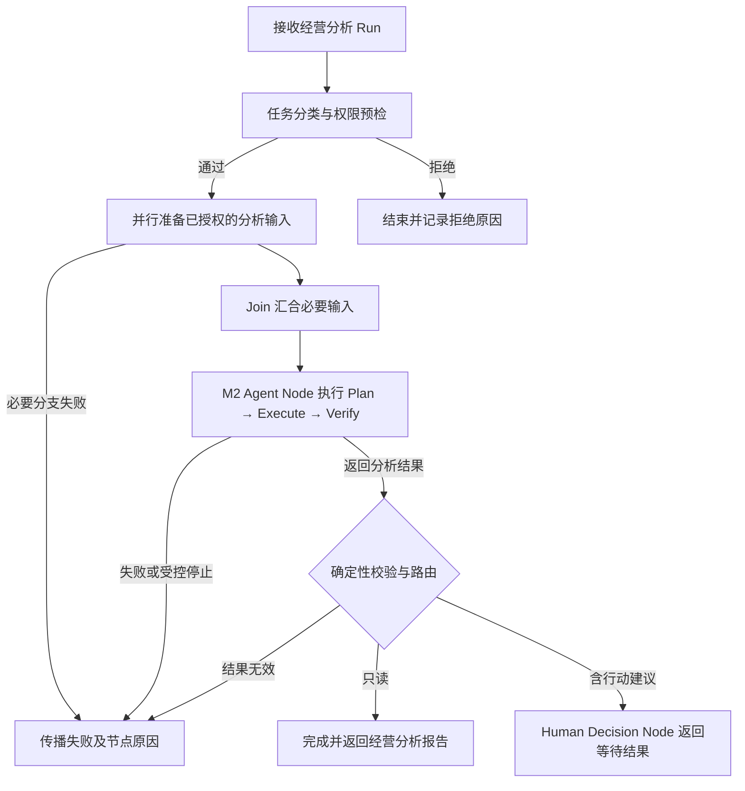

# PRD：第 17 课｜从自主循环到混合编排：构建 Workflow + Agent 执行引擎

> 状态 `draft` · 负责人 `andy` · Profile `standard` · 模板 [项目标准 PRD](../../_templates/PRD.tmpl.md)

[返回需求简报](../BRIEF.md)

## 1. 背景与目标

本课复用第 16 课的计划、执行和验证能力，以及第 15 课的真实 Retail 查询。第 17 课为它增加进程内 Workflow Shell，由确定性节点控制任务分类、权限预检和结果分流。自主分析在一个受预算和停止条件约束的 Agent Node 内完成。

- 用同一条经营分析 Run 验收顺序、条件分支和基础 Parallel / Join。
- 预检通过后交给 M2 Agent 执行 `Plan → Execute → Verify`，由 Workflow 接收并校验分析结果。
- 有效只读分析完成并返回报告，行动建议进入可检查的等待状态。权限、节点契约和 Agent 失败均有明确结果。
- 交付 M3 混合执行引擎、Workflow 控制流与混合架构 ADR。

## 2. 用户与场景

| 用户故事 ID | 目标用户     | 触发场景                | 用户故事                                                                    | 关联需求            |
| ----------- | ------------ | ----------------------- | --------------------------------------------------------------------------- | ------------------- |
| US-01       | 经营分析人员 | 提交华东区 GMV 下滑诊断 | 作为分析人员，我希望在授权范围内获得经营诊断报告，以便核对结论。            | FR-01、FR-03、FR-04 |
| US-02       | 经营分析人员 | 诊断结果含行动建议      | 作为分析人员，我希望结果表明哪项建议正在等待人工决策，以便交给后续审批。    | FR-04、FR-05        |
| US-03       | 课程学员     | 重跑诊断或注入节点失败  | 作为学员，我希望看到节点顺序、并行汇合和失败来源，以便沿 Run 解释执行路径。 | FR-02、FR-03、FR-06 |

## 3. 总体业务流程

### BF-01｜经营分析 Run

经营分析人员提交任务。Agent 应用依据可信上下文预检权限，按已定义的 Workflow 运行节点，最终给出报告、等待结果或可定位的失败。

并行节点与汇合条件由 Workflow 声明。只读与行动建议路径复用同一个 Agent Node。节点失败、结果无效或 M2 受控停止时，Workflow 保留来源和原因。

## 4. 功能需求

| 编号  | 优先级 | 触发与输入                                                            | 预期行为                                                                                                       | 可观察结果                                     | 关联需求             |
| ----- | ------ | --------------------------------------------------------------------- | -------------------------------------------------------------------------------------------------------------- | ---------------------------------------------- | -------------------- |
| FR-01 | P1     | 提交经营分析任务与可信主体、租户及工作区上下文                        | 创建或接收 Run，执行确定性任务分类与权限预检，校验允许进入的路径                                               | 通过后才启动分析节点，拒绝时记录原因           | BR-01                |
| FR-02 | P1     | Workflow 收到 Run 与节点图                                            | 以 Workflow、Node、Edge 表达 Sequence、Conditional Routing 与 Parallel / Join，校验各节点输入输出              | 可核对节点顺序、选中路径、分支结果和汇合输入   | BR-02、NFR-01        |
| FR-03 | P1     | Workflow 到达开放分析节点                                             | 将合法输入交给 M2 Agent Executor，沿用 M1 的 Retail 查询和 M2 的预算与停止规则，返回分析结果或可识别的停止原因 | Agent Node 输出对应当前 Run，Workflow 恢复控制 | BR-03                |
| FR-04 | P1     | Agent Node 返回分析结果                                               | 按确定性规则校验结果，依据结果类型选择只读报告或行动建议路径                                                   | 报告完成、进入人工等待或返回可定位的校验失败   | BR-02、BR-04         |
| FR-05 | P1     | 已校验的行动建议到达 Human Decision Node                              | 返回挂起语义与待决事项，结束本次进程内推进                                                                     | 可关联原 Run 和等待节点，后续动作未触发        | BR-04                |
| FR-06 | P1     | Workflow 或 Agent Node 发生关键状态变化、契约错误、执行失败或预算停止 | 记录结构化节点事件，保留来源和分类，按 Workflow 的失败规则收口                                                 | 能从 Run 关联到具体节点、阶段与失败或停止原因  | BR-02、BR-03、NFR-01 |

## 5. 业务规则与约束

| 规则 ID | 规则                                                                                                                                                    | 关联需求            |
| ------- | ------------------------------------------------------------------------------------------------------------------------------------------------------- | ------------------- |
| BR-01   | 权限由可信主体、租户、工作区和任务范围判定。课堂入口可接既有可信身份机制或显式教学夹具，模型输出和任务文本均无授权作用。                                | FR-01、FR-03        |
| BR-02   | 代码维护 Workflow 的图、路由和结果校验。顺序节点消费已验证的前驱输出。Join 在所有必要分支完成并通过输出校验后才继续。必要分支失败时不进入依赖节点。     | FR-02、FR-04、FR-06 |
| BR-03   | Agent Node 复用 M2 的工具契约、执行预算和停止原因。Workflow 将校验失败、工具/模型失败和预算停止区分开，保留节点与 Run 关联。                            | FR-03、FR-06        |
| BR-04   | 只读结果走报告分支。有行动建议的结果进入等待，携带 Run、等待节点和待决建议的标识或引用。M3 的等待接口在当前运行中可观察，第 19 课接入持久化审批与恢复。 | FR-04、FR-05        |

| 非功能 ID | 要求                                                                                        | 验证口径                                                                        |
| --------- | ------------------------------------------------------------------------------------------- | ------------------------------------------------------------------------------- |
| NFR-01    | 保持进程内执行。关键状态事件能按同一 Run 关联到节点、结果或原因。沿用既有模型和 Chat 行为。 | 用课堂夹具及故障注入检查事件链。运行既有 Agent 回归，验证模型和 Chat 契约兼容。 |

节点输入包含必要业务参数、Run 关联和受信授权范围。输出包含已校验的数据、失败原因或等待信息。Workflow、Node 与 Edge 分别描述整条路径、节点及节点之间的推进条件。具体类型和字段在技术设计定义。

## 6. 范围与依赖

- **交付范围**　`apps/agent` 内的轻量 Workflow Engine、节点契约、M2 Agent Node、错误传播、人工等待接口、课堂控制流和混合架构 ADR。
- **教学范围**　用同一经营任务比较 Python 原生编排、轻量状态机或 DAG、LangGraph、Temporal。分别评估图编排和持久执行。Loop、Subworkflow 和 Workflow-as-Tool 用于机制和组合方式讲解。实战采用 Workflow Shell + Autonomous Analysis Node。
- **本课边界**　本课的并行与汇合针对 Workflow 节点，Agent 内部的计划、验证和预算由 M2 管理。第 18 课接入工具级并发、取消和 Sandbox。人工决策节点返回可检查的等待结果，第 19 课实现持久等待、审批回调及恢复，第 20 课接入异步调度。
- **前置依赖**　[M2 受控自主执行](../../988-lesson-16-controlled-autonomy/BRIEF.md)的 Agent Executor、预算和 Verifier，以及[M1 真实 Retail 查询](../../989-lesson-15-agent-execution-kernel/BRIEF.md)的工具与观察契约。现有模型接口和固定三天样本 API 维持其契约。
- **课堂演示与验收**　先跑权限预检和只读报告路径，再让行动建议停在人工决策节点。另演示独立节点并行、必要分支失败和 M2 停止原因回传。对应 AC-01 至 AC-06。

## 7. 研发资源

| 资源 ID | 资源                                                                                                                                                                              | 用途                               |
| ------- | --------------------------------------------------------------------------------------------------------------------------------------------------------------------------------- | ---------------------------------- |
| RES-01  | [课次原始上下文](../context/source_context.md)、[实施上下文](../context/implementation_context.md)                                                                                | M3 教学边界、实战要求和演示        |
| RES-02  | [Agent 应用说明](../../../apps/agent/README.md)、[可信身份边界](../../../apps/agent/src/compass_agent/model_api.py)、[身份 DTO](../../../apps/agent/src/compass_agent/schemas.py) | 已有模型接口、可信主体和租户作用域 |
| RES-03  | [产品定义](../../999-compass-product-course-landing-app/spec/product-definition.md)                                                                                               | 经营分析角色与受控行动规则         |

## 8. 验收标准

### AC-01｜完成只读经营诊断

**关联**　FR-01、FR-02、FR-03、FR-04、FR-06、BR-01–BR-03、NFR-01

- **Given** 有权限的经营分析人员提交 Retail 渠道与商品分析。M1 的真实只读查询、已发布样本和 M2 执行器可用。
- **When** 执行 Workflow 的只读路径。
- **Then** 分类与权限预检在 Agent Node 前完成。M2 产生经过 Plan、Execute、Verify 的分析结果。Workflow 校验后完成只读报告。运行记录能按同一 Run 关联所经节点。
- **验证方式**　运行课堂主链，核对节点次序、M2 结果、路由和报告。

### AC-02｜拒绝越权请求

**关联**　FR-01、FR-06、BR-01

- **Given** 当前主体对请求中的租户、工作区或任务范围缺少授权。
- **When** 提交经营分析任务，或用请求字段及自然语言声明其他身份。
- **Then** 预检返回拒绝原因。Agent Node、模型调用和外部工具均未启动。
- **验证方式**　以允许和拒绝的教学身份运行同一输入，对照节点事件与调用计数。

### AC-03｜按契约执行 Sequence、Parallel / Join

**关联**　FR-02、FR-06、BR-02

- **Given** Workflow 有两个相互独立的必要分支和一个消费其输出的 Join 后继。
- **When** 两个分支以不同次序完成，再复跑并令其中一个分支失败或返回无效输出。
- **Then** 正常运行中，两分支可同时推进，后继在所需结果全部就绪后执行一次并取得两份对应输出。异常运行可定位失败分支，依赖节点不推进。
- **验证方式**　控制分支完成顺序和故障点，检查事件、Join 输入与调用次数。

### AC-04｜将行动建议停在人工决策点

**关联**　FR-04、FR-05、FR-06、BR-04

- **Given** Agent Node 的有效结果含行动建议。
- **When** Workflow 完成确定性校验并进入 Human Decision Node。
- **Then** 本次执行返回等待结果，可识别原 Run、等待节点与待决建议。报告完成与待人工决策是两种不同结果。审批后继动作调用次数为零。
- **验证方式**　用同一课堂案例切换只读与建议结果，核对路由、等待数据和动作计数。

### AC-05｜保留失败来源与受控停止原因

**关联**　FR-02、FR-03、FR-04、FR-06、BR-02、BR-03

- **Given** 权限预检已通过。
- **When** 分别注入节点输入输出校验失败、Agent 执行失败、M2 预算停止或最终结果校验失败。
- **Then** Run 给出相应原因，可定位 Workflow 节点或 Agent 阶段。报告和动作后继均未启动。
- **验证方式**　对每个故障点比较节点事件、返回原因及后继调用计数。

### AC-06｜复现课堂交付并检查兼容

**关联**　FR-01–FR-06、NFR-01

- **Given** M2 已可运行，既有模型和 Chat 契约有回归检查。
- **When** 运行 M3 教学用例及既有回归。
- **Then** 可展示报告、待决和失败三条路径。控制流与演示一致。ADR 分开说明图编排与持久执行的取舍，既有模型与 Chat 检查通过。
- **验证方式**　运行演示与相关回归，核对控制流和 ADR。

## 待确认事项

| 问题                                                         | 来源       | 影响范围            | 决策阶段 |
| ------------------------------------------------------------ | ---------- | ------------------- | -------- |
| 采用原生代码、轻量状态机还是图组件实现进程内 Workflow        | 实施上下文 | FR-02，ADR          | 技术设计 |
| 教学权限预检入口、路由条件以及并行分支失败后在途分支如何收束 | 实施上下文 | FR-01、FR-02、FR-04 | 技术设计 |

## 变更记录

| 日期       | 变更                                                   | 影响范围    |
| ---------- | ------------------------------------------------------ | ----------- |
| 2026-11-09 | 依据第五篇调整材料和 Compass 工程基线建立初稿          | M3          |
| 2026-11-10 | 明确复用真实 Retail 查询及节点并行、人审等待的验收边界 | 第 17 课 M3 |
