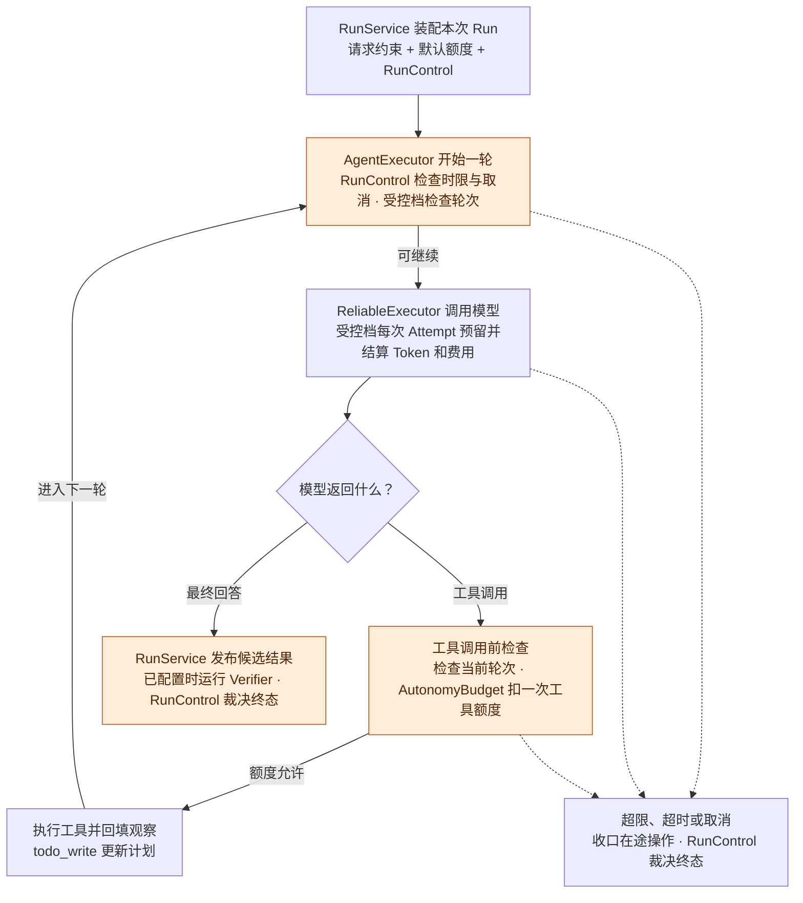
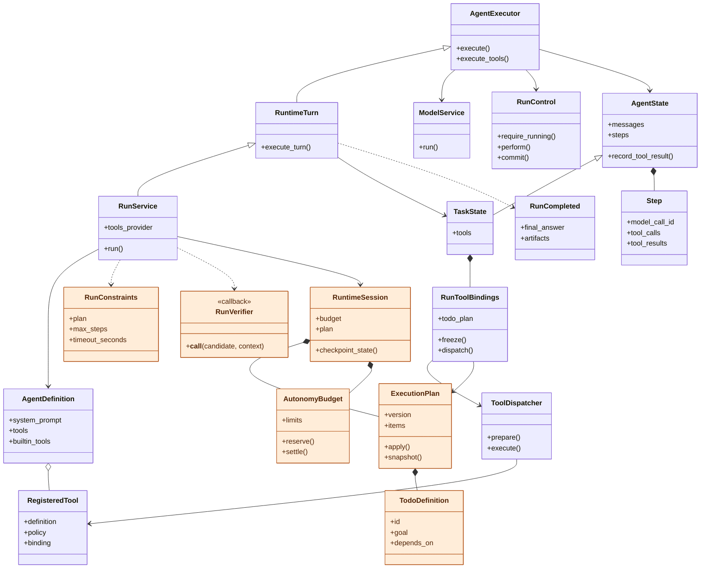
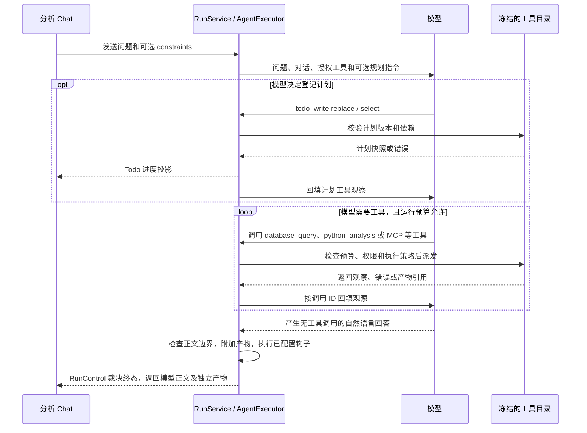

# 第 16 课 · 受控自主执行技术方案

> Profile `standard` · 沿用原技术方案结构 · 2026-11-14 按当前 Compass 源码修订

[需求简报](../BRIEF.md) · [原始 PRD 与验收标准](../spec/PRD.md) · [代码附录](CODE_DESIGN.md) · [HTML 阅读版](TECH_DESIGN.html)

本课保留同一 ReAct 循环、Todo 计划与运行预算。原 PRD 的固定零售工具、强制结论验收及提交工具属于早期设计。当前产品使用通用工具，模型依据实际观察生成正文。课程问题继续使用零售样本演示。

## 目标

- 实现 `todo_write` 待办工具，让模型在同一个 ReAct 循环里制定、推进和调整计划，支持 Plan-and-Execute。
- 提供可选的 Verifier 钩子，让业务层按任务传入核验规则，在发布结果前执行。
- 支持按次配置运行轮次和时限，由 Agent Runtime 执行预算与停止策略。

## 整体架构

**AgentExecutor 驱动同一个 ReAct 循环。** `RunService` 将本次请求的约束和应用默认配置接入执行。轮次、工具次数及模型用量按预算检查，`RunControl` 统一处理时限、取消和终态。



| 角色 | 负责的检查与依赖 |
| --- | --- |
| `RunService` | 读取请求中的 `maxSteps` 和应用配置。持久执行入口用保存的 `timeoutSeconds` 减去已用活跃时间，注册 `RunControl`。 |
| `AgentExecutor`、`RuntimeTurn` | `AgentExecutor` 在每轮启动前检查 `RunControl`，受控档再调用 `AutonomyBudget.require_step()`。模型返回工具调用时，普通路径由 `RuntimeTurn` 拦截达到显式轮次上限的批次；受控档在工具批次入口按已合并的轮次上限检查。 |
| `AutonomyBudget` | 工具实际进入执行前调用 `start_tool()`，检查并扣除一次额度。同一轮的多项工具分别计数。受控档由 `ReliableExecutor` 在每次 Attempt 前调用 `reserve()`，出站后按回执或保守上界 `settle()`。同一主生成的重试共用一个轮次。 |
| `RunControl` | `perform()` 以 Run 剩余时间和阶段时限中的较早者为准。取消或超时会结束在途阶段并核对清理状态。最终由 `commit()` 统一裁决。 |
| `RunService`、可选 Verifier | 已注册的 Verifier 依序核验候选结果。核验拒绝则生成失败候选；成功候选、预算耗尽和核验失败都交给 `RunControl.commit()`。 |

## Agent Runtime 类型设计

橙色框标出本课规划、受控运行及可选核验相关的类型。图中同时保留执行循环与通用工具装配的主要关系。



| 类型 | 当前职责 |
| --- | --- |
| `RunConstraints` | 接收每次请求的计划指令、轮次和时限。 |
| `RuntimeSession` | 受控档的 Run 内状态，汇总计划及预算并提供 Checkpoint 快照。未启用受控档时，`RunToolBindings` 仍可维护 Todo。 |
| `ExecutionPlan[T]`、`TodoDefinition` | 保存自然语言目标、依赖、当前项、版本和完成状态。`verified` 是 Todo 协议中的完成状态，由模型通过 `complete` 推进。 |
| `AutonomyLimits`、`AutonomyBudget` | 管理轮次、工具次数、Token 与费用额度，按模型 Attempt 预留及结算。 |
| `RunVerifier`、`VerificationContext` | 应用代码可注入的异步回调，依次执行全局、场景和调用级钩子。默认 Chat 的回调列表为空。 |

## 工具、计划与最终回答



| 接点 | 当前行为 |
| --- | --- |
| `todo_write` | 支持 `replace`、`select`、`complete`、`skip`。通过 `baseVersion` 检测过期操作，拒绝环依赖、重复 ID、未满足前置依赖及非法状态转换。仅可跳过无其他事项依赖的可选项。完成动作只接收 Todo ID 和可选的下一项 ID。待办依赖检查用于计划状态转换。 |
| `database_query` | 工作区注入 PostgreSQL 注册项，支持列连接、列授权表、查看字段和执行单条受限只读查询。多连接可传 `connectionId`，SQL 表名须带 schema。支持 CTE、JOIN、聚合、排序、LIMIT。查询最多返回 50 行、4 KiB；元数据分页可返回 `nextOffset`。工具检查工作区绑定与当前授权，数据库账号及 RLS 控制可见数据。 |
| `python_analysis` | Sandbox 可用时装配。接受当前 owner 和 Run 可用的 `source_query_id` 与代码，按授权输入执行计算，返回结构化观察及可选 PNG。 |
| 已配置的 MCP | 按 Run 发现并装配，沿用统一预算、权限、审批、取消和恢复机制。 |
| 正文与独立产物 | `RuntimeTurn` 接收模型的无工具调用响应，校验正文非空及编码大小。模型可按用户要求写段落、列表或表格；通用路径的兼容文件字段为 `status: none`，工具产物通过 `artifacts` 交付。 |
| 可选核验 | 注册回调后，`RunService` 在候选终态发布前用隔离快照依序执行回调，并关闭实时正文增量。回调拒绝时记录 `verification_rejected`。新请求仅接收计划、轮次和时限。 |

## 请求、预算与停止

```json 单 Run 约束示例
{
  "question": "先比较两周渠道实付金额，再分析主要商品的贡献。",
  "constraints": {
    "plan": "required",
    "maxSteps": 2,
    "timeoutSeconds": 5
  }
}
```

课堂三个预置分别填入 `plan: required`、`plan: required` 加 `maxSteps: 2`、`timeoutSeconds: 5`。发出前可编辑问题和约束。

| 边界 | 生效位置与口径 |
| --- | --- |
| `plan` | `required` 追加「先调用 `todo_write` 登记计划」到模型指令。模型可用 Todo 取决于本轮工具目录及模型能力。Runtime 对待办修改执行状态校验，模型仍可直接生成正文或先调用其他已授权工具。 |
| `maxSteps` | 接受 1～100，最多运行 100 轮主生成。达到请求显式上限或受控档轮次上限时，该轮可以生成正文；若它返回工具调用，则在执行前停止。 |
| `timeoutSeconds` | 接受 1～600，默认 600。持久 Run 保存原始值并按已用活跃时间恢复剩余时限。受控档的单次主生成另受 25 秒阶段限额。 |
| 工具、Token、费用 | 进入工具执行前按单次调用计量，默认每个 Run 200 次。开启受控档后，按模型档案检查每次 Attempt，默认 160,000 Token 和 0.50 美元。分类与底层重试消耗模型用量，未知回执按上界结算。 |
| 受控档 | `COMPASS_CONTROLLED_AUTONOMY_ENABLED` 控制受控模型计量，默认关闭。常规路径同样执行轮次、时限和工具调用次数限制，支持启用的 Todo。 |
| 停止与清理 | 模型或工具派发遇到额度耗尽、超时或取消时收口。清理缺少确认时保留 `cleanup_unconfirmed`。通用路径的批次派发当前以预算、期限和权限为边界；旧零售场景的重复查询及无进展计数已经退出主路径。 |
| 历史请求与恢复 | 历史字段由 `history.py` 处理。新请求拒绝旧 `showcase` 与 `constraints.verification`；旧课程执行契约可能返回 `workflow_unavailable`。恢复会验证冻结工具目录，已下线工具可能触发 `tool_catalog_changed`。 |

例如设置 `maxSteps: 2` 时，第 1 轮如果调用 `todo_write`，就用掉 1 个模型轮次和 1 次工具额度。第 2 轮仍可以依据已有观察作答。如果第 2 轮又请求查库，Runtime 会在查库前以轮次上限收口。

## Chat 交互与可观测性

| 交互 | 当前实现 |
| --- | --- |
| 计划浮条 | `compass.autonomy.action` 携带计划版本、当前项和事项状态。输入框上方显示环形进度、当前步数和任务名；悬停、点击或键盘展开。完成后短暂显示完成状态并收起。 |
| 分析过程 | 运行中展示最近事件和状态，结束后显示用时。工具节点可展开获授权的入参、结果预览和失败原因。 |
| 最终回答 | 无发布钩子时可呈现模型正文增量，终态保存整段正文。历史消息直接展示已保存的答案。 |
| 审计与恢复 | 保存模型 Attempt、工具绑定、执行节点、Checkpoint 和终态。持久恢复校验所有权与工具目录，并回放已接受记录。 |

## 关键文件

```text 当前源码与课内变化
apps/agent/src/compass_agent/
├── api/runs.py、api/sessions.py          [调整] 组装通用 Agent 并受理 Run
├── schemas.py                           [调整] 单 Run 约束、Todo、终态协议
├── harness/
│   ├── executor.py                      [调整] 共用模型循环与派发边界
│   ├── context.py、prompts.py            [调整] 通用系统提示与模型输入
│   └── autonomy.py、verification.py     [新增] 通用预算与可选结果钩子
├── runtime/
│   ├── service.py、turn.py               [调整] 装配工具、接收模型正文
│   ├── session.py、tool_bindings.py      [调整] 通用计划、工具目录及观察回填
│   └── history.py、durable_service.py    [调整] 历史请求与持久恢复
├── data_connections/tools.py            [新增] 按当前授权注入数据库工具
└── tools/
    ├── catalog.py                       [调整] 登记当前三种通用内置能力
    ├── builtin/todo_write/               [新增] 自然语言计划与依赖状态
    ├── builtin/database_query/          [调整] 授权 PostgreSQL 查询与有界观察
    └── builtin/python_analysis/         [调整] Sandbox 计算与可选产物
apps/web/src/components/
├── analysis-composer.tsx                [调整] 三种预置与约束编辑
├── analysis-todo-panel.tsx               [新增] 输入框上方计划浮条
└── analysis-run-turn.tsx                 [调整] 过程状态、正文与附件
```

[代码附录](CODE_DESIGN.md) 展开工具装配和正文完成分支。

## 课堂演示与验收入口

- 用已授权的样本数据库发送渠道与商品问题，分别直接发送和选择先列计划。观察同一循环中的 Todo、表发现、SQL 结果与最终答案。
- 把同一问题改成一句话摘要或表格，观察模型如何根据要求和实际查询结果组织正文。
- 分别使用最多两轮和 5 秒超时预置。观察最后一轮能否直接回答，以及额度或时限触发后的终态。暂停恢复时核对原约束和活跃执行时长。
- 本地设置与验证入口见 [课堂运行说明](../../../docs/lesson-16-controlled-autonomy.md)。

## 变更记录

| 日期 | 更新 |
| --- | --- |
| 2026-11-10 | 完成受控自主执行初始技术设计。 |
| 2026-11-14 | 同步 Harness、Runtime、工具目录与持久提交入口。 |
| 2026-11-14 | 更新模型自主回答、通用 Todo 和三种受控演示，同步 Home 课程资料。 |
| 2026-11-14 | 跟进通用工具重构，更新产品组合根、旧课堂执行路径、UML 和请求约束。 |
