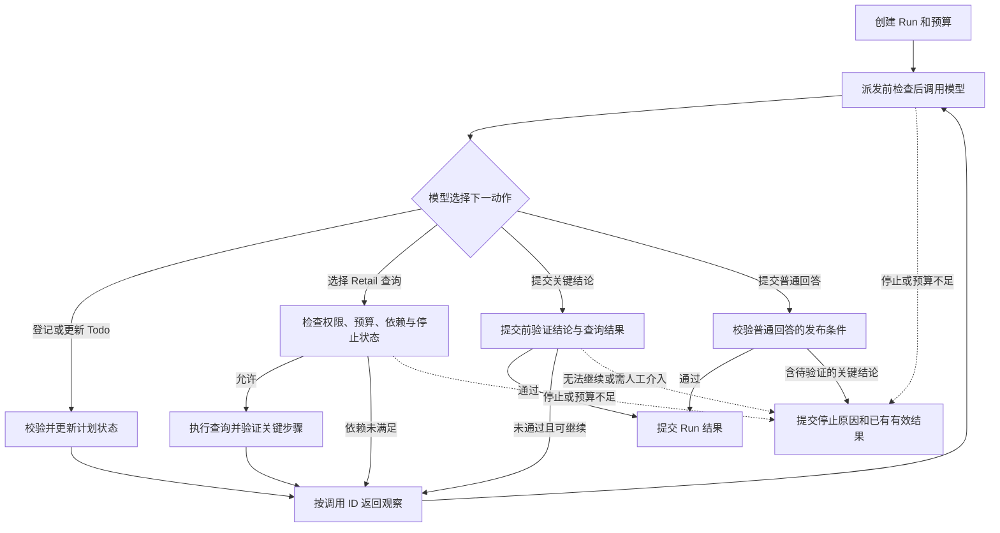

# PRD｜第 16 课 · 从 ReAct 到 Plan-and-Execute：建立受控自主执行机制

> 状态 `draft` · 负责人 andy · Profile `standard`

需求与验收标准以本文为准。课程原始上下文和实施素材保留初始方案。使用 [Compass 标准 PRD 模板](../../_templates/PRD.tmpl.md)。

[返回需求简报](../BRIEF.md) · [素材索引](../context/_INDEX.md)

## 1. 背景与目标

本课以第 15 课的同步 AgentExecutor 和单一真实 Retail 查询工具为前置。复杂经营诊断还需要表达步骤依赖、检查中间结果和关键结论，并在多次尝试后有明确的停止条件。本课为 Compass 增加 M2 受控自主执行能力。

- 在第 15 课的同一个 ReAct 循环中加入 **Todo-driven Plan-and-Execute**。模型根据任务、已有观察和提示词决定直接行动、登记 Todo 或调整计划。用户可以要求先列计划。
- Runtime 独立验证关键步骤和最终结论。验证失败时，模型根据反馈选择重查或调整计划，Runtime 按预算和停止规则控制下一次派发。
- 确定性地执行步数、工具次数、Token、成本和时间约束，记录可区分的结束原因。

## 2. 用户与场景

| 用户故事 ID | 目标用户       | 触发场景                                             | 用户故事                                                                                     | 关联需求                   |
| ----------- | -------------- | ---------------------------------------------------- | -------------------------------------------------------------------------------------------- | -------------------------- |
| US-01       | 经营分析使用者 | 提交需要比较渠道实付金额并追查商品明细的 Retail 分析 | 我希望 Compass 能按任务复杂度管理分析步骤，也能按我的要求先列计划，再用核实的数据给出分析。  | FR-01、FR-02、FR-03、FR-04 |
| US-02       | 经营分析使用者 | 查询结果缺失、步骤失败或运行达到资源上限             | 我希望 Compass 适度重试或修改计划。任务无法继续时，我需要明确原因及可用的已验证结果。        | FR-04、FR-05、FR-06、FR-07 |
| US-03       | 课堂学员       | 对照直接行动与 Todo 规划，并注入数据异常             | 我希望看到计划、实际执行、验证和预算记录，以便理解模型为什么调整计划、Runtime 何时停止派发。 | FR-01～FR-08               |

## 3. 总体业务流程

### BF-01｜同一 ReAct 循环中的受控经营诊断

用户通过 M1 入口发起 Run。模型依据提示词、问题和工具观察选择下一动作。直接查数与 Todo 规划使用同一条循环。模型可在运行中登记计划，例如查完渠道后发现还需要分解和核对商品数据。

模型通过 `todo_write` 登记或修改 Todo，选择要推进的事项，并调用实际业务工具。Runtime 检查模型选定事项的依赖及派发条件。验证失败时，Runtime 返回原因和仍可用的观察，模型在同一循环中选择重查或修改后续事项。关键 Retail 结论通过 `submit_analysis` 提交待核对的结论与来源查询，Runtime 在成功终态前完成独立校验。预算、期限与停止状态贯穿全程。

## 4. 功能需求

### 4.1 新增需求

| 需求编号 | 触发条件                                             | 输入                                                                               | 预期行为                                                                                                                                                                    | 输出或结果                                 | 关联需求编号                      |
| -------- | ---------------------------------------------------- | ---------------------------------------------------------------------------------- | --------------------------------------------------------------------------------------------------------------------------------------------------------------------------- | ------------------------------------------ | --------------------------------- |
| FR-01    | 开始一次经营分析 Run                                 | 任务、用户的规划要求、当前观察                                                     | 模型默认自主决定直接行动或通过 Todo 规划，并可在 Run 中途建立计划。用户明确要求先列计划时，模型先登记计划再发出首个业务工具调用。共用 M1 Run 入口、模型循环和工具观察契约。 | 同一 Run 可识别是否使用计划及首次登记时点  | BR-01、NFR-01                     |
| FR-02    | 模型选择建立计划或调整未完成事项                     | 任务目标、已有观察、带标识与依赖的 Todo                                            | 模型调用 `todo_write` 提交计划。Runtime 校验事项标识、依赖有效性和状态转换，通过后返回当前计划。拒绝时保留上一个有效版本并返回原因。                                        | 已接受的计划版本或可处理的计划错误         | BR-02、FR-05                      |
| FR-03    | 模型选定事项并请求执行或跳过                         | 当前计划、实际执行结果、拟调用工具                                                 | 模型选择下一事项和工具。Runtime 检查所选事项的依赖，校验通过才派发，并关联实际调用和结果。符合条件的跳过保留原因。                                                          | 事项对应的调用、成功、失败、跳过或依赖拒绝 | BR-02、BR-03、FR-04、FR-06        |
| FR-04    | 关键步骤产生结果、模型申请完成关键事项或提交经营结论 | 步骤目标、结构化结果、工具观察及来源查询 ID                                        | Verifier 分别验证步骤和 Run 结果，覆盖规则、Schema 和工具结果验证。关键 Retail 结论通过 `submit_analysis` 提交。校验通过才确认关键事项或成功发布结论。                      | 独立验证状态、规则及失败原因               | BR-03、FR-05                      |
| FR-05    | 计划更新被拒绝、步骤失效或验证失败                   | 失败观察、已验证结果、依赖和剩余预算                                               | 模型根据反馈选择有限重查或通过 `todo_write` 修改受影响的未完成事项。Runtime 检查更新、保留仍有效的已验证结果，并在限制触发或需人工介入时停止推进。                          | 新尝试、计划修订或明确的停止结果           | BR-02、BR-03、BR-04、FR-06、FR-07 |
| FR-06    | Run 开始或将要执行下一次工作                         | Max Steps、Max Tool Calls、Token Budget、Cost Budget、Deadline、执行超时和已知消耗 | AutonomyBudget 计量并检查硬约束。模型、工具和重试均受 Run 剩余额度及期限约束。                                                                                              | 可读取的消耗、剩余额度和拒绝原因           | BR-04、BR-05、NFR-02              |
| FR-07    | 达到结果或检测到停止条件                             | 验证结果、连续失败次数、进展、重复调用、预算和期限                                 | StopPolicy 由确定性规则结束执行。记录成功、失败、预算耗尽或需要人工介入，并能区分超时、连续失败、重复调用和无进展等原因。                                                   | Run 结果、停止原因和可用的已验证结果       | BR-03、BR-04、BR-06、NFR-02       |
| FR-08    | 演示 M2 交付                                         | 同一已发布 Retail 样本、直接行动与 Todo 规划、受控异常和可调预算                   | 在同一执行入口演示模型自主行动、先列计划再执行、验证失败后的计划调整及预算不足时停止派发。配套范式对照和预算与停止策略说明。                                                | M2 可运行演示及课堂材料                    | FR-01～FR-07                      |

### 4.2 兼容行为

M1 的多轮 Tool Calling 和无计划回答路径继续可用。M2 在同一循环中增加 Todo 观察及共享的预算、验证与停止检查。既有分析权限、只读范围和终止清理契约沿用 M1。

## 6. 业务规则与约束

| 规则 ID | 业务规则                                                                                                                                                                                                             | 关联需求                   |
| ------- | -------------------------------------------------------------------------------------------------------------------------------------------------------------------------------------------------------------------- | -------------------------- |
| BR-01   | 同一 ReAct 循环内，模型根据任务复杂度、已有观察和用户要求决定是否规划，并选择每轮下一动作。直接行动与 Todo 规划共享第四篇模型可靠执行和 M1 工具分发。                                                                | FR-01、FR-06               |
| BR-02   | Todo 计划和实际执行记录分别维护。事项使用稳定 ID，依赖指向有效事项且无环。模型提交计划更新，Runtime 校验更新并保留有效观察。无效计划更新不会派发该计划中的工具。                                                     | FR-02、FR-03、FR-05        |
| BR-03   | Runtime 在派发前检查模型选定事项的依赖，依据规则确认跳过及其影响。Verifier 按规则、Schema 和真实工具结果独立验证。关键事项完成与关键结论提交均以校验结果为准，关键经营结论的验证规则同时适用于直接行动和 Todo 规划。 | FR-03、FR-04、FR-05、FR-07 |
| BR-04   | 重查和计划修订继续使用原 Run 的预算与 Deadline。达到重试、连续失败、重复调用或无进展阈值时，Runtime 停止派发。仅改写 Todo 文案或顺序不会刷新无进展计数。                                                             | FR-05、FR-06、FR-07        |
| BR-05   | 步数和工具调用按实际执行计入。模型用量在 Run 层聚合，使用第四篇的逻辑调用和 Attempt 摘要区分一次模型调用与底层重试的消耗，避免重复计量。缺失的用量或成本可辨识，并按明确的预算准入规则处理。                         | FR-06                      |
| BR-06   | 需要人工介入时返回该结果及原因，交还控制权。持久化等待、审批与恢复由第 19 课实现。                                                                                                                                   | FR-07                      |

| 非功能 ID | 要求                                                                                                                                         | 验证口径                                                    |
| --------- | -------------------------------------------------------------------------------------------------------------------------------------------- | ----------------------------------------------------------- |
| NFR-01    | 沿用 M1 同步进程内入口、单条模型循环、观察消息和模型调用能力。Todo 计划及执行记录保存在当前 Run 内存。                                       | 执行无计划的 M1 多轮样例和同一 Run 中建立、调整计划的样例。 |
| NFR-02    | 模型调用、业务工具、重试和计划更新经过适用的硬约束检查。在途执行受剩余期限与执行超时约束。终止后停止派发，成功提交前重新核对验证与停止状态。 | 核对派发计数、结果提交记录、耗时和终止原因。                |

## 7. 范围与依赖

- **本课实现**　在 `apps/agent` 的同一个 ReAct 循环中加入规划提示词、`todo_write`、Run 内计划状态和关键结论提交。模型承担规划、事项选择与重规划，Runtime 承担独立 Verifier、AutonomyBudget、StopPolicy 和终态提交。沿用 M1 的同步进程内执行。
- **前置依赖**　沿用[第 15 课](../../989-lesson-15-agent-execution-kernel/BRIEF.md)的 Run 入口、代码内角色指令、真实 Retail 只读工具与观察契约，以及[派发前和提交前检查点](../../989-lesson-15-agent-execution-kernel/design/TECH_DESIGN.md#两个运行检查点)，复用第四篇的可靠模型执行和用量记录。课堂计划使用该工具支持的查询维度。
- **本课边界**　本课负责单个 Run 的规划、验证、预算检查和停止。第 17 课负责编排业务阶段和人审节点，第 18 课负责工具后端实际执行的限额、取消与清理。人工介入在 M2 返回移交结果，持久审批和恢复在 M5，异步调度与租户配额在 M6。系统级 Eval 在第九篇。
- **教学与演示**　用同一 Retail 任务演示直接行动、模型维护 Todo、验证反馈后的重查或计划调整，再压低预算验证下一次派发停止。对应 AC-01 至 AC-08。

## 8. 研发资源与数据契约

| 资源 ID | 资源                                                                                                                                               | 用途                                      |
| ------- | -------------------------------------------------------------------------------------------------------------------------------------------------- | ----------------------------------------- |
| RES-01  | [课程原始上下文](../context/source_context.md)、[Compass 实施上下文](../context/implementation_context.md)                                         | M2 范围、异常样例与课堂交付               |
| RES-02  | [第 15 课 M1](../../989-lesson-15-agent-execution-kernel/BRIEF.md)                                                                                 | 上一课的 Run、Step、ToolResult 和事件契约 |
| RES-03  | [可靠执行器](../../../apps/agent/src/compass_agent/llm/executor.py)、[模型执行摘要与用量 Schema](../../../apps/agent/src/compass_agent/schemas.py) | 单次逻辑调用与 Attempt 的既有用量口径     |

| 运行对象         | 最小语义                                                                                                     |
| ---------------- | ------------------------------------------------------------------------------------------------------------ |
| ExecutionPlan    | 当前 Run 的 Todo 计划，包含稳定事项 ID、目标、依赖、模型申请的进度和可区分的版本。Runtime 保有已接受的状态。 |
| 计划步骤执行记录 | 关联 Todo 事项和实际 Runtime Step、工具调用及验证结果。区分实际执行、跳过、失败和计划调整。                  |
| 验证结果         | 记录验证层级、目标、规则、是否通过及失败原因。                                                               |
| AutonomyBudget   | 记录配置上限、已计量消耗、剩余约束与拒绝原因。                                                               |
| Run 结果         | 沿用 M1 的运行结果入口，记录是否使用计划、结束原因及可用的已验证结果。                                       |

## 9. 验收标准

### AC-01｜模型在同一入口直接行动或建立计划

**关联**　FR-01、BR-01、NFR-01

- **Given**　同一 Agent 配置、已发布 Retail 样本及可控的模型响应。
- **When**　运行无需规划的样例、明确要求先列计划的同题样例，以及查完渠道后才需要建立计划的样例。
- **Then**　直接行动样例无需 Todo 可完成原有多轮调用。先列计划样例在首个业务工具前登记 Todo。中途规划样例在同一个 Run 内登记计划并沿用已取得的观察。三种路径都通过同一模型循环、工具分发和观察契约执行。
- **验证方式**　核对 Run ID、`todo_write` 发生时点、实际工具调用和结果。

### AC-02｜模型选事项，Runtime 校验依赖和实际进度

**关联**　FR-02、FR-03、BR-02、BR-03

- **Given**　计划含两个就绪候选事项、一个仍有前置依赖的事项和一个可按规则跳过的事项。另准备含无效依赖的计划更新。
- **When**　模型选择不同的就绪事项，尝试执行依赖未满足的事项，申请跳过并提交无效计划更新。
- **Then**　按模型选择推进就绪事项。依赖未满足时返回原因且业务工具调用次数为零。合法跳过保留原因，计划可与实际进度对照。无效更新被拒绝，上一个有效计划及已完成记录仍可用。
- **验证方式**　对照模型调用、Todo 版本、依赖检查、跳过原因及实际派发计数。

### AC-03｜步骤和最终结论均能独立验证

**关联**　FR-04、FR-07、BR-03

- **Given**　准备真实查询的正常结果、结构不符的步骤结果，以及与查询结果不符的关键结论。
- **When**　模型申请完成关键 Todo，分别以普通回复和 `submit_analysis` 提交关键结论，并为后者提供来源查询。
- **Then**　正常样例通过。结构问题与结论不符得到不同层级的失败记录。被拒绝的完成申请不会确认该事项，未经验证的关键结论不会发布成功终态。提交动作校验失败且预算允许时，失败原因按原工具调用 ID 回到模型。
- **验证方式**　构造规则、Schema 和工具结果的通过与失败样例，核对验证层级、配对观察及最终提交。对直接行动与 Todo 路径执行相同的关键结论校验。

### AC-04｜模型根据验证反馈有限重查或修订计划

**关联**　FR-03、FR-04、FR-05、BR-02、BR-03、BR-04

- **Given**　渠道汇总已通过验证，后续商品查询缺数。准备重查可恢复、需要修改后续 Todo、以及持续失败三类样例。
- **When**　Runtime 返回失败观察，模型决定下一动作。
- **Then**　可恢复样例中，模型重查或提交后续 Todo 更新。所有动作在原 Run 执行，仍有效的已验证渠道汇总可复用。持续失败时由 Runtime 在配置边界内停止，保留验证失败及结束原因。
- **验证方式**　对照模型选择、计划修订、工具次数、已验证结果复用和停止状态。

### AC-05｜预算在派发前生效

**关联**　FR-05、FR-06、FR-07、BR-04、BR-05、NFR-02

- **Given**　分别配置仅够完成部分工作的 Max Steps、Max Tool Calls、Token Budget、Cost Budget，并提供已知用量、一次模型层重试和用量缺失样本。
- **When**　下一步正常执行、重试或重规划需要消耗已不足的额度。
- **Then**　对应调用在派发前被拒绝，结果可定位耗尽维度。原 Run 的已计量用量连续累计，单次模型调用内部重试按实际摘要入账，缺失用量按确定的准入规则处理。
- **验证方式**　逐维运行边界用例，核对实际调用计数、逻辑调用摘要、计量记录及停止原因。

### AC-06｜期限、失败和无进展可受控停止

**关联**　FR-06、FR-07、BR-04、NFR-02

- **Given**　分别注入过期 Deadline、单次执行超时、连续失败、超过限额的重复调用和持续无进展。无进展样例包含反复改写 Todo 文案。
- **When**　StopPolicy 检测对应条件。
- **Then**　Run 停止派发新工作，输出可区分的终止原因。超时样例在期限约束内停止推进。
- **验证方式**　使用可控时钟与工具样本核对结束结果和停止后的分发计数。

### AC-07｜交回人工处置

**关联**　FR-07、BR-06

- **Given**　某个验证结果触发已配置的人工介入条件。
- **When**　StopPolicy 处理该结果。
- **Then**　原 Run 返回需要人工介入的结果、原因和已有的有效观察。控制权交回调用方，后续模型和工具调用计数保持稳定。
- **验证方式**　用受控规则触发移交条件，检查响应及 Run 事件。

### AC-08｜课堂可复现正常、修正和停止

**关联**　FR-08

- **Given**　演示说明、执行范式对照、预算与停止策略，以及可切换的数据异常和低预算样本。
- **When**　从同一入口分别运行直接行动、先列计划、数据缺失后的修正和预算耗尽。
- **Then**　学员能用同一组事件定位模型选择、计划修订、验证结论与 Runtime 停止原因。对照材料说明任务复杂度、规划成本、环境变化和验证要求如何影响是否建立计划。
- **验证方式**　按演示说明复现 AC-01、AC-04、AC-05 并逐项对照策略材料。

## 待确认事项

| 问题                                                                            | 来源                     | 影响                       | 阻塞 PRD | 决策环节 |
| ------------------------------------------------------------------------------- | ------------------------ | -------------------------- | -------- | -------- |
| 课堂规划提示词的具体触发提示、可验证指标与缺数样本。                            | 素材索引及课次原始上下文 | FR-01、FR-02、FR-04、FR-08 | 否       | 技术设计 |
| 课堂预算档位、调用的成本与 Token 上界、缺失用量处理，以及停止条件的可复现阈值。 | Compass 实施上下文       | FR-05～FR-07、AC-05、AC-06 | 否       | 技术设计 |

## 变更记录

| 日期       | 变更                                                                                                | 范围                       |
| ---------- | --------------------------------------------------------------------------------------------------- | -------------------------- |
| 2026-11-09 | 形成标准版 PRD 草案                                                                                 | 第 16 课 M2                |
| 2026-11-10 | 衔接 M1 真实 Retail 工具，明确计划演示、验证与单 Run 预算边界                                       | 第 16 课 M2                |
| 2026-11-10 | 改用 Todo-driven Plan-and-Execute，同一模型循环负责规划、推进与重规划，Runtime 负责验证、预算和停止 | FR-01～FR-08、AC-01～AC-08 |
