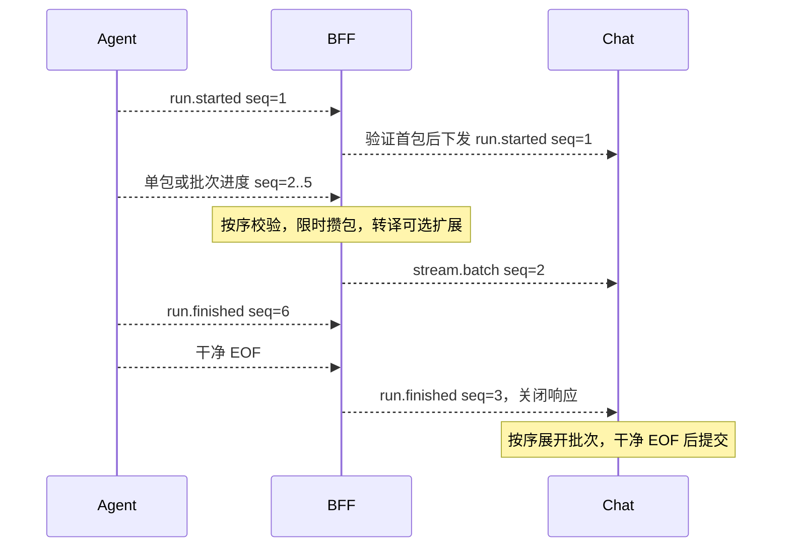

# 第 15 课 · Run 流式数据包协议

[返回技术方案](TECH_DESIGN.md) · [Agent DTO 与编码器](stream-reference/stream_contract.py) · [BFF 与页面解码器](stream-reference/stream.ts) · [协议验证样例](stream-reference/stream.test.ts)

## 传输与包信封

Agent → BFF 和 BFF → Chat 都使用 `compass.run` v1。传输为现有分析启动 POST 的 `text/event-stream` 响应。SSE 的每个数据帧承载一个 JSON 包，格式为 `data: <JSON>\n\n`，读端支持 LF 和 CRLF。HTTP 分块可以在任意字节边界截断，读端按 UTF-8 和 SSE 帧界线重组。SSE 注释 `: keepalive` 不占序号。两段响应均为 `private, no-store`，关闭代理缓冲。终止控制走既有独立 JSON 接口。

| 字段        | 类型                   | 语义                                     |
| ----------- | ---------------------- | ---------------------------------------- |
| `protocol`  | 字面量 `"compass.run"` | 协议标识                                 |
| `version`   | 整数 `1`               | 当前链路使用的主版本                     |
| `requestId` | UUID 字符串            | 浏览器生成，两段沿用                     |
| `runId`     | UUID 字符串            | Agent 生成，两段沿用                     |
| `seq`       | 正整数                 | 每段 HTTP 响应从 1 连续递增，按包计数    |
| `event`     | `StreamEvent`          | 严格判别联合，字段为 `type` 和 `payload` |

每个普通包承载一个逻辑事件。批次包承载有序的内层事件，内层沿用外层版本、请求和 Run ID，使用外层序号和数组位置定位。BFF 重新编排下游包序号，Step 和 ToolCall 的业务标识保持稳定。包序号适用于当前连接，持久事件游标由续流课次定义。

```json
{
  "protocol": "compass.run",
  "version": 1,
  "requestId": "00000000-0000-4000-8000-000000000001",
  "runId": "00000000-0000-4000-8000-000000000002",
  "seq": 1,
  "event": { "type": "run.started", "payload": {} }
}
```

## 事件类型

字段、字面量联合、常量和运行形状的真源是 [Python DTO](stream-reference/stream_contract.py)。以下表按处理语义索引这些类型。

| `event.type`       | 主要 payload 字段                                      | 次序及处理                                                                  |
| ------------------ | ------------------------------------------------------ | --------------------------------------------------------------------------- |
| `run.started`      | 空对象                                                 | 每段首包，独立发送，先于外部派发。                                          |
| `run.routed`       | `providerId, modelLabel, sceneId, toolsEnabled`        | 至多一条，在首个 Step 之前。                                                |
| `step.started`     | `stepId, stepIndex, modelCallId`                       | 顺序打开 Step。                                                             |
| `tool.started`     | `stepId, toolCallId, toolIndex, toolKind, params`      | 同 Step 按原顺序。仅公开已校验参数，非法调用参数为空。                      |
| `tool.finished`    | 同一调用标识，加 `status` 和 `rowCount` 或 `errorCode` | 与已打开调用配对。`ok`、`empty`、`error` 各有严格分支。                     |
| `step.finished`    | `stepId, status`                                       | 关闭当前 Step。失败或停止可带尚未结束的调用，前端收口相应卡片。             |
| `run.finished`     | `RunResult`                                            | 独立终态包。完成才含 `finalAnswer` 和 `file`。                              |
| `stream.batch`     | 有序 `ProgressEvent[]`                                 | 收纳路由、Step、Tool 或可选扩展事件。启动、终态和其他批次不能作为内层事件。 |
| `stream.extension` | `name, version, required, data`                        | 名称带命名空间，版本独立，`data` 为有界 JSON 对象。                         |

`RunResult` 用 `status` 判别。`completed` 包含 `finalAnswer` 和 `AnalysisFile`，`failed` 包含固定 `errorCode`，`canceled` 与 `cleanup_unconfirmed` 分别包含固定原因和清理结果。`AnalysisFile` 分为 `none`、`unavailable` 和 `ready`。有效文件携来源 `stepId + toolCallId`、文件名、类型、行数、字节数和标准 Base64。BFF 和页面同时验证它对应本 Run 成功的商品查询，且文件名、行数和解码长度匹配。

## 扩展兼容

- v1 核心事件使用严格判别联合。字段形状、顺序、身份或版本不合规时结束流。核心语义的变化通过后续主版本协商交付。
- 可选扩展使用 `stream.extension`，例如未来的 `compass.plan.updated`。旧读端校验外层形状、深度和大小后，可消费序号并忽略它。能识别该 `name + version` 的读端还校验其 payload。v1 写入及消费范围为 `required=false`，遇到必须理解的扩展时拒绝流。将来需要改变终态或控制语义时，先落定版本或能力协商，再启用该包。
- Agent 到 BFF 与 BFF 到 Chat 各自登记支持的扩展 Schema。BFF 默认过滤扩展。出站扩展须由明确的转译规则生成，并通过独立的公开 Schema 校验。它可以读窗口内的快照，丢弃、转译或聚合已登记的可选扩展。公开的核心事件保留类型、顺序、关联标识和 payload。

## BFF 收包、攒包与转译



1. **收包。** BFF 在返回 HTTP 200 前校验上游状态、内容类型和首个 `run.started` 包。流建立后先检查包信封、Schema 和物理序号，再按顺序校验批次中的全部逻辑事件。批次任一项无效时整包拒绝。状态校验覆盖 Step、工具生命周期和文件来源。
2. **攒包。** `projectBody()` 支持逐条和限时批次两种输出。M1 默认逐条。批次只暂存已验证进度，累计到 16 项、触及 32 KiB 或等待 100 ms 即刷新，有下游读取需求时计时器可在上游暂停期间唤醒。转译后按实际编码大小拆分批次。启动包立即发出，终态发出前先排空有效进度。每段空闲心跳由本段写端发送。
3. **转译。** BFF 在窗口刷新时处理可选扩展。例如，将多个内部耗时扩展汇总成一条公开进度扩展，只写入允许公开的字段。批次展开后核心事件顺序不变，投影结果再次经过出站 Schema 和顺序校验，再由 BFF 分配连续的下游 `seq`。M1 没有业务扩展转译规则，参考用例演示有规则时的行为。
4. **提交与断流。** BFF 在读到并校验唯一终态后继续等干净 EOF，再发终态并关闭下游。Chat 使用同一个解码器及顺序校验，等下游 EOF 后提交回答与文件。终态后出现数据包、尾部帧截断、错误序号、错误版本或必识扩展都导致协议失败。开流后的异常由 BFF 中止上游，页面保留已接收的合法进度并按现有断流规则收口。当前 HTTP 请求、超时或下游取消信号关闭读端、定时器及上游 fetch，沿用 Agent 的在途终止路径。

| 限制           | 取值和计量                                                     |
| -------------- | -------------------------------------------------------------- |
| 单帧与单流     | 256 KiB、2 MiB，按传输 UTF-8 字节计数，包含 SSE 边界与心跳     |
| 单流逻辑事件   | 96，批次展开后计数，跳过的扩展也计入                           |
| 批次           | 最多 16 项、32 KiB，窗口最长 100 ms                            |
| 扩展           | `data` 重编码最多 4 KiB，JSON 对象或数组最多嵌套 20 层         |
| 心跳           | 空闲 15 秒                                                     |
| 最终回答与 CSV | 回答 JSON 32 KiB，文件最多 128 KiB、200 行，同时受整帧上限限制 |

## 可运行参考

| 位置                                                      | 内容                                                                                                                                            |
| --------------------------------------------------------- | ----------------------------------------------------------------------------------------------------------------------------------------------- |
| [stream_contract.py](stream-reference/stream_contract.py) | 完整 Pydantic 联合、常量、Agent `RunWriter`、JSON Schema / OpenAPI 与常量导出。                                                                 |
| [stream.ts](stream-reference/stream.ts)                   | 从生成契约取得 TypeScript 类型。包含 SSE 分帧、顺序与终态校验、BFF 批次和转译、背压、计时器和中止。BFF 用 `projectBody()`，页面用 `readRun()`。 |
| [stream.test.ts](stream-reference/stream.test.ts)         | Python → BFF → 页面互通样例及异常分支。                                                                                                         |

从仓库根运行。生成物留在临时目录。

```bash
ref=mai-specs/989-lesson-15-agent-execution-kernel/design/stream-reference
stage=$(mktemp -d /tmp/compass-run-stream.XXXXXX)
cp "$ref/"*.ts "$stage/"
ln -s "$PWD/apps/web/node_modules" "$stage/node_modules"
uv run --locked --package compass-agent python "$ref/stream_contract.py" --export "$stage"
pnpm exec openapi-typescript "$stage/openapi.json" -o "$stage/api.ts"
uv run --locked --package compass-agent python "$ref/stream_contract.py" --sample > "$stage/sample.sse"
apps/web/node_modules/.bin/tsc --noEmit --strict --skipLibCheck --target ES2022 \
  --module preserve --moduleResolution bundler --allowImportingTsExtensions \
  --types node --typeRoots "$stage/node_modules/@types" "$stage/stream.ts" "$stage/stream.test.ts"
node --test "$stage/stream.test.ts"
```

实现阶段将 DTO 与限制登记到 `apps/agent/src/compass_agent/schemas.py` 和契约导出脚本，派生 Web Schema、类型及 `run-stream-limits.ts`。Agent `run_api.py` 组装 SSE 写端。BFF 在 `analysis-agent-client.ts` 接入鉴权后的 fetch、首包预检与取消；Web 的 `contracts/analysis-run.ts` 供 BFF 与 Chat 共用。参考实现验证协议编解码与投影，生产路由和浏览器业务验收在实现阶段执行。
