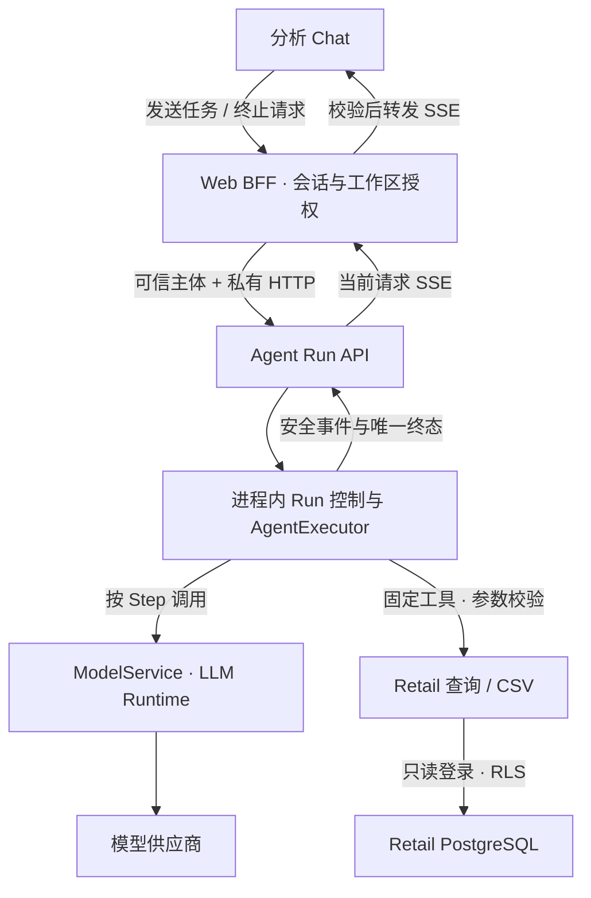
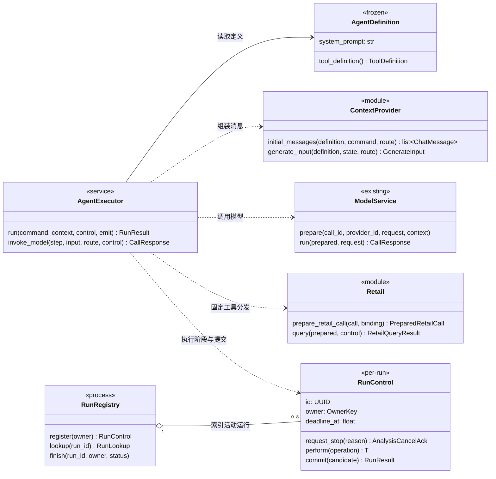
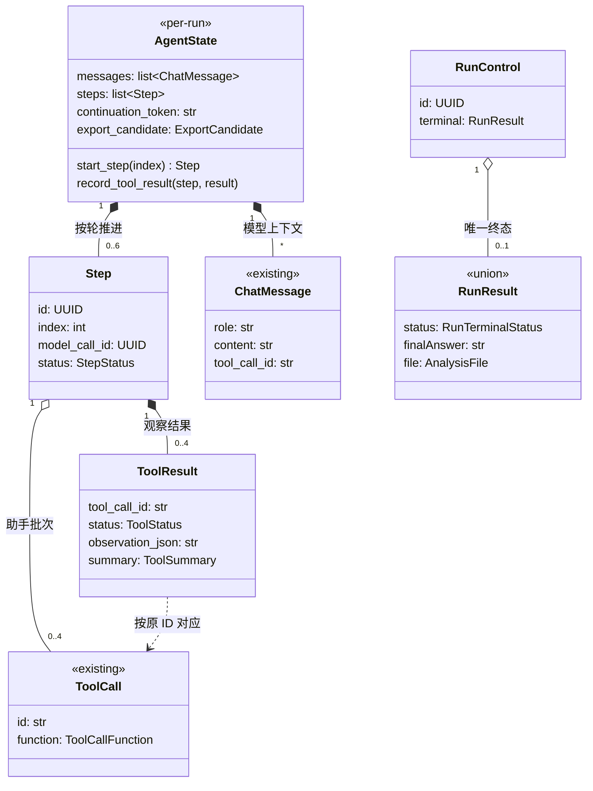
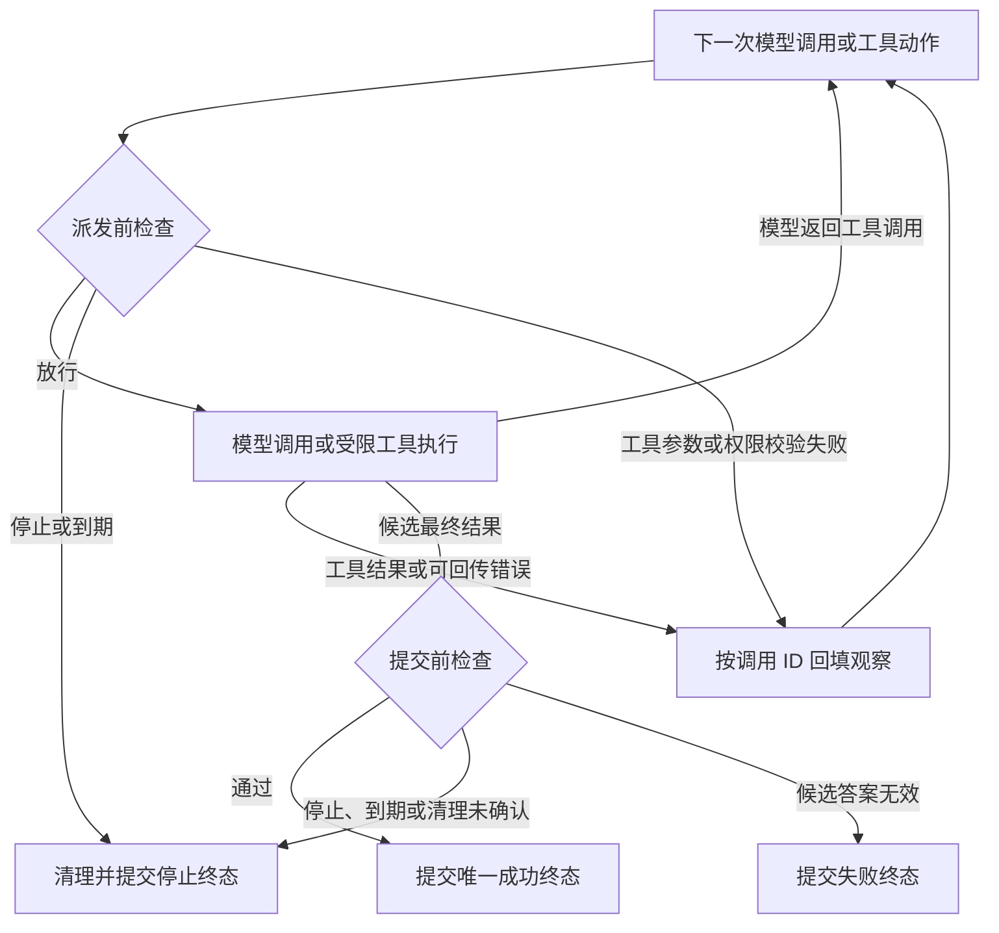
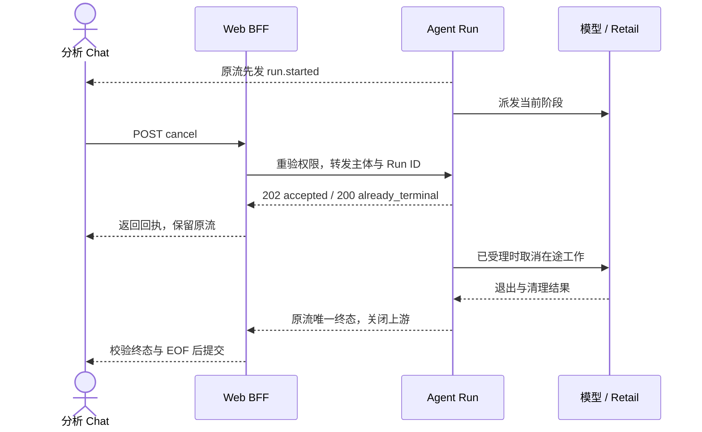

# 第 15 课 · Agent 执行内核技术方案

> Feature 989 · Profile `standard` · 基线 `main@ce2e4bc` · 2026-11-10 · 待评审

[需求简报](../BRIEF.md) · [有效 PRD](../spec/PRD.md) · [标准模板](../../_templates/TECH_DESIGN.tmpl.md) · [代码设计](CODE_DESIGN.md) · [流式数据包协议](STREAM_PROTOCOL.md)

## 需求依据与验收

以 PRD 的 FR-01～FR-12、BR-01～BR-12 和 AC-01～AC-15 为准。交付路径是现有分析 Chat。一次发送经 BFF 建立一条 HTTP 进度流，Agent 在同一进程、同一次请求内顺序推进 ReAct，最终返回回答和最多一份 CSV。课堂主路径从两个时段的渠道汇总继续查指定渠道的商品拆分。停止任务使用单独的 HTTP 请求，原流负责报告清理后的终态。

| 交付面                                 | 设计落点           | PRD 验收     |
| -------------------------------------- | ------------------ | ------------ |
| 真实 Retail 多轮、同轮多调用、失败观察 | §2.2、§2.3         | AC-01～AC-04 |
| 运行隔离、模型兼容、课堂走读           | §2.1、§2.2、§3、§5 | AC-05～AC-07 |
| 授权、进度、回答与文件                 | §2.3、§2.4、§2.6   | AC-08～AC-11 |
| 终止、资源清理、权限与完成竞态         | §2.5、§2.6         | AC-11～AC-15 |

## 1. 方案概述

### 1.1 整体架构

复用 [现有 Chat](../../../apps/web/src/components/analysis-composer.tsx)、[模型鉴权](../../../apps/web/src/server/modules/models/application/authorize.ts)、[模型私有 API](../../../apps/agent/src/compass_agent/model_api.py)、[路由服务](../../../apps/agent/src/compass_agent/routing/service.py) 和 [LLM Runtime](../../../apps/agent/src/compass_agent/llm/README.md)。现有模型 API、平台管理、诊断、演示数据 API 保持各自契约。新编排在 `apps/agent` 内，Web 与 Agent 通过 HTTP 和生成契约协作。

### 1.2 关键决策与评审入口

| 决策        | 选择与维护成本                                                                                                                                                       | 评审入口                                                 |
| ----------- | -------------------------------------------------------------------------------------------------------------------------------------------------------------------- | -------------------------------------------------------- |
| 执行内核    | Python async 顺序循环，一轮一次逻辑模型调用；复用第四篇的队列、重试与 Trace。Agent SDK 或图引擎会引入第二套执行和资源所有权，留待有图执行或持久恢复需求时比较。      | [循环与模型接缝](CODE_DESIGN.md#2-模型接缝与-react-循环) |
| 控制与进度  | 一个活动 Run 注册表，原请求使用 SSE，停止走独立 POST。Run ID 由 Agent 分配，唯一终态由同一事件循环裁决。单 Agent 进程是启用前提，维护 SSE 顺序与两条请求的生命周期。 | [控制器和流](CODE_DESIGN.md#1-run-所有权与终态裁决)      |
| Retail 接入 | 一个课堂工作区绑定一个发布源的 `a_east` 登录。Agent 每次查询建立独占 psycopg 异步连接，源端 RLS 生效，连接可按调用回收。额外开连接的成本换取明确的取消与隔离边界。   | [查询与资源清理](CODE_DESIGN.md#3-retail-查询与清理)     |
| 文件交付    | 一份有界 CSV 随成功终态传输，当前页面 Blob 下载。只维护当前页文件引用和体积限制。第 18 课接入受控 Artifact 时再演进交付路径。                                        | [响应和页面状态](CODE_DESIGN.md#4-bff-与页面提交)        |

本课使用进程内 Run、当前页可见历史和代码内提示词。[第 16 课](../../988-lesson-16-controlled-autonomy/spec/PRD.md)沿用同一 ReAct 循环，通过 Todo 动作加入模型自主规划、验证、预算与停止规则。Workflow、并行工具、Sandbox、持久 Run、Worker 接管和断线续流由后续课次承接。

## 2. 详细设计

### 2.1 Agent Runtime 类型设计

#### 执行组件

`AgentDefinition` 是 `context.py` 的代码常量，包含系统指令和固定工具定义入口。每次构造模型输入时取得独立的 `ToolDefinition`。 `AgentExecutor` 按请求装配，复用现有 `RoutingService`、`ModelService` 和共享容量门。运行时一次解析 `RunRoute`，固定 Provider ID、绑定版本、生成能力与可选 Retail 绑定。 `ContextProvider` 是纯函数模块，按定义、路由和当前状态组装已有 `GenerateInput`，跨供应商续接仍由模型层处理。

`RunControl` 管理生命周期和活动阶段句柄。 `RunRegistry` 是进程级内存索引，持有活动项和轻量终态摘要，终态摘要只保留 `runId + OwnerKey + status`，最多 128 条，5 分钟过期。控制请求只能访问控制器和摘要。一次 Run 由控制器和运行内容共同组成。Run ID 统一归控制器，运行主协程拥有 `AgentState` 的写入权。

#### 一次 Run 的数据关系

- `AgentState` 保存本轮模型消息、Step、私有续接和最多一个导出候选。 `Step` 一次关联一个逻辑 `model_call_id`，分类调用属于预备阶段。 `ToolCall` 沿用模型 DTO，Step 引用同一批调用。 `record_tool_result` 按原 ID 将结果登记到 Step，并追加相应的 tool 消息。查询全量结果只用于当前调用和导出候选，工具记录保留有界观察与摘要。
- `RunResult` 复用 `schemas.py` 的终态联合，只有完成分支带 `finalAnswer` 和 `file`。开流时生成的 `runId` 由 `RunControl` 持有，输出事件添加请求 ID、Run ID 与顺序号。安全摘要用于 SSE，模型观察及续接数据由 Run 内部持有。
- 每次 Run 上限 6 个模型 Step，每批上限 4 条工具调用。单进程最多 8 个活动 Run，超量在开流前返回 429。180 秒总期限从注册起计算，分类、队列、退避、SQL 和导出共用。模型单次调用取既有阶段上限与剩余时间的较小值。

#### 设计模式

| 模式               | 应用位置与目的                                                                                                                                           |
| ------------------ | -------------------------------------------------------------------------------------------------------------------------------------------------------- |
| 编排器             | `AgentExecutor` 用显式 ReAct 循环组织模型、顺序工具调用和观察回填。上下文组装、模型执行和 SQL 各自维护业务规则，主循环负责推进顺序与失败收口。           |
| 有限状态机与单写者 | `RunControl` 集中处理运行、停止与唯一终态。取消入口与 Runner 在同一事件循环通过无 `await` 的状态转换裁决先后，活动阶段有独立的取消与清理回执。           |
| 适配器             | 复用 LLM Runtime 的 `ProviderAdapter` 屏蔽供应商差异。Retail 模块把 `ToolCall` 转成固定 SQL 的类型化参数，将查询结果投影为模型观察、页面摘要与可选 CSV。 |
| 依赖注入与组合     | 在 `run_api.py` 装配定义、现有模型服务及窄签名 Retail 查询函数。受控测试可替换外部调用。编排类和工具模块均采用直接组合。                                 |

#### 持久化边界

| 数据                      | 本期落点                                                                                                                                       |
| ------------------------- | ---------------------------------------------------------------------------------------------------------------------------------------------- |
| Agent 模型调用            | 现有 `model_call` 继续记录分类和每个模型 Step 的调用元数据，`model_provider` 提供模型配置。Run 与这些调用通过 `modelCallId` 和结构化事件串联。 |
| Run、Step、续接和导出候选 | Agent 进程内存。结束后只保留短期终态摘要，进程重启后不可查询或恢复原 Run。                                                                     |
| Web 对话和下载            | 现有 Web 数据库继续承载会话和权限。对话、回答和 CSV 引用在当前页面会话中。                                                                     |
| 经营数据                  | 读取既有 Retail PostgreSQL 表和 RLS，沿用发布工具管理的数据版本。                                                                              |

**新增数据库表 0 张，迁移 0 个。** 当前 Run 与原 HTTP 请求同生命周期，内存状态满足推进、取消和进程内去重。第 19 课交付持久 Run 与 Checkpoint，用于跨请求等待与重启恢复。[数据库规范](../../../docs/database-migrations.md) · [第 19 课 PRD](../../985-lesson-19-durable-runtime-hitl/spec/PRD.md)

日志使用固定事件名和枚举字段，串联 `runId → stepId → modelCallId / toolCallId`，记录耗时、结果码、终止原因与清理状态。查询后端 PID 仅用于服务端诊断。Run 的 Trace 子树关闭内容采集，Chat 事件只包含安全摘要。

### 2.2 模型路由、上下文与工具续接

1. 将 `RoutingService` 的意图分类与主模型选择提取为可直接调用的 `select_route`。现有 `run` 复用该方法并继续原单次推理。Agent Run 开头选择一次，复用「系统优化 / 固定模型 / 闲聊引导」规则和分类授权。首次推理开始时提供模型别名与安全路由摘要。Run 内固定 Provider 和绑定版本。后续每轮 `ModelRepository.begin` 在既有授权与配置读取事务内核对绑定版本和启用状态，变化时收口为模型不可用。
2. `context.py` 放置代码内系统提示词与 Context Provider。首轮组装系统消息、最多 12 个已完成的可见问答对和当前问题。用户历史与问题总 UTF-8 上限 32 KiB，问题维持 8,000 字符。页面仅发送最近的完整问答对，超过输入限额时提示整理上下文。每轮继续检查既有 64 KiB 可见模型输入及 64 条消息上限。超限以 `context_limit` 结束，保留已完成的工具过程。
3. 只有工作区匹配 Retail 绑定、模型的 tools 能力已验证、路由允许经营分析时，附上 `retail_sales`。模型调用选择已验证的流式能力，必要时沿用同步生成。Thinking 复用原选择规则与能力检查。闲聊或未开放工具时保留零工具的回答路径。提示词明确数据不可用时说明范围和缺口，模型选择区提供相应提示。
4. 仅在正常协议终止、结果状态为 `completed` 时解释输出。有调用且 `finish_reason=tool_calls` 时，整批先检查结构、ID 和数量，再按原顺序运行。将原助手 `text + tool_calls` 保留为一条消息，每个调用追加一条观察消息。下一轮在同一绑定下带上该批新密封的 token。保持前缀、调用参数和公开 ID 不变，满足既有续接摘要校验。
5. 现有适配器在 LLM 层拒绝未知工具和参数 Schema 错误。本期新增服务端内部模式 `agent_dispatch`，仅对该 Run 的生成阶段延后名称和参数语义校验。原模型 API 使用默认 `strict`。协议残缺、空或重复 ID、批次过大、`finish_reason` 与内容矛盾仍终止整轮，工具未执行。未知工具、日期错误、非许可维度、权限或查询错误按原 ID 回填固定错误对象。工具错误可由模型解释或继续推进；连接/执行资源清理未确认时立即收口。
6. 合法的 `stop` 结束且无工具调用、正文非空时产生候选 `finalAnswer`。中间正文只用于模型续接。最终回答、文件与步骤在终态裁决时一起提交。模型层可靠执行最多两次尝试，继承原有可重试判定。生成侧在内部消费进度信号以保留第四篇的已出内容重试约束，进度文本不上发给浏览器。

提示词固定本期口径。比较任务先取渠道汇总，按实付金额变化绝对值选渠道，再使用同两段时窗查询该渠道 SPU，说明单位、时段、数据缺口和贡献排序。基于最新已发布合成数据回答，金额以分计算后转元展示。商品观察提供合计及排名预览，回答注明可从 CSV 查看其余记录。数据来源和权限由代码和配置确定。

#### 两个运行检查点

| 检查点 | M1 位置与职责                                                                                                                                                                                                  | M2 沿同一位置增加的规则                                                                                                                                        |
| ------ | -------------------------------------------------------------------------------------------------------------------------------------------------------------------------------------------------------------- | -------------------------------------------------------------------------------------------------------------------------------------------------------------- |
| 派发前 | `RunControl.perform()` 在活动任务登记前检查 Run 状态与绝对期限。`AgentExecutor` 在每条 ToolCall 前检查停止，再校验工具名、参数与可信绑定。路由内各分类调用也在准备前检查；模型层的实际尝试沿用已有期限与取消。 | 下一次模型或工具调用前执行 Run 预算和停止规则。有计划时，校验模型选定 Todo 的依赖及派发条件。                                                                  |
| 提交前 | `AgentExecutor.run()` 校验模型完整结束、非空最终回答和有界文件，形成候选。`RunControl.commit()` 在同一无 `await` 区间复核截止时间、停止与清理状态，裁决并登记唯一终态。先受理的停止或已到期的 Run 走收尾状态。 | 关键 Todo 完成及最终经营结论由独立 Verifier 检查。`submit_analysis` 校验失败时回填工具观察，模型在允许继续时自行重查或修订计划。通过验证的候选仍走原终态裁决。 |

M1 在现有 Run 控制和循环内集中这两个检查点。M2 的规划、推进和重规划由同一个模型循环决定。BFF 与 Chat 继续在验证原流终态和干净 EOF 后分别转发及展示。

### 2.3 Retail 数据范围、查询与文件

**课堂绑定。** 选择已发布的单源样本 `retail-dev-20261022b`，包摘要 `7ae26405a71589c98ca8379bec1e1ec1ff77e16232ff2e1bf26b6d4501b8183e`，规范 schema `core`，身份 `a_east`（Retail 租户 101、区域 1）。部署者从发布工具的私有记录取得该身份，配置课堂 Web 租户与工作区 UUID 的精确匹配。浏览器只传用于 BFF 权限检查的范围选择，Agent 根据可信上下文与唯一部署绑定决定连接。验收前用活动清单核对包摘要和只读角色，不能用课程导入用的扁平 `retail_course` 或通用应用数据库代替受限数据源。 [Retail 发布与权限](../../../docs/data-seeding.md#权限失败与回切)

**参数与口径。** `retail_sales` 只接收 `dimension=channel|product`、`period={start,end}`、可选 `compareTo={start,end}` 和 `channelCode`。日期为 `YYYY-MM-DD`，按上海业务日左闭右开，单段 1～31 日，允许区间 `[2023-01-01, 2026-01-01)`。可独立选择比较段，变化始终按比较段减基准段计算。商品维度必须填写渠道编码，渠道维度禁止该字段。编码采用 1～24 位大写 ASCII 字母、数字或下划线，作为绑定值匹配受限 `core.channel.channel_code`。多余字段、重复 JSON 键、无效日期或形状在连接前拒绝。语法正确但无匹配结果的渠道返回 `empty`。

固定 SQL 读取 `core.channel_product_daily`，在 `tenant_id, report_date, channel_id, sku_id, region_id` 粒度取最新 `report_version`，然后按日期段汇总 `paid_amount_cent`，商品维度经同租户 `sku → spu` 聚合。保留事实 RLS 与显式租户过滤。提供两个时段时按各自的起止日期聚合并计算变化。同一分组缺少其中一段的实付记为 0，整次查询无实付数据返回 `empty`，数据库错误返回独立错误码。排序为变化绝对值降序、编码升序。单段按实付降序、编码升序。每次在同一只读事务内验证实际登录角色、只读状态及事实表 RLS，再执行绑定日期和编码的固定 SQL。每次最多取 201 行检测超限，查询失败或超限不交付部分结果。金额以整数分保存，模型观察用十进制字符串，最多 4 KiB，含合计、行数和前 12 行；预览过宽时按整行收缩。

| 课堂参数     | 取值                                                                                                                 |
| ------------ | -------------------------------------------------------------------------------------------------------------------- |
| 基准 / 比较  | `[2025-11-17, 2025-11-24)` 和 `[2025-11-24, 2025-12-01)`                                                             |
| 推荐发送内容 | 比较 2025-11-17 至 11-23 和 11-24 至 11-30 两周，哪个渠道的实付金额变化最大？变化主要来自哪些商品？                  |
| 对照结果     | POS 基准 1,410,889 分，比较 543,596 分，变化 −867,293 分。SPU3、SPU1、SPU2 分别变化 −511,199、−259,344、−96,750 分。 |
| 本轮文件     | POS 商品拆分，3 条实付商品记录。第一轮查全渠道，第二轮由模型读取首轮观察后选择 POS。                                 |

对照结果已按相同包摘要离线重算，交付时还需在发布库以 `a_east` 对照 SQL 和真实查询重新验证。对照 SQL 与课堂步骤随实现交付，使用独立只读连接。

**CSV。** 取本 Run 中按执行顺序最近一次成功、非空的商品拆分。Agent 从该调用的完整有界结果生成，最多 200 行、128 KiB，UTF-8 BOM、CRLF、Python `csv.writer`，固定字段 `channel_code,spu_code,spu_name,period_start,period_end,compare_start,compare_end,paid_cent,compare_paid_cent,delta_cent`。单段时比较列为空。文本列处理 CSV 引号和公式起始字符，负数金额保留数值。文件名固定为 `retail-products-<runId>.csv`，来源保存 `stepId + toolCallId`。用标准 Base64 通过最终 SSE 帧交付，`file` 是 `none | ready | unavailable`。导出超限或失败标为 `unavailable`，有效回答仍可提交；商品查询结果因行数超限产生 `result_limit` 时，可保留较早成功候选，否则显示超限提示。失败和停止终态清空候选。

### 2.4 网络契约与信任边界

| 目的     | 浏览器到 BFF                                    | BFF 到 Agent                            | 响应                                                                 |
| -------- | ----------------------------------------------- | --------------------------------------- | -------------------------------------------------------------------- |
| 启动 Run | `POST /api/web/v1/analysis/runs`                | `POST /v1/analysis/runs`                | 200 `text/event-stream`，首条 `run.started` 先于分类、推理和工具派发 |
| 停止 Run | `POST /api/web/v1/analysis/runs/{runId}/cancel` | `POST /v1/analysis/runs/{runId}/cancel` | 202 `accepted`、200 `already_terminal` 或 HTTP 拒绝                  |

- 启动请求 BFF 严格校验 `tenantId, workspaceId, requestId, question, history, selection`。其中 `requestId` 为浏览器请求关联 UUID，`history` 为 `{question,answer}[]`，`selection` 复用 `MainModelSelection`。BFF 剥离范围参数，Agent 入参只含后四项。Run ID 由 Agent 生成，单次发送单请求，浏览器、BFF 和代理均不自动重试或重连启动 POST。
- 终止请求 BFF 请求体只接收 `tenantId, workspaceId`，Agent 请求体为空对象，目标 ID 来自路径。两个端点均走既有同源、CSRF、会话、有效工作区、`module.analysis`、`models.invoke` 检查。事务结束后才 fetch；用既有服务令牌与 `X-Compass-Context` 传 `purpose=chat`、用户与工作区。Agent 两个端点都验证服务令牌和用途。无匹配 Run 和非所有者统一 404。BFF 禁止客户端自带可信头或额外字段。
- Agent / BFF 所有响应含 `Cache-Control: private, no-store`，SSE 加 `X-Accel-Buffering: no`。复用 Web `X-Compass-View-Revision`、错误结构与安全消息映射。鉴权失败 401/403，校验失败 422，活动数满 429。BFF 在打开下游前验证上游 HTTP 与首包，失败返回 503。开流后遇到非法包、超限或异常 EOF 时中止，页面按失败或待确认收口。
- Agent → BFF 和 BFF → Chat 共用 **`compass.run` v1**。SSE 包统一为 `protocol, version, requestId, runId, seq, event`。`event` 是 `{type, payload}` 判别联合。BFF 保留请求和 Run ID，为下游按包重新编号。首包及终态单发。进度支持逐条输出、有界批次和已登记可选扩展的转译。
- 两段都校验包、逻辑事件顺序与文件来源。BFF 在上游干净 EOF 后转发唯一终态，Chat 在下游干净 EOF 后提交回答与文件。旧读端可以跳过有界可选扩展。BFF 出站扩展必须通过公开 Schema，核心事件维持原语义和顺序。

完整信封、枚举、大小限制、版本兼容、批次与转译规则见[流式数据包协议](STREAM_PROTOCOL.md)。可运行参考包括 [Agent DTO 与编码](stream-reference/stream_contract.py)、[BFF 与页面解码、攒包及转译](stream-reference/stream.ts)。实现阶段从 `schemas.py` 和 FastAPI 路由生成 Web Schema、类型及流常量，BFF 与 Chat 共用顺序校验。

`AnalysisCancelAck` 是独立的 JSON 联合。202 返回 `{runId, status: "accepted"}`，200 返回 `{runId, status: "already_terminal", terminalStatus}`，拒绝走安全错误体。

### 2.5 终止裁决与资源清理

| 当前状态   | 输入                                 | 转换与副作用                                                                                                       |
| ---------- | ------------------------------------ | ------------------------------------------------------------------------------------------------------------------ |
| `running`  | 终止、断开、到达期限或进程关闭先发生 | 同步切为 `stopping`，保存首次原因并取消一次活动阶段，禁止启动下一阶段和提交迟到结果。                              |
| `stopping` | 重复停止或其他停止来源               | 复用原清理，保持首因。有效用户停止请求返回 202。                                                                   |
| `running`  | 正常完成或运行失败先提交             | 原子写唯一终态，移除活动条目并保存轻量摘要。随后停止回 200 `already_terminal`，只返回已提交状态。                  |
| `stopping` | 清理完成                             | 用户终止、断流、关闭收口为 `canceled`；内部期限收口为 `failed/run_timeout`。确认失败时统一 `cleanup_unconfirmed`。 |

Run 的阶段启动与注册、终止受理、终态写入都在无 `await` 的事件循环片段内完成。清理最多 8 秒，BFF 启动流总等待 195 秒，浏览器 200 秒；取消 POST 上游单独限时 5 秒。原流终态由 Run 主任务拥有，终止接口只回执。出站阻塞使用独立断流监听，进度队列受总事件数和每条进度的大小限制，入队无需等待。停止后保留已提交的合法进度。终态通过独立结果槽交付，无需排队抢空间。活跃进程关闭时停止接收新 Run，统一请求终止并等待清理上限。

- **模型阶段。** 取消当前分类或生成任务，沿 `ModelService → ReliableExecutor → Runtime` 退出队列、退避和调用。基线模型服务会将取消重新抛为裸 `CancelledError`。本次把底层尝试的清理结果通过服务内类型化取消回传给 Run，并核对模型记录收尾。未知资源沿用 `ExecutionGate` 的隔离，不归还对应槽位；迟到任务只允许收尾。
- **Retail 阶段。** 每次调用独占连接，登录即设置只读事务默认、`statement_timeout=5s`、`idle_in_transaction_session_timeout=8s`，连接建立最多 3 秒。SQL 使用显式只读事务，按阶段记录当前命令。终止时对已派发 SQL 使用 `AsyncConnection.cancel_safe(timeout=1)`，等待原执行返回或出现 PostgreSQL 取消错误，关闭游标并回滚，最后关闭连接。设置 `libpq ≥ 17` 的能力门，避免回落到无取消时限的旧实现。若取消报文发送失败，仍在清理预算内等待源端超时或已完成响应。报文发送完成只记为请求已发，退出判定依据原命令和连接状态。清理不明时丢弃专属连接，关闭本地句柄并记录 `cleanup_unconfirmed`，下一次使用新的连接。 [Psycopg 连接取消](https://www.psycopg.org/psycopg3/docs/api/connections.html#psycopg.AsyncConnection.cancel_safe)
- **断流传播。** 浏览器关闭读取或权限页退场后，BFF 终止上游 fetch、撤销监听和定时器。Agent 由唯一 ASGI disconnect 监听任务触发同一个 `request_stop`，不受进度发送回压阻塞。若下游断开，Agent 继续执行有界清理并记录终态。BFF 的 SSE 非法和自身超时采用相同的上游中止路径。

### 2.6 分析 Chat

复用现有输入区、模型选择、同页追问、附件仅预览规则和模型诊断入口。在 [现有原型](../spec/visuals/chat-prototype.html) 的助手回复区下增加按 Step 分组的工具卡、回答区和文件卡。样式沿用现有分析页。模型 Trace 链接按各 Step 的 `modelCallId` 生成，Run ID 用于关联本轮。

发送时锁定当前轮，输入区显示「停止任务」。提前停止记在当前轮本地，收到 ID 后只发送一次终止 POST。单独保留原流。回执成功只更新「正在终止」，晚到回执按 Run ID 与本轮令牌丢弃。终止请求失败且原流还活跃时提示「终止请求未确认」并允许手动重试；原流仍决定最终结果。连接中断且没有终态时，显示失败或「终止结果待确认」，结束加载并保留已收到的工具过程，运行中的卡片按原因收口。

分析过程运行时展开。第一次收到经完整性验证的成功终态时自动折叠一次，同时提交回答与文件卡。过程文本只作为显示数据。标题采用原生 button 和 `aria-expanded`，支持 Enter、空格；焦点位于隐藏区时移回标题。零工具直接展示回答。失败、已终止与清理待确认继续展示已收到的过程。

当前页仅将成功问题与 `finalAnswer` 加入可见历史，重用 `DocumentSession` 的代际、权限版本和退场清理。文件只在成功状态下解码为 Blob，下载时创建短寿命对象 URL。重置、新建对话、退出、会话失效和范围切换时立即释放文件、URL、临时状态及请求句柄。原型下载名不作为真实文件名来源。

### 2.7 配置与发布

| 配置                              | 含义                                                                                                                                                                      |
| --------------------------------- | ------------------------------------------------------------------------------------------------------------------------------------------------------------------------- |
| `COMPASS_RETAIL_RUN_SCOPE`        | Agent 专用课堂绑定 JSON。固定 Web tenant/workspace UUID、预期 release、包摘要和发布清单中的只读角色名，使用本期规定的 `a_east` profile 和 `core` schema。只接受一种绑定。 |
| `COMPASS_RETAIL_RUN_READONLY_DSN` | Agent-only `SecretStr`，只连接所选发布源。与绑定成对配置。开发走根入口，Compose 通过 Agent 私有环境注入。部署说明提供变量示例及活动清单对照步骤。                         |

全空时正常提供无工具 Chat；部分配置或 libpq 能力不满足时禁用 Retail 能力并记录安全配置错误。接入预检用已发布清单核对 release、摘要、库、账号、角色和课堂范围。运行身份无法读取发布控制表，部署绑定及预检负责版本对应，运行连接核对 `session_user` 与 `current_user` 均匹配绑定角色，要求 `transaction_read_only=on` 且 `row_security_active('core.channel_product_daily'::regclass)` 成立。身份检查失败时结束该次工具调用。专用绑定启用前校验不同工作区和不同租户的请求零 Retail 连接。

发布顺序是 Agent 先部署新增路由，验证原模型路径与课堂绑定，再部署 Web Chat。回退先恢复 Web 到原入口，再停止或替换 Agent。单 Agent 进程及单副本作为本期部署约束，验证启动和取消始终命中同一实例。切换样本使用保留的发布版本，Drain 活动 Run 后更换受限 DSN 和绑定。数据库沿用既有版本。

## 3. 风险与最小验证

| 风险                           | 设计约束                                                             | 实施验证                                                                                    |
| ------------------------------ | -------------------------------------------------------------------- | ------------------------------------------------------------------------------------------- |
| 适配器提前拒绝未知工具或参数   | 仅 Agent 内部延后语义校验，保留协议校验和原 API 行为。               | 用受控上游对比同一无效调用在原接口与 Run 的表现，验证配对观察及零查询。                     |
| 模型取消状态被服务层吞掉       | 显式传递清理结果，取消、提前失败和超时分别核对队列、连接、调用记录。 | 用受控模型在生成、队列及退避期间终止，统计源端退出、容量和调用次数。                        |
| SQL cancel 后游标或事务仍活跃  | 等原命令退出再回滚，超时关闭专属连接并隔离。                         | 在发布库通过测试注入固定慢查询，以单独观察连接检查 PID 的查询和事务退出。普通任务后续成功。 |
| 流中段断开或到达无效终态       | 两端严格验证，成功必须通过 EOF 后提交，BFF 中止上游。                | 实际浏览器与 Node/FastAPI 流测截断、无效字段、重复终态、最终帧尾随垃圾和无读取回压。        |
| 模型选择与运行中 Provider 修改 | 首轮一次选模，后续调用内重新授权并校验 binding version。             | 回归固定与自动选模、闲聊、已下架或运行中变更的模型，以及 Thinking 工具续接。                |

## 4. 代码审阅

[代码附录](CODE_DESIGN.md) 覆盖 Run 状态裁决、模型内部校验模式、工具批次与续接、Retail SQL 与取消、流校验和页面提交。流协议另见[完整类型、常量和参考实现](STREAM_PROTOCOL.md)。评审先检查类型和状态所有权，再核对派发前与提交前两个检查点、停止受理到资源释放，以及终态从 Agent 经 BFF 到页面的提交时机。

## 5. 实施任务与验证交接

下表新增路径为拟交付位置。现有模型、权限、样本和部署入口作为接入基线。

| 任务            | 文件与变更                                                                                                                                                                                          | 依赖      | 完成条件                                                                                                                        |
| --------------- | --------------------------------------------------------------------------------------------------------------------------------------------------------------------------------------------------- | --------- | ------------------------------------------------------------------------------------------------------------------------------- |
| T1 · 模型接缝   | 改 `apps/agent/src/compass_agent/routing/service.py`、`models/service.py`、`models/repository.py`、`llm/contracts.py`、`llm/litellm_chat.py` 与 `observability/observer.py`                         | —         | 原模型调用通过回归；内部模式可得到可分发批次，续接绑定与清理结果可测。AC-02、AC-04、AC-06                                       |
| T2 · Retail     | 新增 `apps/agent/src/compass_agent/runtime/retail.py`、`runtime/retail_sql.py` 与 `runtime/artifact.py`；改 `settings.py`                                                                           | —         | 固定 SQL、参数校验、只读身份、CSV 和有界取消通过受控及 PostgreSQL 验证。AC-01、AC-03、AC-10、AC-13、AC-15                       |
| T3 · Run 与契约 | 新增 `runtime/executor.py`、`runtime/context.py`、`runtime/control.py`、`run_api.py`；改 Agent `main.py`、`schemas.py`、私有边界及契约导出脚本；生成 `contracts/` 和 `apps/web/src/generated/`      | T1、T2    | 首帧先于派发，派发前检查停止和期限，候选经提交前裁决形成唯一终态。断流统一收口，跨主体不泄露。AC-01～AC-05、AC-08、AC-11～AC-15 |
| T4 · BFF        | 改 `apps/web/src/server/http/handler.ts`；新增 `server/http/analysis-run-handler.ts`、`server/analysis-agent-client.ts` 和 `contracts/analysis-run.ts`，复用现有私有 HTTP 设施                      | T3        | 启动和取消均完成 BFF 授权，验证首包、批次顺序、EOF 和文件。覆盖逐条、攒包与可选扩展转译，断流取消 fetch。AC-08、AC-11、AC-14    |
| T5 · Chat       | 改 `apps/web/src/components/analysis-composer.tsx`、`app/globals.css`、`client/request-scope.ts`；新增 `components/analysis-run-turn.tsx` 与 `client/analysis-run.ts`                               | T4        | 工具卡、焦点、回答折叠、文件、追问及终止状态走通。AC-01、AC-09～AC-15                                                           |
| T6 · 课堂与发布 | 改 `.env.example`、`deploy/compose/compose.yaml`、`apps/agent/README.md`、`apps/web/README.md`、`deploy/README.md`；新增 `docs/adr/0002-agent-execution-kernel.md` 与 `docs/lesson-15-agent-run.md` | T2～T5    | 课堂入口文档含架构、样本、只读接入、对照 SQL、正常和异常步骤，实际环境完成浏览器验收。AC-01、AC-06、AC-07                       |
| T7 · 验证门禁   | 扩展 `apps/agent/tests/test_runtime.py`、`test_model_lifecycle.py` 与 `apps/web/tests/e2e/analysis-composer.spec.ts`；补 Run 执行/网络、Retail PG 和 Web BFF 契约用例                               | 随 T1～T6 | 覆盖所有 AC 的单元、真实 PostgreSQL 或浏览器路径；跨应用、部署与回归门禁通过。                                                  |

现有测试覆盖单次模型调用、模型鉴权、原 Chat 和发布角色权限。新增验收需补真实样本的多轮依赖、文件、两种在途终止、终止竞态及清理失败。受控测试通过固定上游和屏障重放顺序，数据库慢查询从测试装配注入，沿同一只读身份与连接代码执行。测试观察角色单独连接 `pg_stat_activity`，产品路由不接收测试 SQL 或注入开关。

实施后从仓库根执行 `pnpm contracts`、`pnpm contracts:check`、`pnpm check`、`pnpm build`。浏览器入口为现有 `pnpm test:e2e -F web`；真实 Retail 专项在 T7 登记实际入口及必要配置。部署按现有 Compose 入口及 `pnpm smoke` 执行，课堂路径另用真实受限源和已配置的工具模型验收。设计阶段完成了发布包对照复算，并在临时 PostgreSQL 17 实例用课堂样本切片验证商品 SQL 的单段、对比和 RLS 隔离；同一环境验证 `cancel_safe`、回滚、关闭和后续查询。实际课堂发布库的接入、浏览器端到端和课程演示在实现后验收。
