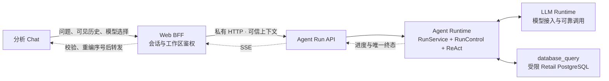
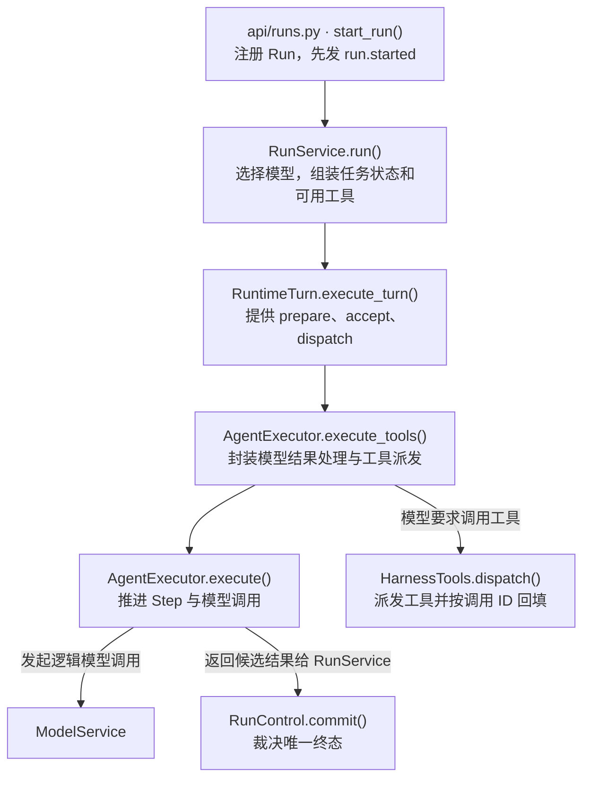
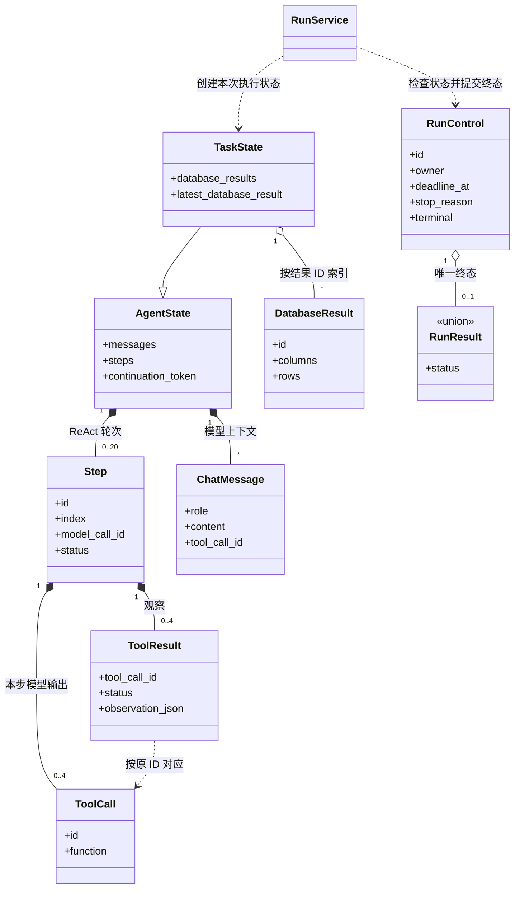
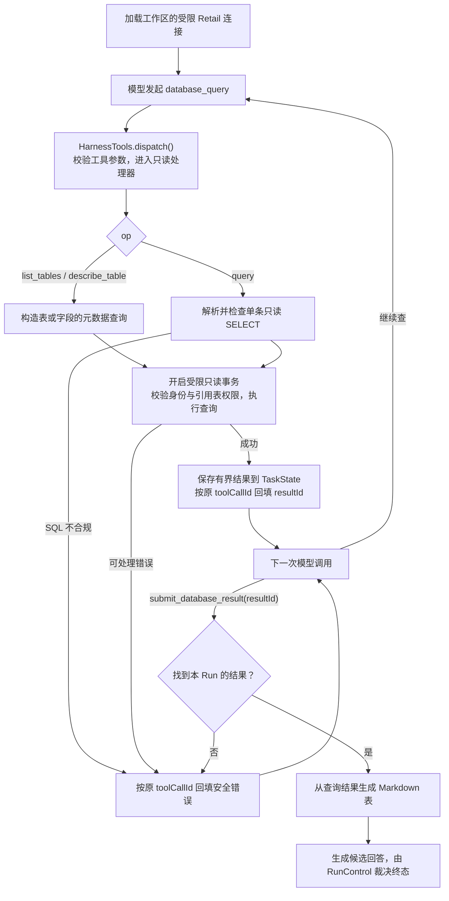
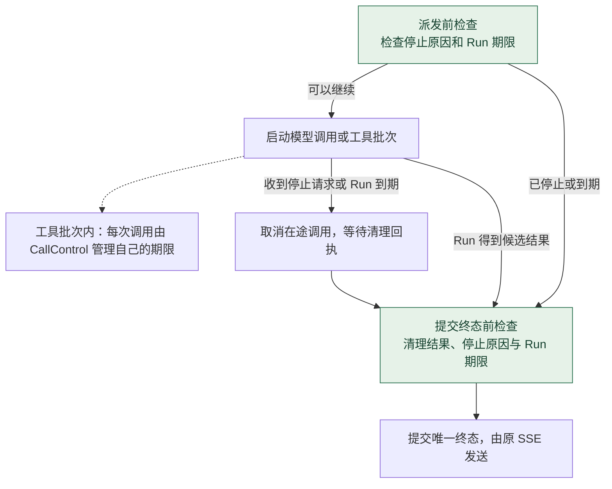
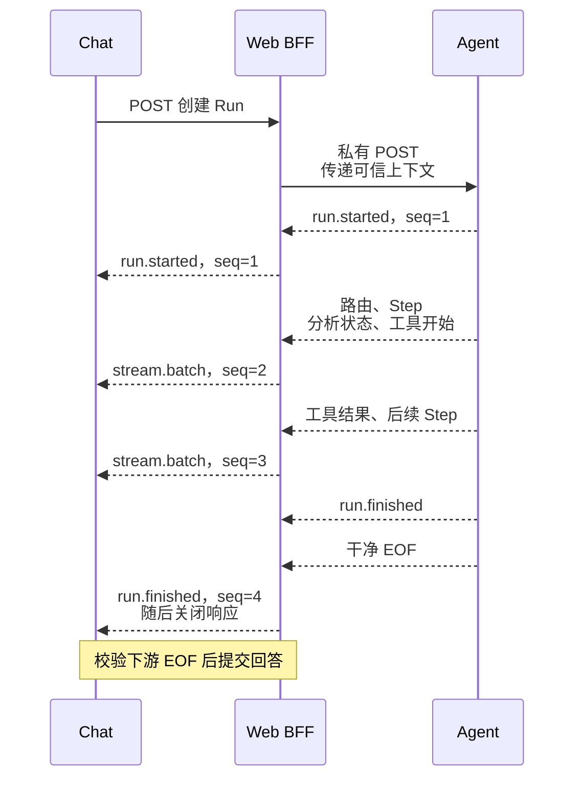

# 第 15 课 · Agent 执行内核技术方案

[需求简报](../BRIEF.md) · [PRD](../spec/PRD.md) · [HTML 阅读版](TECH_DESIGN.html)

一次 Chat 提交创建一个 Run，也就是从开始执行到产生终态的一次任务。Agent Runtime 负责调模型、执行只读查询、将结果交回模型，最后用 SSE（服务端发送事件）向 Chat 交付回答。用户可以停止正在进行的模型调用或查询。

## 需求依据与验收

- 课堂验收覆盖查数后继续回答、在模型或查询期间停止、以及浏览器收到完整回答后结束流。沿用现有登录与工作区权限、模型接入和 Retail 只读身份。
- 最小工具示例使用通用只读 `database_query`，以 Retail 为示例数据库。通用查询交付 Markdown 结果表，`file.status` 为 `none`。原需求文档中固定渠道与商品查询、CSV 交付的验收对应保留的 `retail_sales` 路径。
- 本课讲解一次 HTTP 请求内的执行生命周期和交付。完整工具体系、工作流、计划执行和持久会话恢复由后续课程展开。

## 1. 整体执行链路



| 层 | 职责 |
| --- | --- |
| Chat | 发送问题，消费进度和最终回答。一个 Run 在 Chat 中显示为一轮对话（Turn）。 |
| Web BFF（服务于前端的 Web 后端） | 校验登录、工作区、分析和模型调用权限，防止跨站请求伪造。授权事务结束后把可信身份传给 Agent，将进度转换为浏览器使用的 SSE 事件。 |
| Agent Run API | 分配 Run ID，打开流、受理停止、把进度和终态编码成包。 |
| Agent Runtime | 维护 Run 生命周期与模型上下文，推进 ReAct（调用模型 → 执行工具 → 回填结果 → 继续调用或结束），提交唯一终态。 |
| LLM Runtime（模型调用层） | 调用选定的模型供应商配置，管理调用期限、取消和重试。模型路由和底层重试各有自己的调用记录。 |

入口对应 `POST /api/web/v1/analysis/runs` 和私有 `POST /v1/analysis/runs`。本课走请求内执行分支，整个 Run 在创建请求的生命周期内推进。现行 Agent 还支持持久执行，同一个 v1 入口可以接到该分支。

## 2. Agent Runtime 类型设计

### 2.1 Agent Runtime 总体 UML

**黄色是本课实现的模块和类型，浅绿色是沿用的类型。** 图中按 Run 生命周期、通用 ReAct 循环、模型调用、进度与 SSE 交付组织。`api/runs.py` 展示请求入口如何注册 Run、受理停止和打开流。`AgentExecutor.execute_tools()` 通过 `prepare`、`accept` 和 `dispatch` 三个回调接入任务，底层 `execute()` 推进模型循环。`ToolControl` 提供运行控制，`ModelRoute` 提供已选的模型配置，`TraceSink` 记录进度。

```mermaid Agent Runtime 总体 UML
classDiagram
    accTitle: Agent Runtime 总体 UML
    accDescr: 黄色是本课实现的类型，浅绿色是沿用的类型。图中展示 Run 控制、通用 ReAct 循环、模型调用和流式交付。
    direction TB
    namespace `Run 生命周期` {
        class RunApi["api/runs.py"] {
            <<module>>
            +start_run()
            +cancel_run()
        }
        class RunRegistry {
            +register(owner) RunControl
            +lookup(run_id)
            +finish(control, status)
        }
        class OwnerKey {
            +actor_user_id
            +tenant_id
            +workspace_id
        }
        class TerminalRunSummary {
            +run_id
            +status
            +expires_at
        }
        class RunControl {
            +deadline_at
            +perform(operation)
            +request_stop(reason)
            +commit(candidate) RunResult
        }
    }
    namespace `通用 ReAct 循环` {
        class AgentExecutor {
            +execute_tools(..., prepare, accept, dispatch) RunResult
            +execute(..., prepare, handle) RunResult
        }
        class AgentDefinition {
            +system_prompt
            +tools
            +builtin_tools
        }
        class HarnessContext["harness/context.py"] {
            <<module>>
            +build_messages()
            +model_input()
        }
        class AgentState {
            +messages
            +steps
            +continuation_token
            +record_tool_result(step, result)
        }
        class Step {
            +index
            +model_call_id
            +status
        }
        class ToolResult {
            +tool_call_id
            +status
            +observation_json
        }
        class ToolControl {
            <<protocol>>
            +require_running()
            +perform(operation)
            +mark_cleanup_unconfirmed()
        }
        class ModelRoute {
            <<protocol>>
            +provider_id
            +binding_version
        }
        class TraceSink {
            <<protocol>>
            +model_content(step_id, response)
        }
    }
    namespace `模型调用层` {
        class ModelService {
            +prepare()
            +run()
        }
        class ReliableExecutor {
            +execute()
        }
        class Runtime {
            +invoke(request, emit) RuntimeResult
        }
        class ChatMessage
        class ToolCall
    }
    namespace `进度与 SSE 交付` {
        class ExecutionTrace {
            +emit(event)
            +model_content(step_id, response)
        }
        class RunStreamResponse
        class RunWriter {
            +write(event) bytes
            +heartbeat() bytes
        }
        class RunPacket {
            +request_id
            +run_id
            +seq
            +event
        }
        class RunStreamEvent {
            <<union>>
        }
        class RunFinished {
            +payload: RunResult
        }
        class RunResult {
            <<union>>
            +status
        }
    }
    RunApi ..> RunRegistry : 注册与查询
    RunApi ..> RunStreamResponse : 创建 SSE 响应
    RunApi ..> RunWriter : 写入 SSE
    RunRegistry "1" o-- "0..8" RunControl : 活动 Run
    RunRegistry "1" *-- "0..128" TerminalRunSummary : 近期终态
    RunControl --> OwnerKey : Run 所有者
    TerminalRunSummary --> OwnerKey
    RunControl ..|> ToolControl : 提供派发与取消能力
    RunControl "1" o-- "0..1" RunResult : 裁决终态
    AgentExecutor ..> ToolControl : 运行检查与阶段控制
    AgentExecutor ..> ModelRoute : 接收模型配置
    AgentExecutor ..> AgentState : 推进执行
    AgentExecutor ..> ModelService : 按 Step 调用
    AgentExecutor ..> RunStreamEvent : 发出进度事件
    HarnessContext ..> AgentDefinition : 读取提示词与工具定义
    HarnessContext ..> ChatMessage : 组装模型上下文
    AgentState "1" *-- "0..20" Step
    AgentState "1" *-- "*" ChatMessage : 模型上下文
    AgentState --> TraceSink : 记录模型执行
    Step "1" o-- "0..4" ToolCall
    Step "1" *-- "0..4" ToolResult
    ToolResult ..> ToolCall : 按调用 ID 配对
    ModelService ..> ReliableExecutor : 管理重试
    ReliableExecutor ..> Runtime : 调用供应商适配器
    ExecutionTrace ..|> TraceSink : 记录运行过程
    ExecutionTrace ..> RunStreamEvent : 发出节点事件
    RunWriter ..> RunPacket : 事件编码
    RunPacket --> RunStreamEvent : 事件载荷
    RunStreamEvent ..> RunFinished : 终态事件
    RunFinished --> RunResult : 终态载荷
    style RunApi fill:#fff1bf,stroke:#9a650c,color:#513308,stroke-width:1.5px
    style RunRegistry fill:#fff1bf,stroke:#9a650c,color:#513308,stroke-width:1.5px
    style RunControl fill:#fff1bf,stroke:#9a650c,color:#513308,stroke-width:1.5px
    style OwnerKey fill:#fff1bf,stroke:#9a650c,color:#513308,stroke-width:1.5px
    style TerminalRunSummary fill:#fff1bf,stroke:#9a650c,color:#513308,stroke-width:1.5px
    style AgentExecutor fill:#fff1bf,stroke:#9a650c,color:#513308,stroke-width:1.5px
    style AgentDefinition fill:#fff1bf,stroke:#9a650c,color:#513308,stroke-width:1.5px
    style HarnessContext fill:#fff1bf,stroke:#9a650c,color:#513308,stroke-width:1.5px
    style AgentState fill:#fff1bf,stroke:#9a650c,color:#513308,stroke-width:1.5px
    style Step fill:#fff1bf,stroke:#9a650c,color:#513308,stroke-width:1.5px
    style ToolResult fill:#fff1bf,stroke:#9a650c,color:#513308,stroke-width:1.5px
    style ToolControl fill:#fff1bf,stroke:#9a650c,color:#513308,stroke-width:1.5px
    style ModelRoute fill:#fff1bf,stroke:#9a650c,color:#513308,stroke-width:1.5px
    style TraceSink fill:#fff1bf,stroke:#9a650c,color:#513308,stroke-width:1.5px
    style ExecutionTrace fill:#fff1bf,stroke:#9a650c,color:#513308,stroke-width:1.5px
    style RunStreamResponse fill:#fff1bf,stroke:#9a650c,color:#513308,stroke-width:1.5px
    style RunWriter fill:#fff1bf,stroke:#9a650c,color:#513308,stroke-width:1.5px
    style RunPacket fill:#fff1bf,stroke:#9a650c,color:#513308,stroke-width:1.5px
    style RunStreamEvent fill:#fff1bf,stroke:#9a650c,color:#513308,stroke-width:1.5px
    style RunFinished fill:#fff1bf,stroke:#9a650c,color:#513308,stroke-width:1.5px
    style RunResult fill:#fff1bf,stroke:#9a650c,color:#513308,stroke-width:1.5px
    style ModelService fill:#e9f2df,stroke:#66885e,color:#20372a
    style ReliableExecutor fill:#e9f2df,stroke:#66885e,color:#20372a
    style Runtime fill:#e9f2df,stroke:#66885e,color:#20372a
    style ChatMessage fill:#e9f2df,stroke:#66885e,color:#20372a
    style ToolCall fill:#e9f2df,stroke:#66885e,color:#20372a
```



### 2.2 从 Run 入口到通用执行循环

Compass 自研 Agent Runtime，在 Python 异步循环里直接控制系统提示词、工具结果如何写回模型上下文，以及 Run 何时结束。模型供应商协议、重试和取消复用模型调用层。



`RunService` 在 `runtime/service.py` 组装授权数据源、路由和初始消息。`RuntimeTurn` 在 `runtime/turn.py` 绑定三个回调。`prepare` 构造模型输入，`accept` 审核模型响应并生成直接回答的候选结果，`dispatch` 将工具调用交给 `runtime/tool_bindings.py` 的 `HarnessTools`。`AgentExecutor` 在 `harness/executor.py` 推进循环。

选模时绑定模型供应商配置，实际调用前重新核对配置版本。系统提示词、用户可见的历史问答和当前问题构成初始上下文。模型要求调用工具时，执行器保留原 assistant 消息及整批 `ToolCall`，按调用 ID 回填 `role=tool` 消息。回填内容可以是结果，也可以是安全错误。下一 Step 带上这些消息及模型返回的续接令牌。

### 2.3 一次 Run 的数据关系



| 类型 | 边界 |
| --- | --- |
| Run | 一次任务生命周期。执行器写入本次上下文并产生候选结果，`RunControl` 裁决终态。 |
| Step | 一次逻辑模型调用及其触发的零个或多个工具调用。选模型发生在 Step 之前，供应商接口重试归属同一次逻辑调用。 |
| ToolCall / ToolResult | 同一 Step 内按 `toolCallId` 配对。成功、空结果和可处理错误都可以成为观察。 |
| `TaskState` | 继承 `AgentState`。按结果 ID 保存本 Run 的数据库结果，`resultId` 只在当前 Run 内引用。 |
| RunResult | 成功时包含 Markdown 正文及文件状态，其他终态返回安全的错误或停止信息。 |

一次 Run 最多 20 个主模型 Step，每 Step 最多 4 条工具调用。请求内分支默认每进程最多 8 个活动 Run，注册起总期限 180 秒。进程内状态随请求和执行进程生命周期收口。本课无需新增数据库表或迁移。

## 3. 最小工具 · 只读数据库查询



| 操作 | 输入 | 返回 |
| --- | --- | --- |
| 列表 | `{"op":"list_tables","offset":0}` | 当前身份在 `core`、`ops` 下可读的业务表。 |
| 描述 | `{"op":"describe_table","schema":"core","table":"spu"}` | 有 SELECT 授权的字段、类型与可空性。 |
| 查询 | `{"op":"query","sql":"SELECT count(*) FROM core.spu"}` | 列名、行、截断标记和内部结果引用。 |
| 提交 | `submit_database_result({resultId})` | 从本 Run 已保存的结果确定性生成 Markdown；文件状态为 `none`。 |

- **接入。** 模型需支持工具调用。Agent 根据已授权的租户和工作区选用数据连接。模型只提供操作参数，连接凭据和只读角色由服务端确定。
- **执行。** `HarnessTools` 分发已注册工具，`RetailActions` 调用只读查询处理器。处理器解析 SQL 语法树，限制为单条只读 SELECT，并提取引用表。只读事务校验登录角色、当前角色、Retail 行级权限和引用表权限。结果最多 50 行、4 KiB，截断状态随结果返回。连接建立限时 3 秒，SQL `statement_timeout` 为 5 秒，数据库调用最多 8 秒，同时受工具及 Run 的剩余时间约束。
- **引用与展示。** `resultId` 留在模型观察及 Run 状态，公开 `tool.finished.resultPreview` 不包含它。模型用原 ID 请求发布，服务端从保存结果渲染。工具失败可回填安全错误继续执行。
- **课堂示例。** 「执行 SQL 查询商品记录数」可以直接产生一次查询，再由下一 Step 提交结果。探索未知表可以先列目录和读取字段，随后仍走同一查询及提交路径。

## 4. 停止与资源清理

Chat 发出独立的 `POST /api/web/v1/analysis/runs/{runId}/cancel`。BFF 重新授权，Agent 按 Run 所有者受理并返回 `202 accepted`。创建 Run 时打开的原 SSE 继续等待最终状态。Run 已结束时，停止接口返回 `200 already_terminal` 和终态状态。



每次启动模型调用或工具批次都走第一个检查。工具批次内的 `CallControl` 同时检查自身期限和 Run 的停止状态。第二个检查只在 Run 结束时执行一次。

| 检查点 | 行为 |
| --- | --- |
| 派发前 | `RunControl.perform()` 先查停止及绝对期限，再登记模型或工具批次为活动阶段，子任务启动前再查一次。`ToolDispatcher` 为单次工具调用创建 `CallControl`，调用期限受 Run 剩余时间约束。 |
| 停止受理 | 保存首个原因，取消在途阶段。停止 POST 只返回回执。浏览器在收到首包前点击停止时先保留意图，取得 Run ID 后发送一次请求。 |
| SQL 清理 | 已派发命令使用有界 `cancel_safe`，等待原命令退出，再关闭游标、回滚并关闭独占连接。取消报文发出后还要核对原任务结果。 |
| 模型清理 | 复用 LLM Runtime 的取消、流关闭及容量释放，结果回执传给 RunControl。 |
| 提交前 | `commit()` 在同一无 `await` 区间复核期限和清理结果，再一次提交。清理未确认优先得到 `cleanup_unconfirmed`。清理已确认时，首个停止原因为超时则得到 `failed/run_timeout`，为用户停止、断开或退出则得到 `canceled`。 |

浏览器断开、截止时间或服务退出共用停止边界。已发布的合法进度保留，尚未提交的回答及文件候选随失败或终止丢弃。详细分支见[代码附录](CODE_DESIGN.md)。

## 5. Agent → BFF → Chat 流式协议

### 5.1 两段 SSE 如何交付一条回答

Chat 消费 Web 的响应流，Web 同时消费 Agent 的响应流。EOF（流结束）表示 HTTP 响应已经完整关闭，两段各自校验最后一个事件和 EOF。



图中的下游序号对应旁边这次抓包。进度批次数量由事件节奏、攒包时间和大小决定。

### 5.2 一次完整的浏览器侧 SSE

[查看原始 SSE](document/run-example.sse)。这是受控模型和查询结果下生成的完整响应。Agent 走实际 `start_run` 请求内分支，BFF 走实际 `startAnalysisRunAgent` 投影，结果由浏览器共用的 `readRun` 消费到 EOF。示例只替换模型与数据源，未连接真实业务库。

| 下游包 | 内容 |
| --- | --- |
| `seq=1` | `run.started`。先发布 Run ID，再推进执行。 |
| `seq=2` | 路由、本次第一个 Step、分析节点、工具参数准备及 `tool.started`。 |
| `seq=3` | 查询结果、Step 收尾、下一次模型调用及结果发布。 |
| `seq=4` | `run.finished`。包含最终 Markdown 和文件状态，随后是 EOF。 |

`compass.execution.node@1` 的模型节点带有 `running` 或 `completed` 状态，可用来显示正在分析等进度。模型供应商返回的 Thinking 和旁白正文位于内部 `detail`，进入 v1 SSE 前由 `legacy_node()` 剥离。最终正文在 `run.finished.finalAnswer` 交付。

### 5.3 包信封与提交规则

| 部位 | 约定 |
| --- | --- |
| 传输 | `text/event-stream`，每帧一行 `data: <JSON>` 加空行。HTTP 分块可以拆在任意字节位置。注释心跳不分配序号。 |
| 信封 | `protocol=compass.run`、`version=1`、`requestId`、`runId`、`seq`、`event={type,payload}`。两段各自从 1 连续编号，业务 ID 保持一致。 |
| 批次 | `stream.batch` 内按数组顺序消费，最多 16 项、32 KiB、24 ms。首包与终态独立。收到 `tool.started` 或达到边界时刷新进度窗口。 |
| 扩展 | 按 `name@version` 校验并转换。可跳过未知可选扩展，遇到未知且标记为 `required` 的扩展则结束响应并报协议错误。 |
| 上限 | 单帧 256 KiB，整流 4 MiB，逻辑事件 1024 个，扩展数据 4 KiB，回答 JSON 32 KiB。 |
| 终态 | BFF 等上游 EOF 再发送下游终态，Chat 等下游 EOF 再提交回答、文件与问答历史。截断、重复终态或终态之后还有包都按协议失败收口。 |

Chat 展示分析进度和工具卡，成功后折叠过程、渲染 Markdown，可重新展开。内部编号用于协议关联。终态失败或连接中断时保留已接收进度。字段索引、公开预览与失败约束见[流协议附录](STREAM_PROTOCOL.md)。

## 6. 文件变更清单

清单以第 14 课交付的模型运行层为基线，按当前目录列出第 15 课涉及的实现、生成契约、测试和课堂配置。`[新增]` 表示为本课引入的能力文件，`[迁移]` 表示初版实现重构后的落点，`[调整]` 表示本课接入涉及的现有文件，`[生成]` 表示由契约脚本派生的文件。共用文件的行注只描述第 15 课涉及的职责。

### 6.1 Agent 执行内核

```text Agent 执行内核
apps/agent/src/compass_agent/
├── main.py                  [调整] 挂载 Run 路由并管理注册表生命周期
├── api/
│   └── runs.py              [迁移] 创建与停止 Run，维护请求内 SSE
├── harness/
│   ├── context.py           [迁移] 提示词、历史消息和模型输入边界
│   ├── contracts.py         [迁移] AgentState、Step、ToolResult 与注入接口
│   └── executor.py          [迁移] ReAct 循环、模型调用与工具回填接缝
└── runtime/
    ├── service.py           [迁移] 组装 Run、绑定模型与数据源、提交终态
    ├── turn.py              [迁移] 组装模型输入、结果检查和工具派发回调
    ├── context.py           [调整] 将路由指令和可用工具接入模型上下文
    ├── task_state.py        [迁移] 保存本 Run 的查询结果和任务状态
    ├── control.py           [新增] Run 注册、期限、取消和唯一终态
    ├── stream.py            [新增] SSE 编码、序号与体积检查
    ├── execution_trace.py   [调整] 生成执行节点与分析进度
    ├── execution_detail.py  [调整] 将执行节点投影到 v1 SSE
    └── observation.py       [迁移] Run、步骤与停止的结构化日志
```

### 6.2 模型路由与调用接缝

```text 模型路由与调用接缝
apps/agent/src/compass_agent/
├── api/
│   └── models.py        [迁移] 提供模型接入与身份校验，收口旧推理入口
├── routing/
│   └── service.py       [调整] 选择模型配置，将分类与生成分开
├── models/
│   ├── repository.py    [调整] 读取可用模型与配置版本
│   └── service.py       [调整] 重验模型绑定，接入调用取消与观测
├── llm/
│   ├── contracts.py     [调整] 模型响应、工具续接与清理回执
│   └── litellm_chat.py  [调整] 接入工具分发模式与续接校验
└── observability/
    └── observer.py      [调整] 关联 Run 和模型调用，限制正文采集
```

### 6.3 只读查询与单次工具控制

```text 只读查询与单次工具控制
apps/agent/src/compass_agent/
├── runtime/
│   └── tool_bindings.py        [调整] 注册本轮可用工具，按调用 ID 回填结果
└── tools/
    ├── contracts.py            [迁移] 工具共用运行控制接口 ToolControl
    ├── dispatcher.py           [调整] 校验并执行工具，管理单次调用期限
    └── builtin/
        ├── database.py         [新增] 列表、字段、只读 SQL 与结果提交契约
        ├── export.py           [迁移] 固定查询路径的有界 CSV 交付
        └── retail/
            ├── actions.py      [迁移] 接入通用查询，按 resultId 提交结果
            ├── connections.py  [调整] 按工作区解析受限 Retail 连接
            ├── handler.py      [迁移] 只读事务、身份校验、取消与资源清理
            └── sql.py          [迁移] 固定查询 SQL 与 Retail 身份校验语句
```

### 6.4 Web BFF 与 Chat

```text Web BFF 与 Chat
apps/web/
├── package.json                         [调整] 接入 React Markdown 和 GFM
└── src/
    ├── server/
    │   ├── http/
    │   │   ├── handler.ts               [调整] 将 Run 请求分派给专用处理器
    │   │   └── analysis-run-handler.ts  [新增] 创建与停止入口，完成鉴权
    │   └── analysis-agent-client.ts     [新增] 请求 Agent，合批并转发 SSE
    ├── contracts/
    │   └── analysis-run.ts              [新增] 双侧 SSE 校验与顺序检查
    ├── client/
    │   ├── request-scope.ts             [调整] 流请求、中止与页面作用域
    │   └── analysis-run.ts              [新增] 消费事件、维护对话轮及终态
    ├── components/
    │   ├── analysis-composer.tsx        [调整] 接入提问、运行过程和停止操作
    │   └── analysis-run-turn.tsx        [新增] 渲染运行过程、Markdown 与文件
    └── app/
        └── globals.css                  [调整] 分析过程及回答样式
```

### 6.5 接口契约与生成入口

```text 接口契约与生成入口
Compass 根目录
├── apps/agent/src/compass_agent/
│   └── schemas.py                   [调整] Run、工具事件、终态和停止回执
├── scripts/
│   ├── export-contracts.py          [调整] 从 Agent 导出 Schema 与流限制
│   └── contracts.mjs                [调整] 刷新并校验契约副本
├── contracts/
│   ├── openapi.json                 [生成] Agent HTTP 接口与类型
│   ├── model-contracts.schema.json  [生成] 模型与 Run 相关类型
│   ├── run-stream.schema.json       [生成] SSE 包与事件 Schema
│   └── run-stream-limits.ts         [生成] SSE 计数与大小边界
└── apps/web/src/generated/
    ├── api.ts                       [生成] Web 使用的 Agent API 类型
    ├── model-contracts.schema.json  [生成] Web 模型 Schema 副本
    ├── run-stream.schema.json       [生成] Web SSE Schema 副本
    └── run-stream-limits.ts         [生成] Web SSE 边界副本
```

### 6.6 测试与课堂复现

```text 测试与课堂复现
Compass 根目录
├── apps/agent/
│   ├── src/compass_agent/settings.py       [调整] 定义受限 Retail 连接配置
│   ├── package.json                        [调整] 接入 Agent 集成测试命令
│   └── tests/
│       ├── test_agent_run.py               [新增] Run、SSE、取消与资源清理
│       └── test_agent_run_integration.py   [新增] 真实查询、SQL 与结果约束、取消
├── apps/web/tests/
│   ├── analysis-run-stream.test.ts         [新增] SSE 解析、合批与终态校验
│   ├── analysis-run-client.test.ts         [新增] 页面状态、停止和断流
│   ├── document-session.test.ts            [调整] 页面作用域与请求回收
│   ├── domain/analysis-run-bff.test.ts     [新增] BFF 鉴权与上下游转发
│   └── e2e/analysis-composer.spec.ts       [调整] 从提问到回答的浏览器流程
├── .env.example                            [调整] 说明课堂运行与 Retail 配置
├── deploy/compose/compose.yaml             [调整] 向 Agent 传递运行环境配置
└── docs/
    ├── adr/0002-agent-execution-kernel.md  [新增] 记录执行内核选型
    └── lesson-15-agent-run.md              [新增] 复现查询、终止与验收
```

## 7. 实施任务与验证

| 任务 | 实现位置 | 完成条件 |
| --- | --- | --- |
| 运行内核与模型接缝 | Agent 的 `api/runs.py`、`runtime/{service,turn,context,task_state,control}.py`、`harness/{context,executor,contracts}.py` | 首包先发，逻辑模型调用和工具观察按 Step 推进，终态只提交一次。 |
| 最小查询能力 | Agent 的 `runtime/tool_bindings.py`、`tools/builtin/database.py` 和 `tools/builtin/retail/{actions,connections,handler}.py` | 受限连接、表和字段授权、SQL 校验、有界结果和 `resultId` 提交成立。 |
| 停止与清理 | Agent 的 `runtime/control.py`、`tools/dispatcher.py`、模型执行层和 Retail 连接 | 在途模型或 SQL 退出，已清理和未确认状态分别有明确终态。 |
| 协议和页面 | Agent 的 `schemas.py`、`runtime/{stream,execution_trace,execution_detail}.py`；Web 的 `server/http/analysis-run-handler.ts`、`server/analysis-agent-client.ts`、`contracts/analysis-run.ts`、`client/analysis-run.ts` | 双端校验相同包规范，正常流及断流收口清晰，最终 Markdown 在完整 EOF 后显示。 |

关键实现见[代码附录](CODE_DESIGN.md)。本次文档更新使用受控请求校验完整 SSE，真实 Retail 验收继续使用专用 PostgreSQL 入口。
