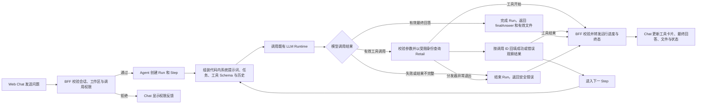
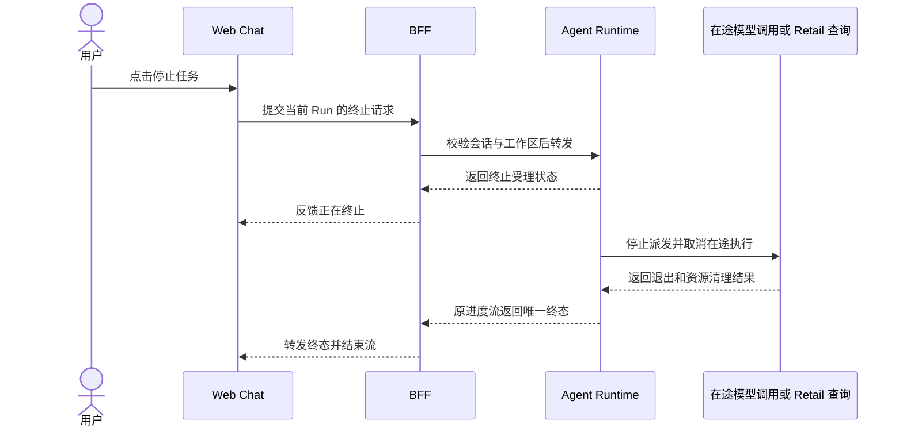

# PRD｜第 15 课 · 从 LLM Runtime 到 Agent Runtime：搭建 Agent 执行内核

> 状态 `draft` · 负责人 andy · Profile `standard`

需求与验收标准以本文为准。使用 [Compass 标准 PRD 模板](../../_templates/PRD.tmpl.md)。课程与实施素材记录初始方案。当前查询、交付入口与验收范围以本文为准。

[返回需求简报](../BRIEF.md) · [素材索引](../context/_INDEX.md)

## 1. 背景与目标

Compass 第四篇已提供统一模型调用、路由、有界可靠执行和模型观测。现有分析 Chat 保留当前页的对话历史，每次发送走一次模型调用。M1 将该入口经 BFF 接到 `apps/agent` 的同步执行内核，在一次请求内组织多轮模型与工具调用，读取独立 Retail PostgreSQL 的已发布合成数据。

- 一个经营问题触发一次 Agent Run，执行器按轮组织模型消息、工具调用和观察结果。
- 使用一个写在代码里的系统提示词和一个固定 Retail 查询工具。在同一个 Run 内走通至少两轮依赖真实查询结果的工具调用，最后由模型作答。
- BFF 复用既有分析授权，通过 HTTP 调用 Agent 并转发运行进度与终态。Web 在原对话中按顺序展示各轮工具调用，收到结构化的 `finalAnswer` 后折叠分析过程，并独立展示回答和可下载文件。
- 通过同一 Run 的事件区分最终回答、可回传的工具失败和异常终止。后续追问使用当前页面已完成的对话历史。
- 用户能从 Chat 终止当前 Run，停止后续派发，取消在途模型调用或 Retail 查询，完成浏览器、BFF、Agent 和执行后端的清理。

## 2. 用户与场景

| 用户故事 ID | 目标用户       | 触发场景                               | 用户故事                                                                            | 关联需求                   |
| ----------- | -------------- | -------------------------------------- | ----------------------------------------------------------------------------------- | -------------------------- |
| US-01       | 经营分析使用者 | 在分析 Chat 比较两个时段的渠道实付金额 | 我希望看到 Compass 如何选定渠道、继续查询商品，并在同一条对话中得到最终分析和文件。 | FR-01～FR-04、FR-08～FR-10 |
| US-02       | 课堂学员       | 在分析 Chat 走读正常运行与故障场景     | 我希望从工具卡片和 Run/Step 记录看出每轮做了什么，以及执行器如何继续或停止。        | FR-03～FR-06、FR-09        |
| US-03       | 发起分析的用户 | 模型生成或 Retail 查询尚在执行         | 我希望在对话中终止这次任务，并能看到是否已完成终止和清理。                          | FR-11、FR-12               |

## 3. 总体业务流程

### BF-01｜分析 Chat 中的同步经营诊断

用户在现有分析 Chat 发送问题。BFF 鉴权后发起一次 Agent 请求，AgentExecutor 在该请求内推进一个 Run，并返回可供页面展示的进度和终态。



每次推进有独立的 Step。一个 Step 可接收对同一个工具的多条 ToolCall，首期顺序执行这一批，再进入下一轮。课堂先查两个时段的渠道汇总，模型根据返回结果选出渠道，再查询该渠道的商品明细。Agent 记录结构化执行事件，并将可展示的状态和摘要随当前请求返回。文件由服务端从已授权结果生成。

### BF-02｜从 Chat 终止当前 Run

Agent 在首次派发前返回 Run ID。用户点击「停止任务」后，Chat 针对该 Run 发送独立终止请求，保留原进度连接等待结果。若点击早于 Run ID 到达，Chat 保留终止意图，取得 ID 后提交。



BFF 清理上下游流、请求监听和定时器。Chat 结束本轮读取，清理进行中状态与未提交文件引用，保留已收到的工具过程供查看。若原连接断开，BFF 向上游传播中止，Agent 按同一清理路径收口。页面根据收到的确认区分已终止、清理失败和结果待确认。

## 4. 功能需求

### 4.1 新增需求

| 需求编号 | 触发条件                                         | 输入                                                            | 预期行为                                                                                                                                                                              | 输出或结果                                                           | 关联需求编号                |
| -------- | ------------------------------------------------ | --------------------------------------------------------------- | ------------------------------------------------------------------------------------------------------------------------------------------------------------------------------------- | -------------------------------------------------------------------- | --------------------------- |
| FR-01    | 提交课堂经营分析任务                             | Agent 配置、任务内容                                            | `AgentExecutor.run()` 创建唯一 Run 和独立的内存 AgentState，按顺序推进 Step。调用方同步取得执行结果。                                                                                 | Run ID、Step 序列、终态和结果                                        | BR-01、NFR-01               |
| FR-02    | 首次执行或上一 Step 已完成                       | 代码内系统提示词、任务、可见历史、固定工具 Schema、已有观察结果 | 最小 Context Provider 组装模型上下文，通过第四篇统一入口调用模型。需要续接时沿用既有消息、模型绑定与续接规则。                                                                        | 归一化的模型结果与可关联调用标识                                     | BR-02、BR-05                |
| FR-03    | 模型返回可关联的 ToolCall 批次                   | 每条调用的 ID、工具名和查询参数                                 | 代码内固定一个 Retail 查询工具。轻量分发校验名称和参数，使用专用受限只读连接执行固定参数化查询。依次处理同批调用，按原 ID 回填结果或错误。                                            | 来自 Retail 的真实查询结果或可区分的失败。观察结果进入下一轮模型请求 | BR-03、BR-04                |
| FR-04    | 收到有效最终回答、模型失败、协议不完整或执行异常 | 模型结果、工具错误或执行器错误                                  | 按归一化状态判断继续或结束。有效最终回答完成 Run 并产生 `finalAnswer`。可处理的工具错误进入观察结果，终止错误收口当前 Step 和 Run。                                                   | 完成态和 `finalAnswer`，或明确的失败状态及安全错误                   | BR-04、BR-05、BR-07         |
| FR-05    | Run 或 Step 启动、产生关键结果、受理终止或结束   | Run ID、Step ID、模型与工具调用标识、状态                       | 记录结构化事件，关联终止原因、在途调用退出与清理结果。向当前请求返回可展示的工具进度与 Run 状态。                                                                                     | 可串联的 Run/Step 记录及 Chat 运行进度                               | BR-01、BR-07、BR-11、NFR-02 |
| FR-06    | 演示 M1 交付                                     | 已发布 Retail 样本、可用模型配置、对照 SQL 和受控故障           | 从现有分析 Chat 走通 BFF、Agent、多轮 Retail 查询、最终回答与文件下载。演示在途模型、真实查询的终止清理及失败反馈。架构图覆盖端到端调用与终止链路，ADR 记录本期取舍。                 | 可复现的 Web 演示、基础执行架构图与执行内核选型 ADR                  | FR-01～FR-05、FR-08～FR-12  |
| FR-08    | 分析 Chat 发送任务                               | 问题、当前页可见历史、模型选择和当前工作区                      | BFF 复用会话及权限检查，向 Agent 传递可信主体和范围。单次发送发起一个 Run，先回传 Run ID，再在同一 HTTP 请求内校验并转发进度、终态和安全错误。                                        | 已鉴权的 Chat 运行响应或明确拒绝                                     | BR-06、BR-07、NFR-04        |
| FR-09    | 收到同一 Run 的工具进度或终态                    | Run、Step、ToolCall 标识，工具摘要、终态和 `finalAnswer`        | 原分析 Chat 按 Step 和调用顺序显示工具卡片并更新状态。运行中展开工具过程，收到完整成功响应中的 `finalAnswer` 后默认折叠过程并单独展示回答。过程可重新展开，完成轮次可用于当前页追问。 | 一条用户消息及其多轮工具卡片、最终回答或失败状态                     | BR-07、BR-09、NFR-02        |
| FR-10    | 本次分析产出符合条件的商品查询结果               | 已授权结果、来源调用和 Run 标识                                 | Agent 使用固定的服务端导出逻辑生成一份有界 CSV，随本次已鉴权响应交付。Web 用文件卡片呈现实际文件名和类型，提供下载。产物生成失败或超限时显示安全提示。                                | 可下载的真实文件或明确的文件状态                                     | BR-08、NFR-04               |
| FR-11    | 用户点击「停止任务」                             | 当前 Run ID、会话与工作区                                       | Chat 发起独立终止请求。BFF 验证当前权限，将 Run ID 与可信主体交给 Agent。原进度连接等待服务器终态，页面区分正在终止、已终止、失败和结果待确认。                                       | 已受理、已结束或拒绝的反馈，以及关联原 Run 的最终结果                | BR-10、BR-11、NFR-04        |
| FR-12    | Agent 受理终止，或活动 Run 的执行请求断开        | 原 Run、终止原因及在途执行和资源句柄                            | 停止派发后续 Step。将终止信号传到 LLM Runtime 或固定 Retail 查询工具，确认在途执行退出，释放本轮资源并丢弃未提交的回答与文件。                                                        | Run 和当前 Step 的终止状态及可核对的清理结果                         | BR-11、BR-12、NFR-05        |

### 4.2 兼容行为

| 需求编号 | 触发条件                                                 | 输入               | 预期行为                                                                                                                                   | 输出或结果                                      | 关联需求编号         |
| -------- | -------------------------------------------------------- | ------------------ | ------------------------------------------------------------------------------------------------------------------------------------------ | ----------------------------------------------- | -------------------- |
| FR-07    | 使用第四篇模型接口、平台模型管理、调用诊断或固定样本演示 | 第四篇已支持的请求 | 既有接口保留权限、响应和观测契约。分析 Chat 复用既有模型选择、授权及当前页历史。无工具轮次可直接返回回答，需调用工具时检查所选模型的能力。 | 原调用方可继续使用既有接口，Chat 可完成本期分析 | BR-05、BR-06、NFR-03 |

## 5. UI 视觉与交互

### UI-01｜现有分析 Chat

沿用现有分析页的输入框、模型选择和对话布局。在同一个助手回复区展示本次 Run 的过程与结果。

静态原型用于核对现有布局和状态，新增折叠交互以下方线框和规则为准。原型沿用现有 Compass 分析页的暖白与墨绿视觉，使用示例 Retail 数据。通过页顶「状态预览」切换执行中、完成、文件不可用、执行失败和各类终止状态。执行中可点击「停止任务」查看等待确认的界面。 [分析 Chat 静态原型](visuals/chat-prototype.html) · [现有 Chat 截图](../../993-lesson-11-llm-runtime/spec/visuals/implemented-model-chat.png)

| 区域         | 行为                                                                                                                                                                     | 关联需求            |
| ------------ | ------------------------------------------------------------------------------------------------------------------------------------------------------------------------ | ------------------- |
| 运行状态     | 发送后显示执行中，正常结束时显示完成或失败。原连接中断时保留当前页已收到的过程，并提示本轮状态。                                                                         | FR-08、FR-09、FR-12 |
| 停止任务     | 执行中可点击。提交后显示「正在终止」，收到服务器清理完成的终态后显示「已终止」。若 Run 已结束，使用已确认的终态。终止请求失败或连接中断时给出对应反馈。                  | FR-11、FR-12        |
| 工具调用卡片 | 按 Step 分组，同一轮的多条调用按原顺序排列。卡片显示工具名、用途和状态，展开可查看经筛选的参数与结果摘要。同一调用的状态在原卡片更新。Run 终止时收口本轮仍在进行的卡片。 | FR-05、FR-09、FR-12 |
| 最终回答     | 收到该 Run 的有效 `finalAnswer` 时，在过程区下方独立渲染回答，并自动折叠过程一次。用户之后可重新展开。没有过程事件时直接显示回答。                                       | FR-04、FR-09        |
| 文件产物     | 在本轮回答下方显示可用文件卡片，标注文件名、类型和下载入口。文件生成失败或超限时给出提示，保留有效的最终回答。                                                           | FR-10               |

过程区紧邻回答区域上方。标题「分析过程」是可聚焦的展开按钮，支持 Enter 和空格操作并暴露展开状态。自动折叠时，如果焦点在将被隐藏的内容内，将焦点移回按钮。

```text
运行中                         回答已到达
▾ 分析过程                     ▸ 分析过程
  查询两段日期的渠道销售额       最终回答
  核对主要下滑渠道               服饰渠道贡献了本周大部分降幅……
```

## 6. 业务规则与约束

| 规则 ID | 业务规则                                                                                                                                                                                                                                                                                                                                 | 关联需求                   |
| ------- | ---------------------------------------------------------------------------------------------------------------------------------------------------------------------------------------------------------------------------------------------------------------------------------------------------------------------------------------- | -------------------------- |
| BR-01   | 一个任务对应一个 Run。Run 包含有序的 Step，Step 可关联一次逻辑模型调用和零到多条 ToolCall。模型内部的尝试仍归第四篇记录。                                                                                                                                                                                                                | FR-01、FR-05               |
| BR-02   | 首轮组装代码内系统提示词、任务与单一工具 Schema。后续保留可见助手消息及对应观察结果。模型供应商的续接状态由既有模型层处理。                                                                                                                                                                                                              | FR-02、FR-03               |
| BR-03   | 只接受代码中定义的工具名及允许的日期、查询维度和筛选参数。查询逻辑使用固定参数化 SQL 和专用 `COMPASS_RETAIL_*` 受限连接，授权范围沿用 Retail 只读身份。模型入参不接受 SQL 文本或连接信息。结果使用原调用 ID 返回，批次完成后才进入下一轮。                                                                                               | FR-03                      |
| BR-04   | 未知工具和无效参数在访问数据库前拒绝。数据库连接或查询失败产生可回传的类型化错误，空结果保留实际状态。模型失败、响应不完整或执行器无法继续时返回明确终止原因。                                                                                                                                                                           | FR-03、FR-04               |
| BR-05   | 沿用第四篇的模型能力检查、可靠执行和 Trace。结论依据授权范围内的 Retail 查询结果，资料不足时说明缺口。                                                                                                                                                                                                                                   | FR-02、FR-03、FR-04、FR-07 |
| BR-06   | BFF 校验会话、有效租户和工作区，并沿用 `module.analysis` 与 `models.invoke`。鉴权事务结束后携服务凭证和可信范围调用 Agent。服务端按授权范围选用受限 Retail 身份。未匹配授权的范围不得查询 Retail，浏览器传参和模型输出均不决定数据权限。                                                                                                 | FR-03、FR-07、FR-08、FR-10 |
| BR-07   | BFF 校验 Agent 运行响应及每条可展示事件，拒绝契约不兼容的数据。页面按 Run/Step/ToolCall 标识关联进度，同一 Run 只提交一个有效终态。完整成功响应才可提交 `finalAnswer` 和有效文件。由 Runtime 在 Run 契约中明确标识 `finalAnswer`，前端按字段和 Run ID 切换展示，过程文本中的提示语不触发折叠。失败、终止或断流时保留可见过程和对应状态。 | FR-04、FR-05、FR-08～FR-10 |
| BR-08   | 文件由固定服务端代码从已授权的查询结果生成，关联原 Run 与来源调用。首期交付一份小型 CSV，校验行数、字节大小和字段转义，随同一次已鉴权 Run 结果返回。文件超限或生成失败不发布下载项。文件内容和引用都不从模型文本中提取。                                                                                                                 | FR-10                      |
| BR-09   | 当前页面继续支持追问。只有已完整完成的用户问题和 `finalAnswer` 进入后续可见历史。内部工具消息、未完成输出及文件字节留在各自边界内。退出、切换授权范围或清空对话时，按当前页面会话规则清理显示及文件引用。                                                                                                                                | FR-02、FR-09、FR-10        |
| BR-10   | 终止前重新校验分析权限。BFF 从会话生成可信主体与范围，Agent 校验其与原 Run 的发起人、租户和工作区匹配。对同一 Run 的重复终止复用同一清理过程。                                                                                                                                                                                           | FR-11                      |
| BR-11   | 原运行和终止控制在同一 Agent 进程收口。正常完成与终止受理按原 Run 的状态裁决。终止受理后停发模型、工具和重试，丢弃迟到结果与未提交的回答和文件。较晚到达的受理回执不得覆盖已确认终态。                                                                                                                                                   | FR-05、FR-11、FR-12        |
| BR-12   | 在途模型调用沿用第四篇取消、流关闭和容量回收机制。正在执行的 Retail SQL 须在数据库端取消或确认退出，再关闭游标、回滚未结束的事务并关闭或安全归还连接。终止和清理使用有界等待。状态不明的执行资源隔离处理，清理未确认时返回相应结果。                                                                                                     | FR-12                      |

| 非功能 ID | 要求                                                                                                                                                             | 验证口径                                                                                  |
| --------- | ---------------------------------------------------------------------------------------------------------------------------------------------------------------- | ----------------------------------------------------------------------------------------- |
| NFR-01    | 本期采用单 Agent、同步返回和内存态。每次 Run 独立维护上下文。                                                                                                    | 连续发起两个任务，检查各自 Run ID、历史和工具结果。                                       |
| NFR-02    | 日志和 Chat 事件按各自可见范围输出。日志保留关联标识、阶段、状态及安全错误。工具卡片只用授权后的安全摘要。凭据、私有续接数据和内部推理内容留在服务端受控边界内。 | 抽查正常和故障两组事件与页面，用哨兵值核查输出。                                          |
| NFR-03    | 延续第四篇模型入口与配置。                                                                                                                                       | 回归 Chat、模型管理和诊断的现有契约。                                                     |
| NFR-04    | Web 与 Agent 通过 HTTP 契约通信，BFF 和页面校验运行响应。Chat 响应及文件交付采用 `no-store`，限定在当前已授权请求和页面会话。                                    | 检查 HTTP 头、越权拒绝、响应断流及会话清理。                                              |
| NFR-05    | 终止可沿同一 Run ID 核对受理、在途调用退出和资源回收。查询设有源端执行时限，清理未确认的资源禁止交给后继调用。                                                   | 在受控模型上游与真实 Retail PostgreSQL 分别验证终止和清理，观察退出、资源计数及随后运行。 |

## 7. 范围与依赖

- **Agent**　`apps/agent` 实现同步单 Agent 执行器、内存 Run/Step、代码内系统提示词、最小 Context Provider、一个固定 Retail 只读查询工具、结构化执行事件和首期文件导出。活动 Run 由当前 Agent 进程接收终止，负责停发后续步骤、取消在途调用与清理。
- **BFF**　`apps/web` 的服务端接入 Agent Run 与终止 HTTP 契约，校验授权与可信主体，转发进度、终态、文件和终止请求，并收尾上下游连接。由 Agent DTO 和路由生成 Web 类型与运行时校验。
- **Web Chat**　复用现有分析 Chat，一次发送对应一个多轮 Agent Run。交付当前页对话、工具调用组件、最终回答、文件卡片与下载，以及用户发起终止、服务端终态反馈和本轮临时状态清理。
- **接入约束**　使用独立 Retail PostgreSQL 和受限只读身份。应用数据库连接、迁移账号和装载账号均不作为工具凭据。本课沿用页面内历史和 Run 内存状态，文件随当前 Run 交付。
- **后续课次**　第 16 课处理计划、验证和 Run 预算，第 17 课处理 Workflow。第 15 课收口当前进程的 Run 和固定 Retail 工具。第 18 课在统一 Tool Executor 扩展到并行工具、工具级取消、Sandbox 和受控 Artifact。第 19 课交付持久 Run 的控制和恢复，[第 20 课](../../984-lesson-20-production-agent-runtime/spec/PRD.md)交付异步调度、Worker 接管、取消竞态及断线续流，并把过程摘要和最终回答阶段接入可续接的用户事件流。提示词持久化、管理后台和版本发布留给后续。
- **前置依赖**　现有分析 Chat 与会话权限、第四篇模型层、支持工具调用的模型及可读取的已发布 Retail 合成样本。
- **教学范围**　比较轻量 Loop、Agent SDK 和图执行框架。M1 用进程内轻量执行器与单工具分发验证多轮闭环。

## 8. 研发资源与数据契约

| 资源 ID | 资源                                                                                                                                                         | 用途                                                           |
| ------- | ------------------------------------------------------------------------------------------------------------------------------------------------------------ | -------------------------------------------------------------- |
| RES-01  | [课程原始上下文](../context/source_context.md)、[Compass 实施上下文](../context/implementation_context.md)                                                   | 教学来源和前置能力。当前功能及验收范围以本 PRD 为准。          |
| RES-02  | [LLM Runtime 入口与目录说明](../../../apps/agent/src/compass_agent/llm/README.md)、[模型消息与结果 Schema](../../../apps/agent/src/compass_agent/schemas.py) | 已有模型调用、ToolCall ID 与消息续接约束，FR-02～FR-04         |
| RES-03  | [第 13 课可靠执行规格](../../991-lesson-13-reliable-model-execution/BRIEF.md)、[第 14 课模型观测规格](../../990-lesson-14-model-observability/BRIEF.md)      | 既有可靠执行和调用关联，FR-05、FR-07                           |
| RES-04  | [Retail 数据操作与只读角色](../../../docs/data-seeding.md#权限失败与回切)                                                                                    | 已发布样本、受限查询身份与对照 SQL 的依据，FR-03、AC-01、AC-03 |
| RES-05  | [Web / BFF 接入说明](../../../apps/web/README.md)、[现有分析 Chat](../../../apps/web/src/components/analysis-composer.tsx)                                   | Chat 页面入口、模型选择、会话和鉴权的现有基础，FR-07～FR-10。  |
| RES-06  | [网络契约生成](../../../contracts/README.md)                                                                                                                 | Agent 路由与 DTO 派生 Web 类型和运行校验，FR-08、NFR-04。      |

| 运行对象              | 最小语义                                                                                                             |
| --------------------- | -------------------------------------------------------------------------------------------------------------------- |
| Agent                 | 角色指令、模型选择与固定工具能力。系统提示词由代码提供。                                                             |
| Run / Step            | Run 标识一次任务及最终结果。Step 标识一次推进，并关联本轮调用和执行状态。                                            |
| Message / AgentState  | 任务、按轮累积的可见消息与工具观察结果。AgentState 归当前 Run。                                                      |
| ToolCall / ToolResult | 共享调用标识。调用携带工具名与参数，结果包含成功数据或安全错误。                                                     |
| Retail 查询           | 固定支持日期区间、渠道汇总与指定渠道的商品拆分。连接和权限由服务端配置。                                             |
| 执行事件              | 按 Run 和 Step 关联，可区分模型调用、工具结果与执行结束。                                                            |
| Chat 运行进度         | 首次派发前提供 Run ID。在同一请求内转发 Step 和工具调用标识、顺序、状态及安全摘要。                                  |
| Chat 终态             | 关联 Run，区分完成、失败、已终止或终止清理未确认。完整成功时返回 `finalAnswer` 与有效文件或文件状态。                |
| Run 终止请求与回执    | 按 Run ID 指定当前任务。可信主体由服务端生成。回执区分受理、已结束与拒绝，原进度流返回清理完成后的终态或未确认结果。 |
| 文件产物              | 来源 Run 和调用、文件名、类型与有界内容。Web 在当前页生成下载入口。                                                  |

## 9. 验收标准

### AC-01｜同一工具完成多轮真实 Retail 查询

**关联**　FR-01、FR-02、FR-03、FR-04、FR-08、FR-09、BR-01、BR-02、BR-03、BR-05

- **Given**　已发布 Retail 样本、受限只读身份、可用的生成模型，以及两个可复现的对照时段。
- **When**　有权限的用户在现有分析 Chat 发送「两个时段里哪个渠道的实付金额变化最大，变化主要来自哪些商品？」并等待当前 Run 结束。
- **Then**　一次发送只发起一个 Run，至少完成两轮对同一工具的真实数据库查询。首轮返回渠道汇总，第二轮模型根据观察结果选择渠道和查询参数。Chat 展示两轮工具卡片及最终回答，关键数字可用相同只读身份、样本版本和对照 SQL 核对。
- **验证方式**　在浏览器用已配置模型和真实 Retail 连接执行完整链路。核对 BFF 请求、Run/Step、调用 ID、两轮参数的依赖关系、实际查询、页面顺序和最终数字。自动化可用受控模型响应覆盖分支，正向数据验收仍查询真实 Retail 样本。

### AC-02｜同一轮多个调用按 ID 续接

**关联**　FR-02、FR-03、BR-02、BR-03

- **Given**　一次模型响应对同一个 Retail 工具发出两个参数不同的 ToolCall，各有独立 ID。
- **When**　轻量分发顺序处理这一批调用并准备下一轮上下文。
- **Then**　下一次模型请求包含原助手工具调用消息，以及两条与原 ID 配对的观察消息。启用需续接的模型能力时沿用既有模型续接契约。
- **验证方式**　检查捕获的模型请求和查询次数，逐条比对 ID、参数与结果。

### AC-03｜参数拒绝与真实查询失败可回传

**关联**　FR-03、FR-04、BR-03、BR-04

- **Given**　分别准备未知工具、无效日期或查询维度，以及受控的 Retail 查询失败。
- **When**　执行器处理对应调用。
- **Then**　错误观察结果保留原调用 ID。未知工具和无效参数的数据库调用次数为零。查询失败得到明确错误状态，空数据和失败可区分。模型可按已知结果继续或说明资料不足。
- **验证方式**　核对分发与数据库调用次数、下一轮模型消息及最终状态。确认连接使用专用受限只读身份。

### AC-04｜模型失败和异常退出收口

**关联**　FR-04、FR-05、BR-04、NFR-02

- **Given**　模型调用失败、返回不完整，或执行器内部出现无法继续的异常。
- **When**　运行到对应失败点。
- **Then**　Run 和当前 Step 有可区分的终止结果。后续工具执行计数不再增加，既有观察结果仍可与原 Step 关联。
- **验证方式**　分别注入模型终止和分发器异常，检查事件、返回值与后续调用计数。

### AC-05｜运行记录可关联且状态隔离

**关联**　FR-01、FR-05、BR-01、NFR-01、NFR-02

- **Given**　接连运行一个正常任务和一个异常任务。
- **When**　按 Run ID 查看结构化记录。
- **Then**　可还原各自 Step 的顺序、工具结果状态和终止原因。两次执行的历史各自独立，记录中没有凭据、私有续接内容或内部推理内容。
- **验证方式**　按 ID 比对内存结果和事件，用测试哨兵值核查输出字段。

### AC-06｜已有模型使用路径兼容

**关联**　FR-07、BR-05、NFR-03

- **Given**　使用第四篇支持的模型配置和调用方。
- **When**　回归既有模型接口、平台模型管理、调用诊断和固定样本演示，并检查分析 Chat 的模型选择和授权。
- **Then**　既有权限与响应契约成立，已有模型调用观测仍可查询。
- **验证方式**　执行现有契约回归并核对模型调用标识。

### AC-07｜课堂交付可复现

**关联**　FR-06

- **Given**　学员获得分析 Chat 入口、Retail 样本版本、只读接入说明、对照 SQL、基础执行架构图和 ADR。
- **When**　在分析 Chat 复现正常的两轮查询，分别在模型生成和真实 Retail 查询时发起终止，再演示一种故障路径。
- **Then**　可定位代码内系统提示词与单一工具定义，沿架构图走读 Web、BFF 和 Agent。正常轮次展示多轮工具、`finalAnswer` 和文件。终止轮次可用同一 Run ID 核对终态和清理结果。
- **验证方式**　从浏览器复现 AC-01、AC-10、AC-12、AC-13，以及 AC-03 或 AC-11，核对下载文件及各层运行事件。

### AC-08｜BFF 鉴权和运行契约

**关联**　FR-08、BR-06、BR-07、NFR-04

- **Given**　准备有权限的课堂账号、未授权账号和无会话请求，以及能返回不合规运行事件的受控 Agent。
- **When**　分别发送合法任务、伪造工作区或可信身份的请求，以及会收到不合规事件的任务。
- **Then**　合法请求携服务端确认的身份和范围进入 Agent。未授权请求在 BFF 拒绝，未授权数据范围不得进入 Retail 查询。不合规事件和结果不会作为成功响应交给页面。
- **验证方式**　核对 BFF 权限结果、Agent 请求次数、可信上下文、Retail 身份、错误状态及 `no-store` 响应头。

### AC-09｜Chat 按轮展示工具并提交最终回答

**关联**　FR-04、FR-05、FR-09、BR-07、BR-09

- **Given**　同一 Run 有两个连续工具轮次，包含同轮多个调用或一次可处理的工具失败。
- **When**　浏览器依次收到工具进度、含「最终回答」字样的过程文本和有效 `finalAnswer`，用户再展开过程并发送追问。
- **Then**　工具卡片按轮次和调用顺序出现，原卡片更新状态。过程文本中的字样不改变展示阶段。收到有效 `finalAnswer` 时过程区默认折叠一次，回答单独呈现。用户可重新展开，追问沿用已完成的可见对话历史。零工具轮次直接显示回答。
- **验证方式**　通过浏览器核对事件与折叠时机、键盘展开、调用 ID、回答位置和追问请求内容。

### AC-10｜显示并下载本次 Retail 查询文件

**关联**　FR-10、BR-08、BR-09、NFR-04

- **Given**　一次获授权的 Run 查询到商品明细，并准备无可导出结果或文件超限的反例。
- **When**　Run 正常完成，用户在 Chat 查看文件卡片并下载 CSV。
- **Then**　卡片对应本次 Run 的实际文件。CSV 内容与授权查询结果一致。无可用文件时没有下载项，超限或生成失败有清晰提示。清空对话或切换授权范围后，原页面的文件入口失效。
- **验证方式**　下载并比较 CSV 表头、行数和数据，检查来源调用与错误状态，再验证会话清理。

### AC-11｜断流和失败的收口

**关联**　FR-05、FR-08～FR-10、FR-12、BR-07、BR-09、BR-12

- **Given**　Chat 已收到至少一个工具卡片，Run 尚未完整完成。
- **When**　原连接中断，或 Agent 返回失败终态。
- **Then**　页面结束加载，保留已收到的工具过程，显示失败或终止结果待确认。本轮未提交的回答和文件被清理。活动 Run 因连接中断而结束时，BFF 和 Agent 沿终止链路释放流与在途资源。
- **验证方式**　分别切断浏览器连接和注入 Agent 失败，核对两侧流关闭、Agent 后续派发次数、资源释放、文件入口及下一次请求的历史。

### AC-12｜从 Chat 终止在途模型调用

**关联**　FR-05、FR-11、FR-12、BR-10～BR-12、NFR-05

- **Given**　浏览器已启动一个有权限的 Run，受控模型上游正在输出。另准备首次 Run ID 到达前点击停止的场景。
- **When**　点击「停止任务」，通过 BFF 对原 Run 提交终止。
- **Then**　页面从「正在终止」进入服务端确认的「已终止」。在途模型流退出并完成资源回收，后续模型、工具和重试计数停止增加。两端进度流关闭，当前轮未提交的回答和文件被丢弃。提前点击时，收到 Run ID 后只发送一次终止请求。
- **验证方式**　按 Run ID 核对停止请求、原流终态、模型上游连接退出、执行槽位归还和页面状态，再发起正常任务。

### AC-13｜从 Chat 终止真实 Retail 在途查询

**关联**　FR-03、FR-11、FR-12、BR-11、BR-12、NFR-05

- **Given**　以受限只读身份在真实 Retail PostgreSQL 执行受控慢查询，同一 Run 仍有后续工作。
- **When**　在确认数据库端正在执行该查询后，从 Chat 点击「停止任务」。
- **Then**　数据库端查询退出，事务和游标清理，连接关闭或安全归还。原 Run 在清理确认后进入已终止状态，后续调用未派发，本轮没有发布 CSV。
- **验证方式**　用测试观察身份检查该活动查询的退出，核对事务、连接、调用计数和终止事件。随后执行正常 Retail 查询检查资源可用。

### AC-14｜终止权限、重复请求和完成竞态

**关联**　FR-11、FR-12、BR-10、BR-11

- **Given**　存在运行中的 Run，并准备其他用户或其他工作区的请求、重复请求以及可控的正常完成时点。
- **When**　分别发送越权终止、同一 Run 的重复终止，并覆盖终止先受理与完成先提交两种顺序。
- **Then**　越权请求不影响原 Run。重复请求只触发一次清理。终止先受理时迟到的结果不发布，完成先提交时页面使用已确认的结果。每个 Run 只有一个生效终态。
- **验证方式**　核对 BFF 与 Agent 的授权、清理次数、结果提交次数及页面终态。

### AC-15｜终止清理未确认

**关联**　FR-11、FR-12、BR-12、NFR-05

- **Given**　受控执行后端模拟关闭异常或无法在清理时限内确认退出。
- **When**　用户终止当前 Run 并等待清理期限。
- **Then**　页面显示清理失败或结果待确认，Agent 记录相应原因并隔离未确认的资源。后续请求使用健康的执行资源。
- **验证方式**　核对清理超时、终态、隔离和后续请求的资源分配。

## 待确认事项

| 问题                                                                           | 来源             | 影响                       | 阻塞 PRD | 决策环节 |
| ------------------------------------------------------------------------------ | ---------------- | -------------------------- | -------- | -------- |
| Retail 发布版本、对照时段、固定参数及课堂工作区与受限数据身份的绑定。          | 课程与实施上下文 | FR-03、FR-06、FR-08、AC-01 | 否       | 技术设计 |
| 本次请求内的进度协议、路由与字段，以及 CSV 随 Run 返回的编码、行数及字节上限。 | 本次范围调整     | FR-08～FR-10、AC-08～AC-11 | 否       | 技术设计 |
| 终止接口与回执字段、在途查询取消机制、执行和清理时限及异常回收策略。           | 本次终止范围调整 | FR-11、FR-12、AC-12～AC-15 | 否       | 技术设计 |

## 变更记录

| 日期       | 变更                                                                         | 范围         |
| ---------- | ---------------------------------------------------------------------------- | ------------ |
| 2026-11-09 | 形成标准版 PRD 草案                                                          | 第 15 课 M1  |
| 2026-11-10 | 将 M1 调整为代码内提示词与单一真实 Retail 查询，更新多轮演示、权限边界和验收 | 第 15 课 M1  |
| 2026-11-10 | 纳入 BFF 与 Web Chat，补充多轮工具卡片、最终回答和 CSV 产物的端到端验收      | 第 15 课 M1  |
| 2026-11-10 | 纳入 Chat 主动终止与 BFF、Agent、模型和真实 Retail 查询的全链路清理验收      | 第 15 课 M1  |
| 2026-11-10 | 补充分析 Chat 静态原型，覆盖多轮工具、回答、文件和终止状态                   | UI-01        |
| 2026-11-10 | 明确 `finalAnswer` 触发的过程折叠和重新展开验收                              | FR-09、AC-09 |
