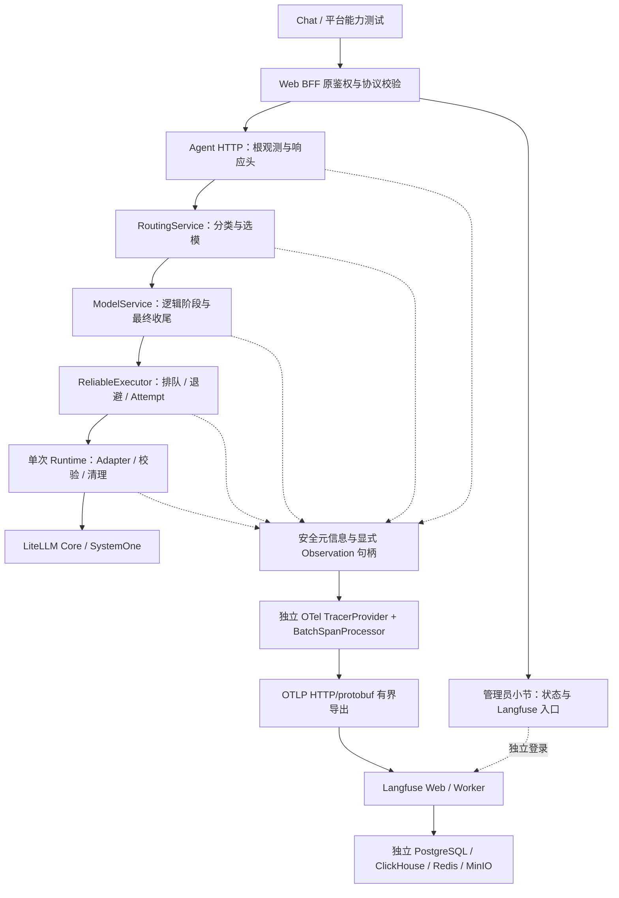
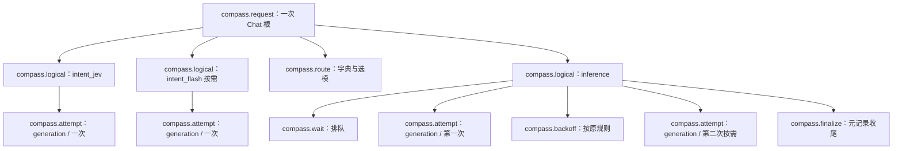

# 第 14 课：模型调用可观测与运营治理技术方案

> Feature：990 | Profile：standard | 状态：已实施并完成验收 | 更新：2026-11-06
>
> 有效需求：[PRD](../spec/PRD.md)；模板：`mai-specs/_templates/TECH_DESIGN.tmpl.md`。代码基线：`d08488b0b9f9dd2614702426f053e1421e9182c9` 加本次读取的未提交工作区。当前 `executor.py`、`admission.py`、0004 和可靠性演示均已出现在工作区，其实施验收由 991 管理。

[返回需求简报](../BRIEF.md)

## 需求依据与验收

先读[开发默认上下文](../context/lesson-14-development-context.md)。2026-11-06 用户确认本地 Docker Langfuse，覆盖上下文中的后端待选项；不改变四页 PPT 原件。需求、权限、五个 Showcase 和 AC-990-01～18 统一由 PRD 维护。本文和[代码设计](CODE_DESIGN.md)维护设计；本次用户连续授权已覆盖实施、部署与验收，实际结果统一在[实施记录](../IMPLEMENTATION.md)维护。

## 1. 方案概述

### 1.1 最小方案与量化设计目标

在现有 Agent 路由、ModelService、ReliableExecutor 与 Adapter 中接入显式观测句柄；进程内 OTel SDK 通过 HTTP/protobuf 直接导出到 Docker Langfuse。Compass 增加关联信息、平台状态小节和一个固定只读对比表；Trace 树与趋势图复用 Langfuse。对比数据从 Langfuse 的公开聚合 API 取得，不保存新统计库。不创建通用控制面、观测数据库或账本。

| 核心问题             | 实现目标                               | 量化指标（设计目标）                                                       |
| -------------------- | -------------------------------------- | -------------------------------------------------------------------------- |
| 一轮多阶段调用难关联 | 请求根 → 分类/主模型逻辑阶段 → Attempt | 每轮 1 个请求根；实际尝试与 Attempt 观测一一对应                           |
| 慢与故障难定位       | 排队、路由、尝试、首字、收尾与状态     | 单调时钟计算；非流式 TTFT 为空；重复用量计数为 0                           |
| 后端异常影响调用     | 后台有界导出，失败降级                 | 每进程队列 512 span；每批 64；每 1 秒导出；网络预算 2 秒                   |
| 正文泄露             | 在采集入口构造安全字段                 | 属性最多 64 项、每字符串 256 字符、span events 最多 16；正文哨兵出现数为 0 |
| 统计失真             | 区分请求、逻辑阶段与尝试，标记未知     | 本机采样率 1；只在 Attempt 写原生 usage/cost；未知不填 0                   |
| 本地复现             | 独立 Langfuse Compose 栈               | UI 127.0.0.1:3002；6 个服务；停止保留全部卷                                |

512/64/1 秒/2 秒等为本期可逆设计默认值，非生产容量或 SLA。沿用模型 8/32、180 秒与原取消预算；观测不重设执行参数。

### 1.2 整体架构

| 位置                        | 本期处理                                                                 | 保持的所有权                                 |
| --------------------------- | ------------------------------------------------------------------------ | -------------------------------------------- |
| Web                         | 透传校验后的观测响应头；显示编号；平台管理状态、固定只读对比表与后台链接 | 账户、授权、UI 和 BFF                        |
| Agent HTTP / RoutingService | 请求根、分类/路由与整轮状态                                              | 父期限、分类兜底与主模型选择                 |
| ModelService                | 从 prepare 之前开始逻辑 span，finish 之后结束                            | 配置快照、解密、调用元记录和最终终态         |
| ReliableExecutor / Runtime  | 实际 Attempt、队列/退避、首片段、发送/清理结果                           | 重试与资源占用，不接受观测控制               |
| LiteLLM Adapter             | 复用回调取得安全回执；规范化响应为稳定补充                               | 协议、SDK 用量；本期不启用自动 Langfuse 集成 |
| OTel / Langfuse             | 安全 span 的异步导出、存储和可视化                                       | 第三方观测数据；不承担业务执行与计费         |

### 1.3 关键决策与减法

| 决策                                    | 选择理由                                                             | 代价与更简单备选                                         | 边界 / 演进                                  |
| --------------------------------------- | -------------------------------------------------------------------- | -------------------------------------------------------- | -------------------------------------------- |
| 用户确定 Docker Langfuse                | 直接满足 Trace 与模型比较                                            | 平台需 Web/Worker、三类存储和缓存，不能简化成单容器      | 无 HA 承诺；6 服务可按需停机                 |
| OTel 原生 span + 少量 Langfuse 属性映射 | 保留通用调用语义与字段采集控制                                       | 比自动 SDK 多一处映射；SDK 自动采集全文需额外清洗        | 映射只在 exporter 边界维护                   |
| 显式句柄传递                            | 取消/后台任务可正确结束，避免 ContextVar 跨任务回调串线              | 少量内部可选参数；无需重写 `ExecutionRequest` 或运行结果 | 每次请求独立根，无全局“当前 span”            |
| 不持久化 trace_id                       | 当轮排障通过响应头获得；旧记录可按 call_id 在 Langfuse metadata 检索 | 刷新后可能仅有 call_id；避免为关联字段迁移业务库         | 需要持久查询关联时再登记 Agent/main 迁移     |
| HTTP 响应头关联                         | start 之前即可获得 ID；取消也可保留                                  | BFF 与 Hook 需同步支持，无新增 SSE 类型                  | 不把后端地址传给租户浏览器                   |
| 指标先复用 Langfuse 观测聚合            | 完成模型比较，不增加第二套时序库                                     | 成功率分母需固定保存查询口径；采样后非完整账             | 原生 OTLP Metrics 不发往 Langfuse Trace 端点 |
| BSP 原生队列和本地自诊断 Metrics        | 复用有界后台线程，不自写重试队列                                     | 固定 SDK 版本并验证内部指标命名                          | 不读 `_queue` 等私有属性                     |
| 仅 Attempt 为 generation                | 模型用量和价格只统计一次                                             | 父级需 metadata 字段说明累计已知/未知                    | 不用父 generation 再填总 Token               |

## 2. 详细设计

### 2.1 观测对象、父子关系与状态

Provider 测试根下直接建立一个 test Logical Call；决策适配采用同样 Attempt 外壳。可靠性演示受控场景标为 `environment=showcase` / `simulation=true`，不能混入 local 的真实模型比较。

- `request.call_id` 是 Chat 用户本轮 UUID；分类现有 `uuid5(parent_call_id, role)` 与主模型 `call_id` 均保留。不得为遥测改写业务 ID。
- `trace_id` / `span_id` 由 SDK 随机生成；父上下文由句柄内部持有。外部调用新建根；已鉴权内部请求可从 `traceparent` / `tracestate` 提取远程父。Web BFF 不透传浏览器上下文，Provider 出站不注入，baggage 不传播。
- 根覆盖 Agent 接纳请求到路由/调用结果完成，包括原数据库收尾；不包含浏览器渲染与 BFF 读 EOF。已发 final 后断流的客户端协议异常仍由 BFF/浏览器处理，不回写成 Agent 的生成失败。
- Logical Call 在 `ModelService.prepare` 之前建立，已选 Provider UUID 和内部模型标识先绑定到句柄，prepare 成功后再补版本快照；准备失败、过载、超时可为零 Attempt。prepare 与 run 通过同一作用域包装，不能只在 `run` 里创建而漏准备失败。
- Attempt 在取槽成功、期限再检查后，调用 Runtime 前建立；每次 Attempt 都有新 span。取消与 RuntimeCancelled 保留原结果；清理结果登记后再结束 Attempt。
- `completed` 要求原输出校验与 `_finish` 成功；Attempt 成功但 `record_write_failed` 时，Attempt 可成功，Logical Call 与根失败；逻辑句柄将 record_write_failed 提升到根，外围取消只能补缺，不能覆盖该权威失败。
- 对取消、过载、未完成、业务拒绝等保留 `compass.status` 和安全错误码；失败、incomplete 映射 OTel ERROR / Langfuse ERROR，canceled 映射 WARNING。成功根下允许存在失败 Attempt。
- 所有正常返回、ModelError、CancelledError 都在 finally 结束对应 span 一次。进程崩溃可能只导出已结束子 span，不承诺补齐根或重放。

### 2.2 字段与隐私

只向 Observer 传结构化安全值；不把完整 `ExecutionRequest`、DTO、异常对象或 LiteLLM kwargs 交给 exporter。`ExecutionRequest`、`RuntimeResult` 与模型数据库结构保持不变，内部新增可选 `observation` 参数。

| 字段组 | 允许内容                                                                           | 限制                                                                    |
| ------ | ---------------------------------------------------------------------------------- | ----------------------------------------------------------------------- |
| 关联   | call_id、parent_call_id、attempt_id、trace/span ID                                 | UUID / SDK ID；不直接携带外部入参字符串                                 |
| 上下文 | 可信 tenant/workspace UUID、actor UUID、purpose、stage                             | 仅既有已鉴权上下文；不存名字/邮箱/Session token；平台项目仅管理员可访问 |
| 路由   | category_id、scene_id、difficulty、路由模式、固定 reason、字典/策略版本            | 只允许字典/枚举登记值，绝不放原问题或分类模型输出全文                   |
| 模型   | Provider UUID、adapter、SDK vendor、配置与绑定版本、请求/响应模型标识              | 模型标识取内部配置受限字段；不放 alias、Base URL 或连接参数             |
| 状态   | completed/failed/canceled/incomplete、安全错误码、sent、unknown、cleanup_confirmed | 错误只写固定码；不调用 `record_exception`，不写栈与 `str(exc)`          |
| 性能   | 阶段/排队/退避/尝试/收尾 ms、first_visible_ms、streamed                            | 非负有界数值；monotonic 差值计算                                        |
| 用量   | input/output/reasoning、完整性、估价状态与已知 USD 部分                            | reasoning 是 output 子集，不再相加                                      |

最大 64 个属性、每字符串 256 字符、16 个安全事件、0 个 links；超限安全字段丢弃并增加本地计数。Span 的名称固定，不含用户内容。白名单构造为主要边界，出口再拒绝 input/output、exception 与不在登记集合的属性。`Resource` 只手工设置 service.name/version、environment，禁用自动 Resource 探测，避免环境变量与主机标识隐式采集。

业务键在采集内部保留 `compass.*` 命名，出口单一映射层将登记字段转换为 `langfuse.observation.metadata.<字段名>`，例如 `model`、`stage`、`status`、`call_id`、`usage_complete`，确保在 Langfuse 顶层 metadata 可筛选。请求根另补 `langfuse.trace.metadata.call_id`，所有 span 均带 environment 与固定 trace 名称。映射后仍检查 64 属性上限；不只依赖无法直接筛选的 metadata.attributes。

LiteLLM 保持 `turn_off_message_logging=True`、`suppress_debug_info=True`，不注册 `langfuse` / `otel` 自动集成，也不自动仪表化 HTTP/SQL。SDK 内部异常日志设置安全过滤器：只保留 logger 名称和固定错误类别，移除 args、exc_info 和任意正文；禁用 verbose logging。导出器自己的日志同样处理，Authorization、端点带参信息均不落日志。

### 2.3 时间与统计口径

| 指标                           | 起止 / 聚合定义                                                                                                    |
| ------------------------------ | ------------------------------------------------------------------------------------------------------------------ |
| request.duration_ms            | Agent 已鉴权后根开始 → 原根任务返回/异常，包含分类、选模与收尾                                                     |
| logical.duration_ms            | prepare 开始 → `_finish` 完成/失败；含等待、退避、尝试和收尾                                                       |
| attempt.duration_ms            | Runtime.invoke 前 → 结果及清理完成，含输出校验                                                                     |
| queue_wait_ms                  | 既有每次取槽等待的累计；专用 wait span 显示各段，零 Attempt 也可有等待                                             |
| first_visible_ms（根）         | 根开始 → 主推理首个 text_delta/tool_delta，在转交 sink 前捕获；分类内容不计                                        |
| first_visible_ms（Attempt）    | Attempt 开始 → 首个 text/tool delta；Thinking 元信息不计；无片段/非流式为 null                                     |
| Langfuse completion_start_time | 本 Attempt 首片段发生的 UTC 时间，仅流式 generation 有值；与 first_visible_ms 对应                                 |
| 逻辑主模型成功率               | inference Logical Call completed / 全部已结束 inference Logical Call，包含 canceled/incomplete/failed 与零 Attempt |
| 整轮成功率                     | request completed / 全部已结束 request；单独统计，不用成功 generation 数代替                                       |
| Attempt 成功率 / 重试放大      | 成功 Attempt / 已结束 Attempt；Attempt 数 / 已结束 Logical Call，均明确 scope                                      |

比较视图使用 `environment=local`，默认 24 小时，同窗口分别筛选 `compass.logical` 与 `compass.attempt`，按 Provider UUID / 模型标识分组。未选到模型的根失败属于整轮失败，不能分摊到任意模型。分类阶段单独筛选，不能重复计入主推理调用量。Compass 平台小节提供按该口径计算的只读对比表（见 §2.7），Langfuse 展示 Trace 与趋势。交付固定查询模板与合成金标数据，无任意查询编辑器、定时任务或统计存储。

### 2.4 Token 与估价映射

- 仅 `compass.attempt` 使用 `langfuse.observation.type=generation`。父级 span 仅写 `compass.known_*` / `unknown_attempts` 元信息，不写 Langfuse 原生 usage/cost。
- 既有 RuntimeResult.usage 为 Token 的权威输入；SDK 回调只提供安全回执和可用成本补充。迟到、缺失或重复回调不改变执行、不重复提交 generation；关闭句柄后忽略回调。
- 保守价格策略：仅用量完整、结果已知、SDK 能识别模型价格与用量细类时估价。优先使用回调中的有限非负 `response_cost`；回调尚未返回时，Adapter 复用锁定 LiteLLM 的本地 `completion_cost(completion_response=..., model=...)`，从已归一响应计算一次安全金额，流式用 SDK 标准组装结果。该计算不联网、不自建价格目录、不把响应传给 exporter。模型不存在、用量不全、SDK 无法处理的缓存/细分类定价均保持 unknown。
- `langfuse.observation.usage_details` 仅填已知 input/output，未知键省略；`usage_complete` 与 unknown_usage_attempts 区分零与未知。reasoning 只在 metadata 记录，不额外写进 total。
- `cost_state` 只使用 `complete_estimate` / `unknown`；来源标记为锁定 SDK 与其本地目录版本。已知有限估价时同时写原生 model 与 `cost_details={total:<USD>}`，Langfuse 按显式成本展示。缺估价时这两个原生字段都省略，只在业务 metadata 保留模型标识，防止平台按另一套价格规则补价；固定对比表按 metadata.model 分组。未知禁止发送 `{total:0}`。
- 根/逻辑阶段记录“已知部分”和未知 Attempt 数，不承诺严格总费用。正式按量计费、预算预占和供应商对账独立建设。

### 2.5 LiteLLM 适配与回调边界

现有 `litellm-core==1.106.6` 源码已读。`CustomLogger` 有同步/异步成功和失败入口；`kwargs['callbacks']` 路径可能登记进全局列表，本期禁止每请求修改该列表。回调采用逐调用动态 `success_callback` / `failure_callback` 函数闭包，绑定当前 AttemptReceipt；不依赖后台回调的当前 ContextVar。

回调只从标准字段读取有限数值与枚举，返回即结束，不联网、不新增 span、不 flush，不保存 response / kwargs。Runtime 在自己规范化结果后关闭唯一 Attempt；回调不可用时仍有完整 Attempt 状态和标准用量。平台接入先通过受控 HTTP 夹具验证当前 SDK 的动态回调路径及晚到行为；不得将未命中的回调当作成功接入。

SystemOne 使用现有类型化决策结果提取用量，进入相同 generation 外壳；不强行套用 LiteLLM Chat 回调。`response_model` 不提供时使用 requested_model 作展示标识，另标来源。

### 2.6 OTel 生命周期、导出与自诊断

新增 Agent 内 `observability/` 模块，只服务本 app，不提取共享包。

1. FastAPI lifespan 创建独立 `TracerProvider`、局部 `MeterProvider` / `InMemoryMetricReader` 与单个 BSP，保存 `app.state.observation`。不调用全局 `set_tracer_provider`，不开启自动仪表化。disabled 时使用 NoOp 门面。
2. 使用 ParentBased 根采样；根自行创建，子 span 显式 parent context，整轮决定一致。默认 ratio=1，ratio<1 时 UI 显示 sampled=false 或 sampled=true，任何情况下不声称入库成功。
3. BSP `max_queue_size=512`、`max_export_batch_size=64`、`schedule_delay_millis=1000`。OTLPSpanExporter `timeout=2` 秒，endpoint 固定完整 Trace 地址。后台网络重试只消费 exporter 自身预算，不能影响模型重试。
4. SDK 1.45.2 的 BSP `export_timeout_millis` 未传给 exporter，不能拿该参数控制 HTTP；网络上限必须在 OTLP HTTP exporter 显式设置。
5. `OTEL_PYTHON_SDK_INTERNAL_METRICS_ENABLED=true` 启用 BSP 的公开 Metrics 输出，读取 `otel.sdk.processor.span.queue.size` 与 `otel.sdk.processor.span.processed` 的 error.type 维度；队列满的 SDK 语义为淘汰最旧条目。指标只读取到本地内存，Langfuse 不作为 OTLP Metrics 接收器。
6. 包装 exporter 增加每进程批次失败计数与最近结果枚举，不保存异常字符串。队列深度/丢弃/失败通过平台状态 API 返回；计数在进程重启后归零，不能用作审计。
7. `/healthz` 和 `/readyz` 不依赖 Langfuse。后端地址不可达或运行时认证失败时降级导出；无有效配置时用 NoOp，状态显示 unconfigured。非法 ratio 或明显无效固定地址在显式 enable 时阻止启动，避免静默错误配置；网络不探测启动门禁。
8. 退出先沿原生命周期关闭模型根任务（现有 4.5 秒），再在后台线程调用 provider.shutdown。SDK 原生 BSP 的 join 预算为 30 秒，HTTP exporter 2 秒；本方案观测关闭验证上限 33 秒，整机 Agent grace period 45 秒。到期允许丢弃，不保证关机前全部送达。无每次请求 flush，也不包装一个无法真正终止线程的“2 秒关闭成功”承诺。

### 2.7 API 与客户端契约

关联使用响应头，避免新增/复制 SSE 状态机：

| 头 / API                                                                    | 字段与语义                                                                                                          | 权限 / 兼容                                                               |
| --------------------------------------------------------------------------- | ------------------------------------------------------------------------------------------------------------------- | ------------------------------------------------------------------------- |
| `X-Compass-Trace-Id`                                                        | 32 位小写 hex；enabled 时发出，含未采样有效 ID                                                                      | BFF 只允许正则匹配值透传；不信任浏览器同名头                              |
| `X-Compass-Trace-Sampled`                                                   | `0` / `1`；关联本轮根采样决定                                                                                       | 客户端单独保存，取消与断流不清除；不放进后续模型消息                      |
| GET `/v1/models/observability`（拟新增）                                    | enabled/configured、mode、sample_ratio、每进程队列深度/容量、drop/error counters、last_export=never/success/failure | Agent `require(context,{manage},platform)`，只接受已有服务令牌+可信上下文 |
| BFF GET `/api/platform/models/observability`（拟新增，沿现有统一 API 分派） | Agent 安全状态 + Web 固定配置的 Langfuse 项目主页 URL（可空）                                                       | 先平台管理员鉴权；不暴露密钥、内部 ingest 地址和数据库连接                |

状态 DTO 从 Agent `schemas.py` 生成，新增 `ObservabilityStatus` 与 `ModelComparison`，业务响应、CallRecordView 和事件 body 不增加字段。BFF/Hook 在发起调用时先读取响应头，再处理原协议。头缺失表示旧 Agent 或禁用；保留原 call_id。管理入口使用 `http://127.0.0.1:3002/project/<project-id>`；本期不依赖不稳定的 Trace 深链，管理员复制 trace_id 或 call_id 在 Langfuse 搜索。

状态接口返回 `private, no-store`。统计量只允许非负整数和固定枚举。Langfuse 的 session/API Key 与 Compass 会话独立，浏览器不能携服务凭据自动登录。普通租户无法调用平台状态 API；如果平台管理员在租户 Chat 中调试，也要通过平台页面打开 Langfuse。

#### 固定只读模型对比

拟新增 Agent GET `/v1/models/observability/summary`，经 BFF `/api/platform/models/observability/summary` 转发，两侧复用平台 manage 鉴权。输入仅 `provider_ids`（两个不同 UUID）、`window=1h|24h|7d`；服务端读取已配置 Provider 的安全快照；查询同时匹配 provider_id 和当前模型标识，响应显示这组选择，避免同一 Provider 历史换模后混算。环境固定 local，时间窗口由 Agent UTC 时钟确定并返回起止值，禁止传任意 Langfuse 查询 JSON。

Agent `observability/summary.py` 使用服务端项目 Key 调用 Langfuse `GET /api/public/v2/metrics`，固定 observations 视图。以 `name=compass.logical`、metadata.stage=inference、metadata.provider_id + 当前 metadata.model 双条件和 metadata.status 筛选；每个模型分别取四种已结束状态的 count 与逻辑延迟（平台 latency 单位按固定版 schema 归一为 ms，使用 1 秒夹具验证数值为 1000 ms），另取 `compass.attempt` 的次数、已知 Token/费用和未知数。元信息筛选全部对应 §2.2 的显式顶层键，拒绝按 traceId/userId 做无界 group-by。每模型 4 个逻辑状态查询 + 1 个 Attempt 用量/费用查询 + 2 个未知计数查询，两模型共 14 个固定聚合查询；硬上限 24 个，最多 4 个并行，单次 HTTP 超时 2 秒，总查询预算 8 秒，每个响应最大 256 KiB、最多 100 行。HTTP 无自动重试，无分页全量扫描，结果仅在内存组合。

返回行包含 provider_id、model、logical_count、completed/failed/canceled/incomplete、success_rate、mean_duration_ms、attempt_count、known_input/output_tokens、unknown_usage_attempts、known_estimated_usd、unknown_cost_attempts 和 data_state。分母为 0 返回 success_rate=null；四状态任一查询失败，整行 data_state=unavailable，不展示不完整比例。费用缺价格、用量不全或结果未知的任一 Attempt 使费用汇总只能标“已知部分”，不能显示完整总额。真实平台无数据价格也不能由 SDK 假设补 0。

查询失败返回类型化观测查询错误，页面只影响对比表，不影响模型调用；不把历史结果伪作新查询。UI 显示采样率与“观测数据可能缺失”，不能把无 drop 的当前进程状态用作历史数据完整性证明。无样本显示 PRD 的空状态。统一 `private, no-store`，不新增缓存、计费账本或通用报表服务。

### 2.8 数据所有权与数据库交付

遵循[数据库规范](../../../docs/database-migrations.md)。本期 Agent/main、Web/main **无结构/受管数据变更**，不新增 migration、SQL 或数据库字段。trace_id 为本轮内存信息；旧记录可用 call_id 检索，导出丢失时只能使用原调用记录。未知未落库 Trace 不回填。

Langfuse 是独立第三方应用栈，PostgreSQL/ClickHouse schema 及内部迁移由固定版本镜像维护；不把其结构导入 Compass ORM，不用业务库账号，Agent/BFF 不直连其表。第三方首次部署及升级需在 `deploy/observability/README.md` 登记镜像版本、上游源、卷、初始化、原生迁移与备份恢复路径；无自研 SQL 副本。

### 2.9 Docker 部署设计

新增 `deploy/compose/observability.yaml`，并入 `compass` 同项目网络，服务前缀统一 `langfuse-`。实施已获用户本地部署授权，运行结果见实施记录：

| 服务                           | 本期选择                                              | 存储 / 对外端口                               |
| ------------------------------ | ----------------------------------------------------- | --------------------------------------------- |
| langfuse-web / langfuse-worker | Langfuse v4.75.0，成对固定版本，实施时解析镜像 digest | Web 仅 127.0.0.1:3002:3000；Worker 不映射宿主 |
| langfuse-postgres              | 独立 PostgreSQL 17 固定 patch/digest                  | 独立卷、账号；无宿主端口                      |
| langfuse-clickhouse            | 官方该 tag 的 ClickHouse 26.3.62.3                    | 数据与日志独立卷，无宿主端口，单节点模式      |
| langfuse-redis                 | Redis 7 固定 patch/digest，认证启用                   | 独立卷；无宿主端口，healthcheck 需认证        |
| langfuse-minio                 | S3 兼容对象存储，固定 digest                          | 独立卷/桶；媒体不开启，无宿主端口             |

完整栈 6 服务，未额外增加 Collector、Prometheus、Grafana 或 Kafka。对象存储用于 Langfuse ingestion，与不采集正文约束兼容。MinIO 仅服务内部事件存储，首版不提供媒体上传，Web/Worker 依赖和 readiness 按固定版官方配置适配。独立 API Key、数据库密码、SALT、ENCRYPTION_KEY、NEXTAUTH_SECRET 由本机初始化生成，绝不沿用上游 CHANGEME。

新增 `scripts/observability.mjs` 与根 `pnpm observability <init|up|status|logs|down>` 为**拟交付入口**：

- init 使用 Node crypto 生成私有 `work/observability/stack.env` 与仅 Agent 所需的 `agent.env`，权限 0600，存在时拒绝覆盖；打印安全路径和后续指令，不打印 secret。project id 可使用本机固定生成的 UUID，后台自动初始化仅作用于本栈新数据；旧栈不强制覆盖。
- up 使用显式 compose 文件、项目名与 env-file，启动本栈和健康检查；不停止或重建现有 Compass app。端口占用明确失败，保留旧数据。status/logs 只覆盖观测服务；日志仍可能含第三方运维信息，导出到 work，不提交。
- down 只停止观测服务，保留卷；没有默认 reset / `down -v`。Agent 在栈停止后自动降级导出。
- 根 Compose 的 Agent 增加 optional `env_file: ../../work/observability/agent.env`，只含观测服务 URL/Key/enabled/ratio；删除该配置文件或设置禁用后重建 Agent 可回到原行为。既有 deploy.mjs 仍部署五应用，不能借本 Feature 追加第六个 app 注册。
- 本地 dev 的根任务加载器只在筛选含 Agent 时合并 `agent.env` 的观测白名单键，显式进程环境/根 `.env` 优先；不向 Web/Home 注入 Key、不改变缓存静态检查。或由操作者按 README 将这组配置填入根 `.env`，首版实现优先选择后者以免改任务编排。
- Docker Agent ingest 使用 `http://langfuse-web:3000/api/public/otel/v1/traces`；宿主开发用 `http://127.0.0.1:3002/api/public/otel/v1/traces`。Web 的公开项目入口是单独配置，不复用内部地址。

全部服务放 `observability` profile；Agent 不 `depends_on` Langfuse。选择安全日志轮转和持久卷，初期不承诺定时清除数据。官方本机/VM建议至少 4 核、16 GiB 内存，宿主还需承载 Compass；这是资源规划参考，实际部署验收记录本机分配和运行情况，不能写成已验证最低硬件。

### 2.10 配置清单

| 拟新增配置                               | 默认值 / 缺失行为                  | 作用域与生效                                               |
| ---------------------------------------- | ---------------------------------- | ---------------------------------------------------------- |
| COMPASS_OBSERVABILITY_ENABLED            | false；禁用门面，无网络            | Agent 启动                                                 |
| COMPASS_OBSERVABILITY_SAMPLE_RATIO       | 1，合法 0～1                       | Agent 启动                                                 |
| COMPASS_LANGFUSE_BASE_URL                | 空；enable 时为空显示 unconfigured | Agent 服务端；固定部署配置                                 |
| COMPASS_LANGFUSE_PUBLIC_KEY / SECRET_KEY | 空；不完整时 NoOp + unconfigured   | Agent SecretStr，不在响应或日志输出                        |
| COMPASS_OBSERVABILITY_ENVIRONMENT        | local / showcase；部署约束枚举     | Agent 启动，不接受浏览器覆盖                               |
| COMPASS_LANGFUSE_PROJECT_URL             | 空时禁用打开                       | Web 服务端，固定 127.0.0.1:3002 的项目 URL，本机 HTTP 例外 |
| OTEL_PYTHON_SDK_INTERNAL_METRICS_ENABLED | enabled 时 true                    | 初始化前设置，仅本地 SDK 自诊断                            |

队列、批次、属性上限、网络与关闭预算先为模块常量，不堆叠可配项。地址校验禁止用户名密码、query、fragment；本地允许固定 loopback/Compose 服务名 HTTP，未来远程必须 HTTPS，不能从调用参数改变目标。

### 2.11 供评审的代码设计

[CODE_DESIGN.md](CODE_DESIGN.md)只保存一份代表性代码：安全字段构造、层级与流式首片段、回调回执、唯一 Attempt 收尾、导出与响应头。设计片段未写生产源码；外围 DTO、界面样板和 compose 完整配置留待实施。关键取消分支与 late callback 行为须在代码评审核对。

## 3. 风险与最小验证

| 风险 / 触发                               | 后果                     | 处理与验证                                                                                |
| ----------------------------------------- | ------------------------ | ----------------------------------------------------------------------------------------- |
| 自动回调采全文或 global callback 累积     | 泄露、跨请求串线         | 禁自动 Langfuse 集成；动态函数闭包；受控并发回调、敏感哨兵出口测试                        |
| 输出后 SDK 回调才触发                     | 丢成本回执或重复计费观测 | Runtime 结果为权威，late callback 忽略；不等待回调，不凭回调新建 generation               |
| OTel shutdown / exporter timeout 理解错误 | 优雅退出卡住             | 锁定 SDK 源码、公有参数；测试后台慢导出与 33 秒边界，不用 BSP export_timeout 代替网络限制 |
| 缺失字段被 Langfuse UI 聚合为 0           | 费用低估、错误成功率     | 根/逻辑/尝试分层，完整性 metadata；金标 API 核对与平台保存视图；不承诺计费                |
| 导出队列满导致父 span 缺失                | Trace 局部断链           | 自诊断与 UI 警示、保持模型路径；不为完整性加同步写库                                      |
| 共享 Langfuse 项目当成租户隔离            | 跨租户观察               | 仅管理员账号；无租户自动授权；不把 metadata 过滤当授权                                    |
| 本地栈消耗资源                            | Compass 和平台争抢内存   | 可选 profile、独立卷、资源规划与实际 Docker 验收；未部署不能计作通过                      |

## 4. 兼容、发布与恢复

| 组合                     | 行为与顺序                                              |
| ------------------------ | ------------------------------------------------------- |
| 新 Web + 旧 Agent        | 无观测头/管理端点时显示未启用或不可用，模型功能沿原链路 |
| 旧 Web + 新 Agent        | 忽略新响应头；原业务 body/SSE 不变                      |
| 新 Agent + Langfuse 停机 | 后台导出失败，原 readiness / 模型调用正常               |
| 新状态/对比 DTO          | 生成 JSON/TS，Agent/BFF 同步；不可手改生成文件          |

首次先部署 Langfuse 栈、初始化并确认独立登录和 Key，再按部署类型配置 Agent，最后部署 Web 入口。Compass 无数据库迁移。回退先禁用遥测并回退代码，不删除 Langfuse 卷。Langfuse 版本升级另做备份、原生迁移和恢复演练；数据库已升级时禁止仅回退镜像，恢复到新卷后切换，保留故障卷。

## 5. 文件级实施任务与验证

下列是拟新增/调整清单，未表示已创建。

| 任务                  | 文件与职责                                                                                                                                                                              | 前置         | 验收                                                             |
| --------------------- | --------------------------------------------------------------------------------------------------------------------------------------------------------------------------------------- | ------------ | ---------------------------------------------------------------- |
| T1 观测门面与安全类型 | 新增 `apps/agent/src/compass_agent/observability/{README.md,observer.py,privacy.py}`；句柄与回执合入 Observation，保持单一终态所有者                                                    | PRD / 本设计 | AC-02/03/10；无业务正文参数；禁用回归                            |
| T2 导出与自诊断       | 新增 `observability/{export.py,litellm_receipt.py,summary.py}`；调整 `main.py`、`settings.py`、`pyproject.toml`、`uv.lock`                                                              | T1           | AC-09/10/14；OTel api/sdk/exporter 1.45.2 同版本锁定             |
| T3 调用集成           | 调整 `model_api.py`、`routing/service.py`、`models/service.py`、`llm/{executor.py,runtime.py,litellm_chat.py,systemone_decision.py}`                                                    | T1/T2        | AC-02～06；prepare 失败、取消和结果收尾覆盖                      |
| T4 状态契约与关联头   | 调整 `schemas.py`、Web `server/http/model-handler.ts`、`model-agent-client.ts`；生成 contracts 与 Web generated                                                                         | T3           | AC-11～13；headers 正则、旧端兼容；无 SSE 类型变更               |
| T5 UI 小节            | 调整 `features/models/{pages.tsx,output.tsx,use-model-call.ts,types.ts}`、`components/analysis-composer.tsx`；新增 `features/models/observability-panel.tsx`                            | T4           | 五个 Showcase；键盘/窄屏/取消编号保留，管理权限                  |
| T6 Docker 交付        | 新增 `deploy/compose/observability.yaml`、`deploy/observability/README.md`、`scripts/observability.mjs` 与工具测试；调整根 package.json、Compose Agent env_file、相关 README / manifest | T2           | AC-01/09/13；固定版本/digest、6服务、私有配置、原5应用边界保持   |
| T7 验证夹具           | 新增 Agent `tests/test_observability.py` / `observability_acceptance.py`；后者显式执行真实 Langfuse 金标/多进程验收；Web model-bff / E2E 场景                                           | T3～T6       | AC-01～18；敏感哨兵、慢后端、容量/关机、统计金标、真实Docker记录 |

最小依赖验证先于 T2/T6 大量实现：锁定 OTel API/SDK/OTLP HTTP 1.45.2，检查 Langfuse v4.75.0 接收 `generation`、usage/cost、completion_start_time 的实际结果，验证 dynamic callback 和私有字段过滤。固定只读表按公开 Metrics v2 聚合数据计算，不能以 generation 成功率替代逻辑成功率；元信息查询字段和返回值通过固定版 API 夹具验证。

实施检查：`pnpm contracts`、`pnpm contracts:check`；Agent/Web lint、typecheck、test；`pnpm check`、`pnpm build`；新增 tooling 按根要求验收。真实 PostgreSQL 回归保留旧调用/配置/权限。Docker 使用本期实际实现入口启动/停止/重启和后端故障注入。各项当前结果见实施记录；设计阶段的源码探索保留在下文历史记录。

## 6. 技术核验来源与本次边界

2026-11-06 读取官方资料与锁定源码，后续实现以版本化配置为准：

- [Langfuse Docker Compose](https://langfuse.com/self-hosting/deployment/docker-compose)：Docker 部署方式与本机资源参考。
- [Langfuse v4.75.0 Compose 真源](https://github.com/langfuse/langfuse/blob/v4.75.0/docker-compose.yml)：六服务依赖；读取文件 SHA-256 `0f34f0fa6c039b2ba1951d69eba073ed5d75c8a908aa1ca8ef822e83507cec5f`。实施参考其配置并保留来源，不复制上游完整仓库。
- [Langfuse OTel](https://langfuse.com/integrations/native/opentelemetry)：HTTP/protobuf 端点、Basic auth、v4 ingestion header、字段映射。使用 `/api/public/otel/v1/traces` 与 `x-langfuse-ingestion-version: 4`。
- [OTel Python v1.45.2 BSP](https://github.com/open-telemetry/opentelemetry-python/blob/v1.45.2/opentelemetry-sdk/src/opentelemetry/sdk/trace/export/__init__.py)与[共享批处理](https://github.com/open-telemetry/opentelemetry-python/blob/v1.45.2/opentelemetry-sdk/src/opentelemetry/sdk/_shared_internal/__init__.py)：有界队列、exporter timeout 分离和 shutdown 预算。
- [Langfuse Metrics v2](https://langfuse.com/docs/metrics/features/metrics-api)：固定 observations 聚合查询、范围和返回行限制；不使用旧版 traces 视图。
- 当前安装 LiteLLM `integrations/custom_logger.py`、`utils.py` 与 `litellm_core_utils/litellm_logging.py`：回调签名与动态/全局登记差异；仅用于技术核验，源码不复制进需求包。

设计阶段执行了源码核验和受控技术探索，[方案评审](../review/design_review.md)记录初审、修订和设计级复核。后续用户授权进入实现与实际验收，当前结果见实施记录；外部模型使用受控 HTTP 夹具。

## 7. 分布式增量与实施授权

2026-11-06 用户要求补齐分布式观测并完整实现验收。覆盖 PRD FR-990-13～15、AC-990-15～18。

- Resource 显式增加 service.namespace=compass、service.instance.id（默认启动 UUID，配置可指定）；环境允许 local/test/staging/production/showcase。属性白名单增加 instance_id，所有业务 span 映射为可筛选顶层 metadata。
- model_api 在既有 trusted_context 和动作权限验证完成后创建根句柄，使用显式 W3C Propagator 提取合法且长度受限的 traceparent/tracestate；不读 baggage。无效 carrier 创建本地新根，不拒绝模型任务，不记录原头。边界之内服务调用和任务消息可用 `scope.carrier()` 得到纯上下文 carrier。浏览器输入头始终由 BFF 丢弃。
- 根/子 span 使用显式 parent Context，ParentBased 继承可信远程采样决定；不依赖全局 TracerProvider 或当前任务变量。HTTP 和消息工具统一实现，无实际 Worker 业务队列新增。
- tracestate 只用于可信内部传播；GuardedExporter 以保留 ID/采样的安全 SpanContext 导出，清除原生 trace_state vendor 文本，防止通过标准上下文字段旁路元信息白名单。

### 7.1 实施收敛

- ModelService 复用原 prepare 得到的 Provider 快照绑定模型与版本；观测不增加业务库读取。准备失败没有模型快照时只按请求/Provider 关联。
- Observation 同时持有安全 metadata、终态、首片段与成本回执，不另建 types.py 或第二份回执状态。代码设计中的分离类型保留为职责说明，实施类型见源码。
- Attempt 继承逻辑阶段，固定模型对比同时筛选 `stage=inference`。Langfuse v4.75.0 的 latency 原生为毫秒；两个进程的 1 秒金标验证数值约为 1000 ms。
- 逐请求 SDK 成本计算和流组装受异常隔离；明确缺失的缓存细分类别保持未知估价。
- Compose 镜像全部固定 digest；MinIO 使用同版上游 Compose 的 Chainguard 发行，避免依赖已不可拉取的旧 MinIO Hub 标签。Web/Worker 显式绑定 `0.0.0.0`；v4 写入和 Metrics v2 模式显式开启。
- 私有配置分为 stack.env / agent.env / web.env；Web 文件只有固定公开项目入口。部署、存储与备份恢复的维护源为 [运行说明](../../../deploy/observability/README.md)。
- 状态返回 instance_id，比较保持跨实例查询；本期不将某个实例的队列状态称为全局状态。正常日志通过安全 JSON formatter输出事件、错误类别、实例编号与可得关联编号，不记录正文/异常原文。
- 评审增量复核：可信入口与浏览器边界、跨实例 parent、采样和实例 ID 的新增规则保持原权限/数据保护；无数据库变更、新服务或共享包。本次允许先更新设计，再按 my-implement-code 实施。
