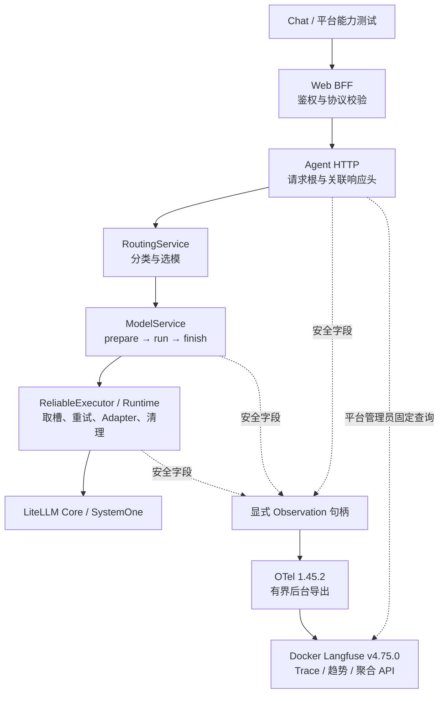
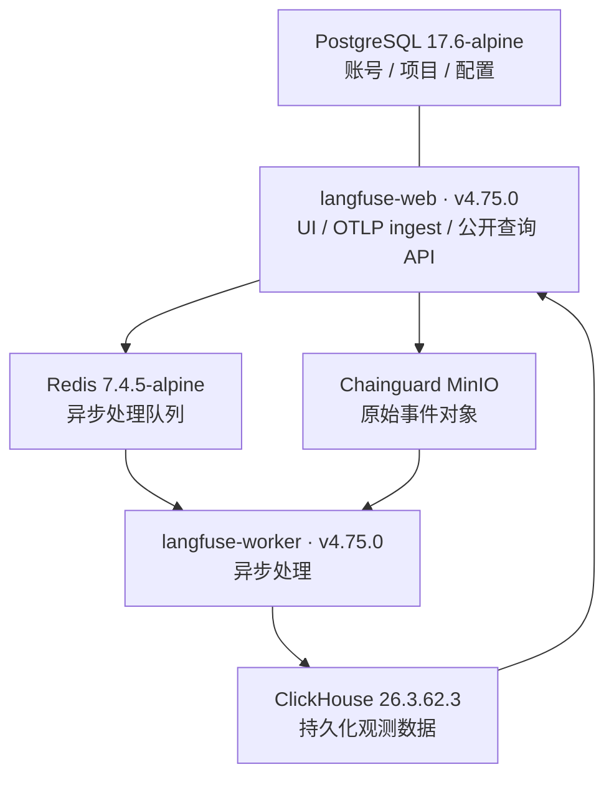
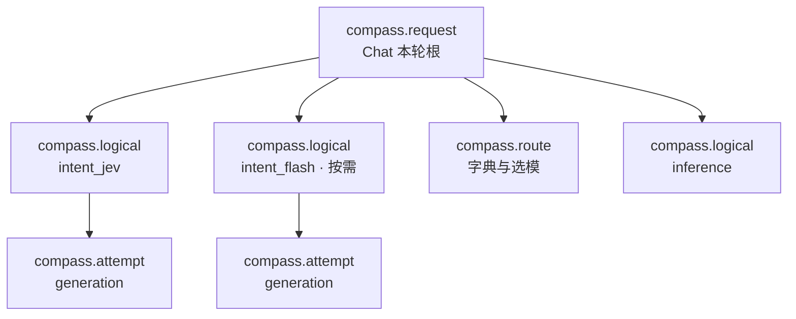
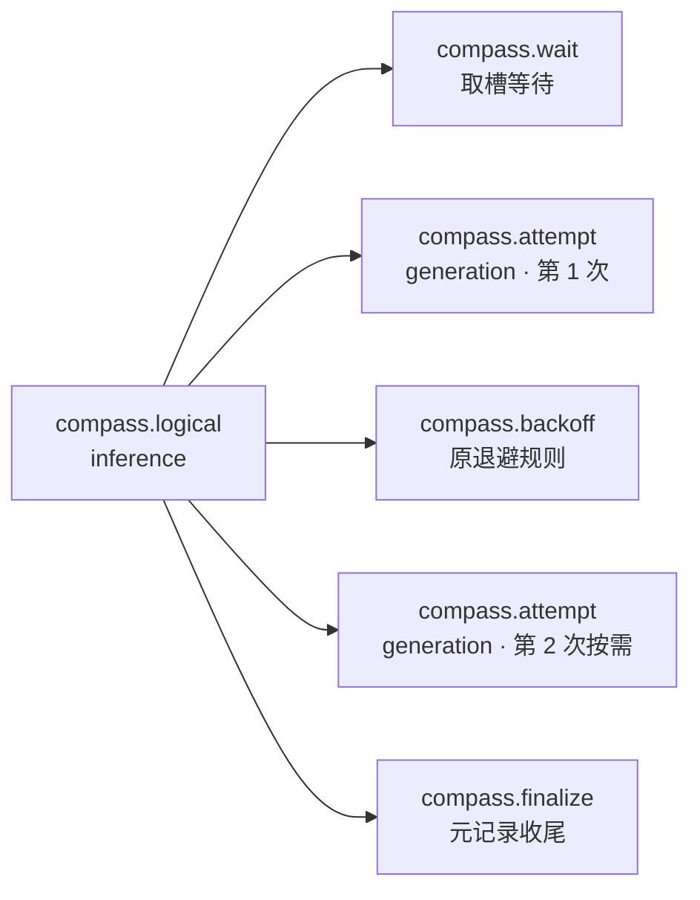
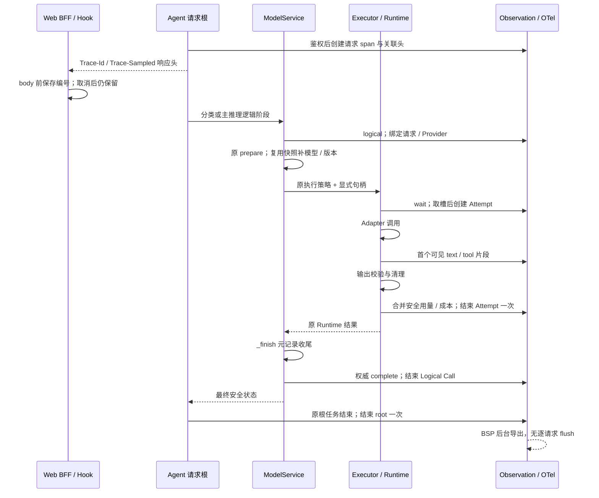
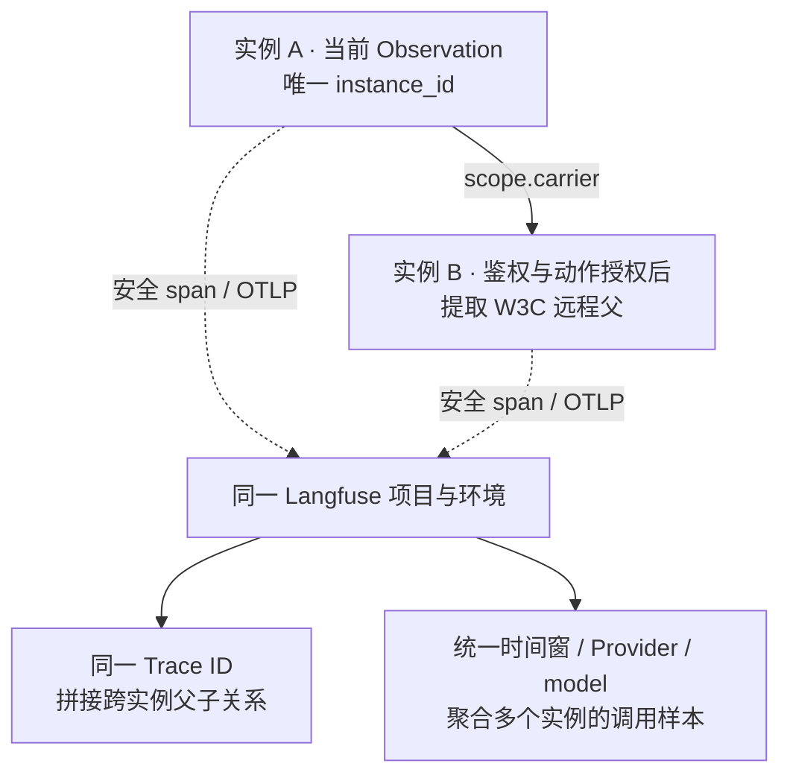
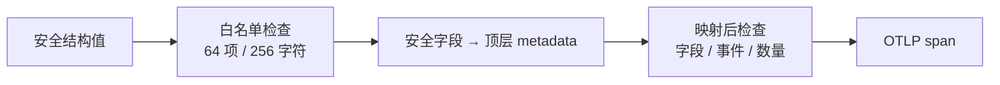
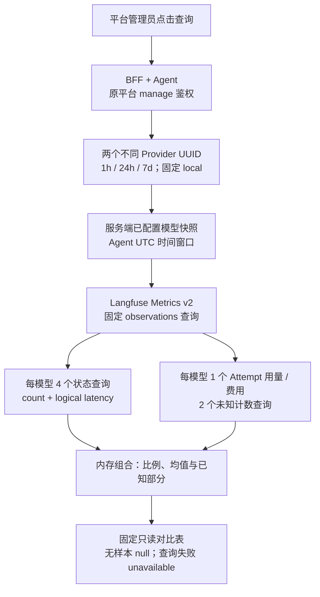

## 目标

| 核心问题             | 实现目标                                      | 量化指标（设计目标）                                                        |
| -------------------- | --------------------------------------------- | --------------------------------------------------------------------------- |
| 一轮多阶段调用难关联 | 请求根 → 分类 / 主推理逻辑阶段 → 实际 Attempt | 每轮 1 个请求入口 span；进入 Adapter 的实际尝试对应 1 个 generation         |
| 慢与故障难定位       | 展示路由、排队、尝试、首字与收尾              | 单调时钟计时；非流式 TTFT 为 null；重复用量计数为 0                         |
| 观测后端异常         | 后台有界导出，调用沿原执行规则完成            | 每进程队列 512 span；每批 64；间隔 1 秒；单次网络预算 2 秒                  |
| 正文或凭据泄露       | 采集入口构造安全字段，出口再次检查            | 每 span 最多 64 属性、字符串 256 字符、16 事件、0 links；正文哨兵出现数为 0 |
| 用量与费用汇总失真   | 只在 Attempt 写原生用量和估价，传播未知       | 本机采样率 1；未知值不填 0；reasoning 不重复计入 total                      |
| 本地复现与模型比较   | 独立观测栈、固定只读对比                      | 6 个服务；UI 127.0.0.1:3002；2 个模型、3 种时间窗；默认 14 个聚合查询       |
| 跨实例调用难拼接     | 显式 W3C carrier、统一项目与独立实例身份      | 每进程启动唯一 instance_id；可信远程父的 Trace ID 与采样决定保持            |

表中数值为本期设计默认值。原执行链继续使用既有 8 / 32 容量、180 秒期限与取消预算。

## 1. 方案概述

### 1.1 职责与依赖

| 模块                        | 本期变化                                               | 所有权与边界                                                          |
| --------------------------- | ------------------------------------------------------ | --------------------------------------------------------------------- |
| Web / BFF                   | 校验并透传关联响应头；展示本轮编号、平台状态与只读对比 | 账户、授权、UI、协议校验；Langfuse 入口使用 Web 固定配置              |
| Agent HTTP / RoutingService | 建立请求根，关联分类、字典路由与主推理                 | 原业务 call_id、父期限与分类兜底保持；根覆盖 Agent 已接纳至原任务收尾 |
| ModelService                | prepare 前创建逻辑阶段，复用原快照绑定模型与版本       | 观测不增加业务库读取；_finish 后发布最终终态                          |
| ReliableExecutor / Runtime  | 记录取槽、退避、实际 Attempt、首片段与清理             | 原重试和资源规则；观测句柄仅接收安全结果                              |
| LiteLLM / SystemOne Adapter | 标准用量与安全成本回执                                 | LiteLLM 使用逐调用函数闭包；SystemOne 使用类型化结果                  |
| Observer / OTel             | 显式句柄、W3C carrier、实例身份与有界导出              | Agent 内部模块；独立 TracerProvider，无自动 HTTP / SQL 仪表化         |
| Langfuse                    | Trace、趋势与公开聚合 API                              | 第三方独立数据栈；Agent / BFF 通过 API 访问                           |

### 1.2 整体架构



### 1.3 本地栈与数据所有者



| 设计项     | 约束                                                                                                    |
| ---------- | ------------------------------------------------------------------------------------------------------- |
| 版本与服务 | Web / Worker 固定 v4.75.0；全部镜像锁定 digest；完整栈 6 服务                                           |
| 网络       | 同属 compass 网络、observability profile；仅 Web 绑定 127.0.0.1:3002:3000；内部存储与 Worker 无宿主端口 |
| 数据归属   | Langfuse 原生维护内部 schema 与迁移；Agent/main、Web/main 无本期结构或受管数据变化                      |
| 持久化     | 独立账号、API Key、密钥与持久卷；停止保留卷；trace_id 只存在本轮内存，旧调用按 call_id 检索             |
| 应用关系   | Agent 不依赖 Langfuse readiness；现有五应用注册保持；本期无新增共享包、统计库或业务 SQL                 |

## 2. 调用层级与收尾

### 2.1 请求、逻辑阶段与实际尝试





| 对象                             | 创建与结束                                                                        | 关键语义                                                                                    |
| -------------------------------- | --------------------------------------------------------------------------------- | ------------------------------------------------------------------------------------------- |
| 请求根                           | Agent 已鉴权后创建；原根任务返回或异常后结束                                      | call_id 保留本轮 UUID；分类使用原 uuid5(parent_call_id, role)；SDK 随机生成 trace / span ID |
| Logical Call                     | prepare 前按请求 / Provider 建立；成功后从原快照绑定 model / 版本，_finish 后结束 | 观测不追加查询；prepare 失败无模型快照时仅关联请求 / Provider；过载可为零 Attempt           |
| Attempt                          | 取槽成功并再检查期限后、Runtime.invoke 前创建；结果与清理登记后结束               | 进入 Adapter 的尝试记 generation；前置校验改为 compass.validation；取消保留安全结果         |
| 路由 / wait / backoff / finalize | 围绕既有阶段建立子 span                                                           | 只记录元信息与耗时；不改变执行路径                                                          |
| 平台测试                         | 根下直接建立 test Logical Call                                                    | 不增加分类或重试；SystemOne 复用 Attempt 外壳                                               |
| 可靠性模拟                       | environment=showcase，simulation=true                                             | local 模型比较排除模拟数据                                                                  |

每个服务入口创建请求 span；外部请求建立新 Trace，可信内部请求可继承远程父。父上下文由句柄持有；BFF 丢弃浏览器 carrier，Provider 出站不注入上下文，baggage 不传播。

### 2.2 响应头、调用与最终收尾



| 条件                              | 终态与处理                                                                                      |
| --------------------------------- | ----------------------------------------------------------------------------------------------- |
| 输出校验与 _finish 都成功         | Logical Call / 根可为 completed                                                                 |
| Attempt 成功，记录收尾失败        | Attempt 保留成功；Logical Call / 根为 failed，安全码 record_write_failed                        |
| 收尾结果已发布后外层收到取消      | ModelService 的权威 complete 冻结终态；record_write_failed 提升到请求根；外围取消保持已发布状态 |
| RuntimeCancelled / CancelledError | 保留安全结果与清理信息，原样传播取消；finally 幂等结束 span                                     |
| failed / incomplete / canceled    | 前两者映射 ERROR；canceled 映射 WARNING；业务状态仍保存在 metadata                              |
| 已发 final 后客户端断流           | BFF / 浏览器处理原协议异常；Agent 已完成结果保持                                                |
| 进程崩溃或导出丢弃                | 可能只有局部 Trace；没有根补齐或重放机制                                                        |

### 2.3 时间与统计口径

| 指标                      | 起止或分母                                                                                |
| ------------------------- | ----------------------------------------------------------------------------------------- |
| request.duration_ms       | Agent 已鉴权根开始 → 原根任务返回 / 异常，含分类、路由与数据库收尾                        |
| logical.duration_ms       | prepare 开始 → _finish 完成 / 失败，含等待、退避、尝试与收尾                              |
| attempt.duration_ms       | Runtime.invoke 前 → 结果与清理完成，含输出校验                                            |
| queue_wait_ms             | 原取槽等待累计；wait span 展示各段，零 Attempt 也可有等待                                 |
| 根 first_visible_ms       | 根开始 → 主推理首个 text_delta / tool_delta，转交原 sink 前捕获；分类内容不计             |
| Attempt first_visible_ms  | Attempt 开始 → 首个 text / tool delta；Thinking 与心跳不计；非流式或无片段为 null         |
| completion_start_time     | 流式 generation 首个可见片段的 UTC 时间；耗时使用单调时钟差值                             |
| 主模型逻辑成功率          | inference completed / 全部已结束 inference Logical Call，含失败、取消、不完整与零 Attempt |
| 整轮成功率                | request completed / 全部已结束 request；未选模型的根失败仅归本层                          |
| Attempt 成功率 / 重试放大 | 成功 Attempt / 已结束 Attempt；Attempt 数 / 已结束 Logical Call                           |

### 2.4 分布式上下文与实例范围



| 边界 / 机制       | 规则                                                                                                                                                           |
| ----------------- | -------------------------------------------------------------------------------------------------------------------------------------------------------------- |
| 传播内容          | scope.carrier() 仅生成 traceparent / tracestate；可由内部 HTTP 请求头或任务消息元信息显式携带                                                                  |
| 可信入口          | 先完成服务身份与动作权限验证，再提取长度受限的 W3C 字段；无效 carrier 建本地新根，原模型任务继续                                                               |
| 浏览器与 Provider | BFF 丢弃浏览器 carrier；Provider 出站请求不带内部上下文；任何路径均不传播 baggage                                                                              |
| 父子关系          | 显式 parent Context；跨实例沿用 Trace ID，新建下游 span / parent 关系；业务 call_id 与 Attempt ID 继续独立                                                     |
| 观测出口          | tracestate 仅用于可信内部传播；GuardedExporter 重建安全 ReadableSpan / SpanContext，导出上下文保留 ID、父子关系与采样标记，清除原生 trace_state 的 vendor 文本 |
| 一致采样          | ParentBased 继承可信远程父决定；父已采样时，下游本地 ratio=0 仍采样；没有有效远程父时才使用本地 ratio                                                          |
| 实例身份          | service.namespace=compass；service.instance.id 默认每进程启动 UUID，可配置唯一值；metadata.instance_id 同步可筛选                                              |
| 聚合与自诊断      | 模型对比查询同项目跨实例样本；状态接口只报告接收请求的实例；多个副本逐实例查看队列与失败                                                                       |
| 生命周期          | 同一请求采样一致；重执行产生新的 Attempt；崩溃不补根、不重放；当前 Worker 业务队列保持后续范围                                                                 |

## 3. 安全字段、Token 与估价

### 3.1 采集白名单与显式映射

| 字段组          | 允许输入                                                                             | 采集边界                                                                                |
| --------------- | ------------------------------------------------------------------------------------ | --------------------------------------------------------------------------------------- |
| 关联 / 上下文   | UUID、SDK ID、instance_id；可信 tenant / workspace / actor；purpose / stage          | 取现有已鉴权上下文；不存名字、邮箱、Session token                                       |
| 路由            | category / scene、difficulty、mode、固定 reason、字典 / 策略版本                     | 只允许登记枚举；原问题与分类输出全文不进入观测                                          |
| 模型            | Provider UUID、adapter、SDK vendor、配置 / 绑定版本、内部模型标识                    | 不放 alias、Base URL、连接参数或凭据                                                    |
| 状态            | completed / failed / canceled / incomplete、安全码、sent、unknown、cleanup_confirmed | 不传异常对象，不调用 record_exception，不写堆栈与 str(exc)                              |
| 性能 / 用量     | 非负有界耗时、首字、streamed、已知 Token、完整性与已知 USD                           | 不传 DTO、ExecutionRequest、模型响应或 LiteLLM kwargs                                   |
| Resource / 事件 | 手动 service.name / namespace / instance.id / version / environment；事件预算有界    | 禁自动 Resource 探测；预算最多 16 事件、0 links；当前出口拒绝 span events；不挂 baggage |



| 内部字段                                           | Langfuse 出口字段                                           | 用途                                                      |
| -------------------------------------------------- | ----------------------------------------------------------- | --------------------------------------------------------- |
| stage / status / model / provider_id / instance_id | langfuse.observation.metadata.&lt;字段名&gt;                | 顶层固定筛选；从安全字段构造顶层 metadata，实例编号可筛选 |
| 根 call_id                                         | observation.metadata.call_id，同时补 trace.metadata.call_id | 本轮 trace_id 与既有 call_id 关联                         |
| generation 类型、usage、cost、首片段               | 登记的 langfuse.observation.* 字段                          | 仅实际 Attempt 设置原生用量 / 成本                        |
| 超限或未登记字段 / 事件                            | 丢弃该 span，增加本地安全计数                               | 不放行任意 metadata 前缀或对象序列化                      |

LiteLLM 使用 turn_off_message_logging=True、suppress_debug_info=True。自动 Langfuse / OTel 集成关闭；第三方与 exporter 日志只保留 logger 名和固定错误类别，清除 args、exc_info、正文与 Authorization。

### 3.2 唯一 generation 与未知传播

| 规则                                                | 行为                                                                                   |
| --------------------------------------------------- | -------------------------------------------------------------------------------------- |
| 权威用量                                            | RuntimeResult.usage；input / output 已知值才写 usage_details，缺失键省略               |
| reasoning                                           | output 的子集，只进入 metadata，不再次累计到 total                                     |
| 原生成本                                            | 仅完整用量、结果已知且锁定 SDK 可识别价格与用量细类时写显式 USD 估价                   |
| 回调已提供成本                                      | 采用有限非负 response_cost；回调只写当前 Attempt 的 Observation                        |
| 回调尚未到达                                        | Adapter 使用锁定 LiteLLM 的本地 completion_cost；流式使用 SDK 标准组装结果             |
| 模型无价格 / 用量不全 / 缓存细类无法定价 / 结果未知 | cost_state=unknown；省略原生 model 与 cost，保留 metadata.model                        |
| 可用估价                                            | cost_state=complete_estimate；显式 model 与 cost_details={total: USD}；cost_source=sdk |
| 父层累计                                            | 只写 known_* 与未知 Attempt 数；任何已发送尝试缺失消耗时，总消耗仅可展示已知部分       |

### 3.3 回调与并发边界

| 入口                   | 设计                                                                                               |
| ---------------------- | -------------------------------------------------------------------------------------------------- |
| LiteLLM Core 1.106.6   | 每调用 success_callback / failure_callback 函数闭包绑定当前 Observation；不修改全局 callbacks 列表 |
| 回调处理               | 提取有限数值 / 枚举即返回；无网络、无新 span、无 flush；不保存 kwargs / response                   |
| 缺失 / 重复 / 迟到回调 | 原执行结果继续；Observation 结束后忽略回调；Runtime 结果结束唯一 Attempt                           |
| SystemOne              | 从现有类型化决策结果取用量，使用同一 generation 外壳                                               |
| 模型标识               | response_model 缺失时用 requested_model 展示，并标记来源                                           |

## 4. 有界导出与固定只读查询

### 4.1 OTel 生命周期与自诊断

| 阶段          | 设计默认值与行为                                                                                                           |
| ------------- | -------------------------------------------------------------------------------------------------------------------------- |
| 初始化        | FastAPI lifespan 创建独立 TracerProvider、局部 MeterProvider / InMemoryMetricReader、单个 BSP；保存 app.state.observation  |
| 采样          | ParentBased + 本地根 ratio，默认 1；可信远程父优先，子 span 显式 parent context                                            |
| 队列与批次    | 每进程 max_queue_size=512、max_export_batch_size=64、schedule_delay_millis=1000；队列满淘汰最旧条目                        |
| 网络          | OTLP HTTP/protobuf，固定完整 Trace 端点；exporter timeout=2 秒；BSP export_timeout_millis 不控制 HTTP                      |
| 自诊断        | SDK 1.45.2 公开 queue.size 与 processed 的 error.type；exporter 包装器记录失败批次及最近结果枚举；只读本地内存             |
| 状态范围      | 返回当前实例 instance_id；队列 / 丢弃 / 失败计数重启归零；跨实例样本由统一后端聚合                                         |
| 禁用 / 缺配置 | NoOp；disabled 或 unconfigured；无同步探测，healthz / readyz 保持原依赖                                                    |
| 配置校验      | enabled 时非法 ratio 或明显无效固定地址阻止启动；网络不可达或认证失败只使导出降级                                          |
| 关闭          | 先原根任务生命周期 4.5 秒，再后台 provider.shutdown，最后关闭 meter provider；观测关闭上限 33 秒，Agent grace period 45 秒 |

观测关闭预算覆盖 BSP 原生 30 秒 join 与 2 秒 HTTP 预算；到期允许丢弃。模型路径不等待网络导出，不逐请求 flush。

自诊断日志使用安全 JSON，包含 event、level、instance_id、固定 reason 与可得计数，按实例区分。

### 4.2 两模型对比的固定计算



| 查询边界     | 固定值与口径                                                                                                              |
| ------------ | ------------------------------------------------------------------------------------------------------------------------- |
| 上游         | GET /api/public/v2/metrics；observations 视图；服务端项目 Key                                                             |
| 逻辑筛选     | name=compass.logical、metadata.stage=inference、metadata.provider_id + 当前 metadata.model、metadata.status；分类单独统计 |
| Attempt 筛选 | compass.attempt + metadata.stage=inference；同样匹配 Provider UUID + 当前 model；仅本层累计用量与费用                     |
| 查询量       | 每模型 7 个，两模型跨实例默认 14 个；硬上限 24 个；最多 4 个并行                                                          |
| 时间与响应   | 单次 HTTP 2 秒；整体 8 秒；每响应最多 256 KiB / 100 行；无自动重试、无分页全量扫描                                        |
| 单位与数值   | Langfuse v4.75.0 latency 原生单位为 ms，直接累计与求均值；统计值有限且非负；不接受额外行与超限响应                        |
| 结果列       | model、逻辑总数与四状态、成功率、平均逻辑耗时、Attempt 数、已知 input / output、已知 USD、未知用量 / 成本数、data_state   |
| 空或部分失败 | 分母 0 时 success_rate=null；任一状态 / 用量 / 未知计数查询失败，整行 unavailable，不展示比例或完整费用                   |
| 可用性说明   | 页面展示采样率与“观测数据可能缺失”；未知成本同时显示已知部分和未知样本数                                                  |

服务端只接受枚举参数，不接受任意查询 JSON、无界 group-by 或任意环境。结果仅在内存组合；查询错误只影响对比表，保留上次结果时标明非最新。

## 5. 输出契约与配置

### 5.1 响应头与平台 API

| 契约                                               | 字段与行为                                                                                            | 权限 / 输出约束                                              |
| -------------------------------------------------- | ----------------------------------------------------------------------------------------------------- | ------------------------------------------------------------ |
| X-Compass-Trace-Id                                 | 32 位小写 hex；enabled 时发出，未采样也有有效 ID                                                      | BFF 仅正则匹配后透传；浏览器同名入站头不可信                 |
| X-Compass-Trace-Sampled                            | 0 / 1；本轮根采样决定                                                                                 | Hook 在 body 前读取；取消 / 断流保留编号；不放入后续模型消息 |
| Agent GET /v1/models/observability                 | instance_id / environment、enabled / configured、sample_ratio、队列 / 容量、drop / error、last_export | 原服务令牌 + trusted_context；platform manage                |
| BFF GET /api/platform/models/observability         | Agent 安全状态 + Web 固定 Langfuse 项目主页 URL，可空                                                 | 平台管理员；不返回 Key、内部 ingest 或数据库地址             |
| Agent GET /v1/models/observability/summary         | provider_ids：两个不同 UUID；window=1h / 24h / 7d                                                     | 平台 manage；返回 UTC 起止范围、固定行结构                   |
| BFF GET /api/platform/models/observability/summary | 转发固定只读模型对比                                                                                  | BFF 与 Agent 双侧鉴权；private, no-store                     |

ObservabilityStatus / ModelComparison 从 Agent schemas.py 派生。原 body、SSE 事件与 CallRecordView 保持；成功与原错误映射均可携带安全关联头。头缺失时保留 call_id，显示未启用或不可用。

### 5.2 平台与本轮信息

| 位置                          | 展示与交互                                                                                                        |
| ----------------------------- | ----------------------------------------------------------------------------------------------------------------- |
| Chat / 平台能力测试的调用信息 | 沿用原折叠与标签页；增加调用编号、观测编号和复制；说明本轮采样及数据稍后可见                                      |
| 平台模型管理“调用观测”        | 进入或点击“刷新状态”时请求，无轮询；显示当前响应实例的 instance_id、队列 / 丢弃 / 失败和导出状态                  |
| Langfuse 入口                 | 服务端固定 http://127.0.0.1:3002/project/&lt;project-id&gt;；新标签页 noopener noreferrer；独立登录，复制编号检索 |
| 只读对比                      | 两个已配置模型、1h / 24h / 7d，默认 24h；管理员点击“查询”获取；窗口统一 UTC，按界面时区展示                       |
| 缺配置 / 查询失败             | 空 URL 禁用打开；加载时禁用刷新；失败可重试；无样本成功率显示未提供                                               |
| 权限与可访问性                | 租户只复制本轮编号；平台 API 服务端拒绝无权限请求；复制有可访问名称与成功状态，窄屏编号换行                       |

### 5.3 服务端配置

| 配置                                     | 默认 / 缺失行为                                         | 作用域                                    |
| ---------------------------------------- | ------------------------------------------------------- | ----------------------------------------- |
| COMPASS_OBSERVABILITY_ENABLED            | false                                                   | Agent 启动；禁用时 NoOp、无网络           |
| COMPASS_OBSERVABILITY_SAMPLE_RATIO       | 1；合法 0～1                                            | Agent 启动；同轮一致采样                  |
| COMPASS_LANGFUSE_BASE_URL                | 空时 enabled 显示 unconfigured                          | Agent 固定服务端地址；自动追加 Trace 端点 |
| COMPASS_LANGFUSE_PUBLIC_KEY / SECRET_KEY | 缺失或不完整时 NoOp + unconfigured                      | SecretStr；只供 Agent / 公开 API 查询     |
| COMPASS_OBSERVABILITY_ENVIRONMENT        | 默认 local；可选 test / staging / production / showcase | 固定部署枚举，浏览器无法覆盖              |
| COMPASS_OBSERVABILITY_INSTANCE_ID        | 空时每次启动生成 UUID                                   | 每进程唯一；配置覆盖值也需保证副本间唯一  |
| COMPASS_LANGFUSE_PROJECT_URL             | 空时禁用打开                                            | Web 固定公开项目 URL，与内部 ingest 分开  |
| OTEL_PYTHON_SDK_INTERNAL_METRICS_ENABLED | enabled 时 true                                         | SDK 初始化前；仅本地自诊断                |

地址拒绝 userinfo、query 与 fragment。本机 HTTP 限固定 loopback / Compose 服务名；远程接入使用 HTTPS。队列、批次、字段与关闭预算为模块常量。

### 5.4 私有配置的职责分离

| 文件      | 内容与消费者                                                    |
| --------- | --------------------------------------------------------------- |
| stack.env | Langfuse 栈账号、项目 Key、初始化配置与独立存储密钥，仅供观测栈 |
| agent.env | Agent 所需启用、采样、环境、内部服务地址与项目 Key              |
| web.env   | 仅公开的固定项目页面 URL，供 Web 展示入口                       |

三份文件位于忽略的 work/observability/，权限 0600。内部 ingest 地址与浏览器公开入口分别配置；Agent / Web 只读取各自所需文件。

## 6. 变更文件与变更内容

文件清单说明职责变化；代码片段用于阅读关键设计。

```text 变更文件树
apps/agent/
├── src/compass_agent/
│   ├── observability/                          [新增] Agent 内观测门面
│   │   ├── README.md                          [新增] 字段与模块职责入口
│   │   ├── observer.py                        [新增] 单一 Observation、W3C carrier、实例身份与幂等终态
│   │   ├── privacy.py                         [新增] 白名单、metadata 映射与日志过滤
│   │   ├── export.py                          [新增] OTel 装配、出口检查与自诊断
│   │   ├── litellm_receipt.py                  [新增] 动态回调、安全标量回执
│   │   └── summary.py                         [新增] 两模型固定查询与未知传播
│   ├── main.py                                [调整] lifespan 装配与关闭
│   ├── settings.py                            [调整] 启用、采样与服务端配置
│   ├── model_api.py                           [调整] 根、响应头、平台状态 / 对比 API
│   ├── schemas.py                             [调整] ObservabilityStatus / ModelComparison
│   ├── routing/service.py                     [调整] 分类、路由与主推理关联
│   ├── models/service.py                      [调整] 复用 prepare 快照、finish 后发布终态
│   └── llm/
│       ├── executor.py                        [调整] wait / backoff / 实际 Attempt
│       ├── runtime.py                         [调整] 安全结果与清理信息提取
│       ├── litellm_chat.py                    [调整] 安全回调、标准用量与 SDK 本地估价
│       └── systemone_decision.py              [调整] 类型化决策用量适配
├── pyproject.toml                             [调整] OTel API / SDK / HTTP exporter 1.45.2
├── tests/test_observability.py                 [新增] 隐私、采样、状态与生命周期场景
└── tests/observability_acceptance.py           [新增] 后端金标、固定查询与多实例场景
apps/web/src/
├── server/http/model-handler.ts               [调整] 平台状态 / 对比路由与权限
├── server/model-agent-client.ts               [调整] 关联头与浏览器 carrier 边界
├── contracts/trace-context.ts                  [新增] 安全关联头校验
├── features/models/
│   ├── observability-panel.tsx                [新增] 管理入口、进程状态与固定对比
│   ├── use-model-call.ts                      [调整] body 前读头、取消保留编号
│   ├── output.tsx / types.ts                  [调整] 本轮编号展示与客户端类型
│   └── pages.tsx                              [调整] 平台观测小节
├── components/analysis-composer.tsx            [调整] 本轮关联信息
└── generated/                                 [生成] Agent 状态 / 对比 DTO
apps/web/tests/
├── domain/model-bff.test.ts                    [调整] 头校验与平台权限场景
└── e2e/                                       [调整] 取消、复制与管理员入口场景
contracts/                                     [生成] Agent DTO 派生契约
contracts/README.md                            [调整] 新状态契约入口
deploy/
├── compose/compose.yaml                       [调整] Agent / Web 各自可选私有 env_file
├── compose/observability.yaml                 [新增] 全镜像 digest 锁定的六服务配置
├── observability/README.md                    [新增] 固定上游、私有配置与持久卷说明
└── README.md                                  [调整] 观测栈与五应用边界
scripts/observability.mjs / 对应工具测试         [新增] 本地栈受管入口与边界场景
scripts/README.md                              [调整] 观测命令入口
package.json                                   [调整] 拟交付 observability 命令
uv.lock                                        [调整] OTel 依赖同版本锁定
.env.example                                   [调整] 无真实凭据的配置项
README.md / apps/{agent,web}/README.md           [调整] 新能力、边界与入口
相关 manifest.yml                              [调整] 对应职责与交付登记
```

## 7. 核心类型与关键代码

代码片段展示当前设计的安全字段与关键分支；外围业务准备、容量管理与 UI 样板由原模块负责。Observation 统一持有 metadata、终态、首片段和成本回执。

### 7.1 白名单与顶层 metadata

字符串、布尔值与有限非负数值逐项构造；instance_id 与业务安全字段进入同一登记集合。根额外补 trace.metadata.call_id，出口仍限制登记属性与事件。

```python privacy.py · 安全字段构造
from math import isfinite

FIELDS = frozenset(
    "call_id parent_call_id attempt_id tenant_id workspace_id actor_id purpose stage "
    "provider_id model adapter config_version binding_version dictionary_version routing_version "
    "category_id scene_id difficulty mode reason status error_code sent outcome_unknown "
    "cleanup_confirmed first_visible_ms queue_wait_ms usage_complete unknown_usage_attempts "
    "cost_state cost_source reasoning_tokens instance_id simulation".split()
)
DEPENDENCY_PREFIXES = ("litellm", "LiteLLM", "openai", "opentelemetry", "httpx", "httpcore")


def scalar(value):
    if type(value) is str:
        return value if len(value) <= 256 else None
    if type(value) is bool or type(value) is int and 0 <= value <= 2**53 - 1:
        return value
    if type(value) is float and isfinite(value) and value >= 0:
        return value
    return None


def fields(values):
    return {
        "langfuse.observation.metadata." + key: clean
        for key, value in values.items()
        if key in FIELDS and (clean := scalar(value)) is not None
    }
```

### 7.2 prepare 快照与最终收尾

逻辑阶段先绑定请求 / Provider，成功后复用原 prepare 的模型与版本快照。失败分支结束该逻辑阶段与请求状态；_finish 完成后发布权威终态，取消继续沿原生命周期传播。

```python models/service.py · 关键方法
import asyncio

async def prepare(self, call_id, provider_id, request, context, *, deadline=None, grant=None):
    observation = (
        self.root_observation.child(
            "compass.logical",
            call_id=str(call_id),
            provider_id=str(provider_id),
            stage=self.stage,
            purpose=context.purpose,
        )
        if self.root_observation
        else None
    )
    if observation:
        self.observations[call_id] = observation
    try:
        prepared = await self._prepare(
            call_id, provider_id, request, context, deadline=deadline, grant=grant
        )
        if observation:
            observation.set(
                model=prepared.spec.api_model,
                config_version=prepared.spec.config_version,
                binding_version=prepared.spec.binding_version,
            )
        return prepared
    except BaseException as exc:
        if observation:
            observation.complete(
                "canceled" if isinstance(exc, asyncio.CancelledError) else "failed",
                getattr(exc, "code", "internal_error"),
            )
            observation.end()
            self.observations.pop(call_id, None)
            if self.root_observation:
                self.root_observation.complete(
                    "canceled" if isinstance(exc, asyncio.CancelledError) else "failed",
                    getattr(exc, "code", "internal_error"),
                )
        raise

async def _finish(self, result, sent):
    observation = self.observations.pop(result.call_id, None)
    finalize = observation.child("compass.finalize") if observation else None
    try:
        return await self._finish_record(result, sent)
    finally:
        if finalize:
            finalize.complete(result.status, result.error_code)
            finalize.end()
        if observation:
            observation.complete(result.status, result.error_code, authoritative=True)
            observation.end()
```

### 7.3 单一终态与幂等结束

complete(authoritative=True) 冻结 ModelService 收尾结果；record_write_failed 提升到仍存活的请求根。end 用同一把锁保证 span 只结束一次。

```python observer.py · 终态与结束
def complete(self, status, code=None, *, authoritative=False):
    with self.lock:
        if self.ended or self.authoritative:
            return
        self.status = (status, error_code(code))
        self.authoritative = authoritative
    if code == "record_write_failed" and self.root is not self:
        self.root.complete("failed", code, authoritative=True)

def end(self):
    with self.lock:
        if self.ended:
            return
        status, code = self.status or ("completed", None)
        self.set(status=status, error_code=code)
        if self.span:
            try:
                level = (
                    "DEFAULT"
                    if status == "completed"
                    else "WARNING"
                    if status == "canceled"
                    else "ERROR"
                )
                self.native("level", level)
                if code:
                    self.native("status_message", code)
                if status in {"failed", "incomplete"}:
                    self.span.set_status(Status(StatusCode.ERROR))
                self.span.end()
            except Exception:
                self.owner.instrumentation_errors += 1
        self.ended = True
```

### 7.4 Attempt 用量与晚到回调

accept_cost 只接收有限非负标量，已结束句柄忽略晚到结果。Adapter 未启动的前置校验改为 compass.validation；进入 Adapter 的尝试才写 generation。缺估价时省略原生 model / cost。

```python observer.py · Attempt 与成本
import json

def accept_cost(self, value):
    from compass_agent.observability.privacy import scalar

    if type(value) not in {int, float} or scalar(value) is None:
        return
    with self.lock:
        if not self.ended:
            self.cost = float(value)

def finish_attempt(self, result):
    if not result.adapter_started:
        # A pre-adapter validation is an execution phase, with no generation or charge.
        if self.span:
            self.span.update_name("compass.validation")
        self.complete(result.status, result.error.code if result.error else None)
        self.end()
        return
    self.native("type", "generation")
    self.set(
        sent=result.upstream_sent,
        outcome_unknown=result.upstream_outcome_unknown,
        cleanup_confirmed=result.cleanup_confirmed,
        reasoning_tokens=result.usage.reasoning_tokens,
    )
    usage = result.usage
    known = usage.input_tokens is not None and usage.output_tokens is not None
    self.set(usage_complete=known, cost_state="unknown")
    detail = {
        k: v
        for k, v in {"input": usage.input_tokens, "output": usage.output_tokens}.items()
        if v is not None
    }
    if detail:
        self.native("usage_details", json.dumps(detail))
    if known and not result.upstream_outcome_unknown and self.cost is not None:
        self.native("model.name", result.requested_model[:256])
        self.native("cost_details", json.dumps({"total": self.cost}))
        self.set(cost_state="complete_estimate", cost_source="litellm-1.106.6")
    self.complete(result.status, result.error.code if result.error else None)
    self.end()
```

### 7.5 安全回调与 SDK 本地估价

函数闭包持有当前 Observation；用量完整才接受成本。回调、缺价与 SDK 估价异常均保持原模型结果，未知继续传播。

```python litellm_receipt.py · 无网络回执
def complete_usage(response):
    usage = getattr(response, "usage", None)
    if usage is None:
        return False
    value = usage if isinstance(usage, dict) else usage.model_dump()
    if any(
        type(value.get(k)) is not int or value[k] < 0
        for k in ("prompt_tokens", "completion_tokens")
    ):
        return False
    # An explicitly incomplete cache category cannot support a complete estimate.
    for key in ("prompt_tokens_details", "completion_tokens_details"):
        details = value.get(key)
        if isinstance(details, dict):
            for name, count in details.items():
                if "cache" in name and (type(count) is not int or count < 0):
                    return False
    return True

def callbacks(observation):
    async def success(kwargs, response_obj, start_time, end_time):
        try:
            if complete_usage(response_obj):
                observation.accept_cost(kwargs.get("response_cost"))
        except Exception:
            return

    async def failure(kwargs, response_obj, start_time, end_time):
        return

    return {"success_callback": [success], "failure_callback": [failure]}

def estimate(observation, sdk, response, model):
    if observation.cost is not None:
        return
    try:
        if complete_usage(response):
            observation.accept_cost(sdk.completion_cost(completion_response=response, model=model))
    except Exception:
        # Missing prices and unsupported usage categories remain unknown.
        return
```

### 7.6 显式 W3C 提取与注入

提取在 trusted_context 和动作权限验证后调用。PROPAGATOR 仅处理 W3C Trace Context；carrier 从当前句柄的 span 生成，内部调用者显式附加。

```python observer.py · W3C carrier
from opentelemetry import trace
from opentelemetry.context import Context
from opentelemetry.trace.propagation.tracecontext import TraceContextTextMapPropagator

PROPAGATOR = TraceContextTextMapPropagator()

def remote_context(carrier):
    """Call only after service authentication; ignore baggage and malformed carriers."""
    safe = {}
    for name in ("traceparent", "tracestate"):
        value = carrier.get(name)
        if isinstance(value, str) and len(value) <= 512:
            safe[name] = value
    return PROPAGATOR.extract(safe, context=Context())

def carrier(self):
    result = {}
    if self.span:
        PROPAGATOR.inject(result, context=trace.set_span_in_context(self.span))
    return result
```

```python 已鉴权入口与内部出站 · 设计示意
# trusted_context 与当前动作权限在进入此段前已经验证。
scope = observer.root(call_id, trusted_context, request.headers)
# 同一 scope 贯穿原异步任务，内部 HTTP / 消息工具显式附加 carrier。
outbound_context = scope.carrier()
```

### 7.7 实例身份与 ParentBased

本地根使用本进程 ratio，远程父采用 ParentBased 的继承决定。Resource 手工登记实例身份，避免环境与主机信息自动探测；状态接口返回同一 instance_id。

```python Observer 初始化 · 设计示意
from uuid import uuid4
from opentelemetry.sdk.resources import Resource
from opentelemetry.sdk.trace import SpanLimits, TracerProvider
from opentelemetry.sdk.trace.sampling import ParentBased, TraceIdRatioBased

instance_id = settings.compass_observability_instance_id or str(uuid4())
provider = TracerProvider(
    resource=Resource({
        "service.name": "compass-agent",
        "service.namespace": "compass",
        "service.instance.id": instance_id,
        "service.version": "0.1.0",
        "deployment.environment.name": settings.compass_observability_environment,
    }),
    sampler=ParentBased(TraceIdRatioBased(settings.compass_observability_sample_ratio)),
    span_limits=SpanLimits(
        max_attributes=64, max_events=16, max_links=0, max_attribute_length=256,
    ),
    shutdown_on_exit=False,
)
```

### 7.8 BFF 响应头

BFF 主动构造上游请求头，浏览器 carrier 不进入 Agent。校验后的关联响应头用于成功 JSON / SSE 及原错误映射，Hook 在 body 前保存编号。

{{code:headers}}

### 7.9 固定模型对比

Logical Call 与 Attempt 同时筛选 inference、Provider UUID 和当前 model。跨实例不加 instance_id 过滤；latency 原生为毫秒。以下展示固定筛选和计算口径。

```python summary.py · 固定筛选形状
selected = [meta("provider_id", str(model.id)), meta("model", model.api_model)]
logical = [
    {"column": "name", "type": "string", "operator": "=", "value": "compass.logical"},
    meta("stage", "inference"),
    *selected,
]
attempts = [
    {"column": "name", "type": "string", "operator": "=", "value": "compass.attempt"},
    meta("stage", "inference"),
    *selected,
]
```

统计值由固定查询校验后传入。任何查询失败返回 unavailable；零分母为 null；存在未知成本时完整估价为空，保留已知 USD 与未知数。

{{code:summary}}
