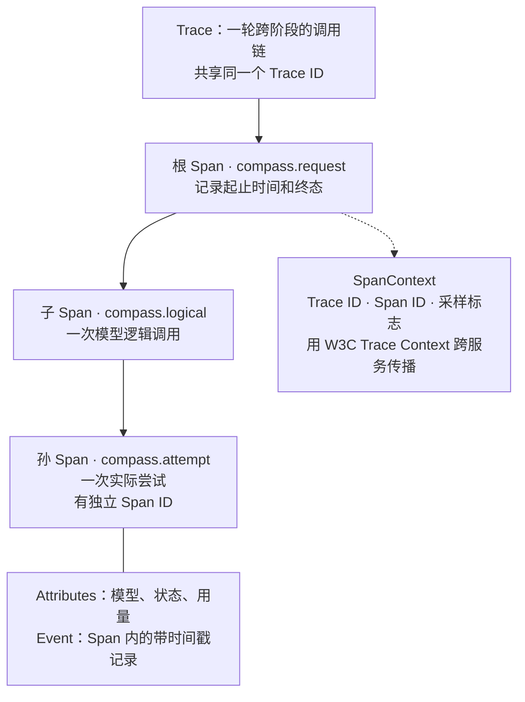
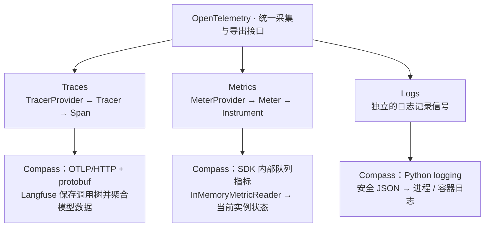
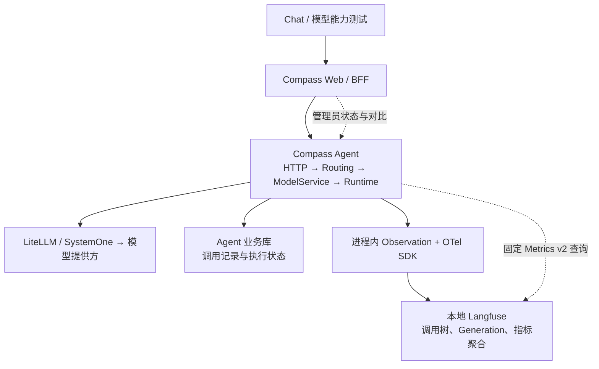
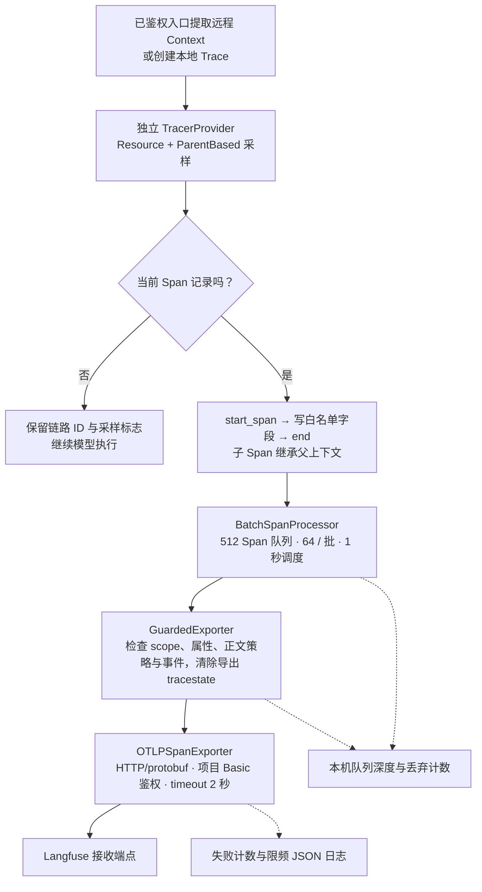
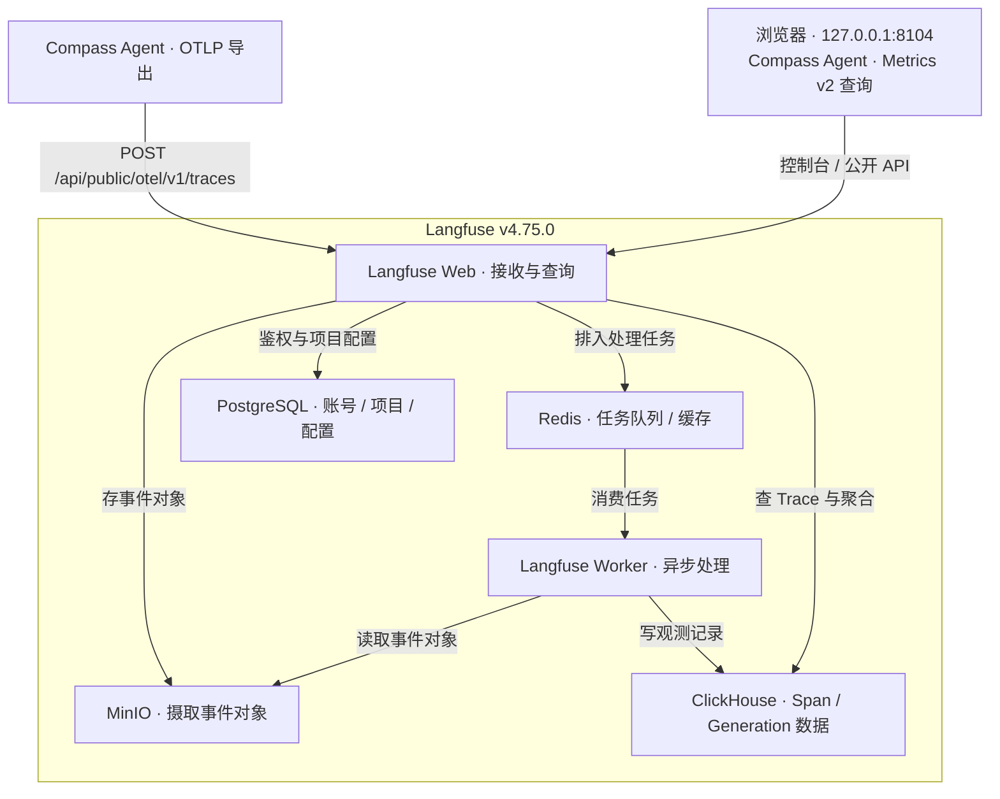

## 0. 先读懂 OTel 的几个术语



下面用一次模型调用展示 `ExportTraceServiceRequest` 的 OTLP JSON 结构。三个 Span 共享同一个 `traceId`，通过 `parentSpanId` 串成「请求 → 逻辑调用 → 实际尝试」。样例选取了部分业务属性，Compass 实际用 HTTP 发送同一结构的二进制 Protobuf。

```json OTLP Trace 数据样例
{
  "resourceSpans": [
    {
      "resource": {
        "attributes": [
          { "key": "service.name", "value": { "stringValue": "compass-agent" } },
          { "key": "service.namespace", "value": { "stringValue": "compass" } },
          { "key": "service.instance.id", "value": { "stringValue": "demo-agent-01" } },
          { "key": "service.version", "value": { "stringValue": "0.1.0" } },
          { "key": "deployment.environment.name", "value": { "stringValue": "local" } }
        ],
        "droppedAttributesCount": 0
      },
      "scopeSpans": [
        {
          "scope": { "name": "compass.observability" },
          "spans": [
            {
              "traceId": "4bf92f3577b34da6a3ce929d0e0e4736",
              "spanId": "1111111111111111",
              "parentSpanId": "",
              "traceState": "",
              "flags": 256,
              "name": "compass.request",
              "kind": 1,
              "startTimeUnixNano": "1780000000000000000",
              "endTimeUnixNano": "1780000001500000000",
              "attributes": [
                { "key": "langfuse.observation.type", "value": { "stringValue": "span" } },
                {
                  "key": "langfuse.observation.metadata.status",
                  "value": { "stringValue": "completed" }
                }
              ],
              "events": [],
              "links": [],
              "droppedAttributesCount": 0,
              "droppedEventsCount": 0,
              "droppedLinksCount": 0,
              "status": { "code": 0 }
            },
            {
              "traceId": "4bf92f3577b34da6a3ce929d0e0e4736",
              "spanId": "2222222222222222",
              "parentSpanId": "1111111111111111",
              "traceState": "",
              "flags": 256,
              "name": "compass.logical",
              "kind": 1,
              "startTimeUnixNano": "1780000000100000000",
              "endTimeUnixNano": "1780000001450000000",
              "attributes": [
                { "key": "langfuse.observation.type", "value": { "stringValue": "span" } },
                {
                  "key": "langfuse.observation.metadata.stage",
                  "value": { "stringValue": "inference" }
                },
                {
                  "key": "langfuse.observation.metadata.queue_wait_ms",
                  "value": { "intValue": "25" }
                }
              ],
              "events": [],
              "links": [],
              "droppedAttributesCount": 0,
              "droppedEventsCount": 0,
              "droppedLinksCount": 0,
              "status": { "code": 0 }
            },
            {
              "traceId": "4bf92f3577b34da6a3ce929d0e0e4736",
              "spanId": "3333333333333333",
              "parentSpanId": "2222222222222222",
              "traceState": "",
              "flags": 256,
              "name": "compass.attempt",
              "kind": 1,
              "startTimeUnixNano": "1780000000200000000",
              "endTimeUnixNano": "1780000001400000000",
              "attributes": [
                { "key": "langfuse.observation.type", "value": { "stringValue": "generation" } },
                {
                  "key": "langfuse.observation.metadata.first_visible_ms",
                  "value": { "doubleValue": 268.5 }
                },
                {
                  "key": "langfuse.observation.metadata.usage_complete",
                  "value": { "boolValue": true }
                },
                {
                  "key": "langfuse.observation.usage_details",
                  "value": { "stringValue": "{\"input\":96,\"output\":24}" }
                }
              ],
              "events": [],
              "links": [],
              "droppedAttributesCount": 0,
              "droppedEventsCount": 0,
              "droppedLinksCount": 0,
              "status": { "code": 0 }
            }
          ]
        }
      ]
    }
  ]
}
```

| 看哪个字段                                       | 读出什么                                                                                                                                             |
| ------------------------------------------------ | ---------------------------------------------------------------------------------------------------------------------------------------------------- |
| `resourceSpans[].resource`、`scopeSpans[].scope` | 哪个服务实例产生数据，以及哪段埋点代码记录了它                                                                                                       |
| `traceId`、`spanId`、`parentSpanId`              | 同一 Trace 共享 32 位十六进制 `traceId`。Span ID 是 16 位十六进制，根 Span 的父 ID 为空                                                              |
| `startTimeUnixNano`、`endTimeUnixNano`           | 纳秒时间戳在 JSON 中写成十进制字符串。样例里的 Attempt 持续 1.2 秒                                                                                   |
| `kind`、`status`、`flags`                        | `kind: 1` 表示内部操作。Compass 在成功时保留 OTel 默认状态 `code: 0`，业务完成状态写入 metadata。`flags` 是位字段，样例采用当前 SDK 的本地上下文编码 |
| `attributes`、`events`、`links`                  | 属性值带类型。Event 是 Span 内的带时间戳记录，Link 可引用其他 Span。Compass 此处只使用属性，两个数组为空                                             |



| 术语                        | 含义                                                              | 在 Compass 中怎么看                                                                                |
| --------------------------- | ----------------------------------------------------------------- | -------------------------------------------------------------------------------------------------- |
| Meter / Instrument / Metric | Meter 创建 Counter、Histogram 等 Instrument，测量值经聚合形成指标 | 这里读取 OTel SDK 已记录的队列深度与处理结果。模型成功率和耗时由 Langfuse 查询 Span 样本得到       |
| Resource                    | 一组描述数据来源的属性                                            | `service.name`、`service.instance.id`、版本与环境帮助区分多个 Agent 实例                           |
| Sampler                     | Span 创建时决定记录与采样                                         | 新根按比例采样，可信远程父链路的采样决定由 `ParentBased` 继承                                      |
| Span Processor / Exporter   | Processor 处理 SDK 内已结束的 Span，Exporter 将批次送出           | `BatchSpanProcessor` 管队列与批次，`GuardedExporter` 核验内容，`OTLPSpanExporter` 发送             |
| OTLP / Observation          | OTLP 是遥测数据传输协议，Observation 是 Langfuse 的观测记录       | 普通 Span 映射为 `SPAN`。进入 Adapter 的 Attempt 映射为 `GENERATION`，可带模型输入输出、用量与估价 |

## 目标

| 核心问题                       | 实现目标                                 | 量化指标（设计目标）                                                |
| ------------------------------ | ---------------------------------------- | ------------------------------------------------------------------- |
| 一轮请求跨分类、选模和生成     | 用 Trace ID 关联所有阶段和实际尝试       | 每次接入服务建立 1 个请求 Span，每次实际尝试有 1 个独立 Span        |
| 慢请求、失败与恢复难排查       | 拆出排队、退避、尝试、首个可见片段和收尾 | 各 Span 各自计时，首片段时间用单调时钟计算                          |
| 导出失败挤占请求资源           | 按进程异步批量上报                       | 队列 512 Span，每批最多 64，调度间隔 1 秒，HTTP 导出器 timeout 2 秒 |
| 多实例比较与单实例诊断容易混淆 | 一处聚合模型数据，逐实例查看队列健康     | 比较两个模型、三个可选窗口，发出 14 个固定查询                      |

## 1. 方案概述

### 1.1 职责分工

| 模块                                      | 谁负责什么                                                           |
| ----------------------------------------- | -------------------------------------------------------------------- |
| Web / BFF                                 | 原鉴权、响应头校验与透传、编号复制、管理员状态和模型对比入口         |
| Agent HTTP / RoutingService               | 建立请求 Span、接收可信 Trace Context，记录分类和选模关联            |
| ModelService / ReliableExecutor / Runtime | 维护 Logical Call 和 Attempt，记录等待、首片段、输出、失败和写库收尾 |
| Agent `observability/`                    | 明确父子关系、构造安全字段、装配 OTel SDK、导出 Span 并查询固定指标  |
| Langfuse                                  | 接收 OTLP、处理入库、展示 Trace 与 Generation、提供查询 API          |

### 1.2 Compass 整体架构



### 1.3 OTel 工作流程



| 多实例场景           | Context 处理                                                                                            |
| -------------------- | ------------------------------------------------------------------------------------------------------- |
| 内部 HTTP 或消息载体 | `carrier()` 注入 W3C 头，接收端在服务鉴权和动作授权后提取。下游沿用 Trace ID，生成自己的 Span ID        |
| 实例 A 调用实例 B    | 两边向同一项目上报。父子 Span 还原一条链路，`service.instance.id` 标记各自来源                          |
| 浏览器和供应商边界   | BFF 丢弃浏览器传入的 Trace Context，模型供应商出站请求省略内部 carrier，OTLP 出口去掉 `tracestate` 文本 |

### 1.4 Langfuse 整体架构



宿主机用 `http://127.0.0.1:8104`。Compose 网络内，Agent 用 `http://langfuse-web:3000`。两个地址指向同一套 Langfuse Web，Trace 数据与 Compass 业务记录分别持久化。

## 2. 一张完整的埋点地图

```diagram-svg Compass 模型调用埋点地图
<svg xmlns="http://www.w3.org/2000/svg" viewBox="0 0 1120 862" width="1120" height="862" role="img">
<title>Compass 模型调用埋点地图</title>
<defs><marker id="flow-arrow" viewBox="0 0 10 10" refX="9" refY="5" markerWidth="6" markerHeight="6" orient="auto"><path d="M 0 0 L 10 5 L 0 10 z" fill="#587769"/></marker></defs>
<g font-family="system-ui, sans-serif">
<rect x="1" y="1" width="1118" height="860" rx="12" fill="#f8fbf7" stroke="#c4d5c9"/>
<rect x="20" y="20" width="744" height="782" rx="12" fill="#eef5ee" stroke="#c4d5c9"/>
<rect x="804" y="20" width="296" height="782" rx="12" fill="#f1f6ef" stroke="#c4d5c9"/>
<text x="39" y="51" font-size="20" font-weight="700" fill="#294538">业务埋点 · 父子关系与字段</text>
<text x="822" y="51" font-size="20" font-weight="700" fill="#294538">采样、上报与本机诊断</text>
<rect x="39" y="70" width="706" height="64" rx="12" fill="#ffffff" stroke="#c4d5c9"/>
<text x="52" y="94" font-size="16" font-weight="650" fill="#294538">入口 · model_api.py</text>
<text x="52" y="117" font-size="14" font-weight="400" fill="#294538">Chat 或 Provider 测试通过鉴权后提取 Context，创建请求句柄</text>
<path d="M 392 134 V 154" fill="none" stroke="#587769" stroke-width="1.45" marker-end="url(#flow-arrow)"/>
<rect x="39" y="154" width="706" height="86" rx="12" fill="#dbecde" stroke="#c4d5c9"/>
<text x="52" y="178" font-size="16" font-weight="650" fill="#294538">compass.request · 一次服务请求</text>
<text x="52" y="201" font-size="14" font-weight="400" fill="#294538">call_id / actor / tenant / workspace、开始与结束、终态与错误码</text>
<text x="52" y="221" font-size="14" font-weight="400" fill="#294538">响应头带 Trace ID / sampled，Web 可用编号查找调用链</text>
<path d="M 392 240 V 261 M 122 261 H 662" fill="none" stroke="#587769" stroke-width="1.45"/>
<path d="M 122 261 V 280" fill="none" stroke="#587769" stroke-width="1.45" marker-end="url(#flow-arrow)"/>
<path d="M 302 261 V 280" fill="none" stroke="#587769" stroke-width="1.45" marker-end="url(#flow-arrow)"/>
<path d="M 482 261 V 280" fill="none" stroke="#587769" stroke-width="1.45" marker-end="url(#flow-arrow)"/>
<path d="M 662 261 V 280" fill="none" stroke="#587769" stroke-width="1.45" marker-end="url(#flow-arrow)"/>
<rect x="39" y="280" width="166" height="106" rx="12" fill="#ffffff" stroke="#c4d5c9"/>
<text x="52" y="304" font-size="16" font-weight="650" fill="#294538">分类 · logical</text>
<text x="52" y="327" font-size="14" font-weight="400" fill="#294538">intent_jev /</text>
<text x="52" y="347" font-size="14" font-weight="400" fill="#294538">intent_flash</text>
<text x="52" y="367" font-size="14" font-weight="400" fill="#294538">使用所选分类器</text>
<rect x="219" y="280" width="166" height="106" rx="12" fill="#ffffff" stroke="#c4d5c9"/>
<text x="232" y="304" font-size="16" font-weight="650" fill="#294538">compass.route</text>
<text x="232" y="327" font-size="14" font-weight="400" fill="#294538">分类 / 场景 / 难度</text>
<text x="232" y="347" font-size="14" font-weight="400" fill="#294538">模型、选择原因</text>
<text x="232" y="367" font-size="14" font-weight="400" fill="#294538">字典与策略版本</text>
<rect x="399" y="280" width="166" height="106" rx="12" fill="#ffffff" stroke="#c4d5c9"/>
<text x="412" y="304" font-size="16" font-weight="650" fill="#294538">主推理 · logical</text>
<text x="412" y="327" font-size="14" font-weight="400" fill="#294538">stage=inference</text>
<text x="412" y="347" font-size="14" font-weight="400" fill="#294538">选定模型的</text>
<text x="412" y="367" font-size="14" font-weight="400" fill="#294538">逻辑调用</text>
<rect x="579" y="280" width="166" height="106" rx="12" fill="#ffffff" stroke="#c4d5c9"/>
<text x="592" y="304" font-size="16" font-weight="650" fill="#294538">能力测试 · logical</text>
<text x="592" y="327" font-size="14" font-weight="400" fill="#294538">stage=test</text>
<text x="592" y="347" font-size="14" font-weight="400" fill="#294538">直接调用指定模型</text>
<text x="592" y="367" font-size="14" font-weight="400" fill="#294538">支持生成与决策</text>
<path d="M 122 386 V 405" fill="none" stroke="#587769" stroke-width="1.45" stroke-dasharray="5 5"/>
<path d="M 482 386 V 405" fill="none" stroke="#587769" stroke-width="1.45" stroke-dasharray="5 5"/>
<path d="M 662 386 V 405" fill="none" stroke="#587769" stroke-width="1.45" stroke-dasharray="5 5"/>
<path d="M 122 405 H 662 M 392 405 V 429" fill="none" stroke="#587769" stroke-width="1.45" stroke-dasharray="5 5" marker-end="url(#flow-arrow)"/>
<rect x="39" y="429" width="706" height="86" rx="12" fill="#dbecde" stroke="#c4d5c9"/>
<text x="52" y="453" font-size="16" font-weight="650" fill="#294538">compass.logical · 上面每个 Logical Call 复用此结构</text>
<text x="52" y="476" font-size="14" font-weight="400" fill="#294538">prepare 前开启。记录 stage、Provider、配置版本、累计排队、终态</text>
<text x="52" y="496" font-size="14" font-weight="400" fill="#294538">准备失败或过载可能只有 logical 记录，随后结束对应句柄</text>
<path d="M 392 515 V 539 M 107 539 H 677" fill="none" stroke="#587769" stroke-width="1.45"/>
<path d="M 107 539 V 558" fill="none" stroke="#587769" stroke-width="1.45" marker-end="url(#flow-arrow)"/>
<path d="M 317 539 V 558" fill="none" stroke="#587769" stroke-width="1.45" marker-end="url(#flow-arrow)"/>
<path d="M 527 539 V 558" fill="none" stroke="#587769" stroke-width="1.45" marker-end="url(#flow-arrow)"/>
<path d="M 677 539 V 558" fill="none" stroke="#587769" stroke-width="1.45" marker-end="url(#flow-arrow)"/>
<rect x="39" y="558" width="136" height="111" rx="12" fill="#ffffff" stroke="#c4d5c9"/>
<text x="52" y="582" font-size="16" font-weight="650" fill="#294538">compass.wait</text>
<text x="52" y="605" font-size="14" font-weight="400" fill="#294538">等待并发槽</text>
<text x="52" y="625" font-size="14" font-weight="400" fill="#294538">起止与取消 / 超时</text>
<text x="52" y="645" font-size="14" font-weight="400" fill="#294538">累加至 logical</text>
<rect x="188" y="558" width="258" height="146" rx="12" fill="#dbecde" stroke="#c4d5c9"/>
<text x="201" y="582" font-size="15" font-weight="650" fill="#294538">compass.attempt · Generation</text>
<text x="201" y="605" font-size="14" font-weight="400" fill="#294538">每次尝试的 ID、模型与终态</text>
<text x="201" y="625" font-size="14" font-weight="400" fill="#294538">首个正文 / 工具片段、发送与清理</text>
<text x="201" y="645" font-size="14" font-weight="400" fill="#294538">已知 Token / 估价，可选输入输出</text>
<text x="201" y="665" font-size="14" font-weight="400" fill="#294538">重试另建一个 Attempt</text>
<rect x="459" y="558" width="137" height="111" rx="12" fill="#ffffff" stroke="#c4d5c9"/>
<text x="472" y="582" font-size="14" font-weight="650" fill="#294538">compass.backoff</text>
<text x="472" y="605" font-size="14" font-weight="400" fill="#294538">退避耗时</text>
<text x="472" y="625" font-size="14" font-weight="400" fill="#294538">取消 / 超时</text>
<rect x="609" y="558" width="136" height="111" rx="12" fill="#ffffff" stroke="#c4d5c9"/>
<text x="622" y="582" font-size="14" font-weight="650" fill="#294538">compass.finalize</text>
<text x="622" y="605" font-size="14" font-weight="400" fill="#294538">记录收尾</text>
<text x="622" y="625" font-size="14" font-weight="400" fill="#294538">状态 / 错误码</text>
<path d="M 317 704 V 722" fill="none" stroke="#587769" stroke-width="1.45" stroke-dasharray="5 5" marker-end="url(#flow-arrow)"/>
<rect x="188" y="722" width="270" height="61" rx="12" fill="#ffffff" stroke="#c4d5c9"/>
<text x="201" y="746" font-size="16" font-weight="650" fill="#294538">compass.validation · 条件分支</text>
<text x="201" y="769" font-size="14" font-weight="400" fill="#294538">Adapter 前校验失败，Attempt 改名</text>
<rect x="822" y="70" width="260" height="87" rx="12" fill="#ffffff" stroke="#c4d5c9"/>
<text x="835" y="94" font-size="16" font-weight="650" fill="#294538">TracerProvider + Sampler</text>
<text x="835" y="117" font-size="14" font-weight="400" fill="#294538">识别服务、环境和实例</text>
<text x="835" y="137" font-size="14" font-weight="400" fill="#294538">继承可信父采样或按比例采样</text>
<rect x="822" y="179" width="260" height="87" rx="12" fill="#ffffff" stroke="#c4d5c9"/>
<text x="835" y="203" font-size="16" font-weight="650" fill="#294538">未采样 · 保留关联 ID</text>
<text x="835" y="226" font-size="14" font-weight="400" fill="#294538">本轮继续执行模型</text>
<text x="835" y="246" font-size="14" font-weight="400" fill="#294538">BSP 只收已采样并结束的 Span</text>
<path d="M 952 157 V 179" fill="none" stroke="#587769" stroke-width="1.45" stroke-dasharray="5 5" marker-end="url(#flow-arrow)"/>
<rect x="822" y="287" width="260" height="87" rx="12" fill="#ffffff" stroke="#c4d5c9"/>
<text x="835" y="311" font-size="16" font-weight="650" fill="#294538">BSP · 进程内批处理</text>
<text x="835" y="334" font-size="14" font-weight="400" fill="#294538">接收已采样、已结束的 Span</text>
<text x="835" y="354" font-size="14" font-weight="400" fill="#294538">512 队列 / 每批 64 / 1 秒</text>
<path d="M 764 398 H 788 V 331 H 822" fill="none" stroke="#587769" stroke-width="1.45" stroke-dasharray="5 5" marker-end="url(#flow-arrow)"/>
<rect x="822" y="398" width="260" height="87" rx="12" fill="#ffffff" stroke="#c4d5c9"/>
<text x="835" y="422" font-size="16" font-weight="650" fill="#294538">GuardedExporter</text>
<text x="835" y="445" font-size="14" font-weight="400" fill="#294538">白名单、正文策略、事件检查</text>
<text x="835" y="465" font-size="14" font-weight="400" fill="#294538">清除导出上下文的 tracestate</text>
<path d="M 952 374 V 398" fill="none" stroke="#587769" stroke-width="1.45" marker-end="url(#flow-arrow)"/>
<rect x="822" y="509" width="260" height="87" rx="12" fill="#ffffff" stroke="#c4d5c9"/>
<text x="835" y="533" font-size="16" font-weight="650" fill="#294538">OTLP / HTTP → Langfuse</text>
<text x="835" y="556" font-size="14" font-weight="400" fill="#294538">protobuf 发送，HTTP timeout 2 秒</text>
<text x="835" y="576" font-size="14" font-weight="400" fill="#294538">Trace 树 / Generation / 聚合</text>
<path d="M 952 485 V 509" fill="none" stroke="#587769" stroke-width="1.45" marker-end="url(#flow-arrow)"/>
<rect x="822" y="618" width="260" height="75" rx="12" fill="#ffffff" stroke="#c4d5c9"/>
<text x="835" y="642" font-size="16" font-weight="650" fill="#294538">Metrics · 当前实例状态</text>
<text x="835" y="665" font-size="14" font-weight="400" fill="#294538">读取队列、丢弃、失败计数</text>
<rect x="822" y="708" width="260" height="75" rx="12" fill="#ffffff" stroke="#c4d5c9"/>
<text x="835" y="732" font-size="16" font-weight="650" fill="#294538">Logs · 进程日志</text>
<text x="835" y="755" font-size="14" font-weight="400" fill="#294538">导出失败 / 关机的安全 JSON</text>
<text x="39" y="837" font-size="15" font-weight="400" fill="#294538">实线：Span 父子关系 / 导出处理顺序</text>
<text x="393" y="837" font-size="15" font-weight="400" fill="#294538">虚线：子树复用 / 条件分支 / 已结束 Span 汇入队列</text>
</g></svg>
```

读图时，沿绿色连线看 Span 父子关系。入口下面的分类、路由、主推理和能力测试按场景出现。分类、推理和测试复用同一个 Logical Call 执行结构，图中把这套子树展开一次。重试产生新的 Attempt Span。出口虚线汇集各阶段已结束的 Span。流式首片段、I/O 和费用都是 Attempt 上的属性，未额外创建 Span。

### 2.1 按埋点类型看源码

每条中文注释放在对应源码的上一行，解释这行在观测流程中的作用。

| 类型            | 写入时机与方法                                                                           | 上报或读取方式                                       |
| --------------- | ---------------------------------------------------------------------------------------- | ---------------------------------------------------- |
| 生命周期 Span   | `root()` / `child()` 创建，`complete()` 记业务终态，`end()` 提交已结束 Span              | 共用 BSP → GuardedExporter → OTLP → Langfuse         |
| 普通属性与状态  | `set()` 写业务 metadata，`native()` 写 Langfuse 类型、级别等原生字段                     | 随所属 Span 上报                                     |
| 计时与分支      | wait / backoff 各有开始与结束，首次可见片段写 Attempt 时间，logical 汇总 `queue_wait_ms` | Span 起止时间与属性一起上报                          |
| Generation 数据 | 进入 Adapter 前采集输入，Attempt 收尾采集已组装输出，写入已知用量和估价                  | `compass.attempt` 上报为 Generation                  |
| SDK Metrics     | SDK 记录队列深度、溢出及关闭丢弃，Pipeline 汇总出口失败                                  | `InMemoryMetricReader` → Agent 状态 API → 平台管理页 |
| 诊断 Logs       | 导出失败限频记录，正常关机写计数                                                         | Python logger → 进程 / 容器日志                      |

#### 生命周期与终态

入口把句柄放在请求和服务上。逻辑调用在 `prepare()` 前开启，因此配置或授权快照失败也会留下阶段记录。`_finish()` 围住原记录收尾并结束逻辑 Span。

```python model_api.py · 请求根与结束
# 为已通过鉴权的模型请求建立根观测句柄。
def start_observation(request, service, context, call_id):
    # 从应用状态取进程启动时创建的 Observer。
    observer = getattr(request.app.state, "observation", None)
    # 观测已启用且 Tracer 可用时才建 Span。
    if observer and observer.tracer:
        # 根据调用编号、可信身份和请求头创建根 Span。
        service.root_observation = observer.root(call_id, context, request.headers)
        # 将同一句柄挂到请求上，供响应头和执行收尾使用。
        request.state.model_observation = service.root_observation


# 用请求根 Span 包住实际模型任务。
async def observed_run(request, coroutine):
    # 取入口保存在请求状态里的句柄。
    observation = getattr(request.state, "model_observation", None)
    # 进入任务执行范围，统一处理正常完成和异常。
    try:
        # 等待模型任务返回业务结果。
        result = await coroutine
        # 句柄存在时同步这次调用的最终状态。
        if observation:
            # 记录业务终态与安全错误码。
            observation.complete(result.status, result.error_code)
        # 把原业务结果交回调用方。
        return result
    # 捕获异常和任务取消，随后交回原错误处理路径。
    except BaseException as exc:
        # 观测启用时记录异常对应的终态。
        if observation:
            # 为失败或取消填入待上报的状态。
            observation.complete(
                # 主动取消与一般执行失败用不同状态区分。
                "canceled" if isinstance(exc, asyncio.CancelledError) else "failed",
                # 沿用已有错误码，缺少时使用内部错误码。
                getattr(exc, "code", "internal_error"),
            # 保存根观测的异常终态。
            )
        # 继续抛出原异常，由业务入口处理。
        raise
    # 成功、失败和取消均进入收尾。
    finally:
        # 有根 Span 时才执行结束操作。
        if observation:
            # 结束根 Span，让 SDK 处理已完成的记录。
            observation.end()
```

```python models/service.py · Logical Call
# 进入模型准备阶段，兼容原期限和授权参数。
async def prepare(self, call_id, provider_id, request, context, *, deadline=None, grant=None):
    # 先取观测句柄，让后续准备失败也落在这个阶段内。
    observation = (
        # 从请求根创建子 Span。
        self.root_observation.child(
            # 用固定名称标识一次模型逻辑调用。
            "compass.logical",
            # 关联业务调用编号。
            call_id=str(call_id),
            # 记录本次选择的 Provider 编号。
            provider_id=str(provider_id),
            # 区分分类、主推理和能力测试等阶段。
            stage=self.stage,
            # 保留来自可信上下文的调用用途。
            purpose=context.purpose,
        # 完成子 Span 创建所需的初始属性。
        )
        # 存在请求根时创建子 Span。
        if self.root_observation
        # 无请求根时沿用原业务路径。
        else None
    # 保存这一分支产生的观测句柄。
    )
    # 已创建逻辑 Span 时建立本轮索引。
    if observation:
        # 按 call_id 保存句柄，供执行与收尾阶段取用。
        self.observations[call_id] = observation
    # 围住原准备逻辑并跟踪异常。
    try:
        # 运行原准备流程，解析并校验模型快照。
        prepared = await self._prepare(
            # 透传原有的期限和授权参数。
            call_id, provider_id, request, context, deadline=deadline, grant=grant
        # 等待准备完成后拿到实际使用的配置。
        )
        # 准备成功后补全已解析的模型信息。
        if observation:
            # 把快照字段写进逻辑 Span 的 metadata。
            observation.set(
                # 记录最终请求的模型标识。
                model=prepared.spec.api_model,
                # 记录所用 Provider 配置版本。
                config_version=prepared.spec.config_version,
                # 记录模型绑定版本，便于定位配置切换。
                binding_version=prepared.spec.binding_version,
            # 一次写入准备好的快照字段。
            )
        # 将原准备结果交给执行器。
        return prepared
    # 准备阶段报错或取消时提前收尾。
    except BaseException as exc:
        # 逻辑 Span 存在时才更新观测。
        if observation:
            # 记录尚未开始 Attempt 时的终态。
            observation.complete(
                # 通过取消异常区分取消与失败。
                "canceled" if isinstance(exc, asyncio.CancelledError) else "failed",
                # 选取安全错误码，避免记录异常正文。
                getattr(exc, "code", "internal_error"),
            # 保存逻辑调用的异常终态。
            )
            # 关闭这个未进入执行的逻辑 Span。
            observation.end()
            # 从索引移除已结束的句柄。
            self.observations.pop(call_id, None)
            # 请求根仍存在时同步整体异常。
            if self.root_observation:
                # 在根 Span 上标记准备阶段的失败或取消。
                self.root_observation.complete(
                    # 沿用同一终态口径。
                    "canceled" if isinstance(exc, asyncio.CancelledError) else "failed",
                    # 将同一个安全错误码带到请求根。
                    getattr(exc, "code", "internal_error"),
                # 完成请求根终态更新。
                )
        # 让业务入口继续处理原异常。
        raise
```

```python models/service.py · finalize
# 包住一次模型结果的持久化收尾。
async def _finish(self, result, sent):
    # 移除并取得此前保存的逻辑调用句柄。
    observation = self.observations.pop(result.call_id, None)
    # 用独立子 Span 测量结果收尾耗时。
    finalize = observation.child("compass.finalize") if observation else None
    # 把原记录写入放在这段生命周期内。
    try:
        # 等待原收尾逻辑，并把它的返回值交给调用方。
        return await self._finish_record(result, sent)
    # 返回或抛出异常前统一结束观测。
    finally:
        # 有收尾 Span 时先处理子节点。
        if finalize:
            # 写入业务结果状态和安全错误码。
            finalize.complete(result.status, result.error_code)
            # 关闭收尾 Span，使其进入导出流程。
            finalize.end()
        # 有逻辑句柄时再结束父节点。
        if observation:
            # 使用收尾后的业务终态，避免后续外围状态覆盖。
            observation.complete(result.status, result.error_code, authoritative=True)
            # 关闭逻辑 Span，保留整次调用耗时。
            observation.end()
```

#### 普通属性、耗时与重试

选模后写入分类、场景、模型和版本。wait 包住取并发槽，backoff 包住重试前等待。Executor 的流式预览只用首个正文或工具片段触发 `first_visible()`。Attempt 的时间写入原生 `completion_start_time`，首片段耗时同时写到 Attempt 和本轮请求。

```python routing/service.py · 路由属性
# 本轮建立了路由 Span 时才写入选择结果。
if route_observation:
    # 将路由决策整理成可筛选的 metadata。
    route_observation.set(
        # 记录分类器判定的业务类别。
        category_id=intent.category_id,
        # 记录命中的业务场景。
        scene_id=intent.scene_id,
        # 记录用于选模的任务难度。
        difficulty=features.difficulty,
        # 区分固定选模和自动选模。
        mode=selection.mode,
        # 保留本次选择的规则原因。
        reason=reason,
        # 记录实际选中的 Provider 编号。
        provider_id=str(provider_id),
        # 记录该 Provider 快照里的模型名。
        model=view.api_model,
        # 记录解释分类结果所用的字典版本。
        dictionary_version=catalog()[0],
        # 记录这次决策所用的路由策略版本。
        routing_version=POLICY.version,
    # 提交这次路由选择的属性。
    )
```

```python llm/executor.py · 并发槽等待
# 用事件循环的单调时钟记录排队起点。
queued = loop.time()
# 在逻辑 Span 下建等待节点。
wait_observation = observation.child("compass.wait") if observation else None
# 覆盖等待并发槽的过程。
try:
    # 沿用模型调用的截止时间限制排队。
    async with asyncio.timeout_at(deadline):
        # 等待取得一个并发槽，随后才能开始尝试。
        await self.gate.slots.acquire()
# 排队中遇到取消、超时等异常时更新观测。
except BaseException as exc:
    # 只在已创建等待 Span 时写终态。
    if wait_observation:
        # 为这段排队过程记录结束原因。
        wait_observation.complete(
            # 取消记为 canceled，其余异常记为 failed。
            "canceled" if isinstance(exc, asyncio.CancelledError) else "failed",
            # 只有超时分支在这里补 model_timeout。
            "model_timeout" if isinstance(exc, TimeoutError) else None,
        # 保存这次排队的异常状态。
        )
    # 把异常交回执行器的原有处理路径。
    raise
# 无论是否取得并发槽，都结算本次等待。
finally:
    # 把经过的时间换算成毫秒，累加到逻辑调用。
    run.queue_wait_ms += max(0, int((loop.time() - queued) * 1000))
    # 等待 Span 存在时需要关闭。
    if wait_observation:
        # 结束排队 Span，保留实际等待区间。
        wait_observation.end()
```

```python llm/executor.py · 退避与终态
# 为重试前等待创建单独的退避 Span。
backoff = observation.child("compass.backoff") if observation else None
# 用此范围记录等待如何结束。
try:
    # 退避仍受原逻辑调用截止时间约束。
    async with asyncio.timeout_at(deadline):
        # 等待本次策略选定的退避时间。
        await self.sleep(delay)
# 退避中取消或到期时进入异常收尾。
except BaseException as exc:
    # 有退避句柄时才更新观测。
    if backoff:
        # 为退避节点记录异常终态。
        backoff.complete(
            # 区分外部取消和其他失败。
            "canceled" if isinstance(exc, asyncio.CancelledError) else "failed",
            # 到期时给出模型超时的安全错误码。
            "model_timeout" if isinstance(exc, TimeoutError) else None,
        # 保存退避节点的异常结果。
        )
    # 交回原异常，由上层决定逻辑调用如何结束。
    raise
# 正常等待完成和异常分支都经过此处。
finally:
    # 确认创建过退避 Span。
    if backoff:
        # 结束退避节点并记录完整等待区间。
        backoff.end()
```

```python llm/executor.py · 流式正文与工具事件
# 接收 Runtime 产生的一个流式事件。
async def preview(event):
    # 允许回调更新执行器持有的正文已暴露标记。
    nonlocal content_exposed
    # 只用正文或工具片段判断用户可见输出。
    if event.type in {"text_delta", "tool_delta"}:
        # 标记本次执行已有可见内容，供恢复策略使用。
        content_exposed = True
        # 同步写入逻辑执行状态。
        run.content_exposed = True
        # 有当前 Attempt 句柄时才埋点。
        if active_observation:
            # 尝试记录首个可见片段，后续片段由句柄忽略。
            active_observation.first_visible()
    # 确认调用方提供了流式事件接收器。
    assert emit is not None
    # 继续把原事件推给调用方。
    await emit(event)
```

```python observer.py · 首个可见片段时间
# 记录当前 Attempt 首个可见正文或工具片段。
def first_visible(self):
    # 只有首个可见片段会写入时间。
    if self.first_ns is None:
        # 以单调时钟记录事件时点，供耗时计算。
        self.first_ns = monotonic_ns()
        # 从 Attempt 起点计算首片段延迟并换算为毫秒。
        self.set(first_visible_ms=(self.first_ns - self.started_ns) / 1e6)
        # 另记 UTC 时刻，供 Langfuse 的 Generation 展示。
        self.native("completion_start_time", datetime.now(UTC).isoformat())
        # 检查本轮请求是否已记录更早的可见片段。
        if self.root.first_ns is None:
            # 将本次首片段时点同步到请求根。
            self.root.first_ns = self.first_ns
            # 按整轮请求起点计算首片段延迟。
            self.root.set(first_visible_ms=(self.first_ns - self.root.started_ns) / 1e6)
```

#### Generation、输入输出与用量

Executor 创建新 Attempt 后把句柄传给 Runtime。`capture_input()` 位于 Adapter 调用前，`finish_attempt()` 位于 Runtime 清理后。取消路径也使用 `RuntimeCancelled.result` 收尾。

```python llm/executor.py · Attempt 与取消结果
# 为即将执行的这一次尝试准备观测句柄。
active_observation = (
    # 在当前逻辑调用下建子 Span。
    observation.child(
        # 固定 Span 名称，方便筛选实际尝试。
        "compass.attempt",
        # 用本次尝试编号区分初次请求和重试。
        attempt_id=str(attempt_id),
        # 关联所属的业务逻辑调用编号。
        call_id=str(request.context.call_id),
        # 继承父节点的业务阶段，缺省时归为测试。
        stage=observation.metadata.get("stage", "test"),
        # 记录本次使用的 Provider。
        provider_id=str(request.access.spec.provider_id),
        # 记录本次请求的模型名。
        model=request.access.spec.api_model,
        # 记录执行所用的配置版本。
        config_version=request.access.spec.config_version,
        # 记录本次执行的模型绑定版本。
        binding_version=request.access.spec.binding_version,
        # 标明所用 Adapter，便于排查适配差异。
        adapter=request.access.spec.adapter,
    # 完成 Attempt 初始属性的传入。
    )
    # 父逻辑 Span 存在时才开启观测。
    if observation
    # 无父观测时继续正常执行模型。
    else None
# 保存本次尝试的可选句柄。
)
# 围住 Runtime 执行以获取取消时的结果。
try:
    # 发起单次 Runtime 调用。
    result = await self.runtime.invoke(
        # 传入已准备好的模型调用参数。
        invocation,
        # 流式请求启用预览回调以记录首片段。
        preview if emit else None,
        # 只在有 Attempt 句柄时传入观测参数。
        **({"observation": active_observation} if active_observation else {}),
    # 等待单次执行返回或抛出取消异常。
    )
# Runtime 取消异常携带部分结果与清理状态。
except RuntimeCancelled as exc:
    # 保留取消发生后资源是否已清理。
    cleanup_confirmed = exc.result.cleanup_confirmed
    # 先把已知尝试结果加入逻辑执行摘要。
    run.observe(attempt_id, exc.result, started_at)
    # 有 Attempt Span 时同步取消后的结果。
    if active_observation:
        # 以 Runtime 提供的取消结果完成 Attempt 上报。
        active_observation.finish_attempt(exc.result)
    # 继续传播取消，让外层按原规则收尾。
    raise
# 正常返回时保存该次执行的清理结果。
cleanup_confirmed = result.cleanup_confirmed
# 将本次尝试写入逻辑执行摘要。
run.observe(attempt_id, result, started_at)
# 有 Attempt 句柄时进入观测收尾。
if active_observation:
    # 根据单次运行结果完成并结束 Attempt Span。
    active_observation.finish_attempt(result)
```

```python llm/runtime.py · Adapter 前采集
# 标记已通过前置校验，即将进入 Adapter。
adapter_started = True
# 有观测句柄时才调用正文采集入口。
if observation is not None:
    # 由采集策略决定是否投影、过滤并记录输入。
    observation.capture_input(request)
# 执行原 Adapter 调用并等待模型输出。
output = await adapter.invoke(request, session)
```

```python observer.py · Generation 上报字段
# 把一次 Runtime 执行结果转换成 Attempt 的观测字段。
def finish_attempt(self, result):
    # 先判断执行是否真正进入模型 Adapter。
    if not result.adapter_started:
        # A pre-adapter validation is an execution phase, with no generation or charge.
        # 前置校验失败时，确认有可更新的 Span。
        if self.span:
            # 将这类提前结束的 Span 标记为校验节点。
            self.span.update_name("compass.validation")
        # 同步校验结果和安全错误码。
        self.complete(result.status, result.error.code if result.error else None)
        # 结束校验 Span。
        self.end()
        # 到此结束校验分支，跳过 Generation 字段。
        return
    # 进入 Adapter 后按 Langfuse Generation 类型记录。
    self.native("type", "generation")
    # 按正文策略写入组装后的可见输出。
    self.capture_output(result)
    # 批量记录单次执行的关键结果。
    self.set(
        # 记录请求是否发给了上游供应商。
        sent=result.upstream_sent,
        # 标记供应商最终结果是否未知。
        outcome_unknown=result.upstream_outcome_unknown,
        # 记录本次执行所占资源是否确认清理。
        cleanup_confirmed=result.cleanup_confirmed,
        # 保留已知的思考 Token 数，不重复加入输出用量。
        reasoning_tokens=result.usage.reasoning_tokens,
    # 完成本次执行结果的 metadata 写入。
    )
    # 从 Runtime 结果取得供应商用量回执。
    usage = result.usage
    # 输入和输出 Token 都有值时才算用量完整。
    known = usage.input_tokens is not None and usage.output_tokens is not None
    # 先登记用量完整性，费用初始设为未知。
    self.set(usage_complete=known, cost_state="unknown")
    # 为 Langfuse 的原生用量字段组织数据。
    detail = {
        # 保留用量名称及它对应的数值。
        k: v
        # 从回执中分别取输入与输出 Token。
        for k, v in {"input": usage.input_tokens, "output": usage.output_tokens}.items()
        # 只保留已知值，零值也保留。
        if v is not None
    # 得到本次尝试的已知用量明细。
    }
    # 存在至少一项已知用量才写属性。
    if detail:
        # 把用量对象编码为 Langfuse 需要的 JSON 字符串。
        self.native("usage_details", json.dumps(detail))
    # 用量完整、结果已知且收到本地估价时才登记费用。
    if known and not result.upstream_outcome_unknown and self.cost is not None:
        # 写入受长度限制的原生模型名。
        self.native("model.name", result.requested_model[:256])
        # 将本地总估价写入原生费用字段。
        self.native("cost_details", json.dumps({"total": self.cost}))
        # 标记费用是完整估算，并登记估价来源。
        self.set(cost_state="complete_estimate", cost_source="litellm-1.106.6")
    # 记录 Attempt 自己的终态和安全错误码。
    self.complete(result.status, result.error.code if result.error else None)
    # 结束 Span，交给后台导出。
    self.end()
```

#### SDK Metrics、诊断日志与统一出口

状态接口读本机 SDK Meter 数据，再叠加出口自己的拒绝、失败计数。Python 日志只接收诊断事件。`GuardedExporter` 在后台批处理中检查 Span，随后把通过检查的批次交给 OTLP Exporter。

```python export.py · 本机 SDK Metrics
# 组装当前 Agent 进程的观测管道状态。
def status(self):
    # 将队列深度和 SDK 丢弃计数初始化为零。
    size = dropped = 0
    # 从本机 SDK 的内存 Reader 读取当前指标。
    metrics = self.reader.get_metrics_data()
    # 有指标数据时再遍历各层。
    if metrics:
        # 按资源遍历这次指标快照。
        for resource in metrics.resource_metrics:
            # 按埋点作用域取出指标。
            for scope in resource.scope_metrics:
                # 逐个识别与导出管道相关的指标名。
                for metric in scope.metrics:
                    # 找到 BSP 队列当前深度的指标。
                    if metric.name == "otel.sdk.processor.span.queue.size":
                        # 将深度的数据点合计到队列长度。
                        size += sum(
                            # 把每个深度数据点的数值转为整数。
                            int(getattr(point, "value", 0)) for point in metric.data.data_points
                        # 完成队列深度汇总。
                        )
                    # 找到 BSP 已处理 Span 的计数指标。
                    if metric.name == "otel.sdk.processor.span.processed":
                        # 从处理计数中单独汇总丢弃项。
                        dropped += sum(
                            # 把匹配的数据点数值转为整数。
                            int(getattr(point, "value", 0))
                            # 遍历该指标下不同结果标签的数据点。
                            for point in metric.data.data_points
                            # 读取数据点的处理错误类型。
                            if (point.attributes or {}).get("error.type")
                            # 只统计队列满和关闭后无法接受的两类丢弃。
                            in {"queue_full", "already_shutdown"}
                        # 完成 SDK 丢弃计数的合计。
                        )
    # 持有导出器的锁，读取同一份出口状态。
    with self.exporter.lock:
        # 返回平台管理页所需的状态字段。
        return {
            # 报告当前进程待导出的队列深度。
            "queue_size": size,
            # 给出配置的 BSP 队列上限。
            "queue_capacity": 512,
            # 将 SDK 丢弃与出口校验拒绝合并。
            "dropped": dropped + self.exporter.rejected,
            # 报告后台导出失败的累计次数。
            "export_failures": self.exporter.failures,
            # 报告最近一次导出状态。
            "last_export": self.exporter.last,
        # 完成当前进程状态快照。
        }
```

```python privacy.py · 诊断日志
# 为观测管道的安全诊断日志定义格式。
class DiagnosticFormatter(logging.Formatter):
    # 将一条 Python 日志记录转换成一行 JSON。
    def format(self, record):
        # 用固定字段构造输出。
        return json.dumps(
            # 开始组装日志记录对象。
            {
                # 标记这是观测管道的诊断事件。
                "event": "observability",
                # 保留 INFO、WARNING 等日志级别。
                "level": record.levelname,
                # 用实例 ID 定位产生诊断的进程。
                "instance_id": getattr(record, "instance_id", ""),
                # 缺少安全原因时使用固定的兜底类别。
                "reason": getattr(record, "safe_reason", "dependency_failure"),
                # 追加调用方已过滤的计数值。
                **getattr(record, "safe_counts", {}),
            # 完成单条诊断记录的数据对象。
            },
            # 使用紧凑分隔符，便于容器按行采集。
            separators=(",", ":"),
        # 返回这一条已序列化的日志。
        )


# 记录一次受控的观测诊断事件。
def diagnostic(instance_id, reason, counts=None):
    # 取得 Compass 观测模块的专用 logger。
    logger = logging.getLogger("compass.observability")
    # 仅在首次使用时安装日志 handler。
    if not logger.handlers:
        # 创建输出到标准错误流的 handler。
        handler = logging.StreamHandler()
        # 指定结构化 JSON 格式。
        handler.setFormatter(DiagnosticFormatter())
        # 把 handler 注册到专用 logger。
        logger.addHandler(handler)
        # 阻止同一记录再传给父 logger 重复输出。
        logger.propagate = False
        # 允许正常关机事件以 INFO 级别输出。
        logger.setLevel(logging.INFO)
    # 构造可安全输出的计数字典。
    safe_counts = {
        # 保留符合条件的键和值。
        key: value
        # 逐项检查调用方附带的计数。
        for key, value in (counts or {}).items()
        # 只接受已登记的观测诊断计数名。
        if key in {"queue_size", "dropped", "export_failures", "instrumentation_errors"}
        # 只收整数，排除布尔值及其他类型。
        and type(value) is int
        # 计数必须为非负数。
        and value >= 0
    # 得到用于诊断的安全计数。
    }
    # 通过专用 logger 发出诊断事件。
    logger.log(
        # 关机使用 INFO，其他诊断使用 WARNING。
        logging.INFO if reason == "shutdown" else logging.WARNING,
        # 用固定消息标识观测模块。
        "observability",
        # 把实例、固定原因和安全计数交给格式化器。
        extra={"instance_id": instance_id, "safe_reason": reason, "safe_counts": safe_counts},
    # 提交本条日志记录。
    )
```

```python export.py · GuardedExporter.export
# 在后台接收 BSP 交来的一个 Span 批次。
def export(self, spans):
    # 准备收集通过出口检查的 Span。
    valid = []
    # 把登记的业务字段映射为 Langfuse metadata 键，并合入允许的原生键。
    allowed = {"langfuse.observation.metadata." + key for key in FIELDS} | {
        # 允许区分普通 Span 和 Generation。
        "langfuse.observation.type",
        # 允许 Langfuse 展示本次观测的级别。
        "langfuse.observation.level",
        # 允许用部署环境区分不同数据。
        "langfuse.environment",
        # 允许设置 Trace 的固定展示名。
        "langfuse.trace.name",
        # 允许用业务调用编号关联请求记录。
        "langfuse.trace.metadata.call_id",
        # 允许写入受控的状态说明或错误码。
        "langfuse.observation.status_message",
        # 允许在符合估价条件时登记原生模型名。
        "langfuse.observation.model.name",
        # 允许发送已知 Token 用量。
        "langfuse.observation.usage_details",
        # 允许发送本地估价。
        "langfuse.observation.cost_details",
        # 允许发送流式首个可见片段的时间。
        "langfuse.observation.completion_start_time",
    # 完成允许字段的集合。
    }
    # 对这一批 Span 逐条核验。
    for span in spans:
        # 取得 Span 属性，缺失时用空字典。
        attrs = span.attributes or {}
        # 把模型输入输出作为一类单独检查。
        body = {"langfuse.observation.input", "langfuse.observation.output"}
        # 检查这个 Span 中实际存在的正文属性是否全部合格。
        content_valid = all(
            # 正文采集须经过已配置的内容策略。
            self.content is not None
            # 正文须通过结构、长度和清洗检查。
            and self.content.accepts(attrs[key])
            # 仅接受 Generation 上的输入输出。
            and attrs.get("langfuse.observation.type") == "generation"
            # 逐一检查已存在的输入和输出键。
            for key in body & attrs.keys()
        # 得到本条 Span 的正文检查结果。
        )
        # 以下任一条件命中时拒绝导出这条 Span。
        if (
            # 先判断 Span 的埋点来源。
            (
                # 拒绝缺少埋点作用域的记录。
                span.instrumentation_scope is None
                # 只接收 Compass 手动观测模块生成的 Span。
                or span.instrumentation_scope.name != "compass.observability"
            # 结束作用域检查。
            )
            # 拒绝包含未登记属性名的 Span。
            or not set(attrs).issubset(allowed | body)
            # 拒绝正文检查未通过的 Span。
            or not content_valid
            # 正文之外的属性必须符合标量类型和长度规则。
            or any(scalar(value) is None for key, value in attrs.items() if key not in body)
            # 拒绝包含原始 Span Event 的记录。
            or bool(span.events)
        # 按检查结果选择丢弃或放行。
        ):
            # 持锁更新共享的拒绝计数。
            with self.lock:
                # 本次拒绝计入本机诊断。
                self.rejected += 1
        # 通过所有检查后组装用于导出的安全副本。
        else:
            # Tracestate may contain vendor text. It is used for trusted internal
            # propagation, while the telemetry sink receives only IDs and flags.
            # 把清理后的 Span 放入待发送批次。
            valid.append(
                # 构造 SDK 导出器可读取的 Span 对象。
                ReadableSpan(
                    # 沿用原 Span 操作名。
                    name=span.name,
                    # 保留 Trace 和 Span 标识，清除内部 tracestate。
                    context=export_context(span.context),
                    # 保留父级关系，同样清除父上下文的 tracestate。
                    parent=export_context(span.parent),
                    # 保留服务、实例等资源信息。
                    resource=span.resource,
                    # 带上已核验的属性。
                    attributes=span.attributes,
                    # 沿用已通过检查的事件集合，此处为空。
                    events=span.events,
                    # 保留关联字段，当前 Compass Span 不添加 Link。
                    links=span.links,
                    # 沿用 SDK 的操作类型。
                    kind=span.kind,
                    # 保留 OTel 状态。
                    status=span.status,
                    # 沿用开始时间。
                    start_time=span.start_time,
                    # 沿用结束时间，便于接收端计算耗时。
                    end_time=span.end_time,
                    # 保留已经核验的埋点作用域。
                    instrumentation_scope=span.instrumentation_scope,
                # 完成安全 Span 副本的构造。
                )
            # 将这一条加入待发送批次。
            )
    # 如果整个批次没有可发送的 Span，提前结束。
    if not valid:
        # 这批已完成本地处理，无需发网络请求。
        return SpanExportResult.SUCCESS
    # 隔离底层导出器异常。
    try:
        # 把核验过的批次交给 OTLP 导出器发送。
        result = self.inner.export(valid)
    # 底层导出过程抛异常时进入失败分支。
    except Exception:
        # 统一转换为 SDK 可识别的导出失败。
        result = SpanExportResult.FAILURE
    # 持锁更新后台导出状态与计数。
    with self.lock:
        # 保存最近一次导出的成功或失败状态。
        self.last = "success" if result == SpanExportResult.SUCCESS else "failure"
        # 仅失败时累加导出失败数。
        if result != SpanExportResult.SUCCESS:
            # 为该次失败增加一个计数。
            self.failures += 1
            # 失败日志之间至少间隔 30 秒。
            if monotonic() - self.last_warning >= 30:
                # 更新最近一次打印告警的单调时钟时间。
                self.last_warning = monotonic()
                # 记录带实例 ID 的安全导出失败日志。
                diagnostic(self.instance_id, "export_failed")
    # 将导出结果返回给 OTel SDK。
    return result
```

## 3. 观测字段与统计口径

| 字段                                         | 写入位置                                     | 查询口径                                                                                        |
| -------------------------------------------- | -------------------------------------------- | ----------------------------------------------------------------------------------------------- |
| `langfuse.observation.metadata.*`            | `fields()` 显式映射业务键                    | 在 Langfuse 可按阶段、状态、模型、Provider、版本、实例和调用编号过滤                            |
| `langfuse.observation.input` / `output`      | 已采样的 Attempt，且开启正文采集             | 本地默认启用正文采集。每侧默认 16 KiB，过长保留预览与截断标记，失败或取消的可用片段标为 partial |
| `langfuse.observation.usage_details`         | Generation                                   | 已知的输入、输出 Token 分别记录。reasoning Token 作为 metadata，属于输出用量子集                |
| `langfuse.observation.cost_details`          | Generation，已知完整用量、结果已知且存在估价 | USD 本地估价。未知通过 `cost_state=unknown` 区分，汇总保留未知样本数                            |
| `first_visible_ms` / `completion_start_time` | 流式第一个可见正文或工具片段                 | 前者由单调时钟计算，后者用于 Langfuse 识别首片段时点。纯思考与心跳不计首片段                    |

**两模型对比。** Langfuse Metrics v2 以环境、时间窗、`provider_id`、当前 `model` 和 `stage=inference` 为过滤条件。逻辑调用数、成功率和耗时来自 `compass.logical`。尝试次数、Token 和费用来自 `compass.attempt`。每个模型 7 个固定查询，两个模型共 14 个，并发 4，总预算 8 秒。状态页显示当前实例，模型比较聚合同一项目的多实例样本。

**本轮查链。** `X-Compass-Trace-Id` 和 `X-Compass-Trace-Sampled` 经 BFF 校验透传，Web 在读取 SSE 正文前保存编号。打开 Langfuse 后用观测编号找到 Trace，选择 `compass.attempt` 查看 Input / Output。业务 `call_id` 可作为 metadata 过滤条件。

{{code:headers}}

## 4. 文件变更与内容清单

范围为第 14 课观测功能的运行、界面、契约、配置、测试和材料。标记以进入第 14 课前的代码为基准，路径相对 Compass 根目录。

### 4.1 Agent

```text Agent 文件树
apps/agent/
├── src/
│   └── compass_agent/
│       ├── llm/
│       │   ├── contracts.py         [调整] CallSession 携带请求级观测句柄
│       │   ├── executor.py          [调整] wait / attempt / backoff、首片段及取消收尾
│       │   ├── litellm_chat.py      [调整] 请求级 LiteLLM 回调与安全估价
│       │   ├── runtime.py           [调整] 传递句柄，在 Adapter 前投影输入
│       │   └── sdk.py               [调整] SDK 加载后安装依赖日志过滤
│       ├── models/
│       │   └── service.py           [调整] Logical Call 贯穿准备到收尾，新增 finalize Span
│       ├── observability/
│       │   ├── __init__.py          [新增] 观测模块包入口
│       │   ├── content.py           [新增] 模型输入输出投影、凭据过滤和截断
│       │   ├── export.py            [新增] BSP、OTLP HTTP、导出检查和本机 SDK Metrics
│       │   ├── litellm_receipt.py   [新增] 请求级成本回执与本地估价条件
│       │   ├── observer.py          [新增] 根与子句柄、上下文、I/O、用量、状态与生命周期
│       │   ├── privacy.py           [新增] 元数据白名单与安全诊断日志
│       │   ├── README.md            [新增] 模块边界及验证入口
│       │   └── summary.py           [新增] 固定 Langfuse 查询与聚合口径
│       ├── routing/
│       │   └── service.py           [调整] 标明分类与推理 stage，记录路由快照
│       ├── main.py                  [调整] lifespan 创建 Observer，模型任务结束后关闭
│       ├── model_api.py             [调整] 已授权请求根、结束与关联头、状态和比较接口
│       ├── schemas.py               [调整] 状态与两模型对比 DTO
│       └── settings.py              [调整] 开关、采样、实例、正文策略、项目 Key 与服务地址
├── tests/
│   ├── observability_acceptance.py  [新增] Langfuse、真实 PostgreSQL 与多进程验收
│   ├── provider_fixture.py          [调整] 受控重试与模型响应
│   └── test_observability.py        [新增] 关联、采样、安全字段、统计和有界导出
├── pyproject.toml                   [调整] 锁定 OTel API、SDK 和 HTTP 导出依赖
└── README.md                        [调整] Agent 观测入口与配置说明
```

### 4.2 Web

```text Web 文件树
apps/web/
├── src/
│   ├── app/
│   │   └── globals.css                  [调整] 观测面板、复制行和窄屏样式
│   ├── client/
│   │   └── request-scope.ts             [调整] 在响应正文前读取响应头
│   ├── components/
│   │   └── analysis-composer.tsx        [调整] 分析 Chat 关联本轮 Trace
│   ├── contracts/
│   │   └── trace-context.ts             [新增] Trace ID 与 sampled 格式校验
│   ├── features/
│   │   └── models/
│   │       ├── call-trace.tsx           [新增] 显示和复制本轮调用及观测编号
│   │       ├── observability-panel.tsx  [新增] 管理员状态、Langfuse 跳转和固定对比
│   │       ├── output.tsx               [调整] 模型测试结果显示关联信息
│   │       ├── pages.tsx                [调整] 平台模型管理挂载调用观测小节
│   │       ├── README.md                [调整] 功能边界与入口
│   │       └── use-model-call.ts        [调整] 保存本轮 Trace，在取消和失败后保留
│   ├── generated/
│   │   ├── api.ts                       [生成] Web 使用的 Agent 类型
│   │   └── model-contracts.schema.json  [生成] BFF 的运行时校验副本
│   └── server/
│       ├── http/
│       │   └── model-handler.ts         [调整] 平台权限、固定查询转发和错误关联
│       ├── agent-api.ts                 [调整] 暴露 BFF 使用的观测接口和头处理入口
│       └── model-agent-client.ts        [调整] Agent 响应头、JSON/SSE 契约及错误归一
├── tests/
│   ├── domain/
│   │   └── model-bff.test.ts            [调整] 平台权限、安全头及超时关联
│   └── e2e/
│       └── observability.spec.ts        [新增] Chat、平台对比、权限、取消与窄屏
└── README.md                            [调整] 管理面板、地址与权限说明
```

### 4.3 共享契约、部署与工程配置

```text 共享交付文件树
compass/
├── contracts/
│   ├── model-contracts.schema.json  [生成] Agent 观测 DTO 的运行时校验契约
│   ├── openapi.json                 [生成] Agent 路由及观测状态、比较模型
│   └── README.md                    [调整] 契约生成来源与用途
├── deploy/
│   ├── compose/
│   │   ├── compose.yaml             [调整] Agent / Web 可选私有配置、Agent 关闭宽限
│   │   └── observability.yaml       [新增] 固定镜像的六服务和持久卷
│   ├── observability/
│   │   └── README.md                [新增] Langfuse 部署、数据路径、分布式关联与备份
│   └── README.md                    [调整] 本地观测栈入口
├── scripts/
│   ├── observability.mjs            [新增] 私有配置初始化和六服务启停
│   ├── observability.test.mjs       [新增] 初始化、文件权限与受管命令测试
│   └── README.md                    [调整] 观测运维命令说明
├── .env.example                     [调整] 宿主观测配置模板
├── manifest.yml                     [调整] 第 14 课交付入口
├── package.json                     [调整] pnpm observability 入口
├── README.md                        [调整] Feature 990 能力与启动入口
├── turbo.json                       [调整] dev 透传观测配置变量
└── uv.lock                          [调整] OTel 依赖锁定
```

### 4.4 需求与课程材料

```text 第 14 课材料文件树
mai-specs/
├── 990-lesson-14-model-observability/
│   ├── design/
│   │   ├── document/
│   │   │   ├── edition.json            [新增] 渲染配置与代码引用
│   │   │   └── guide.md                [新增] 阅读版章节、图与代码摘录
│   │   ├── CODE_DESIGN.md              [新增] 代码设计附录
│   │   ├── README.md                   [新增] 阅读版维护入口
│   │   ├── TECH_DESIGN.html            [生成] 离线阅读版
│   │   └── TECH_DESIGN.md              [新增] 技术设计真源
│   ├── review/
│   │   ├── code_review.md              [新增] 代码自检
│   │   └── design_review.md            [新增] 设计评审
│   ├── spec/
│   │   └── PRD.md                      [新增] 产品需求与验收条件
│   ├── BRIEF.md                        [新增] 需求入口、范围与关键决定
│   ├── context/                        [新增] 四页 PPT 与开发上下文
│   └── IMPLEMENTATION.md               [新增] 实施与验收记录
└── ROADMAP.md                          [调整] 第 14 课实施登记
```

## 5. OTel 与 Langfuse 配置及初始化

### 5.1 三份本地配置

| 配置来源                       | 读取方           | 关键内容                                                              |
| ------------------------------ | ---------------- | --------------------------------------------------------------------- |
| `work/observability/stack.env` | Langfuse Compose | 初始化组织、项目、管理员、项目 Key 与独立存储凭据                     |
| `work/observability/agent.env` | Compose Agent    | 观测开关、环境、正文开关、服务内地址、项目 Key。宿主开发对应根 `.env` |
| `work/observability/web.env`   | Compose Web      | 固定项目 URL。宿主开发对应根 `.env` 的 Web 服务端变量                 |

本地启动用 `pnpm observability init` 创建三份私有配置，`pnpm observability up` 启动栈。下面是版本库中的宿主配置模板和初始化片段。模板中 Key 为空。

```bash .env.example · 宿主开发模板
# 第14课观测默认关闭。先 pnpm observability init/up；私有 Key 见 work/observability/agent.env。
# Docker Agent 使用自动生成的 agent.env；宿主开发使用下面的 loopback 地址。
COMPASS_OBSERVABILITY_ENABLED=false
COMPASS_OBSERVABILITY_SAMPLE_RATIO=1
COMPASS_OBSERVABILITY_ENVIRONMENT=local
# 正文采集：未配置时 local 默认开启，其他环境默认关闭。显式 false 可关闭。
# COMPASS_OBSERVABILITY_CAPTURE_CONTENT=false
# 每个 Attempt 的输入、输出分别最多 16 KiB；超长内容保留脱敏预览与截断标记。
COMPASS_OBSERVABILITY_CONTENT_MAX_BYTES=16384
# 留空时每次进程启动生成唯一实例ID；多副本配置时每个值应不同。
COMPASS_OBSERVABILITY_INSTANCE_ID=
COMPASS_LANGFUSE_BASE_URL=http://127.0.0.1:8104
COMPASS_LANGFUSE_PUBLIC_KEY=
COMPASS_LANGFUSE_SECRET_KEY=
# Web 服务端的公开项目页面入口；不含项目 Key。
COMPASS_LANGFUSE_PROJECT_URL=
```

```javascript scripts/observability.mjs · 项目引导与私有配置
export function initialize(root) {
  const directory = path.join(root, "work/observability");
  const targets = ["stack.env", "agent.env", "web.env"];
  if (targets.some((name) => existsSync(path.join(directory, name))))
    throw new Error("Private observability configuration already exists; preserving it.");
  mkdirSync(directory, { recursive: true, mode: 0o700 });
  const secret = () => randomBytes(32).toString("hex");
  const values = Object.fromEntries(
    [
      "LF_POSTGRES_PASSWORD",
      "LF_CLICKHOUSE_PASSWORD",
      "LF_REDIS_PASSWORD",
      "LF_MINIO_PASSWORD",
      "LF_NEXTAUTH_SECRET",
      "LF_SALT",
      "LF_ENCRYPTION_KEY",
      "LF_ADMIN_PASSWORD",
    ].map((key) => [key, secret()]),
  );
  Object.assign(values, {
    LF_MINIO_USER: `lf${randomBytes(10).toString("hex")}`,
    LF_ORG_ID: randomUUID(),
    LF_PROJECT_ID: randomUUID(),
    COMPASS_LANGFUSE_PUBLIC_KEY: `pk-lf-${randomUUID()}`,
    COMPASS_LANGFUSE_SECRET_KEY: `sk-lf-${secret()}`,
  });
  const serialize = (data) =>
    Object.entries(data)
      .map(([key, value]) => `${key}=${value}`)
      .join("\n") + "\n";
  writeFileSync(path.join(directory, "stack.env"), serialize(values), { mode: 0o600, flag: "wx" });
  writeFileSync(
    path.join(directory, "agent.env"),
    serialize({
      COMPASS_OBSERVABILITY_ENABLED: "true",
      COMPASS_OBSERVABILITY_ENVIRONMENT: "local",
      COMPASS_OBSERVABILITY_CAPTURE_CONTENT: "true",
      COMPASS_OBSERVABILITY_CONTENT_MAX_BYTES: "16384",
      COMPASS_LANGFUSE_BASE_URL: "http://langfuse-web:3000",
      COMPASS_LANGFUSE_PUBLIC_KEY: values.COMPASS_LANGFUSE_PUBLIC_KEY,
      COMPASS_LANGFUSE_SECRET_KEY: values.COMPASS_LANGFUSE_SECRET_KEY,
    }),
    { mode: 0o600, flag: "wx" },
  );
  writeFileSync(
    path.join(directory, "web.env"),
    serialize({
      COMPASS_LANGFUSE_PROJECT_URL: `http://127.0.0.1:8104/project/${values.LF_PROJECT_ID}`,
    }),
    { mode: 0o600, flag: "wx" },
  );
  return directory;
}
```

```yaml deploy/compose/observability.yaml · Langfuse Web 与首次引导
services:
  langfuse-web:
    profiles: [observability]
    image: langfuse/langfuse:4.75.0@sha256:23378ae8cdf1d92b647d68b81c0d0cea3632b43e9fbcbe9b765420af9c9c8662
    environment: &langfuse-env
      HOSTNAME: 0.0.0.0
      DATABASE_URL: postgresql://langfuse:${LF_POSTGRES_PASSWORD:?Run observability init}@langfuse-postgres:5432/langfuse
      NEXTAUTH_URL: http://127.0.0.1:8104
      NEXTAUTH_SECRET: ${LF_NEXTAUTH_SECRET:?}
      SALT: ${LF_SALT:?}
      ENCRYPTION_KEY: ${LF_ENCRYPTION_KEY:?}
      TELEMETRY_ENABLED: "false"
      LANGFUSE_MIGRATION_V4_ALLOW_PREVIEW_OPT_IN: "true"
      LANGFUSE_MIGRATION_V4_WRITE_MODE: events_only
      CLICKHOUSE_MIGRATION_URL: clickhouse://langfuse-clickhouse:9000
      CLICKHOUSE_URL: http://langfuse-clickhouse:8123
      CLICKHOUSE_USER: langfuse
      CLICKHOUSE_PASSWORD: ${LF_CLICKHOUSE_PASSWORD:?}
      CLICKHOUSE_CLUSTER_ENABLED: "false"
      REDIS_HOST: langfuse-redis
      REDIS_PORT: "6379"
      REDIS_AUTH: ${LF_REDIS_PASSWORD:?}
      LANGFUSE_S3_EVENT_UPLOAD_BUCKET: langfuse
      LANGFUSE_S3_EVENT_UPLOAD_REGION: us-east-1
      LANGFUSE_S3_EVENT_UPLOAD_ACCESS_KEY_ID: ${LF_MINIO_USER:?}
      LANGFUSE_S3_EVENT_UPLOAD_SECRET_ACCESS_KEY: ${LF_MINIO_PASSWORD:?}
      LANGFUSE_S3_EVENT_UPLOAD_ENDPOINT: http://langfuse-minio:9000
      LANGFUSE_S3_EVENT_UPLOAD_FORCE_PATH_STYLE: "true"
      LANGFUSE_S3_MEDIA_UPLOAD_BUCKET: langfuse
      LANGFUSE_S3_MEDIA_UPLOAD_REGION: us-east-1
      LANGFUSE_S3_MEDIA_UPLOAD_ACCESS_KEY_ID: ${LF_MINIO_USER:?}
      LANGFUSE_S3_MEDIA_UPLOAD_SECRET_ACCESS_KEY: ${LF_MINIO_PASSWORD:?}
      LANGFUSE_S3_MEDIA_UPLOAD_ENDPOINT: http://langfuse-minio:9000
      LANGFUSE_S3_MEDIA_UPLOAD_FORCE_PATH_STYLE: "true"
      LANGFUSE_INIT_ORG_ID: ${LF_ORG_ID:?}
      LANGFUSE_INIT_ORG_NAME: Compass Local
      LANGFUSE_INIT_PROJECT_ID: ${LF_PROJECT_ID:?}
      LANGFUSE_INIT_PROJECT_NAME: compass-local
      LANGFUSE_INIT_PROJECT_PUBLIC_KEY: ${COMPASS_LANGFUSE_PUBLIC_KEY:?}
      LANGFUSE_INIT_PROJECT_SECRET_KEY: ${COMPASS_LANGFUSE_SECRET_KEY:?}
      LANGFUSE_INIT_USER_EMAIL: local.admin@compass.invalid
      LANGFUSE_INIT_USER_NAME: Compass Local
      LANGFUSE_INIT_USER_PASSWORD: ${LF_ADMIN_PASSWORD:?}
    ports: ["127.0.0.1:8104:3000"]
```

### 5.2 Agent 生命周期与 SDK 装配

`lifespan()` 创建每进程一个 `Observer`。`Observer.__init__()` 装配独立 TracerProvider、实例 Resource、采样器和 Pipeline。`Pipeline.__init__()` 创建本地 MetricReader、OTLP HTTP 导出器和 BSP。退出时先收束模型任务，再关观测。

```python main.py · Agent 生命周期
@asynccontextmanager
async def lifespan(app):
    settings = get_settings()
    app.state.execution_gate = ExecutionGate(
        settings.compass_model_max_concurrency, settings.compass_model_max_inflight
    )
    app.state.model_tasks = ExecutionTasks()
    app.state.observation = Observer(settings)
    app.state.showcase_running = False
    try:
        yield
    finally:
        await app.state.model_tasks.close()
        await asyncio.to_thread(app.state.observation.shutdown)
```

```python observer.py · OTel TracerProvider 与采样
def __init__(self, settings, *, exporter=None):
    self.instance_id = settings.compass_observability_instance_id or str(uuid4())
    self.environment = settings.compass_observability_environment
    self.ratio = settings.compass_observability_sample_ratio
    self.enabled = settings.compass_observability_enabled
    self.content = ContentPolicy(
        settings.capture_observability_content,
        settings.compass_observability_content_max_bytes,
    )
    self.configured = bool(
        settings.compass_langfuse_base_url
        and settings.compass_langfuse_public_key
        and settings.compass_langfuse_secret_key
    )
    self.provider = self.tracer = self.pipeline = None
    self.closed = False
    self.instrumentation_errors = 0
    install_dependency_filters()
    if self.enabled and (self.configured or exporter is not None):
        from compass_agent.observability.export import Pipeline

        os.environ["OTEL_PYTHON_SDK_INTERNAL_METRICS_ENABLED"] = "true"
        self.provider = TracerProvider(
            resource=Resource(
                {
                    "service.name": "compass-agent",
                    "service.namespace": "compass",
                    "service.instance.id": self.instance_id,
                    "service.version": "0.1.0",
                    "deployment.environment.name": self.environment,
                }
            ),
            sampler=ParentBased(TraceIdRatioBased(self.ratio)),
            span_limits=SpanLimits(
                max_attributes=64,
                max_events=16,
                max_links=0,
                max_attribute_length=self.content.max_bytes if self.content.enabled else 256,
            ),
            shutdown_on_exit=False,
        )
        self.pipeline = Pipeline(
            settings, self.provider, exporter=exporter, instance_id=self.instance_id
        )
        self.tracer = self.provider.get_tracer("compass.observability")
```

```python export.py · OTel Pipeline 与 Langfuse OTLP
def __init__(self, settings, provider, *, exporter=None, instance_id=""):
    self.reader = InMemoryMetricReader()
    self.meters = MeterProvider(metric_readers=[self.reader])
    if exporter is None:
        auth = base64.b64encode(
            f"{settings.compass_langfuse_public_key}:{settings.compass_langfuse_secret_key.get_secret_value()}".encode()
        ).decode()
        exporter = OTLPSpanExporter(
            endpoint=settings.compass_langfuse_base_url.rstrip("/")
            + "/api/public/otel/v1/traces",
            headers={"Authorization": "Basic " + auth, "x-langfuse-ingestion-version": "4"},
            timeout=2,
        )
    from compass_agent.observability.content import ContentPolicy

    self.exporter = GuardedExporter(
        exporter,
        instance_id,
        ContentPolicy(
            settings.capture_observability_content,
            settings.compass_observability_content_max_bytes,
        ),
    )
    self.processor = BatchSpanProcessor(
        self.exporter,
        max_queue_size=512,
        max_export_batch_size=64,
        schedule_delay_millis=1000,
        meter_provider=self.meters,
    )
    provider.add_span_processor(self.processor)
```

## 6. 核心 Observation 模块解析

| 源码                          | 关注点                                                               |
| ----------------------------- | -------------------------------------------------------------------- |
| `observer.py` · `Observer`    | 配置判定、实例身份、根 Span、状态与关闭                              |
| `observer.py` · `Observation` | 当前 Span 的显式所有者。建立父子关系，累积属性、状态与估价，统一结束 |
| `privacy.py` / `content.py`   | 元数据白名单、正文选取与限长、凭据过滤、依赖日志清洗                 |
| `litellm_receipt.py`          | 请求级用量/估价回执，流式完成后补充已知估价                          |
| `export.py`                   | 有界批处理、出口校验、传输和本机 SDK 诊断                            |
| `summary.py`                  | 固定观察数据筛选，限制聚合并发、响应体和总等待                       |

### 6.1 创建句柄与关联上下文

`Observation` 使用显式父句柄建立子 Span。业务 metadata 从父句柄复制，子级按自己的 `call_id`、阶段和模型补充。内部传播调用 `carrier()`，响应关联调用 `headers()`。

```python observer.py · W3C 上下文提取
def remote_context(carrier):
    """Call only after service authentication; ignore baggage and malformed carriers."""
    safe = {}
    for name in ("traceparent", "tracestate"):
        value = carrier.get(name)
        if isinstance(value, str) and len(value) <= 512:
            safe[name] = value
    return PROPAGATOR.extract(safe, context=Context())
```

```python observer.py · 显式父子关系与字段写入
def __init__(self, owner, name, attributes=None, parent=None, context=None):
    self.owner, self.name, self.parent = owner, name, parent
    self.metadata = {**(parent.metadata if parent else {}), **(attributes or {})}
    self.root = parent.root if parent else self
    self.started_ns = monotonic_ns()
    self.ended = self.authoritative = False
    self.first_ns = None
    self.status = None
    self.lock = Lock()
    self.cost = None
    self._content_secrets = ()
    self.span = None
    if owner.tracer:
        try:
            self.span = owner.tracer.start_span(
                name,
                context=trace.set_span_in_context(parent.span)
                if parent and parent.span
                else context or Context(),
                attributes={
                    "langfuse.observation.type": "span",
                    "langfuse.environment": owner.environment,
                    "langfuse.trace.name": "compass.request",
                    **fields({"instance_id": owner.instance_id, **self.metadata}),
                },
            )
        except Exception:
            owner.instrumentation_errors += 1

def child(self, name, **attributes):
    return Observation(self.owner, name, attributes, parent=self)

def set(self, **attributes):
    self.metadata.update(attributes)
    if self.span and not self.ended:
        try:
            self.span.set_attributes(fields(attributes))
        except Exception:
            self.owner.instrumentation_errors += 1

def native(self, key, value):
    if self.span and not self.ended:
        try:
            self.span.set_attribute("langfuse.observation." + key, value)
        except Exception:
            self.owner.instrumentation_errors += 1
```

```python observer.py · 响应关联与内部传播
def headers(self):
    if not self.span:
        return {}
    ctx = self.span.get_span_context()
    return {
        "X-Compass-Trace-Id": f"{ctx.trace_id:032x}",
        "X-Compass-Trace-Sampled": "1" if ctx.trace_flags.sampled else "0",
    }

def carrier(self):
    result = {}
    if self.span:
        PROPAGATOR.inject(result, context=trace.set_span_in_context(self.span))
    return result
```

### 6.2 正文字段、估价与晚到回调

`ContentPolicy` 控制正文写入范围。只投影可见消息、工具字段及类型化结果。正文开关未设置时，仅 `local` 默认开启。其他环境可通过部署配置显式覆盖。输入在 Runtime 准备完成后抓取，流式输出以组装后的可用结果为准。配置的供应商 Key 用于替换正文里的精确匹配，私有思考、续接 Token、原始异常和 HTTP 头留在遥测字段之外。

```python observer.py · 正文采集与安全边界
def capture_input(self, request):
    if not self.owner.content.enabled or not self.span or not self.span.is_recording():
        return
    try:
        self._content_secrets = (request.access.api_key.get_secret_value(),)
        encoded, truncated = self.owner.content.encode(
            input_snapshot(request.input), self._content_secrets
        )
        self.native("input", encoded)
        self.set(content_input_truncated=truncated)
    except Exception:
        self.owner.instrumentation_errors += 1

def capture_output(self, result):
    if not self.owner.content.enabled or not self.span or not self.span.is_recording():
        return
    try:
        value = output_snapshot(getattr(result, "output", None))
        if value is not None:
            encoded, truncated = self.owner.content.encode(value, self._content_secrets)
            self.native("output", encoded)
            self.set(
                content_output_truncated=truncated,
                content_output_partial=result.status != "completed",
            )
    except Exception:
        self.owner.instrumentation_errors += 1
```

```python litellm_receipt.py · 请求级成本回执与本地估价
def callbacks(observation):
    async def success(kwargs, response_obj, start_time, end_time):
        try:
            if complete_usage(response_obj):
                observation.accept_cost(kwargs.get("response_cost"))
        except Exception:
            return

    async def failure(kwargs, response_obj, start_time, end_time):
        return

    return {"success_callback": [success], "failure_callback": [failure]}


def estimate(observation, sdk, response, model):
    if observation.cost is not None:
        return
    try:
        if complete_usage(response):
            observation.accept_cost(sdk.completion_cost(completion_response=response, model=model))
    except Exception:
        # Missing prices and unsupported usage categories remain unknown.
        return
```

### 6.3 一处结束，收尾失败优先

`complete()` 保存终态。业务写库失败会将权威失败提升到请求 Span，避免覆盖成普通取消。`end()` 在锁内做幂等检查、映射状态和结束 Span，已结束句柄忽略迟到的估价回执。

```python observer.py · 权威终态
def complete(self, status, code=None, *, authoritative=False):
    with self.lock:
        if self.ended or self.authoritative:
            return
        self.status = (status, error_code(code))
        self.authoritative = authoritative
    if code == "record_write_failed" and self.root is not self:
        self.root.complete("failed", code, authoritative=True)
```

```python observer.py · 幂等结束
def end(self):
    with self.lock:
        if self.ended:
            return
        self._content_secrets = ()
        status, code = self.status or ("completed", None)
        self.set(status=status, error_code=code)
        if self.span:
            try:
                level = (
                    "DEFAULT"
                    if status == "completed"
                    else "WARNING"
                    if status == "canceled"
                    else "ERROR"
                )
                self.native("level", level)
                if code:
                    self.native("status_message", code)
                if status in {"failed", "incomplete"}:
                    self.span.set_status(Status(StatusCode.ERROR))
                self.span.end()
            except Exception:
                self.owner.instrumentation_errors += 1
        self.ended = True
```
