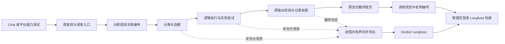

# PRD：第 14 课模型调用可观测与运营治理

> 状态：review（已实施验收） | Profile：standard | 负责人：andy | 更新：2026-11-06
>
> 模板：`mai-specs/_templates/PRD.tmpl.md`；有效输入：[开发默认上下文](../context/lesson-14-development-context.md)、本次会话及当前代码。本文是 Feature 990 需求与验收的维护源。

[返回需求简报](../BRIEF.md)

## 1. 背景与目标

Compass 已有统一模型接入、两级意图分类、选模与调用摘要。当前工作区另已出现可靠执行器、进程共享闸门和尝试摘要，实际验收由 Feature 991 管理。调用信息散落于单轮结果与记录，尚无 Langfuse 部署、观测导出或跨阶段调用链。

本期让运维与开发人员从一次 Chat 找到分类、选模、排队、实际尝试与收尾过程，比较模型运行表现，并验证观测故障与敏感内容采集边界。采用 B 类生产运营型的轻量接入，复用观测平台的查询和可视化。

**用户已确认**：2026-11-06，当前无观测后端；使用本地搭建的 Langfuse，在 Docker 中部署。后续用户授权补齐分布式设计并完整实现验收，本规则作为本期实施范围。平台管理员进入观测后台；租户用户只获得自己本轮调用的关联编号，Langfuse 项目权限沿独立平台管理。

## 2. 用户与场景

| 用户故事  | 用户与触发场景                       | 目标                                             | 关联需求      |
| --------- | ------------------------------------ | ------------------------------------------------ | ------------- |
| US-990-01 | 分析用户完成、取消或中断一轮 Chat    | 复制关联编号供排障，保留当前回答与停止操作       | FR-990-01、02 |
| US-990-02 | 平台管理员处理“回答慢”问题           | 在 Langfuse 查看阶段与首字时间                   | FR-990-03、04 |
| US-990-03 | 开发人员复现限流、断流、取消         | 查看逻辑调用与实际尝试，定位恢复原因             | FR-990-03、05 |
| US-990-04 | 平台管理员比较 Flash / Pro           | 按同一窗口比较成功率、耗时和用量                 | FR-990-06     |
| US-990-05 | 学员或本机运维首次部署               | 启动独立观测栈，初始化项目，验证采集             | FR-990-07     |
| US-990-06 | 后端停机、导出队列满或输入含敏感内容 | 模型路径继续按原协议运行，敏感正文不进入观测平台 | FR-990-08、09 |

## 3. 总体业务流程



主链路保留既有分类策略、模型选择、重试预算、取消、校验与最终提交规则。观测失败走降级导出路径，不启动新的模型尝试，不修改调用的成功或失败结果。调用编号可先于 final 获取；浏览器未收到响应头时，仍可复制既有 call_id。

## 4. 功能需求

### 4.1 新增需求

| 编号      | 触发与输入                                                    | 预期行为与可见结果                                                                                                                                                                                                              |
| --------- | ------------------------------------------------------------- | ------------------------------------------------------------------------------------------------------------------------------------------------------------------------------------------------------------------------------- |
| FR-990-01 | 已鉴权的一轮 Chat / Provider 测试                             | 生成 Trace 关联编号，贯通本轮阶段。浏览器可在调用信息中复制；编号不赋予数据读取权限                                                                                                                                             |
| FR-990-02 | 用户展开调用信息；管理员进入平台模型管理                      | 普通用户看到本轮 call_id / trace_id / 采样说明；平台管理入口显示 Langfuse 打开入口与导出自诊断。直接访问管理 API 仍执行平台管理员鉴权                                                                                           |
| FR-990-03 | 一轮调用进入分类、选模和主模型执行                            | 在 Langfuse 以父子关系展示请求根、分类、路由、各阶段 Logical Call 与每个 Attempt；关联既有配置版本、字典/路由版本和安全错误码                                                                                                   |
| FR-990-04 | 流式和非流式调用                                              | 展示 Agent 接收至结束的总耗时、分类/路由/排队/尝试/收尾耗时；流式记录首个可见正文或工具片段的时间。Thinking 元信息与心跳不算首字；非流式首字值为空                                                                              |
| FR-990-05 | 临时故障、取消、断流或记录收尾失败                            | 区分尝试成功与逻辑调用失败；展示次数、退避、取消、清理结果与结果未知。失败内容不进入遥测，不改变第 13 课恢复规则                                                                                                                |
| FR-990-06 | 管理员选择时间窗口与两个已配置模型                            | 平台管理小节提供固定只读对比表，由 Langfuse 公开聚合 API 提供数据；比较调用量、成功率、延迟、Token 与估算费用。逻辑调用量和实际尝试量分开，分类与主推理分开；未知消耗显式标识，禁止用零代替。Trace 与趋势图继续在 Langfuse 查看 |
| FR-990-07 | 首次安装、重启或停止本机观测栈                                | Docker 部署本地 Langfuse 及所需服务，独立账号、存储和卷；避开 Web 3000 / Home 3001，默认 UI 3002。可重复启动和停机保留数据，交付初始化、配置与健康检查说明                                                                      |
| FR-990-08 | 导出后端不可用、认证失败、队列满或关机                        | 导出有界、后台异步；模型路径不等待网络导出，无遥测驱动的模型重试；丢弃、失败、队列状态可在管理自诊断查看，采集失败只报安全原因                                                                                                  |
| FR-990-09 | 模型输入含 Prompt / SQL / Schema / 工具参数 / 查询结果 / 凭据 | 默认只采集白名单元信息，正文、异常原文、HTTP 头、密钥、续接 token 与思考正文均不采集；使用合成哨兵验证所有导出与日志出口                                                                                                        |
| FR-990-10 | 调整采样与配置，或禁用观测                                    | 默认本机全采样；按整轮调用一致采样。禁用时调用正常，UI 显示未启用；采样不足或导出异常时标明数据口径，指标不承诺完整计费                                                                                                         |

### 4.2 既有行为变更

| 编号      | 原行为 → 本期增量                             | 兼容约束                                                                                                   |
| --------- | --------------------------------------------- | ---------------------------------------------------------------------------------------------------------- |
| FR-990-11 | 调用信息原有摘要 → 增加关联编号与观测状态说明 | 保留模型选择器、回答、工具建议、Thinking、重试摘要与停止；不改变输出提交条件                               |
| FR-990-12 | 平台模型管理 → 增加“调用观测”小节             | 复用现有管理页面、权限和组件；Trace 与趋势图由 Langfuse 承担；Compass 只增加固定只读对比表，无通用分析后台 |

## 5. UI 与交互

设计依据：已读取 `analysis-composer.tsx`、`features/models/output.tsx`、`pages.tsx`、`reliability-panel.tsx`，沿用“调用信息”、平台模型管理和既有 status / error / button 组件。以下为拟议线框，无运行截图或后端接入声明。

```text
分析 Chat / 平台测试：调用信息（沿用折叠/标签页）
┌──────────────────────────────────────────────┐
│ 既有模型、状态、用量、执行摘要                │
│ 调用编号       <call_id>        [复制]        │
│ 观测编号       <trace_id / 未启用> [复制]     │
│ 本轮已采样；观测数据可能稍后可见              │
└──────────────────────────────────────────────┘

平台模型管理：调用观测（仅平台管理员）
┌──────────────────────────────────────────────┐
│ Langfuse      [打开 Langfuse] [刷新状态]      │
│ 导出：已启用 / 未配置 / 降级                  │
│ 待导出 N  丢弃 N  导出失败 N（当前进程）      │
│ 对比：模型 A / 模型 B   最近24小时 [查询]    │
│ 模型｜逻辑调用｜成功率｜耗时｜Token｜估算费用 │
│ 通过观测编号或调用编号在 Langfuse 检索        │
└──────────────────────────────────────────────┘
```

- Trace 树与模型比较进入 Langfuse，独立登录。打开操作使用新标签页、`noopener noreferrer`，URL 由服务端固定配置；客户端无任意跳转地址输入。
- 关联编号在收到响应头后即可展示；停止/断流时保留本页已取得编号。采样状态表示本地决定，不代表已成功入库。
- 平台状态只在进入小节或点击刷新时请求，不轮询、不把“导出已启用”显示成“后端健康”。网络故障由最近实际导出结果反映。
- 对比表按管理员点击“查询”读取，只支持两个已配置模型、1 小时 / 24 小时 / 7 天和 local 环境；不支持任意查询。按 Provider 和当前模型标识共同筛选，避免历史换模混算。后端不可用时显示错误与重试，保留上次结果并标记非最新；没有样本时成功率为未提供。
- 加载态禁用刷新；空配置禁用打开操作并提示配置；请求失败保留原调用结果并允许重试状态查询；无权限隐藏入口，服务端仍拒绝请求。
- 复制按钮有可访问名称，成功反馈为短状态文本；Tab 可到达按钮，原折叠与标签页键盘行为沿用；窄屏编号可换行。

### 最终文案

| 编号        | 位置 / 状态       | 文字与变量规则                                                                                    |
| ----------- | ----------------- | ------------------------------------------------------------------------------------------------- |
| COPY-990-01 | 平台小节 / 按钮   | “调用观测”“打开 Langfuse”“刷新状态”“查询”                                                         |
| COPY-990-02 | 关联字段 / 复制   | “调用编号”“观测编号”；按钮“复制”，可访问名称“复制调用编号” / “复制观测编号”；反馈“已复制”         |
| COPY-990-03 | 观测禁用          | “调用观测未启用。”                                                                                |
| COPY-990-04 | 本轮采样          | “本轮已采样；观测数据可能稍后可见。”                                                              |
| COPY-990-05 | 未采样            | “本轮未采样，可使用调用编号联系管理员排查。”                                                      |
| COPY-990-06 | 状态查询失败      | “暂时无法读取观测状态，请重新加载。”                                                              |
| COPY-990-07 | 导出降级          | “观测导出异常，模型调用继续运行；部分观测数据可能缺失。”                                          |
| COPY-990-08 | 未配置后台        | “尚未配置 Langfuse 入口，请联系平台管理员。”                                                      |
| COPY-990-09 | 未知用量或费用    | “未提供”；部分汇总显示“已知部分”，同时展示未知样本数；估算费用标注“估算费用（USD）”               |
| COPY-990-10 | 对比无数据 / 失败 | “所选范围暂无调用数据。” / “暂时无法读取模型对比，请重试。”；部分查询失败不展示成功率或完整总费用 |

## 6. 业务规则与约束

| 编号      | 规则                                                                                                                                                                              |
| --------- | --------------------------------------------------------------------------------------------------------------------------------------------------------------------------------- |
| BR-990-01 | 平台管理员可查看全平台观测；Langfuse 的项目凭据只留服务端。租户用户只复制自己本轮编号，不自动加入 Langfuse 项目；metadata 过滤不承担租户权限隔离                                  |
| BR-990-02 | root 表示一次 Agent 已接纳的请求；Logical Call 表示一次分类或主模型阶段；Attempt 表示一次实际进入 Runtime 的尝试。JEV→Flash 是两次分类阶段，主生成的两次 Attempt 从属同一逻辑阶段 |
| BR-990-03 | 图表明确时间窗口、环境和统计层级。主模型成功率为该模型阶段 completed 数 / 已结束的该模型逻辑阶段数，包含失败、取消、不完整和零 Attempt 过载；整轮成功率单独按请求根计算           |
| BR-990-04 | Token / 费用只在 Attempt 层入账式观测，父级不重复填写可聚合用量；失败尝试的已知消耗保留，任何已发送尝试缺失消耗则整轮完整总量不可知                                               |
| BR-990-05 | 首字采用首个可见 text/tool 片段；同时区分 Agent 端首字延迟和 Attempt 首字延迟，不承诺浏览器渲染耗时                                                                               |
| BR-990-06 | 无法估价的模型、不完整用量或结果未知均标记未知；禁止把 Langfuse 的空值或零值当作确认零费用。对比报表同时报告已知值与未知样本                                                      |
| BR-990-07 | 原请求失败或取消时观测结束，不能因记录 Trace 恢复调用、改模型或续写；根请求和 Logical Call 的最终状态在原收尾之后确定                                                             |
| BR-990-08 | 仅导出代码登记的安全字段；不接受浏览器传入遥测标签、导出地址、凭据和任意 baggage；tenant / actor / workspace 由原可信上下文提供                                                   |
| BR-990-09 | Langfuse 及其 PostgreSQL、ClickHouse、缓存与对象存储由该第三方栈管理；独立于 Agent/main 与 Web/main，无跨库直连、共享账号或跨库外键                                               |
| BR-990-10 | 采样和有界丢弃允许观测数据缺失；此后端不承担正式计费、配额扣减、强审计和完整 Replay                                                                                               |

| 非功能编号 | 要求与验证口径                                                                                                     |
| ---------- | ------------------------------------------------------------------------------------------------------------------ |
| NFR-990-01 | 模型路径没有同步网络导出或逐次 flush；受控后端停机/超时后模型次数、输出、取消与提交语义保持                        |
| NFR-990-02 | 导出队列、单条字段、批次和关闭等待均有明确上限；数值在技术方案中登记为设计默认值；压测验证不越界                   |
| NFR-990-03 | 使用敏感哨兵检查 Agent 日志、导出载荷及 Langfuse 查询结果，正文与凭据出现数为 0；编号保持可关联                    |
| NFR-990-04 | 宿主端口绑定 127.0.0.1；只开放所需 UI，内部依赖不暴露到宿主；本机 HTTP 例外仅限 loopback / 受控 Compose 网络       |
| NFR-990-05 | 数据库账号、API Key、登录密码随机生成或由操作者配置，使用忽略 Git 的私有配置；禁止提交样例真密钥；停止与重启保留卷 |

## 7. 范围与边界

**包含**：十项新增能力、两项界面增量、本地 Docker Langfuse、五个 Showcase 的实际验证路径。后台图表复用 Langfuse 原生能力和保存视图；固定只读对比表通过公开 API 提供；需要导出的指标必须由本期埋点提供。

**不包含**：Gateway / Proxy、通用观测平台或 Trace 存储自研、Collector / Kafka、Prompt 管理、数据集与效果评估、业务输出质量评分、GPU 指标、强审计账本、付费配额、持久恢复、跨租户自助观测后台、SSO、生产 HA、自动告警值班体系。SLO、告警配置暂使用 Langfuse 已有能力按需观察，本期不承诺新增告警服务。

**依赖**：993 接入、992 分类与路由、991 实际可靠执行链；本地 Docker 与足够资源。开发不等待真实密钥，使用受控 Provider 验证；真实供应商用量与估价另行登记。Docker 实测未执行时不得计作已交付。

## 8. 研发资源与拟议默认值

- [开发默认上下文](../context/lesson-14-development-context.md)：课程理论与选型真源，保持原文。
- 本次后端决定：本地 Docker Langfuse，覆盖素材索引中“后端待选择”的历史问题。
- 默认入口 `http://127.0.0.1:3002`，项目 `compass-local`，环境 `local`，本机默认全采样。
- 比较模型默认最近 24 小时；可切换 1 小时 / 7 天，统一 UTC 存储并按界面时区展示；具体控件使用 Langfuse 原生实现。
- 初期数据保留至操作者显式清理；首版不承诺定时删除或保留期自动化。部署说明提供磁盘检查与清理前备份提示，禁止默认删除卷。

## 9. 验收标准

| AC        | Given / When                                               | Then 与验证方式                                                                                                                                    |
| --------- | ---------------------------------------------------------- | -------------------------------------------------------------------------------------------------------------------------------------------------- |
| AC-990-01 | Docker 可用，首次按交付命令启动观测栈                      | 所需服务健康，3002 登录页可达，项目与项目 Key 可建立；两次启动无重复破坏，停止重启观测仍在；实际 Docker 验证                                       |
| AC-990-02 | 普通业务 Chat，分类后自动或静态选模                        | 一条请求 Trace 可关联分类阶段、选模与主模型 Logical Call；实际 Attempt 与供应商调用数一致，版本字段正确；Langfuse 查询和受控计数                   |
| AC-990-03 | 平台 Provider 测试与 System One 决策测试                   | 各自只有本路径阶段与真实 Attempt；类型化用量和安全状态进入 Trace，不新增分类或重试；受控 Adapter                                                   |
| AC-990-04 | 控制首片段延迟、排队、Thinking 元信息与非流式响应          | 阶段耗时与单调时钟相符；Thinking 不触发首字，非流式 TTFT 为空；Agent 与 Attempt 口径分开；时钟夹具测试                                             |
| AC-990-05 | 首次无正文 429，第二次成功                                 | 一个主模型 Logical Call、两个 Attempt，第一次 ERROR、第二次成功，父级 completed；用量不重复；Langfuse Trace 与两次调用计数                         |
| AC-990-06 | 生成中取消/断流、准备失败、零 Attempt 过载、记录收尾失败   | 结束状态与原链路一致；取消保留关联编号，已发送未知用量不写 0；记录失败时父级失败，不能仅凭 Attempt 成功显示全轮成功                                |
| AC-990-07 | 固定合成 Flash / Pro 样本包含成功、失败、取消、重试        | 选定同一环境/窗口，逻辑与 Attempt 数分别等于金标；主模型成功率分母正确；已知 Token 与估价匹配，未知样本可辨识；平台对比表与 Langfuse 公开 API 校验 |
| AC-990-08 | 模型无价格、缺用量、失败尝试未知或缓存字段不完整           | 估价显示未提供/已知部分；禁止自动推成零或完整账单；检查 Langfuse 属性与报表口径                                                                    |
| AC-990-09 | 关闭 Langfuse，或返回 401/503/慢响应，导出队列满           | 模型调用和停止正常；导出占用有界、溢出可见；状态接口显示失败/丢弃而不修改模型结果；故障注入与集成                                                  |
| AC-990-10 | 在 Prompt、SQL、Schema、异常、工具参数、头和续接中植入哨兵 | 日志、OTLP、Langfuse 数据无哨兵，白名单元信息可关联；导出捕获测试与后台检索                                                                        |
| AC-990-11 | 普通租户用户、其他租户、未登录用户尝试平台状态入口         | 统一拒绝；不能从响应获得项目 Key、后端内部地址或其他调用记录；BFF / Agent 双侧测试                                                                 |
| AC-990-12 | 开启/禁用观测或设置部分采样，流式在 final 前中断           | UI 正确显示编号与采样说明；同轮阶段采样一致，既有无 final 不提交规则不变；浏览器与协议测试                                                         |
| AC-990-13 | 数据库旧版与新版应用，禁用观测部署                         | 原模型记录与权限保留，无本期业务库迁移；只新增契约字段/头时执行生成与兼容验证；PostgreSQL 原回归与 contracts 检查                                  |
| AC-990-14 | 导出队列有积压时关闭 Agent                                 | 模型根任务按原生命周期收束，观测关闭受上限约束，允许丢弃并记录安全计数，无无限等待；生命周期测试                                                   |

## 分布式观测增量（2026-11-06 用户授权）

- FR-990-13：每个 Agent 实例手工登记 service.name、service.instance.id、service.version 和环境。实例 ID 默认每次启动生成，可由部署显式指定。所有实例向同一个 Langfuse 项目汇聚，固定对比查询默认跨实例。
- FR-990-14：已完成内部服务鉴权的 HTTP/任务入口可提取 W3C traceparent/tracestate，继承父 Trace 并创建本地子 span；提供内部调用/消息 carrier 的显式注入与提取工具。Web BFF 丢弃浏览器的上下文输入，Provider 出站不注入上下文，baggage 不传播。Worker 的实际业务执行保持后续范围，工具通过两实例 HTTP/消息 carrier 验收。
- FR-990-15：本地根按配置采样；可信远程父上下文的采样标记由子链路继承，禁止下游重新决定。各实例自诊断按实例返回，Trace 和模型聚合统一存储；暂不增加全局时序监控平台。

| AC        | 场景                                      | 可判定结果                                                                                        |
| --------- | ----------------------------------------- | ------------------------------------------------------------------------------------------------- |
| AC-990-15 | 两个独立进程/实例上报同一项目             | Trace 可查到各自 instance_id，模型汇总跨实例且无重复；状态查询明确当前实例                        |
| AC-990-16 | 上游通过可信 HTTP 或消息 carrier 调用下游 | 同 trace_id、不同 span_id、正确 parent_span_id，业务调用 ID 仍独立；无鉴权/浏览器伪造上下文不接入 |
| AC-990-17 | 上游已采样/未采样，下游本地 ratio 相反    | 下游继承远程父采样结果，格式非法时新建本地根；不记录原非法头                                      |
| AC-990-18 | 两实例各发生导出失败/队列满               | 每实例自诊断带唯一实例 ID；失败数据不冒充全局完整数据，调用继续遵循原执行语义                     |

## 待确认与假设

| 事项                           | 状态 / 对开发的影响                                                                    |
| ------------------------------ | -------------------------------------------------------------------------------------- |
| 本地 Docker Langfuse           | 用户已确认；不再阻塞设计                                                               |
| 平台管理员访问与租户只复制编号 | 本 PRD 拟议默认，沿既有管理边界；若要求租户直接查 Langfuse，需单独补项目隔离与授权设计 |
| 真实模型价格与币种             | 观测估价统一 USD；已知来源才估价，缺失保持未知，不阻塞受控样本验证                     |
| 镜像、依赖精确版本与宿主资源   | 技术方案固定候选版本并在实现入口锁定；本次不部署、不写入真实凭据                       |

## 变更记录

| 日期       | 内容                                                                                                            |
| ---------- | --------------------------------------------------------------------------------------------------------------- |
| 2026-11-06 | 按用户连续授权产出首版 PRD；确认 Docker Langfuse，落实五个 Showcase、权限与敏感内容边界。规格和实现验收分开维护 |
