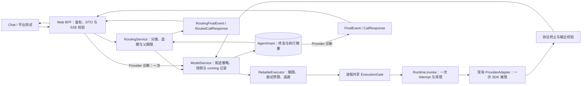

# 第 13 课：可靠模型执行技术方案

> Feature：991 | Profile：standard | 状态：已实现，验收见实施记录 | 更新：2026-11-06
>
> 模板：[项目标准技术方案模板](../../_templates/TECH_DESIGN.tmpl.md)。有效需求来源：[BRIEF](../BRIEF.md)、[上下文](../context/_INDEX.md)及本次会话确认；规范化验收维护于本文。代码基线：`main` / `d08488b0b9f9dd2614702426f053e1421e9182c9` 加当前未提交工作区，包含已接入的 992 分类与路由链。

[返回需求简报](../BRIEF.md)

## 需求依据与验收

2026-11-05 用户调用 `my-create-design`，随后选择“按建议做进程内可靠执行”：首版覆盖进程内重试、Deadline、并发限制、输出校验和流式最终提交；保留调用元记录，进程重启后不自动续跑。本文将这些输入转成可评审的实现与验收，新增数值为设计默认值。

同日用户要求先按[设计评审](../review/design_review.md)修订，再讨论流式中断处理。本次修订对齐现有路由链和取槽后到期边界，并明确已展示片段后的停止与手动重提语义；保持既有进程内执行范围。

本 Feature 无 PRD。本文是本阶段需求与 AC 的维护位置；后续实现和测试沿用下列 ID。[第 13 课大纲](../../../../../../lessons/v5/formal/lesson_13_reliable_model_execution/brief/lesson_outline.md)仍为 pending，课程页级设计与生产继续在课程工作区推进。

### 用户路径与边界

用户沿用分析 Chat 提交问题；遇到可恢复的临时拒绝时，服务在原调用内恢复，页面只形成一个回答。用户可查看尝试次数、错误类别和总耗时；失败片段保留为临时展示，下一轮上下文仅包含成功提交的回答。平台测试页继续验证单次供应商能力，也展示执行元信息。停止、断连和撤权沿已有取消链路结束执行。

本期实现同一 Provider、同一配置快照、同一输入的有界重试。模型生成与工具调用建议保持无业务副作用；工具执行、SQL 执行、报告写入、Agent Loop、持久化恢复、分布式队列、跨进程配额及完整 Trace/Replay 均留待相应 Feature。

992 PRD（本地需求资料；不随本节点提交）维护已接入的 JEV/Flash 两级分类、字典特征、静态/自动选模和单次主推理。当前 Chat 通过 `RoutingService.run` 调用分类与主推理，共享路由父 Deadline。991 在该链路的选定主模型生成阶段增加最多两次尝试；JEV 分类、Flash 分类、Provider 诊断和其他决策调用保持各一次。最坏一轮为 JEV 一次、Flash 分类一次和主生成两次，共四次模型推理。可靠执行循环由本 Feature 的 `ReliableExecutor` 唯一维护，不新增供应商切换、跨模型 Fallback、参数降级或分类兜底流程。

### 验收标准

| ID        | 场景与操作                                                                                                                         | 可判定结果                                                                                                                                                                                                                              |
| --------- | ---------------------------------------------------------------------------------------------------------------------------------- | --------------------------------------------------------------------------------------------------------------------------------------------------------------------------------------------------------------------------------------- |
| AC-991-01 | 普通 Chat 分类、选模、正常生成；随后发起下一轮                                                                                     | 主生成使用客户端 call_id、一条主生成元记录和一次尝试；分类沿用派生 ID 和独立元记录；已验证结果进入下一轮上下文                                                                                                                          |
| AC-991-02 | 分类及选模完成后，主模型同一 Provider 第一次无正文返回 429 或 5xx，第二次成功                                                      | 主生成自动重试一次，输入与配置快照不变；主生成 SDK 调用总数为 2，分类次数不增加；页面正文只出现成功尝试的内容                                                                                                                           |
| AC-991-03 | 两次均临时拒绝；另测 401/403、400/404、非法输入、Schema 失败、拒绝和内部错误                                                       | 临时拒绝最多两次；其余直接结束；不切 Provider、不改模型或能力、不隐式修复输出                                                                                                                                                           |
| AC-991-04 | 已发送请求后超时、连接中断且结果未知                                                                                               | 终止并标记结果未知，后续出站为 0；未知用量保留 null                                                                                                                                                                                     |
| AC-991-05 | 分类消耗父预算；排队、取槽后策略构造前、退避及执行分别耗尽绝对期限                                                                 | 主生成沿用路由父期限，整轮执行预算最多 180 秒；取槽后到期返回 model_timeout/deadline_exceeded，不构造非法 CallPolicy、不新增 Attempt；保留已有摘要并释放槽；最终清理及记录收尾额外最多各 2 秒，早期阶段收尾消耗父预算；调度误差单独报告 |
| AC-991-06 | K=2、N=5 时通过多个独立 ModelService 同时提交 20 个请求                                                                            | 同一进程本地活跃尝试及未确认清理占用合计不超过 2；进入执行器的逻辑调用最多 5；其余返回明确过载结果且无供应商出站                                                                                                                        |
| AC-991-07 | 在排队、退避、出站及清理阶段取消，连续运行多批请求                                                                                 | 取消后无新增出站；可确认清理的容量全部归还；清理无法确认时隔离相应容量并报错，后续可用容量不超限                                                                                                                                        |
| AC-991-08 | 分别请求 text、JSON、Schema、工具调用建议；注入截断、非法 JSON、错误字段及非法工具参数                                             | 复用各自输出契约；无效结果保持 failed/incomplete，不产生可提交的结果或可续接 token；正常 text 无须额外 JSON 校验                                                                                                                        |
| AC-991-09 | 已展示 text/tool delta 后厂商连接断流；另测 Schema 失败或记录收尾失败，再手动重新提交原问题                                        | 当前调用无自动重试或续传；片段保留并标为未完成，不进入下一轮上下文、不执行工具、不开放续接；手动重提使用新 call_id 和原成功历史加该问题，重新生成独立回答                                                                               |
| AC-991-10 | Chat 的 RoutingFinalEvent 及诊断的 FinalEvent 分别出现重复 final、缺少 final、尾部多余内容或不完整 EOF；另测分类失败且 result=null | 两种协议均拒绝异常提交；正常链路在唯一成功 final 和干净 EOF 后提交一次；路由失败不合成模型成功结果                                                                                                                                      |
| AC-991-11 | 重复 call_id、跨用户/租户/工作区查询，执行中更新 Provider 配置                                                                     | 重复 ID 返回既有 409 且不重复出站；越权查询保持 404；当前逻辑调用使用已捕获快照，下一调用读取新配置                                                                                                                                     |
| AC-991-12 | 主生成两次尝试分别有完整/未知 Token 用量，随后查询记录并查看路由 metrics                                                           | 主生成记录汇总其两次尝试；分类记录及 classification_calls 保持独立，不重复累计；任一已发送尝试缺少某类用量时该类汇总为 null；明细仅含安全元信息，不存正文、凭据、工具参数或续接密文                                                     |
| AC-991-13 | 执行期间重启 Agent，恢复后查询原 call_id 并尝试复用该 ID                                                                           | 不自动重放；到期原 running 显示 incomplete/结果未知，明细可能缺失；重复 ID 拒绝，不声称上游未执行                                                                                                                                       |
| AC-991-14 | PostgreSQL 17 空库安装、0003 带旧数据升级、SQL 生成、权限及恢复演练                                                                | 见 §4 数据交付矩阵；Provider、旧调用及凭据保持，历史调用可查询且 execution 为 null                                                                                                                                                      |
| AC-991-15 | 固定受控上游，100 个并发客户端发送 1,000 个短调用，混合正常、429→成功、永久失败及断流                                              | 每个调用终态符合故障脚本、无串流/重复提交、无隐藏重试；并发/排队计数满足 K/N；结束后无未归属执行任务，清理正常时容量恢复初值                                                                                                            |
| AC-991-16 | Flash 分类临时拒绝；另测 JEV→Flash 分类兜底后主生成 429→成功                                                                       | JEV 分类≤1、Flash 分类≤1、主生成≤2；最坏整轮≤4 次推理；分类失败停止主生成，服务端用途决定预算，浏览器不能提高次数                                                                                                                       |
| AC-991-17 | 分别在 Chat 分类、主生成及 Provider 诊断执行中触发 shutdown                                                                        | 禁止新根任务进入；登记并取消/收束路由和诊断根 runner，子执行与资源按既有期限结束；无关闭后新增出站                                                                                                                                      |

## 1. 方案概述

### 1.1 最小实现

保留 `llm/runtime.py:Runtime.invoke` 作为单次 Attempt 内核，新建 `llm/executor.py:ReliableExecutor` 负责 Logical Call 的尝试预算、退避、并发与结果汇总。`ModelService` 继续拥有配置读取、解密、可信身份和数据库收尾。每次重试创建新的单次资源对象，复用不可变配置及请求快照。

只增加一列可空 JSON 执行摘要，不建立 Attempt 表、常驻消费者或恢复任务。新增闸门在 FastAPI lifespan 中创建，每个应用进程、每个事件循环一份。Web 增加调用次数和尝试摘要展示，并强化最终提交；保持现有页面布局和权限。

### 1.2 现有能力与实际缺口

| 真实入口                                           | 当前行为                                                                     | 本次处理                                                                       |
| -------------------------------------------------- | ---------------------------------------------------------------------------- | ------------------------------------------------------------------------------ |
| `llm/runtime.py`、`llm/policy.py`                  | 单次调用、180 秒绝对期限、取消与有界清理；策略固定一次                       | 保留一次调用语义；增加明确的发送/故障恢复判据与清理确认                        |
| `llm/litellm_chat.py`、`llm/systemone_decision.py` | 两类适配器，SDK 重试关闭；生成支持 JSON + 本地 Schema 校验                   | 保持协议转换；携带安全失败分类，禁止启用 SDK 隐藏重试                          |
| `llm/errors.py`、`llm/transport.py`                | 公共错误码归一；部分 4xx 与网络失败可能归为同类错误                          | 恢复依据与公开错误码分开；仅可确认类别允许重试                                 |
| `models/service.py`、`models/repository.py`        | 准备快照及 running 占位，终态条件更新，超期记录显示 incomplete               | 接入执行器；终态事务一并写入摘要，查询复用既有作用域                           |
| `routing/service.py`、`routing/config.py`          | 父期限 180 秒，JEV/Flash 分类及主推理均调用 ModelService；分类阶段有更短期限 | 阶段调用显式传入 LogicalPolicy：分类各一次、主生成两次；保持原父期限与分类兜底 |
| `model_api.py:get_model_service`                   | 每次请求新建 Service/Runtime                                                 | 通过 Request 注入 lifespan 所有的共享 Gate；禁止请求级新建限流器               |
| `model_api.py:chat/invoke`                         | Chat 返回路由 envelope；诊断返回原模型 envelope；均有 16 项有界 SSE 队列     | 维持两类协议及队列；登记真实 HTTP 根 runner；失败不发续接 token                |
| Web `use-model-call.ts`、`analysis-composer.tsx`   | 页面累积 delta；成功回答才进入 Chat 历史                                     | final 先暂存，整个读取成功后再标 completed，错误片段仅供展示                   |

源码均位于 `apps/agent/src/compass_agent/`；Web 路径位于 `apps/web/src/features/models/` 和 `apps/web/src/components/`。本方案所列新增执行器、Gate、测试和 0004 迁移现已交付，实际文件及本次检查见[实施记录](../IMPLEMENTATION.md)。

### 1.3 关键决策与 Review 索引

| 决策                                       | 推荐及理由                                       | 持续成本与更简单备选                                            | Review 重点                                                            |
| ------------------------------------------ | ------------------------------------------------ | --------------------------------------------------------------- | ---------------------------------------------------------------------- |
| 单次 Runtime 外增加薄执行器                | 保留原资源所有权和协议测试；一处计算重试次数     | 多一个协调模块；直接在 Service 内循环会混合记录、取消与执行策略 | [代码设计](CODE_DESIGN.md#2-逻辑调用与恢复分支)中的终止与重试条件      |
| 主生成最多两次                             | 服务端阶段显式传入策略；分类、诊断和决策保持一次 | 现有路由增加一次策略传递；无需通用规则引擎                      | Flash 分类与主生成同为 GenerateInput，必须按用途区分；整轮最多四次推理 |
| 结果未知时停止                             | 保留上游不确定性，避免重复费用和重复片段         | 一部分临时网络故障需要用户手动重发                              | `recovery` 判据必须来自单次边界，默认禁止重试                          |
| 共享 Gate，执行上限 K=8、逻辑进入上限 N=32 | 限制本地供应商调用及等待者；无需 Redis           | 维护两个计数与取消收尾；进程数变化时容量随之倍增                | 生命周期、取消竞争、隔离容量                                           |
| `model_call.execution` 可空 JSON           | 最多两条尝试，和终态共同写入，已有记录为 null    | 一次加列及读取 DTO；独立 Attempt 表会增加当前无消费的查询/事务  | 摘要上限、写入原子性、旧版兼容                                         |
| 输出校验失败直接结束                       | 保持原有 Schema/工具校验语义，不扩展生成修复流程 | 某些输出需用户重发；既有 JEV→Flash 分类兜底保持独立             | 工具建议与正文契约的适用分支                                           |

减法结果：无新服务、消息队列、Provider 策略表、Attempt 查询 API、实时 Attempt 事件或执行配置页。只有跨进程容量治理、独立尝试检索或重启恢复成为明确需求时，才重新设计相应机制。

## 2. 详细设计

### 2.1 Logical Call、Attempt 与状态

Chat 客户端 `call_id` 同时标识整轮路由请求及其主生成记录；JEV、Flash 分类沿用 `uuid5(parent_call_id, role)` 派生 ID，各自有一条模型调用记录。分类失败、主生成尚未 prepare 时，父 ID 可以没有主生成记录，查询沿用既有 404；本期不增加路由父记录表。每条 `model_call` 的 `execution` 只汇总自身尝试，主生成最多两条，分类/诊断/决策最多一条。

每次实际进入 Adapter 的尝试分配独立 `attempt_id` 和从 1 连续递增的序号。排队超时、过载、准备失败可以有零次 Attempt。SDK 的认证 HTTP 及协议交换继续由 SDK 管理，Attempt 计数按推理入口计数。

逻辑状态沿用 `running → completed | failed | canceled | incomplete`。`completed` 同时要求有效模型输出、完整协议终止、响应大小合法及元记录收尾成功。运行期间等待与退避为进程内阶段，不增加公共状态枚举。已产生片段的异常保持 incomplete；结果未知通过现有 `upstream_outcome_unknown` 表达。

Attempt 摘要仅在进程内追加，最大 2 项；终态写入时一次提交。Attempt 内部状态使用现有终态集合，`running` 不进入持久化摘要。进程崩溃时仅保留既有 running 占位，查询在原 Deadline 之后给出 incomplete；不补造缺失的 Attempt 明细。

不变量：同一 call_id 的尝试串行；同一时刻最多一个尝试可产生内容；终态更新只匹配 running，相同终态重复收尾可幂等确认，冲突终态保持原记录；数据库收尾失败不得再次调用供应商。

### 2.2 恢复决策、期限与配置

单次 `CallPolicy` 仍固定 `max_attempts=1`、`allow_fallback=False`，其公开意义限定为 Attempt。拟新增内部 `LogicalPolicy` 记录逻辑最大次数和单次超时；不接受浏览器传递恢复权限或供应商地址。

`ModelService.run` 新增仅服务端关键字参数 `logical_policy`，生产路由和诊断入口显式传入；既有内部单次调用保留安全的一次默认值，由 `RoutingService.stage` 按阶段显式构造。`intent_jev`、`intent_flash` 为一次，`inference` 的生成请求为两次；Provider 诊断入口及其他决策调用显式传一次。禁止从 `purpose=chat`、`GenerateInput` 或 `capability_mode` 推断重试次数；未知阶段拒绝执行。所有阶段仍进入同一个进程 Gate。

| 项                              | 默认与来源                                                           | 行为                                                                                                                                     |
| ------------------------------- | -------------------------------------------------------------------- | ---------------------------------------------------------------------------------------------------------------------------------------- |
| 主生成次数                      | 服务端常量 2，含首次                                                 | 同 Provider 重试至多一次；JEV/Flash 分类、平台诊断及其他决策均为 1；整轮推理最多 4 次                                                    |
| 总期限                          | Chat 从 `RoutingService.run` 开始 180 秒；诊断从 prepare 开始 180 秒 | 分类、准备、排队、执行、delta 回压与退避共用父 Deadline；分类沿用 30 秒总预算和 JEV 8 秒/Flash 20 秒阶段上限；主生成及重试只使用剩余时间 |
| 单次超时                        | 内部策略默认 180 秒，上限 180 秒                                     | 实际截止为 `min(logical_deadline, attempt_started + attempt_timeout)`；测试可注入更小预算，无新增管理 UI                                 |
| 退避                            | `[0.1, 0.3]` 秒间均匀抖动一次                                        | 仅可恢复失败执行；剩余时间不足退避加 10ms 调度余量时停止                                                                                 |
| `COMPASS_MODEL_MAX_CONCURRENCY` | 新增 Agent 环境配置，默认 8，合法范围 1–64                           | 共享 Gate 的活跃/未确认清理占用上限，进程启动生效                                                                                        |
| `COMPASS_MODEL_MAX_INFLIGHT`    | 新增 Agent 环境配置，默认 32，范围 K–256                             | 已进入执行器的逻辑调用总数，包含排队、退避及当前执行；满时直接结束，不再排队                                                             |
| 清理/记录收尾                   | 沿用最后清理最多 2 秒、记录最多 2 秒                                 | BFF 190 秒、浏览器 200 秒保持；早期 Attempt 的清理消耗原总预算                                                                           |

并发参数在 Settings 校验，非法组合阻止启动。本期不增加重试次数、超时及退避环境配置；策略在一个模块集中维护，单测通过构造值注入短预算。

获得执行槽后，在拥有该槽的 `try/finally` 内捕获一次 `attempt_started`。若其已达到逻辑 Deadline，立即返回 `model_timeout`、`stop_reason=deadline_exceeded`，保持已有摘要，零出站并归还槽；通过检查后使用同一个时间值构造 `CallPolicy`。Runtime 继续负责出站前的期限和取消检查。

| 故障/观察结果                                                      | 恢复策略                                         | 输出与记录                                                              |
| ------------------------------------------------------------------ | ------------------------------------------------ | ----------------------------------------------------------------------- |
| 确认未发送的临时连接失败                                           | 未展示内容且清理成功、次数和 Deadline 允许时重试 | 保存安全错误码，未出站推理的用量为 0                                    |
| 收到 429 或 500–599 终止响应，未收到正文/工具片段                  | 同上                                             | 默认响应不提供可信用量时保留 null；原始响应与错误正文不持久化           |
| 已发送后的超时、读失败、连接中断、发送状态不明确                   | 停止                                             | 结果未知；已有片段为 incomplete，无片段为 failed                        |
| 401/403、其他 4xx、能力或输入错误、拒绝、Schema/协议错误、内部异常 | 停止                                             | 使用既有安全错误码；不得通过削弱输出约束继续                            |
| 用户取消、断连或失权                                               | 取消，不重试                                     | 透传 CancelledError，已有发送及未知用量保留                             |
| 清理无法确认                                                       | 停止，隔离该执行槽                               | `resource_cleanup_failed`；不继续尝试，不把未确认关闭的槽返还给下一请求 |
| JEV/Flash 分类、平台能力诊断、其他决策                             | 各一次                                           | 避免分类/诊断被重试扩大；JEV→Flash 分类兜底沿用路由层规则               |

恢复判据新增内部枚举 `not_sent_transient | rejected_transient | never`，默认 `never`。公开错误码继续负责用户文案。单凭 `model_unavailable_upstream` 不放行重试；该码目前覆盖多种网络与 HTTP 情形。适配器保留 SDK 异常的安全 status_code，Transport 将 429/5xx 的“无正文终止响应”归类；4xx、Timeout 及含糊异常不授予恢复资格。原生 SDK 路径按保守发送状态处理，无法确认未发送时立即结束。

本地输出未展示也不改变“已发送超时停止”的规则。纯生成可能重复产生用量，系统仅承诺本地不并行执行同一 call_id；上游 exactly-once 与跨请求业务幂等性不在本期承诺内。

### 2.3 并发和生命周期

`main.py` 使用 lifespan 创建一个 `ExecutionGate`，并在 shutdown 取消/收束所登记执行任务；`get_model_service(request)` 从 `request.app.state` 取得它。测试宿主 `tests/e2e_app.py` 同样使用应用 Gate，注入测试 Adapter；模块导入不创建绑定事件循环的对象。

任务登记以 HTTP 根 runner 为单位：Chat 的流式及非流式入口登记 `RoutingService.run` 任务，Provider 诊断登记其 `ModelService.run` 任务；当前直接 await 的非流式诊断也由同一登记入口创建受管 runner。根 runner 完成后移除，shutdown 先禁止接纳，再取消并有界等待这些任务，由既有所有权链收束其执行子任务。分类阶段无需另建常驻任务。

Gate 的 N 限制从 `ModelService.run` 进入执行器时开始，适用于完成配置准备后的逻辑调用。满额结果为 `runtime_overloaded`，零 Attempt，随后按既有记录路径结束。该限制保护 Runtime 排队及执行；准备事务、ASGI 请求接入及数据库池仍由各自边界控制。

每次 Attempt 开始前在同一总期限内获取 K 执行槽；一次推理及其资源清理持有该槽。退避期间归还已确认清理的执行槽，逻辑名额仍占用。等待取消、等待超时不得误释放他人持有的槽；仅实际 acquire 成功者拥有 release 权限。

`CallResources.close` 与 `RuntimeResult` 增加清理确认标记，关闭异常、超时及遗留清理任务一律为未确认。此时本地槽保持隔离占用，写安全日志和错误码；运行方检查后重启进程恢复容量。隔离数量最多 K，不创建无限后台清理任务。进程内 K 限制本地任务及资源槽，上游已经接受的请求可能在断连后继续处理。

### 2.4 输出契约与最终提交

沿用 `GenerateInput.output_format/output_schema` 和现有 `Draft202012Validator`。Schema 请求在出站前完成 Schema 合法性、本地引用及大小限制检查；正文在完整终止后完成 JSON/Schema 校验。`complete_output` 的 Schema 错误采集改为惰性取最多 20 项，避免为大错误集建立完整列表。

契约按输出类型分支：text 输出非空文本；json/schema 输出分别检查 JSON 和声明 Schema；声明 tools 且返回工具建议时校验工具名、参数 JSON、对应 Schema 及唯一工具 ID，调用方后续决定工具执行。工具建议与纯文本完成使用现有可接受输出集合，模型 `completed` 只描述本次模型调用。SystemOne 沿用其类型化决策结果校验。

结构化模式当前以 JSON 输出指令加本地 Schema 校验实现，继续保留这一机制；供应商原生 strict schema 支持及自动修复不加入本次设计。

流式 delta 始终为预览。执行器的 sink 在尝试转发第一个 text/tool delta **之前**标记 `content_exposed=True`，即使 sink 因回压、断连或取消失败也不重试。reasoning_meta 可重复覆盖，不计正文，不新增重试事件。不得将失败 Attempt 的部分输出、tool delta 或续接 token 拼入下一 Attempt。

最终提交分四步：

1. Runtime 确认协议终止、输出契约与资源清理；执行器生成至多两条尝试摘要和总用量。
2. ModelService 组装完整 `CallResponse`，校验沿用的 2 MiB envelope 上限，短事务收尾 `model_call`；响应超限按失败收尾。
3. 只有收尾确认成功的 completed 响应可提供续接 token。失败、取消、不完整、写入未知全部清除 token；保留的正文仅供预览。
4. HTTP 发唯一 final；BFF 保持缓存 final 至干净 EOF 的检查。浏览器 Hook 暂存 final，等 `modelRequest` 成功返回后才将展示状态置为 completed，并允许 Chat 更新历史。非流式响应同样要求成功状态和有效 DTO。

Chat 提交使用 `RoutingFinalEvent/RoutedCallResponse`，保留 `classification_status`、`route_selected` 和 `metrics`，同时要求外层及内层 `result.status` 均为 completed。分类/路由失败允许 `result=null`，此时只发布失败展示状态，不合成成功模型结果。Provider 诊断继续使用 `FinalEvent/CallResponse`。Hook 的异常路径清空 `view.result`、`view.routed` 和待提交 final，保留纯预览片段，避免嵌套结果残留续接 token。

#### 2.4.1 输出途中断链与重新提交

正文和工具 delta 按到达顺序实时转发，页面立即预览；完整结果确认后才进入可续聊历史。首次正文/工具分片已交给上层后，厂商连接中断将结束当前调用，保留当前页片段并标为未完成。失败结果及片段不自动写入下一轮上下文，不自动重发原请求，也不向新回答拼接旧片段。

用户手动重新提交原问题时创建新 `call_id`，使用此前成功历史与该问题重新执行分类、选模及完整生成。新答案独立展示，文本可能变化，旧片段继续保持失败状态。用户继续问其他问题时，上下文同样只包含此前成功提交的轮次；原失败回答不会作为已知结论传入。

当前没有厂商生成位置恢复协议、输出事件持久化或 SSE 重放入口，Agent 与浏览器断连时沿既有取消链路结束调用，页面重载也不恢复片段。现有 `continuation_token` 用于完整成功工具建议的后续上下文绑定，不携带厂商流的字节/token 偏移。断点续传及基于半截回答的语义续写均不属于本期能力。

不新增业务提交 API或持久化正文。未来业务写入和工具执行必须从已提交结果入口消费；本期没有这类副作用。

### 2.5 元记录、HTTP 与错误

复用 `model_call` 主键、身份、Provider、配置版本、deadline 与条件终态更新。拟新增可空 JSON 列 `execution`；旧行保持 null，查询不推造旧尝试。

`ExecutionSummary` 结构：`version=1`、`max_attempts`、`queue_wait_ms`、`stop_reason`、`attempts`。每条 Attempt 含 `attempt_id`、`number`、`provider_id`、`config_version`、`binding_version`、`started_at`、`duration_ms`、终态、安全错误码、`upstream_request_id`、`upstream_outcome_unknown`、`sent`、`cleanup_confirmed`、`usage`。所有字符串使用固定枚举或既有 200 字符 ID 上限，attempts 最大 2，总序列化上限 16 KiB。摘要校验失败时安全失败，禁止静默截断列表或回显异常正文。

`queue_wait_ms` 为所有获取执行槽等待的累计值。`stop_reason` 为 `completed | non_retryable | attempts_exhausted | deadline_exceeded | canceled | overloaded | cleanup_unconfirmed`，表示执行器结束原因；应用记录失败仍以外层 `record_write_failed` 为准。摘要中的 completed 表示执行器已产出有效结果，整体对外成功由 §2.4 决定。

用量按类别独立汇总：没有 Attempt 时为零；明确未发送的失败为零；已发送但缺少用量为 null；只有该类别的全部 Attempt 用量已知时才求和。reasoning_tokens 保持 SDK 原语义，不再加到 output_tokens。失败开销保留在明细，页面可显示“已知值 + 未知部分”。

现有 `/v1/models/calls`、Provider 测试和 call 查询路由保持。`CallOutcome`、`CallRecordView` 增加可选 `execution`，由 `CallResponse`、`RoutingMetrics.classification_calls` 及各自 final 类型继承/嵌套，经既有 DTO 源和契约生成分发。start/delta/final 以及分类/选模事件名不变，无逐 Attempt SSE 事件。

主生成过载通过 `RoutedCallResponse.result` 或 `RoutingFinalEvent.result` 中的 failed CallResponse 表达；诊断直接返回 failed CallResponse/FinalEvent，均 `error_code=runtime_overloaded`。分类过载沿当前分类结果处理及 JEV→Flash 兜底规则，不新增同一分类的重试。BFF 和客户端不自动重发。准备阶段的 HTTP 409/权限错误沿用当前协议。

新增 `runtime_overloaded` 和 `resource_cleanup_failed` 贯穿 Agent 与 Web 安全文案注册。推荐文案分别为“当前模型调用较多，请稍后重试。”及“本次模型连接未能正常结束，请稍后重试。”；保留原 call_id 查询提示。调用结果中的错误状态继续使用原 envelope；内部服务失败保持既有 HTTP/BFF 503 规则，全部响应 no-store。

### 2.6 供评审的代码设计

[CODE_DESIGN.md](CODE_DESIGN.md)仅维护一份关键骨架，包含共享 Gate 的所有权、恢复分支、Deadline、资源隔离和用量汇总。片段为设计示意，尚未写入生产源码或执行验证。Review 需同时核对单次 Runtime 和应用收尾的取消传播，防止把清理失败当成可再次出站的机会。

## 3. 风险与验证安排

| 触发条件                                | 影响                           | 最小措施与验证                                                                                                                                                 |
| --------------------------------------- | ------------------------------ | -------------------------------------------------------------------------------------------------------------------------------------------------------------- |
| SDK 归一异常丢失发送/HTTP 类别          | 错误重试                       | 分类默认 never；用受控 HTTP 400、429、503、读失败分别验证 SDK 推理次数和恢复资格                                                                               |
| 清理任务或 SDK 流无法结束               | 本地资源未归还                 | 隔离占用、禁止再尝试；注入 aclose 阻塞和关闭错误验证剩余容量                                                                                                   |
| 多次记录未知用量                        | 汇总低估消耗                   | null 传播，UI 展示未知部分；不以 0 替代                                                                                                                        |
| JSON Schema 计算及大响应占用事件循环    | 到期后仍有同步工作，P95 增大   | 保留输入/输出上限、惰性限制错误项；负载矩阵加入接近上限的验证样本，测事件循环延迟；若不能满足超时响应，再单独评审隔离执行，首版不承诺恶意 Schema 的 CPU 硬中断 |
| Flash 分类与主生成均为 GenerateInput    | 分类被意外重试、父预算扩大     | 路由层显式传策略；测试分类 429 一次、主生成 429→成功两次及整轮四次上限                                                                                         |
| 取槽后已到期，策略构造先于 Runtime 检查 | 零出站被记为内部错误，摘要缺失 | 捕获单一 attempt_started，构造 CallPolicy 前判断到期；覆盖首次和第二次取槽边界                                                                                 |
| final 或收尾失败时页面已标成功          | 无效内容进入历史               | Hook 以整体读取返回为提交点；浏览器测试覆盖尾帧、Schema 失败和写记录失败                                                                                       |

已有测试覆盖单次内核、准备取消、记录条件更新、超时、输出上限、协议和 SSE 解析。保留这些行为，针对新增执行器、共享 Gate、两次用量及提交竞态补测试；原单次 Runtime 测试继续要求一次出站。

当前业务验证缺口为 AC-991-02/06/09/10/15 的多层联调，单元测试无法独立覆盖。实施时需要补充受控供应商脚本、真实 PostgreSQL 的 API 链路和浏览器场景；可在后续调用 `my-create-test-plan` 细化业务用例。本次未创建测试计划或执行生产实现测试。

负载测试使用本地受控上游、固定随机种子与独立测试数据库，不消耗真实供应商额度。100 并发、1,000 调用为课程验收负载，记录成功/拒绝/重试、P50/P95、最大活跃槽、等待数及事件循环延迟；通过条件是矩阵正确性与容量边界，不设无部署依据的生产吞吐 SLA。按 K=2/N=5 验证边界，再用默认 K=8/N=32 完成负载。

## 4. 数据库、兼容及发布恢复

### 4.1 数据变更登记

| 项             | 计划                                                                                                                                                       |
| -------------- | ---------------------------------------------------------------------------------------------------------------------------------------------------------- |
| Owner / 引擎   | `agent/main` / PostgreSQL 17；Web/main 不变                                                                                                                |
| 对象           | `model_call.execution JSON NULL`，无新索引、无正文或密钥                                                                                                   |
| 起止版本       | 当前 0003 → 拟定 0004；实施前重新核对真实 Alembic head，版本被占用时顺延并同步工具、SQL、文档和测试                                                        |
| 唯一迁移源     | 拟新增 `apps/agent/migrations/versions/0004_reliable_execution.py`，`down_revision=0003`；历史 0001–0003 保持字节不变                                      |
| 模型及受管入口 | 更新 `models/entities.py`、`apps/agent/scripts/database.py` 的 REVISIONS、TARGET、结构核验、列权限及 SQL 区间生成                                          |
| 完整/增量 SQL  | 生成 `apps/agent/db/main/sql/bootstrap.sql`（empty→0004），新增 `upgrades/0001__0004.sql`、`0002__0004.sql`、`0003__0004.sql`，更新 manifest；历史增量保持 |
| 旧数据         | 新列保持 null，无回填，不修改 Provider、凭据、旧 call_id 与原终态                                                                                          |
| 运行权限       | runtime 仅获得新列所需查询与随终态更新权限，保留禁止 DDL、删除与版本表改写的规则                                                                           |
| 跨应用引用     | 沿用 actor/tenant/workspace 逻辑 ID 与可信上下文，不新增跨 app 外键或直连                                                                                  |
| 事务           | 加列与版本更新同一受管迁移事务；终态及 execution 同一个条件更新事务                                                                                        |

上述迁移、模型和 SQL 已按[数据库规范](../../../docs/database-migrations.md)交付；执行结果见实施记录。

### 4.2 发布和兼容

公开 DTO 的 StrictModel/生成 JSON Schema 会拒绝未知字段；新增可选字段也需 Agent/BFF 同步部署。停止模型新请求并等待原执行结束，备份 Agent 库及加密密钥，执行受管迁移到固定目标版本，生成并发布契约匹配的 Agent 与 Web，再执行 smoke 和模型入口检查，最后恢复访问。Web/main 无本次迁移。

`main.py:/readyz` 及数据库工具同步识别新版本。历史 execution=null 正常显示“无尝试明细”。当前基线已包含 992 分类与路由链；其 DTO、阶段调用和父期限已纳入本次修订。实施前继续按真实工作区复核迁移版本及入口，不以 HEAD 单独替代实际基线。

恢复优先停用新版本并配套回退 Web/Agent；保留新增可空列，旧代码不使用该列。旧 Agent readyz 当前只允许 0003，因此保留列的应用回退需要维护过版本兼容的回退构建，发布前验证。无此构建时采用已演练的 PostgreSQL 备份恢复到新供应的旧版库，再配套切换两端；保留故障库以回收新调用元记录。备份后的新记录不承诺自动迁回，恢复演练报告实际时间窗。禁止通过删除调用历史或改写旧 revision 回退。

### 4.3 实施验收入口

沿用以下实际命令；需传专用测试凭据的集成验证必须报告执行、跳过与阻塞：

- `pnpm contracts`、`pnpm contracts:check`；禁止手改生成 JSON/TS。
- Agent、Web 分别运行 `pnpm lint -F <app>`、`pnpm typecheck -F <app>`、`pnpm test -F <app>`，并运行 `pnpm build -F web`。
- `pnpm db:sql -F agent`、`pnpm db:sql:check -F agent`；真实 PostgreSQL 执行 `pnpm test:integration -F agent`，覆盖空库原生/完整 SQL、0003 有数据升级/增量 SQL、0001/0002 区间、错误起始版本、重复执行、权限与恢复。
- 使用隔离部署完成 `pnpm db:migrate -F agent`、重复 `pnpm db:seed -F agent`、`pnpm smoke`；从实际 SQL manifest 读取固定目标后使用受管 apply-sql，避免裸 SQL 绕过版本控制。
- Web 受控浏览器入口 `pnpm test:e2e -F web` 覆盖提交与取消；更新实际 e2e 宿主的 lifespan 和故障注入，不在生产路由开放故障开关。

环境配置及跨应用契约变化完成后，按项目集成要求执行 `pnpm check`、`pnpm build`。本次实现同时交付源码、配置、契约和迁移；实际检查与未执行项见实施记录。

## 5. 文件级任务与顺序

### 用户追加：管理员可靠性演示

2026-11-05 用户授权完整实施并在平台“Agent 与模型”页面增加可靠性模拟测试。该演示覆盖正常完成、429/503 恢复、次数耗尽、401 停止、已发送超时、输出途中断流、Schema 拒绝、取消、并发过载和关闭失败隔离。页面允许选择预设场景、运行/停止、查看实时预览与每条调用的执行摘要、已知/未知用量和容量统计。

新增 `/v1/models/reliability/scenarios` 与 `/v1/models/reliability/runs`，由现有 BFF 平台管理员鉴权、CSRF、可信服务身份和 DTO 校验代理。输入仅接受场景枚举及客户端 call_id；不接收供应商地址、凭据、任意脚本、SQL 或可提高资源上限的参数。每个 Agent 进程同时只运行一个演示，场景最多 20 条调用、固定短期限，断连/撤权/shutdown 取消演示根任务。

演示使用隔离 Gate 与内置模拟供应商，复用生产 Runtime、输出校验和 ReliableExecutor；HTTP 故障通过 httpx MockTransport 注入，不访问真实厂商、不改变普通调用行为、不写入正式调用表。运行结果明确标记 simulation，成功指标来自实际执行结果与计数；每次演示结束丢弃隔离容量。流式接口返回 start/progress/final，经 BFF 及浏览器完整 EOF 校验后提交最终报告。该受限演示接口属于本次正式交付，与开发测试宿主的故障开关分离。

AC-991-18：非平台管理员访问目录或运行演示被拒绝；非法场景/自由地址等被校验拒绝；演示无外部出站，无真实 Provider 或业务记录写入。

AC-991-19：逐个运行预设场景，观察真实片段、尝试次数、停止原因、未知用量及并发上限；取消/断连不遗留任务；再次运行场景不串流；课堂演示无需模型密钥。

T8：Agent 增加 `reliability/` 的预设目录、模拟供应商和有界执行服务，schemas/model_api 登记协议；Web 增加同页演示面板、BFF 双端校验和浏览器场景。新增相关 README、单元/API/权限/E2E 用例。R1/R2 已按前次修订对齐；本次继续以真实代码测试验收。

下列文件均以 Compass 根目录为基准；“新增”为计划，现有生成文件通过命令更新。

| 任务                   | 文件及变更                                                                                                                                                                                                                           | 前置     | 交付与验收                                                                                                                                                                                                                 |
| ---------------------- | ------------------------------------------------------------------------------------------------------------------------------------------------------------------------------------------------------------------------------------ | -------- | -------------------------------------------------------------------------------------------------------------------------------------------------------------------------------------------------------------------------- |
| T1 单次故障与清理契约  | 修改 `llm/contracts.py`、`errors.py`、`runtime.py`、`transport.py`、`litellm_chat.py`、`systemone_decision.py`                                                                                                                       | 设计评审 | 发送恢复判据、cleanup_confirmed、异常状态保留；单次 Runtime 原行为回归，AC-03/04/07/08                                                                                                                                     |
| T2 有界执行器          | 新增 `llm/executor.py`、`llm/admission.py`，修改 `llm/policy.py`                                                                                                                                                                     | T1       | 显式 LogicalPolicy、共享预算、取槽后到期检查、退避、串行尝试、Gate 与取消；新增 `tests/test_reliable_executor.py`、`tests/test_execution_gate.py`，AC-02–07/12                                                             |
| T3 元记录与数据库      | 修改 `schemas.py`、`models/entities.py`、`repository.py`；新增 revision，修改 `scripts/database.py` 并派生 §4 SQL                                                                                                                    | T1       | 有界摘要、终态同事务、查询隔离；扩展 `test_models_integration.py`、`test_database_tools_integration.py`，AC-11–14                                                                                                          |
| T4 应用集成与生命周期  | 修改 `models/service.py`、`routing/service.py`、`model_api.py`、`main.py`、`settings.py`、`models/errors.py`，以及 `tests/e2e_app.py`                                                                                                | T2/T3    | 阶段显式传 logical_policy、分类各一次及主生成两次、沿用 routing/config.py 父/阶段期限；Gate 从 lifespan 注入，登记路由/诊断根 runner；扩展 `test_model_lifecycle.py`、`test_intent_routing.py`、`test_api.py`，AC-05/16/17 |
| T5 网络契约与 Web 提交 | 从 Agent DTO 生成 contracts 和 `apps/web/src/generated/`；修改 Web `features/models/use-model-call.ts`、`output.tsx`、`types.ts`、`server/model-agent-client.ts`、`contracts/model-errors.ts` 及既有测试                             | T4       | 两种 final 与非流式 envelope、result=null、尝试摘要、未知用量、读取完成后提交、失败清除嵌套结果；保持 Chat 成功历史规则，AC-01/09/10/12                                                                                    |
| T6 故障与并发验收      | 扩展 `tests/provider_fixture.py`、`test_sdk_protocols.py`、`test_intent_routing.py`、Web `tests/model-stream.test.ts`、`tests/e2e/models.spec.ts`、`tests/e2e/intent-routing.spec.ts`；新增 `apps/agent/tests/test_executor_load.py` | T4/T5    | 可重复 429/5xx/未知超时/断流/清理失败；分类一次与整轮四次上限、父预算、shutdown、断流后手动重提；零外部额度负载矩阵，AC-02–10/15–17                                                                                        |
| T7 配置分发与交付说明  | 修改根 `.env.example`、`deploy/compose/compose.yaml` 的 Agent 配置及相关说明；更新根/Agent/Web/llm/models/数据库 README、`docs/database-migrations.md`、受影响的 manifest；Feature 实施记录按需生成                                  | T1–T6    | 新配置启动校验、迁移版本/恢复、命令与派生契约一致；全部承诺以本次实际结果登记                                                                                                                                              |

Agent 模块相对 `apps/agent/src/compass_agent/`，Agent tests/scripts 相对 `apps/agent/`。T5 的 Web 相对 `apps/web/src/`；Web tests 相对 `apps/web/`。不修改 992 PRD 及课程大纲，不新增共享包。

实施前优先审查恢复判据、进程共享 Gate、最终提交及 PostgreSQL 交付。当前无需要再次确认的业务范围选择；关键 SDK 故障归类与清理确认需在 T1 的最小验证中落实。本 Feature Phase 保持 draft。

## 实现补充

2026-11-06：RuntimeResult 以内部 adapter_started 标记实际 Adapter 入口；出站前拒绝或取消保留零 Attempt、已知零用量。ModelService 的省略策略仅兼容既有单次内部调用，业务入口显式传入预算。HTTP 根任务登记放在 models/lifecycle.py，保持 llm 层不依赖数据库及应用异常。模拟界面及预设目录已实现；模拟供应商事件展示真实请求次序，普通 Chat 无逐 Attempt SSE 变更。
