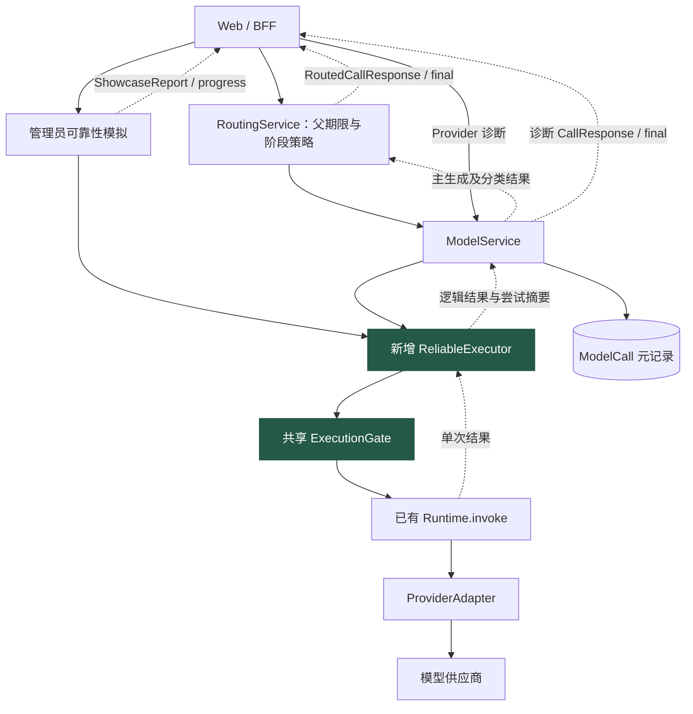
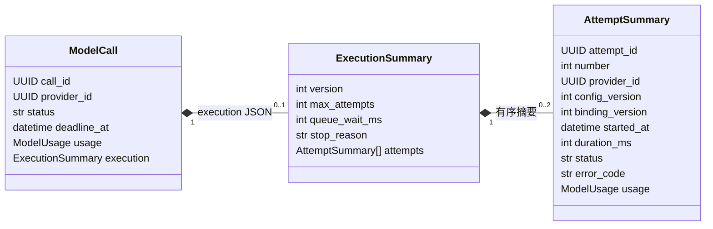
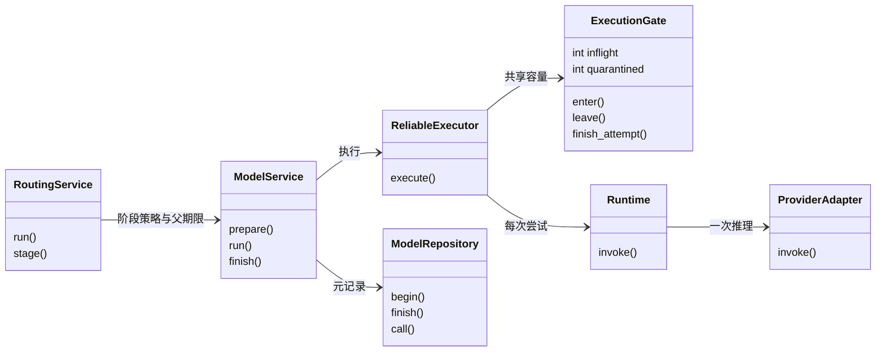
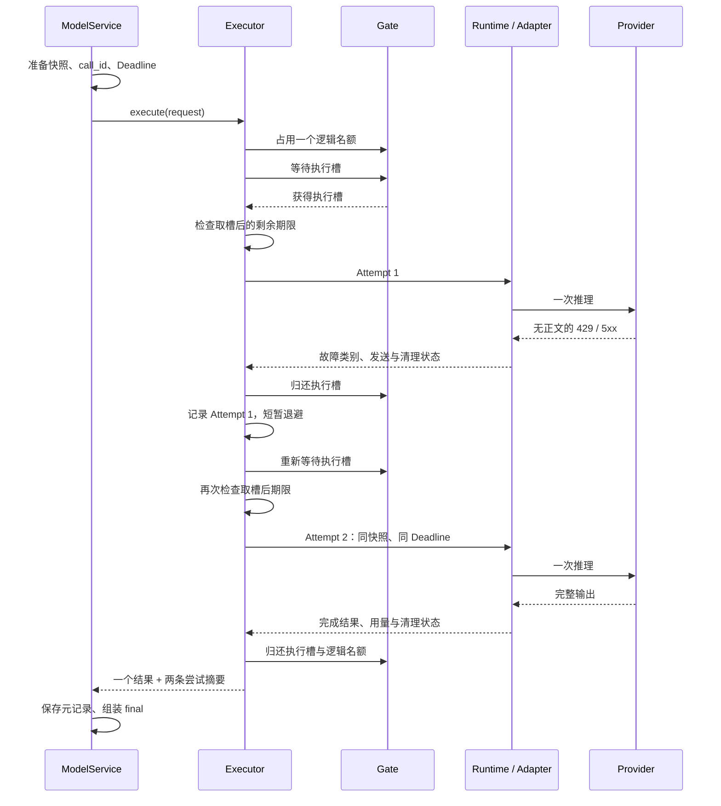
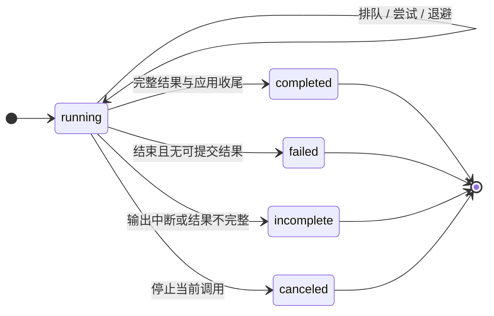
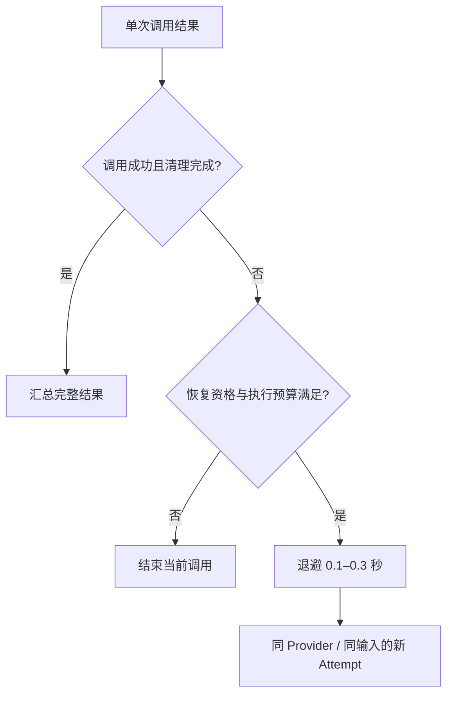
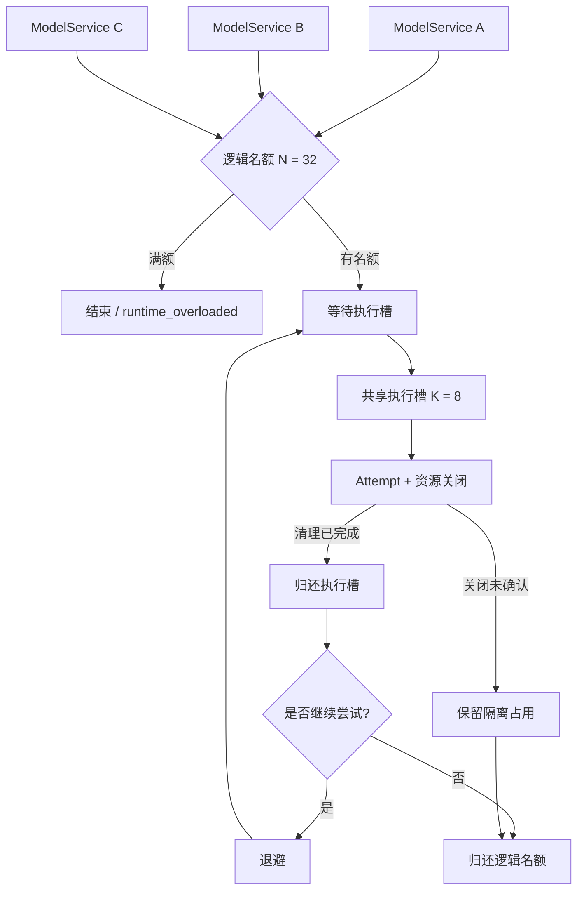
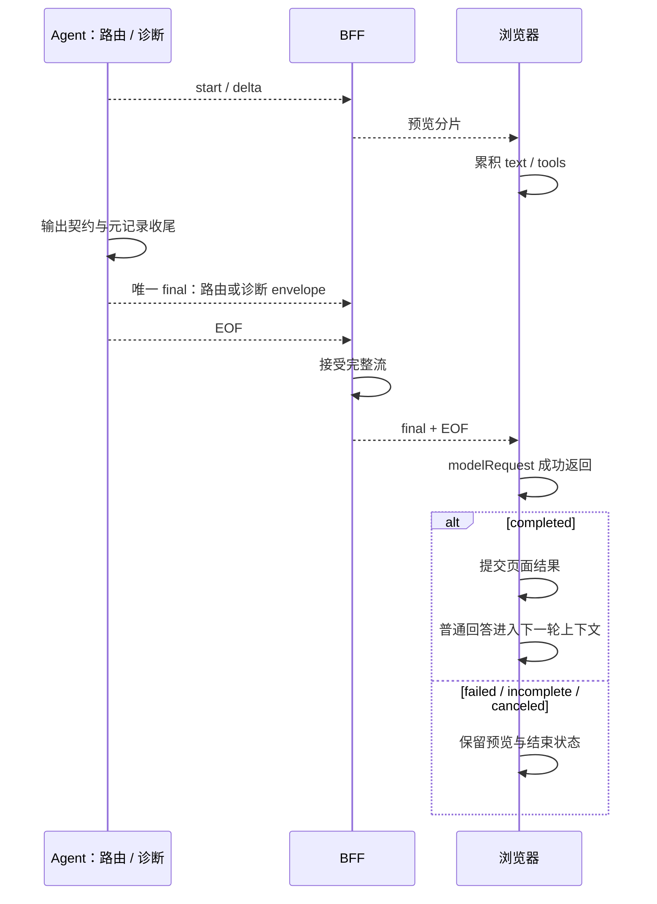

<!-- diagram:architecture -->

<!-- diagram:data -->

<!-- diagram:components -->

<!-- diagram:sequence -->

<!-- diagram:states -->

<!-- diagram:retry -->

<!-- diagram:capacity -->

<!-- diagram:stream -->

