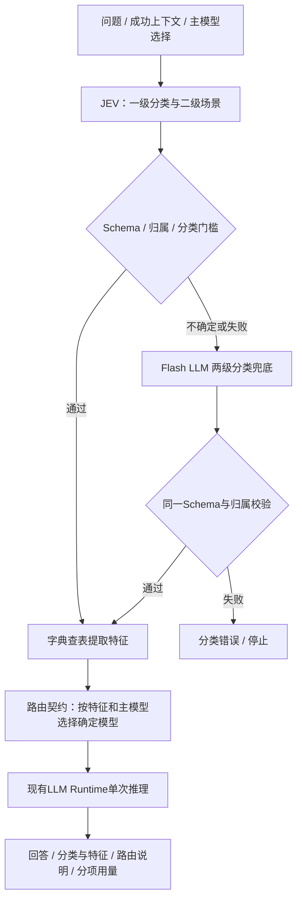

# DataAgent Compass 两级意图分流与模型路由技术方案

> Feature：992 | Profile：standard | 模板：[项目技术方案模板](../../_templates/TECH_DESIGN.tmpl.md)，按当前范围裁剪 | 需求：[PRD](../spec/PRD.md) | 代码基线：main / d08488b0及工作区 | 状态：评审修订已落实 | 更新：2026-11-05

[返回需求简报](../BRIEF.md)

## 需求依据与范围

2026-11-05 用户进一步明确本期闭环：**意图识别只输出一级分类与二级场景 → 字典提取特征 → 路由契约选模型 → 现有LLM Runtime完成推理。** JEV优先实验、Flash LLM分类兜底保留；主模型静态绑定不影响分类。闲聊/非业务场景固定通过独立prompt调用Flash婉拒并引导业务数据任务。

本期不建设完整Harness，不选择或调用Skill、subAgent、workflow，不拆分任务、不生成多步骤计划。不同分类未来可以接入任一种执行方式，当前响应不预设这些实现。

Runtime可靠性建设留到第14课。本方案复用现有Runtime，仅处理与分类和选模直接相关的请求契约、能力检查、时限传递与调用结果；移除上一版恢复执行器、重试、容灾兼容组、跨模型生成Fallback、受控降级及相关配置/存储/验收任务。JEV→Flash是意图分类兜底，由薄路由应用服务持有。

前端推理统一复用现有models/calls，意图分流在服务端内部执行；路由策略直接写入代码配置，随代码发布，不做策略持久化或管理API。

PRD是需求与AC唯一维护源；重点为FR-992-02～05、11、12、18～20和AC-992-02～08、43～55。本文给出完整的本期技术设计，模型版本、阈值与真实性能仍待实验。

## 1. 方案概述

### 1.1 架构与取舍



分类效果和端到端性能优先，再在满足目标的模型中节约成本。JEV优先实验；Flash基线和兜底提供第二条分类路径。首版按需顺序兜底，避免每轮固定执行两次分类。持续并发双判只有在后续性能实验明确需要时再考虑。

只让模型识别两级标签，减少输出约束和校验分支；任务类型、难度等业务特征交由字典确定性维护，模型选择交由可复核契约完成。代价是场景字典粒度须足以区分不同特征；同一场景内若需要不同难度，先细化场景或后续扩展契约，本期不额外调用模型推断特征。

### 1.2 复用与最小增量

现有[LLM Runtime](../../../apps/agent/src/compass_agent/llm/README.md)已有`Runtime.invoke(ExecutionRequest, emit)`、SystemOneDecisionAdapter、LiteLLMChatAdapter、能力检查与单次生命周期；现有[模型服务](../../../apps/agent/src/compass_agent/models/README.md)负责配置、凭据、授权和调用元记录。全部继续复用。

已新增应用内`apps/agent/src/compass_agent/routing/`，README及模块职责如下；当前不创建Harness目录、执行框架或新服务：

| 模块                 | 职责                                           |
| -------------------- | ---------------------------------------------- |
| `schemas.py`（既有） | 两级Intent、字典Feature、ModelRoute与响应类型  |
| `config.py`          | 分类角色、阈值、时限与模型绑定的不可变代码配置 |
| `intent.py`          | JEV/Flash两级识别、严格校验和一次兜底          |
| `dictionary.py`      | 只读字典加载、归属校验及特征查表               |
| `service.py`         | 特征到模型绑定的确定性路由契约                 |
| `service.py`         | 分类→字典→路由→单次推理的薄应用服务            |

依赖方向为HTTP入口→routing应用服务→现有models服务→llm Runtime/Adapter。`llm/`不导入routing；routing不导入Skill/subAgent/workflow。核心骨架见[代码设计](CODE_DESIGN.md)。

## 2. 分类、字典与模型契约

### 2.1 分类模型输出

```json
{ "category_id": "business_channel", "scene_id": "SC-01" }
```

模型业务输出严格两个字段，均为字典登记ID：`additionalProperties=false`，无difficulty、task_type、action、model_id、Skill/工具或子任务数组。上例为设计示意，实际ID从现有场景字典冻结。

JEV在一个DecisionInput中提交两题：一级分类choice、二级场景choice。每题候选均来自服务端目录，场景描述包括父级定义；一次响应后校验场景属于分类。采用两题同时判断，正常路径一次出站。候选数、问题数及输入窗口沿用现有协议上限；超限直接交能完整处理的Flash，不裁剪场景目录或必要上下文。

JEV协议回答中的概率/可选confidence属于分类适配元信息，归一化后Intent只保留两字段。接受条件为类型、候选、父子关系合法，以及两题最高候选概率/间隔达到对应模型/模板/字典版本的代码默认门槛；confidence自报字段不单独作为准入依据。

Flash使用同一标签定义和严格JSON Schema，输出同样两个字段。JEV与Flash共享必要问题/成功上下文，但各自使用对应协议。模型版本、题目/提示模板、字典摘要与门槛绑定记录。Flash不需要返回模型自报难度或分类理由正文。

### 2.2 字典特征

[场景工作簿](../spec/task-scenarios.xlsx)继续维护分类、场景、特征及金标；运行时使用由其派生的只读JSON，不导入问题金标。`apps/agent/scripts/export_routing_dictionary.py`导出至`routing/scenes.json`并检查摘要一致性，运行应用无需读取XLSX。导出脚本与JSON已随实现交付。

| 字典项                 | 语义                                                    |
| ---------------------- | ------------------------------------------------------- |
| category_id / scene_id | 一级归属、二级场景；scene_id全局唯一                    |
| task_type              | 如指标对比、诊断、整理、解释等场景特征                  |
| difficulty             | L1/L2/L3/undetermined，固定于本次字典版本               |
| response_mode          | answer/clarify/refuse/handoff，决定本次响应约束         |
| required_capabilities  | 真实必需的Schema/Thinking等能力；不因分类而新增工具执行 |
| output_contract_ref    | 服务端已登记的回答/结构化响应约束                       |

特征提取只执行`dictionary[category_id, scene_id]`与引用校验。未知键不临时补造字典行。字典登记“未识别/待澄清”场景用于Flash无法确定时的合法结果，随后按澄清响应契约处理；语法非法或两路调用失败返回分类错误。

一级分类、场景及特征的编辑真源保持工作簿；模型角色绑定和选模规则由类型化服务端代码配置维护。金标中的期望模型用于测试，不作为线上推理输入。现有40场景/88题保留；导出脚本只读取场景目录默认特征，完全不导出问题金标。旧宽标签保留为历史材料，本期测试按新两级契约构造受控用例。

### 2.3 路由契约与静态绑定

本期路由输入为Intent、字典Feature、用户主模型选择、服务端Provider绑定和输入/能力约束。路由输出为选定模型身份/版本、Provider引用、选模原因、输出契约和调用时限。

| 条件                       | 本次主模型选择                                     |
| -------------------------- | -------------------------------------------------- |
| 用户fixed                  | 使用用户指定的可用主模型；分类JEV/Flash独立        |
| auto且L1                   | Flash配置绑定                                      |
| auto且L2/L3                | Pro配置绑定                                        |
| auto且undetermined或需澄清 | 显式默认Flash响应绑定及字典对应的澄清/范围说明约束 |
| 绑定缺失、不可用或能力不足 | 明确拒绝，无第二个推理候选，不隐式换模型           |

固定模型仍接受能力校验。输出响应模式、格式与质量要求来自字典引用的服务端契约；模型选择不会把澄清任务改成凭空分析。复合输入命中已登记复合/待澄清场景，返回范围说明或澄清响应，本期不拆成多个执行步骤。

契约结构如`SelectedRoute(provider_id, model_identity, output_contract, required_capabilities, reason, dictionary_version, routing_version)`。不包含executor_kind、Skill、subAgent、workflow、step_plan、兼容组或恢复优先级。未来业务执行方式在后续需求设计，本期只保留稳定分类ID。

### 2.4 与Runtime的边界

分类器和本次推理都通过现有Runtime单次调用。推理请求只表达模型、完整输入、能力/输出契约和时限，不把分类枚举或字典传入Runtime策略。

本期只构造并验证一个选定推理模型。生成失败/未知结果按现有返回结束，不新增生成重试或模型替换。与后续可靠性方案的集成留到第14课，当前不预建恢复接口、通用执行协调器或候选CRUD。

## 3. 应用流程与失败处理

### 3.1 正常与分类兜底

1. 入口校验当前账号/租户/工作区、问题与上下文限制，读取字典和路由绑定快照。
2. JEV在分类子时限内执行一次；通过两级分类门槛后继续。低置信、非法、父子不一致、上下文能力不足或不可用时进入一次Flash分类兜底。
3. Flash结果按相同两字段Schema及父子关系校验；失败则结束，主模型推理零次。合法未识别场景继续按字典澄清模式处理。
4. 字典提取特征，路由契约选择模型，校验启用状态、用户选择、必需能力与输出约束。
5. 调用现有Runtime一次，返回标准响应结构和各调用消耗。

最多一次JEV+一次Flash分类+一次主模型推理，共三次出站。无SDK隐含重试。本期不存在内部步骤模型分配。

### 3.2 时限、取消与未知结果

沿用180秒父时限上限；代码分类子预算30秒，JEV最多8秒、Flash最多20秒，为主模型至少保留1秒，数值为实验起始值。每次出站使用父剩余时限和阶段时限的较小值，不重置总预算。修改仅涉及调用准备向已有CallPolicy传递子截止时间；Runtime内部单次机制保持现有语义。

取消/撤权/父时限耗尽立即停止本地流程，不再调用分类备路或主模型。JEV子调用超时或结果未知时，只有父请求仍有效、必要上下文适配且有剩余时限才允许Flash分类兜底；这是无业务副作用的异构分类路径，真实消耗保留未知。选定推理模型超时或结果未知直接结束。

主模型流式中断、Schema错误、凭据错误等复用既有错误状态与取消清理，不额外设计恢复矩阵。分类状态不当成业务正文。失败/不完整回答不进入下一轮成功上下文。

## 4. HTTP与响应结构

### 4.1 统一推理API

前端发起推理统一复用 `POST /api/web/v1/models/calls`，BFF继续调用 Agent `POST /v1/models/calls`。静态和自动选模使用相同路径，服务端依次完成分类、字典特征提取、契约选模和一次推理，JSON/SSE由原input.stream决定。前端每轮只发送一次请求。

沿用现有鉴权、Same-Origin/CSRF、no-store和生成Schema校验；Agent复用服务令牌与受信Context。DTO唯一源为`schemas.py`与`model_api.py`，通过`pnpm contracts`派生。直接修改已有ChatCallInput及该路由的处理逻辑，不新增分析、路由、分类或路由测试端点。

现有Provider配置和`/providers/{provider_id}/tests`诊断接口继续保留单次调用语义。路由规则试算通过本地纯函数/测试完成，分类实验由本地脚本调用内部应用服务；完整链通过统一推理接口验证。上述工具与现有诊断各自使用既有授权，不增加平台路由管理接口或测试页面。

```json
{
  "call_id": "UUID",
  "main_model": { "mode": "auto" },
  "input": {
    "kind": "generate",
    "messages": [{ "role": "user", "content": "比较这份渠道汇总" }],
    "stream": false
  }
}
```

fixed模式使用`main_model={mode:fixed, provider_id:UUID}`，复用现有可用模型列表。保留原顶层provider_id输入形式，将其归一化为fixed后进入相同分类链；main_model与顶层provider_id同时出现或均缺失时返回422。auto模式不携带provider_id。不提供绕过分类的浏览器开关。

保留现有call_id作为整轮请求标识，不新增request_id。请求示例省略现有消息模型空字段；BFF请求仍携带tenantId/workspaceId，由BFF授权后转为受信Context。浏览器提交问题、成功上下文和主模型选择；分类答案、字典特征、阈值与授权由服务端生成。

### 4.2 正确响应结构

```json
{
  "call_id": "UUID",
  "status": "completed",
  "error_code": null,
  "intent": { "category_id": "business_channel", "scene_id": "SC-01" },
  "features": {
    "task_type": "metric_comparison",
    "difficulty": "L1",
    "response_mode": "answer",
    "required_capabilities": []
  },
  "routing": {
    "mode": "auto",
    "provider_id": "UUID",
    "model": "Flash版本绑定",
    "reason": "difficulty_L1",
    "dictionary_version": "摘要",
    "routing_version": "版本"
  },
  "result": {
    "call_id": "UUID",
    "status": "completed",
    "text": "本次回答",
    "usage": { "input_tokens": 100, "output_tokens": 50 }
  },
  "metrics": {
    "classifier_source": "jev",
    "fallback_reason": null,
    "classification_calls": [],
    "duration_ms": 500,
    "usage_complete": true
  }
}
```

数字为结构示意。result实施时复用完整CallResponse；intent无第三个字段。features由字典生成，routing由契约生成，classifier_source、兜底原因、版本与分项用量放外层。失败发生在分类/选模时，intent或routing可空，result=null，外层status=failed与安全error_code明确阶段；推理失败保留Runtime失败结果，不包装为成功。

JSON响应和流式final使用相同结构。响应外层另含status、error_code，分别反映整条链；推理成功且响应校验通过时才为completed。每个分类调用保留call_id、实际Provider/模型、状态、用量、耗时及未知标记；推理用量在result中，metrics可给分项汇总。未知值保持null，不能充作零消耗或精确总量。

### 4.3 统一流式协议与客户端迁移

在现有models/calls及ModelEvent协议上增量加入classification_status、route_selected。整轮仍只有一个start和唯一final，业务输出继续使用text_delta/tool_delta。start只声明call_id和整轮状态；实际主模型在route_selected之后确定，不预填Provider。BFF不再对auto请求预先绑定Provider，fixed请求在选模后校验实际主模型符合用户指定接入。

分类两字段与字典特征在route_selected和final返回，分类模型原始响应不向普通Chat暴露。所有公开事件使用整轮call_id，物理分类调用ID只进入分项元信息。主模型的文本/工具分片映射到同一事件流，不向前端发送分类模型的正文或子调用start/final。

JSON及final按§4.2统一演进；同步更新BFF生成Schema、事件校验、use-model-call和响应解析器，不另保留一条旧推理HTTP路径或通过参数分出低层调用模式。既有Provider诊断保留原CallResponse及单次ModelEvent，可复用基础事件类型；在DTO中清楚区分诊断结果和整轮推理结果。

断连和资源清理复用现有模型服务生命周期，取消覆盖当前分类或推理。统一入口将最终CallResponse组装入整轮final；不新增流式恢复或持久化重放协议。

安全错误码包括intent_unavailable、intent_invalid、dictionary_unavailable、route_binding_missing和route_capability_mismatch。开始流前按现有401/403/422/409/503返回；开始后通过唯一final报告错误。主模型已输出后的失败保留incomplete，不重发。

## 5. 配置、授权与数据

### 5.1 服务端代码配置

`routing/config.py`，以不可变类型化代码配置维护分类模式jev_with_flash/flash_only、JEV/分类Flash角色绑定、auto Flash/Pro角色绑定、分类子时限、模板版本、字典摘要和代码默认门槛；确定性选模规则维护于`service.py`。本期不增加路由策略表、草稿/修订模型、策略CRUD、启停API或编辑页面。

Provider连接及凭据继续用已有模型管理能力，代码配置只引用Provider身份；部署环境中不同的Provider ID通过已有环境配置装配到明确角色，规则、门槛和默认值留在代码中。密钥继续由已有Provider存储管理，不写入代码配置。

字典在首次使用时只读加载并缓存，代码配置不可变；各物理调用通过现有模型服务准备并固定Provider配置快照。规则和门槛随代码发布生效，绑定环境值变更随受控重启生效；通过正常发布回退配置。routing_version使用代码中配置版本或规范化内容摘要，仅用于响应追踪，不建立数据库修订及在线启停流程。

分类Flash与生成Flash可引用同一Provider，保留不同配置角色和call_id。用户fixed/路由auto只决定主模型，不改变分类配置。JEV按代码默认门槛完成流程；效果校准留后续课程，Flash单路可用于流程验收；缺少当前模式必需配置时明确不可用。

### 5.2 服务端分类授权

现有租户`purpose=chat`是请求来源，原ModelRepository.begin对Chat只允许GenerateInput和chat_visible模型。为统一推理入口的内部分类调用增加仅在进程内构造的`RoutingGrant`，包含actor、scope、物理call_id、Provider与输入kind，仅用于服务端分类调用。

BFF沿用module.analysis和models.invoke授权。routing服务基于受信Context和配置派生grant，ModelRepository.begin仅在带合法内部grant的分类路径允许DecisionInput或内部Flash；这两类分类Provider须enabled，但无需成为前端可选主模型。inference继续要求原Chat准入及chat_visible。统一推理HTTP DTO没有提交grant的字段，用户输入继续使用GenerateInput。

本地受控实验和已有平台Provider诊断使用purpose=test，统一推理链全部沿用purpose=chat及当前scope约束，无需新增purpose枚举、数据库CHECK或把租户请求伪装成平台测试。分类对象不提供数据授权；统一推理入口不接入取数/工具执行，无新增数据就绪声明契约。

### 5.3 数据与记录

本期不新增数据库表、列或迁移，不创建model_policy、model_execution、兼容组和多步骤记录。各次分类和推理复用现有ModelCall，保持purpose=test/chat与单次调用状态/用量记录。整轮call_id与物理调用ID的阶段关联、分类/特征/契约快照放本次响应与页面内存；不承诺整条链跨刷新查询、自动重放或后台续跑。

分类阶段由整轮call_id加固定阶段名派生稳定UUID子调用ID；主模型推理继续使用原call_id，复用现有ModelCall唯一键拒绝同阶段重复出站；重复ID发生冲突时整条请求停止，不自动重放历史正文。BFF不自动重试整个POST。无需建设跨进程完整路由事务或恢复幂等协议，后续确有持久化查询需求再增量设计。

对话、原始JEV响应、私有推理、凭据不新增持久化。Provider版本/绑定版本及每次实际用量使用已有字段；分类元信息只在响应中返回。首次受理使用配置快照，调用前Provider停用/绑定失效按已有约束拒绝，禁止悄悄换接入。

如果实施发现单次记录确需新增持久化字段，先补充[数据库规范](../../../docs/database-migrations.md)要求的owner、revision、SQL及恢复设计再实施；当前不预先安排数据库升级。

## 6. 验证与实验

### 6.1 分层验证

| 范围       | 必测内容                                                             | PRD验收                       |
| ---------- | -------------------------------------------------------------------- | ----------------------------- |
| 分类Schema | 两字段、额外字段拒绝、候选及父子一致性、上下文对照                   | AC-992-05、07、08、28、45、51 |
| 字典       | 唯一场景、分类归属、特征完整、修改字典改变特征、无金标泄漏           | AC-992-04、44、47、50、52     |
| 路由       | L1/L2/L3/default、fixed覆盖、能力不足和绑定缺失                      | AC-992-02～06、31、48         |
| 分类兜底   | JEV低置信/错误/未知/窗口不足、Flash合法/非法、取消与三次调用上限     | AC-992-08、12、38、49         |
| 响应与兼容 | 五段结构、外层状态、实际模型与分项消耗、统一推理入口与既有诊断       | AC-992-24、27、30、34、37     |
| 推理接入   | 使用既有Runtime、失败不重发、上下文与流式回归                        | AC-992-10、11、26、28、43、53 |
| Web        | 同一接口且每轮一次请求、静态/auto、停止、详情、权限与键盘/窄屏       | AC-992-27、30～32、54         |
| 代码配置   | 规则/阈值随代码发布，角色绑定校验，每轮固定快照，无策略存储或管理API | AC-992-55                     |

本期无恢复完成率、双供应商容灾、受控降级、并发执行器、数据库升级或业务分派验收。

### 6.2 本期流程验收

本期只验证分类调用、两字段契约、字典查表、fixed/auto及闲聊Flash路由和一次推理。受控上游明确给出场景答案，验证代码调用与边界；真实供应商使用少量合成问题验证接入和兜底。准确率调优、阈值校准、正式留出集和性能收益比较均留后续课程，无本期效果准入门槛。

分类默认阈值与时限写入routing/config.py，Provider角色在settings中装配。未配置专用UUID时，现有已启用decision接入作为JEV候选，deepseek-flash/deepseek-v4-flash和deepseek-v4-pro按代码角色解析，存在多条时使用最近更新项；部署可配置明确UUID消除歧义。JEV缺失或判断失败时执行Flash分类兜底。

本期实际测试见[实施记录](../IMPLEMENTATION.md)。实现后运行Agent/Web各自lint/typecheck/test、契约生成与漂移检查、pnpm check/build，必要数据库回归及浏览器E2E；无新迁移或恢复系统验收。

## 7. 发布与风险

先复核工作簿两级字典和金标、导出只读目录，再完成JEV/Flash真实分类实验及Flash/Pro推理。统一响应结构需要Agent与BFF/Chat配套发布，暂停新推理请求后先更新Agent及派生契约，再更新BFF/Chat请求与响应解析，通过smoke后恢复；Provider与凭据复用，数据库无升级。配置与模式按实际实验结果部署，未配置时明确不可用，禁止绕过分类。

Provider配置及诊断API保留；Chat固定/自动均使用同一个models/calls，静态选择仅决定本次主模型。回退应用版本或改用已通过验收的flash_only配置均不涉及删除数据库对象；配置回退通过正常发布完成。

主要待落实项是JEV/Flash具体版本与上下文能力、分类阈值、子时限、工作簿两级字段和场景特征精度。完整Harness和Runtime第14课工作的设计及实现均不阻塞本期最小链路。上一版宽分类、多步骤/业务分派和Runtime可靠执行方案由本次收敛覆盖。

## 8. 实施任务

| 任务            | 拟变更位置                                                                                 | 完成标准                                                    |
| --------------- | ------------------------------------------------------------------------------------------ | ----------------------------------------------------------- |
| T1 字典与样例   | 现有spec/task-scenarios.xlsx；新增导出脚本和routing/data/scenes.json                       | 两级分类与特征分别维护，40场景/88题按当前范围复核，派生一致 |
| T2 分类实验     | 本地分类实验脚本及已有Provider诊断；结论纳入实施记录，私有输出留work                       | JEV两题/Flash两字段、门槛和子时限、真实基线与兜底           |
| T3 最小分类服务 | 新增routing/contracts.py、intent.py、dictionary.py                                         | 两字段Schema、归属校验、一次JEV和一次Flash，字典确定性特征  |
| T4 契约选模     | 新增routing/config.py、router.py、service.py，扩展models/service.py及repository.py受限调用 | 代码配置、fixed/auto、必需能力、内部grant及一次推理         |
| T5 API与契约    | 现有schemas.py、model_api.py的models/calls与ModelEvent，生成契约                           | 同一推理路径、五段响应及统一SSE；Provider诊断回归           |
| T6 Web接入      | 现有BFF模型处理器/客户端、analysis-composer/use-model-call及响应解析器                     | 仅一次推理请求，分类/特征/选模解释、停止及实际用量          |
| T7 验收与文档   | 相关Agent/Web测试、真实模型联调及所属README/manifest                                       | 本期AC通过，明确未验项；无Harness/恢复执行器/新增数据库前置 |

本期实现及流程验收完成，Phase为done，详见[实施记录](../IMPLEMENTATION.md)；无数据库结构变更。

## 本次最终交付边界

本期只验证意图分流流程、契约和模型接入，不做效果调优、正式留出分类评测或分类准确率准入。JEV保留两题结构与代码默认接受门槛，低置信/不合法时Flash兜底；不以校准缺失阻断接入。分类效果研究与调优留后续课程。

SC-39业务范围外（包含日常闲聊）通过字典response_mode=refuse映射到专用Flash模型与独立prompt，温和说明经营/业务数据分析范围，并询问是否有相关数据任务；即使用户选择Pro，闲聊也按该分流调用Flash，响应routing.reason明确off_topic_flash。业务场景继续遵循fixed/auto。分类模型只输出两个ID，业务特征由字典提取。

统一models/calls返回intent/features/routing/result/metrics及整轮状态；SSE在route_selected之后校验实际Provider。现有Provider诊断沿用CallResponse/ModelEvent。本期无新路由管理端点、测试页、策略持久化或数据库迁移。
