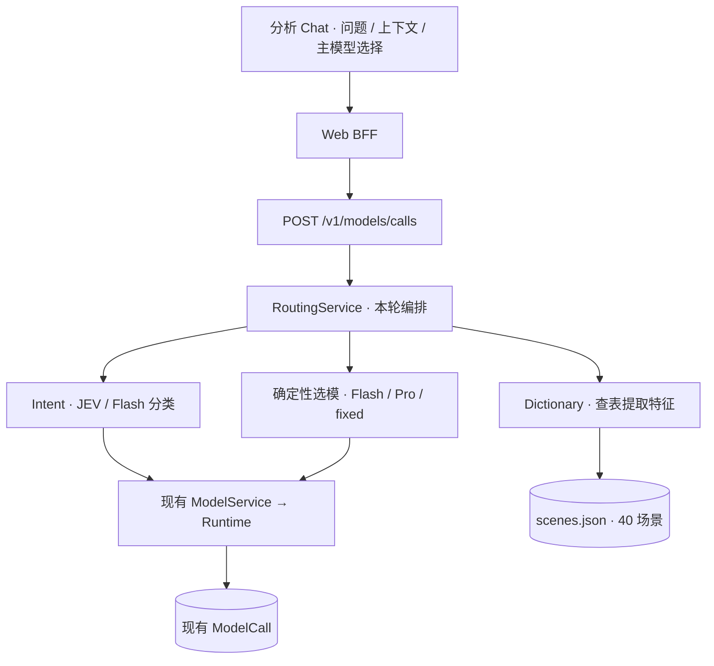
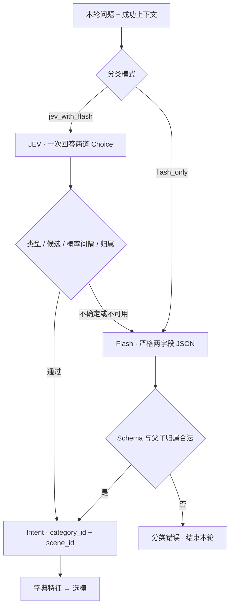
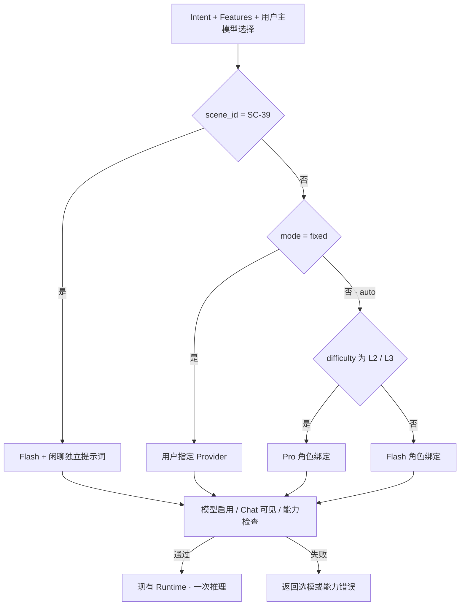
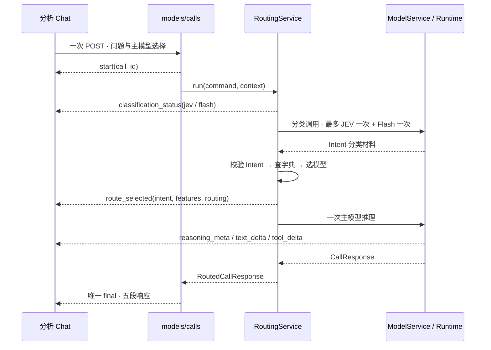

## 目标

| 核心问题                             | 实现目标                               | 量化指标（设计目标）                                 |
| ------------------------------------ | -------------------------------------- | ---------------------------------------------------- |
| 用户表达需要映射到稳定业务场景       | 分类模型只识别一级分类与二级场景       | Intent 严格 2 个字段；额外字段拒绝                   |
| 难度和响应方式需要统一口径           | 服务端按场景字典提取特征               | 40 个场景；公开特征 4 类；模型生成特征字段 0 个      |
| 分类不确定时需要继续识别             | JEV 优先，必要时交 Flash 分类          | 每轮最多 1 次 JEV + 1 次 Flash 分类 + 1 次最终推理   |
| 自动选模、用户指定与闲聊规则需要协调 | 按固定优先级确定本轮主模型             | 1 个最终模型；SC-39 优先，其次 fixed，再按难度选择   |
| 前端需要完整理解一轮调用             | 沿用统一接口，返回分类到结果的全链信息 | 每轮 1 个 HTTP 请求；5 段业务响应；最多 1 个 `final` |

## 1. 方案概述

### 1.1 四个阶段

| 阶段     | 负责模块                      | 输入 → 输出                          | 规则来源                     |
| -------- | ----------------------------- | ------------------------------------ | ---------------------------- |
| 两级分类 | `routing/intent.py`           | 问题与成功上下文 → `Intent`          | JEV / Flash + 服务端标签目录 |
| 特征提取 | `routing/dictionary.py`       | `Intent` → `RoutingFeatures`         | 只读场景字典                 |
| 模型选择 | `routing/service.py`          | 场景、特征、用户选择 → `ModelRoute`  | 代码中的优先级与角色绑定     |
| 最终推理 | 既有 `ModelService / Runtime` | 选定模型 + 完整输入 → `CallResponse` | 现有模型能力与输出契约       |

### 1.2 整体架构



| 边界       | 设计决定                                                                          |
| ---------- | --------------------------------------------------------------------------------- |
| 依赖方向   | HTTP → `routing/` → `models/` → `llm/`；Runtime 专注一次模型调用                  |
| 配置所有者 | 阈值、时限和路由规则在代码中；Provider 身份由配置装配，连接与凭据使用现有模型管理 |
| 数据所有者 | 场景工作簿派生只读 JSON；运行时加载场景目录，问题金标留在工作簿                   |
| 持久化     | 复用 `ModelCall`；新增数据库表与迁移均为 0；整轮分类、选模详情留在响应与页面内存  |

## 2. 详细设计

### 2.1 两级分类与一次兜底



| 约束         | 当前设计                                                                         |
| ------------ | -------------------------------------------------------------------------------- |
| JEV 输入     | 同一个 `DecisionInput` 包含 category、scene 两道 Choice；标签来自服务端完整目录  |
| JEV 接受条件 | 两题均选中概率最高候选；概率 ≥ 0.5、第一与第二候选间隔 ≥ 0.1；场景存在且属于分类 |
| Flash 输入   | 相同标签定义、必要上下文和 `Intent` JSON Schema；`additionalProperties=false`    |
| 合法待澄清   | 命中字典中的待澄清场景，按对应 `response_mode` 继续；未知标签视为分类错误        |
| 调用有效性   | 父请求仍有效且预算充足时才进入下一阶段；分类内容只用于路由                       |
| 默认值性质   | 概率与间隔是代码演示门槛；分类准确率目标未设定                                   |

### 2.2 两字段 Intent 与四类字典特征

```python schemas.py · 关键类型摘录
class Intent(StrictModel):
    category_id: str = Field(max_length=80)
    scene_id: str = Field(max_length=20)


class RoutingFeatures(StrictModel):
    task_type: str
    difficulty: Literal["L1", "L2", "L3", "undetermined"]
    response_mode: Literal["answer", "clarify", "refuse", "handoff"]
    required_capabilities: list[str] = Field(default_factory=list)
```

| 字典特征                | 如何影响本轮行为                                                   |
| ----------------------- | ------------------------------------------------------------------ |
| `task_type`             | 标记查数、对比、诊断等任务类别                                     |
| `difficulty`            | 在 auto 模式中决定 Flash / Pro                                     |
| `response_mode`         | 选择回答、澄清、拒绝或入口引导提示词；handoff 只生成引导说明       |
| `required_capabilities` | 在模型调用前检查必需能力                                           |
| 字典身份                | `scene_id` 全局唯一；先验证与 `category_id` 的父子关系，再提取特征 |

### 2.3 选模顺序



| 优先级 | 命中条件                 | 模型 / 提示词                                     | `reason`                       |
| ------ | ------------------------ | ------------------------------------------------- | ------------------------------ |
| 1      | SC-39 闲聊或非业务问题   | Flash；温和婉拒并引导业务数据问题；覆盖用户 fixed | `off_topic_flash`              |
| 2      | 其余场景 + fixed         | 用户模型；按字典响应模式构造提示词                | `user_fixed_main_model`        |
| 3      | auto + L2 / L3           | Pro；按字典响应模式构造提示词                     | `difficulty_L2 / L3`           |
| 4      | auto + L1 / undetermined | Flash；保留字典的澄清与范围说明约束               | `difficulty_L1 / undetermined` |

### 2.4 时间、调用身份与授权

| 范围               | 取值 / 规则                                                                                       |
| ------------------ | ------------------------------------------------------------------------------------------------- |
| 整轮请求           | 父预算 180s；所有阶段共用同一截止时间                                                             |
| 分类阶段           | 合计最多 30s；JEV 最多 8s；Flash 最多 20s；主推理至少预留 1s                                      |
| 分类调用截止时间   | 取父截止时间、分类截止时间与当前子预算截止时间的最小值                                            |
| JEV 物理调用       | `uuid5(call_id, "intent_jev")`                                                                    |
| Flash 分类物理调用 | `uuid5(call_id, "intent_flash")`                                                                  |
| 主模型物理调用     | 复用整轮 `call_id`；每次调用沿用现有元记录                                                        |
| 分类授权           | 进程内 `RoutingGrant` 绑定 actor、scope、物理 call_id、Provider 和输入 kind；分类 Provider 须启用 |
| 推理授权           | 使用原 Chat 准入和 `chat_visible`；浏览器仅提交生成输入与主模型选择                               |

### 2.5 一个接口与五段响应

```json Agent · POST /v1/models/calls · 请求结构示意
{
  "call_id": "00000000-0000-4000-8000-000000000001",
  "main_model": { "mode": "auto" },
  "input": {
    "kind": "generate",
    "messages": [{ "role": "user", "content": "比较这份渠道汇总" }],
    "stream": true
  }
}
```

| 请求字段         | 约束                                                           |
| ---------------- | -------------------------------------------------------------- |
| `main_model`     | auto 自动选模；fixed 同时提供 `provider_id`；两种模式均先分类  |
| `input.messages` | 当前问题与页面内成功上下文；失败或不完整回答不进入下一轮       |
| `input.stream`   | 同一路径选择 JSON / SSE；Web 入口为 `/api/web/v1/models/calls` |

| 响应字段                        | 数据形态与责任                                                        |
| ------------------------------- | --------------------------------------------------------------------- |
| `call_id / status / error_code` | 整轮标识与终态；JSON 响应和 SSE final 使用相同结构                    |
| `intent`                        | `category_id / scene_id` 两字段                                       |
| `features`                      | 字典提供 task_type、difficulty、response_mode、required_capabilities  |
| `routing`                       | mode、实际 Provider / model、reason、字典与路由版本                   |
| `result`                        | 完整 `CallResponse`；分类或选模阶段结束时为 `null`                    |
| `metrics`                       | 分类来源、兜底原因、各分类调用用量与耗时、总耗时；未知用量保持 `null` |



| 事件规则   | 约定                                                                 |
| ---------- | -------------------------------------------------------------------- |
| `start`    | 只声明整轮 `call_id`；实际模型在 `route_selected` 中确定             |
| 分类事件   | 公开阶段状态；分类模型输出保留在服务端，分类子调用 ID 放入分项元信息 |
| 主模型事件 | 公开事件统一使用整轮 `call_id`；正文与工具分片沿用现有协议           |
| 终态       | 推理失败或不完整时保留 Runtime 状态；本轮结束后不追加生成调用        |

## 3. 变更文件与内容

```text Agent · 相对 Compass 根目录
apps/agent/
├── scripts/export_routing_dictionary.py [新增] 场景工作簿 → 只读 JSON
└── src/compass_agent/
    ├── routing/
    │   ├── config.py          [新增] 分类门槛、阶段预算与策略版本
    │   ├── intent.py          [新增] 两题分类、Flash Schema 与结果校验
    │   ├── dictionary.py      [新增] 目录加载、归属校验与特征提取
    │   ├── scenes.json        [生成] 40 场景目录与默认特征
    │   ├── service.py         [新增] 分类 → 查表 → 选模 → 单次推理
    │   └── prompts.py         [新增] 业务响应模式与闲聊独立提示词
    ├── schemas.py             [调整] Intent / Features / Route / 整轮响应
    ├── model_api.py           [调整] models/calls 接入 JSON 与 SSE 路由链
    ├── settings.py            [调整] 分类模式与 Provider 角色绑定
    └── models/
        ├── __init__.py        [调整] 进程内 RoutingGrant
        ├── service.py         [调整] 子 deadline 与分类 grant 传递
        └── repository.py      [调整] 分类授权与已有调用占位
```

```text Web 与公共契约 · 相对 Compass 根目录
apps/web/src/
├── components/analysis-composer.tsx [调整] auto / fixed 选择与结果详情
├── features/models/
│   ├── use-model-call.ts      [调整] 分类、选模、推理状态与成功上下文
│   ├── protocol.ts            [调整] 事件顺序与五段响应解析
│   └── types.ts               [调整] 整轮调用的前端状态
├── server/
│   ├── model-agent-client.ts  [调整] 统一推理契约与事件校验
│   └── http/model-handler.ts  [调整] BFF 请求与响应映射
└── generated/                 [生成] Agent DTO 派生类型与 Schema
contracts/                     [生成] OpenAPI 与 JSON Schema
```

## 4. 核心代码

### 4.1 JEV 结果归一化

```python routing/intent.py · from_jev 摘录
def from_jev(response):
    if response.status != "completed" or not response.answers:
        return None
    if set(response.answers) != {"category", "scene"}:
        return None
    chosen = {}
    for key, answer in response.answers.items():
        probs = answer.probabilities
        if answer.type != "choice" or not probs or answer.choice not in probs:
            return None
        ranked = sorted(probs, key=lambda label: probs[label], reverse=True)
        probability = probs[ranked[0]]
        margin = probability - probs[ranked[1]] if len(ranked) > 1 else probability
        if (
            answer.choice != ranked[0]
            or probability < POLICY.intent_probability
            or margin < POLICY.intent_margin
        ):
            return None
        chosen[key] = answer.choice
    try:
        return validate_intent({"category_id": chosen["category"], "scene_id": chosen["scene"]})
    except (ModelError, ValidationError):
        return None
```

### 4.2 归属校验与特征查表

```python routing/dictionary.py · 两个纯查表函数摘录
def validate_intent(value):
    intent = Intent.model_validate(value)
    scene = catalog()[1].get(intent.scene_id)
    if scene is None or scene["category_id"] != intent.category_id:
        raise ModelError("intent_invalid", 503)
    return intent


def features_for(intent):
    row = catalog()[1][intent.scene_id]
    return RoutingFeatures(**{key: row[key] for key in RoutingFeatures.model_fields})
```

### 4.3 确定性选模

```python routing/service.py · 选模分支摘录
selection = command.selection()
off_topic = intent.scene_id == "SC-39"
if off_topic:
    provider_id, _ = await self.provider("flash")
    reason = "off_topic_flash"
elif selection.mode == "fixed":
    provider_id, reason = selection.provider_id, "user_fixed_main_model"
else:
    role = "pro" if features.difficulty in {"L2", "L3"} else "flash"
    provider_id, _ = await self.provider(role)
    reason = "difficulty_" + features.difficulty
```

### 4.4 不可变策略配置

```python routing/config.py · 默认策略摘录
@dataclass(frozen=True)
class RoutingPolicy:
    version: str = "lesson12-flow-1"
    intent_probability: float = 0.5
    intent_margin: float = 0.1
    classification_seconds: float = 30
    jev_seconds: float = 8
    flash_seconds: float = 20
    parent_seconds: float = 180
```
