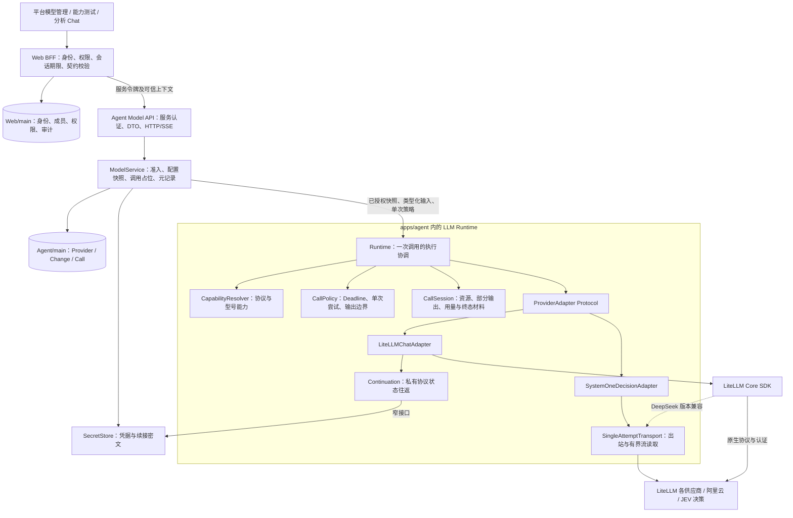
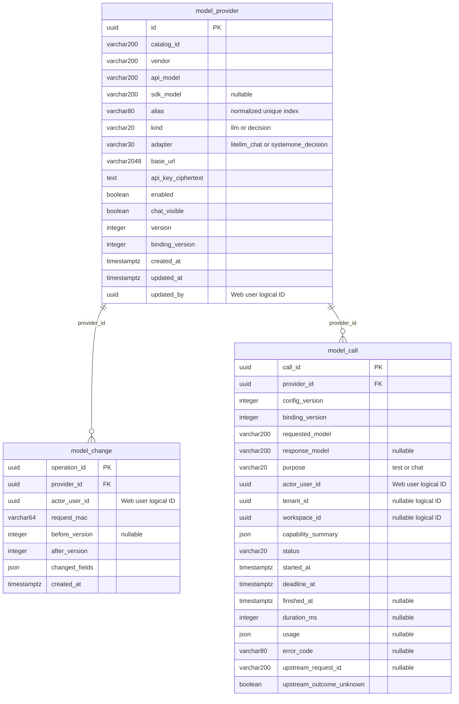
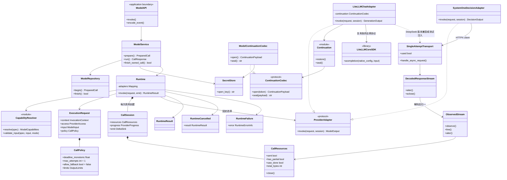
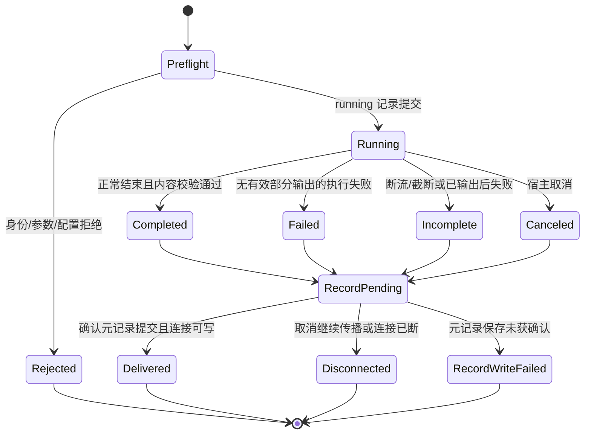
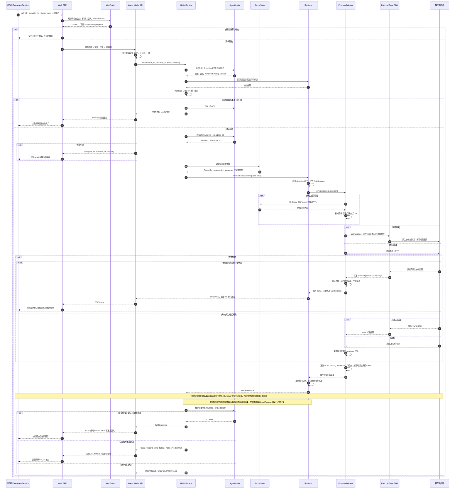

# Compass LLM Runtime 技术方案 V2

> Feature：993｜Profile：standard｜日期：2026-11-04｜状态：V2 已实施，本地验收通过
>
> 有效需求来源：[PRD](../spec/PRD.md)、本轮用户指定的五项完整设计要求｜模板：[标准技术方案模板](../../_templates/TECH_DESIGN.tmpl.md)
>
> 代码基线：main@0972e295 加本机当前工作区；Feature 实现包含未提交文件，commit 单独不能定位全部实现。
>
> [返回 BRIEF](../BRIEF.md) · [已实现方案](TECH_DESIGN.md) · [融合意见](../review/design_review.md#2026-11-04-v2-与当前实现的架构比较) · [数据库规范](../../../docs/database-migrations.md)

本文按用户要求单独生成 V2。`TECH_DESIGN.md` 与 `CODE_DESIGN.md` 保留已实现基线；本文独立描述目标分工、完整契约及增量实施任务。V2 已完成本地实施与单元、集成、端到端验收；阿里云真实调用按既定安排后测，Feature Phase 保持 draft。最新结果见[实施记录](../IMPLEMENTATION.md#2026-11-04-v2-实施与验收)。公共 HTTP 契约与 SQL 的编辑真源继续位于应用源码；本文中的现有定义用于集中阅读和设计核对。

## 2026-11-04 LiteLLM 协议复用增量设计（当前有效）

依据 PRD AC-993-34～36 和用户本轮连续实施授权，取消生成模型供应商与型号白名单。该节更新此前两款 DeepSeek 的产品限制；原实现和历史验收保留为基线。

1. `llm/catalog.py` 调用 SDK `get_llm_provider` 解析目录标识，保存规范供应商与模型名；绑定不依赖清单成员资格，手工 `provider/model` 同样由 SDK 解析。`chat_supported` 只检查生成类型及 LiteLLM adapter。
2. `llm/capabilities.py` 复用 SDK 的参数/模型能力元数据。两款已联调 DeepSeek 的补充能力描述保留；未知能力继续允许管理端诊断，不阻断基本 Chat。
3. `LiteLLMChatAdapter` 只调用一次 `litellm.acompletion`，传入原生 SDK 标识和供应商连接参数，由 SDK 完成供应商认证、载荷转换、响应与流式归一。SDK 原生协议使用归一后的 finish/usage/model；原有 DeepSeek HTTP 守卫仅处理已知 OpenAI 兼容分支，不套用到 Anthropic/Gemini/云供应商。SDK 的认证交互和协议所需 HTTP 由 SDK 管理，单次执行约束指一次 SDK 推理调用，重试设为 0。原生非流式 HTTP 缓冲由 SDK 管理，应用检查归一后的结果与续接大小；Runtime 保留绝对期限、取消、显示输出上限与元记录；SDK 自有连接池由 SDK 管理，Runtime 关闭自己持有的流和客户端。
4. `ProviderAccess` 增加请求私有的 `connection_params`；密钥与参数保存在已有 Fernet `provider_key` envelope，旧 `{provider_id,key}` 可读，新 envelope 增加 `connection_params`。编辑使用旧 envelope 合并未提交项，新配置保存空 key 也有有效密文。参数值和 key 均不返回；ProviderView 只提供 `has_connection_params`。绑定版本在密钥/参数变化时递增。
5. 基础 SDK 参数固定后合并经校验的供应商连接参数。阻止覆盖 `model/messages/tools/stream/client/callbacks/retries/timeout/api_base` 等执行字段；端点扩展字段（如 `azure_endpoint`、`api_endpoint`）使用同一端点校验，内联供应商凭据加密保存。Base URL 留空时使用 SDK 默认；自定义路径按合法 HTTPS URL 校验，取消 OpenAI 路径枚举。
6. UI 增加手工 SDK 标识与连接参数输入；目录展示当前生成能力范围、供应商原生协议、Chat 控制语义。契约仍由 Agent DTO 生成，BFF 转发受管字段并校验响应。

关键实现不变量：

```python
# 设计示意；实际契约见应用源码。
model, vendor, _, _ = litellm.get_llm_provider(model=sdk_identifier)
sdk_model = f"{vendor}/{model}"
chat_allowed = kind == "llm" and adapter == "litellm_chat"
# SDK 连接参数不得覆盖由 Runtime 固定的执行参数。
params = {**validated_connection_params, **runtime_invocation_params}
response = await litellm.acompletion(**params)
```

数据库 owner 为 Agent/main，继续使用 0002 和原有表/列，Web/main 继续 0003；没有 DDL、历史 SQL 或迁移版本变化。旧密文读取兼容；包含新参数的配置恢复旧应用前，应使用原版本配置备份，原加密密钥保持不变。新参数不增加 Web 持久化副本。

依赖：保留 LiteLLM Core 1.106.6，补齐 boto3、google-auth、azure-identity，以及该版本 Responses 桥接导入所需的 mcp 2.x；不启用代理服务或 MCP 业务工具执行。

实施顺序：规格与设计同步 → SDK 绑定/能力/认证配置 → 原生协议调用与 UI → 契约生成 → Agent/Web 单元、PostgreSQL 集成、原生协议与浏览器回归 → 本机服务及 smoke。当前验证结果统一登记 IMPLEMENTATION；本节设计完成时尚未表示回归通过。

## 2026-11-04 System One 增量设计（当前有效）

对应 PRD AC-993-37～39。本节更新下文历史基线中的 `aliyun_decision`、阿里云专用适配及 Agent 0002 版本描述。

1. 将 `llm/aliyun_decision.py` 重命名为 `llm/systemone_decision.py`，实现 `SystemOneDecisionAdapter`，注册键为 `systemone_decision`。保持统一 ProviderAdapter、单次出站、期限、输出边界、取消与元记录生命周期。生成模型仍由 LiteLLM Core 处理。
2. `catalog.binding()` 对 `aliyun/`、`typesafe/`、`systemone/` 显式协议命名空间绑定到 decision + systemone_decision；API 型号原样保存与传输，不查型号白名单。目录提供两家预设，决策目录来源标为 `systemone`；预设支持与真实账号联调状态分别表达。
3. 请求为 `POST {api_base}/systemone`，Bearer 使用服务端解密后的 API Key。Base URL 必填，复用合法 HTTPS origin 允许列表校验，取消阿里云路径限定；末尾斜杠统一移除。配置不得填写完整 `/systemone` 操作地址。决策配置拒绝非空 LiteLLM 连接参数，避免保存未生效参数；编辑时继续保留旧密钥。
4. `DecisionQuestion` 的 instructions 和 criteria 描述支持 str/dict/list；保持三种题型和现有 16 题/输入字节边界。响应按题型、ID、概率和 Score legend 校验，读取 input_tokens/output_tokens，缺失为 None。顶层未知字段忽略；当前不开放 assets/Box/实验 headers。
5. Web 表单根据已选目录 kind 或手工协议命名空间判断决策类型，显示适用端点/密钥提示，隐藏生成模型连接参数，禁用 Chat；服务端继续执行权威校验。BFF 无业务数据副本，DTO 修改后重新生成 OpenAPI/Schema/TS。

关键逻辑示意（实际实现与验证见源码及 IMPLEMENTATION）：

```python
prefix = catalog_id.partition("/")[0]
if prefix in {"aliyun", "typesafe", "systemone"}:
    return prefix, "decision", "systemone_decision", None
# 生成模型继续 SDK 原生解析。
expected = "systemone_decision" if spec.kind == "decision" else "litellm_chat"
# decision 不对 api_model 做名称枚举；sdk_model 必须为空。
url = spec.api_base + "/systemone"
usage = ModelUsage(input_tokens=wire_usage.get("input_tokens"),
                   output_tokens=wire_usage.get("output_tokens"))
```

### 数据库交付与恢复

Owner 为 `agent/main`，0002 → 0003；Web/main 仍为 0003_model_invocation_permission。追加 [0003_systemone_decision.py](../../../apps/agent/migrations/versions/0003_systemone_decision.py)，不改写 0001/0002。迁移在事务内移除旧 adapter CHECK，将旧 `aliyun_decision` 行改为 `systemone_decision`，建立新 CHECK。该重命名不改变上游绑定与行为，因此不递增业务配置版本；ID、凭据密文、URL、配置、审计和调用历史原样保留。

完整及增量 SQL 从 Alembic 派生，入口 `pnpm db:sql -F agent` / `pnpm db:sql:check -F agent`；交付 bootstrap（empty → 0003）、0001 → 0003、0002 → 0003，并保留 0001 → 0002 历史区间。迁移工具对 0002 和 0003 分别核验 adapter CHECK。发布顺序：备份现有 Agent 库和原加密密钥 → 停止 Agent 模型写入 → `pnpm db:migrate -F agent` → 启动新版 Agent/Web → smoke/旧 Provider 回归。API 启动不隐式迁移。

恢复沿用数据库 README 的新库备份恢复方案；恢复旧应用时使用迁移前备份和原加密密钥，保留升级库。0003 不执行破坏性 downgrade。集成验证覆盖旧阿里云行/密钥/调用保留、升级后真实适配调用、两种安装一致性、运行角色权限与备份恢复。

实施任务：PRD/设计 → 通用绑定/校验/DTO → Adapter/目录/UI → 迁移和 SQL → 契约 → 单元/两应用检查/PG/浏览器回归 → 本地启动。

## 2026-11-05 测试示例与原始响应增量

对应 PRD AC-993-40。`decision-examples.ts` 维护四个 System One 页面示例（不提供预造模型答案），Playground 初始化首项，显式加载其余项并清理旧结果；编辑后的替换沿当前页面脏状态确认。示例只在 Web 表单驻留，供应商调用继续走现有协议。

`DecisionOutput.raw_response: dict | None`（repr=False）保存有界读取后的 System One 原始 JSON；先保存响应，再校验 answers，便于失败诊断。ModelService 映射到公开 `CallResponse.raw_response`，不写入 ModelCall。决策仍仅平台测试入口开放。生成调用保持 None，原始响应页标明展示测试接口 JSON，流式为汇总结果；沿既有清理机制释放。DTO 修改后重新生成契约及 Web 类型，流式前端装配补空 raw_response。该增量没有数据库结构或迁移变化。

## 需求依据与验收

业务范围沿用 PRD：平台管理模型接入，租户按权限使用平台开放的 LiteLLM 生成模型，管理员测试生成与决策模型，提供流式/非流式、工具声明及手工续接、Thinking 和结构化结果。上传解析、联网检索、Agent Loop、SQL 执行、Memory、持久任务仍由后续需求承接。

本轮在已实现方案上吸收 V2 参考材料的统一入口、策略与执行分离、协议适配和事件归一原则。本文登记完整设计；实施结果、内部接口补充和真实调用验收统一记录在实施记录中。

| 需求/约束                                                 | V2 落点                                                         | 后续实施验收                                                   |
| --------------------------------------------------------- | --------------------------------------------------------------- | -------------------------------------------------------------- |
| AC-993-01～09、19、21、25、27～30：管理、权限、配置及迁移 | Agent 数据库唯一可编辑来源，Web 权限，ModelService 快照与元记录 | 原管理、权限、并发与数据库用例保持通过                         |
| AC-993-10～18、20、26：模型调用及异常处理                 | Runtime 统一生命周期，生成/决策契约，两个 Adapter               | 两种入口行为等价；每次执行调用一次 SDK，关闭重试；取消与流式故障回归 |
| AC-993-22～24、31～33：Chat、决策边界、输入框             | 现有 HTTP、页面状态与主模型选择保持                             | 现有浏览器旅程通过；决策模型仍仅在管理端调用                   |
| 用户要求：数据库 ER 图                                    | §2.1.1                                                          | 与 Agent 当前三张表和跨库逻辑引用一致                          |
| 用户要求：完整 Runtime UML                                | §2.1.2 的组件类图、契约类图及状态机                             | 所有核心依赖与 §2.4 类型、§2.3 目录对应                        |
| 用户要求：完整推理时序                                    | §2.1.3                                                          | 鉴权、快照、出站、流、持久化、取消和错误均有唯一责任方         |
| 用户要求：完整类型定义                                    | §2.4                                                            | 公开模型、内部值对象、结果、错误、续接和 Protocol 完整可读     |
| 用户要求：目录组织规范                                    | §2.3.7                                                          | 明确现有、新增、修改、生成目录和依赖方向                       |

## 1. 方案概述

### 1.1 设计目标和设计原则

目标是为 Compass 提供可被 Chat、模型测试以及后续 Agent Loop 使用的同一个模型执行入口。平台管理、权限和持久化继续由宿主应用承担；Runtime 完整管理一次模型执行的期限、取消、资源和结果。

| 分类     | 本轮 V2 的设计决定                                                                                                             |
| -------- | ------------------------------------------------------------------------------------------------------------------------------ |
| 保留     | Agent 内运行、LiteLLM Core、System One 通用适配、三张表、可信 BFF、配置快照、单次出站、加密续接及现有公开事件                       |
| 调整     | 将执行超时、取消、连接清理及运行错误归一从 ModelService 收拢到 Runtime；Adapter 采用共同 Protocol；凭据解密留在应用层          |
| 补充     | 明确内部请求/结果类型、单次执行策略、输入能力解析和取消结果传递方式；完善完整类图与文件边界                                    |
| 后续触发 | 多模型选择需求出现后引入 ModelIntent；受控重试需求出现后引入 Attempt；观测需求出现后接入 OTel；第二个 app 实际消费后提取共享包 |

本期继续固定 `max_attempts=1`、`allow_fallback=false`。Runtime 无任务/会话持久状态；不增加 Router、Proxy、Redis、队列、Attempt 表、成本账本或全局配额。执行入口使用现有名称 `Runtime`，它承担参考方案中 LLMClient 的职责，不同时建立另一层 LLMClient/CallExecutor。

### 1.2 整体架构



管理路径不进入 Runtime。调用路径必须经过 ModelService 准入与占位，再进入 Runtime。后续同进程 Agent Loop 通过相同应用服务获取配置和登记调用；执行内核本身不查询 Web/Agent 数据库。

### 1.3 关键决策与 Review 索引

| 决策              | 推荐及理由                                                                | 代价与备选                                   | 待判断事项/确认状态          | 详情           |
| ----------------- | ------------------------------------------------------------------------- | -------------------------------------------- | ---------------------------- | -------------- |
| D1 宿主           | 继续嵌入 apps/agent，复用已有请求链路                                     | Worker 独立复用需 owner API 和共享包边界     | 保留现状                     | §1.2、§2.3.7   |
| D2 配置           | Agent PostgreSQL 为接入配置真源；每次调用固定快照                         | 每次一次短事务；当前无需 YAML 同步和缓存失效 | 保留现状                     | §2.1.1         |
| D3 生命周期       | Runtime 统一 deadline、取消、资源关闭和执行结果                           | 需要移动已有逻辑，保留原行为回归             | V2 已落地                    | §2.3.3、§2.4.4 |
| D4 公共契约       | 保留 schemas.py；内部结果与 HTTP envelope 分开                            | 少量映射；共享字段继续引用原类型             | V2 已落地，HTTP 无破坏性变化 | §2.4           |
| D5 Adapter        | 固定两个实现使用同一 Protocol                                             | 一张固定映射表，无动态插件加载               | V2 已落地                    | §2.3.4         |
| D6 重试与模型选择 | 用户指定 Provider；一次尝试，无自动换模                                   | 临时故障由用户显式重发；后续可增加显式策略   | 保留当前需求                 | §2.3.3         |
| D7 生成与决策     | 使用判别联合，保留两种载荷语义                                            | Adapter 各自验证实际协议                     | 保留现状                     | §2.4.1～2.4.3  |
| D8 流终态         | Adapter 归一 delta；Runtime 决定执行状态；ModelService 落库；API 发 final | 区分执行结果与交付结果，维护两个完成阶段     | 保留行为并明确责任           | §2.1.3         |
| D9 私有状态       | 仅适配器处理原始 Thinking；短期加密 token 续接                            | 续接受身份、版本、TTL、大小约束              | 保留现状，缩小依赖接口       | §2.3.5         |
| D10 观测          | 当前用量与耗时进入调用元记录                                              | 暂无完整 Trace/成本估算；未来按独立要求建设  | 保留当前范围                 | §2.3.6         |

## 2. 详细设计方案

### 2.1 核心结构设计

#### 2.1.1 数据结构设计

**数据库 ER 图。** 以下展示 LLM Runtime 功能完整持久化模型。三张表均属于 `agent/main`，字段来自当前 ORM 与 `0002` 迁移。Agent 的 demo 表与本功能无关联；Web 的用户、租户和空间只作为逻辑 ID 引用，不在本图建立跨库外键。



数据库类型中的 varchar 后缀表示最大长度。`model_change` 实际没有 action 字段；`model_call` 当前列名为 error_code。V2 按真实表结构表达，不增加这两个旧文字稿中的异名字段。

| 对象     | 约束及访问路径                                                                                                                            |
| -------- | ----------------------------------------------------------------------------------------------------------------------------------------- |
| Provider | alias 使用 `lower(trim(alias))` 唯一索引；version > 0，0 < binding_version ≤ version；decision 的 chat_visible 必须为 false；无硬删除接口 |
| 配置版本 | 每次有效保存增加 version；模型、目录绑定、端点或密钥变化更新 binding_version；仅改别称和开关不使旧工具绑定版本失效                        |
| Change   | operation_id 唯一；保存与变更记录同事务；request_mac 为服务端 HMAC；只记录字段名和版本，不记录值或密钥                                    |
| Call     | call_id 唯一；purpose=test 时 tenant/workspace 均为空，purpose=chat 时两者非空；状态集合为 running/completed/failed/canceled/incomplete   |
| 关系     | provider_id 使用同库外键；Web 身份 ID 无跨库 FK；历史配置版本号不引用另一张版本快照表                                                     |
| 索引     | Change(provider_id, created_at)；Call(provider_id, purpose, started_at)；Call(tenant_id, actor_user_id, started_at)；保留当前索引定义     |
| 内容边界 | 不存 Prompt、回复、工具参数、决策 state/questions、原始推理、续接 token；usage 未知字段保持 null                                          |

保存遵循 operation_id 幂等与 expected_version 乐观锁。重复 operation_id 核对 actor 和 HMAC；相同请求返回原写入结果，不覆盖后续修改。别称冲突、旧版本更新明确拒绝。

调用准入在短事务内对 Provider 加共享行锁，校验状态、用途、模型绑定、端点、能力及输入，插入 running 后提交。并发重复 call_id 只有首次插入者出站，其他请求返回 409。配置更新与快照读取按行锁排序，调用期间释放数据库事务；在途调用保持已取得的版本。

| owner / database-key | V2 起点 → 终点                            | 迁移与 SQL 真源                                                                                                                                              | V2 数据处理                                   |
| -------------------- | ----------------------------------------- | ------------------------------------------------------------------------------------------------------------------------------------------------------------ | --------------------------------------------- |
| agent/main           | 0002 → 0002                               | `apps/agent/migrations/versions/`；`apps/agent/db/main/sql/bootstrap.sql`、`upgrades/0001__0002.sql`、`manifest.json`                                        | 无 DDL、回填或新表；旧配置、记录和密文保持    |
| web/main             | 0003_model_invocation_permission → 同版本 | `apps/web/db/main/migrations/`；`apps/web/db/main/sql/bootstrap.sql`、`upgrades/0002_readable_routes__0003_model_invocation_permission.sql`、`manifest.json` | 无权限迁移；保留显式授予 models.invoke 的规则 |

空库安装和旧库升级继续使用现有受管 db:provision、db:migrate、db:sql、db:sql:check、db:apply-sql 命令。V2 不创建空迁移，不改写 0001/0002/0003 历史。数据库规范详见本文开头链接；若实施中发现必须改表，先修订本登记再实施。

#### 2.1.2 LLM Runtime 完整 UML

以下三张 UML 分别覆盖模块/对象协作、完整契约关系和执行状态。`<<module>>` 表示函数模块，无需实现同名 Service；`<<protocol>>` 是静态接口约束。管理 CRUD、数据库仓储和 HTTP 作为 Runtime 外围依赖显示。未来的 Router、Attempt、OTel 不进入当前类图。

**模块与执行对象类图。**



**契约类图。** 原始 Thinking 只在 Adapter 的局部状态和加密续接载荷中存在；RuntimeResult 与公开事件不携带原文。

```mermaid
classDiagram
    class PreparedCall {
      +spec ModelSpec
      +ciphertext str
      +context InvocationContext
      +policy CallPolicy
    }
    class ModelSpec {
      +provider_id UUID
      +config_version int
      +binding_version int
      +kind ModelKind
      +adapter AdapterKind
      +vendor str
      +api_model str
      +sdk_model str
      +api_base str
    }
    class ProviderAccess {
      +spec ModelSpec
      +api_key SecretStr
    }
    class InvocationContext {
      +call_id UUID
      +capability_mode CapabilityMode
      +continuation_binding ContinuationBinding
    }
    class ContinuationBinding {
      +actor UUID
      +scope PlatformScope_or_TenantScope
      +provider UUID
      +binding_version int
    }
    class ModelInput {
      <<union>>
      GenerateInput_or_DecisionInput
    }
    class GenerateInput {
      +messages ChatMessage[]
      +tools ToolDefinition[]
      +thinking bool
      +stream bool
      +output_format str
      +continuation_token str
    }
    class DecisionInput {
      +state JSON_or_string
      +questions Map
      +stream false
    }
    class ChatMessage
    class ToolDefinition
    class ToolFunction
    class ToolCall
    class ToolCallFunction
    class DecisionQuestion
    class DecisionAnswer
    class ModelCapabilities
    class Capability
    class ProviderProgress {
      +output ModelOutput
      +usage ModelUsage
      +finish_reason str
    }
    class ModelOutput {
      <<union>>
      GenerationOutput_or_DecisionOutput
    }
    class GenerationOutput {
      +text str
      +tool_calls ToolCall[]
      +continuation_token str
    }
    class DecisionOutput {
      +answers Map
    }
    class RuntimeResult {
      +status TerminalStatus
      +output ModelOutput
      +usage ModelUsage
      +validation OutputValidation
      +error RuntimeErrorInfo
      +upstream_outcome_unknown bool
      +upstream_sent bool
    }
    class ModelUsage
    class OutputValidation
    class RuntimeErrorInfo
    class ContinuationPayload
    class RuntimeDelta {
      <<union>>
      TextDeltaEvent_or_ToolDeltaEvent_or_ReasoningMetaEvent
    }
    class TextDeltaEvent
    class ToolDeltaEvent
    class ReasoningMetaEvent
    class StartEvent
    class FinalEvent
    class CallOutcome
    class CallResponse
    class ModelEvent {
      <<public union>>
      Start_or_Delta_or_Final
    }
    PreparedCall --> ModelSpec
    PreparedCall --> InvocationContext
    ProviderAccess --> ModelSpec
    InvocationContext --> ContinuationBinding
    ContinuationPayload --> ContinuationBinding
    ModelInput --> GenerateInput
    ModelInput --> DecisionInput
    GenerateInput --> ChatMessage
    GenerateInput --> ToolDefinition
    ToolDefinition --> ToolFunction
    ChatMessage --> ToolCall
    ToolCall --> ToolCallFunction
    DecisionInput --> DecisionQuestion
    ModelCapabilities --> Capability
    ProviderProgress --> ModelOutput
    ModelOutput --> GenerationOutput
    ModelOutput --> DecisionOutput
    GenerationOutput --> ToolCall
    DecisionOutput --> DecisionAnswer
    RuntimeResult --> ModelOutput
    RuntimeResult --> ModelUsage
    RuntimeResult --> OutputValidation
    RuntimeResult --> RuntimeErrorInfo
    RuntimeDelta --> TextDeltaEvent
    RuntimeDelta --> ToolDeltaEvent
    RuntimeDelta --> ReasoningMetaEvent
    CallOutcome <|-- CallResponse
    CallOutcome <|-- FinalEvent
    ModelEvent --> StartEvent
    ModelEvent --> RuntimeDelta
    ModelEvent --> FinalEvent
```



图中省略的字段逐一列在 §2.4，图内所有具体类型均有定义或现有源文件归属。ModelInput/ModelOutput/RuntimeDelta 为类型别名，无额外运行时包装。

**状态机。**



Preflight、RecordPending、Delivered 为进程内阶段，不是新增数据库状态。持久终态只允许 `WHERE status='running'` 条件更新一次。若进程退出留下 running，超过 deadline_at 后查询派生 incomplete/结果未知；无后台重发。记录失败时公开结果为 failed/record_write_failed；底层库可能保留 running，提交确认丢失时也可能已是终态，调用者通过原 call_id 核对，禁止重发模型请求来补写记录。

#### 2.1.3 数据流设计：完整推理请求时序

以下以 Chat 流式生成为主路径，包含平台测试、非流式与决策分支。`COMMIT` 位置划定数据库事务边界；首包前取消同样进入统一资源收尾。



异常分支的行为契约：

- BFF 授权短事务完全结束后再调用 Agent，数据库事务重试不包裹上游请求。
- start 只表示调用已经占位。解密失败、续接失败或过期 deadline 均可在 start 之后以 failed final 结束，出站次数为 0。
- Runtime deadline 使用事件循环单调时钟；持久 deadline_at 使用 UTC。ModelService 在准备开始时捕获时间对并传入同一 180 秒预算；数据库等待和解密消耗预算。事务最终提交时若期限已过，禁止出站，并收尾该记录。
- 浏览器停止、离线、导航、撤权会取消 HTTP；API 取消 service task；ModelService 必须取消并等待其 runtime task，接收 `RuntimeCancelled.result`，写入取消记录后重新抛出取消。
- Runtime 清理最多 2 秒，应用层元记录写入最多 2 秒。总执行 180 秒之外仅允许上述收尾；BFF 190 秒、浏览器 200 秒保持外围兜底。
- 已交付任何正文或工具片段后发生异常，保留部分结果并标 incomplete；用户取消仍标 canceled。无正常结束标记、length 截断、半截工具参数均不标 completed。

#### 2.1.4 接口设计

所有路由继续使用现有前缀和 HTTP Schema。下表 Web 路径相对 `/api/web`，Agent 路径相对 `/v1/models`。内部 Runtime 的 Python 接口调整不对浏览器暴露。

| Web / Agent 相对路径                                      | 方法与用途           | 权限与输入输出                                                |
| --------------------------------------------------------- | -------------------- | ------------------------------------------------------------- |
| `/platform/models/catalog` / `/catalog`                   | GET 模型目录         | 平台；搜索/供应商/分页 → CatalogPage                          |
| `/platform/models` / `/providers`                         | GET 列表、POST 保存  | 平台；ProviderCreate → SavedProvider                          |
| `/platform/models/:id` / `/providers/:id`                 | GET、PATCH           | 平台；ProviderPatch 含 operation_id/expected_version          |
| `/platform/models/operations/:id` / `/operations/:id`     | GET 保存核对         | 平台；同操作者的操作结果                                      |
| `/platform/models/:id/changes` / `/providers/:id/changes` | GET 变更记录         | 平台；只返回安全字段与版本                                    |
| `/models/available` / `/available`                        | GET Chat/module 摘要 | 对应租户入口权限；开放平台可见的生成模型，无端点和凭据                |
| `/platform/models/:id/tests` / `/providers/:id/tests`     | POST 模型测试        | 平台；TestCallInput → CallResponse 或 SSE；可诊断停用配置     |
| `/models/calls` / `/calls`                                | POST Chat            | module.analysis + models.invoke；ChatCallInput；租户/空间有效 |
| `/models/calls/:id` / `/calls/:id`                        | GET 调用元记录       | 本人、相同 tenant/workspace、chat                             |
| `/platform/models/calls/:id` / `/test-calls/:id`          | GET 测试元记录       | 本人、platform/test                                           |

API 服务认证复用 `COMPASS_AGENT_SERVICE_TOKEN`，TrustedContext 由可信 BFF 构造。Agent 不直连 Web 库；检查 context 与路由用途一致。Runtime 只接收应用服务已经裁定的 capability_mode 和续接绑定，不执行租户授权。

公开错误继续使用 `{error:{code,message,requestId,currentVersion?}}`。输入/能力 422，身份 401/403，不可见对象 404，重复或配置冲突 409，限流 429，供应商不可用、超时及协议错误使用既有 503 映射。执行阶段流错误使用 final，HTTP 已发送后不改状态码。未知异常固定安全文案，不返回上游正文或请求头。

公开流保持 `start → reasoning_meta/text_delta/tool_delta → final`，POST + fetch，禁止自动重连和重放。同一 call_id 最多一个 final；BFF 拒绝未知事件、错 ID、重复 final 和超限帧。DecisionInput.stream 固定 false。不存在 reasoning_delta 公开事件。

### 2.2 配置变更

V2 不新增部署环境变量和运行依赖。依赖沿用 Python 3.13、`litellm-core==1.106.6`、Pydantic、HTTPX、cryptography、jsonschema；以 uv.lock 为实际版本来源。

| 配置项                                                      | 当前用途与来源            | 默认值/缺失行为                         | 生效时机                   |
| ----------------------------------------------------------- | ------------------------- | --------------------------------------- | -------------------------- |
| AGENT_API_URL                                               | Web 服务端内部 Agent 地址 | 沿用当前配置                            | Web 重启                   |
| COMPASS_AGENT_SERVICE_TOKEN                                 | BFF → Agent 服务身份      | 缺失时模型接口不可用                    | 两端重启                   |
| COMPASS_MODEL_ENCRYPTION_KEY                                | Agent 凭据和续接密文保护  | 缺失时不能保存/调用模型；契约生成不依赖 | Agent 重启，旧密文需原 key |
| COMPASS_MODEL_ALLOWED_ORIGINS                               | 精确 HTTPS origin 清单    | 默认 DeepSeek；阿里工作区显式加入       | Agent 重启                 |
| LITELLM_LOCAL_MODEL_COST_MAP                                | SDK 离线目录              | 固定 True                               | 导入 SDK 前设置            |
| DATABASE_URL                                                | Agent runtime 角色连接    | 缺失/不可用时拒绝需数据库操作           | Agent 重启                 |
| AGENT_MIGRATION_DATABASE_URL / AGENT_PROVISION_DATABASE_URL | 受管迁移/供应             | 仅工具读取，运行容器不持有              | 工具执行                   |

`CallPolicy` 为代码内构造的单次策略，不接受浏览器 kwargs 覆盖。总时限 180 秒，连接时限 10 秒；请求 envelope 2 MiB、可见输入合计 64 KiB、单 Schema 16 KiB、最多 64 消息/16 工具、可见输出 1 MiB、续接密文 1 MiB、HTTP 响应/SSE 单帧 2 MiB。输入框 8000 字，默认 max_tokens=8192，上限 32768。限制对象由 Runtime/Adapter/HTTP 各自按职责检查，不静默截断。

### 2.3 分模块详细设计

#### 2.3.1 Web/BFF 与 Agent HTTP

复用 DocumentSession 的 controller、generation、viewRevision 和显示期限；流片段进入 UI 前复核有效性。管理保存冲突保留安全草稿，响应丢失按 operation_id 查询，密钥不回填。Chat 调用中禁换模和重复发送，换模开启新上下文，换租户/空间清除页面敏感状态。

Agent model_api.py 保留服务认证、DTO、错误 HTTP 映射、16 项有界队列和 SSE 编码。它只转发 Runtime delta，不再承担模型执行状态判断。start 在占位之后发送，final 仅在 ModelService 完成记录收尾后发送；客户端断开取消 producer，解除队列 put/get 等待。

#### 2.3.2 ModelService、Repository 与 Secrets

ModelService 负责已授权配置解析、调用占位、凭据解密、创建 ExecutionRequest、应用层结果记录和查询。Repository 管理三表事务及并发，不执行网络调用；Secrets 留在 models/，不通过 Runtime 导入 ORM 或应用服务。

`PreparedCall` 包含不可变配置快照、仅应用层可见的密文、可信续接绑定和期限。应用层解密后构造 ProviderAccess。其 connection_params 承接 SDK 供应商连接与认证字段，和 Key 一起保存在已有 Fernet envelope 中；旧密文按空参数读取，编辑留空保留、对象替换、空对象清空。参数不可覆盖模型、消息、客户端、回调、期限或重试，端点字段复用 HTTPS origin 校验。SDK 默认端点与原生认证由 SDK 管理。Runtime 不接收数据库密文或完整 SecretStore，只由 Adapter 使用窄 ContinuationCodec 接口。

ModelService 保留执行 task 的所有权。取消父 task 时显式取消子 task，并有界等待其 RuntimeCancelled；取消结果用于元记录后再抛出取消。凭据解密异常、准备提交后的取消以及 Runtime 启动失败均需结束已占位记录。finish 使用本次结果深拷贝和独立短事务，不依赖浏览器连接是否存在。

#### 2.3.3 Runtime、能力与 CallPolicy

Runtime 公开一个 `invoke(request, emit=None)`。stream 字段决定 Adapter 输出模式，非流式不需要回调。共同入口保证所有调用路径都执行能力检查、总期限、取消与清理；不额外增加 generate/stream 两条重复生命周期。

能力解析继续使用 catalog.py + capabilities.py。配置目录提供已锁定 SDK 元信息与三款项目补充；调用基于保存的 adapter/sdk_model/api_model，目录移除不使已有绑定失效。能力依次受协议实现、具体型号规则和参数组合约束；平台可诊断 unknown 能力，普通 Chat 接受已启用且平台可见的生成模型。chat_supported 属于应用产品准入，UI 读取后端派生结果。

当前适配映射固定为 litellm_chat → LiteLLMChatAdapter、systemone_decision → SystemOneDecisionAdapter。错误 kind/adapter 组合在调用前拒绝。适配映射无动态模块名或插件发现；平台管理的供应商连接参数经过 SDK 字段与执行边界校验后传给 LiteLLM。

策略中的绝对 deadline 在本次调用内保持不变。已有受管 HTTP 分支的 `SingleAttemptTransport` 阻止自动重复请求；原生 SDK 分支由 SDK 管理认证和协议交互；SDK 明确 `num_retries=0`、`max_retries=0`、无 fallback、不自动丢参数。以后增加重试时，单独扩展策略与 Attempt 计量、修改 transport 和测试，当前接口不假装支持多次尝试。

#### 2.3.4 Provider Adapter 与传输

LiteLLMChatAdapter 完成请求映射、响应字段规范化、生成/工具分片聚合、结构化校验及私有状态续接。SystemOneDecisionAdapter 使用 System One state/questions 协议返回答案与真实可得用量；禁止向决策输入填充 Chat messages。

三款接入沿用现有绑定：DeepSeek `deepseek-v4-pro` / `deepseek-flash`，SDK 前缀 `deepseek/`；阿里云 `decision-model-preview`，工作区 `/compatible-mode/v1/systemone`。三款作为课程联调基线；其他生成模型协议直接复用 SDK，接入与 Chat 不设型号白名单。

保留已有 transport 兼容处理：HTTP 内容先解压再限长，SSE 按完整帧解析，只有独立 DONE 帧计作正常结束，正文中的 `[DONE]` 保持文本。保存 wire finish_reason 避免 SDK 归一化丢失语义；同步工具结果只映射公开字段，额外 SDK 元数据留在适配器内部。

工具按 index 聚合并保持 ID 稳定；完成后检查工具名、参数 JSON 与声明 Schema。JSON Schema 使用本地 Draft 2020-12 校验，只允许本地引用，无自动修复或二次出站。DeepSeek Schema 模式继续为 JSON 输出加本地校验。拒答、空输出、异常 finish、断流、截断分别保留原有错误行为。

Adapter 负责唯一一次协议转换和分片组装；CallSession 保存已经规范化的部分输出和元信息，Runtime 不重新解析 SDK delta。Adapter 成功返回的输出仍由 Runtime 验证正常终结条件后生成 completed；Adapter 失败通过 RuntimeFailure 提交安全错误类别。

#### 2.3.5 Thinking 与工具续接

ContinuationCodec 仅执行 purpose=tool_continuation 的加解密；凭据加解密不属于该接口。适配器持有 Codec，不能借此读取 Provider 密钥或任意 purpose 密文。

恢复顺序：校验密文和 900 秒 TTL → actor/scope/provider/binding_version → 原可见历史摘要 → 新增 tool 消息 ID 完整集合且无重复 → 还原对应 assistant 的私有协议字段。任何失败在出站前拒绝。完整工具调用返回后才生成新的 token；没有工具调用时无需 token。

密文载荷继续使用当前 binding/visible_count/visible_digest/private_assistants/allowed_tool_call_ids 结构，保持已发 token 的兼容性。Fernet 自带签发时间，payload 不新增另一套 TTL 来源。token 与凭据均不写日志、不进持久会话；在当前页面内存中随结果存在。结构冻结不能代替深拷贝，Runtime 不修改调用者的 Pydantic 消息对象。

#### 2.3.6 用量、状态与观测

CallSession 只记录本次必要数据：开始单调时钟、是否出站、是否公开部分输出、供应商标识、finish_reason、用量和规范化部分结果。RuntimeResult 用于应用层元记录；不增加独立 Telemetry 服务或通用事件总线。

保留三类结果：正常完成、明确失败、上游结果未知。超时/连接中断/取消发生在出站后时记录相应 unknown；未知 Token 为 null。decision 只记录供应商实际提供的输入 Token，不补 output_tokens。结构校验失败保留已知 usage，供调用者理解已产生的调用。

未来多次尝试启用后，需同时定义 LogicalCall/Attempt 的归属、每次配置版本、请求标识、失败用量和总量聚合；未来成本应包含币种、价格版本、计量来源及未知状态。当前表不提前增加这些字段。OTel 接入另行声明 Collector、脱敏和采样策略，故障不能改变模型调用结果。

#### 2.3.7 文件目录组织规范

全部路径相对 Compass 根。`[保留]` 为当前存在，`[修改]` 为 V2 拟重构，`[新增]` 为通过评审后创建；本轮只编写设计文件。

```text
apps/agent/
├── README.md                                      [修改] 说明新执行职责
├── src/compass_agent/
│   ├── main.py                                    [保留] FastAPI 装配
│   ├── schemas.py                                 [保留] 公共 HTTP DTO 唯一源
│   ├── model_api.py                               [修改] 装配适配器/Codec，HTTP 与 SSE
│   ├── models/
│   │   ├── README.md                              [新增] 配置与持久化职责
│   │   ├── __init__.py                            [修改] 无副作用的 PreparedCall 类型
│   │   ├── entities.py                            [保留] 三表 ORM
│   │   ├── repository.py                          [修改] PreparedCall 与时间预算
│   │   ├── service.py                             [修改] 准入/快照/占位/记录与任务所有权
│   │   ├── errors.py                              [修改] Runtime → 公共 HTTP 错误映射
│   │   └── secrets.py                             [修改] 增加窄 ModelContinuationCodec
│   └── llm/
│       ├── README.md                              [新增] 内核入口、依赖与不变量
│       ├── __init__.py                            [修改] 公开 Runtime 与必要类型
│       ├── contracts.py                           [修改] 内部执行与适配器 Protocol
│       ├── runtime.py                             [修改] 唯一生命周期协调者
│       ├── policy.py                              [新增] 时间预算与固定单次策略
│       ├── errors.py                              [新增] 无 HTTP 状态的执行错误
│       ├── capabilities.py                        [修改] 协议/型号能力与输入校验
│       ├── catalog.py                             [保留] 固定 SDK 目录与补充项
│       ├── litellm_chat.py                         [修改] 对齐 ProviderAdapter 签名
│       ├── systemone_decision.py                      [修改] 对齐 ProviderAdapter 签名
│       ├── continuation.py                        [修改] 类型化 payload + Codec
│       └── transport.py                           [修改] 复用 transport，错误类型解耦
├── migrations/versions/                           [保留] 0001/0002 不改写
├── db/main/sql/                                   [保留] 已生成 SQL 与 manifest
└── tests/
    ├── test_models.py                             [修改] 保留产品契约回归
    ├── test_model_boundaries.py                    [修改] 取消、终态、单次出站
    ├── test_runtime.py                            [新增] FakeAdapter 验证内核生命周期
    ├── test_models_integration.py                 [修改] 真实 PG 元记录及快照回归
    └── test_database_tools_integration.py          [保留] 迁移与恢复
apps/web/
├── src/features/models/                           [保留] 管理/测试/Chat 客户端
├── src/client/request-scope.ts                     [保留] DocumentSession 请求所有权
├── src/server/modules/models/                     [保留] 模型授权入口
├── src/server/model-agent-client.ts                [保留] BFF 契约和流校验
└── src/generated/                                 [生成] 禁止手改
contracts/                                         [生成] scripts/contracts.mjs 派生
mai-specs/993-lesson-11-llm-runtime/design/
├── TECH_DESIGN.md                                 已实现基线
├── CODE_DESIGN.md                                 已实现基线代码设计
└── TECH_DESIGN.v2.md                              本文：目标设计与完整类型
```

依赖规则：

1. Web 与 Agent 只通过 HTTP 契约交互；不跨 app 导入。Worker 暂不接入 Runtime，不读 Agent 表。
2. `schemas.py` 只依赖 Pydantic/标准库；llm/contracts.py 可引用共享消息、用量、验证与公开 delta。HTTP Schema 不反向导入 Runtime。
3. `llm/` 不导入 `models/`、SQLAlchemy、FastAPI、Repository 或 SecretStore。应用层实现 Codec 并通过组合注入。
4. SDK、原始 HTTP 响应、原始 reasoning 字段只出现在两个 Adapter、continuation 与 transport 内；其他层使用自有类型。
5. `policy.py` 和能力解析为纯值/纯函数。新增类型优先放已有 contracts.py；两个适配器继续现有文件，不为类图逐类建文件。
6. `CallSession` 每调用创建，内部消息/结果深拷贝；SDK key/base URL 使用请求参数与独立 client，不写全局可变凭据。
7. HTTP 和 JSON Schema 从 schemas.py 生成；SQL 从迁移源生成；文档不成为生成文件的编辑入口。新目录职责 README 随实施交付。

### 2.4 供评审的代码设计（for review check）

本节完整列出本期 Runtime 涉及的类型及关键执行逻辑。公开类型摘录当前源码，内部类型为 V2 目标。Protocol 只声明签名；业务分支在 §2.4.4 展开。示意代码不代表生产实现已经重构。

#### 2.4.1 公开契约完整定义

下面包含当前 Feature 993 的上下文、能力、管理、生成/决策、结果、流事件与错误 envelope，统一源仍是 `apps/agent/src/compass_agent/schemas.py`。V2 保持字段、默认值与校验语义；完整代码在下一代码块中集中呈现。

```python
from datetime import datetime
from typing import Annotated, Literal
from uuid import UUID

from pydantic import BaseModel, ConfigDict, Field, RootModel, model_validator


class StrictModel(BaseModel):
    model_config = ConfigDict(extra="forbid")


class PlatformScope(StrictModel):
    kind: Literal["platform"]


class TenantScope(StrictModel):
    kind: Literal["tenant"]
    tenant_id: UUID
    workspace_id: UUID


class TrustedContext(StrictModel):
    actor_user_id: UUID
    scope: Annotated[PlatformScope | TenantScope, Field(discriminator="kind")]
    purpose: Literal["manage", "test", "chat", "module_read"]


class Capability(StrictModel):
    state: Literal["supported", "unsupported", "unknown"]
    reason: str


class ModelCapabilities(StrictModel):
    sync: Capability
    stream: Capability
    tools: Capability
    thinking: Capability
    json_output: Capability
    schema_output: Capability
    reasoning_efforts: list[str]


class CatalogItem(StrictModel):
    id: str
    vendor: str
    api_model: str
    kind: Literal["llm", "decision", "unsupported"]
    adapter_supported: bool
    chat_supported: bool = False
    source: Literal["litellm", "project_verified", "systemone"]
    base_url: str | None = None
    capabilities: ModelCapabilities


class CatalogPage(StrictModel):
    items: list[CatalogItem]
    total: int
    page: int
    page_size: int
    sdk_version: str


class ProviderCreate(StrictModel):
    operation_id: UUID
    catalog_id: str = Field(min_length=1, max_length=200)
    api_model: str = Field(min_length=1, max_length=200)
    alias: str = Field(min_length=1, max_length=80)
    base_url: str = Field(default="", max_length=2048)
    api_key: str = Field(default="", max_length=4096, repr=False)
    connection_params: dict | None = Field(default=None, repr=False)
    enabled: bool = False
    chat_visible: bool = False


class ProviderPatch(StrictModel):
    operation_id: UUID
    expected_version: int = Field(ge=1)
    catalog_id: str | None = Field(default=None, min_length=1, max_length=200)
    api_model: str | None = Field(default=None, min_length=1, max_length=200)
    alias: str | None = Field(default=None, min_length=1, max_length=80)
    base_url: str | None = Field(default=None, max_length=2048)
    api_key: str | None = Field(default=None, min_length=1, max_length=4096, repr=False)
    connection_params: dict | None = Field(default=None, repr=False)
    enabled: bool | None = None
    chat_visible: bool | None = None


class SavedProvider(StrictModel):
    provider_id: UUID
    version: int
    operation_id: UUID


class TestSummary(StrictModel):
    call_id: UUID
    status: str
    binding_version: int
    started_at: datetime
    capabilities: list[str]
    stale: bool


class ProviderView(StrictModel):
    id: UUID
    catalog_id: str
    vendor: str
    api_model: str
    alias: str
    kind: Literal["llm", "decision"]
    base_url: str
    has_api_key: bool
    has_connection_params: bool = False
    enabled: bool
    chat_visible: bool
    chat_supported: bool
    version: int
    binding_version: int
    capabilities: ModelCapabilities
    latest_test: TestSummary | None = None
    created_at: datetime
    updated_at: datetime


class ProviderPage(StrictModel):
    items: list[ProviderView]
    total: int
    page: int
    page_size: int


class AvailableModel(StrictModel):
    id: UUID
    alias: str
    api_model: str
    kind: Literal["llm"]
    capabilities: ModelCapabilities


class AvailableModels(StrictModel):
    items: list[AvailableModel]


class ModelChangeView(StrictModel):
    operation_id: UUID
    provider_id: UUID
    actor_user_id: UUID
    before_version: int | None
    after_version: int
    changed_fields: list[str]
    created_at: datetime


class ModelChangePage(StrictModel):
    items: list[ModelChangeView]
    total: int
    page: int
    page_size: int


class ToolFunction(StrictModel):
    name: str = Field(pattern=r"^[A-Za-z_][A-Za-z0-9_-]{0,63}$")
    description: str = Field(default="", max_length=2000)
    parameters: dict = Field(default_factory=lambda: {"type": "object", "properties": {}})


class ToolDefinition(StrictModel):
    type: Literal["function"] = "function"
    function: ToolFunction


class ToolCallFunction(StrictModel):
    name: str
    arguments: str


class ToolCall(StrictModel):
    id: str = Field(min_length=1, max_length=200)
    type: Literal["function"] = "function"
    function: ToolCallFunction


class ChatMessage(StrictModel):
    role: Literal["system", "user", "assistant", "tool"]
    content: str | None = None
    tool_calls: list[ToolCall] | None = None
    tool_call_id: str | None = None

    @model_validator(mode="after")
    def validate_role_fields(self):
        if self.role == "tool" and (not self.tool_call_id or self.content is None):
            raise ValueError("tool message requires content and tool_call_id")
        if self.role != "tool" and self.tool_call_id is not None:
            raise ValueError("tool_call_id requires tool role")
        if self.tool_calls and self.role != "assistant":
            raise ValueError("tool_calls requires assistant role")
        if self.content is None and not self.tool_calls:
            raise ValueError("message requires content or tool calls")
        return self


class GenerateInput(StrictModel):
    kind: Literal["generate"] = "generate"
    messages: list[ChatMessage] = Field(min_length=1, max_length=64)
    stream: bool = False
    thinking: bool = False
    reasoning_effort: Literal["low", "medium", "high", "max"] | None = None
    tools: list[ToolDefinition] = Field(default_factory=list, max_length=16)
    output_format: Literal["text", "json", "schema"] = "text"
    output_schema: dict | None = None
    max_tokens: int = Field(default=8192, ge=1, le=32768)
    continuation_token: str | None = Field(default=None, max_length=1048576, repr=False)

    @model_validator(mode="after")
    def validate_options(self):
        if not self.thinking and self.reasoning_effort is not None:
            raise ValueError("reasoning_effort requires thinking")
        if (self.output_format == "schema") != (self.output_schema is not None):
            raise ValueError("output_schema is required only for schema mode")
        return self


class DecisionQuestion(StrictModel):
    type: Literal["choice", "noul", "score"]
    instructions: str | dict | list = ""
    criteria: dict[str, str | dict | list | None] | list[str | dict | list] | None = None

    @model_validator(mode="after")
    def validate_criteria(self):
        if self.type == "choice" and (
            not isinstance(self.criteria, dict) or not 1 <= len(self.criteria) <= 255
        ):
            raise ValueError("choice requires 1..255 named criteria")
        if self.type == "score" and (
            not isinstance(self.criteria, list) or not 2 <= len(self.criteria) <= 255
        ):
            raise ValueError("score requires 2..255 ordered criteria")
        if (
            self.type == "noul"
            and self.criteria is not None
            and (not isinstance(self.criteria, dict) or set(self.criteria) != {"true", "false"})
        ):
            raise ValueError("noul criteria must contain true and false")
        return self


class DecisionInput(StrictModel):
    kind: Literal["decision"] = "decision"
    state: str | dict | list
    questions: dict[str, DecisionQuestion] = Field(min_length=1, max_length=16)
    stream: Literal[False] = False


class TestCallInput(StrictModel):
    call_id: UUID
    input: Annotated[GenerateInput | DecisionInput, Field(discriminator="kind")]


class ChatCallInput(StrictModel):
    call_id: UUID
    provider_id: UUID
    input: GenerateInput


class ModelUsage(StrictModel):
    input_tokens: int | None = Field(default=None, ge=0)
    output_tokens: int | None = Field(default=None, ge=0)
    reasoning_tokens: int | None = Field(default=None, ge=0)


class OutputValidation(StrictModel):
    status: Literal["not_requested", "valid", "invalid"] = "not_requested"
    mode: Literal["text", "json", "schema", "decision"] = "text"
    paths: list[str] = Field(default_factory=list)


class DecisionAnswer(StrictModel):
    type: Literal["choice", "noul", "score"]
    choice: str | None = None
    noul: float | None = Field(default=None, ge=0, le=1)
    score: float | None = None
    probabilities: dict[str, float] | None = None
    confidence: float | None = Field(default=None, ge=0, le=1)
    legend: dict[str, str | dict | list] | None = None


class CallOutcome(StrictModel):
    call_id: UUID
    provider_id: UUID
    config_version: int
    status: Literal["completed", "failed", "canceled", "incomplete"]
    duration_ms: int
    usage: ModelUsage = Field(default_factory=ModelUsage)
    error_code: str | None = None
    upstream_outcome_unknown: bool = False
    requested_model: str
    response_model: str | None = None
    upstream_request_id: str | None = None
    finish_reason: str | None = None
    validation: OutputValidation = Field(default_factory=OutputValidation)


class CallResponse(CallOutcome):
    kind: Literal["generate", "decision"]
    text: str = ""
    tool_calls: list[ToolCall] = Field(default_factory=list)
    answers: dict[str, DecisionAnswer] | None = None
    continuation_token: str | None = Field(default=None, repr=False)


class CallRecordView(StrictModel):
    call_id: UUID
    provider_id: UUID
    config_version: int
    binding_version: int
    purpose: Literal["test", "chat"]
    status: Literal["running", "completed", "failed", "canceled", "incomplete"]
    requested_model: str
    response_model: str | None
    started_at: datetime
    finished_at: datetime | None
    duration_ms: int | None
    usage: ModelUsage
    error_code: str | None
    upstream_outcome_unknown: bool


class StartEvent(StrictModel):
    type: Literal["start"] = "start"
    call_id: UUID
    provider_id: UUID
    config_version: int


class TextDeltaEvent(StrictModel):
    type: Literal["text_delta"] = "text_delta"
    call_id: UUID
    text: str


class ToolDeltaEvent(StrictModel):
    type: Literal["tool_delta"] = "tool_delta"
    call_id: UUID
    index: int
    id: str | None = None
    name: str | None = None
    arguments: str = ""


class ReasoningMetaEvent(StrictModel):
    type: Literal["reasoning_meta"] = "reasoning_meta"
    call_id: UUID
    thinking: bool
    reasoning_effort: str | None = None


class FinalEvent(CallOutcome):
    type: Literal["final"] = "final"
    continuation_token: str | None = Field(default=None, repr=False)


class ModelEvent(
    RootModel[
        Annotated[
            StartEvent | TextDeltaEvent | ToolDeltaEvent | ReasoningMetaEvent | FinalEvent,
            Field(discriminator="type"),
        ]
    ]
):
    pass


class ModelErrorDetail(StrictModel):
    code: str
    message: str
    requestId: str
    currentVersion: int | None = None


class ModelErrorResponse(StrictModel):
    error: ModelErrorDetail
```

#### 2.4.2 Runtime 内部完整类型定义

下列类型分别落在 `llm/contracts.py`、`llm/policy.py`、`llm/errors.py` 与现有 `llm/transport.py`。为便于完整核对，按依赖顺序合并为一个代码块。ModelInput 复用公开生成/决策 DTO；执行结果使用自己的判别载荷，再由应用层映射 CallResponse。`PreparedCall` 单独定义在下一节，仅属于应用层。

| 定义文件           | 所有类型与接口                                                                                                                                                                                                                                                                                                                                           | 依赖约束                                                                                  |
| ------------------ | -------------------------------------------------------------------------------------------------------------------------------------------------------------------------------------------------------------------------------------------------------------------------------------------------------------------------------------------------------- | ----------------------------------------------------------------------------------------- |
| llm/policy.py      | OutputLimits、CallPolicy                                                                                                                                                                                                                                                                                                                                 | 只依赖标准库，不导入 contracts                                                            |
| llm/errors.py      | RuntimeErrorCode、RuntimeErrorInfo、RuntimeFailure                                                                                                                                                                                                                                                                                                       | 只依赖标准库，不导入 contracts 或 HTTP                                                    |
| llm/transport.py   | AsyncClosable、CallResources；现有 SingleAttemptTransport、ObservedStream、DecodedResponseStream                                                                                                                                                                                                                                                         | 可导入 errors，不导入 contracts；HTTP 资源的实现集中在此                                  |
| llm/contracts.py   | ModelKind、AdapterKind、TerminalStatus、CapabilityMode、ModelInput、RuntimeDelta、DeltaSink、ModelSpec、ProviderAccess、ContinuationBinding、ContinuationPayload、ContinuationCodec、InvocationContext、ExecutionRequest、GenerationOutput、DecisionOutput、ModelOutput、ProviderProgress、CallSession、ProviderAdapter、RuntimeResult、RuntimeCancelled | 引用 schemas、policy、errors、transport；重导出上层需要的类型，不反向导入 Runtime/Adapter |
| models/**init**.py | PreparedCall                                                                                                                                                                                                                                                                                                                                             | 引用 contracts 与标准库，不导入应用 service/repository                                    |

transport 的三个具体类继续使用现有 HTTPX 接口；它们是内部协议实现，调用契约只通过 CallResources 暴露。Runtime、两个 Adapter 与 ModelService 的公开方法签名在 UML、ProviderAdapter Protocol 和 §2.4.4 主干中对应。

```python
from __future__ import annotations

import asyncio
from collections.abc import Awaitable, Callable
from dataclasses import dataclass, field
from typing import Annotated, Literal, Protocol
from uuid import UUID

from pydantic import Field, SecretStr

from compass_agent.schemas import (
    DecisionAnswer,
    DecisionInput,
    GenerateInput,
    ModelUsage,
    OutputValidation,
    PlatformScope,
    ReasoningMetaEvent,
    StrictModel,
    TenantScope,
    TextDeltaEvent,
    ToolCall,
    ToolDeltaEvent,
)

type ModelKind = Literal["llm", "decision"]
type AdapterKind = Literal["litellm_chat", "systemone_decision"]
type TerminalStatus = Literal["completed", "failed", "canceled", "incomplete"]
type CapabilityMode = Literal["verified", "diagnostic"]
type ModelInput = Annotated[GenerateInput | DecisionInput, Field(discriminator="kind")]
type RuntimeDelta = TextDeltaEvent | ToolDeltaEvent | ReasoningMetaEvent
type DeltaSink = Callable[[RuntimeDelta], Awaitable[None]]
type RuntimeErrorCode = Literal[
    "validation_failed",
    "capability_not_supported",
    "model_authentication_failed",
    "model_rate_limited",
    "model_timeout",
    "model_unavailable_upstream",
    "provider_protocol_error",
    "stream_interrupted",
    "output_truncated",
    "model_refused",
    "empty_output",
    "invalid_json",
    "schema_validation_failed",
    "invalid_tool_arguments",
    "continuation_invalid",
    "continuation_too_large",
    "response_too_large",
    "internal_error",
]


@dataclass(frozen=True, slots=True)
class OutputLimits:
    visible_input_bytes: int = 65_536
    schema_bytes: int = 16_384
    visible_output_bytes: int = 1_048_576
    private_reasoning_bytes: int = 1_048_576
    continuation_bytes: int = 1_048_576
    wire_response_bytes: int = 2_097_152
    messages: int = 64
    tools: int = 16


@dataclass(frozen=True, slots=True)
class CallPolicy:
    started_monotonic: float
    deadline_monotonic: float
    max_attempts: Literal[1] = 1
    allow_fallback: Literal[False] = False
    connect_timeout_s: float = 10.0
    cleanup_timeout_s: float = 2.0
    limits: OutputLimits = field(default_factory=OutputLimits)

    def __post_init__(self) -> None:
        if self.max_attempts != 1 or self.allow_fallback is not False:
            raise ValueError("current runtime accepts one attempt without fallback")
        if not 0 < self.deadline_monotonic - self.started_monotonic <= 180:
            raise ValueError("call duration must be within 180 seconds")


@dataclass(frozen=True, slots=True)
class ModelSpec:
    provider_id: UUID
    config_version: int
    binding_version: int
    vendor: str
    kind: ModelKind
    adapter: AdapterKind
    api_model: str
    sdk_model: str | None
    api_base: str


@dataclass(frozen=True, slots=True)
class ProviderAccess:
    spec: ModelSpec
    api_key: SecretStr = field(repr=False)
    connection_params: dict = field(default_factory=dict, repr=False)


class ContinuationBinding(StrictModel):
    actor: UUID
    scope: Annotated[PlatformScope | TenantScope, Field(discriminator="kind")]
    provider: UUID
    binding_version: int = Field(ge=1)


class ContinuationPayload(StrictModel):
    binding: ContinuationBinding
    visible_count: int = Field(ge=1)
    visible_digest: str = Field(pattern=r"^[0-9a-f]{64}$")
    private_assistants: dict[str, str | dict] = Field(default_factory=dict, repr=False)
    allowed_tool_call_ids: list[str] = Field(min_length=1, max_length=16)


class ContinuationCodec(Protocol):
    def open(self, token: str) -> ContinuationPayload:
        """Verify purpose and Fernet TTL=900; invalid tokens raise RuntimeFailure."""
        ...

    def seal(self, payload: ContinuationPayload) -> str:
        """Encrypt only tool_continuation payload and enforce ciphertext byte limit."""
        ...


@dataclass(frozen=True, slots=True)
class InvocationContext:
    call_id: UUID
    capability_mode: CapabilityMode
    continuation_binding: ContinuationBinding


@dataclass(frozen=True, slots=True)
class ExecutionRequest:
    context: InvocationContext
    access: ProviderAccess
    input: ModelInput = field(repr=False)
    policy: CallPolicy


@dataclass(frozen=True, slots=True)
class GenerationOutput:
    kind: Literal["generate"] = "generate"
    text: str = field(default="", repr=False)
    tool_calls: tuple[ToolCall, ...] = field(default=(), repr=False)
    continuation_token: str | None = field(default=None, repr=False)


@dataclass(frozen=True, slots=True)
class DecisionOutput:
    kind: Literal["decision"] = "decision"
    answers: dict[str, DecisionAnswer] = field(default_factory=dict, repr=False)


type ModelOutput = GenerationOutput | DecisionOutput


@dataclass(frozen=True, slots=True)
class RuntimeErrorInfo:
    code: RuntimeErrorCode


class RuntimeFailure(Exception):
    def __init__(self, code: RuntimeErrorCode):
        self.error = RuntimeErrorInfo(code)
        super().__init__(code)


class AsyncClosable(Protocol):
    async def aclose(self) -> None:
        """Release a request-owned response or client."""
        ...


@dataclass(slots=True)
class CallResources:
    sent: bool = False
    has_partial: bool = False
    saw_done: bool = False
    clients: list[AsyncClosable] = field(default_factory=list, repr=False)
    total_bytes: int = 0
    error_code: RuntimeErrorCode | None = None
    wire_finish_reason: str | None = None
    wire_response_model: str | None = None
    wire_request_id: str | None = None

    async def close(self) -> None:
        # Runtime additionally bounds the complete cleanup operation to two seconds.
        for client in reversed(self.clients):
            try:
                async with asyncio.timeout(1):
                    await client.aclose()
            except Exception:
                continue


@dataclass(slots=True)
class ProviderProgress:
    output: ModelOutput = field(repr=False)
    usage: ModelUsage = field(default_factory=ModelUsage)
    validation: OutputValidation = field(default_factory=OutputValidation)
    response_model: str | None = None
    upstream_request_id: str | None = None
    finish_reason: str | None = None
    normal_eof: bool = False


@dataclass(slots=True)
class CallSession:
    resources: CallResources
    progress: ProviderProgress
    emit: DeltaSink | None = field(default=None, repr=False)


class ProviderAdapter(Protocol):
    async def invoke(self, request: ExecutionRequest, session: CallSession) -> ModelOutput:
        """Normalize the provider protocol, update progress, and return validated output.

        RuntimeFailure carries a safe error code; CancelledError must propagate.
        Register clients/responses in session.resources before waiting on network IO.
        Update normalized partial output before awaiting the public delta sink.
        """
        ...


@dataclass(frozen=True, slots=True)
class RuntimeResult:
    call_id: UUID
    provider_id: UUID
    config_version: int
    binding_version: int
    requested_model: str
    status: TerminalStatus
    duration_ms: int
    output: ModelOutput = field(repr=False)
    usage: ModelUsage
    validation: OutputValidation
    response_model: str | None = None
    upstream_request_id: str | None = None
    finish_reason: str | None = None
    error: RuntimeErrorInfo | None = None
    upstream_outcome_unknown: bool = False
    upstream_sent: bool = False  # Internal only: metadata-write failure accounting.


class RuntimeCancelled(asyncio.CancelledError):
    def __init__(self, result: RuntimeResult):
        self.result = result
        super().__init__("model call canceled")
```

类型不变量与入口规则：

- 类型块中的 frozen 限制字段重赋值。内部 Pydantic 对象、字典和列表仍须在调用边界 `model_copy(deep=True)` 或等价深拷贝，禁止跨请求共享可变数据。
- ModelSpec 的 config/binding_version 必须为正且 binding_version ≤ config_version；kind=decision 对应 systemone_decision，kind=llm 对应 litellm_chat。构造入口执行这些检查，并核对 api_model/sdk_model 绑定。
- capability_mode 由 ModelService 从可信用途映射：chat → verified，platform/test → diagnostic。浏览器不能填写此字段，diagnostic 仍拒绝明确 unsupported 和适配器未实现的参数。
- continuation_binding 的 provider/version 必须与 spec 一致；actor/scope 由可信上下文提供。续接模型的 JSON 序列化使用 UUID 字符串，保持旧密文载荷形状。
- GenerationOutput 只含可公开的完整工具调用；未闭合工具分片保留在 Adapter 的请求内累积器及已发送 delta 中，不构造有效 ToolCall。DecisionOutput.answers 必须经过 Adapter 语义验证。
- RuntimeResult.status=completed 时 error 必须为空，输出类型与输入一致，结构校验有效；canceled 的 error 为空；failed/incomplete 包含安全 error。失败的 partial output 保持对应请求类型。
- RuntimeErrorInfo 不包含 HTTP 状态、供应商错误原文或建议自动重试的布尔值。应用层映射固定错误码；record_write_failed 属于应用层，不加入 RuntimeErrorCode。
- AsyncClosable 只承载真实 client/response 清理；生产中内部 SDK 对象通过已登记的 client 或小型包装适配。关闭异常仅记录安全类型，不输出对象 repr。
- wire_response_bytes 限制解压后的上游读取；HTTP 最终 envelope 与 SSE 单帧限制由 API/BFF 另行检查。两者用途分别明确。

#### 2.4.3 应用层交接类型与映射

以下 `PreparedCall` 统一放在 `models/__init__.py` 的无运行副作用类型区。仓储与服务引用同一份定义，Runtime 不导入它。

```python
from dataclasses import dataclass, field
from datetime import datetime

from compass_agent.llm.contracts import (
    CallPolicy,
    InvocationContext,
    ModelSpec,
)


@dataclass(frozen=True, slots=True)
class PreparedCall:
    spec: ModelSpec
    context: InvocationContext
    policy: CallPolicy
    started_at: datetime
    deadline_at: datetime
    ciphertext: str = field(repr=False)
```

实现时 policy 类型实际由 `llm/policy.py` 定义，contracts.py 重导出；PreparedCall 统一放在 `models/__init__.py` 的类型区，service/repository 导入它。该文件只导入标准库及无副作用类型模块，禁止反向导入 service/repository。此处固定归属，实施阶段无需再选择另一份定义。

| 内部内容                 | 对外/持久化映射                                                                                       |
| ------------------------ | ----------------------------------------------------------------------------------------------------- |
| RuntimeResult 公共元信息 | 映射 CallOutcome；binding_version 仅入 model_call，不新增公开响应字段                                 |
| GenerationOutput         | CallResponse.kind=generate、text/tool_calls/continuation_token；answers=null                          |
| DecisionOutput           | CallResponse.kind=decision、answers；text 为空、tool_calls 为空、continuation_token=null              |
| RuntimeErrorInfo.code    | CallOutcome.error_code；固定错误字典决定 HTTP 文案，禁止上游原文透传                                  |
| RuntimeDelta             | 直接复用公开 delta Schema，HTTP 层编码；无私有 reasoning 字段                                         |
| 元记录保存未确认         | 应用层覆盖公开 status=failed、error_code=record_write_failed；按是否出站设置 upstream_outcome_unknown |
| RuntimeCancelled.result  | 先写 canceled 元记录，继续抛取消；客户端已断开时不尝试发送 final                                      |

RuntimeResult 的输出对象不传给数据库模型；持久化映射明确选取 call_id、版本、模型、状态、耗时、usage、错误和上游标识。不得直接 `asdict(result)` 存为 JSON 或输出日志。

**Runtime 与能力模块的完整签名视图。** 下列使用 Python 类型存根写法表达接口；不新增 `.pyi` 生产文件或第二个 Runtime 实现。省略号仅用于签名声明，具体执行分支在下一节定义。

```python
from collections.abc import Mapping

from compass_agent.llm.contracts import (
    AdapterKind,
    CapabilityMode,
    DeltaSink,
    ExecutionRequest,
    ModelInput,
    ModelSpec,
    ProviderAdapter,
    RuntimeResult,
)
from compass_agent.schemas import ModelCapabilities


class Runtime:
    def __init__(self, adapters: Mapping[AdapterKind, ProviderAdapter]) -> None: ...

    async def invoke(
        self,
        request: ExecutionRequest,
        emit: DeltaSink | None = None,
    ) -> RuntimeResult: ...


# capabilities.py pure functions; CapabilityResolver in UML denotes this module.
def resolve(spec: ModelSpec) -> ModelCapabilities: ...


def validate_input(
    spec: ModelSpec,
    request: ModelInput,
    mode: CapabilityMode,
) -> None: ...
```

`Runtime.invoke` 正常返回 RuntimeResult；外部取消抛 RuntimeCancelled，其携带的 RuntimeResult.status 固定 canceled。构造器复制固定适配映射，拒绝未知键；调用中不修改该映射。`resolve` 输出能力描述，`validate_input` 拒绝无效参数或不支持能力时抛 RuntimeFailure，不执行网络请求。

#### 2.4.4 核心执行与取消代码设计

以下是按真实协作边界编写的结构化伪代码。时间、状态和副作用顺序为约束；日志和对象构造等样板在实施时补齐。Adapter Protocol 的声明不包含默认执行实现，两种 Adapter 必须遵守同一语义。

**Runtime.invoke 主干。**

```text
输入：ExecutionRequest；可选 DeltaSink
输出：RuntimeResult；取消时抛 RuntimeCancelled(result)

1. 创建独立 CallSession，按 input.kind 初始化空 GenerationOutput 或 DecisionOutput。
   在受控执行块内检查配置绑定、参数和单次 CallPolicy。
   若 deadline 已到，生成 failed/model_timeout；sent=false，禁止进入 Adapter。

2. 进入 asyncio.timeout_at(policy.deadline_monotonic)：
   2.1 以 spec.adapter 从固定映射选取 Adapter。
   2.2 await adapter.invoke(request, session)。
       Adapter 将 client/response 注册到 resources；只允许一个物理请求。
       每次可公开输出先更新规范化 progress，再 await emit，回压等待受同一 deadline 控制。
       私有 reasoning 不调用 emit；工具分片只在 Adapter 组装。
   2.3 检查 output.kind 与 input.kind 一致。
       正常 EOF、有效 finish、完整工具、内容/Schema 校验满足后置 completed。

3. 处理受控执行块的结果：
   - CancelledError：置 canceled，unknown=resources.sent；记录取消标志。
   - TimeoutError：无公开部分输出置 failed，有部分输出置 incomplete；
     code=model_timeout，unknown=resources.sent。
   - RuntimeFailure：优先使用 transport 保存的安全 code；
     stream_interrupted/output_truncated 或已有公开部分输出 → incomplete；其余 → failed。
     code 为 timeout/unavailable/stream_interrupted 且已出站时 unknown=true。
   - 其他异常：适配器应已归一供应商错误；漏出的未知异常置 internal_error，
     已出站时 unknown=true，不保留异常原文；已有部分输出标 incomplete。

4. 无论上述结果如何，进入单独 cleanup task，最多 2 秒：
   - 取消并等待仍存活的本次执行子任务（若有）。
   - 反序关闭所有登记的 response/client。
   - 仅保护 cleanup task；再次取消父任务时保留取消标志，按剩余清理预算继续等待。
   - 到期取消 cleanup task，安全记录清理未完成；禁止再出站或启动恢复请求。
   - 取消继续优先传播；单纯的连接关闭异常记录安全诊断，保持原有执行结果语义，
     不丢弃已知输出或用量，不触发新请求。

5. 深拷贝 progress，构造 RuntimeResult：
   duration_ms 从 prepare 捕获的 started_monotonic 计算，包含实际执行与清理。
   已知 usage 与部分正文保留；取消时忽略与取消无关的错误码。
   若取消标志为真，抛 RuntimeCancelled(result)；否则返回 result。
```

**ModelService.run 与元记录保护。**

```text
1. prepare 在短事务内获得 PreparedCall；只有确认 INSERT running 提交后才能调用模型。
   若 prepare 被取消，必须有界等待同一短事务的结果；确认已提交则执行取消收尾，
   未获确认时不出站，遗留记录可按 call_id 查询和到期派生。

2. 创建一个拥有者 scope，持有 runtime_task 和可选 disconnect_task。
   先按固定快照解密凭据，构造 ExecutionRequest；解密失败在应用层生成安全失败记录。
   启动 runtime_task，若 HTTP 层提供 disconnect，则与它并行等待首次完成。

3. 若 runtime 正常完成：取 RuntimeResult。
   若 disconnect 或父任务取消：
   - 显式 runtime_task.cancel()；停止并等待 disconnect_task。
   - 在清理预算内等待 runtime_task，自其 RuntimeCancelled 提取结果。
   - 若结果尚未可得，保守使用 canceled/unknown=true（已启动执行），记录待核对；
     凭据解密之前的取消保持 unknown=false。
   - 始终保留需要向上抛出取消的标志。

4. 在 finally 中执行一次 finish：
   - 深拷贝元信息；独立线程池短事务，数据库 statement_timeout≤1.8 秒。
   - UPDATE ... WHERE call_id=:id AND status='running'。
   - 提交确认后返回 true。重复收尾仅接受已存相同终态；未知状态不覆盖。
   - asyncio shield 只保护该短事务；等待总预算 2 秒，二次取消按剩余时间处理。
   - 若 wait 超时与任务完成同时发生，核对这一个 write_task 的真实结果。
   - 未确认成功则生成 record_write_failed；不调用 Provider，不重跑整个 run。

5. 若已有取消标志，记录收尾后继续抛 CancelledError。
   其余情况下向 HTTP 返回 CallResponse，由 HTTP 编码 JSON 或唯一 final。
```

**三类必须保持的边界用例。**

| 触发                                  | 目标行为                                                                   |
| ------------------------------------- | -------------------------------------------------------------------------- |
| 第一个 token 前取消；模型尚在连接     | 取消 runtime task、关闭 client，写 canceled，不等待下一片输出才感知取消    |
| 已显示文字后发生断流；尾部 usage 缺失 | incomplete/stream_interrupted，部分文字保留，usage 未知字段为 null，零重试 |
| 上游完成但元记录提交响应未确认        | record_write_failed，提示结果可能已产生；原 call_id 可查询；不再次付费调用 |

本节将现有取消保护的行为收拢到明确 owner。实施时需验证 asyncio 的重复取消与线程池事务完成竞争，不能只检查最终页面文字。

## 3. 风险评估

| 风险与触发条件                                        | 影响                          | 缓解措施                                                                             | 验证方式                                          |
| ----------------------------------------------------- | ----------------------------- | ------------------------------------------------------------------------------------ | ------------------------------------------------- |
| 生命周期迁移后 API、Service、Runtime 各自关闭同一任务 | 重复终态、遗漏清理或等待无界  | Runtime owns 模型资源；Service owns 调用 task/记录；API owns HTTP/队列；固定关闭顺序 | 首包前/流中/写记录时取消、重复取消、队列满        |
| 把落库确认移到 final 之后                             | 用户先见成功随后记录丢失      | final 必须在应用层记录收尾之后                                                       | finish 失败/超时/提交确认竞争                     |
| HTTP DTO 与内部类型重复演进                           | 字段漂移或空值语义变化        | 复用 schemas.py 的消息/用量/事件；只新增执行值对象                                   | 契约生成无差异、JSON/SSE 快照回归                 |
| 供应商 SDK 隐式重发或改变流结束语义                   | 多次出站、截断误标完成        | 保留 SingleAttemptTransport 和 wire 协议观察                                         | 400/429/5xx/timeout/DONE 文本/gzip 故障样本       |
| 新类型改变已发续接 token 结构                         | 工具回填失败                  | 保留旧 payload JSON 形状和 Fernet purpose/TTL                                        | 用旧实现生成 token，新实现恢复；身份/版本错误拒绝 |
| 仅按供应商推断未来新增型号能力                        | 误开放参数或模型              | 当前两款绑定保持；新增型号需显式规则与诊断                                           | 不支持、unknown、跨 kind 的出站前负例             |
| 准备线程被取消后仍提交占位                            | 遗留 running 或取消后意外出站 | 未确认 prepare 成功禁止出站；同 call_id 查询与到期显示；收尾只作用于原调用           | 延迟事务提交与取消竞争，真实 PG 验证              |
| deadline 的 UTC 与单调时钟混用                        | 提前/延后超时                 | prepare 一次捕获时间对；运行只用 loop.time；数据库记录 UTC                           | 人工控制时钟、准备耗时消耗预算                    |

## 4. 兼容性考量

| 端与版本/协议组合               | 是否兼容及依据                        | breaking change / 旧端行为                             | 是否需配套发版与上线顺序                   |
| ------------------------------- | ------------------------------------- | ------------------------------------------------------ | ------------------------------------------ |
| 现有 Web + V2 Agent             | 目标兼容；HTTP DTO 与事件名不变       | 需通过实际契约/浏览器回归；内部接口变化不要求 Web 更新 | 先验收 Agent，Web 无功能变更可保持         |
| 现有数据库 + V2 Agent           | schema 版本保持 agent 0002 / web 0003 | 无 DDL；记录字段和密文格式保持                         | 不执行新迁移；启动前检查已有版本           |
| V2 Agent 回退当前 Agent         | 保持 schema/API/key 的前提下兼容      | 当前调用需先结束；两版本均接受现有 token 格式          | 重启旧构建，原库与密钥保留                 |
| Agent 内直接调用 Runtime 的代码 | Python 私有接口发生变化               | 所有现有调用者随 Agent 一次性更新                      | 只有该 app 内部消费者；禁止跨 app 兼容导入 |
| 尚未上线 993 的旧工程           | 需要原有 993 迁移和权限准备           | 无新表/新权限时模型入口不可用                          | 先按原方案供应/迁移 Agent、Web，再发布应用 |

发布步骤：确认现有版本与备份 → 通过类型/契约/模型测试 → 构建 Agent → 等待在途请求结束后重启 → 健康检查、模型管理与 Chat smoke → 记录版本。保留当前构建及原加密主密钥。V2 不迁移业务数据、不删除数据库或旧记录。

新安装或原有 993 升级继续执行既有两库顺序：供应独立角色，Agent 到 0002，Web 到 0003，发布应用，再配置服务令牌、加密密钥、允许 origin 和成员授权。某一步失败保留各库实际版本，停止新功能发布。数据库恢复使用新受管库和原密钥，原库保留；不执行 destructive downgrade。

## 5. 任务分解

以下为 V2 实施任务清单，V2-01～V2-05 已完成；逐项结果见[实施记录](../IMPLEMENTATION.md#2026-11-04-v2-实施与验收)。PRD 的验收编号与既有功能范围保持，新增的是重构后的等价性检查。

| 任务               | 关联模块/决策 | 变更文件（新增/修改/删除）                                                                    | 前置依赖  | 交付物与验收条件                                                                |
| ------------------ | ------------- | --------------------------------------------------------------------------------------------- | --------- | ------------------------------------------------------------------------------- |
| V2-01 固定类型边界 | D3、D4、D5    | 修改 llm/contracts.py、models/**init**.py；新增 llm/policy.py、llm/errors.py                  | 方案评审  | 类型与 UML 一致；HTTP Schema 无语义变化；私有载荷不可出现在公共结果             |
| V2-02 统一 Adapter | D5、D7、D9    | 修改 litellm_chat.py、systemone_decision.py、continuation.py、transport.py、models/secrets.py    | V2-01     | 共同 invoke 签名；保留协议修正；旧 token 可恢复；HTTP 出站至多一次              |
| V2-03 收拢生命周期 | D3、D6、D8    | 修改 runtime.py、models/service.py、repository.py、model_api.py、models/errors.py             | V2-02     | Runtime 管 deadline/取消/资源；Service 管记录；首包前与二次取消、落库竞争均通过 |
| V2-04 能力解析整理 | D2、D7        | 修改 capabilities.py，必要时调整 catalog.py 的纯函数组织                                      | V2-01     | 产品 Chat 准入与协议能力分别表达；没有第二份配置真源；unknown 只供平台诊断      |
| V2-05 验证与说明   | 全部          | 新增 test_runtime.py、llm/README.md、models/README.md；修改相关模型测试、apps/agent/README.md | V2-03、04 | 受影响应用检查、真实 PG、HTTP/SSE、浏览器、契约与构建完成；实施记录如实登记     |

验证分层与命令：

- 内核 FakeAdapter：验证精确 deadline、成功/失败/取消状态、资源关闭和 delta 回压；无需数据库或供应商密钥。
- 现有受控 HTTP：保留 test_models.py、test_model_boundaries.py 的全部行为覆盖，新增 V2 任务所有权与旧 token 兼容用例。
- Agent：`pnpm lint -F agent`、`pnpm typecheck -F agent`、`pnpm test -F agent`、`pnpm build -F agent`。
- 公共契约：`pnpm contracts:check`；若重构确需修改 schemas.py，先审查兼容性，再 `pnpm contracts` 并核对生成差异，禁止手改生成文件。
- 持久化：专用 PostgreSQL 环境执行 `pnpm test:integration -F agent`；覆盖并发占位、快照、取消后终态、错误版本、角色权限与恢复。保留现有空库/旧库/SQL 一致性用例，SQLite 不替代该层。
- 集成验收：按 Web 已登记命令运行模型相关单测和浏览器旅程；跨应用集成完成后执行 `pnpm check`、`pnpm build`。部署变更仅在发生时执行相应容器与 smoke；真实供应商调用另用明确授权账号，阿里云真实验收继续按用户安排后测。

后续扩展触发点：模型选择策略进入第 12 课后增加 ModelIntent/候选解析；可靠执行进入第 13 课后增加共享尝试预算和 Attempt；治理进入第 14 课后增加 Trace/成本/预算。新增能力需同步契约、数据归属与测试，当前 V2 不预建空模块。

本次文档完成条件为：模板章节齐全；ER 字段与实际迁移一致；UML、时序和类型无职责冲突；五项指定内容完整；内部链接、代码块与 Mermaid 可解析。应用行为通过状态继续由 IMPLEMENTATION 维护。
