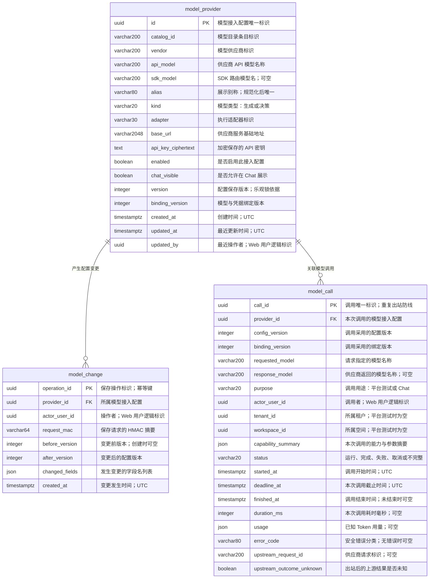

#### 2.1.1 数据结构设计

模型接入配置、配置变更记录和调用元记录共同构成模型功能的持久化边界，统一由 Agent 应用管理。它们分别回答“调用哪个模型”“配置如何变化”“这次调用发生了什么”。

图中 `PK` 表示主键，`FK` 表示同库外键；varchar 后的数字是最大字符长度。标注“可空”的字段允许缺失，未知用量的子字段也保持 null。一个接入配置可以对应多次配置变更和多次模型调用。

**设计取舍与理由**

| 设计                     | 为什么这样组织合理                                                                                                      | 关键约束                                                                                                  |
| ------------------------ | ----------------------------------------------------------------------------------------------------------------------- | --------------------------------------------------------------------------------------------------------- |
| 配置、变更、调用分表     | 三类数据的生命周期和写入频率不同。独立保存可避免频繁调用覆盖管理信息，也便于按配置和时间查询运行情况                    | model_provider 保存可维护配置；model_change 追加变更摘要；model_call 先占位、后写终态                     |
| 平台统一管理接入配置     | 各租户使用平台授权的模型池，减少重复录入、凭据分散和租户间配置漂移                                                      | Provider 不绑定租户；调用记录保留调用者与作用域；Web 裁定访问权限                                         |
| 区分配置版本和绑定版本   | 别称、启停等管理变更需要并发保护；模型、端点或密钥变化需要使旧续接绑定失效。分开计数可减少无关管理操作对工具续接的干扰  | 每次有效保存增加 version；模型、目录、端点或密钥变化更新 binding_version；0 < binding_version ≤ version   |
| 同库外键与跨应用逻辑标识 | Agent 内部的数据关系由数据库保证；Web 独立拥有身份和权限，逻辑标识让两侧能独立部署和维护                                | provider_id 外键关联配置；用户、租户、空间不设跨库外键；查询时校验调用者与作用域                          |
| 操作幂等与乐观锁并用     | 浏览器重复提交或响应丢失时可以核对同一操作；多个管理员同时编辑时，明确阻止过期修改覆盖新配置                            | operation_id 唯一；核对操作者和 request_mac；expected_version 匹配后才保存，变更记录与配置同事务提交      |
| 先占位，再执行模型请求   | 唯一 call_id 在出站前建立请求归属，重复请求能在数据库边界被拒绝；网络等待期间释放数据库事务，减轻长调用对连接和锁的占用 | running 占位提交后才出站；并发重复 call_id 返回 409；终态条件更新只作用于原 running 记录                  |
| 每调用采用确定配置快照   | 管理员更新配置与用户推理可以并行；在途调用始终使用准备阶段取得的模型、端点和凭据，结果能关联到当时的版本                | 短事务读取并锁定配置与占位；记录 config_version、binding_version；不保存可重放的完整历史配置副本          |
| 仅持久化安全元信息       | 状态、模型、耗时、用量和安全错误足以定位大多数运行问题；减少对话内容和密钥副本可降低存储负担与敏感数据暴露面            | 凭据加密保存；变更只记字段名；调用表不存 Prompt、回复、工具正文、决策正文、原始 Thinking 或续接 token     |
| 显式记录未知结果         | 出站后发生超时、取消或断连时，供应商可能已处理请求；独立标志可以让状态展示和后续人工处理保留这种不确定性                | status 与 upstream_outcome_unknown 分别记录本地终态和上游确定性；缺失 usage 保持 null，查询不触发再次调用 |

**关系、约束与查询索引**

| 对象                | 规则                                                                                                                           | 作用                                                         |
| ------------------- | ------------------------------------------------------------------------------------------------------------------------------ | ------------------------------------------------------------ |
| Provider 别称与类型 | alias 使用 lower(trim(alias)) 唯一索引；kind 为 llm 或 decision；adapter 为已注册协议标识；decision 的 chat_visible 固定 false | 防止大小写或首尾空格造成重名；在配置层阻止决策模型误入 Chat  |
| 调用用途与作用域    | purpose=test 时 tenant_id/workspace_id 均为空；purpose=chat 时二者均非空                                                       | 数据库约束与接口用途一致，防止混入错误作用域的记录           |
| 调用状态            | running、completed、failed、canceled、incomplete                                                                               | 保留执行过程和异常结束语义；公开结果中可同时表达上游结果未知 |
| 变更历史查询        | model_change(provider_id, created_at)                                                                                          | 按模型定位配置变更，并按时间展示                             |
| 模型调用查询        | model_call(provider_id, purpose, started_at)                                                                                   | 按模型、测试/Chat 用途和时间检索运行记录                     |
| 用户调用查询        | model_call(tenant_id, actor_user_id, started_at)                                                                               | 支持租户内本人记录检索；workspace_id 继续作为权限过滤条件    |
| 配置生命周期        | 无硬删除入口，使用 enabled 与 chat_visible 控制开放范围                                                                        | 保存历史外键关系，避免删除配置使已有变更和调用记录失去归属   |

数据库职责按应用划分：Agent 保存上述三张模型业务表；Web 保存身份、租户、成员、权限和通用审计。两侧分别管理数据库账号和事务，跨应用调用通过 HTTP 契约携带可信上下文。运行账号与 schema 管理账号分离，使日常模型请求只持有业务所需权限。
