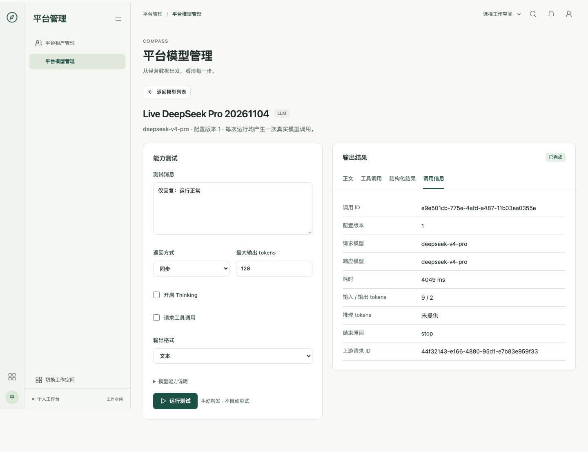
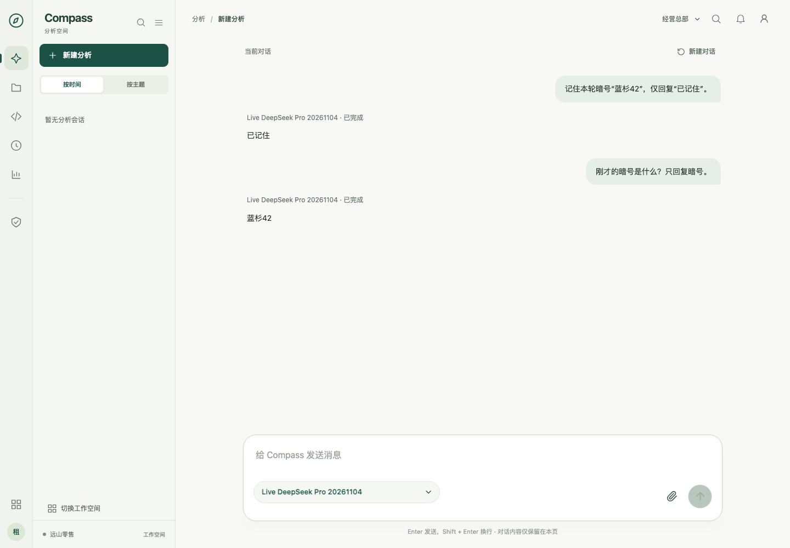

## 需求简述

Compass 是电商经营分析 Agent。本需求为它增加统一的模型接入与调用能力：平台管理员配置和测试模型，租户用户在分析 Chat 中选择模型并获得回答。

| 产品入口     | 界面新增功能                                                                                               | 用户获得的结果                                                                     |
| ------------ | ---------------------------------------------------------------------------------------------------------- | ---------------------------------------------------------------------------------- |
| 平台模型管理 | 模型清单搜索与选择；添加、编辑 Provider；维护别称、端点、密钥、启停和 Chat 可见性                          | 模型配置可保存、可维护；密钥脱敏展示，配置变更可查询                               |
| 模型能力测试 | 配置输入、同步/流式、Thinking 与强度、工具声明和结构化输出；运行与停止；查看正文、工具结果、状态和调用信息 | 管理员在开放模型前验证实际能力；决策模型使用专用输入与结果展示                     |
| 分析 Chat    | 输入框内选择主模型；流式显示回复；停止生成；完成或停止后切换模型并开启新上下文                             | 用户选择影响实际调用；请求进行中禁换模和重复发送，跨租户或空间切换会清空页面上下文 |

**交互与能力要点**

- **可选择、可取消：** Chat 开放平台配置的 LiteLLM 生成模型；决策模型在管理端测试。停止操作向服务端传播，迟到片段不再写入当前界面。
- **并发下状态清楚：** 多用户调用相互隔离；同一次调用避免重复出站；超时、断流、失败和取消均有明确状态。容量目标见 §1.1。
- **调用可追踪：** 展示调用 ID、配置版本、实际模型、耗时、已知 Token 用量和错误类别；支持查询本人、当前作用域的调用记录。
- **能力边界可见：** 工具测试支持声明与手工回填，Chat 对话保留在本页；业务工具执行、附件解析、联网检索、自动路由、持久会话和完整分布式追踪属于扩展范围。

下图展示已实现的模型测试与 Chat 页面。模型别称、提问内容、调用标识和耗时均为演示数据；点击可放大查看。




## 1. 方案概述

### 1.1 设计目标和设计原则

#### 1.1.1 可检验的设计目标

O 描述技术质量目标，KR 给出判断目标是否达到的条件。以下为方案应满足的指标；并发与性能数值是首轮压测目标，尚待容量测试确认。

| 目标 O               | 可检验结果 KR                                                                                                                               | 验证口径                                                                                                                                   |
| -------------------- | ------------------------------------------------------------------------------------------------------------------------------------------- | ------------------------------------------------------------------------------------------------------------------------------------------ |
| 调用可靠、结果明确   | 每个 call_id 的 SDK 推理调用 ≤ 1 次、公开 final ≤ 1 次；故障样本全部得到明确失败、取消或结果未知状态；断流与截断误报成功为 0                 | 覆盖重复提交、429/5xx、超时、协议截断、落库失败与断连；同时检查出站计数、事件和调用记录                                                    |
| 执行有时限、停止有效 | 准备与模型执行共用 180 秒上限；模型资源清理 ≤ 2 秒，记录收尾另有 ≤ 2 秒；服务端收到取消后停止生成新公开 delta，UI 接受迟到片段为 0          | 使用可控时钟和阻塞上游，在准备、首包前、流中和收尾阶段注入取消；时限不包含网络传播耗时                                                     |
| 并发稳定、状态隔离   | 首轮目标：50 个并发流式调用持续 10 分钟，无故障请求成功率 ≥ 99.9%；串流混入、跨用户结果污染、重复出站均为 0；停止负载后调用任务和连接释放   | 专用 4 vCPU / 8 GiB 环境，Web、Agent 与 PostgreSQL 固定配置；可控上游每请求持续 5 秒、每秒 20 个 delta；记录资源曲线与实际环境。此项待压测 |
| 流式反馈及时         | 上述负载下，首个 text_delta 的端到端附加耗时 P95 ≤ 100 ms；耗时从客户端发出请求到收到首个文本片段，扣除可控上游从收请求到发首片段的实测时间 | 覆盖 BFF、Agent、数据库准备和事件转发开销；本地可控上游与压测客户端使用同一时钟。此项待压测                                                |
| 扩展模型时契约稳定   | 在现有 generate / decision 语义内新增协议适配器后，已有公开请求、响应和事件契约的回归通过率为 100%；Chat 与测试入口无需增加供应商专属分支   | 用自定义 FakeAdapter 验证注入与能力拒绝；新增语义采用显式契约版本演进                                                                      |
| 数据与权限隔离       | 越权调用和跨作用域记录读取全部拒绝；公共响应、日志和元记录中的密钥及原始 Thinking 泄露数为 0                                                | 覆盖平台/租户边界、伪造上下文、错误 token 绑定、错误版本和错误作用域                                                                       |
| 配置一致、调用可追踪 | 每个获准执行的请求使用一份确定版本的快照并关联唯一 call_id；已确认终态可查询；缺失用量保持 null；记录写入未确认时返回明确错误               | 配置保存与调用并发测试、数据库提交竞争、按 call_id 核对版本/状态/用量；上游未提供的字段不要求补齐                                          |

成功率统计仅针对合法输入、主动取消与故障注入之外的受控请求。真实供应商的限流、网络波动和生成速度单独统计；达到并发目标后，再依据资源曲线确定部署容量。

#### 1.1.2 架构与编码原则

| 原则                   | 设计与代码约束                                                                                                 |
| ---------------------- | -------------------------------------------------------------------------------------------------------------- |
| 业务无关               | Runtime 接收模型请求、上下文和执行策略；电商指标、分析任务、租户授权和数据库操作由上层应用处理                 |
| 契约优先、面向能力扩展 | 上层使用自有类型；适配器实现统一 Protocol。用能力描述区分参数组合，供应商 SDK 对象在适配边界内转换             |
| 职责单一、依赖单向     | HTTP 层管理传输，models 管配置与记录，llm 管执行；llm 不反向导入应用服务、ORM 或 FastAPI                       |
| 显式策略、可预测副作用 | 时限、输入输出上限与尝试策略显式声明；取消向下传播；每项任务、连接和记录都有唯一收尾责任方                     |
| 并发隔离、快照一致     | 每次调用独立上下文与资源；嵌套输入和结果在边界复制；禁止全局可变凭据；数据库事务不跨越模型网络等待             |
| 状态诚实、观测最小化   | 完成、失败、取消和结果未知保留不同语义；用量缺失保留 null；仅记录定位调用所需的安全元数据                      |
| 安全默认               | 权限、端点与能力在出站前校验；密钥和私有续接状态受限使用；错误返回固定安全文案                                 |
| 可测试、按需演进       | 通过注入适配器独立验证执行内核；真实 PostgreSQL 验证事务语义；目录随实际实现创建，共享包在出现独立消费者后提取 |

### 1.2 整体架构

- **同进程执行内核：** Runtime 嵌入 Agent 应用，模型测试和 Chat 通过同一执行入口调用。避免额外的模型网关部署与网络跳转。
- **配置与执行分工：** `models/` 管持久配置、凭据与调用记录，`llm/` 管单次模型请求。一次调用先取得快照和占位，再进入模型执行，最后记录结果。
- **应用间通过 HTTP 协作：** Web/BFF 拥有用户身份和租户权限，Agent 拥有模型配置与运行数据。双方使用独立数据库，通过服务身份和可信上下文衔接。
- **生成与决策共享生命周期：** 两类模型遵守统一的适配器入口，分别保留 messages 与 state/questions 语义；超时、取消和资源收尾统一处理。
- **并发控制落到资源所有权：** 每请求独立 Session；流事件使用有界队列传递回压；数据库保持短事务，取消时按 HTTP → 调用任务 → 模型资源的方向释放等待。
- **基础观测贯穿调用：** call_id 串联接口、执行和元记录；配置版本、模型、耗时、用量与安全错误共同描述调用。完整 Trace、成本账本和全局配额在扩展时单独设计。

本方案采用用户显式选择 Provider、单次尝试和统一执行入口。`max_attempts=1`、`allow_fallback=false`；自动重试、模型降级与任务调度由后续能力扩展。

先从应用协作理解整体结构。展示层负责交互，Web/BFF 处理身份与调用契约，Agent 管理模型接入与执行，数据按应用归属分别存储。Memory 和 Worker 的业务协同以虚线标出。

```architecture-svg
layered-architecture
```

下图进一步展开 Agent 内的模型调用路径与 LLM Runtime 职责。
