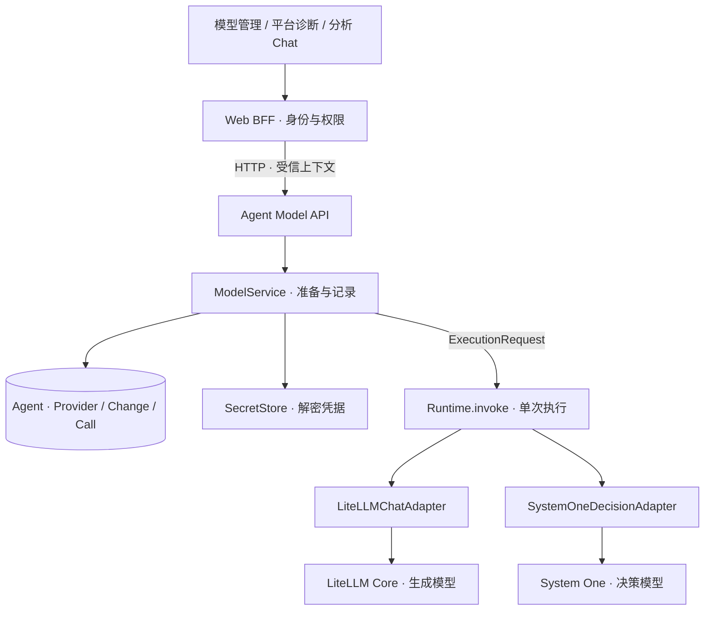
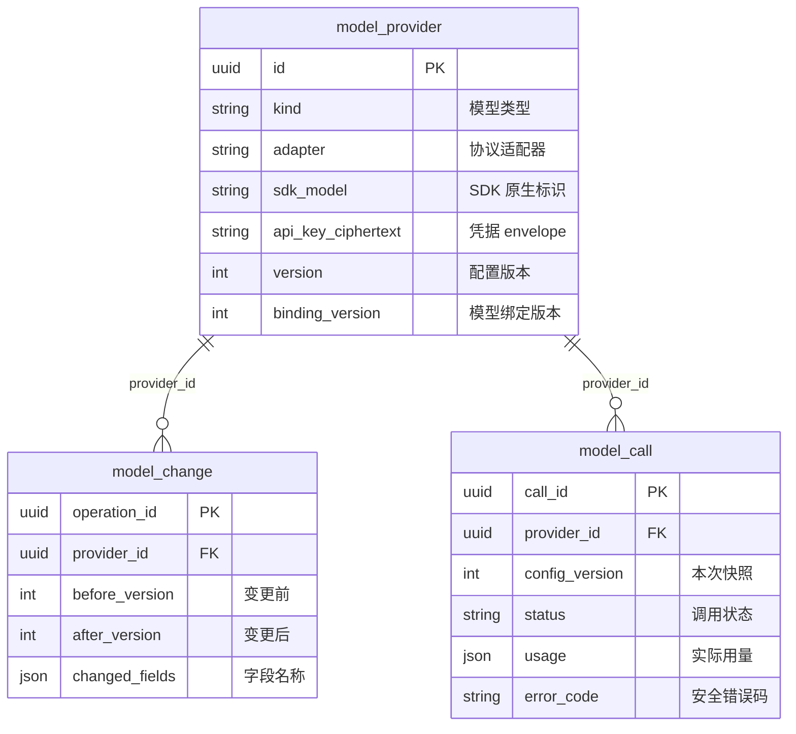
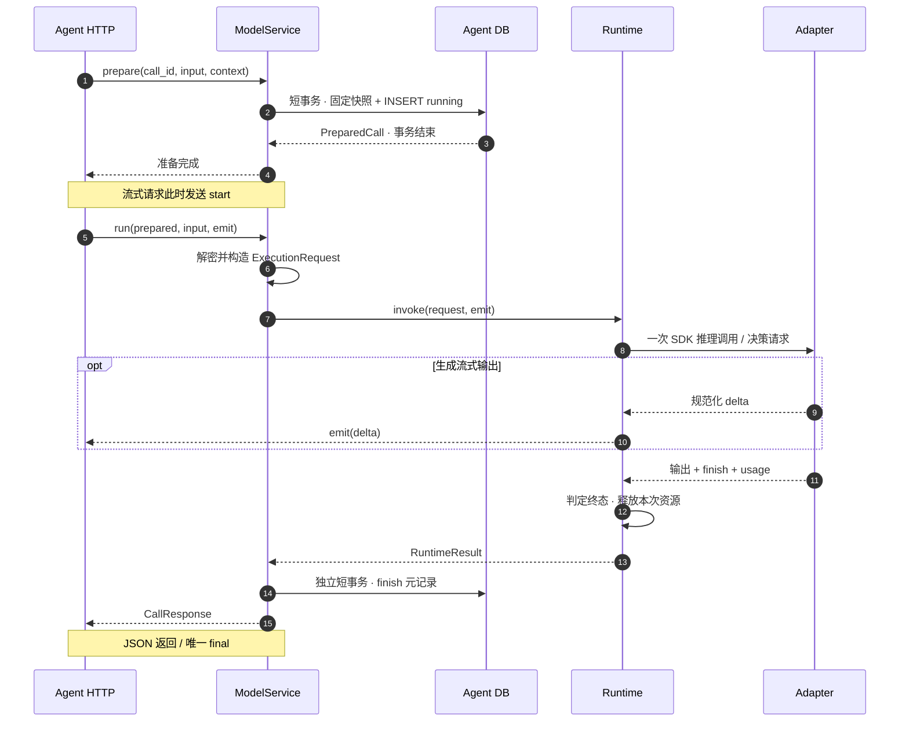
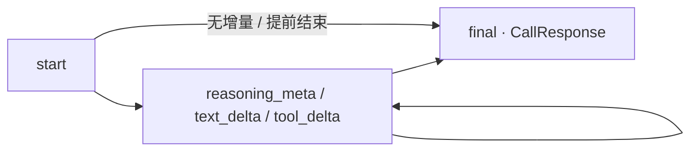

## 目标

| 核心问题                        | 实现目标                             | 量化指标（设计目标）                                                     |
| ------------------------------- | ------------------------------------ | ------------------------------------------------------------------------ |
| Chat 与模型诊断需要统一执行逻辑 | 用同一个 Runtime 承接生成与决策调用  | 1 个 `invoke` 入口；2 类输入；2 个 Adapter                               |
| 调用职责散落在服务与协议代码中  | 固定一次调用的生命周期与资源所有权   | 每次调用最多 1 次 SDK 推理调用或决策请求；重试 0 次；准备与执行共用 180s |
| 配置变化影响调用归属与追踪      | 准备阶段固定模型快照，记录调用元信息 | Agent 内 3 张表；每次调用 1 个唯一 `call_id`                             |
| 不同协议的结果形态难以统一消费  | 输出归一为类型化结果和同一条事件流   | 每个 `call_id` 最多 1 个 `final`；可见输出上限 1MiB                      |
| 工具续接需要保留协议状态        | 将续接绑定到当前用户、模型与消息历史 | token 有效期 900s；工具调用 ID 与历史摘要参与绑定                        |

## 1. 方案概述

### 1.1 职责分层

| 层 / 模块     | 核心职责                                        | 交付给下一层                      |
| ------------- | ----------------------------------------------- | --------------------------------- |
| Web / BFF     | 登录态、租户权限、请求上下文与响应契约          | 受信身份、作用域、类型化输入      |
| Agent HTTP    | 服务认证、DTO、JSON / SSE 编码                  | `ModelService` 调用与公开事件通道 |
| `models/`     | Provider 配置、凭据解密、快照、调用占位与元记录 | `ExecutionRequest`                |
| `llm/Runtime` | 单次执行、期限、取消、输出与资源生命周期        | `RuntimeResult` + 增量事件        |
| Adapter       | 供应商参数与协议转换，组装规范化输出            | 生成结果 / 决策答案 / 实际用量    |

### 1.2 整体架构



| 设计边界   | 约定                                                                                                |
| ---------- | --------------------------------------------------------------------------------------------------- |
| 模块依赖   | `models/ → llm/`；Runtime 接收值对象，不持有 ORM 或应用服务                                         |
| 状态所有权 | 配置与调用元记录归 Agent；Web 身份通过逻辑 ID 引用；本次执行状态留在请求内存                        |
| 单次执行   | `max_attempts=1`、`allow_fallback=false`；生成侧限制 1 次 SDK 推理调用，SDK 负责认证与协议所需 HTTP |

## 2. 详细设计

### 2.1 三张表与一次配置快照



| 对象 / 操作 | 设计要点                                                                                                                          |
| ----------- | --------------------------------------------------------------------------------------------------------------------------------- |
| Provider    | `kind` 与 `adapter` 为独立字段；`api_model` 保留供应商型号；生成模型另存 `sdk_model`；开关用 `enabled / chat_visible`             |
| 配置保存    | `operation_id` 幂等 + `expected_version` 乐观锁；每次有效保存递增 `version`；模型、端点、密钥或连接参数变化递增 `binding_version` |
| Change      | 保存与变更记录在同一事务；仅保留操作者、字段名、版本与请求 HMAC                                                                   |
| 调用准备    | 短事务校验配置并插入 `running`，提交后释放事务，再开始网络调用；重复 `call_id` 返回 409                                           |
| Call        | 保存模型、版本、作用域、状态、耗时与用量；Prompt、正文、工具参数和续接 token 留在内存；未知用量为 `null`                          |

### 2.2 应用层到 Runtime 的交接

| 类型                          | 内容                                           | 生命周期 / 所有者                    |
| ----------------------------- | ---------------------------------------------- | ------------------------------------ |
| `PreparedCall`                | 模型快照、可信上下文、调用策略、密文、起止时间 | 应用层准备结果；不可变               |
| `ModelSpec`                   | Provider、模型、Adapter、配置与绑定版本        | 本次调用固定                         |
| `ProviderAccess`              | 解密后的 API Key 与 `connection_params`        | 请求私有；由应用层创建、Adapter 使用 |
| `CallPolicy`                  | 绝对期限、固定单次策略、输入输出边界           | 服务端构造                           |
| `ExecutionRequest`            | 快照 + 输入 + 访问材料 + 上下文 + 策略         | Runtime 的统一入参                   |
| `CallSession / CallResources` | 部分输出、用量、终态材料、流与客户端           | 每次调用独占；Runtime 管理           |
| `RuntimeResult`               | 状态、输出、用量、错误和上游标识               | 应用层映射为公开响应与元记录         |

### 2.3 一次调用的时序



| 执行约束 | 当前取值与语义                                                              |
| -------- | --------------------------------------------------------------------------- |
| 时间     | 准备与执行共用 180s；Runtime 资源清理最多 2s；应用层记录收尾独立最多 2s     |
| 输入     | 可见输入合计 64KiB；最多 64 条消息、16 个工具；单个 Schema 16KiB            |
| 输出     | 可见内容 1MiB；HTTP 响应 / SSE 单帧 2MiB；超限进入错误终态                  |
| 取消     | HTTP 断连通知 ModelService；取消当前 Runtime task，完成有界清理与元记录收尾 |

### 2.4 协议适配与能力

| 维度     | 生成模型                                                            | 决策模型                                                             |
| -------- | ------------------------------------------------------------------- | -------------------------------------------------------------------- |
| Adapter  | `LiteLLMChatAdapter`                                                | `SystemOneDecisionAdapter`                                           |
| 型号解析 | LiteLLM `get_llm_provider` 解析 `provider/model`；沿用 SDK 支持范围 | `aliyun/`、`typesafe/`、`systemone/` 协议命名空间；型号原样传输      |
| 输入     | `GenerateInput`：消息、工具声明、Thinking、输出格式                 | `DecisionInput`：state、questions；Choice / Noul / Score，最多 16 题 |
| 出站     | 一次 `litellm.acompletion`，关闭 SDK 重试                           | `POST {api_base}/systemone`                                          |
| 能力     | SDK 能力元数据 + 已知模型补充；参数组合在调用前校验                 | 校验题型、答案 ID、概率与 Score legend                               |
| 输出     | 文本、工具调用建议、结构化结果、用量                                | answers、实际用量；平台诊断可查看有界 `raw_response`                 |
| 使用入口 | 启用且 Chat 可见的模型可用于分析页；平台可诊断                      | 平台诊断；`stream=false`                                             |

### 2.5 结果与流式契约



| 状态 / 字段      | 对调用方的含义                                                                                                                            |
| ---------------- | ----------------------------------------------------------------------------------------------------------------------------------------- |
| `completed`      | 正常 EOF、有效 finish、完整工具参数与内容 / Schema 校验全部满足                                                                           |
| `failed`         | 未得到可用结果；返回安全 `error_code`                                                                                                     |
| `incomplete`     | 流中断、截断或已有部分输出后失败；保留已知内容与用量                                                                                      |
| `canceled`       | 外部取消终止当前执行；记录取消结果后继续传播取消                                                                                          |
| `reasoning_meta` | 仅公开推理元信息；私有推理保留在适配器内部                                                                                                |
| `raw_response`   | System One 平台诊断响应；生成调用为 `null`；不写入 `model_call`                                                                           |
| 工具续接         | 返回工具调用建议；用户手工提交 tool 消息；续接 token 绑定 actor / scope / Provider / binding_version / 历史摘要 / tool_call_ids，TTL 900s |

| Agent 接口                             | 用途 / 返回                                                               |
| -------------------------------------- | ------------------------------------------------------------------------- |
| `GET /v1/models/catalog`               | 接入目录与模型能力                                                        |
| `GET / POST /v1/models/providers`      | Provider 列表与创建；单项通过 `GET / PATCH .../providers/{id}` 读取和编辑 |
| `GET /v1/models/available`             | 当前用户可用的生成模型                                                    |
| `POST /v1/models/providers/{id}/tests` | 平台诊断 → `CallResponse` / SSE                                           |
| `POST /v1/models/calls`                | Chat 调用 → `CallResponse` / SSE                                          |
| `GET /v1/models/calls/{id}`            | 本人、同作用域内的 Chat 调用元记录                                        |

## 3. 变更文件与内容

```text Agent · 相对 Compass 根目录
apps/agent/src/compass_agent/
├── schemas.py                 [调整] 公共输入、结果与事件 DTO
├── model_api.py               [调整] HTTP / SSE 与 Runtime 装配
├── models/
│   ├── __init__.py            [调整] PreparedCall 等应用层交接类型
│   ├── repository.py          [调整] Provider 快照、running 占位与元记录
│   ├── service.py             [调整] prepare / run / finish 与任务所有权
│   └── secrets.py             [调整] 凭据 envelope 与续接 Codec
└── llm/
    ├── contracts.py           [调整] ExecutionRequest / Result / Adapter Protocol
    ├── runtime.py             [调整] 单次执行与资源生命周期
    ├── policy.py              [新增] 期限与固定单次策略
    ├── errors.py              [新增] 执行错误与取消结果
    ├── capabilities.py        [调整] 能力解析与输入约束
    ├── catalog.py             [调整] SDK 标识与决策协议绑定
    ├── litellm_chat.py        [调整] SDK 原生协议与统一输出
    ├── systemone_decision.py  [调整] System One 决策协议
    ├── continuation.py        [调整] 续接载荷与绑定
    └── transport.py           [调整] 流读取与协议资源
```

```text Web 与公共契约 · 相对 Compass 根目录
apps/web/src/
├── features/models/           [调整] 模型配置、诊断与调用状态
├── server/model-agent-client.ts [调整] 服务端模型 HTTP / SSE 客户端
└── generated/                 [生成] Agent DTO 派生类型与 Schema
contracts/                     [生成] OpenAPI 与 JSON Schema
```

## 4. 核心类型与代码

### 4.1 应用层交接类型

{{code:prepared}}

### 4.2 Runtime 入口与能力函数签名

{{code:runtime}}

### 4.3 SDK 绑定与参数优先级

{{code:sdk}}

### 4.4 执行主干

```text Runtime.invoke · 设计伪代码
输入 ExecutionRequest；可选 emit；创建本次独占 CallSession

检查绑定、能力、参数与 CallPolicy
期限耗尽 → failed / model_timeout，结束

在同一个绝对 deadline 内：
  根据 spec.adapter 选择 Adapter
  执行一次 SDK 推理调用 / 决策请求
  归一化增量 → 更新 progress → await emit
  正常 EOF + 有效 finish + 完整输出校验 → completed

发生取消：canceled；保留取消标记
发生超时或执行错误：
  已有部分输出 / 流中断 / 截断 → incomplete
  其余 → failed
  保留安全错误码、已知用量与上游结果未知标记

独立清理 task，最多 2s；关闭本次持有的流与客户端
深拷贝 progress → RuntimeResult
有取消标记 → 抛 RuntimeCancelled(result)
其余 → 返回 result，由 ModelService 完成记录收尾
```
